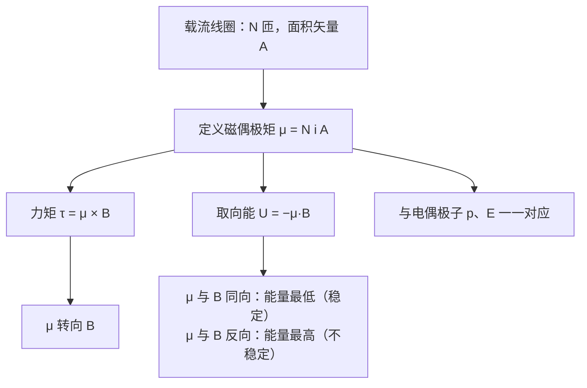

# C28.6 磁偶极矩 The Magnetic Dipole Moment

> [!abstract] 这一讲的任务
> 线圈的力矩公式只对「线圈」推导过。小磁针、地球、电子的形状各不相同，难道要各写一个公式？这一讲把线圈的结果包装成一个物理量——**磁偶极矩** $\vec\mu$。有了它，任何载流线圈、任何磁体都能用同一个力矩公式和同一个取向能公式来描述。

> [!info] 怎么读这份讲义
> 正文中的「例 N」指 Chapter 28 幻灯片里的第 N 个例题，「第 N 页」是幻灯片页码；「SP」是教材的 Sample Problem，「Checkpoint」是教材的随堂思考题。
> 标有 **（拓展）** 或 **【拓展】** 的内容，是**课堂上没有讲到、由教材延伸补充**的部分。复习时可先掌握未标注的主干内容，行有余力再看拓展部分。

---

## 0. 开场：小磁针为什么总指向同一个方向

把一根小磁针放进磁场，它会转动，最后停在某个方向上。拨它一下，它还会回到原来的方向。这种「转过去、又转回来」的行为，要用什么量来描述？

> [!question] 停一下，先自己想想
> 如果小磁针受到的是一个力矩 $\tau$，它会朝哪个方向转？转到哪里就停了？

## 1. 撞墙：每种磁体一个公式？

上一节的力矩 $\tau=NiAB\sin\theta$ 是为线圈推导的。小磁条、地球、电子，各自的结构完全不同，难道要分别推公式？

仔细看线圈的结果：与磁场有关的，只有 $Ni\vec A$ 这一组合。给它一个名字，就能把所有情况统一起来：

$$\vec\mu\equiv Ni\,\vec A=NiA\,\hat n$$

$\vec\mu$ 称为**磁偶极矩**（magnetic dipole moment），单位 $\mathrm{A\cdot m^2}$（等价于 $\mathrm{J/T}$）。

> [!important] 磁偶极矩的力矩
> $$\vec\tau=\vec\mu\times\vec B,\qquad |\vec\tau|=\mu B\sin\theta$$
> 其中 $\theta$ 是 $\vec\mu$ 与 $\vec B$ 的夹角。

对载流线圈而言，这就是上一节的结果。对于任何磁体，只要它的磁偶极矩是 $\vec\mu$，力矩就是这个式子。这就是「磁偶极子」的含义：一个载流线圈就是一个磁偶极子，它有两个「端」（N 与 S），整体的磁效应只由 $\vec\mu$ 决定。

> [!note] 【拓展】教材 Table 28-2：几种磁偶极矩的数量级
> | 对象 | $\mu$（J/T） |
> |---|---|
> | 小磁条 | $5$ |
> | 地球（近似） | $8.0\times10^{22}$ |
> | 电子 | $9.3\times10^{-24}$ |
> | 质子 | $1.4\times10^{-26}$ |
>
> 教材指出：地球可近似看作磁偶极子；电子、质子、中子都有磁偶极矩。这些粒子的磁矩，教材在第 32 章再从电流环的角度解释。

## 2. 取向能：磁偶极子也有「能量地形」

力矩会把 $\vec\mu$ 推向与 $\vec B$ 同向。这种「随取向变化的力矩」背后，对应一个取向能：

$$U=-\vec\mu\cdot\vec B=-\mu B\cos\theta$$

推导的思路是：把 $\vec\mu$ 从 $\theta_i$ 缓慢转到 $\theta_f$，外力矩要克服磁力矩做功，外力做的功等于取向能的增加。外力矩的大小为 $\mu B\sin\theta$，与磁力矩反向，于是

$$W_a=\int_{\theta_i}^{\theta_f}\mu B\sin\theta\,d\theta=\mu B(\cos\theta_i-\cos\theta_f)=U(\theta_f)-U(\theta_i)$$

与 $U=-\mu B\cos\theta$ 完全一致。

- $\theta=0$（$\vec\mu$ 与 $\vec B$ 同向）：$U=-\mu B$，**最低**，稳定；
- $\theta=\pi$（反向）：$U=+\mu B$，**最高**，不稳定；
- $\theta=\pi/2$：$U=0$。

![[C28-取向能曲线.png]]

（纵轴是归一化的取向能 $U/(\mu B)$，以及力矩的 $z$ 分量 $\tau_z/(\mu B)$。力矩的正负只表示它把 $\theta$ 推向哪个方向，大小与 $\sin\theta$ 成正比。）

> [!question] 停一下：小磁针转到指北后，拨它一下它又会回去，为什么？
> 因为 $\theta=0$ 是能量谷底。偏离它，力矩就把它拉回来，与单摆回到最低点是同一个道理。

## 3. 【拓展】教材 Checkpoint 5：四个取向的排序

图中磁场 $\vec B$ 沿 $+x$，四个磁偶极矩 $\vec\mu$ 与 $\vec B$ 都成 $\theta$ 角，只是方向不同：

- ① $\vec\mu$ 指向左上：与 $-\hat x$ 成 $\theta$，与 $+\hat x$ 成 $180^\circ-\theta$；
- ② $\vec\mu$ 指向右上：与 $+\hat x$ 成 $\theta$；
- ③ $\vec\mu$ 指向右下：与 $+\hat x$ 成 $\theta$；
- ④ $\vec\mu$ 指向左下：与 $+\hat x$ 成 $180^\circ-\theta$。

**(a) 力矩大小**：$\tau=\mu B\sin(\text{夹角})$。四个夹角的正弦都是 $\sin\theta$，所以**四者相等**。

**(b) 取向能**：$U=-\mu B\cos(\text{夹角})$。

- ①、④：夹角 $180^\circ-\theta$，$U=+\mu B\cos\theta$，较高；
- ②、③：夹角 $\theta$，$U=-\mu B\cos\theta$，较低。

所以排序（从大到小）为 **①=④ > ②=③**。

> [!question] 课堂追问：如果 $\theta$ 很小，哪一个取向最稳定？
> ② 和 ③ 的能量接近 $-\mu B$，最低，最稳定。这两个取向都接近 $\vec\mu$ 与 $\vec B$ 同向。

## 4. 【拓展】教材 Sample Problem 28.07：把线圈转过去要做多少功

**题目**：线圈有 250 匝，面积 $A=2.52\times10^{-4}\ \mathrm{m^2}$，电流 $100\ \mathrm{mA}$，放在 $B=0.85\ \mathrm T$ 的均匀磁场中，$\vec\mu$ 起初与 $\vec B$ 同向。(a) 线圈中的电流方向如何？(b) 要把线圈转过 90°（使 $\vec\mu\perp\vec B$）并保持静止，外力矩需要做多少功？

- **(a)** 用右手定则：右手拇指沿 $\vec\mu$ 方向握住线圈，四指的绕向就是电流方向。教材的结论是：近侧导线中的电流**由上向下**。
- **(b)** 磁偶极矩的大小：
$$\mu=NiA=(250)(0.100)(2.52\times10^{-4})=6.3\times10^{-3}\ \mathrm{A\cdot m^2}$$
外力做的功等于取向能的变化：
$$W_a=U(90^\circ)-U(0^\circ)=0-(-\mu B)=\mu B=(6.3\times10^{-3})(0.85)\approx5.4\times10^{-3}\ \mathrm J=5.4\ \mathrm{mJ}$$

> [!note] 【拓展】再转 90°
> 从 $90^\circ$ 再转到 $180^\circ$（$\vec\mu$ 与 $\vec B$ 反向），$U$ 从 $0$ 增至 $+\mu B$，又要做 $\mu B$ 的功。两段合起来，把线圈完全反转需要 $2\mu B\approx10.7\ \mathrm{mJ}$。

> [!question] 停一下：为什么第一个 90° 的功是 $\mu B$，而不是 $2\mu B$？
> 转 90° 时，$U$ 从 $-\mu B$ 变到 $0$，变化量只有 $\mu B$。反向 180° 才需要两段，共 $2\mu B$。

## 5. 电偶极子与磁偶极子的对照

电场中的电偶极子与磁场中的磁偶极子，公式结构完全平行（Chapter 28 第 42 页的对照）。这个对应可以用一张表记住：

| 量 | 电偶极子（$\vec p$，外场 $\vec E$） | 磁偶极子（$\vec\mu$，外场 $\vec B$） |
|---|---|---|
| 偶极矩 | $\vec p=q\vec d$ | $\vec\mu=Ni\vec A$ |
| 力矩 | $\vec\tau=\vec p\times\vec E$ | $\vec\tau=\vec\mu\times\vec B$ |
| 取向能 | $U=-\vec p\cdot\vec E$ | $U=-\vec\mu\cdot\vec B$ |
| 稳定取向 | $\vec p$ 与 $\vec E$ 同向 | $\vec\mu$ 与 $\vec B$ 同向 |

电偶极子的力矩与取向能，已在 [[C22.7 电场中的电偶极子]] 中讨论过；这里只是把同样的结构搬到磁场中。

## 这一讲的三句话

> [!important] 记住这三条
> 1. **磁偶极矩** $\vec\mu=Ni\vec A$，单位 $\mathrm{A\cdot m^2}$；载流线圈就是磁偶极子。
> 2. **力矩** $\vec\tau=\vec\mu\times\vec B$ 使 $\vec\mu$ 转向 $\vec B$；**取向能** $U=-\vec\mu\cdot\vec B$，同向最低、反向最高。
> 3. 把偶极子转到反向要做 $2\mu B$ 的功；磁偶极子与电偶极子的公式结构完全对应：$\tau=p\times E\leftrightarrow\mu\times B$，$U=-p\cdot E\leftrightarrow-\mu\cdot B$。

> [!tip] 下一章预告
> 本章讨论的都是磁场对电流、线圈、磁偶极子的作用。下一章要反过来问：**电流本身怎样产生磁场？** 届时 $\vec\mu$ 的来源，也就是电流环的磁场，会成为主角。

---

上一节 ← [[C28.5 载流线圈的磁力矩]] ｜ 下一章 → 第 29 章 电流产生的磁场（尚未整理）
索引 → [[电磁学 MOC]]
