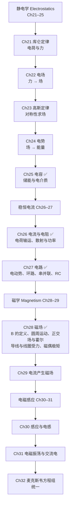
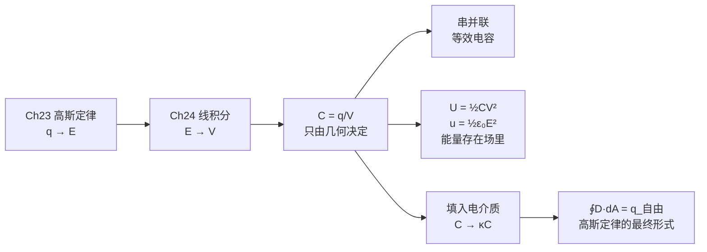
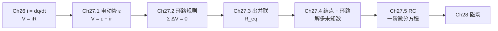

# 电磁学 MOC

本索引汇总由 `courseware/` 下的 PPTX 课件整理而成的笔记。每篇按**课件自身的分节**拆分，目标是**看完笔记即可替代听课**：课件上一行结论的地方，笔记展开成完整推导 + 易错点 + 前后联系。

## 全册脉络

## 笔记索引

> [!info] 体例说明（2026-09 起）
> 第 23、24、25 章采用**讲义体**：具体情景开场 → 由问题逼出概念 → 中途「停一下 / 课堂追问」→ 三句话小结 → 折叠答案的自测区。目标是**看完笔记就不必再听这节课**。
> 第 21、22 章仍是早期的**整理体**（学习目标 / 核心关系 / 课件原文 板块式），内容完整但叙述方式不同。若要统一，可回头按同样方式改写。
> 第 23–25 章已有的自测答案默认**折叠**（`> [!success]-`），点开才显示。第 26 章继续采用讲义体，依照当前整理规范将理解检查放在正文，篇末只保留三句话、速查表与下一讲预告；旧篇内容保持原样。第 27 章沿用讲义体（同第 26 章）：理解检查放在正文，篇末只留三句话、速查表与下一讲预告。第 28 章同样沿用讲义体。
>
> **章号对照**：此前使用的中译本教材章号比课件/本 vault 大 1（中译本第 25 章 = 课件 Ch24 电势，中译本第 26 章 = 课件 Ch25 电容）。章级提纲文件里保留对应教材原式号便于翻书。本库英文《Fundamentals of Physics》第 10 版则以 **Chapter 26** 对应本次“电流与电阻”，不要把中译本偏移套到英文版。
>
> 讲义体三章连起来可以读成一条线：**Ch23 用对称性绕开积分求出 $\vec E$ → Ch24 把矢量 $\vec E$ 换成标量 $V$ → Ch25 用 $V$ 和高斯定律算电容与能量**。每篇篇末的「下一讲预告」就是这条线的接缝。

| 章 | 节 | 笔记 | 核心内容 | 状态 |
|---|---|---|---|---|
| 21 | 0 | [[C21.0 开篇回顾 热学遗留]] | 第19章 Q27 讲评、热学知识点清单 | ✅ |
| 21 | 1 | [[C21.1 电荷]] | 正负电荷、元电荷与量子化、电荷守恒、摩擦起电 | ✅ |
| 21 | 2 | [[C21.2 导体与绝缘体]] | 导体/绝缘体/半导体/超导体、传导电子、静电感应 | ✅ |
| 21 | 3 | [[C21.3 库仑定律]] | 库仑定律、$\varepsilon_0$ 与 $\mu_0$、叠加原理、壳层定理完整推导 | ✅ |
| 22 | 1 | [[C22.1 电场]] | 场的观点、$\vec E=\vec F/q_0$、电场线三规则 | ✅ |
| 22 | 2 | [[C22.2 点电荷的电场]] | 点电荷场、矢量叠加、例题1三电荷 | ✅ |
| 22 | 3 | [[C22.3 电偶极子的电场]] | 偶极矩、轴线与中垂线远场、$1/r^3$ 与多极展开 | ✅ |
| 22 | 4 | [[C22.4 线电荷的电场]] | 电荷密度、连续分布六步法、圆环与圆弧 | ✅ |
| 22 | 5 | [[C22.5 带电圆盘的电场]] | 圆盘轴线场、无限大平面 $\sigma/2\varepsilon_0$ | ✅ |
| 22 | 6 | [[C22.6 电场中的点电荷]] | $\vec F=q\vec E$、密立根油滴、喷墨打印 | ✅ |
| 22 | 7 | [[C22.7 电场中的电偶极子]] | 力矩 $\vec\tau=\vec p\times\vec E$、势能 $U=-\vec p\cdot\vec E$ | ✅ |
| 23 | 0 | [[C23.0 开篇回顾 统计物理遗留]] | 第20章 Q47 多重度、第22章知识点清单 | ✅ |
| 23 | 1 | [[C23.1 电通量]] | 面矢量、$\Phi=\oint\vec E\cdot d\vec A$、点电荷通量 | ✅ |
| 23 | 2 | [[C23.2 高斯定律]] | $\oint\vec E\cdot d\vec A=q_{enc}/\varepsilon_0$、面外电荷不贡献通量 | ✅ |
| 23 | 3 | [[C23.3 带电导体的电场]] | 静电平衡、空腔感应电荷、$\sigma/\varepsilon_0$、导体平板 | ✅ |
| 23 | 4 | [[C23.4 对称带电绝缘体的电场]] | 球/柱/面三种对称性与高斯面匹配、公式汇总 | ✅ |
| 24 | 0 | [[C24.0 开篇回顾 第21章遗留习题]] | 第21章 Q21/Q23、第23章知识点清单 | ✅ |
| 24 | 1 | [[C24.1 电势与电势能]] | 保守力、环路定理、$V=U/q$、等势面、电子伏特 | ✅ |
| 24 | 2 | [[C24.2 点电荷的电势]] | $V=q/4\pi\varepsilon_0r$、标量叠加、多电荷系统势能 | ✅ |
| 24 | 3 | [[C24.3 从电场算电势]] | $\Delta V=-\int\vec E\cdot d\vec s$、导体球、零势点选择 | ✅ |
| 24 | 4 | [[C24.4 叠加原理算电势]] | 连续分布积分、偶极子电势、带电棒与圆盘 | ✅ |
| 24 | 5 | [[C24.5 从电势算电场]] | $\vec E=-\nabla V$、半无限长棒 45°、泰勒展开四极项 | ✅ |
| 24 | — | [[C24 第24章提纲]] | 教材《复习和小结》式 25-1…25-43 归位 + 两张速查表 | ✅ |
| 25 | 1 | [[C25.1 电容器与电容的计算]] | $C=q/V$、四步法、平行板/柱形/球形/孤立球 | ✅ |
| 25 | 2 | [[C25.2 电容器的串并联]] | 并联等压求电荷、串联等电荷求电压、混联倒推 | ✅ |
| 25 | 3 | [[C25.3 电场的能量]] | $U=q^2/2C=\frac12CV^2$、能量密度 $u=\frac12\varepsilon_0E^2$ | ✅ |
| 25 | 4 | [[C25.4 电介质与电介质中的高斯定律]] | $\kappa$、极化与感应电荷、$\vec D$、$\oint\vec D\cdot d\vec A=q_{自由}$ | ✅ |
| 26 | 1 | [[C26.1 电流]] | 净电荷输运与 $i=dq/dt$、方向约定、两种载流子、电流是标量、结点守恒 | ✅ |
| 26 | 2 | [[C26.2 电流密度]] | $i=\int\vec J\cdot d\vec A$、方向约定、流线与电场线类比、两道例题完整解答 | ✅ |
| 26 | 3 | [[C26.3 电阻与电阻率]] | $R=V/i$ 与 $\rho=E/J$、$R=\rho L/A$ 三步推导、室温材料表、温度系数 | ✅ |
| 26 | 4 | [[C26.4 欧姆定律与微观导电机制]] | 电阻器 vs 二极管伏安曲线、漂移速率、$\rho=m/(ne^2\tau)$、平均自由程 | ✅ |
| 26 | 5 | [[C26.5 电功率、半导体与超导体]] | 功率与参考方向、半导体与 pn 结、超导与迈斯纳效应、LHC 应用 | ✅ |
| 27 | 0 | [[C27.0 开篇回顾 第24、25章遗留习题]] | 第24章 Q57、第25章 P20/P39/P50 | ✅ |
| 27 | 1 | [[C27.1 电动势与电源]] | 电动势 $\varepsilon=dW/dq$、理想与真实电源 $V=\varepsilon-ir$、能量转换 | ✅ |
| 27 | 2 | [[C27.2 单环路电路]] | 电势法、环路规则、例1 两节反向电池 $i\approx0.24$ A | ✅ |
| 27 | 3 | [[C27.3 电阻的串联与并联]] | $R_{eq}=\sum R$、$1/R_{eq}=\sum1/R$、串并联的环路定义、例2、电表（拓展） | ✅ |
| 27 | 4 | [[C27.4 多回路电路]] | 结点与支路、结点规则、两个环路方程、3 个未知数 3 个方程 | ✅ |
| 27 | 5 | [[C27.5 RC电路]] | $q=CE(1-e^{-t/RC})$、$q=q_0e^{-t/RC}$、$\tau=RC$、例3、例4 | ✅ |
| 28 | 1 | [[C28.1 磁体与磁场的定义]] | 无磁单极子、用运动带电粒子定义 $\vec B$（零力轴 + 右手定则）、磁力不做功、T 与 G、磁场线、地磁场、例 1、例 2 | ✅ |
| 28 | 2 | [[C28.2 带电粒子的圆周运动]] | $r=mv/\|q\|B$、$T=2\pi m/\|q\|B$（与速率无关）、螺旋线螺距、回旋加速器共振、同步加速器、质谱仪 | ✅ |
| 28 | 3 | [[C28.3 正交场与霍尔效应]] | $\vec F=q(\vec E+\vec v\times\vec B)$、$E=vB$ 直线通过、汤姆孙测荷质比、霍尔效应 $V_H=Bi/(ne\ell)$ | ✅ |
| 28 | 4 | [[C28.4 磁场对载流导线的力]] | $F_B=iLB\sin\varphi$ 的推导、$\vec F_B=i\vec L\times\vec B$、非直导线的微分形式、例 6、例 7 | ✅ |
| 28 | 5 | [[C28.5 载流线圈的磁力矩]] | 合力为零的力偶、$\tau=NiAB\sin\theta$、面矢量、例 8 | ✅ |
| 28 | 6 | [[C28.6 磁偶极矩]] | $\vec\mu=Ni\vec A$、$\vec\tau=\vec\mu\times\vec B$、$U=-\vec\mu\cdot\vec B$、电与磁偶极子对照 | ✅ |
| 29–32 | — | Ch29 电流产生的磁场 … Ch32 麦克斯韦方程组 | 课件在 `courseware/` 下，尚未整理 | ⏳ |

## 第 21 章速查

**作业题**：Problems 21，23，32，42

**必背公式**

| 公式 | 内容 |
|---|---|
| $q=ne$ | 电荷量子化，$e=1.602\ 176\ 487\times10^{-19}\ \mathrm{C}$ |
| $F=k\dfrac{\|q_1\|\|q_2\|}{r^2}$ | 库仑定律（大小） |
| $\vec F_{12}=\dfrac{1}{4\pi\varepsilon_0}\dfrac{q_1q_2}{r^2}\hat r$ | 矢量形式，$\hat r$ 由 2 指向 1 |
| $k=\dfrac{1}{4\pi\varepsilon_0}=8.99\times10^9$ | $\varepsilon_0=8.854\times10^{-12}$ |
| $\vec F_{1,net}=\sum_i \vec F_{1i}$ | 叠加原理（矢量和） |
| $c_0=\dfrac{1}{\sqrt{\varepsilon_0\mu_0}}$ | 通向 Ch32 电磁波 |

**三条最容易失分的地方**

1. 库仑定律标量式带绝对值，**方向必须另判**；矢量式下标顺序与 $\hat r$ 定义不能反。
2. 多电荷求合力必须**分解成分量再求和**，$\arctan$ 要检查象限。
3. 「导体 vs 绝缘体」的电荷分布完全不同：导体只在外表面，绝缘体可以内部任意分布。

## 原始课件位置

`courseware/Chapter 21 Coulomb Law.pptx` … `Chapter 32 Maxwell's equations.pptx`（共 12 章）

---
相关已有笔记：[[电磁学]]、[[大学物理提纲]]

## Ch22–24 速查

**作业题**：Ch22 — 18, 21, 26, 32, 37, 58 ｜ Ch23 — 16, 21, 32, 40, 43, 48, 53, 55 ｜ Ch24 — 11, 18, 28, 32, 37, 40, 61, 67

**四章的方法主线**

**静电场公式总表**

| 电荷分布 | $E$ | $V$（$V(\infty)=0$，无限大分布除外） |
|---|---|---|
| 点电荷 $q$ | $\dfrac{q}{4\pi\varepsilon_0r^2}$ | $\dfrac{q}{4\pi\varepsilon_0r}$ |
| 电偶极子（轴线，$z\gg d$） | $\dfrac{p}{2\pi\varepsilon_0z^3}$ | $\dfrac{p\cos\theta}{4\pi\varepsilon_0r^2}$ |
| 电偶极子（中垂线，$x\gg d$） | $-\dfrac{p}{4\pi\varepsilon_0x^3}$ | $0$ |
| 圆环（轴线） | $\dfrac{qz}{4\pi\varepsilon_0(R^2+z^2)^{3/2}}$ | — |
| 圆盘（轴线） | $\dfrac{\sigma}{2\varepsilon_0}\left[1-\dfrac{z}{\sqrt{z^2+R^2}}\right]$ | $\dfrac{\sigma}{2\varepsilon_0}\left(\sqrt{z^2+R^2}-z\right)$ |
| 球壳 $r>R$ / $r<R$ | $\dfrac{q}{4\pi\varepsilon_0r^2}$ / $0$ | $\dfrac{q}{4\pi\varepsilon_0r}$ / $\dfrac{q}{4\pi\varepsilon_0R}$ |
| 绝缘实心球 $r<R$ | $\dfrac{qr}{4\pi\varepsilon_0R^3}$ | — |
| 无限长线 $\lambda$ | $\dfrac{\lambda}{2\pi\varepsilon_0r}$ | $\propto\ln r$（零点不能取 $\infty$）|
| 无限大绝缘板 $\sigma$ | $\dfrac{\sigma}{2\varepsilon_0}$ | $\propto r$（零点不能取 $\infty$）|
| 导体表面外侧 $\sigma$ | $\dfrac{\sigma}{\varepsilon_0}$ | 导体是等势体 |

**跨章最容易混的五组**

1. **导体 vs 绝缘体**：导体电荷全在表面、内部 $E=0$；绝缘体电荷可任意分布、内部 $E\propto r$。
2. **$\sigma/\varepsilon_0$ vs $\sigma/2\varepsilon_0$**：药盒有 1 个还是 2 个底面在出通量。
3. **$q_{enc}=0$ vs $\vec E=0$**：前者只保证通量为零，面上仍可有场（面外电荷贡献）。
4. **$\vec E=0$ vs $V=0$**：$\vec E=-\nabla V$ 取的是变化率，$V$ 为常数即可让 $E=0$。
5. **$\Delta U$ vs $\Delta V$ 的符号**：$\Delta V=\Delta U/q$，负电荷会把符号翻过来。

**转成 PDF 的课件**：`courseware/_pdf/Chapter 22 Electric Fields.pdf`（原 pptx 过大，转换后便于快速翻阅；原文件未改动）

## 第 25 章速查

**作业题**：Ch25 — 14, 20, 26, 35, 39, 50

**本章主线**

**电容公式总表**

| 结构 | 真空中的 $C$ | 填满介质（介电常数 $\kappa$） |
|---|---|---|
| 平行板（面积 $A$，间距 $d$） | $\dfrac{\varepsilon_0A}{d}$ | $\dfrac{\kappa\varepsilon_0A}{d}$ |
| 柱形（内 $a$，外 $b$，长 $L$） | $\dfrac{2\pi\varepsilon_0L}{\ln(b/a)}$ | $\times\kappa$ |
| 球形（内 $a$，外 $b$） | $4\pi\varepsilon_0\dfrac{ab}{b-a}$ | $\times\kappa$ |
| 孤立导体球（半径 $a$） | $4\pi\varepsilon_0a$ | $\times\kappa$ |

**必背公式**

| 公式 | 内容 |
|---|---|
| $C=\dfrac{q}{V}$ | 电容定义，$q$ 是**单板**电荷 |
| $C_{eq}=\sum C_i$ ｜ $\dfrac1{C_{eq}}=\sum\dfrac1{C_i}$ | 并联 ｜ 串联（两个串联：$\dfrac{C_1C_2}{C_1+C_2}$） |
| $U=\dfrac{q^2}{2C}=\dfrac12qV=\dfrac12CV^2$ | 电容器储能；$V$ 固定用第三式，$q$ 固定用第一式 |
| $u=\dfrac12\varepsilon_0E^2$ | 电场能量密度（**能量存在场中**） |
| $C=\kappa C_0$，$E=E_0/\kappa$ | 插入电介质 |
| $q'=\dfrac{\kappa-1}{\kappa}q$，$P=\dfrac{\kappa-1}{\kappa}E_0$ | 感应电荷与退极化场（课件口径，$P$ 量纲为电场） |
| $\vec D=\kappa\varepsilon_0\vec E$，$\oint\vec D\cdot d\vec A=q_{自由}$ | 介质中的高斯定律 |

**第 25 章最容易失分的五处**

1. **做题第一句话：电源还连着吗？** 连着 → $V$ 固定；断开 → $q$ 固定。两种情形下 $V$、$E$、$U$ 的变化方向全都相反。
2. **串联要取倒数**，而且等效电容**比最小的那个还小**；别和电阻的规律搞反。
3. **介质只填一部分时不能整体替换 $\varepsilon_0\to\kappa\varepsilon_0$**，要分段积分，或看成串联。
4. **$\oint\vec D\cdot d\vec A=q$ 右边只装自由电荷**，且右边没有 $\varepsilon_0$。
5. **课件的 $P$ 不是教材的极化强度**：课件 $P=q'/\varepsilon_0A$（量纲为电场），教材 $P=q'/A$（C/m²），相差 $\varepsilon_0$ 倍。

**课件数值勘误（已独立复算）**

| 位置 | 课件写的 | 正确值 |
|---|---|---|
| Ch25 例题 5(a) | $U=8.21\times10^{-8}\ \mathrm J$ | $U=1.03\times10^{-7}\ \mathrm J$（(b) 的 $2.54\times10^{-5}$ 正确） |
| Ch25 例题 6(1) | $C_1=1.8\times10^{-7}\ \mathrm F$ | $C_1=1.77\times10^{-8}\ \mathrm F$（指数多一位） |
| Ch25 例题 6(1) | $C_2=5.4\times10^{-7}\ \mathrm F$ | $C_2=5.31\times10^{-8}\ \mathrm F$ |
| Ch25 例题 6(3) | $Q=5.4\times10^{-4}\ \mathrm C$ | $Q=5.31\times10^{-5}\ \mathrm C$ |
| Ch25 例题 6 推导 | $C_2=C_2\dfrac{V_1}{V_2}$ | 应为 $C_2=C_1\dfrac{V_1}{V_2}$ |

（$\kappa=3.0$ 这一问不受影响——它是比值，公共因子约掉了。）

**转成 PDF 的课件**：`courseware/_pdf/Chapter 24 Electric Potential.pdf`、`courseware/_pdf/Chapter 25 Capacitance.pdf`（原 pptx 未改动）

## 第 26 章索引与来源核查

本章共 27 页，依课件自己的五个分节拆成五篇；p22–27 的半导体、超导体与应用归入第五节，也与英文教材的 26-5 编排一致。编号和课件顺序相同，建议顺读 C26.1 → C26.5。

| 笔记 | 课件页码 | 核心内容 | 手写笔迹 |
|---|---|---|---|
| [[C26.1 电流]] | p1–6 | 静电与电流的分界（随机运动不产生电流）、$i=dq/dt$ 与 $q=\int i\,dt$、安培是 SI 基本单位、稳恒时各截面电流相同的守恒论证、方向约定、电子与正离子两种载流子、电流是标量与结点规则；含教材 Checkpoint 1 逐结点求解 | 无，0 页 |
| [[C26.2 电流密度]] | p7–11 | 从"电流是标量"到 $\vec J$ 的升级动机、方向约定、$i=\int\vec J\cdot d\vec A$ 与 $\cos\theta$、流线与电场线类比、例 1（20/10 A/m²）与例 2(a)(b)（1.9 A / 7.1 A）完整解答；含连续性方程【拓展】 | 无，0 页 |
| [[C26.3 电阻与电阻率]] | p12–15 | $R\equiv V/i$、$\rho\equiv E/J$、$\sigma=1/\rho$、从 $J=E/\rho$ 到 $R=\rho L/A$ 的三步推导、室温材料表 8 行金属（含 $\alpha$）、温度系数线性近似与适用范围 | 无，0 页 |
| [[C26.4 欧姆定律与微观导电机制]] | p16–19 | 欧姆定律真正多说的内容（$R$ 与 $V,i$ 无关）、pn 结二极管反例、漂移速率与随机热运动的量级对比、$v_d=eE\tau/m$、$\rho=m/(ne^2\tau)$、平均自由程 $\ell\approx v\tau$ | 无，0 页 |
| [[C26.5 电功率、半导体与超导体]] | p20–27 | $P=iV$、$i^2R$ 与 $V^2/R$ 的适用条件、功率正负与参考方向、半导体掺杂与 pn 结势垒、升温更易导电、超导转变温度与迈斯纳效应、LHC 磁体与四个探测器的设施名与尺寸表 | 无，0 页 |

### 教材与页码

本次以本库 `物理/courseware/教材/Fundamentals of Physics (David Halliday, Robert Resnick, Jearl Walker).pdf` 为补充讲解依据。扉页确认为 **Halliday & Resnick / Jearl Walker, Fundamentals of Physics, Tenth Edition, Extended**。

**页码换算（以后查这本来直接用）**：PDF 阅读器页码 = 印刷页码 + 26，等价于 **pymupdf 的 0 基索引 = 印刷页码 + 25**（实测：0 基索引 770 = 印刷 p.745，773 = p.748，796 = 第 27 章首页 p.771）。按 `+24` 或把「阅读器页码」当「索引」都会整体错一页。

第 26 章在教材中：正文 **印刷 pp.745–763**（26-1 电流 745、26-2 电流密度 748、26-3 电阻与电阻率 752、26-4 欧姆定律 756、26-5 功率与半导体超导 760，p.763 为 Review & Summary），**pp.764–770 为 Questions 与 Problems**，第 27 章自印刷 p.771 起。PDF 文件页对应 771–796。

课件未另列指定教材、教师信息或 ISBN，因此这里确认的是本库实际使用的教材版本，不额外推断课程官方书单。

**作业题**：课件 p.1 列出 `Problems: 8, 11, 35, 37, 54`；这五题在教材第 26 章习题区（印刷 pp.765–769）均存在（8/11 在 p.765、35 在 p.767、54 在 p.769），两边一致。

课件原文件为 `物理/courseware/Chapter 26 Current and Resistance.pptx`。27 页均已视觉检查，无跳页或动画帧省略；PPTX 中 InkML 文件数为 0，也未发现图片形式的手写批注，故为 **0 处笔迹、0 页含笔迹**。p14 是整页图片表格，绝非空白页。

### 授课进度与标注约定

未在物理课程目录找到本章课堂转写稿。笔记完成状态代表资料整理完成，**不代表本学期已经讲授完毕**。无笔迹同样不能证明尚未讲授。各篇开头已说明进度未确认，未将全章逐条标成“拓展”。本次未合并或改名任何转写稿，也未退役旧篇的拓展标记。

未来拿到课堂转写稿后，再依据实际覆盖范围区分主干与未讲内容。若以后发现原作者早年的笔迹，可作为课件讲解依据，但不能据此判断本学期进度；只有来源和时间可信的本学期笔迹才可作为本学期讲授证据。已有章节的拓展标记本次保持原状。

### 本章的方法主线

### 第 26 章公式速查

**作业题：Problems 8、11、35、37、54。**

| 公式 | 物理含义与条件 |
|---|---|
| $i=dq/dt$，$\Delta q=\int i\,dt$ | 给定参考方向的净电荷输运 |
| $\sum i_{\rm in}=\sum i_{\rm out}$ | 结点不积累净电荷 |
| $i=\int_A\vec J\cdot d\vec A$ | 总电流是电流密度的通量 |
| $i=JA$ | 密度均匀且垂直穿面 |
| $dA=2\pi r\,dr$ | 圆柱对称轴向电流的截面环带微元 |
| $R=V/i$，$\rho=E/J$，$\sigma=1/\rho$ | 器件电阻、各向同性材料电阻率与电导率 |
| $R=\rho L/A$ | 均匀、各向同性、等截面，完整端面接触 |
| $\rho(T)\approx\rho_0[1+\alpha(T-T_0)]$ | 有限温区的线性近似 |
| $\vec J=nq_c\vec v_d$ | 电子 $q_c=-e$；大小关系 $J=nev_d$ |
| $v_d=eE\tau/m$，$\rho=m/(ne^2\tau)$ | 简化稳态金属输运模型 |
| $\ell\approx v_{\rm eff}\tau$ | 平均自由程，勿用 $v_d$ 替代有效速率 |
| $p=vi$，$W=\int vi\,dt$ | 被动符号约定下为吸收功率与能量 |
| $P=i^2R=V^2/R$ | 电阻耗散；比较时先确定恒流还是恒压 |
| $\vec J\cdot\vec E=\rho J^2$ | 欧姆材料单位体积电功率 |

### 常用数值与符号补充

| 量 | 值或单位 | 提醒 |
|---|---|---|
| 元电荷大小 $e$ | $1.602176634\times10^{-19}\ \mathrm C$ | 正值；电子带电量是 $-e$ |
| 电子质量 $m$ | $9.11\times10^{-31}\ \mathrm{kg}$ | 本章例算近似值 |
| $1\ \mathrm{mm^2}$ | $10^{-6}\ \mathrm{m^2}$ | 面积单位要平方换算 |
| 铜的室温电阻率 | $1.69\times10^{-8}\ \Omega\cdot\mathrm m$ | 表格参考温度 $20^\circ\mathrm C$ |
| 铜的温度系数 | $4.3\times10^{-3}\ \mathrm{K^{-1}}$ | 有限温区近似 |
| 铜的传导电子数密度 | $8.49\times10^{28}\ \mathrm{m^{-3}}$ | 数密度，不是电荷密度 |
| 铜的有效电子速率 | 约 $1.6\times10^6\ \mathrm{m/s}$ | 与缓慢漂移速率不同 |
| 铜的平均自由时间、自由程例算 | 约 $2.47\times10^{-14}\ \mathrm s$、$40\ \mathrm{nm}$ | 用上述参数计算 |
| 本征硅表中电阻率 | $2.5\times10^3\ \Omega\cdot\mathrm m$ | 不是任意掺杂硅的通用值 |
| 本征硅表中温度系数 | $-70\times10^{-3}\ \mathrm{K^{-1}}$ | 不能大温区线性外推 |
| 汞的超导转变温度 | 约 $4.2\ \mathrm K$ | 课件正文粗略写约 $4\ \mathrm K$ |

完整八种金属的室温参数见 [[C26.3 电阻与电阻率]]，铜与硅对比见 [[C26.5 电功率、半导体与超导体]]。本章的 $\sigma$ 是电导率，与静电章节的面电荷密度同字母但不同单位；$\rho$ 在本章主要指电阻率。

### 第 26 章课件问题清单

| 位置 | 问题或易误读处 | 本次处理 |
|---|---|---|
| p4 | “静电：电荷不动”容易误解为电子完全静止 | [[C26.1 电流]] 第 1 节区分宏观静电平衡、稳恒电流与微观随机运动 |
| p8 | $J=di/dA$ 隐含面积垂直于局部电流密度 | [[C26.2 电流密度]] 第 3–4 节先写 $dA_\perp$，再推点积积分 |
| p9 | “流线面密度高，电流强”不够精确 | [[C26.2 电流密度]] 第 5 节更正为电流密度大，强调总电流可不变 |
| p14 | 文本提取为空，但页面是材料参数表 | [[C26.3 电阻与电阻率]] 第 6 节完整录入，与教材核对 |
| p14 锰铜一行 | 课件与教材均写 $4.82\times10^{-8}\ \Omega\cdot\mathrm m$，与原厂常见 $10^{-7}$ 量级不符，疑似指数错误 | [[C26.3 电阻与电阻率]] 第 6 节保留原值并列出 Kanthal 数据与单位换算，不擅定唯一替代值 |
| p14 锰铜一行 | 有脚注标记 `a` 却没有脚注正文 | 教材原注为「专为 $\alpha$ 极小而设计」，已在 [[C26.3 电阻与电阻率]] 材料表补注 |
| p14 表只印金属段 | 教材同表的半导体与绝缘体两段被裁掉，纯硅 $\alpha=-70\times10^{-3}\ \mathrm{K^{-1}}$ 缺失 | [[C26.3 电阻与电阻率]] 第 6 节补全半导体/绝缘体两段 |
| p5、p6、p17、p18、p25 | 课件上的中文批注（「电荷的时间微分是电流」「载流子=电子/正离子」「电阻」「结」「漂移速率」、磁偶极/四极/六极）经 LibreOffice 导出后**渲染成方框或整块消失**；p25 三行红色标注只在文本层 | 已从 pptx XML 取回原文写入正文；复核命令 `pptx_ink.py text <deck> --cjk-only` |
| p11 例 2(b) | 课件写的是 $J=ar^2$（$a$ 单位 $\mathrm{A/m^4}$ 与之一致），易被误记成 $J=ar$；该小问未重述 $R$ | [[C26.2 电流密度]] 沿用 (a) 的 $2.0\ \mathrm{mm}$ 并注明 |
| p18–19 | $J=nev_d$、$a=eE/m$ 是大小式，电子方向需另判 | [[C26.4 欧姆定律与微观导电机制]] 第 3–6 节给出带负号的电子矢量式 |
| p22 | “连通形成电流”容易被读成接触就永久供能 | [[C26.5 电功率、半导体与超导体]] 第 2.3 节说明热平衡零净电流与外加正向偏置 |
| p26 | 原课件将 AD 误译为反质子探测器 | [[C26.5 电功率、半导体与超导体]] 第 3.5 节更正为反质子减速器，附 CERN 官方来源 |
| p27 | 四个探测器尺寸与公开资料比对：CMS / ATLAS / LHCb 相符，ALICE「直径 20 m」与常见资料（长 26 m、高 16 m、宽 16 m）不一致 | [[C26.5 电功率、半导体与超导体]] 保留课件原值并标注待核；课件内部逐字自洽 |
| p26 | `27 km` 是 26.659 km 的取整（差 1.3%） | [[C26.5 电功率、半导体与超导体]] 按课件叙述，估算时用 26.7 km |
| 转换预览的部分页 | 中文字体在临时 PDF 中缺字，原 PPTX 文字仍完整 | 已从 PPTX XML 恢复中文文字；缺字不是墨迹丢失，未将临时预览 PDF 作为正式笔记来源 |

**数值复算**：p10 的 $20$ 与 $10\ \mathrm{A/m^2}$ 正确；p11 两问的精确计算值分别为 $1.88496\ \mathrm A$、$7.06858\ \mathrm A$，课件的 $1.9\ \mathrm A$、$7.1\ \mathrm A$ 均为正确舍入。p18 的 $v_d\sim10^{-4}$–$10^{-5}\ \mathrm{m/s}$ 与教材 $5\times10^{-7}\ \mathrm{m/s}$ 不矛盾——两者假定的电流密度不同（约 $1\ \mathrm{A/mm^2}$ 与 $6.8\ \mathrm{mA/mm^2}$），已在 [[C26.4 欧姆定律与微观导电机制]] 澄清。本章未发现例题的数值笔误。实验材料常数与教材逐项核对；探测器尺寸按课件约数保留，未声称从理论重新计算。

**配图处理**：学习路线与加速器关系用原生 Mermaid。本版全章共 **21 张配图**，全部在 `物理/attachments/`：C26.1 用 8 张（随机热运动、假设平面电流定义、稳恒各截面、两种载流子方向、结点分流、结点与空间朝向无关、教材 Checkpoint 1 电路）；C26.2 用 5 张（密度方向约定、大小与通量、流线与电场线类比、缩颈处流线变密、例 1 两截面）；C26.3 用 2 张（均匀导体电阻推导示意、铜电阻率随温度变化自绘示意）；C26.4 用 3 张（电阻器与二极管伏安特性、金属导电微观图像、无场/有场电子路径对比）；C26.5 用 2 张（pn 结接触形成势垒与正向导通、超导转变与电阻率骤降）。自绘图标为"示意"而非实测；裁切图均逐张回看验收。27 页课件的笔迹核查结果不变（0 处），没有需要还原的板书。

**本版来历（2026-09-29）**：本版五篇是在同日旧版基础上**独立重做**的一版：重新逐页读图（27 页无跳读）、重新裁图、重新核对教材页码与数字，并统一了篇末格式（`上一节 ← … ｜ 下一节 → …` + `索引 → [[电磁学 MOC]]`）与 `title`（中文 + 英文全称）。旧版五篇与 11 张旧配图已备份在 vault 之外，未进版本库。旧图中 10 张在新版中不再被引用。

## 第 27 章索引与来源核查

本章共 24 页，依课件自己的五个分节拆成五篇，开篇的四页第 24、25 章遗留习题单独成 C27.0。编号与课件顺序一致，建议顺读 C27.0 → C27.5。

| 笔记 | 课件页码 | 核心内容 | 手写笔迹 |
|---|---|---|---|
| [[C27.0 开篇回顾 第24、25章遗留习题]] | p1–4 | 第24章 Q57（能量守恒求停止位置）、第25章 P20（7 个电容并联）、P39（串联耐压与能量）、P50（电介质分割） | 无，0 页 |
| [[C27.1 电动势与电源]] | p5–11 | 分节与学习目标、关键词、电动势装置、三类能源、$\varepsilon=dW/dq$、理想与真实电源 $V=\varepsilon-ir$、能量转换（$\varepsilon_B>\varepsilon_A$） | 无，0 页 |
| [[C27.2 单环路电路]] | p12–13 | 电势法、环路规则、例1 两节反向电池 $i\approx0.24\ \mathrm A$ | 无，0 页 |
| [[C27.3 电阻的串联与并联]] | p14、17 | 串联 $R_{eq}=\sum R$、并联 $1/R_{eq}=\sum 1/R$、串并联的环路定义、例2（既不串也不并）、电表（拓展） | 无，0 页 |
| [[C27.4 多回路电路]] | p15–16 | 结点与支路、结点规则、两个环路方程、3 个未知数 3 个方程 | 无，0 页 |
| [[C27.5 RC电路]] | p18–24 | 充电 $q=CE(1-e^{-t/RC})$、放电 $q=q_0e^{-t/RC}$、$\tau=RC$、例3、例4 | 无，0 页 |

### 教材与页码

教材沿用第 26 章的 **Fundamentals of Physics, Tenth Edition, Extended**（`物理/courseware/教材/`）。第 27 章 Circuits 自印刷 p.771 起，各节页码：27-1 单环路 pp.771–780（Checkpoint 1–3，Sample 27.01 在 p.780）；27-2 多回路 pp.781–787（Checkpoint 4 在 p.783，Sample 27.02 在 p.784，27.03 在 p.786，27.04 在 p.787）；27-3 电流表与电压表 p.788；27-4 RC 电路 pp.788–792（Checkpoint 5 在 p.791，Sample 27.05 在 p.792）；Review & Summary 在 p.793；Problems 在 pp.795–800。

页码换算同第 26 章：PDF 阅读器页码 = 印刷页码 + 26，pymupdf 的 0 基索引 = 印刷页码 + 25。

作业题：课件 p.5 列出 Problems 45、48、63、66、68。本库未附答案，笔记中只列题号，未展开。

课件原文件为 `物理/courseware/Chapter 27 Circuits.pptx`（24 页）。笔迹核查：包内没有 `ppt/ink/` 墨迹层，也没有 `contentPart` 墨迹引用；讲者备注（notesSlides）各页为空；逐页目视 24 页也未见手写批注。故 **0 处笔迹、0 页含笔迹**，没有需要还原的板书。

### 配图处理

全章共 13 张图，全部在 `物理/attachments/`，前缀 `C27-`。其中 12 张是对课件页面的裁切（电路图与对照图），1 张「RC 充放电曲线」是按公式绘制的示意图。裁切图已在一张接触表上逐张核对，裁切范围不含原页的边框与标题。

### 授课进度与标注约定

未在物理课程目录找到本章课堂转写稿（`transcript/` 目录不存在）。笔记完成代表资料整理完成，**不代表本学期已讲授完毕**。无笔迹同样不能证明尚未讲授。

本章正文主干全部取自课件；教材补充以 **【拓展】** 标注，包括：C27.1 教材对电池充放电的化学描述；C27.2 教材 Sample 27.01 第 (b) 问；C27.3 教材 Checkpoint 4、Sample 27.02 与电流表/电压表；C27.4 教材 Sample 27.04 与线性方程组写法；C27.5 教材 Sample 27.05 与专业关联。教材 Checkpoint 1 与 Checkpoint 5 依赖书上的图与表，未展开。

### 本章的方法主线

### 第 27 章公式速查

**作业题：Problems 45、48、63、66、68。**

| 公式 | 物理含义与条件 |
|---|---|
| $\varepsilon=\dfrac{dW}{dq}$ | 电动势：每单位电荷获得的能量，单位 V |
| $V=\varepsilon-ir$ | 真实电源放电时的端电压；充电时为 $\varepsilon+ir$ |
| $P_\varepsilon=\varepsilon i$，$P_r=i^2r$，$P_{\text{外}}=Vi$ | 电源提供、内阻耗散、外电路得到 |
| $\sum\Delta V=0$ | 环路规则（沿闭合回路） |
| $\sum i_{\text{入}}=\sum i_{\text{出}}$ | 结点规则（稳恒电荷守恒） |
| $R_{eq}=\sum_j R_j$ | 串联：电流相同，总电阻大于任一电阻 |
| $\dfrac1{R_{eq}}=\sum_j\dfrac1{R_j}$ | 并联：电压相同，总电阻小于最小电阻 |
| $\tau=RC$，$q=CE(1-e^{-t/\tau})$，$i=\dfrac ER e^{-t/\tau}$ | RC 充电；$\tau$ 的单位为秒 |
| $q=q_0e^{-t/\tau}$，$U=U_0e^{-2t/\tau}$ | RC 放电与能量；能量衰减的指数是电荷的两倍 |
| $t_{q/2}=\ln2\cdot\tau$，$t_{U/2}=\tfrac{\ln2}{2}\tau$ | 电荷减半与能量减半的时刻 |

### 第 27 章课件问题清单

| 位置 | 问题 | 本次处理 |
|---|---|---|
| p2（第 25 章 P20） | 课件写 $C_0=0.326\ \mathrm{pF}$，按 $\varepsilon_0$ 复算为 $0.32549\ \mathrm{pF}$，三位有效数字应为 $0.325$ | [[C27.0 开篇回顾 第24、25章遗留习题]] 第 2 节注明；$C_{\max}\approx2.28\ \mathrm{pF}$ 不变 |
| p4（第 25 章 P50） | 课件写 $C_2=54.9\ \mathrm{pF}$，复算为 $54.84\ \mathrm{pF}$ | [[C27.0 开篇回顾 第24、25章遗留习题]] 第 4 节注明；$C\approx45.5\ \mathrm{pF}$ 不变 |
| p7 关键词 | 列出 Ammeter、Voltmeter，正文幻灯片中没有对应页 | [[C27.3 电阻的串联与并联]] 第 6 节以教材 27-3 补充（拓展） |
| p17 例2 | 中支路电池 $E_2$ 的极性在图上难以辨认 | [[C27.3 电阻的串联与并联]] 第 4 节由答案 $I_2=0.5\ \mathrm A$ 反推：$E_2$ 与 $I_2$ 反向 |
| 本章（PDF 预览） | LibreOffice 转出的预览 PDF 中，中文字体缺失，显示为方框 | 中文文字已从 pptx 的 XML 取回，内容完整；预览 PDF 不作为笔记来源 |
| p5 | 作业 45、48、63、66、68 未附答案 | 只列题号，不展开 |

### 数值复算

本章正文的主要数值已用 Python 独立复算。主要结果：Q57 的 $K_f=3.00\ \mathrm J$、$L_s=9.0\ \mathrm m$、$y_s\approx-8.5\ \mathrm m$；P39 的 $V_{\max}=190\ \mathrm V$、$U=0.095\ \mathrm J$；例1 的 $i=0.2396\ \mathrm A$，能量账 $1.054=0.503+0.551\ \mathrm W$；例3 的 $Q=0.0441\ \mathrm{mC}$；教材 Sample 27.05 的 $t\approx9.40\ \mathrm{ms}$。

首次整理日期：2026-10-08。

## 第 28 章索引与来源核查

本章共 42 页，依课件自己的六个分节拆成六篇，编号沿用课件顺序。课件把「圆周运动」（28.2）排在「正交场与霍尔效应」（28.3）之前，与教材 28-2、28-3、28-4 的顺序相反。课件顺序依赖更顺：霍尔效应与汤姆孙实验都要用 $r=mv/\|q\|B$。建议顺读 C28.1 → C28.6。

| 笔记 | 课件页码 | 核心内容 | 手写笔迹 |
|---|---|---|---|
| [[C28.1 磁体与磁场的定义]] | p1–14 | 无磁单极子；用运动带电粒子定义 $\vec B$（零力轴 + 右手定则）；$F_B=\|q\|vB\sin\varphi$；磁力不做功；T 与 G；磁场线三规则；地磁场与磁倾角；例 1（$8.8\times10^{-18}\ \mathrm N$）、例 2（5.3 MeV 质子） | 无，0 页 |
| [[C28.2 带电粒子的圆周运动]] | p15–23 | $r=mv/\|q\|B$、$T=2\pi m/\|q\|B$（与速率无关）；螺旋线（螺距 $p=v_\parallel T$）；例 3（$4.7\times10^6\ \mathrm{m/s}$）、例 4（电子走小圈）、例 5（螺距 9.16 cm）；回旋加速器共振条件；同步加速器；PSI、Diamond 照片 | 无，0 页 |
| [[C28.3 正交场与霍尔效应]] | p24–30 | $\vec F=q(\vec E+\vec v\times\vec B)$；汤姆孙三步法（$\|q\|/m=2yE/L^2B^2$）；霍尔效应（1879）；$V_H=Bi/(ne\ell)$；由 $V_H$ 的正负判断载流子电性 | 无，0 页 |
| [[C28.4 磁场对载流导线的力]] | p31–33 | $F_B=iLB\sin\varphi$ 的推导（$t=L/v_d$、$q=iL/v_d$）；长度矢量；$\vec F_B=i\vec L\times\vec B$；非直导线的微分形式；例 6（$4.0\times10^{-2}\ \mathrm N$，竖直向下）；例 7（$1.6\times10^{-2}\ \mathrm T$） | 无，0 页 |
| [[C28.5 载流线圈的磁力矩]] | p34–38 | 线圈四边的受力（与转轴平行的两边形成力偶，与转轴垂直的两边不产生力矩）；$\tau=NiAB\sin\theta$；面矢量；例 8（3.9 N·m） | 无，0 页 |
| [[C28.6 磁偶极矩]] | p39–42 | $\vec\mu=Ni\vec A$；$\vec\tau=\vec\mu\times\vec B$；$U=-\vec\mu\cdot\vec B$；$\theta=0$ 最低、$\theta=\pi$ 最高；电偶极子与磁偶极子对照 | 无，0 页 |

### 教材与页码

教材沿用 **Fundamentals of Physics, Tenth Edition, Extended**（`物理/courseware/教材/`）。第 28 章 Magnetic Fields 正文自印刷 p.803 起，各节：28-1 磁场的定义 pp.803–807（Table 28-1 与 Checkpoint 1 在 p.806，Sample Problem 28.01 在 p.808）；28-2 正交场·发现电子 pp.808–809；28-3 霍尔效应 pp.810–813（Checkpoint 2 在 p.810，Sample Problem 28.02 在 p.812）；28-4 回旋带电粒子 pp.814–816（Checkpoint 3 与 Sample Problem 28.03 在 p.816）；28-5 回旋加速器与同步加速器 pp.817–820（Sample Problem 28.04 在 p.817，Sample Problem 28.05 在 p.819）；28-6 载流导线的磁力 pp.820–821（Checkpoint 4 在 p.821）；28-7 载流线圈的力矩 pp.822–823（Sample Problem 28.06 在 p.822）；28-8 磁偶极矩 pp.824–826（Checkpoint 5、Sample Problem 28.07 与 Table 28-2 在 p.826）。Review & Summary 在 p.827，Problems 自 p.829 起。

页码换算同第 26、27 章：pymupdf 的 0 基索引 = 印刷页码 + 25，PDF 阅读器页码 = 印刷页码 + 26。

作业题：课件 p.1 列出 Problems 6、12、34、48、52、62。本库未附答案，笔记中只列题号，未展开。

课件原文件为 `物理/courseware/Chapter 28 Magnetic Fields.pptx`（42 页）。笔迹核查：`pptx_ink.py check` 结果为 **0 处笔迹、0 页含笔迹**（`ppt/ink/` 为空，也未发现图片形态的手写批注），没有需要按板书还原的页。第 8 页是纯图片页（右手定则），其底图裁切后入库，见下节。

### 配图处理

全章 4 张图，均在 `物理/attachments/`，前缀 `C28-`：

- `C28-右手定则.png`：裁切自第 8 页（纯图片页，无可提取文字），保留 (a)–(e) 全部分步图。
- `C28-螺旋轨迹.png`、`C28-霍尔效应.png`、`C28-取向能曲线.png`：python（matplotlib）自绘，英文标签，避免中文字体缺失。

教材 Checkpoint 1–5 的题图未入库：题意与答案在正文中用文字写明，并给出坐标约定。

**未逐页目视的图页**：42 页的文字（XML 原文）已逐页核对；但只目视了第 8 页与教材的题图。第 11–13 页（磁场线、地磁图）、第 21、23 页（加速器照片）、第 26–27 页（阴极射线管）等图页的内容是依据文字写的，没有对照原图。如需精确对照，可再逐页看图。

### 授课进度与标注约定

未在物理课程目录找到本章课堂转写稿（`transcript/` 目录不存在）。笔记完成代表资料整理完成，**不代表本学期已讲授完毕**。无笔迹同样不能证明尚未讲授。

本章正文主干取自课件；教材补充以 **【拓展】** 标注，包括：C28.1 的 Table 28-1、Checkpoint 1、例 1 的方向补全与 Sample Problem 28.01；C28.2 的 Checkpoint 3、Sample Problem 28.03、28.04（质谱仪）、28.05 与磁瓶；C28.3 的霍尔测漂移速度、Sample Problem 28.02 与 Checkpoint 2；C28.4 的数载流子算法、Sample Problem 28.06 与 Checkpoint 4；C28.5 的电动机原理；C28.6 的 Table 28-2、Checkpoint 5 与 Sample Problem 28.07。

### 本章的方法主线

### 第 28 章公式速查

**作业题：Problems 6、12、34、48、52、62。**

| 公式 | 物理含义与条件 |
|---|---|
| $\vec F_B=q\vec v\times\vec B$，$\|\vec F_B\|=\|q\|vB\sin\varphi$ | 磁力；垂直于 $\vec v$ 与 $\vec B$；不做功 |
| $B=F_{B,\max}/(\|q\|v)$ | 磁感应强度的定义（$\vec v\perp\vec B$）；$1\ \mathrm T=1\ \mathrm{N/(A\cdot m)}$，$1\ \mathrm G=10^{-4}\ \mathrm T$ |
| $r=\dfrac{mv_\perp}{\|q\|B}$，$T=\dfrac{2\pi m}{\|q\|B}$，$f=\dfrac{\|q\|B}{2\pi m}$，$\omega=\dfrac{\|q\|B}{m}$ | 圆周运动；$T$、$f$、$\omega$ 与速率无关 |
| $p=v_\parallel T=(v\cos\varphi)\dfrac{2\pi m}{\|q\|B}$ | 螺旋线的螺距 |
| $f_{\text{osc}}=\dfrac{\|q\|B}{2\pi m}$，$K=\dfrac{(\|q\|BR)^2}{2m}$ | 回旋加速器的共振条件与最终动能 |
| $E=vB$（$v=E/B$） | 正交场平衡，粒子直线穿过 |
| $\dfrac{\|q\|}{m}=\dfrac{2yE}{L^2B^2}$ | 汤姆孙法测荷质比 |
| $V_H=\dfrac{Bi}{ne\ell}$，$n=\dfrac{Bi}{eV_H\ell}$ | 霍尔效应（$\ell$ 为薄片厚度） |
| $\vec F_B=i\vec L\times\vec B$，$F_B=iLB\sin\varphi$ | 通电导线的受力；弯曲导线 $d\vec F_B=i\,d\vec L\times\vec B$ |
| $\tau=NiAB\sin\theta$，$\vec\tau=Ni\vec A\times\vec B$ | 线圈的力矩；$\theta$ 为法线 $\hat n$ 与 $\vec B$ 的夹角 |
| $\vec\mu=Ni\vec A$，$\vec\tau=\vec\mu\times\vec B$，$U=-\vec\mu\cdot\vec B$ | 磁偶极矩、力矩与取向能 |

### 第 28 章课件问题清单

| 位置 | 问题 | 本次处理 |
|---|---|---|
| 第 14 页 例 2(a) | 数值 $8.4\times10^{-17}\ \mathrm N$；复算应为 $6.1\times10^{-15}\ \mathrm N$（差约 73 倍）。(b) 的 $3.7\times10^{12}\ \mathrm{m/s^2}$ 与正确值一致，判断 (a) 为笔误 | [[C28.1 磁体与磁场的定义]] 第 8 节注明 |
| 第 10 页 例 1 | 方向处留空（Direction ?） | [[C28.1 磁体与磁场的定义]] 第 7 节补全（【拓展】） |
| 第 18 页 中文译文 | 「速度分量分别平行和垂直电场」，应为「磁场」 | [[C28.2 带电粒子的圆周运动]] 第 3 节注明 |
| 第 20 页 例 5 | 螺距写 9.17 cm；复算 9.16 cm，教材 SP 28.03 亦为 9.16 cm | [[C28.2 带电粒子的圆周运动]] 第 3 节注明 |
| 第 33 页 例 7 | 只问最小磁场的大小与方向，未给电流方向 | [[C28.4 磁场对载流导线的力]] 第 3 节按教材 SP 28.06 补全 |
| 第 38 页 例 8 | 文字写「与磁场成 30°」，图上标的是法线与 $\vec B$ 的夹角；若按平面与 $\vec B$ 成 30° 理解，结果为 6.8 N·m | [[C28.5 载流线圈的磁力矩]] 第 4 节，两种读法并列说明 |
| 第 8 页 | 纯图片页（右手定则），无可提取文字 | 裁切入库：[[C28.1 磁体与磁场的定义]] 第 3 节 |
| 本章（LibreOffice 底图） | 中文批注在渲染图中整块消失（第 5、6、10、12、18、21、22、28 页），渲染图留 `□□□` 或空白 | 笔记以 `pptx_ink.py text` 的 XML 文字为准；底图不作为笔记来源 |

### 数值复算

本章正文数值已用 Python 独立复算（脚本未入库）。主要结果：例 1 $F=8.8\times10^{-18}\ \mathrm N$；例 2 $F=6.1\times10^{-15}\ \mathrm N$、$a=3.7\times10^{12}\ \mathrm{m/s^2}$；例 3 $v=4.7\times10^{6}\ \mathrm{m/s}$；例 5 $p=9.16\ \mathrm{cm}$；例 6 $F=0.0396\ \mathrm N$；例 7 $B=0.0163\ \mathrm T$（约为地表磁场的 160 倍）；例 8 $\tau=3.93\ \mathrm{N\cdot m}$；教材 SP 28.02 $V=3.0\ \mathrm{mV}$；SP 28.04 $m\approx3.39\times10^{-25}\ \mathrm{kg}\approx204\ \mathrm u$；SP 28.05 $B=1.57\ \mathrm T$、$K\approx16.6\ \mathrm{MeV}$；SP 28.07 $\mu=6.3\times10^{-3}\ \mathrm{A\cdot m^2}$、$W=5.4\ \mathrm{mJ}$。

首次整理日期：2026-10-08。
