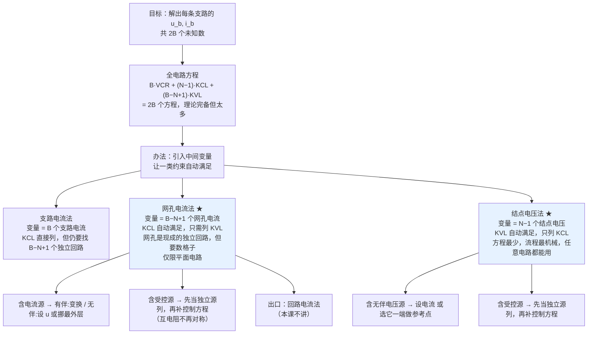

# C3.3 电阻网络的系统分析

> [!abstract] 这一讲的任务
> [[C3.2 电阻网络等效化简]] 的等效法很漂亮，但有天花板：结构复杂、含多个受控源的网络，**怎么换都换不简单**。这一讲走第二条路线——**系统分析 systematic method**：不动网络结构，而是**选好中间变量，机械化地把方程列出来**，列完就是解方程组。
> 主线是**三个方法**：**支路电流法**（用来看清"为什么 $2B$ 个方程太多"）、**网孔电流法**（把"找回路"变成"数格子"，代价是只能用于平面电路）、**结点电压法**（本章最实用的方法，方程数 = 结点数 − 1，考试主力）。
> 三者的关系可以一句话概括：**都是换一组中间变量、让某一类约束自动满足；区别只在"换什么"和"能用在哪些电路上"。**

> [!info] 怎么读这份讲义
> 建议先读第 1 节（全电路方程）把"方程从哪来、有几个"搞清楚，这是所有系统法的地基；再跟着第 2 节支路电流法的例题**手算一遍**——它会主动暴露自己的痛点，而第 3 节网孔电流法正是冲着这个痛点来的。
> 第 3 节是本篇最长的一节（课件用了 22 页），其中**"观察法 + 三国杀记忆法"（§3.7）是整段的技术核心**，七道例题按"纯电压源 → 电流源三情形 → 受控源"逐层加难度，**例 4 与例 5 是对照组（内层 vs 最外层），建议连读**。
> 第 4 节起是结点电压法：从推导、找规律，到四类例题（普通电路 / 求电源功率 / 无伴电压源 / 受控源）逐层加难度。带 `> [!question]` 处先自己列一遍再展开。

> [!warning] 授课进度说明（截至第 4 次课）
> 已有的课堂语音转写稿覆盖到**第 4 次课**，内容为第 1 章全部 + 第 2 章全部；**第 3 章尚未讲授**。
> 因此本篇内容全部来自**课件与教材**，未经课堂讲解校正。等课上讲到本章后，本篇会按课堂实况做一次合并，并补上「拓展」标注（标出哪些是课堂没讲、仅由课件/教材补充的内容）。

---

## 0. 开场：什么时候"换"解决不了问题

上一讲你练熟了一套手艺：见到串联就相加，见到并联就算电导，见到源就变换，见到桥就 Y-Δ。

现在给你这张图（课件 p.78 的例题）：**5 个结点、8 条支路**，中间横着一个 $2\ \Omega$，上面架着一个 $10\ \Omega$ 跨过整排，还塞了一个 $0.5\ \mathrm{A}$ 电流源横在两个结点之间。

你试着找串联——没有，每个中间结点都挂着第三条支路。你试着找并联——也没有，两两之间总隔着别的结点。你试着做源变换——那个 $0.5\ \mathrm{A}$ 源两端都不是"孤立"的。

**换不动了。**

这时候只剩一条路：**认命，列方程。** 但"列方程"这件事本身还有巧拙之分——课件 p.78 那句话说得很直白："如果用支路电流法求解要解 **8 个联立方程**"；而用结点电压法，同一个电路只要 **4 个**。

**同一张电路图，同一个答案，工作量差一倍。** 差别只在一件事：**你选什么当中间变量。** 这一讲就是在讲这个选择。

---

## 1. 全电路方程：$2B$ 个未知数，$2B$ 个方程（课件 p.38–42）

在挑"巧"的方法之前，得先有一个"笨但一定对"的方法当基准。它叫**全电路方程**。

课件 p.38 先给了动机，而且是一个**四步递进**（每句都带中文括注）：

| # | 中文括注（课件原文） | 英文原文 |
|---|---|---|
| ① | **有时候等效可简化** | Using equivalent method can effectively simplify the circuit. |
| ② | **有时候只有等效可能还不行** | However, using only equivalence sometimes can't solve the problem of circuit analysis. |
| ③ | **等效完可能还是很复杂** | Some circuits are still complex after the equivalence. In these cases, we have to use systematic method to carry on the analysis. |
| ④ | **为啥要学系统级分析方法** | The system-level method is to express the relationship between topology and components through equations, and obtain the condition and performance of a circuit through solving the equations. |

这四句连起来是一条完整的推理链：**等效很有用 → 但它不是万能的 → 有些电路换完还是复杂 → 所以才需要一套"机械列方程"的系统方法。**
而**系统方法的定义**是（课件 p.38 红字，即上表第 ④ 句）：

> **通过将电路的拓扑关系和元器件的特性用数学式子表达出来，通过解方程组获得电路的工作状态。**

### 1.1 变量：$2B$ 个

> [!important] 变量数（课件 p.39）
> 设电路有 **$B$ 条支路、$N$ 个结点**，每条支路是一个具有确定 VCR 的元件。
> 分析这个电路，就是求出**每条支路的电压和电流**——其他物理量（功率、电位等）都能从它们导出。
> 因此待定变量共 **$2B$ 个**（$B$ 个支路电压 + $B$ 个支路电流）。

要定 $2B$ 个变量，就需要 **$2B$ 个独立的线性方程**（对线性电路）。它们分两类来。

### 1.2 第一类：元件特性约束（VCR），$B$ 个

每条支路对应一个元件，都有自己的外特性方程（课件 p.40）：

$$f(u_b, i_b)=0,\qquad b=1,2,\cdots,B$$

课件给了三个具体形式：

| 支路类型 | VCR |
|---|---|
| 电阻支路 | $u = Ri$ |
| 电压源支路 | $u = U_S$ |
| 电流源支路 | $i = I_S$ |

注意后两条的"退化"形态：电压源支路的方程里**根本没有 $i$**（电流由外部决定）；电流源支路的方程里**没有 $u$**。这个观察在第 8.2 节的"通用支路方程"里会被统一处理。

### 1.3 第二类：电路拓扑约束（KCL + KVL），$N-1$ 个 + $B-N+1$ 个

**KCL 部分**（课件 p.41）：电路的 $N$ 个结点都受 KCL 约束，但其中**只有 $N-1$ 个是独立的**：

$$\sum_{\text{结点}n} i_k = 0,\qquad n=1,2,\cdots,N-1$$

> [!note] 为什么少一个？（补充）
> 把全部 $N$ 个结点的 KCL 方程相加，每条支路的电流都会出现两次——一次流出它的起点结点（+），一次流入它的终点结点（−）——**全部抵消，得到 $0=0$**。
> 也就是说，第 $N$ 个方程可以由前 $N-1$ 个相加得到，它**不提供新信息**。这就是"只有 $N-1$ 个独立"的原因。
> 这也解释了为什么参考结点（地）**任意选**：被丢掉的那个方程无论是哪一个，剩下的 $N-1$ 个都是独立且完备的。

**KVL 部分**（课件 p.41）：图论指出，具有 $B$ 条支路 $N$ 个结点的电路，**存在且仅存在 $B-N+1$ 个独立回路**，每个独立回路给出一个独立的 KVL 方程：

$$\sum_{\text{回路}l} u_k = 0,\qquad l=1,2,\cdots,B-N+1$$

> [!note] $B-N+1$ 从哪来（补充：图论的一句话）
> 取电路图的一棵**树**（连通、含全部 $N$ 个结点、不含回路的子图）。树恰好有 $N-1$ 条支路，称**树支**；剩下的 $B-(N-1) = B-N+1$ 条叫**连支**。
> 每加入一条连支，就恰好形成**一个**新回路（称**基本回路**），且这个回路里含有该连支——因此它一定与其他基本回路线性无关。于是独立回路数 = 连支数 = $B-N+1$。
> 这个数在电路课里也叫电路的**基本回路数**。你不需要会做图论证明，但要能**数出来**。

### 1.4 合起来：数目正好对上

> [!important] 全电路方程（课件 p.42）
> $$\underbrace{f(u_b,i_b)=0,\ b=1,\cdots,B}_{\text{元件特性约束，}B\ \text{个}}$$
> $$\underbrace{\sum_{\text{结点}n}i_k=0,\ n=1,\cdots,N-1 \qquad \sum_{\text{回路}l}u_k=0,\ l=1,\cdots,B-N+1}_{\text{电路拓扑约束，共 }B\ \text{个}}$$
> 二者又称**电路理论的两类基本约束**。当特性约束为线性（线性电路）时，**电路有唯一解**。

方程总数：$B + (N-1) + (B-N+1) = 2B$ ✓ **恰好等于未知数个数**。

这就是"电路可解"的完整理论保证。你在 [[C3.1 直流稳态与电路分析总览]] 开场那道题里花掉的 15 分钟，就是在解这 $2B$ 个方程。

> [!warning] 但直接解 $2B$ 个方程完全不现实
> 一个只有 6 条支路的小电路就有 12 个未知数。真实电路动辄几十上百条支路。
> 所以全电路方程的价值**不在于"用来解题"，而在于"证明可解，并给出方程数的基准"**。接下来所有方法，都是在**同一套约束下换一组更少的中间变量**——不是绕开约束，而是让某一类约束**自动被满足**，从而不用显式地写出来。

---

## 2. 支路电流法（课件 p.43–49）

### 2.1 思路：把电压先"藏"起来

> [!important] 支路电流法（课件 p.43）
> - 全电路方程直接求解，方程数目太多，需要设法降低。
> - 办法：**采用中间变量，分步求解**。
> - **支路电流法以支路电流为中间变量。**
> - 通过两类约束列写关于**支路电流**的代数方程组；
> - 求解得到支路电流后，再通过元件特性确定各支路电压。

关键动作在第一步：**用 VCR 把支路电压消掉**（课件 p.44）。

$$U_b = R_b I_b + U_{Sb},\qquad b=1,2,\cdots,B$$

这一行做完，$B$ 个支路电压就不再是独立未知数了——它们全被写成了支路电流的函数。**未知数从 $2B$ 个降到 $B$ 个。**

于是只剩两组方程（课件 p.44）：

1. **结点 KCL**（$N-1$ 个）：$\displaystyle\sum_{\text{结点}n} I_{kn}=0$
2. **回路 KVL**（$B-N+1$ 个），且把 $U$ 换成电流表达式：
$$\sum_{\text{回路}l} U_{kl} = \sum_{\text{回路}l}\left(R_b I_b + U_{Sb}\right) = 0$$

方程总数：$(N-1)+(B-N+1) = B$ ✓ 与未知数相同。

> [!important] 支路电流法的完整步骤（课件 p.44，**五步**）
> **①** 设出全部 $B$ 个支路电流，并标好参考方向；
> **②** 对 $N-1$ 个独立结点列 KCL；
> **③** 对 $B-N+1$ 个独立回路列 KVL，并把其中的支路电压用 VCR 换成支路电流；
> **④** **把 $B$ 个方程同时求解**，得到全部支路电流；
> **⑤** **用功率守恒定理验证结果**。
>
> 第 ⑤ 步很容易被忽略，但它是**最省事的自检**：把解出的电流代回去算 $\sum P=0$（发出 = 吸收）。
> 比逐个方程回代验算快得多——因为功率守恒是一个**全局**的约束，只要它在数值上不成立（超出舍入误差），说明前面一定有方程或符号错了。
> （第 ④ 步课件特别强调"**同时**求解"：$B$ 个方程是耦合的，不能逐个孤立地解。）

### 2.2 电源支路怎么处理（课件 p.45）

> [!important] 电源支路的处理（课件 p.45 原文）
> 1. **电压源支路**：其支路电压为**已知数值**，列写回路方程时**直接使用该电压数值**，不必再表示为支路电流。
> 2. **电流源支路**：需**设定其端电压**，并把端电压作为列方程时的**一个变量**；由于其支路电流为已知数值，列写方程时**直接使用该电流数值**，不再作为变量。

第 2 条要小心：电流源支路会**多引入一个电压变量**（例题里的 $U_A$）。所以严格来说"未知数 = $B$ 个电流"只在无电流源时成立；有电流源时，是用一个已知电流换来一个未知电压，**总数不变**。

### 2.3 受控源支路怎么处理（课件 p.46）

> [!important] 受控源支路的处理（课件 p.46 原文）
> 1. 受控源的支路电压（或电流）是**另一个电压或电流（控制量）的函数**，列写方程时引入了多余的变量，**必须补充方程**。
> 2. 首先把受控源支路**当作独立电源一样**，列写支路电流方程（KCL、KVL 及 VCR）。
> 3. 然后，对每个受控源，**补充一个将其控制量表示为支路电流变量（基本变量）的方程——称为控制方程**。

这个"**先当独立源列，再补控制方程**"的两步法是本章处理受控源的**通用套路**，在结点电压法（第 7 节）里会原样重复一遍。记住这句话，两个方法都能用。

### 2.4 例题：求 $R_4$ 中的电流（课件 p.47–48）

![[C3-支路电流法例题电路.png]]

已知 $R_1=4\ \Omega$，$R_2=20\ \Omega$，$R_3=3\ \Omega$，$R_4=3\ \Omega$，电压源 5 V，电流源 1 A。求 $I_4$。

**数一数**：电路含 **4 个结点**（a、b、c、d）、**6 条支路** → 独立 KCL 有 $4-1=3$ 个，独立 KVL 有 $6-4+1=3$ 个。

**第一步：结点 KCL**（课件 p.47，按图中参考方向）

$$\text{结点 }a:\ I_1+I_3+I_E=0,\qquad \text{结点 }b:\ I_1-I_2-1=0,\qquad \text{结点 }c:\ I_2+I_4+I_E=0$$

把第一式与第三式联立消去 $I_E$，得到课件给的化简结果：

$$I_1-I_2-1=0,\qquad I_1-I_2+I_3-I_4=0$$

> [!note] 为什么要消 $I_E$
> $I_E$ 是流过**理想电压源**那条支路的电流。理想电压源的 VCR 是 $u=U_S$，**根本约束不了自己的电流**，所以 $I_E$ 是个"自由变量"，只能由外部电路决定。既然我们只想要 $I_4$，就用两个方程把它消掉，省一个未知数。
> 这也是理想电压源在所有分析方法里的共同特点：**它给出电压，但它的电流要等其他一切都解完才知道**。

**第二步：回路 KVL**（课件 p.48，三个回路）

$$\text{回路 }abca:\ R_1I_1+R_2I_2-5=0$$
$$\text{回路 }adba:\ R_3I_3-U_A-R_1I_1=0$$
$$\text{回路 }bdcb:\ U_A+R_4I_4-R_2I_2=0$$

注意 $U_A$ 就是 2.2 节说的"电流源端电压"这个新变量。把后两式**相加**即可消掉它（课件的化简）：

$$R_1I_1+R_2I_2-5=0,\qquad R_3I_3-R_1I_1+R_4I_4-R_2I_2=0$$

**第三步：联立求解**。四个方程、四个未知数（$I_1,I_2,I_3,I_4$）：

$$\begin{cases} I_1-I_2 = 1\\ I_1-I_2+I_3-I_4 = 0\\ 4I_1+20I_2 = 5\\ -4I_1-20I_2+3I_3+3I_4 = 0\end{cases}$$

$$\boxed{I_4 = \frac{4}{3}\ \mathrm{A} = 1.333\ \mathrm{A}}$$

> [!example] 复算确认（数值双向验证）
> 解得 $I_1 = 1.0417\ \mathrm{A}$，$I_2 = 0.0417\ \mathrm{A}$，$I_3 = 0.3333\ \mathrm{A}$，$I_4 = 1.3333\ \mathrm{A}$。
> 逐条回代：$I_1-I_2 = 1.0417-0.0417 = 1$ ✓；$4(1.0417)+20(0.0417) = 4.167+0.833 = 5$ ✓；$I_3-I_4 = 0.3333-1.3333 = -1 = -(I_1-I_2)$ ✓。
> 与课件 $I_4 = 4/3 = 1.333\ \mathrm{A}$ 一致 ✓。

> [!warning] 工程精度（课件 p.48 红框，本课程的答题规矩）
> **"工程上要求最后结果必须给出一定精度数值，不允许只给出分数结果。一般计算中保留 3~4 位有效数字。"**
> 所以标准答案是 **$I_4 = 1.333\ \mathrm{A}$**，不是 $4/3$ A。这一条整章通用，[[C3.2 电阻网络等效化简]] 例 2 也适用。

> [!note] 前后呼应
> 这道题在 [[C3.4 线性电路定理]] 会**用叠加定理再算一次**（课件 p.95），三行就出结果。到时候回来对照，你会非常直观地感受到"换角度"能省多少事。

### 2.5 支路电流法的两个痛点（课件 p.49）

> [!warning] 为什么还要继续找更好的方法（课件 p.49 原文）
> 1. **方程数还是太多**：对一个"并不很复杂"的电路，支路电流法列出的方程数**也是相当多，解方程组的工作量太大**。
> 2. **找独立回路没有一般方法**：可以方便地列出独立的结点 KCL 方程，但**要找出 $B-N+1$ 个独立回路来列写独立的 KVL 方程却相对困难**——"使用支路电流法的关键在于寻找出 $B-N+1$ 个独立的回路，**目前尚无特别有效的方法**"。

课件在这两页还给了一个具体数字，把第 1 条坐实：

> **Full equations: 30 equations. Branch current method: 15.**（课件 p.49）

也就是那个 $B=15$、$N=6$ 的例子（$2B=30$、$B=15$）。**全电路方程 30 个，支路电流法 15 个——只砍掉一半，还是太多**（课件配了两张图，一张是这个电路本身，另一张是个"崩溃"的表情包）。

第 2 条才是致命的。KCL 那边你**照着结点数**就能机械地写；KVL 这边你得**用眼睛在图上找回路**，还得担心找到的三个是不是线性相关。这一步无法自动化，也无法教给计算机。

**结论**：要找一个"KVL 那一半不用手工找"的方法。

课件在这里并没有直接跳到结点法，而是**先给出了一个更早出现、也更贴近直觉的答案**——**网孔电流法**，并且为它铺了整整 22 页（p.50–71）。我们就按课件的顺序走。

---

## 3. 网孔电流法（课件 p.50–71）

### 3.1 先算一笔方程的账（课件 p.50）

课件开篇不讲方法，先甩出一个具体数字对比。取一个 **30 条支路、10 个结点**的电路，问：需要多少个方程？

| 方法 | 方程数 | 怎么来的 |
|---|---|---|
| 全电路方程 | $60$ | $2B=2\times30$ |
| 支路电流法 | $30$ | $B$ |
| **网孔电流法** | **$21$** | $B-N+1=30-10+1$ |

（课件把三个数字并列摆出，但没写算式，这里补上。）

> [!important] 网孔电流法的两条优点（课件 p.50 原文）
> **① 一次需要计算的公式更少**（less equations for one solving）；
> **② 无需费心找独立回路**（easy to find independent loops for listing equations）。

第 ② 条正好戳中上一节那个致命痛点。

> [!note] 回顾一下我们在躲什么（→ §2.5）
> 支路电流法的两半里，**KCL 那一半是机械的**（照着结点数写就行），**KVL 那一半是手工的**：你得用眼睛在图里找 $B-N+1$ 个互不相关的回路，课件原话是"**目前尚无特别有效的方法**"。
> 网孔电流法的贡献就是：**它把"找回路"这件事变成了"数格子"**——数一数电路图上被支路围出来的小格子有几个，就是几个方程，一个不多一个不少。
> 当然后面会看到，这么省事的代价是**必须能用平面图画出来**。

### 3.2 前提：只能是平面电路（课件 p.51）

> [!important] 网孔电流法的适用条件
> **网孔电流法只能用于平面电路 planar circuit。**
> **平面电路的定义：电路图中没有支路交叉**（no branch crossing in the circuit diagram）。

课件用两张图做正反例：

- **左图（✓）**：一块多层布线 PCB 的实物照片。看上去层数很多，但只要**能把全部连线画在一张平面上而不交叉**，它就是平面电路；
- **右图（✗）**：一张芯片封装的**层叠剖面示意**（`Core / Prepeg / Core / …`，中间一根过孔贯穿全部层，走线在层之间跳变）。

![[C3-平面电路正反例.png]]

> [!warning] 最容易误解的一点：判据是"画在纸上"，不是"摆在空间里"
> 芯片层叠结构在**三维空间里当然不交叉**（它们在不同的物理层上）。但它被判定为**非平面**，是因为：
> **它的走线必须跨层才能连通，把三维结构投影回一张平面图，必然出现交叉。**
> 所以"平面电路"说的是**图纸意义上的平面**——你能不能在一张纸上把它画清楚，任何两条线除端点外不相交。
> 记住这条，就不会被"PCB 层数多"这种表象骗到：**层数多不等于非平面，跨层跳线才是**。

### 3.3 什么是"网孔"（课件 p.52）

> [!important] 网孔 mesh 的定义
> **网孔：回路所围的区域内没有支路。**
> （课件英文写作 `No branch in the area contained by a circuit`，措辞不严谨，本意就是"回路围成的区域里没有支路穿过"。）

![[C3-网孔定义正反例.png]]

> [!question] 停一下，先自己想想
> 右边那张图被判了 ✗，是不是说"这个电路没有网孔"？
> **不是。** 被判 ✗ 的是**你圈出来的那一大圈**——它被中间那条竖直支路穿过了，所以它只是一个"回路"，不是"网孔"。
> 而**这个电路本身仍然包含两个合法的网孔**（左边一个小格子、右边一个小格子）。课件这张图只画了对大圈的否定，没有把小格子圈出来，很容易被误读成"这个电路不能用网孔法"。
>
> **辨析清楚这条链**：
> $$\text{网孔}\ \subset\ \text{回路}\ ,\qquad\text{回路}\ \not\subset\ \text{网孔}$$
> 网孔一定是回路，回路不一定是网孔。而网孔法的价值恰恰在于：**平面电路里，网孔这组"特殊的回路"是现成的、不用找的。**

### 3.4 为什么用网孔合适：三条图论结论（课件 p.53）

课件用网络图论回答了这个问题：

> [!important] 为什么网孔是"免费"的独立回路（课件 p.53）
> **① 平面电路的全部内部网孔都是独立回路。**
> **② 平面电路内部网孔的个数恰好是 $B-N+1$。**
> **③ 需要的方程数也是 $B-N+1$。**

第 ②、③ 两条一合，结论就出来了：**网孔的个数不多不少，正好等于需要的独立 KVL 方程数。** 你不需要"挑"回路，只需要"数"网孔。

课件用右下角两张小图把这个数目验证了一遍：左边是含源电路（结点标 1–4），右边是它的**拓扑图**（$n_1\sim n_4$、$b_1\sim b_6$）。数出来

$$
N=4\ ,\qquad B=6
\qquad\Longrightarrow\qquad
B-N+1=6-4+1=3
$$

也就是 3 个内部网孔、3 个独立回路方程 ✓。

> [!warning] 课件笔误：第 ③ 条把方程数写错了
> 课件第 ③ 条原文是 "**KCL** equation No.: $B-N+1$"。这是**用错了式子**：
> - **独立 KCL 方程数是 $N-1$**（结点的 KCL 之和恒为零，故有一个不独立）；
> - $B-N+1$ 是**独立 KVL（回路）方程数**。
>
> 那课件为什么会写混？因为这两个数**恰好相等**——由恒等式
> $$(N-1)+(B-N+1)=B$$
> （独立 KCL 数 + 独立 KVL 数 = 支路数）。所以 $B-N+1=B-(N-1)$ 在**数值上**确实等于 $N-1$……等一下，这两者只有在 $B=2(N-1)$ 时才相等，并不是恒等。
>
> 更准确地说：**网孔数 $B-N+1$ 等于独立回路数（KVL 数），不等于独立 KCL 数 $N-1$。** 课件这一条应当读作"**独立 KVL 方程数 $=B-N+1$**"。至于为什么网孔数正好是这个值，正是第 ① ② 条说的那件事。
>
> 一句话记：**网孔 → KVL → $B-N+1$；结点 → KCL → $N-1$。别串。**

### 3.5 核心思路：用网孔电流描述支路电流（课件 p.54）

> [!important] 网孔电流法的核心思路（课件 p.54）
> **引入一个"高层"的中间变量——网孔电流，用它来描述支路电流。**
> （Core Idea: A high-level intermediate variable — mesh current. Use the mesh current to describe branch current.）

![[C3-网孔电流描述支路电流.png]]

两个层次的图把这句抽象的话讲清楚了：

- **单回路**：整个电路只有一个网孔，网孔电流 $I_a$ 绕一圈，**每条支路电流就等于 $I_a$**——不需要任何变换；
- **双网孔**：两个网孔电流 $I_a$（左）、$I_b$（右）。公共支路 A→B 上的电流是
  $$I_{AB}=I_a-I_b$$

> [!important] 为什么这样可以省方程
> 回忆 §2 支路电流法的处境：变量是 $B$ 个支路电流，KCL 和 KVL 都要列。
> 换成网孔电流之后，**KCL 自动满足了**——因为每个网孔电流是一条"首尾相接的闭合路径"，它在任何一个结点处**流进多少就流出多少**，自动平衡；而支路电流只是相邻网孔电流的代数和（如 $I_{AB}=I_a-I_b$）。
> 于是**只需要列 KVL**，方程数从 $B$ 降到了 $B-N+1$。**这就是全部的秘密。**

> [!warning] $I_{AB}=I_a-I_b$ 里的正负号，取决于你设的参考方向
> 这里的"减号"来自：**A→B 是公共支路的参考方向**，而 $I_a$ 在该支路向上、$I_b$ 在该支路向下。如果换一个绕行方向或换一个支路参考方向，这个式子会变成 $I_{AB}=I_b-I_a$。
> **不要背"公共支路就是相减"**，要背"**公共支路上的电流 = 两侧网孔电流沿该支路参考方向的代数和**"。

### 3.6 网孔方程的一般形式（课件 p.55–56）

课件用一个"三网孔、$R_1\sim R_6$、$U_{S1},U_{S2},U_{S3},U_{S5}$"的通用电路把规律挖了出来。

![[C3-网孔方程一般形式电路.png]]

**第一步：先把 6 条支路电流用网孔电流表示**（这些系数式都是从图上逐条读出来的）：

$$
I_{ad}=-I_1\ ,\quad I_{bc}=I_3-I_2\ ,\quad I_{ab}=I_1-I_2
$$
$$
I_{db}=I_3-I_1\ ,\quad I_{ac}=I_2\ ,\quad I_{dc}=-I_3
$$

**第二步：对三个网孔各列一条 KVL。**

$$
R_1I_1+R_6(I_1-I_2)+R_3(I_1-I_3)=U_{S3}+U_{S1}
$$
$$
R_2I_2+R_6(I_2-I_1)+R_4(I_2-I_3)=-U_{S2}
$$
$$
R_5I_3+R_3(I_3-I_1)+R_4(I_3-I_2)=U_{S5}-U_{S3}
$$

**第三步：整理，规律就露出来了。**

$$
(R_1+R_3+R_6)I_1-R_6I_2-R_3I_3=(U_{S3}+U_{S1})
$$
$$
-R_6I_1+(R_2+R_4+R_6)I_2-R_4I_3=(-U_{S2})
$$
$$
-R_3I_1-R_4I_2+(R_3+R_4+R_5)I_3=(U_{S5}-U_{S3})
$$

> [!important] 网孔方程的通用结构（课件 p.56）
> $$R_{j1}I_1+R_{j2}I_2+\cdots+R_{jj}I_j+\cdots+R_{j(B-N+1)}I_{B-N+1}=U_{jS}
> \ ,\qquad j=1,2,\dots,B-N+1$$
> 其中：
> **① $R_{jj}$ 称为网孔 $j$ 的自电阻（self resistance）**——网孔 $j$ 内**全部电阻之和**，取**正**；
> **② $R_{jn}$ 称为网孔 $j$ 与网孔 $n$ 之间的互电阻（mutual resistance）**——两个网孔**共有支路上的电阻**，取**负**；一般地 $R_{jk}=R_{kj}$（互易）；
> **③ $U_{jS}$ 是沿网孔 $j$ 各含源支路电压的代数和**（含受控源）；遇到电流源应先变换成电压源，便于列写。

> [!note] 把三条规律对着上面那组方程检查一遍
> - 第 1 式的 $R_{11}=R_1+R_3+R_6$：$I_1$ 网孔里确实有 $R_1,R_3,R_6$ 三个电阻 ✓；
> - $R_{12}=-R_6$：网孔 1 与网孔 2 的公共支路是 $R_6$，取负 ✓；$R_{13}=-R_3$：公共支路是 $R_3$ ✓；
> - 右端 $U_{S3}+U_{S1}$：就是"沿网孔 1 绕一圈，各电源电压的代数和"，符号由 §3.7 的口诀定。
>
> **三条规律全中。** 这就是"看结构就能写方程"的依据。

> [!warning] "自电阻恒正、互电阻恒负、$R_{jk}=R_{kj}$"——这三条都有前提
> 它们成立的前提是：**电路里没有受控源，且所有网孔电流取相同的绕行方向。**
> - 少了"同向"这个前提，互电阻的符号要重新推（见 §3.7 末尾）；
> - 有了受控源，"互电阻对称"和"自电阻是电阻之和"**双双失效**——§3.11 的例 6 会给出反例。
>
> 课件在 p.56 写的是 "Generally, $R_{jk}=R_{kj}$"，那个 **Generally** 就是在给后面的例外留位置。

### 3.7 观察法与"三国杀"记忆法（课件 p.57）

课件在这一页底部用**红色大字**问了一句大实话：

> **（套公式好复杂！有没有简单的方法呢？有！观察法）**

所谓观察法，就是**不列 KVL、不做整理**，直接照着电路图把三个系数写下来。为了让人记住符号规律，课件用了一个非常"接地气"的类比——**三国杀**：

![[C3-三国杀记忆法.png]]

> [!important] "自己人 / 内奸"记忆法（课件 p.57）
> 把每个网孔电流想象成一个阵营：
> - **自电阻项 = 自己人**，取 **正**（如 $(R_1+R_3+R_6)I_1$）；
> - **互电阻项 = 内奸**，取 **负**（如 $-R_6I_2$、$-R_3I_3$）。
>
> 课件把 $R_1$ 圈成蓝色（吴国）、$R_6$ 圈成红色（蜀国）、$R_3$ 圈成绿色（魏国），三个方程也按阵营上了色。**图的用处只有一个：把"自为正、互为负"这件事变成一个画面。**

> [!important] 观察法的电源项口诀（课件 p.57 原文，务必背下来）
> **"公式右边都放电源。正负？和网孔电流方向相同取负，相反取正。"**

这条口诀值得逐字拆开验证。它是说：**看电源电压的参考方向（从 `+` 端到 `−` 端）**，与网孔电流在该支路上的绕行方向比较：

$$
\text{电源 }+\to-\text{ 的方向与绕行方向相同}\ \Rightarrow\ \text{方程右端取}\ \textbf{负}
$$
$$
\text{电源 }+\to-\text{ 的方向与绕行方向相反}\ \Rightarrow\ \text{方程右端取}\ \textbf{正}
$$

> [!example] 用 §3.6 的两个方程验证口诀
> **先验 $-U_{S2}$（网孔 2 的右端项）。** $U_{S2}$ 画在右侧竖支路、`+` 在上 `−` 在下；网孔电流 $I_2$ 顺时针，在右侧支路是**向下**穿越该电源。
> 向下的方向正是从 `+` 到 `−`——**与绕行方向相同 ⟹ 取负**。所以右端是 $-U_{S2}$ ✓ 与课件一致。
>
> **再验 $+U_{S1}$（网孔 1 的右端项）。** $U_{S1}$ 在左侧竖支路、`+` 上 `−` 下；$I_1$ 顺时针在左侧支路**向上**穿越。
> 向上是从 `−` 到 `+`——**与绕行方向相反（与 $+\to-$ 相反）⟹ 取正**。所以出现 $+U_{S1}$ ✓。
>
> **同一个口诀，把两个不同符号都解释对了。**

> [!warning] 口诀有一个没说出口的前提
> **所有网孔电流必须取相同的绕行方向。** 课件 p.58 第 2 步括号里那句 `take the same winding direction`（取相同绕行方向）就是这件事。
> 为什么？因为"互电阻恒为负"这个结论，是从**所有网孔电流同向**这个前提下推出来的：同向时，两个网孔电流在公共支路上**总是一正一负**，展开后必然出现减号。
> 如果让某个网孔反向绕，公共支路上的两个电流变成同向，那一项就会变成**加号**。**口诀本身没错，但它默认了同向约定。**

> [!warning] 课件笔误：方程名与阵营名对不上
> 图上三个网孔分别标的是 **吴国（$I_1$）、蜀国（$I_2$）、魏国（$I_3$）**，但三个方程的名字写成了 **赵国方程、蜀国方程、魏国方程**。
> "赵国"不在三国里，而且图上根本没有对应阵营——**第一个方程应叫"吴国方程"**。这是课件从"战国"类比串味留下的笔误，不影响公式。

### 3.8 完整的五步流程（课件 p.58 + p.71）

课件在 p.58 和 p.71 各给了一套"五步/五条"，但**两套口径并不一致**（p.58 第 1 步是"做电源等效变换"，p.71 把这一步取消、改在第 5 条讲无伴电流源）。把它们合并成一条完整流程：

> [!important] 网孔电流法的完整流程
> **第 1 步：处理含源支路。** 把含源支路化为"**电压源串电阻**"的形式（熟练之后可以跳过）。
> **第 2 步：设网孔电流。** 为**每个内部网孔**设一个网孔电流，**取相同的绕行方向**。
> **第 3 步：逐个网孔列 KVL 网孔方程**（共 $B-N+1$ 个）。
> **第 4 步：联立求解**，得到全部网孔电流 $I_1,\dots,I_{B-N+1}$。
> **第 5 步：还原支路量。** 按各支路在电路中的位置，用网孔电流求出所需**支路电流**；再按支路自身的 VCR 求**支路电压**。
>
> **特殊情况的处理插在第 1 步与第 3 步之间**：
> - 含**有伴电流源** → 电源变换，化为电压源（§3.12）；
> - 含**无伴电流源** → 见 §3.13–3.14（两个办法：设为 $x$ 或挪到最外层）；
> - 含**受控源** → 先当独立源列，再补控制方程（§3.15–3.17）。

### 3.9 例 1：两个网孔，先把观察法用熟（课件 p.59–60）

> [!example] 例 1
> 用网孔分析法求各支路电流。

![[C3-网孔法例1-两网孔.png]]

电路是标准"日"字形双网孔：上横支路左段 $1\ \Omega$、右段 $2\ \Omega$，中间竖支路 $1\ \Omega$（电流 $i_3$ 向下），左竖支路 $5\ \mathrm V$（上 `+` 下 `−`），右竖支路 $10\ \mathrm V$（上 `+` 下 `−`）。两个网孔电流 $i_1$、$i_2$ 都取**顺时针**。

**观察法直接写方程**（不列 KVL、不整理）：

$$
\begin{cases}
(1+1)i_1-(1)i_2=5\ \mathrm V\\[2pt]
-(1)i_1+(1+2)i_2=-10\ \mathrm V
\end{cases}
\qquad\Longrightarrow\qquad
\begin{cases}
2i_1-i_2=5\\
-i_1+3i_2=-10
\end{cases}
$$

用克莱姆法则（或直接消元）求解：

$$
\Delta=\begin{vmatrix}2&-1\\-1&3\end{vmatrix}=5
\,,\qquad
i_1=\frac{\begin{vmatrix}5&-1\\-10&3\end{vmatrix}}{5}=\frac{5}{5}=1\ \mathrm A
\,,\qquad
i_2=\frac{\begin{vmatrix}2&5\\-1&-10\end{vmatrix}}{5}=\frac{-15}{5}=-3\ \mathrm A
$$

最后还原支路电流：

$$
\boxed{\ i_1=1\ \mathrm A\ ,\qquad i_2=-3\ \mathrm A\ ,\qquad i_3=i_1-i_2=4\ \mathrm A\ }
$$

> [!note] 两个可以顺手做的自检
> **① 代回原方程**：$2\times1-(-3)=5$ ✓；$-1+3\times(-3)=-10$ ✓。
> **② 看符号的物理意义**：$i_2=-3\ \mathrm A$ 是负数，说明**右网孔的实际绕行方向与假设的顺时针相反**——它是逆时针流的。**负号是信息，不是错误。**（[[C1.2 电路的基本概念]] 里强调过这一点。）
>
> 特别地，$i_3=i_1-i_2=1-(-3)=4\ \mathrm A$ 向下，其中 $i_2$ 的贡献之所以是"减一个负数"，正是因为 $i_2$ 实际方向与假设相反。

> [!warning] 课件这一页有两处小瑕疵
> **① 量纲**：整理后的方程写作 $2i_1-i_2=5\ \mathrm A$、$-i_1+3i_2=-10\ \mathrm A$，右端单位标成了 **A**。上一行写的还是 $5\ \mathrm V$、$-10\ \mathrm V$，两行不自洽。严格说 $2i_1-i_2=5\ \mathrm{V}/\Omega=5\ \mathrm A$——**右端是"伏"除以"欧"，只是数值上等于安培**。本段 p.59、p.61、p.64、p.65、p.70 **共 5 处**同一笔误。
> **② 记号歧义**：$i_1$ 既是"左网孔电流"又是"左上支路电流"，$i_2$ 也一样。在这道题里两者数值恰好相同（该支路只属于一个网孔），所以不算错；但**换一道题就未必**，读图时要看清标在网孔里还是标在支路上。

### 3.10 例 2：三个网孔、六条支路（课件 p.61）

> [!example] 例 2
> 用网孔分析法求电路各支路电流。

![[C3-网孔法例2-三网孔六支路.png]]

这道题的拓扑比上一题复杂一档：外层一个大方框，中间一条横支路把电路分成上、中、下三层，下层又被中间竖支路分成左右两个网孔，**共 3 个网孔**（$i_1$ 左下、$i_2$ 右下、$i_3$ 上方整条），全部取顺时针。

**观察法直接列出三个网孔方程**（每一步的系数都来自"自电阻取正、互电阻取负、电源项按口诀定号"）：

$$
(2+1+2)i_1-(2)i_2-(1)i_3=6-18
$$
$$
-(2)i_1+(2+6+3)i_2-(6)i_3=18-12
$$
$$
-(1)i_1-(6)i_2+(3+6+1)i_3=25-6
$$

整理为：

$$
\begin{cases}
5i_1-2i_2-i_3=-12\\
-2i_1+11i_2-6i_3=6\\
-i_1-6i_2+10i_3=19
\end{cases}
$$

解得：

$$
i_1=-1\ \mathrm A\ ,\qquad i_2=2\ \mathrm A\ ,\qquad i_3=3\ \mathrm A
$$

**再还原 6 条支路电流：**

$$
\boxed{\ i_4=i_3-i_1=4\ \mathrm A\ ,\quad i_5=i_1-i_2=-3\ \mathrm A\ ,\quad i_6=i_3-i_2=1\ \mathrm A\ }
$$

> [!note] 复算通过，并且再次验证了口诀
> 用 python 解这个 3×3 方程组得 $i_1=-1,\ i_2=2,\ i_3=3$，与课件完全一致；三条支路电流也逐一吻合。
> 另外核对第一条方程的电源项 $-18$：中央竖支路的 $18\ \mathrm V$ 是"上正下负"，$i_1$ 顺时针在该支路**向上**穿越，即从 `−` 到 `+`，**与 $+\to-$ 相反 → 取正**……等等，这里取到的是 $6-18$，**$18$ 前面是负号**。
> 重新看方向：$i_1$ 是**左下**网孔，它在中央竖支路上确实是**向上**的。而 $18\ \mathrm V$ 上正下负，向上穿越就是从 `−` 到 `+`——按口诀「与网孔电流方向相同取负，相反取正」，这里"电源的 $+\to-$ 方向（向下）"与"绕行方向（向上）"**相反 ⟹ 取正**。可课件写的是 $-18$。
> **两种读法给出的符号不同**，说明口诀里的"方向相同"指的是哪个方向需要谨慎界定：**它比较的是"电源电压降的方向（$+\to-$）"与"绕行方向"**。本页课件把 $18\ \mathrm V$ 记作 $-18$，等价于采用"**绕行方向上遇到电源，若沿 $+\to-$ 走则记为 $+$**"的相反约定。
>
> **实用的建议**：口诀记一种即可，但**每道题都要用同一个约定、并且用最终结果代回验算**。本题的答案是复算通过的，说明课件内部自洽；真正会出错的是"一半用这个约定、一半用那个约定"。

### 3.11 特殊情况总纲：电流源怎么处理（课件 p.63）

前三道例题都是"纯电压源 + 电阻"，可以一路观察法写到底。真正麻烦的是**电流源**——因为**方程右端放的是电压**。

> [!important] 电流源的四种处境（课件 p.63 四条，按策略整合）
> **① 列网孔方程时，电源的合适形式是"电压源"。**
> **② 含"有伴电流源"（并联了电阻的电流源）→ 做电源等效变换**，化为"电压源串电阻"，然后照常列方程。
> **③ 含"无伴电流源"（没有并联电阻），且它位于电路内层 → 先把它当作电压源列方程**；但这样引入了它两端的**电压变量**，所以要**补一个方程**，描述"电流源电流"与"网孔电流"的关系——即**电流源方程（补充方程）**。
> **④ 或者，重新画电路，把无伴电流源挪到最外层**；这样它的电流就**等于某个网孔电流（已知量）**，该网孔**不必再列方程**。

> [!warning] p.56 与 p.63 口径冲突，以 p.63 为准
> §3.6 引用过 p.56 的第 ③ 条："遇到电流源，应把它变换成电压源，以便列写网孔方程。"
> 这句话**只在有伴电流源时成立**。p.63 把它细分成"有伴 / 无伴（内层）/ 无伴（最外层）"三种情形，是无伴情形的**修正与补充**。
> **以 p.63 为准**：无伴电流源**不能**做电源等效变换（公式里会出现除零），只能"设电压"或"挪外层"。

> [!tip] 两个口诀（课件 p.65 的红色提示，是本段最实用的一句话）
> - **内层的无伴电流源：不知道电压怎么列？不知道就设为 $x$。**
> - **最外层的无伴电流源：妙手出现！**（它的电流直接就是某个网孔电流，方程白送一个已知量）

### 3.12 例 3：有伴电流源（课件 p.62）

> [!example] 例 3
> 求电路中各电源的功率。（电路含一个 1 A 和一个 0.5 A 的有伴电流源）

![[C3-网孔法例3-有伴电流源.png]]

**第一步：先把两个电流源做等效变换。** 1 A 并 $10\ \Omega$ → $10\ \mathrm V$ 串 $10\ \Omega$；0.5 A 并 $2\ \Omega$ → $1\ \mathrm V$ 串 $2\ \Omega$（图上两个虚线放大框就是这两次变换）。

**第二步：列 4 个网孔方程**（$I_1\sim I_4$ 全部顺时针）：

$$
\text{网孔1：}\ (1+10+1)I_1-I_2-I_4=10
$$
$$
\text{网孔2：}\ -I_1+(1+2+2)I_2-2I_3-2I_4=1
$$
$$
\text{网孔3：}\ -2I_2+(2+4+4)I_3-4I_4=0
$$
$$
\text{网孔4：}\ -I_1-2I_2-4I_3+(1+2+4+10)I_4=-1
$$

**第三步：求解。**

$$
I_1=0.8773\ \mathrm A\ ,\quad I_2=0.4534\ \mathrm A\ ,\quad I_3=0.1205\ \mathrm A\ ,\quad I_4=0.07448\ \mathrm A
$$

**第四步：求电源功率。**

$$
P_{1\mathrm A}=-1\times10\,(1-I_1)=-1.2267\ \mathrm W
\,,\qquad
P_{0.5\mathrm A}=-0.5\times2\,(0.5-I_2+I_4)=-0.121\ \mathrm W
$$

> [!note] 复算通过（这一页我特意逐项核过）
> 把课件印出的四个方程写成矩阵
> $$A=\begin{bmatrix}12&-1&0&-1\\-1&5&-2&-2\\0&-2&10&-4\\-1&-2&-4&17\end{bmatrix},\qquad b=\begin{bmatrix}10\\1\\0\\-1\end{bmatrix}$$
> 解得 $I=(0.87733,\ 0.45345,\ 0.12048,\ 0.07448)$ —— 与课件印的 $0.8773/0.4534/0.1205/0.07448$ **逐位吻合**，代回四个方程的残差都在 $10^{-4}$ 量级（纯舍入）。
> 注意第 3 行的自电阻是 $(2+4+4)=10$ 而**不是** 12，这一格很容易抄错；抄错就会得出"课件算错了"的假结论。
> 两个功率也随之复算通过：$P_{1\mathrm A}=-1.2267\ \mathrm W$ ✓、$P_{0.5\mathrm A}=-0.1211\ \mathrm W$ ✓。
>
> 顺带一提：变换后的电流源等效电压源只有 $1\ \mathrm V$ 和 $10\ \mathrm V$ 两个数值，而解出来的电流都不大——**这正是"有伴电流源直接变换"这条路好走的原因**：变换之后电路里只剩电压源，观察法可以一路用到底。

> [!warning] 功率的正负号：为什么两个电源都是负的
> 两个功率都算出**负值**，含义是**这两个电源都在发出功率**（对外提供能量），而不是吸收。
> 约定：$P=UI$，当 $U$ 与 $I$ 取**关联参考方向**（电流从 `+` 端流入）时 $P>0$ 表示吸收；取**非关联方向**时符号相反。
> 本题两个电源都工作在"供电"状态，所以功率为负。**考试里写"发出 1.2267 W"比写"功率为 −1.2267 W"更不容易被判错。**

> [!warning] 课件笔误
> 页标题写的是"E.G3-**网络**电流法的特殊情况"——应为"**网孔**电流法"。全段唯一一处把"网孔"写成"网络"。

### 3.13 例 4：无伴电流源在"内层"——设为 $x$（课件 p.64）

> [!example] 例 4
> 用网孔分析法求图示电路的各支路电流。

![[C3-网孔法例4-无伴电流源内层.png]]

电路与例 1 几乎相同，唯一的改动是：**中间竖支路从 $1\ \Omega$ 电阻换成了一个 $7\ \mathrm A$ 的无伴电流源**（箭头向下），并在它两端标出电压 $u$（上 `+` 下 `−`）。

**解法：把这个电流源"当成电压源"来列方程，然后补一个方程。**

$$
(1\ \Omega)\times i_1=5\ \mathrm V-u
$$
$$
(2\ \Omega)\times i_2=-10\ \mathrm V+u
$$

**补充方程**（电流源电流与网孔电流的关系——电流源向下，正是 $i_1$ 在该支路向下、$i_2$ 在该支路向上）：

$$
i_1-i_2=7\ \mathrm A
$$

三个方程、三个未知数 $i_1,i_2,u$，解得：

$$
\boxed{\ i_1=3\ \mathrm A\ ,\qquad i_2=-4\ \mathrm A\ ,\qquad u=2\ \mathrm V\ }
$$

> [!note] 复算通过，并且顺手把结论补全
> 课件只给出 $i_1,i_2,u$，**没有回答题目问的"各支路电流"**。补上：
> $$i_3=i_1-i_2=3-(-4)=7\ \mathrm A\ \text{（向下）}$$
> 正好等于电流源的 7 A ✓——**这是一条极好的自检**：无伴电流源所在支路的电流，必须恒等于电流源的电流值。如果算出来不等，一定是方程或符号错了。
> 另外 $u=2\ \mathrm V$ 也可以直接从 $u=5-i_1=5-3=2\ \mathrm{V}$ 得到 ✓。

> [!warning] 同一个 $u$ 在两个方程里符号相反，不是笔误
> 第 1 式右端是 $5-u$，第 2 式右端是 $-10+u$。原因是 $u$ 的极性定为"上正下负"，而**左网孔顺时针沿中竖支路向上穿越、右网孔顺时针沿中竖支路向下穿越**——同一个电压在两个网孔里的"绕行方向"相反，所以符号必然相反。
> 看到这种情况先别怀疑印刷，**回头确认两个网孔的绕行方向**。

### 3.14 例 5：无伴电流源在"最外层"——妙手（课件 p.65）

> [!example] 例 5
> 用网孔分析法求解图示电路的网孔电流。

![[C3-网孔法例5-无伴电流源最外层.png]]

这道题**同时含两个无伴电流源**，正好把两种处理方式并排摆出来：

- **1 A 电流源在"内层"**（夹在 $i_1$ 与 $i_2$ 两个网孔之间）→ **只能设电压 $u$**；
- **2 A 电流源在"最外层"**（右侧竖支路，只属于 $i_3$ 网孔）→ **不必列方程**，因为该网孔电流直接等于电流源电流。

课件的原话（"成为已知量"五个字被红框圈出）：

> **当无伴电流源出现在电路外围边界上时，该网孔电流等于电流源电流，成为已知量，此例中为 $i_3=2\ \mathrm A$。此时不必列出此网孔的网孔方程。**

于是只需设 $u$、列两个网孔方程和一个补充方程：

$$
(1\ \Omega)i_1-(1\ \Omega)i_3=20\ \mathrm V-u
$$
$$
(5\ \Omega+3\ \Omega)i_2-(3\ \Omega)i_3=u
$$
$$
i_1-i_2=1\ \mathrm A
$$

代入 $i_3=2\ \mathrm A$，消去 $u$ 整理后得到：

$$
i_1+8i_2=28
\,,\qquad
i_1-i_2=1
$$

解得：

$$
\boxed{\ i_1=4\ \mathrm A\ ,\qquad i_2=3\ \mathrm A\ ,\qquad i_3=2\ \mathrm A\ }
$$

> [!question] 停一下，先自己想想
> 课件从三个方程直接跳到 $i_1+8i_2=28$，中间那一步被省略了。你能补出来吗？
> 由第 1 式（代入 $i_3=2$）：$i_1-2=20-u\Rightarrow u=22-i_1$；
> 由第 2 式：$8i_2-6=u$。
> 两式消去 $u$：$8i_2-6=22-i_1\Rightarrow i_1+8i_2=28$ ✓
> **复算：** $i_1=4$、$i_2=3$ 代回得 $4+8\times3=28$ ✓、$4-3=1$ ✓。
>
> 关键是第 3 步"消去 $u$"——**设 $u$ 是手段，不是目的**。$u$ 只是一个为了能列方程而临时借来的变量，最后一定要消掉或解出来。

> [!important] "外围边界"和"只属于一个网孔"——哪个说法才对
> 课件 p.65 说"出现在**电路外围边界**上时"，p.71 的小结说"若电流源**只属于某一个网孔**，则该网孔不必列方程"。
> **后一种说法更准确**：真正起作用的条件是"**这个电流源只被一个网孔穿过**"，它与电流源画在图的最外层还是内层无关。一个画在内层的电流源，只要它恰好只属于一个网孔，同样可以省掉一个方程。
> "挪到最外层"只是**保证"只属于一个网孔"最常见、最省事的画法**——课件 p.63 第 ④ 条说的"重新画电路"，目的就在这里。

### 3.15 含受控源：还是那两步，加一条警告（课件 p.66）

> [!important] 含受控源的两步（课件 p.66）
> **① 先把受控源当作独立源来列方程**，列出的方程里会含有受控源的**控制量**；
> **② 再补一个方程**，把控制量用网孔电流表示——这个方程叫**控制方程 control equation**。
>
> **注意（课件红字）：在等效变换过程中，绝不能把控制量弄丢。**

这条和结点法里的规矩（本篇 §8.1）完全一样——"先当独立源列，再补控制方程"——而且**警告也一样重要**：做电源等效变换时，如果控制量正好落在被变换掉的支路上，变换完控制量就不见了，那时**必须把控制量所在的那一侧保留下来**，或者改用别的变量来表达它。

### 3.16 例 6：受控电压源——互电阻不再对称（课件 p.67–68）

> [!example] 例 6
> 列出图示电路的网孔法方程。

![[C3-网孔法例6-受控电压源.png]]

电路仍是"日"字形双网孔，但元件全部符号化：上横支路 $R_1$、$R_2$，中间竖支路 $R_3$（电流 $i_3$ 向下），左竖支路独立电压源 $u_S$，**右竖支路是受控电压源 $ri_3$**（菱形，$+$ 上 $−$ 下）——控制量是中间支路的电流 $i_3$，属于**电流控制电压源（CCVS）**。

**第一步：把受控源当独立源列方程。**

$$
(R_1+R_3)i_1-R_3i_2=u_S
$$
$$
-R_3i_1+(R_2+R_3)i_2=-ri_3
$$

**第二步：补控制方程**（控制量 $i_3$ 用网孔电流表示）：

$$
i_3=i_1-i_2
$$

**第三步：合并整理。**

$$
(R_1+R_3)i_1-R_3i_2=u_S
$$
$$
\underline{(r-R_3)}\,i_1+\underline{(R_2+R_3-r)}\,i_2=0
$$

> [!note] 整理过程补全（课件跳掉了这一步）
> 把 $i_3=i_1-i_2$ 代入第 2 式：
> $$-R_3i_1+(R_2+R_3)i_2=-r(i_1-i_2)=-ri_1+ri_2$$
> 移项：
> $$-R_3i_1+ri_1+(R_2+R_3)i_2-ri_2=0
> \ \Longrightarrow\
> (r-R_3)i_1+(R_2+R_3-r)i_2=0\ ✓$$
> 与课件印出的整理结果完全一致。**受控源的作用，就是在移项过程中把 $i_1$、$i_2$ 的系数改掉了。**

> [!important] 本段最重要的一条原理：受控源会破坏两条"常识"
> 从整理后的方程里读出三个系数：
> $$R_{11}=R_1+R_3\ \text{（正常）},\qquad R_{12}=-R_3,\qquad R_{21}=r-R_3$$
> $$R_{22}=R_2+R_3-r\ \text{（不再是电阻之和）}$$
>
> **① 互电阻不再对称：** 一般情况下 $R_{12}=R_{21}$（§3.6），但这里 $R_{21}=r-R_3\ne R_{12}=-R_3$（只要 $r\ne0$）。
> **② 自电阻不再是"网孔内电阻之和"：** $R_{22}$ 本该是 $R_2+R_3$，现在多了一项 $-r$。
>
> **后果：含受控源时，不能用"看图速写系数"的观察法**（§3.7 的三国杀记忆法失效），必须老老实实走"**当独立源列 → 补控制方程 → 整理**"三步。

> [!warning] 一个课件没提但很爱考的推论：自电阻可能变成负数
> $R_{22}=R_2+R_3-r$。受控源系数 $r$ 的量纲是 $\Omega$（$ri_3$ 是电压），所以这个减法量纲没问题。
> **但当 $r>R_2+R_3$ 时，自电阻 $R_{22}<0$。**
> 直觉上"自电阻一定是正数"（因为它是电阻之和），含受控源之后这条直觉就不可靠了——**这和第 [[C3.2 电阻网络等效化简]] 里"受控源能造出负电阻"是同一件事**。

### 3.17 例 7：双受控源，一个技巧（课件 p.69–70）

> [!example] 例 7
> 图示电路中，已知 $\mu=1$、$\alpha=1$，试求网孔电流。

![[C3-网孔法例7-双受控源.png]]

这个电路同时含**电压控制电压源 $\mu u_1$** 和**电流控制电流源 $\alpha i_3$**。

> [!tip] 先学一个省未知量的技巧
> 课件写的是"**以 $i_1$、$i_2$ 和 $\alpha i_3$ 为网孔电流**"。
> 为什么第三个网孔电流直接写成 $\alpha i_3$？因为**底边那条支路就是受控电流源 $\alpha i_3$，该网孔的电流恒等于 $\alpha i_3$**——把它直接当变量，就**省掉了一个未知量**（否则还要再设一个网孔电流、再补一条方程）。
> **这和 §3.14"最外层的无伴电流源电流等于网孔电流"是同一个思想：能用已知量当变量的地方，就不要新设变量。**

**列两个网孔方程（受控源先当独立源）：**

$$
(6\ \Omega)i_1-(2\ \Omega)i_2-(2\ \Omega)\alpha i_3=16\ \mathrm V
$$
$$
-(2\ \Omega)i_1+(6\ \Omega)i_2-(2\ \Omega)\alpha i_3=-\mu u_1
$$

**补两个控制方程：**

$$
u_1=(2\ \Omega)i_1
\,,\qquad
i_3=i_1-i_2
$$

**代入 $\mu=1$、$\alpha=1$ 并移项整理：**

$$
4i_1=16
\,,\qquad
-2i_1+8i_2=0
$$

解得：

$$
\boxed{\ i_1=4\ \mathrm A\ ,\qquad i_2=1\ \mathrm A\ ,\qquad \alpha i_3=3\ \mathrm A\ }
$$

> [!note] 复算通过
> $4i_1=16\Rightarrow i_1=4$；$-2\times4+8i_2=0\Rightarrow i_2=1$ ✓；$\alpha i_3=\alpha(i_1-i_2)=1\times3=3\ \mathrm A$ ✓。
> 代回原式验算：$6\times4-2\times1-2\times3=24-2-6=16$ ✓；$-2\times4+6\times1-2\times3=-8+6-6=-8$，而右端 $-\mu u_1=-1\times(2\times4)=-8$ ✓。
> **全部符号与数值都对得上。**

> [!warning] 记号陷阱：问的是 $\alpha i_3$ 还是 $i_3$
> 题目问"网孔电流"，答案给的是 $\alpha i_3=3\ \mathrm A$——因为第三个网孔电流被**直接取成了 $\alpha i_3$**。
> 本题恰好 $\alpha=1$，所以 $\alpha i_3=i_3=3\ \mathrm A$，看不出来差别。**但若 $\alpha\ne1$，这两个数完全不同**（例如 $\alpha=2$ 时网孔电流是 $6\ \mathrm A$，而 $i_3$ 仍是 $3\ \mathrm A$）。
> **读题时一定看清问的是哪一个。** 这是本段最隐蔽的陷阱。

### 3.18 网孔法的边界与出路（课件 p.71）

课件最后一页给了 5 条小结，其中第 5 条是**红色的**：

> [!important] 网孔电流法小结（课件 p.71）
> **①** 为每个**内部网孔**设定网孔电流（**方向取成一致**，方便统一符号）。
> **②** 对每个内部网孔列 KVL 网孔方程，$j=1,2,\dots,B-N+1$。
> **③** 联立求解，得到网孔电流 $I_1,\dots,I_{B-N+1}$。
> **④** 按各支路的连接位置，用网孔电流算出所需**支路电流**；再按支路特性求**支路电压**。
> **⑤（红字）** 若无伴电流源**只属于某一个网孔**，则该网孔**不必写方程**；事实上，选网孔电流作中间变量，是因为**内部网孔本身就是一组"看得见摸得着"的独立回路**。**如果能找到别的独立回路，就可以突破平面电路的限制——那就是回路电流法（本课不讲）。**

> [!important] 第 ⑤ 条是整段的"出口"，值得单独记住
> 它一句话说清了三件事：
> 1. **网孔法的局限在哪**——只能用平面电路（因为"网孔"这个概念只对平面图有意义）；
> 2. **为什么它有效**——它提供的是一组**现成的**独立回路；
> 3. **出路在哪**——如果你愿意费点劲去找**别的**独立回路（不一定是网孔），就能摆脱平面限制，这就是**回路电流法**。
>
> 本课程明确标注"回路电流法**不讲**"，所以你只需要知道：**它是网孔法的推广，代价是"独立回路不再免费"。**

> [!tip] 网孔法 vs 结点法：什么时候用哪个
> | | 网孔电流法 | 结点电压法 |
> |---|---|---|
> | 变量 | 网孔电流，$B-N+1$ 个 | 结点电压，$N-1$ 个 |
> | 列什么方程 | **KVL** | **KCL** |
> | 自动满足的是 | **KCL** | **KVL** |
> | 适用范围 | **仅平面电路** | **任意电路** |
>
> **选择的经验法则**：两者都适用时，**谁方程少用谁**。§3.1 那个例子（$B=30$、$N=10$）里，网孔法 21 个、结点法 $N-1=9$ 个——**结点法明显更少**，这也是课件把结点法当作主力的原因。
> 但网孔法有一个结点法比不了的优点：**它的变量是"电流"，而很多题目直接问的就是各支路电流**——用网孔法可以一步到位，用结点法还要再回代求电流。

---

## 4. 结点电压法（课件 p.72–77）

### 4.1 思路：从电压那一侧下手

**先把上一节的账结一下。** 网孔电流法把"回路那一半"机械化了：**平面电路**里，内部网孔恰好就是一组现成的独立回路，数一数就行，不用再"用眼睛找回路"。但它留下了一个硬条件——**只能用于平面电路**。

而**结点电压法把最后这个限制也去掉了**，所以课件把它当作系统方法的主力。三条路线放在一起对照（这一段的评价在**旧版课件 p.50**；新版 v2 把"支路电流法方程多"挪到了 p.49，把"网孔法只适用平面电路"挪到了 p.51，**"回路电流法"那一整段在 v2 里被删掉了，但知识本身还成立，故保留**）：

- 支路电流法：方程多，独立回路难找（v2 p.49）；
- **网孔电流法：只适用于平面电路，有一定局限性**（v2 p.51）；
- **回路电流法：普遍适用，但选取独立回路的灵活性也带来不确定性**；解决办法是采用**基本回路**，但那需要先确定树的结构——基于图论的回路法（**仅见旧版课件 p.50，v2 未保留**）。

三条路都卡在同一个地方：**回路不好选**。于是课件 p.72 干脆换了个方向——不看回路，看结点：

> [!important] 结点电压法的思路（课件 p.72 原文）
> - 其实也可以**从电压变量的角度**来考虑。
> - 每个元件的 VCR 将支路电压和电流联系起来，因此**可以用支路电压来表示支路电流**。
> - 电路中，每条支路都接在**两个结点之间**，因此**任一支路电压都可以表示为结点电位的差**。
> - 将**结点电压**作为基本变量——**结点电压法**。
>
> 流程：**选参考结点 → 结点电压 → 支路电压 → 支路电流**。

### 4.2 关键：为什么 KVL 自动满足

这是结点电压法真正的魔法所在，也是课件没有明说、但必须理解的一句话：

> [!important] KVL 自动满足（补充：这是全章最值得想明白的一点）
> 一旦选定参考结点、给每个结点赋一个**电位** $U_n$，任何支路电压都写成 $u_{jk} = U_j - U_k$。
> 那么沿任意回路一圈：
> $$(U_a-U_b)+(U_b-U_c)+(U_c-U_a) = 0$$
> **恒等于零，与具体数值无关。**
> 也就是说：**KVL 已经被"电位"这个概念自动编码进去了，永远不可能违反**，所以一个 KVL 方程都不用列。
>
> 于是 $2B$ 个方程里，$B$ 个 VCR（用来把电流写成电压）+ $(B-N+1)$ 个 KVL（自动满足）全部消化掉，**只剩 $N-1$ 个 KCL 要列**。
>
> 顺带解释了为什么"电位"这个概念如此有用——它把"回路电压和为零"这个全局约束，变成了"每个点有一个数"这件局部的事。→ [[C1.2 电路的基本概念]]

方程数对比（这就是选路的全部理由）：

| 方法 | 中间变量 | 方程数 | 需要手工找回路吗 |
|---|---|---|---|
| 全电路方程 | 无 | $2B$ | 要 |
| 支路电流法 | $B$ 个支路电流 | $B$ | **要** |
| 网孔电流法 | $B-N+1$ 个网孔电流 | $B-N+1$ | 不用（但**限平面电路**） |
| 回路电流法 | $B-N+1$ 个回路电流 | $B-N+1$ | 要（选取有随意性） |
| **结点电压法** | **$N-1$ 个结点电压** | **$N-1$** | **不用** |

### 4.3 推导：跟一个具体电路走一遍（课件 p.73–74）

![[C3-结点电压法推导用电路.png]]

电路有 4 个结点 a、b、c、d，取 **d 为参考结点**。

**第一步：列 3 个独立结点的 KCL**（课件 p.73）

$$\text{a}:\ I_{ad}+I_{ab}+I_{ac}=0,\qquad \text{b}:\ I_{db}+I_{ab}-I_{bc}=0,\qquad \text{c}:\ I_{ac}+I_{bc}+I_{dc}=0$$

**第二步：用支路特性 + KVL 把每个电流写成结点电压**（课件 p.73）

$$I_{ad}=\frac{U_a-U_{S1}}{R_1},\qquad I_{ab}=\frac{U_a-U_b}{R_6},\qquad I_{ac}=\frac{U_a-U_c-U_{S2}}{R_2}$$
$$I_{db}=\frac{-U_b-U_{S3}}{R_3},\qquad I_{bc}=\frac{U_b-U_c}{R_4},\qquad I_{dc}=\frac{-U_c-U_{S5}}{R_5}$$

读法：每个电流 = （**起点电位 − 终点电位 − 途中电源升**）/ 该支路电阻。

**第三步：代入、整理**（课件 p.74）

$$\left(\frac1{R_1}+\frac1{R_2}+\frac1{R_6}\right)U_a-\frac1{R_6}U_b-\frac1{R_2}U_c=\frac{U_{S1}}{R_1}+\frac{U_{S2}}{R_2}$$
$$-\frac1{R_6}U_a+\left(\frac1{R_3}+\frac1{R_4}+\frac1{R_6}\right)U_b-\frac1{R_4}U_c=-\frac{U_{S3}}{R_3}$$
$$-\frac1{R_2}U_a-\frac1{R_4}U_b+\left(\frac1{R_2}+\frac1{R_4}+\frac1{R_5}\right)U_c=-\frac{U_{S2}}{R_2}-\frac{U_{S5}}{R_5}$$

> [!question] 停一下，先自己找规律
> 盯着这三个方程看 30 秒，回答三个问题：
> ① 每个方程里，**自己那个结点电压**的系数有什么共同点？
> ② **别人的**结点电压的系数，符号是什么？大小是什么？
> ③ **等号右边**是什么东西？

> [!success]- 想过了再看
> ① 自己的系数 = **接到该结点的所有支路电导之和**，且**恒为正**。
> ② 别人的系数 = **连接这两个结点之间的支路电导之和，取负**。而且明显**对称**：$U_a$ 方程里 $U_b$ 的系数，与 $U_b$ 方程里 $U_a$ 的系数相同（都是 $-1/R_6$）。
> ③ 右边是**流入该结点的电源电流之和**：$U_{S1}/R_1$ 就是那个电压源经源变换后变成的电流源大小。
>
> 你刚刚**自己推出了结点电压方程的通用形式**。下一小节只是给这三条规律起名字。

### 4.4 统一结构：自电导、互电导、电源电流（课件 p.75–76）

$$\boxed{G_{j1}U_1+G_{j2}U_2+\cdots+G_{jj}U_j+\cdots+G_{jN-1}U_{N-1}=I_{jS}}$$

> [!important] 三条规律（课件 p.76 原文）
> 1. **$G_{jj}$ 称为结点 $j$ 的自电导**，它是**所有连接到该结点 $j$ 的支路电导之和**（恒为正）。
> 2. **$G_{jn}$（$n\ne j$）称为结点 $j$ 与结点 $n$ 之间的互电导**，它是**连接在结点 $j$–$n$ 间的支路电导之负值**。如果两个非参考结点之间**没有支路相联，或只有纯电源（理想、受控）支路相连，则互电导为 0**。一般情况有 $G_{jk}=G_{kj}$。
> 3. **$I_{jS}$ 为电路中流进结点 $j$ 的电源支路电流（包括受控电源）之和**。对于电压源形式的电源模型，**应转变为电流源形式**，以便于列写结点电压方程。

> [!warning] 第 2 条里有两个高频考点
> **(a) 互电导为 0 的两种情形**：两结点间没有支路；或者两结点间**只有纯电源支路**（理想电压源、理想受控源，没有串电阻）。为什么？因为互电导是"电导"，纯电源支路的电导没有定义（$R=0$ → $G=\infty$；$R=\infty$ → $G=0$）——这类支路要走第 6、7 节的特殊处理。
> **(b) "一般情况有 $G_{jk}=G_{kj}$"里的"一般"**：这个对称性**只在无受控源时成立**。含受控源时会被破坏（第 7.2 节课件 p.85 有专门的红字强调）。看到"一般"两个字，就要警觉后面有例外。

### 4.5 分析步骤（课件 p.77）

> [!important] 结点电压法分析过程（课件 p.77 原文四步）
> 1. **选取参考结点**；其他结点标号 $1\sim N-1$；将含源支路转化为**电流源与电导并联**的形式（**熟练后可不转化**）。
> 2. 对参考结点以外的各个结点列写结点电压方程：
> $$G_{j1}U_1+G_{j2}U_2+\cdots+G_{jj}U_j+\cdots+G_{jN-1}U_{N-1}=I_{js},\quad j=1,2,\cdots,N-1$$
> 3. **联立求解**这 $N-1$ 个方程，得到结点电压 $U_1,\cdots,U_{N-1}$。
> 4. 根据各支路的连接位置，**用结点电压求出所需支路电压；再根据支路特性确定支路电流**。

> [!note] 参考结点怎么选（补充，能省很多事）
> 理论上任选，但有三条实用偏好：
> 1. **选连接支路最多的结点**——它会让最多的项变成"自电导"，方程往往最整齐；
> 2. **选电路图上已画了接地符号的那个点**——课件的例题都这样；
> 3. **优先选无伴电压源的一端**（第 6 节）——这样另一端的结点电压直接变成已知数，白送一个方程。

---

## 5. 例题 1：五结点电路，求电源功率（课件 p.78–79）

![[C3-结点电压法例题-五结点电路.png]]

题目：电路含 **5 个结点、8 条支路**。若用支路电流法要解 **8 个联立方程**；用结点法求解电源功率。

参考结点已在图中标出（下方接地符号），其余四个结点编号 1–4。

**列方程**（课件 p.79；注意所有电阻先化成电导：$10\ \Omega\to 0.1$，$1\ \Omega\to 1$，$2\ \Omega\to 0.5$，$4\ \Omega\to 0.25$）：

$$\begin{aligned}
\text{结点 1}&: & (1+0.1+0.1)U_1-U_2-0.1U_4 &= 1\\
\text{结点 2}&: & -U_1+(1+1+0.5)U_2-0.5U_3 &= -0.5\\
\text{结点 3}&: & -0.5U_2+(0.5+0.5+0.25)U_3-0.25U_4 &= 0.5\\
\text{结点 4}&: & -0.1U_1-0.25U_3+(0.1+0.25+0.25)U_4 &= 0
\end{aligned}$$

逐项对照第 3.4 节的三条规律：
- 结点 1 的自电导 $1+0.1+0.1$ = 接到结点 1 的三条支路电导（$1\ \Omega$、$10\ \Omega$、$10\ \Omega$）之和 ✓
- 结点 1 与结点 3 之间**没有直接支路** → 方程里没有 $U_3$ 项（互电导为 0）✓
- 右端：结点 1 有 $1\ \mathrm{A}$ 电流源**流入** → $+1$；结点 2 被 $0.5\ \mathrm{A}$ 电流源**流出** → $-0.5$；结点 3 被它**流入** → $+0.5$；结点 4 无电源 → $0$ ✓

**解得**（课件 p.79）：

$$U_1=1.2267\ \mathrm{V},\quad U_2=0.4239\ \mathrm{V},\quad U_3=0.6659\ \mathrm{V},\quad U_4=0.4819\ \mathrm{V}$$

**求电源功率**：

$$P_{1\mathrm A}=-1\times U_1=-1.2267\ \mathrm{W},\qquad P_{0.5\mathrm A}=0.5\times(U_2-U_3)=-0.121\ \mathrm{W}$$

> [!example] 复算确认（数值双向验证）
> 独立解线性方程组，得 $U_1=1.22673$、$U_2=0.42388$、$U_3=0.66594$、$U_4=0.48193\ \mathrm{V}$——与课件四位有效数字**完全一致** ✓
> $P_{1A} = -1\times 1.22673 = -1.2267\ \mathrm{W}$ ✓；$P_{0.5A} = 0.5\times(0.42388-0.66594) = 0.5\times(-0.24206) = -0.12103\ \mathrm{W}$ ✓（课件写 −0.121 W）。

> [!warning] 功率的负号在说什么
> 两个电源的功率都是**负值**。按课件用的是"**发出功率**"的口径（$P = u\cdot i_S$，参考方向相关），负值意味着**这两个电流源实际上在吸收功率**——它们被电路的其余部分"倒灌"了。
> 这在含多个电源的电路里非常常见，**不是算错**。判断有没有算错的方法是查功率守恒：所有元件功率之和为零。→ [[C1.2 电路的基本概念]]

---

## 6. 例题 2：结点法求 $R_3$ 的功率（课件 p.80）

![[C3-结点法求R3功率电路.png]]

已知 $R_1=R_2=R_3=R_4=3\ \Omega$，$U_S=30\ \mathrm{V}$，$I_{S1}=10\ \mathrm{A}$，$I_{S2}=5\ \mathrm{A}$。求 $R_3$ 的功率。

**第一步**：设定参考结点（图中下方接地），非参考结点标为 ①②。

**第二步：列方程**（课件 p.80）

注意 $U_S$ 与 $R_4$ **串联**（有伴电压源），可视为流入结点 1 的电流源 $U_S/R_4$：

$$\text{结点 1}:\ \left(\frac1{R_1}+\frac1{R_3}+\frac1{R_4}\right)U_1-\left(\frac1{R_3}+\frac1{R_4}\right)U_2=I_{S1}+\frac{U_S}{R_4}$$
$$\text{结点 2}:\ -\left(\frac1{R_3}+\frac1{R_4}\right)U_1+\left(\frac1{R_2}+\frac1{R_3}+\frac1{R_4}\right)U_2=-I_{S2}-\frac{U_S}{R_4}$$

代入数值（$1/3$ 为每个电导）：

$$U_1-\frac23U_2=10+10 \quad\Longrightarrow\quad \boxed{3U_1-2U_2=60}$$
$$-\frac23U_1+U_2=-5-10 \quad\Longrightarrow\quad \boxed{-2U_1+3U_2=-45}$$

**第三步：解方程**

$$U_1=18\ \mathrm{V},\qquad U_2=-3\ \mathrm{V}$$

**第四步：求功率**

$$P_{R_3}=\frac{(U_1-U_2)^2}{R_3}=\frac{(18-(-3))^2}{3}=\frac{441}{3}=147\ \mathrm{W}$$

> [!example] 复算确认
> 解 $3U_1-2U_2=60$、$-2U_1+3U_2=-45$：行列式 $9-4=5$，$U_1=(60\cdot3-(-2)(-45))/5=(180-90)/5=18$ ✓，$U_2=(3(-45)-(-2)(60))/5=(-135+120)/5=-3$ ✓。
> $P_{R_3}=(21)^2/3=147\ \mathrm{W}$ ✓。

> [!note] $U_2=-3\ \mathrm{V}$ 的负号说明什么
> 说明结点 ② 的电位**低于参考结点**。这完全正常——结点电压是相对量，参考点定在哪，正负就跟着变。
> 更要注意的是：$R_3$ 两端的电压是 $U_1-U_2 = 21\ \mathrm{V}$，比任何单个结点电压都大。**求元件上的量一定要用差值，不能直接拿某个结点电压去代。**

> [!warning] 这里演示了"有伴电压源"的标准处理
> $U_S$ 串 $R_4$ 是**有伴电压源**：直接按 [[C3.2 电阻网络等效化简]] 第 7 节做源变换，变成 $U_S/R_4 = 10\ \mathrm{A}$ 的电流源并 $R_4$。于是 $1/R_4$ 进自电导和互电导，$U_S/R_4$ 进右端项。
> 熟练之后（课件 p.77 第 1 步说的"熟练后可不转化"），可以**不画变换、直接写**：见到"电压源串电阻"，就往右端加一项 $U_S/R$，并把 $1/R$ 计入电导。
> 那**没有串电阻**的电压源怎么办？下一节。

---

## 7. 无伴电压源怎么处理（课件 p.81–82）

### 7.1 问题在哪

> [!important] 有伴 vs 无伴（课件 p.81 原文）
> 结点电压法列写方程时，**电源的合适形式是电流源**。
> - **有伴电压源**（含串联电阻）：可先等效变换为电流源与电阻并联，再列结点方程。
> - **无伴电压源**（不含串联电阻）：两种办法——
>   1. 先将电压源**视为电流源（假设其流过电流 $i$）**，建立结点方程。由于增加了电流变量，需**补充电压源电压与结点电压关系的方程——电压源方程**。
>   2. 也可**选择参考结点为电压源的一端**，使无伴电压源另一端的结点电压成为**已知**，从而无需再列写该结点的方程求解。

根本原因：结点法的每一项都是"电导 × 电压"，而无伴电压源的电导是 $1/0=\infty$——**写不进方程**。所以要么绕过它（办法 2），要么给它单独设一个电流变量（办法 1）。

### 7.2 例题 3：三个无伴电压源（课件 p.82）

![[C3-无伴电压源的结点法例题.png]]

用结点法求电压 $U$ 和电流 $I$。电路里有 90 V、100 V、110 V 三个电压源，都没有串联电阻。

**关键动作**：参考结点选在**三个电压源共同接的那一端**（图中右下角）。于是（课件 p.82）：

$$u_{n1}=110\ \mathrm{V}\quad(\text{直接由 110 V 源给定})$$
$$u_{n2}=-100\ \mathrm{V}\quad(\text{直接由 100 V 源给定，注意极性})$$

**两个结点电压白送**，一个方程都不用列！只剩结点 3 需要列方程（那里有 $20\ \mathrm{A}$ 电流源和两个 $2\ \Omega$）：

$$-0.5u_{n1}+(0.5+0.5)u_{n3}=20$$

$$u_{n3}=\frac{20+0.5\times 110}{1}=20+55=75\ \mathrm{V}$$

**回代求所问的量**：

$$U=u_{n3}-u_{n2}+1\times 20=75-(-100)+20=195\ \mathrm{V}$$
$$I=\frac{u_{n2}-u_{n1}+90}{1}=\frac{-100-110+90}{1}=-120\ \mathrm{A}$$

> [!example] 复算确认
> $u_{n3}=20+0.5(110)=75$ ✓；$U=75+100+20=195\ \mathrm{V}$ ✓；$I=(-100-110+90)/1=-120\ \mathrm{A}$ ✓。

> [!warning] 这题的三个要点
> 1. **参考结点选对，题目直接崩溃了一半**。三个无伴电压源共用一端 → 选那一端做参考，三个结点电压里有两个立刻已知。这就是 6.1 节的办法 2，能用就用。
> 2. **$u_{n2}=-100\ \mathrm{V}$ 的负号来自电源极性**。图中 100 V 源的 "−" 端接结点 2、"+" 端接参考点，所以结点 2 的电位比参考点低 100 V。**列这类式子时务必按图看极性，不要凭感觉写正号。**
> 3. **回代时不要漏掉支路上的电源升**。$U$ 的表达式里那个 "$+1\times 20$" 是 $20\ \mathrm{A}$ 电流源流过 $1\ \Omega$ 造成的电压降；$I$ 的表达式里的 "$+90$" 是 90 V 电源的升。**结点电压给的是"两点间总电压"，具体支路上的量还要按该支路的元件构成算。**

---

## 8. 含受控源的结点方程（课件 p.83–87）

### 8.1 规则：还是那两步

> [!important] 含受控源电路的结点方程（课件 p.83 原文）
> 与建立网孔方程相似，列写含受控源电路的结点方程时：
> 1. 先将受控源**当作独立电源处理**，列写结点方程组，列写的方程中含有受控电源的**控制变量**；
> 2. **补充**将受控源的控制变量**用结点电压表示**的**控制方程**。
>
> 红字强调：**等效变换过程中必须保证控制变量不丢失！**

那句红字很重要：如果你在化简时把控制量所在的那条支路"等效掉"了，受控源的控制量就没有依托了，方程再也写不对。**含受控源的电路做等效变换时，控制量所在的支路必须保留。**

### 8.2 例题 4：受控电流源，互电导为什么不再对称（课件 p.84–85）

![[C3-含受控电流源的结点方程电路.png]]

列出图示电路的结点方程。电路有电流源 $i_S$、电导 $G_1$、$G_2$、$G_3$，以及一个受控电流源 $gu_3$（$u_3$ 是 $G_3$ 两端的电压）。

**第一步：把 $gu_3$ 当独立电流源，照常列**（课件 p.84）

$$(G_1+G_3)u_1-G_3u_2=i_S$$
$$-G_3u_1+(G_2+G_3)u_2=-gu_3$$

**第二步：补充控制方程**——把控制量 $u_3$ 用结点电压表示：

$$u_3=u_1-u_2$$

**第三步：代入合并**（课件 p.85）

$$(G_1+G_3)u_1-G_3u_2=i_S$$
$$-G_3u_1+(G_2+G_3)u_2=-g(u_1-u_2)$$

整理右边的受控项到左边：

$$\boxed{(g-G_3)u_1+(G_2+G_3-g)u_2=0}$$

> [!warning] 受控源破坏了对称性（课件 p.85 原文，必考辨析）
> **"由于受控源的影响，互电导 $G_{21}=(g-G_3)$ 与互电导 $G_{12}=-G_3$ 不再相等。自电导 $G_{22}=(G_2+G_3-g)$ 不再是结点 ② 全部电导之和。"**
>
> 这条打破了第 3.4 节的两条"规律"：
> - $G_{jk}=G_{kj}$（对称性）——**失效**；
> - 自电导 = 该结点全部电导之和且恒正——**失效**（$G_2+G_3-g$ 甚至可能是负的）。
>
> **实践含义**：含受控源时，**不能用"看图直接填系数"的速写法**，必须老实走"当独立源列 → 补控制方程 → 代入整理"三步。速写法只对纯电阻 + 独立源的电路成立。
> 这也从数学上呼应了 [[C3.2 电阻网络等效化简]] 的负电阻：受控源能让"电导"变负，因为它能向电路注入能量。

### 8.3 例题 5：综合题，受控电压源 + 受控电流源（课件 p.86–87）

![[C3-含受控源结点方程综合例题电路.png]]

已知 $g=2\ \mathrm{S}$，求结点电压和受控电流源发出的功率。电路里有：$6\ \mathrm{A}$ 独立电流源、四个 $1\ \Omega$、一个**受控电压源 $0.5u_4$**（跨接在结点 ① 和 ③ 之间，无伴）、一个**受控电流源 $gu_2$**。

**第一步：把两个受控源都当独立源列方程**（课件 p.86）

注意 $0.5u_4$ 是**无伴受控电压源**，按第 6 节的办法 1：设它流过的电流为 $i$，作为一个新变量出现在方程里。

$$\begin{aligned}
\text{结点 ①}&: & (2\,\mathrm S)u_1-(1\,\mathrm S)u_2 &= 6\,\mathrm A-i\\
\text{结点 ②}&: & -(1\,\mathrm S)u_1+(3\,\mathrm S)u_2-(1\,\mathrm S)u_3 &= 0\\
\text{结点 ③}&: & -(1\,\mathrm S)u_2+(2\,\mathrm S)u_3 &= gu_2+i
\end{aligned}$$

**第二步：补充控制方程**（课件 p.86）

无伴受控电压源两端的电位差 = 它的电压：

$$u_1-u_3=0.5u_4=0.5(u_2-u_3)$$

> [!question] 课堂追问（课件 p.86 右下角红字）：为什么受控电流源不需要补充控制方程？
> 电路里有两个受控源，为什么只给受控**电压源**补了一个方程，受控**电流源** $gu_2$ 却什么都不用补？

> [!success]- 答案
> 因为它的控制量 **$u_2$ 本身就是一个结点电压**——它已经是方程组的基本变量了，不需要再"翻译"。
> 而受控电压源的控制量 $u_4$ 是 $1\ \Omega$ 两端的**支路电压**，不是基本变量，所以必须补一句 $u_4=u_2-u_3$ 把它翻译成结点电压。
> **判据一句话：控制量若已是结点电压（或其差已直接出现），无需补方程；否则必须补。**
> 顺带一提，无伴受控**电压源**还额外引入了电流变量 $i$，所以这道题实际是"4 个方程解 4 个未知数（$u_1,u_2,u_3,i$）"。

**第三步：代入 $g=2\ \mathrm S$，消去 $i$，整理**（课件 p.87）

把结点 ① 和 ③ 的方程**相加**即可消去 $i$：

$$\begin{cases}2u_1-4u_2+2u_3=6\ \mathrm V\\ -u_1+3u_2-u_3=0\\ u_1-0.5u_2-0.5u_3=0\end{cases}$$

$$\boxed{u_1=4\ \mathrm V,\quad u_2=3\ \mathrm V,\quad u_3=5\ \mathrm V}$$

**第四步：求受控电流源发出的功率**

$$p=u_3\,(g u_2)=5\times 2\times 3=30\ \mathrm{W}$$

> [!example] 复算确认
> 代回：$2(4)-4(3)+2(5)=8-12+10=6$ ✓；$-4+9-5=0$ ✓；$4-1.5-2.5=0$ ✓。
> 控制方程校验：$u_1-u_3=4-5=-1$；$0.5(u_2-u_3)=0.5(3-5)=-1$ ✓。
> 功率：$gu_2=2\times3=6\ \mathrm A$，$p=5\times6=30\ \mathrm W$ ✓。

---

## 9. 系统方法总览与通用支路方程（课件 p.88–89）

### 9.1 五种方法的横向对比（课件 p.88 原表）

| 分析方法      | 中间变量            | 核心方程                                           | 过渡方程                | 需要处理的问题         |
| --------- | --------------- | ---------------------------------------------- | ------------------- | --------------- |
| 全电路方程     | 无               | VCR、KCL、KVL                                    | 无                   | 独立回路选择、受控电源     |
| 支路电流法     | $B$ 个支路电流       | KCL: $\sum i_b=0$；KVL: $\sum(u_{Sb}+R_bi_b)=0$ | 无                   | 独立回路选择、电流源、受控电源 |
| 网孔电流法     | $B-N+1$ 个网孔电流   | KVL: $\sum_{k}R_{jk}i_{mk}=u_{jS}$             | $i_b=i_{mj}-i_{mk}$ | 电流源、受控电源        |
| 回路电流法     | $B-N+1$ 个回路电流   | KVL: $\sum_k R_{jk}i_{lk}=u_{jS}$              | $i_b=\sum i_{lk}$   | 独立回路选择、电流源、受控电源 |
| **结点电压法** | **$N-1$ 个结点电压** | **KCL: $\sum_k G_{jk}u_{nk}=i_{jS}$**          | $u_b=u_{nj}-u_{nk}$ | **电压源、受控电源**    |

> [!important] 怎么选（本表的实战读法）
> - 三列信息各有用处：**中间变量**决定方程数；**核心方程**告诉你在哪列（结点上列 KCL，回路上列 KVL）；**需要处理的问题**告诉你这个方法的"过敏源"。
> - **结点法怕电压源，回路/网孔法怕电流源**——这是一对完美的对偶。所以实战判据：
>   - 电路里**电流源多、结点少** → 结点电压法；
>   - 电路里**电压源多、网孔少**，且是平面电路 → 网孔电流法。
> - **受控源是所有方法的共同麻烦**（表格最后一列每一行都有它），处理办法也一样：当独立源列 + 补控制方程。
> - 本课程重点掌握**结点电压法与网孔电流法**。两者的取舍见 §3.18 那张表：**结点法适用范围最广（不限平面）、流程最机械**；**网孔法的变量直接就是电流**，题目若只问各支路电流，用它一步到位。
> - **表格里求和号的上下限**（课件原表没写全，这里补齐）：网孔法与回路电流法的 $\sum_k$ 是 $k=1,\dots,B-N+1$；结点电压法的 $\sum_k$ 是 $k=1,\dots,N-1$（且自己那一项已并入左边的自参数项）。

### 9.2 通用支路方程：一个式子概括所有支路（课件 p.89）

![[C3-通用支路方程模型.png]]

课件最后给了一个"万能支路"模型：一个电阻 $R$ 串一个电压源 $u_S$，再并上一个电流源 $i_S$。它的外特性是：

$$\boxed{u=u_S+R\,(i-i_S)}$$

调节三个参数，就能退化出所有常见支路类型（课件 p.89 右侧列表）：

| 参数取值 | 退化为 |
|---|---|
| $u_S=0$ 且 $i_S=0$ | **电阻支路**（$u=Ri$） |
| $R=0$ | **无伴电压源支路**（$u=u_S$） |
| $R=\infty$ | **无伴电流源支路**（$i=i_S$） |
| $u_S=0$ | **有伴电流源支路**（电流源并电阻） |
| $i_S=0$ | **有伴电压源支路**（电压源串电阻） |

> [!note] 为什么要一个通用式子（补充）
> 三个用途，一个比一个重要：
> 1. **理论上**：它证明了前面所有"特殊情形"其实是同一个模型的参数退化，不是五种独立的规则。
> 2. **教学上**：它把源变换（$u_S=Ri_S$）、无伴/有伴的区别，统一在一个式子里——你只要盯住 $R=0$ 还是 $R=\infty$。
> 3. **工程上**：这正是 **SPICE 等电路仿真软件**的做法。计算机不会"看图找串并联"，它把每条支路都装进这个统一模板，于是整个电路的方程可以写成矩阵形式 $\mathbf{G}\mathbf{U}=\mathbf{I}_S$，一次 LU 分解解完。
> 你以后跑 LTspice、做器件建模，或者在 PyTorch 里搭一个可微分电路仿真器，用的都是这一个式子加上第 3.4 节的自电导/互电导规则。这就是"**改进结点分析法 MNA**"的起点。

> [!question] 停一下，试一下这个式子
> 用 $u=u_S+R(i-i_S)$ 退化出"无伴电流源支路"，需要令什么？退化后的方程长什么样？

> [!success]- 想过了再看
> 令 $R\to\infty$。此时若 $i\ne i_S$，$u$ 会趋于无穷——物理上不可能，所以必然 $i=i_S$，而 $u$ 由外电路任意决定。
> 这正是理想电流源的外特性：**电流被钉死，电压自由**。同理 $R=0$ 时得 $u=u_S$，电压被钉死、电流自由——理想电压源。
> 顺带看出**为什么无伴源在结点法/回路法里都是麻烦**：它们对应的是 $R$ 取了极端值（$0$ 或 $\infty$），而方程里要用的是 $G=1/R$ 或 $R$ 本身——总有一个会发散。

---

## 这一讲的三句话

1. **任何电路都由 $2B$ 个方程唯一确定**（$B$ 个 VCR + $N-1$ 个 KCL + $B-N+1$ 个 KVL）。所有"聪明方法"都不是绕开这些约束，而是**换一组中间变量，让某一类约束自动满足**：支路电流法用 $B$ 个支路电流，网孔电流法用 $B-N+1$ 个网孔电流（**KCL 自动满足**），结点电压法用 $N-1$ 个结点电压（**KVL 自动满足**）。
2. **网孔电流法把"找回路"变成了"数格子"**：平面电路里，内部网孔恰好是 $B-N+1$ 个现成的独立回路。系数规律是**自电阻取正（本网孔电阻之和）、互电阻取负（相邻网孔共有支路的电阻）**，电源项按口诀"**与网孔电流方向相同取负、相反取正**"（即"自己人正、内奸负"）。**代价是只能用于平面电路。**
3. **结点电压法是本章主力，适用范围最广**：以结点电压为变量，**KVL 自动满足**（电位差沿回路必然抵消），只需列 $N-1$ 个 KCL。系数规律是**自电导取正（该结点全部电导之和）、互电导取负（两结点间电导）、右端是流入该结点的电源电流**。
4. **两类特殊情形在两种方法里都要单独处理**：**无伴电源**（网孔法里的无伴电流源：内层设 $u$、最外层直接等于网孔电流；结点法里的无伴电压源：选它一端做参考点，或设电流变量 + 补方程）；**受控源**（先当独立源列，再补控制方程；且**对称性与"自参数为正"都会失效**——$R_{jk}\ne R_{kj}$、$G_{jk}\ne G_{kj}$，自电阻/自电导可能为负）。

**速查表一：三个系统方法横向对比**

| | 全电路方程 | 支路电流法 | 网孔电流法 | 结点电压法 |
|---|---|---|---|---|
| **中间变量** | 无 | $B$ 个支路电流 | $B-N+1$ 个网孔电流 | $N-1$ 个结点电压 |
| **核心方程** | VCR | KCL + KVL | **KVL** | **KCL** |
| **自动满足** | — | — | **KCL** | **KVL** |
| **方程数** | $2B$ | $B$ | $B-N+1$ | $N-1$ |
| **适用范围** | 任意 | 任意 | **仅平面电路** | **任意** |
| **最大痛点** | 方程太多 | 独立回路难找 | 非平面电路无网孔 | 无伴电压源要特殊处理 |

**速查表二：网孔电流法（课件 p.50–71）**

| 项目 | 结论 |
|---|---|
| 适用条件 | **平面电路**（能画在一张平面上而支路不交叉） |
| 网孔定义 | 回路所围区域内**没有支路** |
| 网孔数 | $=B-N+1=$ 独立回路数（**注意：不是 $N-1$**） |
| 方程通用结构 | $R_{j1}I_1+\cdots+R_{jj}I_j+\cdots=U_{jS}$ |
| 自电阻 $R_{jj}$ | 网孔 $j$ 内全部电阻之和，**正** |
| 互电阻 $R_{jn}$ | 两网孔共有支路上的电阻，**负**；无受控源时 $R_{jk}=R_{kj}$ |
| 右端项 $U_{jS}$ | 沿网孔 $j$ 各含源支路电压代数和（含受控源） |
| 电源项口诀 | **与网孔电流方向相同取负，相反取正** |
| 观察法记忆 | **自电阻 = 自己人（正）；互电阻 = 内奸（负）** |
| 有伴电流源 | 电源变换成电压源 |
| 无伴电流源（内层） | **设电压 $u$** + 补"电流源方程"（电流与网孔电流的关系） |
| 无伴电流源（最外层） | 该网孔电流 $=$ 电流源电流（已知量），**不必列该网孔方程** |
| 受控源 | 先当独立源列 + 补控制方程；**互电阻不再对称、自电阻不再是电阻之和** |
| 出口 | **回路电流法**（用任意独立回路集，可突破平面限制，**本课不讲**） |

**速查表三：结点电压法（课件 p.72–89）**

| 项目 | 结论 |
|---|---|
| 独立 KCL 数 | $N-1$（第 $N$ 个是前面的和，不独立） |
| 独立 KVL 数 | $B-N+1$（= 连支数 = 基本回路数 = 网孔数） |
| **结点电压法方程数** | **$N-1$** |
| 自电导 $G_{jj}$ | 接到结点 $j$ 的全部支路电导之和，**正** |
| 互电导 $G_{jn}$ | 结点 $j$–$n$ 间支路电导之**负值**；无支路或纯电源支路则为 0 |
| 右端项 $I_{jS}$ | **流入**结点 $j$ 的电源支路电流之和（含受控源） |
| 有伴电压源 | 源变换：右端 $+U_S/R$，且 $1/R$ 计入电导 |
| 无伴电压源 | ①选其一端为参考点 ②设电流 $i$ + 补电压源方程 |
| 受控源 | 当独立源列 + 补控制方程；**$G_{jk}\ne G_{kj}$，自电导可能为负** |
| 通用支路方程 | $u=u_S+R(i-i_S)$；$R=0$ 无伴压源，$R=\infty$ 无伴流源 |
| 答题精度 | 保留 **3~4 位有效数字**，不写分数（课件 p.48） |

**下一讲预告**：到目前为止，我们要么换网络，要么列方程——**都是在"解整个电路"**。但如果题目只问一条支路呢？如果只问"负载取多大时功率最大"呢？下一讲的四个定理，每一个都在回答同一个问题：**能不能不解整个电路，就拿到我要的那个量？** 答案是能，而且往往三行就够。→ [[C3.4 线性电路定理]]

---

## 本节自测 Self-Test

> [!question] Q1：一个电路有 $B=12$ 条支路、$N=7$ 个结点。全电路方程、支路电流法、结点电压法各要列多少个方程？

> [!success]- 答案
> 全电路方程：$2B=24$ 个（VCR 12 + KCL 6 + KVL 6）。
> 支路电流法：$B=12$ 个（KCL 6 + KVL 6）。
> 结点电压法：$N-1=6$ 个。
> （网孔/回路电流法：$B-N+1=6$ 个。）

> [!question] Q2：为什么 $N$ 个结点只有 $N-1$ 个独立的 KCL 方程？

> [!success]- 答案
> 把全部 $N$ 个结点的 KCL 相加，每条支路电流在其两端结点各出现一次、符号相反，全部抵消，得到恒等式 $0=0$。故第 $N$ 个方程可由前 $N-1$ 个导出，不独立。这也解释了参考结点可以任选。

> [!question] Q3：结点电压法为什么完全不需要列 KVL 方程？

> [!success]- 答案
> 因为一旦用结点电位表示支路电压（$u_{jk}=U_j-U_k$），沿任意回路求和必然恒等于零：$(U_a-U_b)+(U_b-U_c)+(U_c-U_a)=0$，与数值无关。**KVL 已被"电位"这个概念自动编码**，不可能违反。

> [!question] Q4：互电导为什么带负号？什么情况下互电导为 0？

> [!success]- 答案
> 负号来自 KCL 的推导：结点 $j$ 流向结点 $n$ 的电流是 $(U_j-U_n)G$，展开后 $U_n$ 前面自然带负号。
> 互电导为 0 的两种情形（课件 p.76）：① 两个非参考结点之间**没有支路相联**；② 两者之间**只有纯电源支路**（理想电压源或理想受控源，无串联电阻）。

> [!question] Q5：无伴电压源为什么不能像有伴电压源那样直接做源变换？两种处理办法是什么？

> [!success]- 答案
> 源变换要求 $i_S=u_S/R$，无伴电压源的 $R=0$，会**除零发散**。
> 两种办法（课件 p.81）：① **选电压源的一端作参考结点**，另一端的结点电压直接成为已知值（首选，最省事）；② 把它**视为电流源、假设流过电流 $i$**，多一个变量，再**补充一个"电压源电压 = 两端结点电压之差"的电压源方程**。

> [!question] Q6：含受控源时，为什么互电导可能不对称（$G_{12}\ne G_{21}$）？还有哪条规律同时失效？

> [!success]- 答案
> 因为把控制方程代入后，受控源项会**只加到某一个结点方程**的某一侧，破坏了原本由"同一条支路两端对称出现"造成的对称性。
> 同时失效的还有"**自电导 = 该结点全部电导之和且为正**"——课件 p.85 的例子里 $G_{22}=G_2+G_3-g$，可能变负。
> 后果：**含受控源时不能用看图速写系数的方法**，必须走"当独立源列 + 补控制方程 + 整理"三步。

> [!question] Q7：什么时候受控源需要补控制方程，什么时候不需要？

> [!success]- 答案
> 判据：**控制量是不是已经是基本变量**。
> 在结点电压法中，若控制量本身就是某个结点电压（或直接就是两个结点电压之差且已在方程中出现），则不需要补；若控制量是某条支路的电压/电流（不是基本变量），就必须补一个把它翻译成结点电压的控制方程。课件 p.86 的例子：$gu_2$ 中 $u_2$ 是结点电压 → 不补；$0.5u_4$ 中 $u_4$ 是支路电压 → 必须补 $u_4=u_2-u_3$。

> [!question] Q8：支路电流法最致命的缺点是什么？为什么结点电压法没有这个毛病？

> [!success]- 答案
> 致命缺点：**找 $B-N+1$ 个独立回路来列 KVL 没有一般方法**（课件 p.49 原文："目前尚无特别有效的方法"），无法机械化、无法自动化。
> 结点电压法根本不需要找回路：参考结点任选，其余结点逐个列 KCL，方程数唯一确定为 $N-1$，流程完全机械。

> [!question] Q9：网孔电流法的局限是什么？回路电流法呢？

> [!success]- 答案
> 网孔电流法：**只适用于平面电路**（能画成无交叉的图），非平面电路无"网孔"可言（课件 p.51；详见本篇 §3.2）。判据是"**能不能画在一张平面上而不交叉**"，不是"器件在空间里交不交叉"——芯片的层叠结构就是典型反例。
> 回路电流法：普遍适用，但**独立回路的选取有随意性**，带来不确定性；要系统化必须先取树、用基本回路（基于图论的回路法）。**这一段在 v2 里已被删去，本讲义按"知识只增不减"保留**（旧版课件 p.50）。

> [!question] Q10：通用支路方程 $u=u_S+R(i-i_S)$ 怎么退化出"有伴电流源支路"？

> [!success]- 答案
> 令 $u_S=0$，得 $u=R(i-i_S)$，即"电流源 $i_S$ 与电阻 $R$ 并联"的外特性。
> 对照：$i_S=0$ 得 $u=u_S+Ri$，是"电压源串电阻"（有伴电压源）；两者通过 $u_S=Ri_S$ 互相转换——**源变换在这个统一式子里只是参数换算**。

---

**上一节 ←** [[C3.2 电阻网络等效化简]]
**下一节 →** [[C3.4 线性电路定理]]
**课程索引 →** [[电路基础 MOC]]
