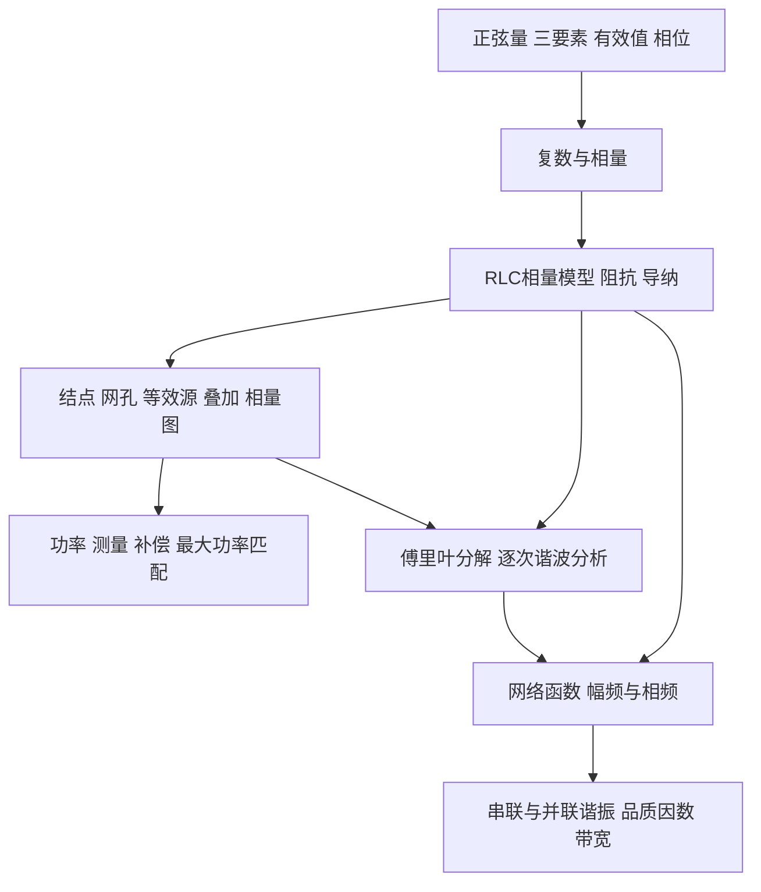

# 第四章 交流稳态电路分析 · 知识提纲

> [!abstract] 复习主线与覆盖范围
> **正弦量（sinusoid） → 相量（phasor） → 元件模型与阻抗（impedance） → 全电路求解 → 功率（power）与匹配 → 多频谐波（harmonic）分析 → 网络函数（network function）与谐振（resonance）。**
> 本提纲按现有 C4.1—C4.6 六篇笔记逐节整理，补入旧版笔记中的复数基础、阻抗与导纳（admittance）换算，以及个人作业中的易错点。定义、公式、条件、性质、解题方法和例题入口均列出；完整推导与题图通过双链回查。
> 六篇笔记标注的课件范围合计为「第4章-交流稳态（steady state）电路分析-(上集).pdf」p3—141；本次整理依据已有笔记，未找到该原始课件，**不把笔记覆盖情况等同于原课件逐页复核结果**。旧笔记中的“截至第4次课尚未讲授”属于历史记录，不代表当前进度。

## 0. 全章结构与统一约定

- **研究对象**：线性、时不变（time-invariant）电路的交流稳态；正弦稳态（sinusoidal steady state）分析默认暂态（transient）已经结束。稳态是波形规律稳定，瞬时值仍可变化。
- **交流稳态与直流稳态**：直流稳态下电容（capacitance）开路、电感（inductance）短路；交流下必须保留动态元件的作用。含独立储能状态的电路通常由微分方程描述；纯电阻（resistance）交流电路仍可用代数方程描述。线性时不变元件对应常系数方程，不能把“量随时间变化”误称为“参数时变”。
- **本提纲统一使用有效值（RMS value）相量与正弦参考**：$u(t)=\sqrt2U\sin(\omega t+\theta_u)\leftrightarrow\dot U=U\angle\theta_u$。采用余弦参考也可以，但同题全程必须一致。
- **参考方向（reference direction）**：先标电压（voltage）极性、电流（current）箭头；以下元件关系与吸收功率公式默认关联参考方向（associated reference directions）。非关联方向应先调整符号。
- **符号分工**：$u,i$ 为瞬时值；$U,I$ 为有效值；$U_m,I_m$ 为峰值；$\dot U,\dot I$ 为相量；$Z,Y$ 为复阻抗、复导纳。$Q$ 作为无功功率（reactive power）时单位为 var，作为品质因数（quality factor）时无量纲。

## 1. 正弦量与相量（C4.1）

> 来源：[[C4.1 正弦量与相量]]，课件 p3—18；复数运算另参照 [[Legacy/C4.1 正弦量与相量]]。

### 1.1 正弦量、频率与相位

1. **一般表达式与三要素**：$u(t)=U_m\sin(\omega t+\theta)$；三要素为峰值、频率（frequency）、初相位（initial phase）。幅值（amplitude）取非负值，表达式前的负号应吸收到相位中。
2. **周期（period）、频率、角频率（angular frequency）**：$T$ 单位 s，$f$ 单位 Hz，$\omega$ 单位 rad/s；$f=1/T$，$\omega=2\pi f$，$T=2\pi/\omega$。例如 $50\,\mathrm{Hz}\leftrightarrow100\pi\,\mathrm{rad/s}$。
3. **相位与初相位**：$\omega t+\theta$ 是瞬时相位，$\theta$ 是 $t=0$ 时的初相；通常将初相规范到 $(-\pi,\pi]$。波形图横轴可能是 $t$，也可能是 $\omega t$，要区分单位。
4. **相位差（phase difference）**：同频量的 $\varphi_{12}=\theta_1-\theta_2$，应按 $2\pi$ 等价性规范；正值表示量1超前量2，负值表示滞后。同相 $0$、正交 $\pm90^\circ$、反相 $180^\circ$。超前波形更早到峰，在时间轴上向左移动。
5. **比较相位的条件**：同频率、同一种三角函数、正幅值。不同频率之间没有恒定相位差，不应直接用初相之差描述固定超前关系。
6. **统一表达式**：$\cos x=\sin(x+90^\circ)$，$\sin x=\cos(x-90^\circ)$；$-\sin x=\sin(x\pm180^\circ)$，$-\cos x=\cos(x\pm180^\circ)$；可直接用 $-\cos x=\sin(x-90^\circ)$。

### 1.2 有效值与读数

> [!definition] 有效值（均方根，RMS）
> 交流量与直流量分别作用于相同电阻，在相同时间内发热相等时，该直流量大小为交流量的有效值。
> $$U=\sqrt{\frac1T\int_{t_0}^{t_0+T}u^2(t)\,\mathrm dt},\qquad I=\sqrt{\frac1T\int_{t_0}^{t_0+T}i^2(t)\,\mathrm dt}.$$

1. RMS 的计算次序为平方、平均、开方；周期积分起点任取。定义适用于任意具有有限均方值的周期波形，也适用于带直流分量的信号。
2. **正弦量专用换算**：$U=U_m/\sqrt2$，$I=I_m/\sqrt2$，峰峰值 $U_{pp}=2U_m=2\sqrt2U$。其他波形不能直接套用峰值除以 $\sqrt2$。
3. 正弦波平方的周期平均为峰值平方的一半，这是 $\sqrt2$ 的来源；正弦平均值为零不代表没有发热。
4. 本章理想交流电压表、电流表读数按有效值处理；一般设备标称交流值也采用有效值。示波器的峰值、峰峰值须看测量项。非正弦波的实际仪表还应区分真有效值与按正弦校准的平均值仪表。
5. 例如有效值 $220\,\mathrm V$ 对应正弦峰值约 $311\,\mathrm V$，峰峰值约 $622\,\mathrm V$；耐压分析需识别峰值。

### 1.3 复数基础与相量表示

1. **虚数单位与欧拉公式**：$\mathrm j^2=-1$，$\mathrm e^{\mathrm j\theta}=\cos\theta+\mathrm j\sin\theta$。
2. **三种复数写法**：$z=a+\mathrm jb=|z|\mathrm e^{\mathrm j\theta}=|z|\angle\theta$；$|z|=\sqrt{a^2+b^2}$，$\theta=\operatorname{atan2}(b,a)$，$a=|z|\cos\theta$，$b=|z|\sin\theta$。
3. **复数运算**：加减用实部、虚部分别加减；乘除用模相乘除、角相加减；除法可乘分母共轭。$z^*=a-\mathrm jb$，$zz^*=|z|^2$。取倒数时模取倒数、相角变号。
4. **旋转矢量**：$U_m\mathrm e^{\mathrm j\theta}\mathrm e^{\mathrm j\omega t}$ 在复平面以角速度 $\omega$ 逆时针旋转，虚轴投影为正弦量，实轴投影为余弦量。横轴为实轴，纵轴为虚轴。
5. **相量定义**：去掉共同旋转因子后保留幅度与初相的静止复数。有效值相量 $\dot U=U\angle\theta$；幅值相量 $\dot U_m=U_m\angle\theta=\sqrt2\dot U$，两套不能混用。
6. **正反映射**：$u(t)=\operatorname{Im}[\sqrt2\dot U\mathrm e^{\mathrm j\omega t}]$；余弦参考取实部。相量与时间函数是映射关系，不能写成二者相等。相量不单独记录频率；还原时必须补回 $\omega t$ 和有效值对应的 $\sqrt2$。
7. **四种正弦量表示**：函数式、波形图、相量复数式、相量图（phasor diagram）；应能互相转换。
8. **象限**：$3\pm\mathrm j4$ 的角为 $\pm53.13^\circ$，$-3+\mathrm j4$ 为 $126.87^\circ$，$-3-\mathrm j4$ 为 $-126.87^\circ$。$\arctan(b/a)$ 只给主值，必须结合象限。

### 1.4 同频相量合成与相量法的依据

1. 同频正弦量相加减，可直接对相量作复数加减，再还原；几何上用首尾相接或平行四边形法则。
2. 合成有效值与相位：$U=\sqrt{(\sum U_k\cos\theta_k)^2+(\sum U_k\sin\theta_k)^2}$，$\theta=\operatorname{atan2}(\sum U_k\sin\theta_k,\sum U_k\cos\theta_k)$。
3. 两量合成也可用 $U^2=U_1^2+U_2^2+2U_1U_2\cos(\theta_1-\theta_2)$。同相时模相加，反相时作差，正交时平方和开方。
4. **不能一般地把峰值或有效值直接相加**。例如峰值分别为3、4且正交的两正弦量，合成峰值为5，合成有效值为 $5/\sqrt2$；若给定的是有效值3、4，合成有效值才是5。
5. **合法性**：线性时不变电路在存在正弦稳态时保持输入频率，元件微分、积分及 KCL/KVL 只改变幅度和相位；公共旋转因子可以统一消去。
6. **适用边界**：相量法计算给定频率的稳态受迫响应，不包含初始条件引起的暂态。不同频率分别计算，不能直接合成一个相量；非线性（nonlinear）产生新频率时不能原样套用线性叠加。
7. 稳态存在也是前提：理想无损 LC 在理想谐振激励下可能没有有界正弦稳态，不能直接套用带有限损耗的结果。

## 2. 元件相量模型、阻抗与导纳（C4.2）

> 来源：[[C4.2 元件相量模型与阻抗导纳]]，课件 p19—33；换算补充见 [[Legacy/C4.2 元件相量模型与阻抗导纳]]。

### 2.1 微积分的相量对应与 RLC 模型

1. 对同频正弦稳态量，$\mathrm d/\mathrm dt\leftrightarrow\mathrm j\omega$，积分 $\leftrightarrow1/(\mathrm j\omega)$；这里只取该频率分量，积分常数另行处理。
2. 乘 $\mathrm j$ 表示逆时针旋转 $90^\circ$，乘 $-\mathrm j$ 表示顺时针旋转 $90^\circ$；乘 $\mathrm j\omega$ 同时使模乘 $\omega$、相角加 $90^\circ$。

| 元件 | 基本关系与时域 VCR | 相量 VCR | 阻抗 $Z$ | 导纳 $Y$ | $\theta_u-\theta_i$ |
|---|---|---|---|---|---|
| 电阻 | $u=Ri$ | $\dot U=R\dot I$ | $R$ | $1/R$ | $0$ |
| 电感 | 磁链（flux linkage） $\psi=Li$，$u=L\,\mathrm di/\mathrm dt$ | $\dot U=\mathrm j\omega L\dot I$ | $\mathrm j\omega L$ | $-\mathrm j/(\omega L)$ | $+90^\circ$ |
| 电容 | 电荷（charge） $q=Cu$，$i=C\,\mathrm du/\mathrm dt$ | $\dot I=\mathrm j\omega C\dot U$ | $-\mathrm j/(\omega C)$ | $\mathrm j\omega C$ | $-90^\circ$ |

3. 三种元件的电压、电流均同频。电阻 $U=RI$；电感 $U=\omega LI$；电容 $I=\omega CU$。口诀“容超感滞”指电流相对电压。
4. **感抗（inductive reactance）与容抗（capacitive reactance）大小**：$X_L=\omega L>0$，$X_C=1/(\omega C)>0$，单位均为 $\Omega$；电容的阻抗是 $-\mathrm jX_C$，不能丢掉 $-\mathrm j$。一般有符号电抗 $X=\operatorname{Im}Z$ 则可为负。
5. 理想模型中 $\omega\to0$ 时 L 短路、C 开路；$\omega\to\infty$ 时 L 阻抗趋于无穷、C 阻抗趋于零。实际器件高频受寄生参数影响，不能无限外推理想模型。

### 2.2 全电路相量模型与基本定律

1. **建模三步**：电源换为相量；支路（branch）电压、电流改为相量；R/L/C 换为对应阻抗。拓扑（topology）、参考方向与连接关系保持一致，频率另行记录。
2. **相量 KCL、KVL**：$\sum\dot I_k=0$，$\sum\dot U_k=0$；有效值标量通常不满足这样的代数和关系。
3. **广义欧姆定律（Ohm's law）**：$\dot U=Z\dot I$，$\dot I=Y\dot U$，其成立以端口（port）与电流、电压方向定义一致为前提。
4. 元件约束与拓扑约束均为线性关系，故电阻网络中的系统方法和线性定理可以推广到相量域；最大功率条件要按复阻抗重新确定。

### 2.3 阻抗、导纳及其互换

> [!definition] 阻抗与导纳
> $$Z=\frac{\dot U}{\dot I}=R+\mathrm jX=|Z|\angle\varphi_z,\qquad Y=\frac{\dot I}{\dot U}=G+\mathrm jB=\frac1Z.$$
> $R$ 电阻、$X$ 电抗，单位 $\Omega$；$G$ 电导（conductance）、$B$ 电纳，单位 S。阻抗、导纳可随频率变化。

1. $|Z|=U/I=\sqrt{R^2+X^2}$，$\varphi_z=\theta_u-\theta_i=\operatorname{atan2}(X,R)$ 为阻抗角（impedance angle）；$|Y|=I/U=1/|Z|$，$\varphi_y=-\varphi_z$ 为导纳角。
2. **精确互换**：$G=R/(R^2+X^2)$，$B=-X/(R^2+X^2)$；$R=G/(G^2+B^2)$，$X=-B/(G^2+B^2)$。一般情况下 **$G\ne1/R$、$B\ne1/X$**，不能把复数的倒数拆成实虚部各自取倒数。
3. 阻抗三角形（impedance triangle）为 $R,X,|Z|$，导纳三角形为 $G,B,|Y|$；实部表征有功吸收或发出，虚部表征储能交换。对含源等效网络，实部也可能为负，不能一概称为耗损。
4. **符号与性质判据**：阻抗、导纳是相量之比，不是正弦量的相量，$Z,Y$ 头顶不加点。$X>0$ 或 $\varphi_z>0$ 为感性，电流滞后；$X<0$ 为容性，电流超前；$X=0$ 为阻性。若用导纳，$B$ 与上述电抗符号相反。
5. 纯电感的阻抗角为 $+90^\circ$、导纳角为 $-90^\circ$；纯电容相反。不能把阻抗和导纳都写为同一个相角。
6. **固定频率的端口等效**：感性网络可写成串联 RL 或并联 RL；容性网络可写成串联 RC 或并联 RC。等效参数依赖频率，不能直接用于全部频率。
7. **串并联互换**：设 $Z=R_s+\mathrm jX_s$，则 $R_p=(R_s^2+X_s^2)/R_s$，$X_p=(R_s^2+X_s^2)/X_s$；并联支路阻抗写作 $\mathrm jX_p$，保留其符号。反向为 $R_s=R_pX_p^2/(R_p^2+X_p^2)$，$X_s=R_p^2X_p/(R_p^2+X_p^2)$。纯电阻、纯电抗等零分母情形按相应极限处理。
8. 例如 $3+\mathrm j4\,\Omega$ 对应 $Y=0.12-\mathrm j0.16\,\mathrm S$，并联等效 $R_p=8.333\,\Omega$、$X_p=6.25\,\Omega$。

### 2.4 串联、并联、分压、分流与仪表

1. 串联用阻抗：$Z=\sum Z_k$；$\dot U_k=(Z_k/\sum Z)\dot U$。
2. 并联用导纳：$Y=\sum Y_k$；$\dot I_k=(Y_k/\sum Y)\dot I$。两支路并联 $Z=Z_1Z_2/(Z_1+Z_2)$，$\dot I_1=Z_2\dot I/(Z_1+Z_2)$。
3. 分压（voltage division）、分流（current division）必须在复数域完成。支路电压或电流的模之和可以大于端口总量的模；$6\,\mathrm V$ 与 $8\,\mathrm V$ 的正交分压合成为 $10\,\mathrm V$。
4. 表的读数是相量的模，不能把相量实部当读数；电压表跨哪两个节点（node）、主路电流是哪条支路电流，必须先辨清。
5. 已知纯电容支路电流和支路电压，可由 $X_C=U/I_C$ 反推容抗；无须额外已知电容值。
6. **典型算例**：阻抗串并联例（p30）求得 $I\approx11.92\,\mathrm A$；并联分流与电表例（p31—33）中 $\dot I=\mathrm j10+(10-\mathrm j10)=10\,\mathrm A$，$\dot U_o=100-\mathrm j100\,\mathrm V$，读数为 $141.4\,\mathrm V$。

## 3. 正弦稳态电路的一般分析（C4.3）

> 来源：[[C4.3 正弦稳态电路的一般分析]]，课件 p34—51。

### 3.1 总流程与系统分析方法

1. **总流程**：时域（time domain）条件统一 → 建立相量模型（phasor model） → 解复数代数方程 → 按要求给出时间函数、有效值读数或相位关系。仅求有效值时取模；题目要求时间函数时补回 $\sqrt2$ 与频率。
2. **支路电流法（branch-current method）**：用相量 KCL、KVL 与 VCR 列方程。连通电路有 $n-1$ 个独立 KCL 方程、$b-n+1$ 个独立 KVL 方程。
3. **结点电压法（nodal analysis）**：以导纳组织方程；自导纳为所接支路导纳之和，互导纳为相关支路导纳的负和，右端为按规定方向注入的电流。电压源（voltage source）串阻抗支路可折算为电流注入项。
4. 无伴电压源接参考点时直接给出结点（node）电位（potential）；跨两个未知结点时补电压约束，可用超结点。
5. **网孔（mesh）/回路电流法**：以阻抗组织方程；各网孔方向一致时，自阻抗为本网孔总和，共享支路的互阻抗取负。源项的正负取决于绕行方向和电源极性。
6. 无伴电流源（current source）不能直接做普通有伴源变换；可用已知网孔电流、超网孔或增加源电压未知量与约束。共享支路实际电流须由网孔电流按方向组合。
7. **受控源（controlled source）**：按原控制关系保留，所有独立源（independent source）置零时受控源也不能删除。将控制量表示为结点电压或网孔电流，补控制方程；受控量未知，不能作为已知激励直接处理。先辨清菱形里是电流箭头还是电压极性，以及控制系数单位。

### 3.2 电源变换、叠加与等效电源

1. **有伴源变换**：电压源 $\dot U_s$ 串 $Z$ 等效为电流源 $\dot I_s=\dot U_s/Z$ 并同一个 $Z$；反向 $\dot U_s=Z\dot I_s$。根据电流箭头确定电压源极性。
2. 变换只保持端口外特性；参与变换的阻抗必须确为源的串联/并联伴随阻抗，其他阻抗仍按原连接关系处理。
3. **叠加定理（superposition theorem）**：线性网络中一次只保留一个独立激励；其余理想电压源（ideal voltage source）短路、理想电流源（ideal current source）开路，受控源保留。各分响应保持统一参考方向。
4. 同频响应可在相量域叠加；异频响应分别还原后在时域叠加。**同频不同电源的功率不能直接叠加**，须先合成电压、电流再算功率。
5. **戴维南定理（Thévenin's theorem）**：线性一端口在给定频率下等效为开路电压（open-circuit voltage） $\dot U_{oc}$ 串等效阻抗 $Z_0$；负载电流 $\dot I_L=\dot U_{oc}/(Z_0+Z_L)$。
6. **诺顿定理（Norton's theorem）**：等效为短路电流（short-circuit current） $\dot I_{sc}$ 并 $Z_0$；方向一致时 $\dot U_{oc}=Z_0\dot I_{sc}$。
7. **求内阻抗**：独立源置零后从端口看入；有受控源时可加测试源，$Z_0=\dot U_t/\dot I_t$。适用时也可用开路电压与短路电流之比；纯受控源网络出现 $0/0$ 时不能用此比值。
8. 第三章的等效化简、替代定理（substitution theorem）、Y—Δ 等端口分析思想也可推广至适用的复阻抗网络；不能把“方法能推广”理解成“所有直流结论不加条件照抄”。

### 3.3 相量图、参数识别与移相桥

1. **参考相量选择**：串联电路优先选公共电流，并联电路优先选公共电压；选为 $0^\circ$ 后，其余量按相对相位作图。
2. **图解法**：结合 KCL/KVL、RLC 的同相/正交关系，使用勾股定理、余弦定理与相似三角形。图示未按比例绘制时不能从图上量取精确角度。
3. **相位设计题**：对非零相量比 $F=\dot U/\dot I$，相差 $\pm90^\circ$ 等价于 $\operatorname{Re}F=0$ 且虚部非零；同相/反相可先令虚部为零，再以实部正负区分。最后核对谁超前谁。
4. **三电压法识别线圈**：已知纯电阻 $R_1$ 与 RL 线圈串联，测得总电压 $U$、电阻电压 $U_1$、线圈电压 $U_2$：
   $I=U_1/R_1$，$\cos\theta_2=(U^2-U_1^2-U_2^2)/(2U_1U_2)$；$R_2=U_2\cos\theta_2/I$，$L_2=U_2\sin\theta_2/(\omega I)$。也可联立 $U^2=I^2[(R_1+R_2)^2+(\omega L_2)^2]$ 与 $U_2^2=I^2[R_2^2+(\omega L_2)^2]$ 求解。
5. **移相桥结构与原理**：一支路为两相等电阻，另一支路为可变电阻串电容，输出取两中点之间。等阻分压中点位于电源相量中点；RC 两分压正交，使另一中点沿以电源相量为直径的半圆运动。
6. 按原例输出参考方向，令 $x=\omega CR_2$，有 $\dot U_{ab}/\dot U=-1/2+\mathrm jx/(1+\mathrm jx)$；因此 $U_{ab}=U/2$，输出相移 $180^\circ-2\arctan x$。$R_2:0\to\infty$ 时相位从 $180^\circ$ 降至 $0^\circ$；$x=1$ 时为 $90^\circ$。输出相位与 RC 支路电流相位是两个不同的角。
7. 移相桥用于连续移相、相位校准、相敏检测与交流电桥（bridge）；实际接入负载后应考虑负载对理想幅相关系的影响。

### 3.4 本节例题逐项入口

| 原笔记例题 | 必须掌握的知识/结果 | 课件页 |
|---|---|---|
| 例1：结点法（nodal analysis） | 电源统一相位、阻抗换算、结点求解及时间函数还原 | p35 |
| 例2：网孔与结点两解 | 自/互阻抗、源方向、理想源约束、两法互验；原题 A/mA 标注存疑，勿混用 | p36—38 |
| 例3：含受控源 | 回路法（loop analysis）与结点法均需控制关系；$\dot I_1=1.2404\angle29.74^\circ$、$\dot I_2=2.7735\angle56.31^\circ\,\mathrm A$（正弦参考） | p39—40 |
| 例4：源变换与戴维南 | 相同端口等效、内阻抗求法；$\dot I\approx1.13\angle81.9^\circ\,\mathrm A$ | p41—42 |
| 例5：叠加 | 分响应相量合成；现有笔记反推 $Z_2=50\angle-30^\circ\,\Omega$，该反推条件需与原题核对 | p43—44 |
| 例6：相差90° | 令相量比实部为零，$\beta=-41$，$\dot U_s/\dot I_1=-\mathrm j1000$ | p45 |
| 例7：测线圈 | 三电压法与解析法；$R_2\approx19.58\,\Omega$、$L_2\approx0.1332\,\mathrm H$ | p46—47 |
| 例8：移相桥 | 定幅、变相与半圆轨迹 | p48—49 |
| 例9：戴维南 | 开路电压、复内阻抗与负载电流；原笔记提示题图有遮挡 | p50—51 |

## 4. 正弦稳态功率、测量、补偿与匹配（C4.4）

> 来源：[[C4.4 正弦稳态功率与功率因数]]，课件 p52—74。

### 4.1 瞬时功率与四种功率量

> [!formula] 关联参考方向、有效值相量、正弦参考
> $$\varphi=\theta_u-\theta_i,\qquad p(t)=u(t)i(t)=UI\cos\varphi-UI\cos(2\omega t+\theta_u+\theta_i).$$
> $$P=\frac1T\int_0^Tp(t)\,\mathrm dt=UI\cos\varphi,\qquad Q=UI\sin\varphi,\qquad S=UI.$$
> $$\widetilde S=\dot U\dot I^*=P+\mathrm jQ,\qquad S=|\widetilde S|=\sqrt{P^2+Q^2}.$$

1. 瞬时功率（instantaneous power）包含恒定项与二倍频项。$p>0$ 表示按规定方向吸收能量，$p<0$ 表示瞬时返还能量；不是每个负载的瞬时功率都一定出现负值。
2. **有功功率（active power） $P$** 单位 W，表示净能量转换速率；周期能量为 $PT$。
3. **无功功率 $Q$** 单位 var，表征储能交换；它是一个带符号的量，不能说“$Q$ 本身的平均值为零”，应说理想储能元件（energy-storage element）交换部分不贡献周期平均有功。
4. **视在功率（apparent power） $S$** 单位 VA，表征电压、电流容量；$|P|\le S$，无源（passive）负载 $0\le P\le S$。不能用 $S-P$ 代替 $Q$。
5. **复功率（complex power）** 是将有功与无功组合的复数工具，电流必须取共轭；不共轭会得到相位和。若采用峰值相量，则 $\widetilde S=\dot U_m\dot I_m^*/2$。
6. **功率因数（power factor）**：正弦稳态下 $\lambda=P/S=\cos\varphi$，$\varphi$ 也称功率因数角；对于无源负载在0与1之间，包含理想纯电抗的边界值。相同功率因数数值可以对应感性或容性，要结合相位或 $Q$ 的符号。
7. 功率因数是 power factor；品质因数是 quality factor，二者不同。

### 4.2 三元件、一般阻抗与功率守恒

| 对象 | 有功 $P$ | 无功 $Q$ | 性质 |
|---|---|---|---|
| 电阻 $R$ | $I^2R=U^2/R=UI$ | $0$ | 耗有功，功率因数1 |
| 理想电感 | $0$ | $I^2\omega L=U^2/(\omega L)>0$ | 吸收感性无功，功率因数0 |
| 理想电容 | $0$ | $-I^2/(\omega C)=-\omega CU^2<0$ | 发出容性无功，功率因数0 |
| $Z=R+\mathrm jX$ | $I^2R$ | $I^2X$ | $\widetilde S=I^2Z$ |
| $Y=G+\mathrm jB$ | $U^2G$ | $-U^2B$ | $\widetilde S=U^2Y^*$ |

1. 理想 L、C 不消耗平均有功，但有非零电流、电压并占用设备容量；一般有源（active）端口可能发出有功。
2. **三个相似三角形**：阻抗 $R,X,|Z|$；以电流为参考的电压分量 $IR,IX,U$；功率 $P,Q,S$。它们的角为同一个 $\varphi$，缩放因子依次为 $I$、$I^2$。
3. **功率三角形（power triangle）**：水平 $P$、竖直 $Q$、斜边 $S$；$P=S\cos\varphi$，$Q=S\sin\varphi$，适用时 $\tan\varphi=Q/P$。
4. 同频网络各支路的 $P$、$Q$、复功率分别按符号相加；全网以吸收为正时总和为零。电源输出与负载吸收要统一记账。
5. **视在功率不满足一般代数可加性**：$S_\Sigma=\sqrt{(\sum P_k)^2+(\sum Q_k)^2}$，通常不等于 $\sum S_k$。只有相应复功率同向等特殊情形才相等。
6. 反例：$(P_1,Q_1)=(3,4)$，$(P_2,Q_2)=(0,-4)$，则 $S_1+S_2=9\,\mathrm{VA}$，端口 $S=3\,\mathrm{VA}$。
7. 并联 RLC 先按公共电压求各支路电流、相量合成；功率也可分别算 $P=U^2/R$、$Q=U^2/(\omega L)-\omega CU^2$ 后求 $S,\lambda$。计算中间量尽量不提前取整。

### 4.3 功率表、三表法与参数测量

1. **单相功率表**：电流线圈串联于负载，电压线圈经较大附加电阻并联于负载；平均转矩正比于 $UI\cos\varphi$，因此直接测有功功率。
2. 两线圈同名端（dotted terminals）/星号端按规定极性接入；接反会改变指示方向。附加电阻使电压线圈支路近似纯阻，减小相位误差。
3. **三表法**：电压表、电流表、功率表测得 $U,I,P$，对已知感性线圈：$|Z|=U/I$，$R=P/I^2$，$X_L=\sqrt{|Z|^2-R^2}$，$L=X_L/\omega$，$\cos\varphi=P/(UI)$。
4. 仅凭 U、I、P 可确定电抗的绝对值；感性/容性须靠对象性质或相位信息区分。实际测量应考虑仪表内阻、接线与自身功耗造成的系统误差，本章理想题通常忽略。
5. 三表法例（p63）：$U=50\,\mathrm V,I=1\,\mathrm A,P=30\,\mathrm W$，得 $R=30\,\Omega,X_L=40\,\Omega,L\approx0.1273\,\mathrm H$。
6. **直流＋交流法测线圈**：直流稳态先测 $R=U_{dc}/I_{dc}$，交流测 $|Z|=U/I$，再求 $X_L=\sqrt{|Z|^2-R^2}$ 与 $L=X_L/\omega$；不能把线圈总电压当作纯电感电压。

### 4.4 功率因数提高

1. **目的**：提高电源容量利用率，降低供电线路电流及 $I^2R$ 线损，减小导线材料需求。固定 $P,U$ 时 $I=P/(U\lambda)$。
2. **前提与方法**：电压源供电、负载并联、保持设备端电压和工作状态；对感性设备并联电容，以负无功抵消正无功。
3. **变与不变**：理想补偿不改变设备本身的阻抗、电压、支路电流、有功功率和功率因数；改变的是端口总无功、线路电流和线路总功率因数。线路损耗另算。
4. 补偿前 $Q=P\tan\varphi$，目标 $Q_1=P\tan\varphi_1$；电容无功为 $Q_C=-\omega CU^2$，所需补偿无功大小为 $|Q_C|=P(\tan\varphi-\tan\varphi_1)$。
5. **补偿公式**：$C=P(\tan\varphi-\tan\varphi_1)/(\omega U^2)$；$I_C=\omega CU=P(\tan\varphi-\tan\varphi_1)/U$。通常欠补偿时 $0\le\varphi_1<\varphi$；完全补偿取 $\varphi_1=0$。
6. 电容过大可使总负载变容性并再次增大电流，不能认为补偿电容越大越好。容量受限时的 $P_{\max}=UI$ 与匹配问题中的最大功率公式是两个不同问题。
7. **日光灯例（p67—68）**：将灯管等效为电阻、镇流器等效为电感。$P=12\,\mathrm W,U_R=100\,\mathrm V,U=220\,\mathrm V,f=50\,\mathrm{Hz}$ 时，$I=0.12\,\mathrm A$、$U_L=\sqrt{U^2-U_R^2}\approx196\,\mathrm V$、$L\approx5.20\,\mathrm H$、$\lambda=U_R/U\approx0.455$；补偿至0.9需 $C\approx1.165\,\mu\mathrm F$。

### 4.5 最大功率传输与三种匹配

> [!formula] 一般负载功率
> 戴维南源 $\dot U_s$、内阻抗 $Z_s=R_s+\mathrm jX_s$、负载 $Z_L=R_L+\mathrm jX_L$：
> $$P_L=\frac{U_s^2R_L}{(R_s+R_L)^2+(X_s+X_L)^2}.$$
> 以下最大值公式要求 $R_s>0$，负载电阻非负，且调节自由度与题设一致；$U_s$ 为有效值。

| 调节条件 | 最优负载条件 | 最大有功 |
|---|---|---|
| $R_L,X_L$ 均可变：共轭匹配 | $X_L=-X_s$，$R_L=R_s$，即 $Z_L=Z_s^*$ | $U_s^2/(4R_s)$ |
| $R_L$ 固定，仅调 $X_L$：电抗匹配 | $X_L=-X_s$ | $U_s^2R_L/(R_s+R_L)^2$ |
| 负载只能为可变纯电阻：模匹配 | $X_L=0$，$R_L=\lvert Z_s\rvert=\sqrt{R_s^2+X_s^2}$ | $U_s^2/[2(R_s+\lvert Z_s\rvert)]$ |

1. 共轭匹配可先消去总电抗，再对 $R_L$ 求导；两个要求缺一不可。分母用的是内阻实部 $R_s$，不是 $|Z_s|$。
2. **比较自由度须一致**：共轭匹配是上述全局最大；固定电阻后的电抗匹配，不能与“可任意改变电阻”的模匹配给出无条件大小排序。对相同 $R_L$，消去 $X_s$ 后的功率不小于未消去时；$X_s=0$ 可相等。
3. 对这套戴维南等效源，$\eta=P_L/(P_L+I^2R_s)=R_L/(R_s+R_L)$；共轭匹配时为50%。最大功率与高效率是不同目标；该效率不代表原含源复杂网络的所有内部效率。
4. **匹配网络实现**：给纯电阻并联电容后，$Z_{\mathrm{load}}=R_p/(1+\mathrm j\omega CR_p)$；令其等于 $Z_s^*$，分别比较实、虚部，不能直接令实体并联电阻 $R_p=R_s$。
5. 例（p72—73）：$Z_s=5+\mathrm j5\,\Omega,U_s=10\,\mathrm V$；纯电阻5 Ω时 $P=4\,\mathrm W$；模匹配 $R_L=7.071\,\Omega$ 得约4.142 W；在 $\omega=10^5$ 时用10 Ω并1 μF可实现 $5-\mathrm j5\,\Omega$，得5 W。
6. 含电流源例（p74）：先源变换求 $\dot U_s=60+\mathrm j60\,\mathrm V$、$Z_s=15-\mathrm j45\,\Omega$，再取 $Z_L=15+\mathrm j45\,\Omega$，$P_{\max}=120\,\mathrm W$。变换后别漏掉另串的阻抗。

## 5. 非正弦周期电路与谐波分析（C4.5）

> 来源：[[C4.5 非正弦周期电路的谐波分析]]，课件 p75—98。

### 5.1 非正弦来源、周期性与展开条件

1. **周期函数**：$f(t+T)=f(t)$，最小正周期确定基频 $f_0=1/T$。多个正弦分量须频率可公度才形成严格周期信号，并非任意异频叠加都周期。
2. **三个来源**：非正弦周期（non-sinusoidal periodic）电源激励线性电路（linear circuit）；多个异频正弦源激励线性电路；正弦激励作用于非线性电路（nonlinear circuit）产生谐波。本节计算采用前两类线性问题。
3. 非正弦激励在线性网络中可通过“傅里叶分解＋叠加”处理；线性时不变电路改变各已有谐波的幅相，不产生新的频率。非线性情形不能套用这一叠加流程。
4. **狄里赫利条件（本章常用充分条件）**：一周期绝对可积，有限个极大/极小值，有限个第一类间断点且存在有限左右极限。它们不是傅里叶表示在所有数学意义下的必要条件。
5. 连续点处级数收敛到原函数；跳变点处收敛到左右极限平均值。有限项逼近跳变处有吉布斯现象：约为跳变量9%的过冲不会因项数增多而消失，但影响区间变窄。
6. 非零周期信号一般总能量无穷，但周期平均功率（average power）可有限；不能把“每周期积分有限”说成“总能量有限”。

### 5.2 傅里叶级数、系数与对称性

> [!formula] 两种写法（$\omega=2\pi/T$）
> $$f(t)=A_0+\sum_{k=1}^{\infty}[a_k\cos(k\omega t)+b_k\sin(k\omega t)]
> =A_0+\sum_{k=1}^{\infty}A_{km}\sin(k\omega t+\varphi_k).$$
> $$A_0=\frac1T\int_{t_0}^{t_0+T}f(t)\,\mathrm dt,\quad a_k=\frac2T\int_{t_0}^{t_0+T}f(t)\cos(k\omega t)\,\mathrm dt,\quad b_k=\frac2T\int_{t_0}^{t_0+T}f(t)\sin(k\omega t)\,\mathrm dt.$$

1. $A_0$ 是平均值本身；若另一本书写 $a_0/2$，则其 $a_0=2A_0$。不混淆直流、基波/一次谐波、高次谐波与第 $k$ 次谐波 $k\omega$。
2. 换积分变量 $x=\omega t$ 时，平均值系数为 $1/(2\pi)$，正余弦系数为 $1/\pi$，积分范围可取完整的 $2\pi$。
3. **系数换算**：$a_k=A_{km}\sin\varphi_k$，$b_k=A_{km}\cos\varphi_k$；$A_{km}=\sqrt{a_k^2+b_k^2}$，$\varphi_k=\operatorname{atan2}(a_k,b_k)$。注意此处 atan2 的参数顺序；幅度为零时相位任意。
4. **正交性与投影**：不同整数倍频率的正弦/余弦乘积，在公共整周期积分为零；常数与正弦/余弦也正交。系数积分正是将信号投影到各基函数上。
5. 相对选定原点，奇函数只有正弦项且无直流；偶函数只有余弦项。半波反对称 $f(t+T/2)=-f(t)$ 时无直流和偶次谐波。时间平移会改变相位及正余弦组成，套公式前先看波形原点。
6. 波形跳变通常对应 $1/k$ 量级的系数衰减；连续但有尖角的三角波对应 $1/k^2$。衰减快意味着所需近似项数较少。

### 5.3 五种典型波形：公式不能漏

下式 $U_m$ 为相应波形峰值；正弦相位起点采用下列波形定义。整流式中的 $\omega$ 特指**整流前正弦**的角频率。

1. **双向方波**：$0<t<T/2$ 为 $+U_m$，$T/2<t<T$ 为 $-U_m$：
   $$u(t)=\sum_{n=1}^{\infty}\frac{4U_m}{(2n-1)\pi}\sin[(2n-1)\omega t].$$
   直流为零，只有奇次正弦项，衰减 $1/n$。
2. **双向三角波**：过原点上升，四分之一周期达到正峰：
   $$u(t)=\sum_{n=1}^{\infty}\frac{(-1)^{n-1}8U_m}{(2n-1)^2\pi^2}\sin[(2n-1)\omega t].$$
   直流为零，只有奇次谐波，符号交替，衰减 $1/n^2$。
3. **单向上升锯齿波**：$u(t)=U_mt/T$，$0<t<T$，再周期延拓：
   $$u(t)=\frac{U_m}{2}-\sum_{n=1}^{\infty}\frac{U_m}{n\pi}\sin(n\omega t).$$
   直流 $U_m/2$，包含所有整数次谐波，衰减 $1/n$。去掉直流后的部分是奇对称；不能把带非零直流的整个波形称为奇函数。
4. **全波整流**：$u(t)=U_m|\sin\omega t|$：
   $$u(t)=\frac{2U_m}{\pi}-\sum_{n=1}^{\infty}\frac{4U_m}{(4n^2-1)\pi}\cos(2n\omega t).$$
   直流为 $2U_m/\pi$；周期为原正弦的一半，只含相对于原正弦的偶次谐波，最低非直流频率为 $2\omega$。以整流后最小周期定义基频时，$2\omega$ 就是它自身的基波。
5. **半波整流**：$u(t)=U_m\max(\sin\omega t,0)$：
   $$u(t)=\frac{U_m}{\pi}+\frac{U_m}{2}\sin\omega t-\sum_{n=1}^{\infty}\frac{2U_m}{(4n^2-1)\pi}\cos(2n\omega t).$$
   直流为 $U_m/\pi$，包括基波与偶次谐波；可由“半波＝原正弦与全波之和的一半”推得。

> [!warning] 整流系数校正
> 现有 C4.5 的表中，全波与半波余弦项系数分别少了一个2；此处已分别改为 $4U_m/[(4n^2-1)\pi]$ 和 $2U_m/[(4n^2-1)\pi]$。可用 $t=0$ 时两种波形均为零，或直接按傅里叶系数积分核验。原笔记中的整流图标题互换、三角波积分相位与结果不一致，也不能直接照抄。

### 5.4 幅度谱、相位谱与时频描述

1. **幅度谱**：各谐波振幅随频率的分布；**相位谱**：各谐波初相随频率的分布；二者共同组成完整的频谱描述。只给幅度谱通常不能唯一还原时域波形。
2. 周期信号对应离散谱，谱线位于基频整数倍处；某些谐波可以缺失，因此实际相邻非零谱线不一定恰好相隔一个基频。
3. 周期延长时谱线网格间隔变小；在适当的周期延拓极限下，$T\to\infty$ 可得到非周期信号的连续频谱，需要使用谱密度。不能把“离散时间周期信号”误说成“连续频谱”。
4. 频谱与网络函数结合时，各次输出满足 $\dot R_k=H(\mathrm jk\omega)\dot E_k$；不同频率的幅度与相移分别改变，可形成滤波效果。

### 5.5 非正弦有效值与平均功率

> [!formula] 各频率先归并，再作合成
> $$U=\sqrt{U_0^2+\sum_{k\ge1}U_k^2},\qquad I=\sqrt{I_0^2+\sum_{k\ge1}I_k^2},\qquad U_k=U_{km}/\sqrt2.$$
> $$P=U_0I_0+\sum_{k\ge1}U_kI_k\cos\varphi_k,\qquad\varphi_k=\theta_{uk}-\theta_{ik}.$$
> 用峰值时，第 $k$ 次有功为 $P_k=U_{km}I_{km}\cos\varphi_k/2$。

1. **平方和的原因**：展开平方后，直流与交流交叉项、异频交叉项在公共周期积分为零，各次正弦平方项贡献峰值平方的一半。这是 Parseval 型关系。
2. 同频分量必须先相量合成，不能直接将它们当作相互正交的独立分量作平方和；直流分量直接用 $U_0$、$I_0$，不除以 $\sqrt2$。
3. 平均功率只有电压、电流在同一频率的分量配对才可能非零；一边缺失或同频相位差为 $\pm90^\circ$ 时该次功率为零。“两边都有”不保证一定有非零有功。
4. 异频交叉项可能有瞬时功率，但其周期平均值为零；直流仅与直流贡献平均有功。
5. 一般端口某次 $P_k$ 可为负，表示在该频率发出有功；这不能仅由“容性”解释。无源线性时不变 RLC 一端口在关联方向下各频率有功均不为负；负的 $P_k$ 不能当作普通无源 RLC 的一般性质。
6. **正弦与非正弦的区别**：不同独立源的同频功率通常不能叠加，而不同频率的平均功率能按正交性相加。非正弦总功率因数为 $P/(UI)$，通常不能用单一相位差的余弦表示；$S^2=P^2+Q^2$ 的简单正弦功率三角形也不能直接外推。
7. 例（p81/有效值手算）：直流80 V、各谐波有效值220、100、45、30 V，合成 $U=\sqrt{67725}\approx260.2403\,\mathrm V$。
8. 例4-6-1（p94）：直流电压存在而直流电流为零，$P_0=0$；基波与3次谐波配对，$P\approx29.19\,\mathrm W$。
9. 一般支路例（p95—96）：仅直流、1次、4次配对；$P_0=2$、$P_1=43.3013$、$P_2=P_3=0$、$P_4=-0.25\,\mathrm W$，总计约45.0513 W。原题只给端口波形，不能据此把端口认定为无源线性 RLC。

### 5.6 谐波分析完整流程

1. 将激励展开为直流、基波和各次谐波，按需要截取项数；记录各次振幅、相位、频率。
2. 直流分量用直流稳态方法分析：C 开路、L 短路。
3. 第 $k$ 次谐波分别建模：$\omega_k=k\omega$，$Z_{Lk}=\mathrm jk\omega L$，$Z_{Ck}=1/(\mathrm jk\omega C)$；独立源按本频率保留，其他频率独立源置零，受控源保留。
4. 每个频率独立求响应相量；频率变化时感抗增大、容抗减小，不能把基波阻抗重复用于全部谐波。
5. 每次响应分别还原成时间函数，再与直流相加：$i(t)=I_0+\sum\sqrt2I_k\sin(k\omega t+\theta_{ik})$。不同频率相量不能直接相加。
6. 最后按需要求总有效值、平均功率与频谱；不把各频率峰值直接相加当作整体峰值。

## 6. 网络函数与频率特性（C4.6 前半）

> 来源：[[C4.6 网络函数与谐振]] §1，课件 p99—107。

### 6.1 定义、种类与依赖因素

1. **频率特性/频率响应**：由于 $X_L,X_C$ 随频率变化，电路输入输出的幅度比、相位差随频率变化。
2. **网络函数**：给定输入、输出及端口条件，在线性正弦稳态中定义 $H(\mathrm j\omega)=\dot R/\dot E$；计算某一独立输入对应的函数时其余独立源置零，受控源保留。

| 类别 | 名称 | 相量比 | 单位 |
|---|---|---|---|
| 同端口策动点 | 输入阻抗 | $Z_{in}=\dot U_1/\dot I_1$ | Ω |
| 同端口策动点 | 输入导纳 | $Y_{in}=\dot I_1/\dot U_1$ | S |
| 不同端口转移 | 转移阻抗 | $Z_T=\dot U_2/\dot I_1$ | Ω |
| 不同端口转移 | 转移导纳 | $Y_T=\dot I_2/\dot U_1$ | S |
| 不同端口转移 | 电压传输比 | $A_u=\dot U_2/\dot U_1$ | 无量纲 |
| 不同端口转移 | 电流传输比 | $A_i=\dot I_2/\dot I_1$ | 无量纲 |

3. 网络函数由拓扑、元件参数、频率、输入输出变量及端口位置、终接条件决定；在线性范围内不依赖输入幅值。
4. $H=|H|\mathrm e^{\mathrm j\varphi}$；**幅频特性（amplitude-frequency characteristic）**为 $|H|$ 随频率变化，**相频特性（phase-frequency characteristic）**为 $\arg H$ 随频率变化。相角同样要考虑象限。
5. **已知函数求响应**：$\dot R=H\dot E$；输出幅度为 $|H|$ 乘输入幅度，输出相位为输入相位加 $\arg H$。对多频输入逐频计算。
6. **求函数的方法**：将 $\omega$ 保留为符号，按相量模型列结点或网孔方程，消去中间变量，取输出与输入之比；再求模、相角及低频/高频极限。
7. **阶数**：在约分后的适当有理表示中，动态阶次与独立储能状态有关；输入输出函数可能因极零抵消而降低阶数。不能机械数 L/C 总个数，也不能不看分母和约分便只取式中出现的最高幂。

### 6.2 原笔记网络函数例题

- 网孔方程：$(2+\mathrm j\omega)\dot I_1-2\dot I_2=\dot U_s$，$-2\dot I_1+(4+\mathrm j\omega)\dot I_2=0$。
- 得 $Y_T=2/(4-\omega^2+\mathrm j6\omega)$，$A_u=\mathrm j2\omega/(4-\omega^2+\mathrm j6\omega)$；两者分母为二阶。
- $\omega\to0$ 时 $Y_T\to0.5\,\mathrm S$、$A_u\to0$；$\omega\to\infty$ 时两者趋于零。输入输出选取不同，频率特性也不同。
- **数值校正**：$\omega=2$ 时分母为 $\mathrm j12$，所以 $Y_T=-\mathrm j/6\,\mathrm S$、$A_u=1/3$。该电路只有 R、L；不能因为某个分母实部为零，就把它认作 LC 储能交换意义的谐振。

## 7. 谐振、品质因数与通频带（C4.6 后半）

> 来源：[[C4.6 网络函数与谐振]] §2—6，课件 p108—139；结语覆盖至p141。

### 7.1 谐振概念与判据

1. 本章 LC 谐振涉及磁场与电场两种储能的交换，在交流稳态特定频率下，端口无功分量抵消而呈阻性；含 R、L、C 不保证任意参数下必有非零谐振频率。
2. **端口判据**：用阻抗时令 $\operatorname{Im}Z=0$，用导纳时令 $\operatorname{Im}Y=0$；排除零频、无定义与退化情形。正电阻情况下端口电压、电流同相，功率因数为1。
3. **谐振类型**：RLC 串联、GCL 理想并联，以及复合串并联/多重谐振；复合网络在现有笔记中只列类别，未展开公式。
4. 纯阻性判据和“某响应取极值”不能在任意复杂或含频变损耗网络中无条件等同。以下阻抗最小、导纳最小等极值结论都有具体模型前提。
5. **调谐**：可调激励频率至谐振频率，也可固定频率改变 L/C；常用可变电容。

### 7.2 RLC 串联谐振

> [!formula] $R,L,C$ 固定且 $R>0$
> $$Z(\omega)=R+\mathrm j\left(\omega L-\frac1{\omega C}\right),\quad \omega_0=\frac1{\sqrt{LC}},\quad f_0=\frac1{2\pi\sqrt{LC}}.$$
> $$\rho=\omega_0L=\frac1{\omega_0C}=\sqrt{\frac LC},\qquad Q_s=\frac\rho R=\frac{\omega_0L}{R}=\frac1{\omega_0CR}.$$

1. **谐振条件**：$X_L=X_C$。$\omega<\omega_0$ 为容性，$\omega>\omega_0$ 为感性。
2. **阻抗/电流特点**：$Z_0=R$，阻抗模最小、导纳模最大；固定电压幅度时 $I_0=U/R$ 最大，电流与电源电压同相。
3. **电压特点**：$\dot U_R=\dot U$，$\dot U_L=\mathrm jQ_s\dot U$，$\dot U_C=-\mathrm jQ_s\dot U$；$\dot U_L+\dot U_C=0$，但各自电压并非零。
4. $U_L=U_C=Q_sU$，称**电压谐振**。$Q_s>1$ 才有超过电源电压的放大，可能造成元件过电压；高 Q 放大不违反能量守恒。
5. **特性阻抗（characteristic impedance） $\rho$** 单位 Ω；**品质因数 $Q_s$** 无量纲。固定其他参数，提高 $L/C$ 或降低总串联损耗可提高 Q；若指定谐振频率，调整参数时也要满足 LC 乘积约束。
6. **总损耗电阻**包括负载、电源内阻、线圈及其他串联损耗，设计时不能只取图中某一个电阻。
7. **能量**：取 $i=I_{m0}\sin\omega_0t$，则 $W_L=LI_{m0}^2\sin^2\omega_0t/2$，$W_C=LI_{m0}^2\cos^2\omega_0t/2$；两种能量交替，最大值相等，总储能 $W=LI_{m0}^2/2=LI_0^2$ 恒定。
8. **功率**：$P=RI_0^2=U^2/R$，$Q_L=\omega_0LI_0^2$，$Q_C=-I_0^2/(\omega_0C)$，总无功为零。电源仍向电阻持续提供有功能量；“与电源没有能量交换”只应指 LC 对外净无功交换抵消。
9. **品质因数物理意义**：$Q=2\pi W/\Delta W$，其中 $W$ 为谐振总储能，$\Delta W=PT_0$ 为每周期耗散能量。Q 大表示储能相对于周期损耗大，不代表无条件的绝对能量或损耗大小结论。
10. 串联求参数例（p118）：$\omega_0=5000\,\mathrm{rad/s},U=10\,\mathrm V,I_0=0.2\,\mathrm A,U_C=600\,\mathrm V$，得 $R=50\,\Omega,Q=60,L=0.6\,\mathrm H,C=0.06667\,\mu\mathrm F$。原笔记记录的课件末行 L/C 数值不应照抄。

### 7.3 频率曲线、归一化、选择性与带宽

1. **阻抗幅频与相频**：$|Z|=\sqrt{R^2+(\omega L-1/(\omega C))^2}$，$\varphi_z=\arctan[(\omega L-1/(\omega C))/R]$。低频角趋向 $-90^\circ$，谐振为0，高频趋向 $+90^\circ$。
2. **电流谐振曲线**：$I(\omega)=U/|Z(\omega)|$，在 $\omega_0$ 取最大，低频和高频均趋向零；曲线在普通线性频率轴上不严格左右对称。
3. **归一化**：$\eta=\omega/\omega_0$，$I_0=U/R$：
   $$\frac I{I_0}=\frac1{\sqrt{1+Q_s^2(\eta-1/\eta)^2}}.$$
   同一 Q 对应同一归一化曲线；各曲线过 $(1,1)$。Q 越大曲线越窄、选择性（selectivity）越强，但归一化峰高均为1。
4. **选择性**：保留目标频率、抑制偏离谐振频率信号的能力。讨论时需明确输出取电流、电阻电压还是其他变量。
5. **半功率点**：$P/P_{\max}=1/2$，对应 $I/I_0=1/\sqrt2\approx0.707$；电阻电压同理。这是约 $-3.01\,\mathrm{dB}$ 边界，不是电流降为一半。
6. **上下截止频率**：$\eta_1=(\sqrt{1+4Q_s^2}-1)/(2Q_s)$，$\eta_2=(\sqrt{1+4Q_s^2}+1)/(2Q_s)$，$\omega_{1,2}=\eta_{1,2}\omega_0$；$\omega_1\omega_2=\omega_0^2$，因此 $\omega_0$ 为几何中心。
7. **通频带（passband）与带宽（bandwidth）**：通带为两截止频率之间；$\Delta\eta=1/Q_s$，$\Delta\omega=\omega_2-\omega_1=\omega_0/Q_s=R/L$，$\Delta f=f_0/Q_s$。
8. **Q 与带宽的权衡**：Q 大，选择性高、带宽窄；设计应同时满足目标频率与需要通过的信号带宽，不能一律追求最高 Q。
9. **设计步骤**：给定 $f_0,\Delta f$，先求 $Q=f_0/\Delta f$，再由总电阻求 $L=QR_{\mathrm{total}}/\omega_0$，最后 $C=1/(\omega_0^2L)$。
10. **接收机例（p127—128）**：$L=250\,\mu\mathrm H,C=150\,\mathrm{pF},R=20\,\Omega$ 时，$\omega_0\approx5.164\times10^6\,\mathrm{rad/s}$、$f_0\approx821.87\,\mathrm{kHz}$、$Q\approx64.55$、$\Delta f\approx12.73\,\mathrm{kHz}$；对640、820、1026 kHz分别算阻抗，820 kHz响应最大。820 kHz只是接近谐振，严格计算不能把其电抗直接置零。
11. **设计例（p129）**：$f_0=10\,\mathrm{kHz},\Delta f=100\,\mathrm{Hz}$ 得 Q=100；若负载5 Ω加源内阻10 Ω，总电阻15 Ω，则 $L\approx23.87\,\mathrm{mH},C\approx10.61\,\mathrm{nF}$。题图或数值若用另一套总电阻，必须说明条件。

### 7.4 电感、电容电压的峰值频率

1. 在电源电压 U 恒定时，
   $$\frac{U_L}{U}=\frac{Q_s\eta}{\sqrt{1+Q_s^2(\eta-1/\eta)^2}},\qquad \frac{U_C}{U}=\frac{Q_s/\eta}{\sqrt{1+Q_s^2(\eta-1/\eta)^2}}.$$
2. **$Q_s>1/\sqrt2$ 时存在内部极大值**：$\omega_{Cm}=\omega_0\sqrt{1-1/(2Q_s^2)}<\omega_0$，$\omega_{Lm}=\omega_0/\sqrt{1-1/(2Q_s^2)}>\omega_0$。
3. 相应最大有效值相等：$U_{L,\max}=U_{C,\max}=Q_sU/\sqrt{1-1/(4Q_s^2)}>Q_sU$。这里“最大值”指随频率扫描得到的最大有效值，不是时间波形的峰值；时间峰值还要乘 $\sqrt2$。
4. 原因是 $U_L=\omega LI$、$U_C=I/(\omega C)$ 各含一个随频率变化的额外因子。电流峰值在谐振点，不代表 L/C 电压峰值也在同一点。
5. Q 增大时两个峰值频率逼近 $\omega_0$。$Q_s\le1/\sqrt2$ 时无上述有限正频率内部峰值：电容电压从低频极限 U 单调下降，电感电压向高频极限 U 单调上升。

### 7.5 理想 GCL 并联谐振及串并联对偶

> [!formula] 电阻以电导 $G=1/R_p$ 表示
> $$Y=G+\mathrm j\left(\omega C-\frac1{\omega L}\right),\qquad\omega_0=\frac1{\sqrt{LC}},\qquad Q_p=\frac{\omega_0C}{G}=\frac1{\omega_0LG}=\frac1G\sqrt{\frac CL}.$$

1. 谐振时 $B=0$，$Y_0=G$，导纳模最小，阻抗模最大 $Z_0=1/G=R_p$，端口电压电流同相。
2. 固定电流源幅值时端电压 $U_0=I_s/G$ 最大；固定电压源供电时端电压被电源固定，应讨论源电流最小，不能再说端电压一定出现峰值。
3. 谐振时电感、电容支路电流相量等大反向，$I_L=I_C=Q_pI_s$（这里 $I_s$ 为谐振时源电流），故称**电流谐振**；损耗支路电流等于源电流。
4. 并联低频时 B<0，对外感性；高频时 B>0，对外容性；与串联回路（loop）的低频容性、高频感性相反。
5. 恒定电流激励下，归一化端电压为 $U/U_0=[1+Q_p^2(\eta-1/\eta)^2]^{-1/2}$；$\Delta\omega=\omega_0/Q_p=G/C$，$\Delta f=f_0/Q_p$。
6. **对偶对应**：串联↔并联，电压↔电流，阻抗↔导纳，电阻↔电导；串联看阻抗最小、电流最大、L/C电压放大，并联看导纳最小、电压最大、L/C电流放大。
7. 串联 $Q_s=(1/R)\sqrt{L/C}$ 与并联 $Q_p=(1/G)\sqrt{C/L}$ 的根式不同；不能脱离参数定义简单断言二者互为倒数。

### 7.6 实际线圈 $(r+\mathrm j\omega L)$ 与电容并联

> [!formula] 精确导纳与非零频率相位谐振
> $$Y=\frac1{r+\mathrm j\omega L}+\mathrm j\omega C
> =\frac r{r^2+(\omega L)^2}+\mathrm j\left[\omega C-\frac{\omega L}{r^2+(\omega L)^2}\right].$$
> $$\omega_r=\sqrt{\frac1{LC}-\left(\frac rL\right)^2},\qquad r<\sqrt{L/C},\qquad Z(\omega_r)=\frac L{rC}.$$

1. 对给定 L、C，损耗电阻满足 $r<\sqrt{L/C}$ 才存在非零相位谐振频率；此频率低于理想 LC 的 $1/\sqrt{LC}$。若 C 也允许改变，存在条件须用新参数重新检验。
2. 相量图中电容电流超前电压 $90^\circ$，实际线圈电流滞后不足 $90^\circ$；二者虚部抵消，源电流与电压同相。抵消的是无功分量，实际线圈总电流一般不等于电容电流。
3. **高 Q 近似**要求 $\omega L\gg r$ 且在目标频带附近：$\omega_r\approx1/\sqrt{LC}$，$Y\approx r/(\omega L)^2+\mathrm j[\omega C-1/(\omega L)]$。
4. **精确串并联换算（单一频率）**：$R_p=[r^2+(\omega L)^2]/r$，$L_p=[r^2+(\omega L)^2]/(\omega^2L)$。高 Q 时 $R_p\approx(\omega L)^2/r$，$L_p\approx L$；若 $Q_L=\omega L/r$，则 $R_p/r=1+Q_L^2\approx Q_L^2$。
5. 谐振附近 $Q_p\approx R_p/(\omega_rL)\approx\omega_rL/r=Q_L$。小串联损耗可对应大的并联等效电阻（equivalent resistance），用作谐振高阻负载；近似参数不能脱离指定频带使用。
6. **别与暂态阻尼（damping）混淆**：$r<\sqrt{L/C}$ 是此并联电路非零相位谐振的条件。其零输入特征方程（characteristic equation）为 $LCs^2+rCs+1=0$，欠阻尼（underdamped）条件是 $r<2\sqrt{L/C}$；二者不同。
7. 本模型的实部导纳随频率变化，因此“相位谐振”与“阻抗模最大”一般不严格同频；高 Q 时可很接近。

### 7.7 谐振应用与物理边界

- **接收机调谐选台**：在目标频率增大响应、抑制其他频率；依靠 Q 和带宽实现频率选择。
- **振荡器选频网络**：选定反馈频率；无源 LC 本身不持续产生能量，维持振荡（oscillation）还需要补偿损耗的有源部分。
- **滤波网络**：按输出位置和网络函数实现选频，不同位置可表现为低通、高通、带通或陷波。
- **谐振电压/电流放大**：用于信号检测，也可能造成过电压、过电流；储能的交换不等于产生能量。

## 8. 个人作业知识点与纠错清单

> 来源：[[C4 作业与错题]]。这里只提炼知识与复习入口；历史批改文字存在自相矛盾处，以可复算的公式为准。

| 题号 | 应掌握的知识 | 核对要点 |
|---|---|---|
| E4-2 | 负号、sin/cos 与相位关系 | $-12\cos(6280t-150^\circ)=12\sin(6280t+120^\circ)$；相对 $u$ 的 $-30^\circ$ 为超前150°。原记录所列这一步本身正确，不能继续当作错误背诵 |
| E4-4 | 直角式与极坐标式互换 | 注意二、三象限；$-6+\mathrm j10$ 的相角约120.964° |
| E4-10 | 直流/交流联合测线圈 | 先求 $R=5.5\,\Omega$，再扣除电阻分量；$L\approx17.86\,\mathrm{mH}$，使用 $\omega=2\pi f$ |
| E4-11 | RLC串联电压相量合成 | $15+\mathrm j100-\mathrm j80=15+\mathrm j20$，总有效值25 V，不能直接作 $15+100-80$ |
| E4-12 | RL串联的电流、有功、无功与相量图 | 原作业标为未完成，题图与待补状态保留；知识已纳入§2—4 |
| E4-13 | RC电源题 | 原作业标为未完成，保留题图入口；按 $Z_C=1/(\mathrm j\omega C)$ 建模，勿以未作答误判为无知识点 |
| E4-18 | 并联电流合成、45°线圈及参数反推 | $R_2=X_L$ 只直接说明该 RL 支路阻抗角45°；总电流/总电压的关系还须经过KCL/KVL推导。原记录结果 $X_L=8\,\Omega,X_C=16\,\Omega$ |
| E4-19 | 先观察电抗抵消，再列方程 | $5+\mathrm j4$ 的模为 $\sqrt{41}$，角约38.660°；若分子为 $100\angle60^\circ$，结果为 $15.617\angle21.340^\circ$ A。原记录把该分母写成 $5\angle53.13^\circ$，相角错误；避免照抄 |
| E4-20 | 有伴源变换与端口等效 | $(3+\mathrm j4)\parallel(3-\mathrm j4)=25/6\,\Omega$；区分阻抗与导纳，勿倒成6/25 |
| E4-21 | 功率因数补偿 | 10 kW、220 V、50 Hz、0.6→0.9，$C\approx558.4\,\mu\mathrm F$；一般 $\lvert Z_1+Z_2\rvert^2$ 含交叉项，只有正交才等于模平方和，直接用无功补偿式最稳妥 |

## 9. 全章易混条件与拓展边界

### 9.1 考前逐条核对

- 相量求解前：是否同频？sin/cos 是否统一？峰值是否已换成有效值？负号是否并入相位？
- 复数计算时：加减是否用直角式？乘除相角符号是否正确？反正切是否判象限？是否误把 $|Z_1+Z_2|$ 当成 $|Z_1|+|Z_2|$？
- 阻抗建模时：是否先把 f 换成 $\omega$？电容是否保留 $-\mathrm j$？导纳虚部是否反号？频率改变后是否重算阻抗？
- 列方程时：电流源注入方向、网孔绕向、共享支路电流是否一致？受控源是否保留并补控制式？
- 输出时：要的是瞬时式、峰值、有效值、读数还是相位差？时域还原是否补回 $\sqrt2$ 和本次频率？
- 功率计算时：是否关联方向？复功率是否共轭？P/Q/S单位是否分清？支路总功率是否按P、Q分别合成？
- 补偿时：补偿改变的是端口总功率因数，设备工作状态须保持；负无功的符号与补偿容量大小是否分清？
- 匹配时：先看允许调什么，再选共轭/电抗/模匹配；P最大不等于效率最大。
- 谐波时：同频先合成，异频算各自有效值；瞬时响应时域叠加，平均功率按同频电压电流配对。
- 谐振时：明确串联/理想并联/实际线圈并联，明确固定电压还是电流；相位谐振、响应极值、元件电压峰值、暂态欠阻尼分别判断。

### 9.2 原笔记中的背景与拓展入口

- **工程频率背景**：原笔记举电网50/60 Hz、语音与无线通信频段、可听声约20 Hz—20 kHz；这些属于应用背景，不改变本章公式。日本电网存在50 Hz和60 Hz地区，不能笼统全部归为60 Hz。
- **频率与设备设计**：频率影响变压器磁通（magnetic flux）、元件尺寸、感抗、损耗与传输效应；频段范围属于概略示例，不能作为所有系统的统一规格。
- **后续信号课程**：傅里叶级数（Fourier series）连接傅里叶变换；DFT/FFT用于数值频谱计算；基带带限信号采样通常要求采样率高于两倍最高频率，并留出实际滤波过渡带。
- **滤波与放大电路**：频域中的每条谐波由对应网络函数调幅移相；高 Q 线圈的串并联等效和高阻谐振负载连接后续放大器设计。
- **暂态课程**：独立储能状态、自然响应、阻尼与网络函数阶次连接第五章；本章相量计算不能替代初始条件分析。

### 9.3 六篇原笔记与例题回查

| 篇目 | 覆盖模块 | 原笔记中应回查的例题/图示 |
|---|---|---|
| [[C4.1 正弦量与相量]] | §0—1 | RL微分方程与相量法（phasor method）对照、有效值与峰峰值、例4-2-4相位换算、旋转矢量与相量叠加、四象限 |
| [[C4.2 元件相量模型与阻抗导纳]] | §2 | RLC相量图、阻抗/导纳三角形、串并联等效、分压分流、电表读数 |
| [[C4.3 正弦稳态电路的一般分析]] | §3 | 九组例题全部列于§3.4；结点/网孔两解、受控源、源变换、叠加、线圈测量、移相桥、等效电源 |
| [[C4.4 正弦稳态功率与功率因数]] | §4 | 并联RLC功率、功率守恒反例、三表法、日光灯补偿、两组最大功率题 |
| [[C4.5 非正弦周期电路的谐波分析]] | §5 | 五种典型波形、傅里叶逼近、频谱、平方和有效值、两组谐波平均功率、谐波分析流程 |
| [[C4.6 网络函数与谐振]] | §6—7 | 网孔求网络函数、串联谐振（series resonance）求参、能量交换曲线、归一化曲线、选台、带宽设计、L/C电压峰值、并联对偶、实际线圈 |
| [[C4 作业与错题]] | §8 | E4-2/4/10/11/12/13/18/19/20/21；12、13保留未完成状态 |

> [!note] 图表与例题的保留方式
> 提纲不复制原笔记的大量题图、波形图及逐步演算；上表与各节双链保留全部题型和图示入口。公式以可编辑 LaTeX 列出。复习时先用本提纲检查知识点，再进入原笔记核对图、推导和完整解题过程；遇到原笔记与本提纲已明确校正的公式冲突时，以校正公式及其适用条件为准。

## 10. 复习自测

> [!question]- 1. 为什么相量法只计算单一频率的稳态响应？
> 同频量可去掉公共旋转因子；初始条件造成的自然响应不包含在该频率相量中。异频量需分别计算。

> [!question]- 2. 为什么一般 $G\ne1/R$？
> $Y=1/(R+\mathrm jX)=(R-\mathrm jX)/(R^2+X^2)$，故 $G=R/(R^2+X^2)$，不能对实虚部各自取倒数。

> [!question]- 3. 为什么复功率要取电流共轭？
> 共轭将角度由相位和变为电压与电流的相位差，得到 $P+\mathrm jQ$。

> [!question]- 4. 为什么同频电源功率不能叠加，而异频平均功率可以相加？
> 同频电源分响应之间存在不为零的交叉项；异频项在公共整周期上正交，交叉项平均为零。

> [!question]- 5. 如何区分三种最大功率匹配？
> 实虚部均可调取 $Z_L=Z_s^*$；电阻固定只调电抗取 $X_L=-X_s$；只能调纯电阻取 $R_L=|Z_s|$。

> [!question]- 6. 串联谐振时为什么总无功为零，电源仍然输出有功？
> L、C的无功相互抵消，但电阻持续耗散 $I_0^2R$，电源必须补充这部分能量。

> [!question]- 7. Q越大为什么不一定越适合电路？
> 高Q提高选择性，也缩窄通频带，并提高谐振内部电压/电流；应满足实际信号带宽与元件容量。

> [!question]- 8. 为什么实际线圈并联的相位谐振条件不能当作欠阻尼条件？
> 前者由稳态导纳虚部为零得到 $r<\sqrt{L/C}$；后者由自然响应特征根（characteristic root）得到 $r<2\sqrt{L/C}$，判断对象不同。

---
课程索引：[[电路基础 MOC]] · 原题与个人记录：[[C4 作业与错题]] · 下一章：[[C5.1 动态电路与换路定则]]
