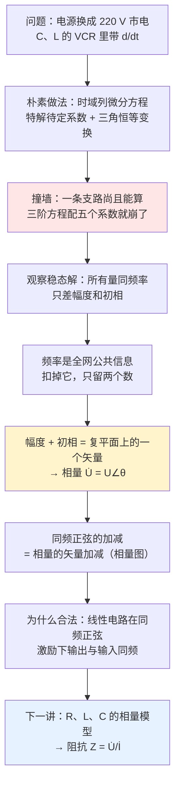

# C4.1 正弦量与相量 Sinusoids and Phasors

> [!abstract] 这一讲的任务
> 前三章我们解的全是**直流电阻（resistance）电路**：KCL、KVL 是代数方程，欧姆定律（Ohm's law）是代数方程，一路高斯消元就完事。从这一讲起，电源换成随时间周期（period）变化的交流，电容（capacitance）和电感（inductance）的伏安关系里那个 $\mathrm{d}/\mathrm{d}t$ 立刻开始咬人——电路方程从代数方程变成**微分方程**，而且右端还是正弦函数，光合并同类项就能算到手软。
> 这一讲干两件事：**第一**，把描述一个正弦量（sinusoid）所需要的信息压缩到最少（三要素、有效值、相位差）；**第二**，造出一把新工具——**相量（phasor）**，用一个复数同时记住"幅度"和"相位"，让微分方程退化回代数方程。
> 工具造好之后，你会发现第 3 章学的所有方法一个字都不用改，整套搬过来就能用。这一讲是整章的地基。

> [!info] 怎么读这份讲义
> 从第 0 节的两个场景开始顺着读，不要跳。第 3 节（有效值）和第 6 节（相量是怎么被逼出来的）是两个需要你合上讲义自己想三十秒的地方；第 5 节的相位差（phase difference）例题请自己动笔画一遍波形。
> 这份讲义的通篇约定：**正弦量一律写成 $\sin$ 形式**，相量一律写成**有效值（RMS value）相量** $\dot U=U\angle\theta$。这两条约定全程不改，否则相位会凭空差出 $90^\circ$ 或 $\sqrt2$ 倍。

---

> [!warning] 授课进度说明（截至第 4 次课）
> 已有的课堂语音转写稿覆盖到**第 4 次课**，内容为第 1 章全部 + 第 2 章全部；**第 4 章尚未讲授**。
> 因此本篇内容全部来自**课件与教材**（课件为 `第4章-交流稳态电路分析-(上集).pdf`，全文无手写笔迹），未经课堂讲解校正，篇内不使用「拓展」标注。等课上讲到本章后，本篇会按课堂实况做一次合并。

---

## 0. 开场：一台仪器，两个数字

先看两件真事。

**第一件。** 实验室里一台小变压器接在墙上，铭牌写着 `220 V / 50 Hz`。你把万用表打到交流电压（voltage）档去量，读数 220 V。换示波器探头接上去，屏幕上是一条正弦波，从正波峰到负波峰跨了约 622 V，也就是**峰值 311 V**。

同一个插座，两个数字，差 1.414 倍。哪个是真的？答案是：**两个都真**，只是它们说的不是同一件事——一个说**有效值**，一个说**峰值**。这一讲要做的第一件事，就是把这两个数之间的关系讲清楚（第 3 节）。

**第二件。** 你手上有一个 $5\ \mathrm{mH}$ 的电感串一个 $5\ \Omega$ 的电阻，接到 $u_S(t)=10\sin(1000t)\ \mathrm{V}$ 的电源上，想求电流（current） $i(t)$。

按第 3 章的老办法，列 KVL：

$$
5i+0.005\frac{\mathrm{d}i}{\mathrm{d}t}=10\sin(1000t)
$$

这是一阶线性常系数微分方程，非齐次项是正弦。设特解（particular solution） $i_p=A\sin(1000t)+B\cos(1000t)$ 代回去：

$$
\begin{aligned}
&5(A\sin+B\cos)+5(A\cos-B\sin)=10\sin\\
\Longrightarrow\quad &(5A-5B)\sin(1000t)+(5A+5B)\cos(1000t)=10\sin(1000t)
\end{aligned}
$$

对比系数得 $A-B=2$、$A+B=0$，于是 $A=1$、$B=-1$：

$$
i_p=\sin(1000t)-\cos(1000t)=\sqrt2\sin(1000t-45^\circ)\ \mathrm{A}
$$

再加上齐次解（时间常数 $\tau=L/R=1\ \mathrm{ms}$，几个毫秒就衰减掉）：

$$
\boxed{\,i(t)=\sqrt2\sin(1000t-45^\circ)+\mathrm{e}^{-1000t}\ \mathrm{A}\approx1.414\sin(1000t-45^\circ)\ \mathrm{A}\,}
$$

验算一下：$\sqrt2\times\sin(-45^\circ)=-1$，加上齐次项 $1$ 正好是 $0$，$i(0)=0$ 对上了。

算出来了，所以呢？**这一条支路（branch），我们花了整整一屏的三角运算。** 如果电路里有两个电感、一个电容，方程就升到二阶甚至三阶，特解要待定四个系数；如果有三条独立支路，你要解的是一个**微分方程组**。每一次加一个元件，工作量就翻一倍。

> [!question] 停一下，先自己想想
> 上面这个解里，有哪些信息是**这一条支路独有的**，又有哪些信息是**整个电路公共的**？
> 电源用的是 $10\sin(1000t)$，算出来的电流是 $1.414\sin(1000t-45^\circ)$。两者的角频率（angular frequency）都是 $1000\ \mathrm{rad/s}$——**一模一样**。
> 那么：既然是公共的，为什么每次运算都要把它带着走？

这就是全部问题的出口。观察稳态（steady state）解，全电路所有电压、电流都是**同一频率（frequency）**的正弦量，彼此只差两件事：**幅度**和**初相**。频率是公共信息，带着它算纯属浪费。

于是思路出现了：**扣掉频率，把"幅度 + 初相"这两个数打包成一个东西。** 而"一个模长、一个角度"——恰好就是复数在复平面上的样子。

这一讲剩下的全部内容，就是把这句直觉做成严谨的工具。

---

## 1. 从直流稳态到交流稳态（课件 p.4–5）

### 1.1 什么叫交流稳态电路

前面第三章研究的都是**直流稳态**：激励是恒定值，电路已经稳定，电容开路、电感短路，方程是实系数的代数方程。

现在把定义换掉：

> [!important] 交流稳态电路 AC steady-state circuit
> 当电路中的**电压和电流随时间作周期性变化**时，电路工作在**交流稳态 AC steady state**。处于交流稳态的电路称为**交流稳态电路**，简称**交流电路 AC circuit**。

课件的这一页把交流电路的四个特点逐条列了出来，这四条就是本章存在的理由：

| # | 特点 | 含义 |
|---|---|---|
| ① | 输入和输出都是**周期函数** | 不再是恒定值，量本身随时间摆动 |
| ② | **动态元件（C/L）不能简单当开路/短路处理** | 直流稳态那两条规则在交流里彻底失效 |
| ③ | 求响应要用一般方法：**VCR + KCL/KVL 列方程** | 方法没变，只是列出来的东西变了 |
| ④ | 交流电路的方程是**时变微分方程** | 为什么？见下 |

第 ④ 条课件特意加了一个 "Why?"，值得停下来回答。

> [!question] 课堂追问：为什么交流电路的方程一定是微分方程？
> 两个原因叠在一起：
> - 电容和电感的 VCR 自带导数：$i_C=C\dfrac{\mathrm{d}u_C}{\mathrm{d}t}$，$u_L=L\dfrac{\mathrm{d}i_L}{\mathrm{d}t}$。**只要电路里有动态元件，方程里就必然出现导数**。
> - 而直流稳态时，所有量都不再变化，$\mathrm{d}/\mathrm{d}t\equiv0$，导数项整体消失，方程退化成代数方程——这正是"电容开路、电感短路"的来历。
>
> 交流稳态下量一直在变，导数为零这条捷径没了，微分方程原样留在那里。第 5 章会用微分方程的方法正面硬解它（暂态）；本章要走的是一条**绕过去**的路。

### 1.2 为什么专门研究"单一频率正弦"

课件接着给出了**主要电路 primary circuit** 的定义：

> [!important] 正弦交流电路 AC sine circuit
> 由**单一频率正弦输入**激励的电路，称为**正弦交流电路**。

为什么偏偏挑正弦？课件在这一页没有展开，只在后面（p.18）给了答案。先记着这个问题，第 8 节专门回收——**只有单一频率，所有量才能共享同一个旋转因子，才能被画进同一张相量图（phasor diagram）。**

正弦稳态电路的定义（p.5）比上面更细一层：

> [!important] 正弦稳态（sinusoidal steady state）电路
> 电路的**输入、输出，或电路中任何部分的电压电流，都按正弦规律变化**，这样的电路处于正弦稳态。
> 交流电路里"稳态 steady-state"三个字的含义是：**V-I 的关系已经稳定下来、不再变化**——换路（switching）引起的那一段过渡过程（transient process）已经走完了。

课件还补了一句对比：与直流电路不同，交流电路的电压电流**随时间变化**，这给分析和计算带来了困难。这句大实话就是下一节要解决的问题。

### 1.3 出路：相量法

课件把整章的思路一句话说完了：

> [!important] 相量法（phasor method）的思想（课件 p.5）
> 既然所有的电压电流都是正弦函数，我们就**用复数工具（plural tool）来表示正弦函数**，把电路分析搬进**相量域 phasor domain**。
> 这样，交流电路的**微分方程就变成了复数代数方程**。

一句话概括这一章要做的事：**把微积分翻译成复数的加减乘除。**

翻译的过程分三步，正好是接下来三讲的分工：

| 步骤 | 做什么 | 在哪一讲 |
|---|---|---|
| ① 造工具 | 把正弦量表示成相量 | 本讲 |
| ② 换元件 | R、L、C 各自的相量模型（phasor model） → 阻抗（impedance） $Z$ | [[C4.2 元件相量模型与阻抗导纳]] |
| ③ 搬方法 | 第 3 章全部解法在相量域重跑一遍 | [[C4.3 正弦稳态电路的一般分析]] |

---

## 2. 正弦量的三要素（课件 p.6）

一个正弦电流，课件的写法是：

$$
i(t)=I_{\mathrm{m}}\sin(\omega t+\theta)
$$

配一张波形图，图上只有三处被圈出来：

> [!important] 正弦量的三要素
> ① **幅值（峰值）** $I_{\mathrm{m}}$ —— 波形能爬到的最大值；
> ② **频率** $f$（等价地：周期 $T$、角频率 $\omega$）—— 波形变化的快慢；
> ③ **初相位（initial phase）** $\theta$ —— $t=0$ 时波形"起步"的位置。

**只要这三个数定了，这条正弦波就完全定了**，一个不多、一个不少。后面造相量，本质上就是把"三要素"里的两个（幅值和初相）打包。

![[C4-正弦量三要素示意.png]]

读这张波形图有一个容易忽略的细节：**横轴是 $\omega t$，不是 $t$**。

$\omega t$ 是**相位**（单位 rad），$t$ 是时间（单位 s）。两者差一个常数因子 $\omega$，看起来只是换个刻度，其实是在提醒你一件后面非常关键的事：**我们真正关心的量是相位，时间只是相位的载体。** 后面旋转矢量和相量图里的所有角度，量纲都是相位，不是时间。

图里 $I_{\mathrm{m}}$ 标在波峰处、$\theta$ 标在原点处波形与横轴的交错位置——这两个量加上频率，就是这条曲线留在纸上的全部信息。

---

## 3. 有效值：为什么"220 V"的峰值是 311 V（课件 p.7）

### 3.1 问题：交流的"大小"该怎么说

正弦量的瞬时值一直在变，那"这个电压有多大"该怎么回答？说峰值？正半周 311 V、负半周 −311 V，两个峰值。

更麻烦的是：**峰值没法跟直流比。** 一个 311 V 的直流电源和一条峰值 311 V 的交流电压，接在同一个电阻上，平均发热量完全不同——交流有一半时间是负的，甚至还有过零的时刻。

工程上需要一个**能跟直流直接对比的等效值**。思路来自发热：

> [!important] 有效值 effective value（均方根 RMS）
> 让一个交流电压 $u(t)$ 和一个直流电压 $U$ 分别加在**相同的电阻**上，经过**相同的时间**后产生**相同的热量**，那么这个直流电压 $U$ 就称为该交流电压的**有效值**。

### 3.2 把它算出来

直流 $I$ 在 $R$ 上的发热功率（power）是 $I^2R$；交流 $i(t)$ 在同一个 $R$ 上的瞬时功率（instantaneous power）是 $i^2R$，一周期内的平均功率（average power）是 $\dfrac{1}{T}\displaystyle\int_{t_0}^{t_0+T}i^2R\,\mathrm{d}t$。

"发热相同"就是两个平均功率相等：

$$
I^2R=\frac{1}{T}\int_{t_0}^{t_0+T}i^2R\,\mathrm{d}t
\ \Longrightarrow\
I^2=\frac{1}{T}\int_{t_0}^{t_0+T}i^2\,\mathrm{d}t
$$

开方：

$$
\boxed{\,U=\sqrt{\frac{1}{T}\int_{t_0}^{t_0+T}u^2(t)\,\mathrm{d}t}\,,\qquad
I=\sqrt{\frac{1}{T}\int_{t_0}^{t_0+T}i^2(t)\,\mathrm{d}t}\,}
$$

这三个动作——**先平方（square）、再取平均（mean）、最后开方（root）**——英文缩写就是 **RMS**。

> [!note] 一个很容易被忽略的普适性
> 上面这个定义**对任何周期波形都成立**：方波、锯齿波、全波整流，甚至带直流分量的波形，都这么算。
> 它不只服务于正弦量。第 [[C4.5 非正弦周期电路的谐波分析]] 里"非正弦周期（non-sinusoidal periodic）的有效值等于直流分量与各次谐波（harmonic）有效值的平方和再开方"，就是从这个积分式推出来的。**现在把定义记牢，那里就不用重新推。**

### 3.3 正弦量的特例：一个 $\sqrt2$

对正弦量 $i(t)=I_{\mathrm{m}}\sin(\omega t+\theta)$，代进 RMS 的定义：

$$
I^2=\frac{1}{T}\int_0^TI_{\mathrm{m}}^2\sin^2(\omega t+\theta)\,\mathrm{d}t
=\frac{I_{\mathrm{m}}^2}{T}\int_0^T\frac{1-\cos 2(\omega t+\theta)}{2}\,\mathrm{d}t
=\frac{I_{\mathrm{m}}^2}{T}\cdot\frac{T}{2}=\frac{I_{\mathrm{m}}^2}{2}
$$

（中间那步用的是倍角公式降幂；$\cos 2(\omega t+\theta)$ 在一个整周期上的积分为零。）

$$
\boxed{\,I=\frac{I_{\mathrm{m}}}{\sqrt2}\approx0.707\,I_{\mathrm{m}}\,,\qquad I_{\mathrm{m}}=\sqrt2\,I\approx1.414\,I\,}
$$

![[C4-有效值均方根示意.png]]

上下两张图把 RMS 的三个动作画全了。上面是原始波形；下面是它的平方——**"先平方"的作用是把整个波形抬到横轴上方**，正负半周不再互相抵消。而 $\sin^2$ 在一个整周期里的平均值恰好落在 $1/2$ 那条虚线上，不是 $1$。最后开方，得到 $U_{\mathrm{m}}/\sqrt2$。

> [!question] 停一下，先自己想想
> 为什么是 $\sqrt2$，而不是 $2$？换句话说，为什么有效值是峰值的 $0.707$ 倍，而不是"峰值打对折"？
> 关键在**平方**这一步。正弦波平方之后，大部分时间待在中间高度附近，只有很短时间接近峰值；$\sin^2$ 的**平均值是 $1/2$**，不是峰值 $1$。所以均方根是 $\sqrt{1/2}=0.707$，而如果直接对折就会得到 $0.5$——**错的那个是漏掉了"先平方"的后果**。

回到开场那台变压器：铭牌上的 220 V 是**有效值**，峰值就是 $220\times\sqrt2=311\ \mathrm{V}$。示波器读出来的 622 V 是**峰峰值**（正峰到负峰），正好是 $2\times311$。万用表读 220 V，是因为交流电压表内部做的就是 RMS 换算。三个数字，一件事。

| 有效值 $U$ | 峰值 $U_{\mathrm{m}}=\sqrt2U$ | 峰峰值 $2U_{\mathrm{m}}$ |
|---|---|---|
| 10 V | 14.14 V | 28.28 V |
| 220 V（单相市电） | 311.1 V | 622.3 V |
| 380 V（三相线电压） | 537.4 V | 1074.8 V |
| 100 V（日光灯管电压，见 [[C4.4 正弦稳态功率与功率因数]]） | 141.4 V | 282.8 V |

> [!warning] 两条别记反的约定
> **（1）工程上凡说"交流电压/电流是多少"，默认都是有效值。** 课件原文：一般情况下，交流电压或电流的幅值（amplitude），除非另有说明，都指**有效值**；**交流电压表和电流表的读数也是有效值**。所以"绝缘耐压 220 V"这种说法本身就是坑——绝缘要按 **311 V** 的峰值去考虑。
> **（2）但"幅值相量"和"有效值相量"是两套东西**，下一节就要遇到。$\dot U_{\mathrm{m}}=U_{\mathrm{m}}\angle\theta$ 和 $\dot U=U\angle\theta$ 差一个 $\sqrt2$ 倍，混用会让所有结果整体差 1.414 倍。**本讲义全局采用有效值相量。**

---

## 4. 频率、周期、角频率（课件 p.8）

三要素里的第二个是频率。三个量说的是同一件事，只是刻度不同：

| 量 | 定义 | 单位 |
|---|---|---|
| 周期 $T$ | 波形变化一周所需的时间 | s、ms、μs |
| 频率 $f$ | 每秒钟波形变化的次数 | Hz、kHz、MHz |
| 角频率 $\omega$ | 相位角每秒钟变化多少**弧度** | rad/s |

$$
\boxed{\,f=\frac{1}{T}\,,\qquad \omega=2\pi f\,}
$$

> [!warning] 角频率的单位是 rad/s，不是 Hz
> $\omega$ 和 $f$ 差一个 $2\pi$，混用是本章最常见的低级错误。$\omega=314$ 说的是 $50\ \mathrm{Hz}$，不是 $314\ \mathrm{Hz}$。
> 记住这个换算：**工频 $50\ \mathrm{Hz}$ 对应 $\omega=2\pi\times50=314.16\ \mathrm{rad/s}$**。

课件用一整页给出了工程上各种信号的频段，这是很实用的背景表：

| 场景 | 频率 |
|---|---|
| 电网（中国、欧洲） | 50 Hz |
| 电网（美国、日本） | 60 Hz |
| 有线通信 | 300 Hz ～ 5000 Hz |
| 无线通信 | 30 kHz ～ 30 GHz |
| 声波（人耳可听） | 20 Hz ～ 20 kHz |

> [!note] 为什么电网是 50/60 Hz
> 这不是随便定的。频率太低，变压器和电机的铁芯要做得极大（磁通与 $1/f$ 成正比）才能撑住同样的功率；频率太高，输电线路的感抗（inductive reactance） $\omega L$ 和铁芯的涡流损耗又会迅速上去，还会引入无线电干扰。50/60 Hz 是"设备体积、铁损、线路压降"三者折中的结果。所以全世界只有两个数。

**顺便回收一个伏笔**：第 5 节的相位差例题里，正弦量的角频率是 $314\ \mathrm{rad/s}$——那就是 $50\ \mathrm{Hz}$ 的工频，从这张表来的。

> [!note] 往前接一步：这个 $\omega$ 在专业课上会反复出现
> 频率决定了信号处理系统的采样率下限（奈奎斯特：要无失真地采 $20\ \mathrm{kHz}$ 的音频，采样率至少要 $40\ \mathrm{kHz}$）。第 [[C4.6 网络函数与谐振]] 里那个"收音机是怎么从一堆电台里挑出一个频率的"，用的也正是这里的频率概念——$\omega$ 在那一讲会从"一个已知参数"升级成"一个自变量"。

---

## 5. 初相位与相位差（课件 p.9–11）

### 5.1 相位与初相位

$$
i(t)=I_{\mathrm{m}}\sin(\omega t+\theta)
$$

括号里的 $(\omega t+\theta)$ 叫 $t$ 时刻的**相位角（相位）**，它以 $2\pi$ 为周期循环。$t=0$ 时的相位就是 $\theta$，叫**初相位**：

$$
\boxed{\,-\pi<\theta\le\pi\,}
$$

初相位是"波形在时间零点处走到了相位上的哪个位置"。同一个波形在时间轴上左右平移，改变的只有 $\theta$。

**这个约定值的注意**：初相位规定在 $(-\pi,\pi]$ 之内。这个区间后面算相角时会反复用到——题目给出 $\theta=270^\circ$，你应该立刻改写成 $-90^\circ$。

### 5.2 相位差：只有同频率才配比较

两个同频率正弦量 $u_1=U_{1\mathrm{m}}\sin(\omega t+\theta_1)$、$u_2=U_{2\mathrm{m}}\sin(\omega t+\theta_2)$，它们的**相位差**定义为：

$$
\varphi_{12}=(\omega t+\theta_1)-(\omega t+\theta_2)=\theta_1-\theta_2
$$

注意 $\omega t$ **当场消掉了**——这正是"必须同频率"的含义。

> [!warning] 为什么不同频率不能比相位
> 不同频率的两个正弦量，$\omega_1t$ 和 $\omega_2t$ 消不掉，它们的相位差是**随时间变化的**：这一刻我说它超前 $30^\circ$，下一刻就变成超前 $200^\circ$。**这个数不稳定，所以没有意义。**
> 课件在例题里把这一条列成注意事项 A，并问了一个 WHY——答案就在这里。

$\varphi_{12}$ 的符号与命名有固定口径：

| $\varphi_{12}$ | 关系 | 说法 |
|---|---|---|
| $=0$ | 同相（in phase） | $u_1$ 与 $u_2$ 同时到峰、同时过零 |
| $>0$（$\theta_1>\theta_2$） | $u_1$ 超前（leading）$u_2$ | $u_1$ 先到峰 |
| $<0$（$\theta_1<\theta_2$） | $u_1$ 滞后（lagging）$u_2$ | $u_1$ 后到峰 |
| $=\pm90^\circ$ | 正交（orthogonal） | 一个到峰时另一个正好过零 |
| $=\pm180^\circ$ | 反相（antiphase） | 一个到正峰时另一个到负峰 |

> [!warning] 超前/滞后的方向最容易记反
> 一句话锚定：**"谁先到峰，谁超前"**。$\varphi_{12}>0$ 意为 $\theta_1>\theta_2$，相位大的先走，所以 $u_1$ 超前。
> 换个说法就不会错：**"超前"是时间上的早，不是数值上的大。** 波形图上超前的那条曲线整体**向左**平移。

### 5.3 例题 4-2-4：相位差算给你看（课件 p.10–11）

> [!example] 例 4-2-4
> 已知两个同频率正弦电压
> $$u_1=200\sin(314t+45^\circ)\ \mathrm{V},\qquad u_2=-100\cos(314t+30^\circ)\ \mathrm{V}$$
> 求这两个正弦电压的相位差。

课件先给了"比较相位时必须注意"的三条：

> [!important] 比较相位的三条前提
> **A. 同频率。** 理由见上一小节，$\omega t$ 必须消掉。
> **B. 同函数。** 一个 $\sin$ 一个 $\cos$ 时，必须先化成同一种。为什么？因为 $\sin$ 与 $\cos$ 相差 $90^\circ$，直接拿括号里的角做差会丢掉这 $90^\circ$。
> **C. 同符号。** 出现负号时，必须先把幅值变成正数。为什么？因为 $-\sin x=\sin(x\pm180^\circ)$——负号不是"大小"，它是**额外的 $180^\circ$ 相移**。

用到的三角恒等式（课件列了全套）：

$$
\sin\theta=\cos(\theta-90^\circ),\quad
\cos\theta=\sin(\theta+90^\circ),\quad
-\sin\theta=\sin(\theta\pm180^\circ),\quad
-\cos\theta=\cos(\theta\pm180^\circ)
$$

**解。** $u_1$ 用 $\sin$、幅值为正；$u_2$ 是 $\cos$、还带负号，两条都不满足，先统一。把 $-100\cos(314t+30^\circ)$ 的负号并进角度：

$$
u_2=-100\cos(314t+30^\circ)=100\sin\big[(314t+30^\circ)-90^\circ\big]=100\sin(314t-60^\circ)\ \mathrm{V}
$$

（推法：$-\cos x=\cos(x-180^\circ)=\sin(x-180^\circ+90^\circ)=\sin(x-90^\circ)$。）

现在两个都是"正幅值 + $\sin$"，可以比了：

$$
\varphi_{12}=45^\circ-(-60^\circ)=105^\circ
$$

> [!important] 结论
> $u_1$ 比 $u_2$ **超前 $105^\circ$**；等价地说，$u_2$ 比 $u_1$ **滞后 $105^\circ$**。

> [!warning] 这道题的两个坑
> **坑一：把 $-100$ 当幅值用。** 幅值必须是正数。看到负号，处置方式是把 $180^\circ$ 加到相位里，而不是让振幅带负号。
> **坑二：$\sin$ 与 $\cos$ 直接相减。** 如果懒得转换，直接写 $\varphi_{12}=45^\circ-30^\circ=15^\circ$，就把 $\sin/\cos$ 之间那 $90^\circ$ 的差吃掉了，答案会错。三个前提缺一不可。

---

## 6. 相量是怎么被逼出来的（课件 p.13–14）

### 6.1 从一个旋转的矢量说起

课件用的切入点是几何：

> [!important] 正弦量的旋转矢量表示
> 一个正弦量的瞬时值，可以表示为**一个旋转的有向线段在纵轴上的投影值**。

具体规定（p.13）：

| 有向线段的特征 | 对应正弦量的 |
|---|---|
| 长度 | 幅值 $U_{\mathrm{m}}$ |
| 与横轴的夹角 | 初相位 $\theta$ |
| 以角速度 $\omega$ **逆时针**旋转 | 相位随时间增长 |

于是这条线段在复平面上可以写成

$$
U_{\mathrm{m}}\mathrm{e}^{\mathrm{j}\theta}\cdot \mathrm{e}^{\mathrm{j}\omega t}
$$

其中 $\mathrm{e}^{\mathrm{j}\omega t}$ 被课件称为**旋转因子（rotate factor）**。它的投影（取虚部）就是 $U_{\mathrm{m}}\sin(\omega t+\theta)$。

![[C4-旋转矢量与正弦波投影.png]]

左边是复平面上的旋转矢量，右边是它投影出来的正弦波。两个图是**同一件事的两种画法**：矢量转一圈，右边正好画完一个周期。

> [!warning] 原课件笔误：下一页的复平面坐标轴标反了
> 课件 p.13 的画法是对的——横轴 $+1$、纵轴 $+j$，矢量逆时针转。但紧接的 p.14 配图上把**纵轴标成了 $\mathrm{Re}$、横轴标成了 $\mathrm{Im}$**，与 p.13 相反。
> 这是课件的排版笔误，照它画图会把实部虚部弄反。**以 p.13 为准：横轴是实轴 $\mathrm{Re}$，纵轴是虚轴 $\mathrm{Im}$**——与复数的标准写法 $\dot U=U\cos\theta+\mathrm{j}U\sin\theta$ 一致。

### 6.2 关键一步：把旋转因子丢掉

> [!question] 停一下，先自己想想
> 整个正弦稳态电路里，**所有的电压、电流都是同一个频率** $\omega$。那么上面那个旋转因子 $\mathrm{e}^{\mathrm{j}\omega t}$，对电路中的每一个量来说，是不是长得一模一样？

是的——**一模一样**。它是全电路的公共因子。

> [!important] 相量的定义（课件 p.14）
> 既然同频率正弦量的旋转速度相同，就**只需要确定它们的初始矢量**。这个初始矢量称为该正弦量的**相量 phasor**。

课件给出两种相量，写法上只差一个 $\sqrt2$：

$$
\boxed{\ \text{幅值相量：}\ \dot U_{\mathrm{m}}=U_{\mathrm{m}}\mathrm{e}^{\mathrm{j}\theta}=U_{\mathrm{m}}\angle\theta\ }
\qquad\text{或}\qquad
\boxed{\ \text{有效值相量：}\ \dot U=U\mathrm{e}^{\mathrm{j}\theta}=U\angle\theta\ }
$$

符号约定：相量头顶**加点**（$\dot U$），以示与普通复数、与有效值标量 $U$ 的区别。

从时域（time domain）到相量的完整映射链条是：

$$
u(t)=U_{\mathrm{m}}\sin(\omega t+\theta)
\ \xleftarrow{\ \text{取虚部}\ }\
U_{\mathrm{m}}\mathrm{e}^{\mathrm{j}\theta}\mathrm{e}^{\mathrm{j}\omega t}
\ \xrightarrow{\ \text{丢掉公共因子}\ }\
\dot U_{\mathrm{m}}=U_{\mathrm{m}}\angle\theta
$$

用有效值相量写的话，末尾是 $\dot U=U\angle\theta=\dfrac{U_{\mathrm{m}}}{\sqrt2}\angle\theta$。

> [!example] 手算：把市电写成相量
> $u(t)=311\sin(314t+30^\circ)\ \mathrm{V}$（峰值 311 V，就是 220 V 有效值）
> - 幅值相量：$\dot U_{\mathrm{m}}=311\angle30^\circ\ \mathrm{V}$
> - 有效值相量：$\dot U=220\angle30^\circ\ \mathrm{V}$
>
> 反过来，已知有效值相量 $\dot U=220\angle30^\circ\ \mathrm{V}$、$\omega=314\ \mathrm{rad/s}$：
> $$u(t)=\sqrt2\cdot220\sin(314t+30^\circ)=311\sin(314t+30^\circ)\ \mathrm{V}$$
> 注意反变换时**必须补回 $\sqrt2$ 和 $\omega t$**：相量里没有这两样东西，它们是你在变换时主动丢掉的，回头要主动还回去。

> [!warning] 丢掉了什么，回头就要还什么
> 相量只保留"幅值 + 初相"两个数。它丢掉了**频率**——所以任何一道相量法题目，$\omega$ 都必须从题干另找（通常写在激励表达式里）；它丢掉了**时间的正弦形状**——所以最终答案要还原成 $u(t)$ 时，$\sqrt2$、$\sin$、$\omega t$ 一个都不能少。
> 这也解释了为什么**相量本身不是正弦量**：它是一个静止的复数，恰好对应一条正弦波。

### 6.3 回头看我们做了什么

把这一节的三步整理一下：

1. **发现冗余**：稳态下所有量同频率，频率信息重复出现在每一个量里；
2. **扣掉冗余**：把公共的旋转因子 $\mathrm{e}^{\mathrm{j}\omega t}$ 整体约掉，只留 $t=0$ 那一瞬的矢量；
3. **代价**：这个矢量是**静止**的，它不再含有时间信息——但它含有我们真正需要的全部信息（幅度、相位）。

第 8 节会证明这一步为什么合法。第 [[C4.2 元件相量模型与阻抗导纳]] 会证明它有多划算。

---

## 7. 相量图与四种表示法（课件 p.15–17）

### 7.1 相量图：让加减变成画图

> [!important] 相量图 phasor diagram
> 把相量作为矢量画在复平面上，得到的图称为**相量图**。利用相量图的**矢量叠加**方法，可以方便地进行同频率正弦量的加、减运算。

道理很直接：同频正弦量的加减，本质上是复数的加减，而复数加减就是矢量加减（平行四边形法则）。

课件给出了两个相量合成的完整公式。设 $\dot U_1=U_1\angle\theta_1$、$\dot U_2=U_2\angle\theta_2$，则

$$
\begin{aligned}
\dot U&=\dot U_1+\dot U_2=U_1\angle\theta_1+U_2\angle\theta_2\\
&=U_1\cos\theta_1+U_2\cos\theta_2+\mathrm{j}\,(U_1\sin\theta_1+U_2\sin\theta_2)\\
&=U\angle\theta
\end{aligned}
$$

$$
U=\sqrt{(U_1\cos\theta_1+U_2\cos\theta_2)^2+(U_1\sin\theta_1+U_2\sin\theta_2)^2}
\,,\qquad
\theta=\arctan\frac{U_1\sin\theta_1+U_2\sin\theta_2}{U_1\cos\theta_1+U_2\cos\theta_2}
$$

> [!warning] 课件笔误：这个 $\arctan$ 只给了主值
> 课件把 $\theta$ 直接写成 $\arctan(\cdot)$，但 $\arctan$ 的值域只有 $(-90^\circ,90^\circ)$，**只覆盖第一、第四象限**。当合矢量落在第二、第三象限时，还要按下一小节的规则补 $\pm180^\circ$。
> 课件自己下一页（p.16）就写了"注意象限"，两页口径没对齐——**以 p.16 为准**：先定象限，再修正角度。

![[C4-相量图矢量叠加.png]]

这张图给了一个非常直观的对照：左边是时域里两条正弦波**逐点相加**，右边是相量图上两个矢量**首尾相接**。两种算法结果相同，但右边只用画一个三角形。

> [!warning] 幅值不能直接相加
> 两个幅值 $3$ 和 $4$ 的正弦量相加，结果**不是** $7$——除非它们同相。举个手算例子：$u_1=3\sin\omega t$、$u_2=4\sin(\omega t+90^\circ)$，则
> $$\dot U=3\angle0^\circ+4\angle90^\circ=3+\mathrm{j}4=5\angle53.1^\circ
> \ \Longrightarrow\ u(t)=5\sqrt2\sin(\omega t+53.1^\circ)$$
> 幅值 $5$（不是 $7$），相位 $53.1^\circ$。**只有在 $\theta_1=\theta_2$ 时，幅值才能直接相加。**
> "正弦量相加等于幅值相加"是这一章最容易犯的错，考试里几乎每年都有人在这里丢分。

### 7.2 四种表示法（课件 p.16）

同一个正弦量有四种写法，课件把它们并排放在一页上：

| 表示法 | 形式 | 什么时候用 |
|---|---|---|
| **函数式** | $u=\sqrt2U\sin(\omega t+\theta)$ | 题目给出条件、要求最终答案时 |
| **波形图** | 一条正弦曲线，标注峰值与 $\theta$ | 讲物理直觉、看相位关系时 |
| **相量（复数式）** | $\dot U=U\mathrm{e}^{\mathrm{j}\theta}=U\angle\theta$ | **做计算的主力**，代数运算全在这里 |
| **相量图** | 复平面上的矢量 | 加减法、看几何关系、估算时 |

四种表达之间可以自由转换，做题的一般路径是：**函数式（题干）→ 相量（计算）→ 相量图（检查/定性）→ 函数式（答案）**。

### 7.3 象限：算相角时最常翻车的地方（课件 p.16）

课件在这一页专门加了一条 Note：**计算相量的相位时，必须注意它落在哪个象限。**

| 相量 | 转换结果 | 象限 | 相位范围 |
|---|---|---|---|
| $\dot U=3+\mathrm{j}4$ | $u=5\sqrt2\sin(\omega t+53.1^\circ)$ | 第一象限 | $0<\theta<90^\circ$ |
| $\dot U=3-\mathrm{j}4$ | $u=5\sqrt2\sin(\omega t-53.1^\circ)$ | 第四象限 | $-90^\circ<\theta<0$ |
| $\dot U=-3+\mathrm{j}4$ | $u=5\sqrt2\sin(\omega t+126.9^\circ)$ | 第二象限 | $90^\circ<\theta<180^\circ$ |
| $\dot U=-3-\mathrm{j}4$ | $u=5\sqrt2\sin(\omega t-126.9^\circ)$ | 第三象限 | $-180^\circ<\theta<-90^\circ$ |

**四个数都验算一遍。** 模长都是 $\sqrt{3^2+4^2}=5$，差别只在角度：

- $3+\mathrm{j}4$：$\arctan(4/3)=53.13^\circ$ ✓
- $3-\mathrm{j}4$：$-\arctan(4/3)=-53.13^\circ$ ✓
- $-3+\mathrm{j}4$：$180^\circ-\arctan(4/3)=180^\circ-53.13^\circ=126.87^\circ$ ✓
- $-3-\mathrm{j}4$：$-180^\circ+\arctan(4/3)=-126.87^\circ$ ✓（也可以写成 $233.13^\circ$，但超出 $(-\pi,\pi]$，要改回 $-126.9^\circ$）

> [!warning] 别只按 $\arctan(\text{虚}/\text{实})$ 按计算器
> $\arctan$ 的值域只有 $(-90^\circ,90^\circ)$，它**分不清 $(3,4)$ 和 $(-3,-4)$**——这两者的 $\arctan$ 都是 $53.13^\circ$。必须先看实部虚部的符号定象限，再修正角度。
> 标准动作：**① 算 $\arctan|X/R|$；② 看象限；③ 按上表修正。** 后面做阻抗、算功率因数（power factor）角，全都要靠这个动作。

### 7.4 三条 Tips（课件 p.17）

课件用一整页写了三条使用相量时必须记住的话，每一条都比表面看起来重要。

> [!important] Tip 1：相量与正弦量是**映射关系**，不是相等
> 课件原文：相量和正弦量之间是一种**映射关系（injection relation）**。我们只是**用**相量来表示正弦量，但这并不意味着两者相等。
> 两种映射方式的完整写法：
> $$i(t)=I_{\mathrm{m}}\sin(\omega t+\theta)=\operatorname{Im}\left[I_{\mathrm{m}}\mathrm{e}^{\mathrm{j}\theta}\mathrm{e}^{\mathrm{j}\omega t}\right]$$
> $$i(t)=I_{\mathrm{m}}\cos(\omega t+\theta)=\operatorname{Re}\left[I_{\mathrm{m}}\mathrm{e}^{\mathrm{j}\theta}\mathrm{e}^{\mathrm{j}\omega t}\right]$$
> 用 $\sin$ 表示就**取虚部**，用 $\cos$ 表示就**取实部**。

> [!warning] 这就是"sin / cos 必须全局统一"的根源
> 很多人把"选 $\sin$ 还是选 $\cos$"当成个人习惯，其实它会改变结果。因为映射方式一变，"取虚部"和"取实部"就换了，所有相位会整体差 $90^\circ$。
> 规矩是：**同一道题里，所有正弦量要么都写成 $\sin$、要么都写成 $\cos$，中途不许换。** 本讲义全局用 $\sin$。
> （更现代的做法是统一用复指数 $\mathrm{e}^{\mathrm{j}\omega t}$ 而不纠结实部虚部，但课件走的是 $\sin$ 路线，我们跟着课件。）

> [!important] Tip 2：$\sin$ 与 $\cos$ 两种表达任选，选方便的那个
> 课件原文：实际应用中，我们可以选择其中更方便的一种。工程上两者都常见——电力系统爱用 $\cos$（因为功率公式 $P=UI\cos\varphi$ 更顺），数学教材爱用 $\sin$。**只要一道题里自洽就行。**

> [!important] Tip 3：只有同频率的两个正弦量，才能画进同一张相量图
> 课件补了一句原因：**因为这两个相量是相对静止的。**
> 展开说：相量的定义是"扣掉公共旋转因子 $\mathrm{e}^{\mathrm{j}\omega t}$ 之后剩下的初始矢量"。既然扣掉了旋转，相量图上的一切都是**静止**的，两条相量之间的夹角是一个**不随时间变化的常数**——这才有意义。
> 如果两个正弦量频率不同，它们各自带着不同转速的旋转因子，扣不干净；画在同一张图上，两个矢量的夹角会随时间越转越大或越转越小。**图是死的，夹角是活的，这张图就没有信息量。**

---

## 8. 相量法为什么合法（课件 p.18）

到这里工具已经造好，但还欠一个交代：**凭什么可以用一个静止的复数代替一条随时间摆动的正弦波？** 课件在 p.18 用一整页回答，标题就是"单一频率正弦信号激励下的线性电路（linear circuit）"。

三条依据：

> [!important] 相量法的合法性基础
> **① 线性电路满足叠加定理（superposition theorem）。** 电路的稳态响应是各个电源激励的**线性组合**。
> **② 在单一频率正弦激励下，线性电路的电压电流输出与输入同频率。** 这是全部依据里最关键的一条。
> **③ 于是，"分析正弦稳态线性电路"实质上是"研究正弦输入与输出之间的（幅度与相位）关系"，因此可以用相量法把三角函数的计算换成复常数（复数）的计算，简化分析。**

第 ② 条值得展开——课件只给结论，我们把它补全：

> [!note] 为什么输出一定与输入同频率
> 逐个元件看一遍就清楚了。
> - **电阻**：$u=Ri$，纯粹的乘常数，同频进去同频出来。
> - **电容**：$i=C\frac{\mathrm{d}u}{\mathrm{d}t}$。对 $u=U_{\mathrm{m}}\sin(\omega t+\theta_u)$ 求导，结果是 $\omega CU_{\mathrm{m}}\cos(\omega t+\theta_u)$——**还是同频的正弦**，只是幅度乘了 $\omega C$、相位提前了 $90^\circ$。
> - **电感**：$u=L\frac{\mathrm{d}i}{\mathrm{d}t}$，同理，同频、幅度乘 $\omega L$、相位滞后 $90^\circ$。
>
> 也就是说：**线性元件的 VCR 作用在正弦量上，只会改变幅度和相位，不会改变频率。**（这个"幅度乘一个 $\omega$ 的函数、相位移动 $\pm90^\circ$"的性质，就是 [[C4.2 元件相量模型与阻抗导纳]] 里阻抗 $Z$ 的雏形。）
>
> 再往上走：KCL、KVL 是线性组合，同频量的线性组合仍然同频；多个元件串并联还是线性组合。所以**从电源到电路任何一个角落，频率都不变**。
>
> 归纳一下这条推理链：**线性 VCR（保频） + 线性拓扑（topology）约束（保频） ⟹ 全网同频 ⟹ 相量法合法。**

**现在回收第 1 节留下的那个伏笔。** 当时问：为什么课件要专门强调"单一频率正弦激励"？

> [!important] 为什么必须是"单一频率"
> 因为相量法丢掉的那个旋转因子 $\mathrm{e}^{\mathrm{j}\omega t}$，**必须是对全电路所有量都相同的公共因子**，才谈得上"整体约掉"。
> - 单一频率：全场共用一个 $\mathrm{e}^{\mathrm{j}\omega t}$，约掉它，剩下的初始矢量之间的关系就是电路的输入输出关系——**相量法成立**。
> - 多个频率：$100\ \mathrm{Hz}$ 的量和 $200\ \mathrm{Hz}$ 的量各自带着不同的旋转因子，约不掉，也不能画进同一张相量图。**相量法直接失效。**
>
> 那遇到方波、整流波形这类"多频率"信号怎么办？**先把它们拆成一堆单一频率的正弦量**，然后对每一个频率分别用相量法算，最后把结果叠回去。这套"先分解、再分别用相量法、最后叠加"的流程，就是第 [[C4.5 非正弦周期电路的谐波分析]] 的全部内容。
> 换句话说：**相量法不是万能工具，它只对单一频率有效；而对多频率信号，我们把问题**化简成**一堆单一频率问题。**

---

## 这一讲的三句话

1. **描述一个正弦量只需要三个数**：幅值、频率、初相位。频率是全电路公共的，所以真正需要逐支路计算的只有两个——幅值和初相。**相位差只对同频率有意义，比较前必须先统一成同函数、同符号、正幅值。**
2. **有效值是与直流等效的发热量，正弦量满足 $U_{\mathrm{m}}=\sqrt2U$**；工程上不加说明的交流数值和电表读数都是有效值。而 RMS 的定义 $\sqrt{\frac1T\int u^2\mathrm{d}t}$ 对任何周期波形都成立，这是后面谐波分析的家底。
3. **相量是把"幅值 + 初相"打包成的复数**，它的合法性来自一句话：**线性电路在单一频率正弦激励下，输出与输入同频率**。因此同频正弦的加减可以画成矢量加减（相量图），而频率这个公共因子在运算时被整体约掉。**代价是：答案要还原回时域时，$\sqrt2$ 和 $\omega t$ 必须还回去。**

**速查表**

| 名称 | 公式 | 备注 |
|---|---|---|
| 正弦量的一般式 | $i(t)=I_{\mathrm{m}}\sin(\omega t+\theta)$ | 三要素：$I_{\mathrm{m}}$、$\omega$（或 $f,T$）、$\theta$ |
| 频率关系 | $f=\dfrac1T$，$\omega=2\pi f$ | 工频 50 Hz → $\omega=314\ \mathrm{rad/s}$ |
| 有效值（**通式**） | $U=\sqrt{\dfrac1T\displaystyle\int_{t_0}^{t_0+T}u^2\,\mathrm{d}t}$ | 对任何周期波形成立 |
| 峰值与有效值（**正弦专有**） | $U_{\mathrm{m}}=\sqrt2U\approx1.414U$，$U\approx0.707U_{\mathrm{m}}$ | 只有正弦量能用 |
| 相位差 | $\varphi_{12}=\theta_1-\theta_2$，$-\pi<\varphi_{12}\le\pi$ | **仅同频率可比** |
| 相位关系判据 | $\varphi=0$ 同相；$>0$ 超前；$<0$ 滞后；$\pm90^\circ$ 正交；$\pm180^\circ$ 反相 | 谁先到峰谁超前 |
| 相量（有效值） | $\dot U=U\mathrm{e}^{\mathrm{j}\theta}=U\angle\theta$ | 本讲义全局采用 |
| 相量（幅值） | $\dot U_{\mathrm{m}}=U_{\mathrm{m}}\mathrm{e}^{\mathrm{j}\theta}=U_{\mathrm{m}}\angle\theta$ | 与上者差 $\sqrt2$ 倍 |
| 相量 ↔ 正弦量 | $u(t)=\sqrt2U\sin(\omega t+\theta)=\operatorname{Im}\!\left[\sqrt2\dot U\mathrm{e}^{\mathrm{j}\omega t}\right]$ | $\cos$ 写法改取 $\operatorname{Re}$ |
| 同频相量合成 | $U=\sqrt{\left(\sum U_k\cos\theta_k\right)^2+\left(\sum U_k\sin\theta_k\right)^2}$，$\theta=\arctan\dfrac{\sum U_k\sin\theta_k}{\sum U_k\cos\theta_k}$ | 先定象限，再修正角度 |

**三要素对照表（做题时逐条检查）**

| 要素 | 符号 | 单位 | 工程常见值 | 常见坑 |
|---|---|---|---|---|
| 幅值 | $U_{\mathrm{m}}$ / $I_{\mathrm{m}}$ | V / A | 市电峰值 311 V | 与有效值混用，差 $\sqrt2$ 倍 |
| 频率 | $f$ / $T$ / $\omega$ | Hz / s / rad/s | 工频 50 Hz，$\omega=314$ | $\omega$ 与 $f$ 混用，差 $2\pi$ 倍 |
| 初相 | $\theta$ | rad 或 ° | $(-\pi,\pi]$ | 负号没并进相位、$\sin/\cos$ 没统一 |

**下一讲预告**：工具已经造好了，但它现在还**无处可施**——我们手上只有一条条正弦波的表达式，没有"元件的相量模型"。下一讲把 R、L、C 逐个搬进相量域，看看它们的伏安关系变成什么样子：电阻还是那个电阻，电感变成一个 $j\omega L$，电容变成 $1/(j\omega C)$。三者竟然可以用**同一个公式** $\dot U=Z\dot I$ 统一起来，代价是这个"电阻"$Z$ **必须是复数**。讲完那一讲，你手上就有了一整套"交流版元件库"，第 3 章的所有解法就能原样搬过来了。→ [[C4.2 元件相量模型与阻抗导纳]]

---

**上一讲 ←** [[C3.4 线性电路定理]]
**下一讲 →** [[C4.2 元件相量模型与阻抗导纳]]
**课程索引 →** [[电路基础 MOC]]
