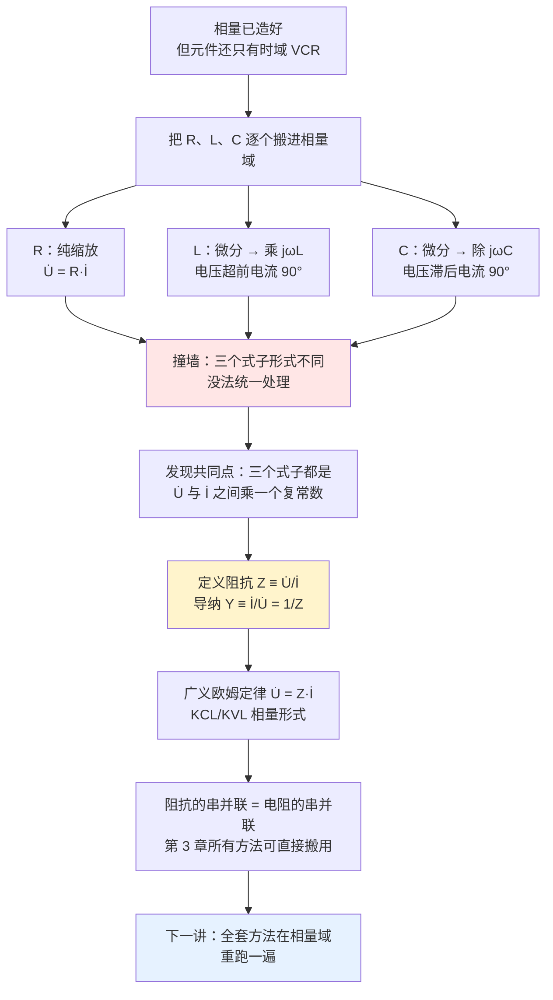

# C4.2 元件相量模型与阻抗导纳 Phasor Models of Components, Impedance and Admittance

> [!abstract] 这一讲的任务
> [[C4.1 正弦量与相量]] 造出了相量这把锤子，但它到现在还没往任何地方钉——我们手上只有"一条正弦波 → 一个复数"的翻译规则，元件的伏安关系却还停在时域：电感是 $u=L\dfrac{\mathrm{d}i}{\mathrm{d}t}$，电容是 $i=C\dfrac{\mathrm{d}u}{\mathrm{d}t}$，都带着导数。
> 这一讲把 R、L、C **逐个搬进相量域**，看它们的 VCR 变成什么样子。搬完之后你会发现一件漂亮得不太真实的事：**三个元件可以用同一个公式 $\dot U=Z\dot I$ 统一描述**，代价是这个"电阻"$Z$ **必须是复数**。
> 讲完这一讲，你手上就有了一整套"交流版元件库"，第 3 章学的所有解法——串并联、结点法、戴维南、叠加——可以原样搬过来用了。

> [!info] 怎么读这份讲义
> 第 1 节是三个元件按**同一个四步模板**走三遍（符号 → 时域 → 正弦稳态 → 相量模型），第一遍（电阻）慢慢看，后两遍会很快。
> 第 2 节回答一个很多人一直没想通的问题：**"乘 $\mathrm{j}\omega$"凭什么就等于"求导"？** 这一节是整个相量法的技术核心。
> 第 3、4 节是把整个电路（不只是元件）搬进相量域；**第 5 节的阻抗/导纳定义是本讲的核心**，第 6 节的"感性/容性"是它的直接推论。
> 第 7 节的复数域分压警告、第 8–9 节的两道例题，是做题的落点。

---

> [!warning] 授课进度说明（截至第 4 次课）
> 已有的课堂语音转写稿覆盖到**第 4 次课**，内容为第 1 章全部 + 第 2 章全部；**第 4 章尚未讲授**。
> 因此本篇内容全部来自**课件与教材**（课件为 `第4章-交流稳态电路分析-(上集).pdf`，全文无手写笔迹），未经课堂讲解校正，篇内不使用「拓展」标注。等课上讲到本章后，本篇会按课堂实况做一次合并。

---

## 0. 开场：一个"电阻"读数会随频率变的元件

你面前有一个两引脚的黑色元件，没有任何标记。你把它串进一个正弦电压源（有效值恒定 $1\ \mathrm{V}$），改变频率，读电流有效值：

| 电源频率 | 电流有效值 | $U/I$ |
|---|---|---|
| 50 Hz | 31.4 mA | $31.8\ \Omega$ |
| 500 Hz | 314 mA | $3.18\ \Omega$ |
| 5.00 kHz | 3.14 A | $0.318\ \Omega$ |

如果它是电阻，$U/I$ 应该是一个固定值——欧姆定律不允许"电阻"随频率变。可这里的数值**频率涨 10 倍，"电阻"就掉到十分之一**。这分明是 $\dfrac{1}{\omega}$ 的形状。

再把示波器的两个探头分别接电压和电流，还看到一件事：**电流波形比电压波形整整早了四分之一个周期**（也就是 $90^\circ$）。

> [!question] 停一下，先自己想想
> 这个元件是什么？"那个随频率反比变化的比值"该记成什么？还有那"早四分之一周期"的相位差，你打算用哪个数把它记下来？

你会发现：**一个实数不够用了。** $U/I$ 只说得出"幅度之比"，说不出"谁超前谁"；而相位差只说得出"角度"，说不出"多大"。要把这个元件描述清楚，你至少需要**两个数**——一个管幅度比，一个管相位差。

而"用一个东西同时装下模长和角度"——**这正是复数的看家本领**。上一讲造的相量，就是为这种元件准备的。

（谜底：这是一只 $C=100\ \mu\mathrm{F}$ 的电容。验算：$X_C=\dfrac{1}{2\pi\times50\times100\times10^{-6}}=31.8\ \Omega$，$I=1/31.8=31.4\ \mathrm{mA}$，三个频率全对得上。）

这一讲要做的，就是**给每个元件算出一个这样的复数**。算出来之后，"用示波器量相位"这种实验手段就再也不需要了——只要知道元件是什么、频率是多少，那个复数可以直接写出来。

---

## 1. 三个元件搬进相量域（课件 p.19–21）

课件对 R、L、C 用的是**同一个四步模板**，一节一页：

1. **电路符号与基本特性**（电容是 $q=Cu$、电感是 $\psi=Li$）
2. **时域特性**（VCR）
3. **正弦稳态下的电压电流**
4. **相量域模型**

### 1.1 电阻元件（课件 p.19）

时域关系最简单：

$$
u(t)=R\cdot i(t)
$$

设 $i(t)=\sqrt2\,I\sin(\omega t+\theta_i)$，代进去：

$$
u(t)=R\cdot i(t)=\sqrt2\,RI\sin(\omega t+\theta_i)=\sqrt2\,U\sin(\omega t+\theta_u)
$$

**对比两边，得到三条结论**（课件原文的三条）：

> [!important] 电阻在正弦稳态下的三条结论
> **（1）同频率**（same $f$）；
> **（2）同相位**：$\theta_u=\theta_i$；
> **（3）幅值关系**：$U=RI$。

第（3）条**长得和欧姆定律一模一样**——这不是巧合，第 1.4 小节会解释为什么。

相量域里，把两边的 $\sqrt2\sin(\omega t+\cdot)$ 都换成相量：

$$
\boxed{\ \dot U=R\cdot\dot I\ }
\qquad\Longrightarrow\qquad
Z\equiv\frac{\dot U}{\dot I}=R
\,,\qquad
Y\equiv\frac{\dot I}{\dot U}=\frac1R=G
$$

> [!note] 为什么电阻最简单
> 因为它的 VCR 是**纯缩放**——四种线性运算（乘常数、求导、积分、加减）里，唯一**不改变相位**的那一种。
> 缩放只动模长、不动角度，所以 $Z$ 是一个**纯实数**，$\varphi_z=0$。
> 记住这个观察，下一小节的电容和电感会用它做对照。

![[C4-RLC元件相量图.png]]

这张图把三个元件的相量关系并排画了出来，请看最上面那一行：$\dot U$ 与 $\dot I$ **画在同一条直线上、方向相同**。这就是"同相"的图形含义。

### 1.2 电容元件（课件 p.20）

基本特性是线性库伏关系（$q$–$u$ 是一条过原点的直线）：

$$
q=Cu
$$

时域特性对电荷求导：

$$
i(t)=\frac{\mathrm{d}q}{\mathrm{d}t}=C\frac{\mathrm{d}u(t)}{\mathrm{d}t}
$$

这次反过来**设电压**、求电流（因为电容的 VCR 是"电压决定电流"）。设 $u(t)=\sqrt2\,U\sin(\omega t+\theta_u)$，则

$$
\begin{aligned}
i(t)&=C\frac{\mathrm{d}u(t)}{\mathrm{d}t}
=\sqrt2\,\omega CU\cos(\omega t+\theta_u)\\
&=\sqrt2\,\omega CU\sin(\omega t+\theta_u+90^\circ)
=\sqrt2\,I\sin(\omega t+\theta_i)
\end{aligned}
$$

> [!important] 电容在正弦稳态下的三条结论
> **（1）同频率**；
> **（2）电压滞后电流 $90^\circ$**：$\theta_u=\theta_i-90^\circ$（课件原文：V lags I）；
> **（3）幅值关系**：$I=\omega CU$。

相量域：

$$
\boxed{\ \dot I=\mathrm{j}\omega C\cdot\dot U\ }
\qquad\Longrightarrow\qquad
\boxed{\ \dot U=\frac{\dot I}{\mathrm{j}\omega C}\ }
$$

$$
Z\equiv\frac{\dot U}{\dot I}=\frac{1}{\mathrm{j}\omega C}=-\mathrm{j}\frac{1}{\omega C}
\,,\qquad
Y\equiv\frac{\dot I}{\dot U}=\frac1Z=\mathrm{j}\omega C
$$

> [!note] 那一步 $\cos\to\sin$ 的 $+90^\circ$ 是从哪来的
> 关键在求导这一步。对 $\sin(\omega t+\theta)$ 求导：
> $$\frac{\mathrm{d}}{\mathrm{d}t}\sin(\omega t+\theta)=\omega\cos(\omega t+\theta)=\omega\sin(\omega t+\theta+90^\circ)$$
> 也就是说，**微分运算作用在正弦量上，等于"幅度乘 $\omega$、相位加 $90^\circ$"**——一个纯粹的"放大 + 转 $90^\circ$"动作。
> 幅度乘 $\omega$、相位转 $90^\circ$……在复数语言里，这不就是**乘 $\mathrm{j}\omega$** 吗？
> **这个类比不是比喻，它就是要建立的对应关系**：第 2 节会把它写成正式的规则。

> [!warning] "电压滞后电流 $90^\circ$"和第 0 节的观测对上了
> 开场那个黑盒，示波器上看到的是"电流比电压早四分之一周期"——四分之一周期就是 $90^\circ$。电流早、电压晚，说的就是**电压滞后电流 $90^\circ$**。
> 记忆口诀两条，任选一条：**"容超感滞"**（电容电流超前，电感电流滞后）；或者英文的 **CIVIL**：**C**apacitor 中 **I** 在 **V** 前（C 的电流超前电压），inductor 中 **V** 在 **I** 前（L 的电压超前电流）。

### 1.3 电感元件（课件 p.21）

基本特性是韦安关系（$\psi$–$i$ 过原点的直线）：

$$
\psi=Li
$$

时域特性对磁链求导：

$$
u(t)=\frac{\mathrm{d}\psi}{\mathrm{d}t}=L\frac{\mathrm{d}i(t)}{\mathrm{d}t}
$$

设 $i(t)=\sqrt2\,I\sin(\omega t+\theta_i)$，求导：

$$
u(t)=L\frac{\mathrm{d}i(t)}{\mathrm{d}t}
=\sqrt2\,\omega LI\cos(\omega t+\theta_i)
=\sqrt2\,\omega LI\sin(\omega t+\theta_i+90^\circ)
=\sqrt2\,U\sin(\omega t+\theta_u)
$$

> [!important] 电感在正弦稳态下的三条结论
> **（1）同频率**；
> **（2）电压超前电流 $90^\circ$**：$\theta_u=\theta_i+90^\circ$（课件原文：V leads I）；
> **（3）幅值关系**：$U=\omega LI$。

相量域：

$$
\boxed{\ \dot U=\mathrm{j}\omega L\cdot\dot I\ }
\,,\qquad
Z\equiv\frac{\dot U}{\dot I}=\mathrm{j}\omega L
\,,\qquad
Y\equiv\frac{\dot I}{\dot U}=\frac{1}{Z}=\frac{1}{\mathrm{j}\omega L}
$$

![[C4-RLC元件相量图.png]]

再看这张图的另外两行：中间一行 $\dot U$ **竖直向上**（超前 $\dot I$ 的 $90^\circ$），下面一行 $\dot U$ **竖直向下**（滞后 $90^\circ$）。三个元件的关系，一眼看完。

### 1.4 三个元件的对照表

| 元件 | 时域 VCR | 相量 VCR | 阻抗 $Z$ | 导纳 $Y$ | 相位关系 | 实/虚 |
|---|---|---|---|---|---|---|
| 电阻 | $u=Ri$ | $\dot U=R\dot I$ | $R$ | $1/R=G$ | 同相（$0^\circ$） | 纯实 |
| 电感 | $u=L\dfrac{\mathrm{d}i}{\mathrm{d}t}$ | $\dot U=\mathrm{j}\omega L\dot I$ | $\mathrm{j}\omega L$ | $1/(\mathrm{j}\omega L)$ | 电压超前 $90^\circ$ | 正纯虚 |
| 电容 | $i=C\dfrac{\mathrm{d}u}{\mathrm{d}t}$ | $\dot I=\mathrm{j}\omega C\dot U$ | $\dfrac{1}{\mathrm{j}\omega C}=-\mathrm{j}\dfrac{1}{\omega C}$ | $\mathrm{j}\omega C$ | 电压滞后 $90^\circ$ | 负纯虚 |

> [!important] 这张表的读法
> 三个元件的相量 VCR **形状完全一样**：都是"$\dot U$ 等于 $\dot I$ 乘一个量"。
> 电阻乘的是实数 $R$；电感乘的是正虚数 $\mathrm{j}\omega L$；电容乘的是负虚数 $-\mathrm{j}/(\omega C)$。
> **差别只在"乘的那个数"是什么**——这正是下一节要把"那个数"命名成阻抗的全部理由。

> [!question] 课堂追问：电容的阻抗是负的，这"负"是什么意思？
> 它**不是指元件会发出功率**（电容不耗能），而是指**相位关系是负的**：$\varphi_z=-90^\circ$，代表电压滞后电流。
> 复数在极坐标下是 $Z=|Z|\angle\varphi_z$，那个 $\angle$ 的符号才是物理含义所在。看到 $-\mathrm{j}$，条件反射应该是"**滞后 $90^\circ$**"。

> [!warning] 一个特别容易写错的地方
> **容抗 $X_C=\dfrac{1}{\omega C}$ 本身是正数**，"容抗"是一个正实数；电容的**阻抗**才是 $-\mathrm{j}X_C$。
> 而且 $1/\omega C$ 这种写法容易读成 $\dfrac1\omega\cdot C$。**一律补上括号写成 $1/(\omega C)$**，别偷懒。

---

## 2. 为什么"乘 $\mathrm{j}\omega$"就等于"求导"（课件 p.22）

上一节有个关键动作一闪而过，这一节专门补上：为什么求导可以用"乘 $\mathrm{j}\omega$"代替？

### 2.1 $\mathrm{j}$ 是一个 $90^\circ$ 旋转算子

课件把这一条写成了一个黑框结论：

> [!important] $\mathrm{j}$ 的几何意义（课件 p.22 原文）
> $\mathrm{j}$ is a $90^\circ$ rotating factor（$\mathrm{j}$ 是 $90^\circ$ 旋转因子）
> - 乘 $\mathrm{j}$，等于**逆时针旋转 $90^\circ$**；
> - 乘 $-\mathrm{j}$，等于**顺时针旋转 $90^\circ$**。

这两句话可以直接验证。任取一个复数 $a+\mathrm{j}b$，乘 $\mathrm{j}$：

$$
(a+\mathrm{j}b)\cdot\mathrm{j}=a\mathrm{j}+b\mathrm{j}^2=-b+\mathrm{j}a
$$

原来在 $(a,b)$，现在跑到 $(-b,a)$——这正是平面上的**逆时针 $90^\circ$ 旋转**。乘 $-\mathrm{j}$ 得到 $(b,-a)$，顺时针 $90^\circ$。

### 2.2 把两个 $90^\circ$ 接起来

现在把两件事拼在一起：

| 在时域里 | 在复平面上 |
|---|---|
| 求导把 $\sin$ 变成 $\cos$ | 相位 $+90^\circ$ |
| 求导把幅度乘 $\omega$ | 模长乘 $\omega$ |
| **合起来：求导** | **合起来：乘 $\mathrm{j}\omega$** |

> [!important] 核心对应关系
> $$\frac{\mathrm{d}}{\mathrm{d}t}\ \Longleftrightarrow\ \times\,\mathrm{j}\omega$$
> **时域里的微分运算，在相量域里就是乘一个 $\mathrm{j}\omega$。**
> 同理，时域里的积分运算，在相量域里就是除以 $\mathrm{j}\omega$（也就是乘 $\frac{1}{\mathrm{j}\omega}$）。

**验算一遍电感。** 时域 VCR 是 $u=L\dfrac{\mathrm{d}i}{\mathrm{d}t}$，把左边的 $u$ 换成 $\dot U$、右边 $\dfrac{\mathrm{d}i}{\mathrm{d}t}$ 换成 $\mathrm{j}\omega\dot I$：

$$
\dot U=L\cdot\mathrm{j}\omega\dot I=\mathrm{j}\omega L\dot I
$$

和上一节算出来的完全一致。**电容同理**：$i=C\dfrac{\mathrm{d}u}{\mathrm{d}t}\ \Rightarrow\ \dot I=C\cdot\mathrm{j}\omega\dot U=\mathrm{j}\omega C\dot U$。

> [!note] 这一步是整个相量法的技术心脏
> 从头到尾，我们做的事情只有一件：**把"解微分方程"换成"复数乘法"**。
> 第 0 节那条把电压电流绑在一起的微分方程，之所以能在相量域变成代数方程，靠的就是这条对应关系——**导数不再需要真的去求，乘个 $\mathrm{j}\omega$ 就行**。
> 这也是为什么相量法**只对单一频率有效**：$\mathrm{j}\omega$ 里的 $\omega$ 必须是一个确定的数。频率一变，"乘 $\mathrm{j}\omega$"这个动作就变了，整个方程也就不一样了。（这条限制在 [[C4.5 非正弦周期电路的谐波分析]] 会被正面处理。）

### 2.3 感抗与容抗

课件顺便给两个"虚部"起了名字：

$$
\boxed{\ X_L=\omega L\ \ \text{（感抗 Inductive reactance）}\ }
\qquad
\boxed{\ X_C=\frac{1}{\omega C}\ \ \text{（容抗 Capacitive reactance）}\ }
$$

两者单位都是 $\Omega$，都**取正值**。用它们写阻抗：

$$
Z_L=\mathrm{j}X_L=\mathrm{j}\omega L
\,,\qquad
Z_C=-\mathrm{j}X_C=-\mathrm{j}\frac{1}{\omega C}
$$

> [!warning] 感抗、容抗、阻抗，三个词别混用
> - **感抗** $X_L=\omega L$、**容抗** $X_C=1/(\omega C)$ 是**正实数**，只描述"虚部有多大"；
> - **阻抗** $Z$ 是**复数**，$\mathrm{j}X_L$ 和 $-\mathrm{j}X_C$ 才是阻抗；
> - 说"容抗是 $-10\ \Omega$"是错的，应该写"**容抗 $X_C=10\ \Omega$，阻抗 $Z_C=-\mathrm{j}10\ \Omega$**"。
> 后面算阻抗串并联时，$-j$ 的符号一旦丢了，感性容性就会判反。

> [!note] 顺手回收第 3 章的一条规则
> 看两个极限：
> - $\omega\to0$（直流）时，$X_L=\omega L\to0$（电感**短路**），$X_C=1/(\omega C)\to\infty$（电容**开路**）；
> - $\omega\to\infty$（高频）时恰好相反：电感开路、电容短路。
>
> 第 3 章那条"直流稳态下电容开路、电感短路"，**就是这里 $\omega\to0$ 的极限**。当时它是一条要背的规则，现在它是公式的一个特例。
> 高频那一半也别丢——第 [[C2.2 单端口器件的电路模型]] 讲过的高频寄生效应，本质就是"寄生电容把信号短路掉了"。

---

## 3. 电路的相量模型：三步替换（课件 p.23）

上一节把元件搬完了，这一节把**整个电路**搬过去。课件给的步骤只有三条：

> [!important] 建立电路相量模型的三个步骤（课件 p.23）
> **① 全部电源电压、电流变成相量**；
> **② 所有支路的电压、电流变量用相量表示**；
> **③ 无源元件 R、L、C 分别换成它们的相量模型** $R$、$\mathrm{j}\omega L$、$\dfrac{1}{\mathrm{j}\omega C}$。
> 做完这三步，就得到了正弦稳态电路的**相量模型**。

![[C4-RLC串联电路相量模型.png]]

左边 (a) 是原来的时域电路：电源 $u$ 串 $R$、$L$、$C$；右边 (b) 是相量模型：电源变 $\dot U$、电流变 $\dot I$、三个元件换成 $R$、$\mathrm{j}\omega L$、$\dfrac{1}{\mathrm{j}\omega C}$。

> [!important] 这张图里最重要的一句话：**拓扑一个都没动**
> 元件的**接法**（谁跟谁串联、谁跟谁并联、有几个结点几个回路）**完全没变**，变的只是每个元件旁边写的那个符号。
> 这个观察是下一讲的全部理由：第 3 章的那些方法（等效化简、结点法、网孔法、戴维南），依赖的只是"拓扑 + VCR"，拓扑没变、VCR 也是同一个形状 $\dot U=Z\dot I$——**那就没有理由不能用。**

> [!warning] 搬过去的时候，有三样东西会留在原地
> 转换是**双向有损**的，动手前先记住丢了什么：
> - **频率 $\omega$ 不在相量里**。相量丢掉了 $\mathrm{e}^{\mathrm{j}\omega t}$，所以 $\omega$ 必须从题干另找。忘了 $\omega$ 就没法算 $\mathrm{j}\omega L$。
> - **时间不在相量里**。相量是一个静止的复数，它不对应任何时刻。
> - **有效值/幅值的约定要统一**。$\dot U=U\angle\theta$ 还是 $\dot U_{\mathrm{m}}=U_{\mathrm{m}}\angle\theta$，全程只能选一种（本讲义全局用有效值相量）。
>
> 回头把答案还原成 $u(t)$ 时，这三样东西要一件一件还回去：补 $\sqrt2$、补 $\sin$、补 $\omega t$。

---

## 4. 电路定律的相量形式（课件 p.24）

元件搬完了，接下来是把**两条铁律**也搬过去。

### 4.1 KCL 与 KVL

时域里，KCL 和 KVL 是对**瞬时值**成立的：

$$
\text{KCL：}\sum_{\text{结点}} i_k(t)=\sum_{\text{结点}} I_{\mathrm{m}k}\sin(\omega t+\theta_{ik})=0
$$

$$
\text{KVL：}\sum_{\text{回路}} u_k(t)=\sum_{\text{回路}} U_{\mathrm{m}k}\sin(\omega t+\theta_{uk})=0
$$

相量域里，它们变成：

$$
\boxed{\ \sum_{\text{结点}}\dot I_k=0\ }\qquad
\boxed{\ \sum_{\text{回路}}\dot U_k=0\ }
$$

（课件同时给出幅值相量的写法 $\sum\dot I_{\mathrm{m}k}=0$、$\sum\dot U_{\mathrm{m}k}=0$——两者只差一个公共的 $\sqrt2$，结论相同。）

> [!note] 凭什么能把 $\sin(\omega t+\cdot)$ 直接拿掉
> 这不是"约分"，值得认真说一次。
> 时域的 KCL 说的是：对**任意时刻** $t$，这一串同频正弦的和都等于零。把所有项都用相量写出来：
> $$\sum_k \operatorname{Im}\!\left[\sqrt2\dot I_k\mathrm{e}^{\mathrm{j}\omega t}\right]
> =\operatorname{Im}\!\left[\sqrt2\,\mathrm{e}^{\mathrm{j}\omega t}\sum_k\dot I_k\right]=0$$
> 括号里的 $\mathrm{e}^{\mathrm{j}\omega t}$ 是全公共的因子。要让它对任意 $t$ 恒成立，只能是**括号内的复数和本身为零**：
> $$\sum_k\dot I_k=0$$
> 于是正弦符号和 $\mathrm{e}^{\mathrm{j}\omega t}$ 一起被"整体约掉"，剩下的正好是相量形式的 KCL。
> 这个推导里用到两件事：**同频率**，以及**线性**。任何一条不满足，这一步就走不通。

### 4.2 广义欧姆定律

把三个元件的相量 VCR 写成统一形式，就是课件所说的**广义欧姆定律**：

$$
\boxed{\ \dot U=Z\cdot\dot I\ }
\qquad\text{其中}\qquad
\begin{cases}
R: & Z=R\\
L: & Z=\mathrm{j}\omega L\\
C: & Z=\dfrac{1}{\mathrm{j}\omega C}
\end{cases}
$$

> [!important] 到这里，搬家工作全部完成
> 我们手上有：
> - **元件约束**：$\dot U=Z\dot I$（和 $u=Ri$ 形状一样）；
> - **拓扑约束**：$\sum\dot I=0$、$\sum\dot U=0$（和直流一样）。
>
> 这两类约束加上"线性"，就是第 3 章全部方法的**唯一依据**。所以结论是：
> **第 3 章的每一个方法、每一条定理，在相量域里逐字成立。** 结点电压法、网孔电流法、叠加定理、电源变换、戴维南/诺顿、最大功率传输——**一个都不用重学**。
> 唯一要改的是算术：从实数算术换成复数算术。第 [[C4.3 正弦稳态电路的一般分析]] 会把这句话逐条验证一遍。

---

## 5. 阻抗与导纳（课件 p.25–26）

### 5.1 定义

刚才三个元件各有一个"乘的那个数"，现在给它一个统一的名字。

> [!important] 阻抗 Impedance 与导纳 Admittance
> 无源二端网络（元件）的**电压相量与电流相量之比**，称为该网络的**阻抗**，记作 $Z$，单位欧姆（$\Omega$）；
> **电流相量与电压相量之比**，称为该网络的**导纳**，记作 $Y$，单位西门子（S）。
> $$Z=\frac{\dot U}{\dot I}=\frac1Y
> \,,\qquad
> Y=\frac{\dot I}{\dot U}=\frac1Z$$
> 两者互为倒数，且**一般都是复数**。

> [!warning] 课件 p.25 的笔误
> 课件在给导纳下定义的那一句里，把"导纳"误写成了 "impedance"（"…is called the **impedance** of this network. The symbol of **impedance** is $Y$"）——显然是从上一段复制过来忘了改。符号 $Y$ 和单位 S 是对的，**定义本身是"电流比电压"**。
> 另外整个第 4 章的标题都把 Admittance 拼成了 "Addmittance"，这是印刷拼写错误。

### 5.2 实部与虚部：谁有损耗

阻抗和导纳**通常是频率的函数**，并且一般同时有实部和虚部：

$$
Z(\mathrm{j}\omega)=R(\mathrm{j}\omega)+\mathrm{j}X(\mathrm{j}\omega)
\qquad
\begin{cases}
R(\mathrm{j}\omega) & \text{电阻部分}\\
X(\mathrm{j}\omega) & \text{电抗部分}
\end{cases}
$$

$$
Y(\mathrm{j}\omega)=G(\mathrm{j}\omega)+\mathrm{j}B(\mathrm{j}\omega)
\qquad
\begin{cases}
G(\mathrm{j}\omega) & \text{电导部分}\\
B(\mathrm{j}\omega) & \text{电纳部分}
\end{cases}
$$

课件用一句浅蓝底色的话概括了两部分的物理差别：

> [!important] 损耗的分工（课件 p.26 原文）
> **电阻（电导）部分有损耗**：The resistance (conductance) part has loss.
> **电抗（电纳）部分无损耗**：The reactance (susceptance) part has **no** loss.

> [!note] 这句话后面会变成一个公式
> "实部有损耗、虚部无损耗"，现在看只是一句定性描述；到 [[C4.4 正弦稳态功率与功率因数]] 它会变成**复功率的实部与虚部**——实部 $P$ 是有功功率（真耗掉的），虚部 $Q$ 是无功功率（在电源和储能元件之间来回倒、不消耗）。
> 这里先埋一个记号：**$R$ 管损失，$X$ 管往返。**

### 5.3 模与相角：阻抗三角形

复数有两种写法，阻抗也一样。用"模 + 相角"写：

$$
Z(\mathrm{j}\omega)=|Z|\angle\varphi_z
\,,\qquad
Y(\mathrm{j}\omega)=|Y|\angle\varphi_y
$$

其中（课件给出）：

$$
|Z|=\frac{U}{I}
\,,\quad \varphi_z=\theta_u-\theta_i
\,;\qquad
|Y|=\frac{I}{U}
\,,\quad \varphi_y=\theta_i-\theta_u=-\varphi_z
$$

![[C4-阻抗三角形与导纳三角形.png]]

这两个直角三角形是这一节的标准教具，读法完全一样：**斜边是模、水平边是实部、竖直边是虚部、夹角是相角。**

$$
|Z|=\sqrt{R^2+X^2}
\,,\qquad
\varphi_z=\arctan\frac{X}{R}
\,;\qquad
|Z|=\frac{U}{I}
$$

> [!question] 停一下，先自己想想
> $\varphi_z=\theta_u-\theta_i$ 这个式子为什么能直接读出"谁超前谁"？
> 因为 $\varphi_z>0$ 意味着 $\theta_u>\theta_i$——**电压的相位更大，电压先走，所以电压超前电流**。
> 一句话总结：**阻抗角就是"电压超前电流"的角度。** 正号感性、负号容性（下一节展开），零就是纯电阻。三个元件的 $\varphi_z$ 分别是 $0^\circ$、$+90^\circ$、$-90^\circ$，与第 1 节的对照表完全一致。

### 5.4 三个元件的相位（课件 p.26 逐条给出）

> [!important] 元件阻抗的实虚结构
> - **电阻**：$Z/Y$ 只有实部，相位 **$0^\circ$**；
> - **电感**：$Z/Y$ 只有虚部，相位 **$+90^\circ$**（其中感抗 $X_L=\omega L$）；
> - **电容**：$Z/Y$ 只有**负**虚部，相位 **$-90^\circ$**（其中容抗 $X_C=1/(\omega C)$）。

（课件这条把电容的容抗写成了 $X_c=1/\omega C$：下标小写、且分母没加括号，容易误读成 $(1/\omega)\cdot C$。**按 $X_C=1/(\omega C)$ 理解**。）

---

## 6. 感性、容性与阻性（课件 p.27）

### 6.1 判据

有了阻抗角，"这个网络是什么脾气"就能用一个数的正负说清楚：

> [!important] 三种性质（课件 p.27）
> 网络相角 **$>0$**：**感性 inductive**；
> 网络相角 **$<0$**：**容性 capacitive**；
> 网络相角 **$=0$**：**阻性 resistive**。

> [!warning] 课件没说清的一件事：到底用哪个相角
> 课件只写"网络的相角"，但网络有两个相角：阻抗角 $\varphi_z=\theta_u-\theta_i$ 和导纳角 $\varphi_y=\theta_i-\theta_u$，而**它们符号相反**。用哪个判据，结论正好反过来。
> **本讲义约定：一律用阻抗角 $\varphi_z$ 判定。**
> $$\varphi_z>0\ \text{感性}\qquad \varphi_z<0\ \text{容性}\qquad \varphi_z=0\ \text{阻性}$$
> 等价的说法（更好用）：**电流滞后电压 → 感性；电流超前电压 → 容性。**（因为 $\varphi_z=\theta_u-\theta_i>0$ 就是说电压相位在前。）
> 直觉版本：电感"拖住"电流，所以感性负载的电流滞后；电容"推着"电流，所以容性负载的电流超前。

### 6.2 串并联两种等效形式

课件给出一个很实用的结论：

> [!important] 感性/容性网络的等效形式（课件 p.27）
> 任意**感性**二端网络，都可以等效成 **$R_S(\omega)$ 串 $L_S(\omega)$**，也可以等效成 **$R_P(\omega)$ 并 $L_P(\omega)$**；
> 任意**容性**二端网络，都可以等效成 **$R_S(\omega)$ 串 $C_S(\omega)$**，也可以等效成 **$R_P(\omega)$ 并 $C_P(\omega)$**。
> （下标 S = series 串联，P = parallel 并联。）

![[C4-感性容性等效电路.png]]

> [!warning] 下标里那个 $(\omega)$ 不是装饰
> $R_S(\omega)$、$L_S(\omega)$ 后面带的 $(\omega)$ 在提醒你：**这个等效只在当前这一个频率上成立。**
> 你在 $1\ \mathrm{kHz}$ 上算出"这个网络等于 $10\ \Omega$ 串 $5\ \mathrm{mH}$"，换到 $10\ \mathrm{kHz}$，它的等效元件值**会变**（因为整个 $Z(\mathrm{j}\omega)$ 是频率的函数）。
> 所以这**不是元件的固有属性**，而是一种"逐频率的等价替换"。工程上很有用（在这个频率上我就当成一个线圈看），但别把它当成真相。

> [!example] 手算：串联形式和并联形式怎么互换
> 设某感性网络的串联等效是 $R_S=3\ \Omega$、$X_S=4\ \Omega$，即
> $$Z=3+\mathrm{j}4=5\angle53.1^\circ\ \Omega$$
> 求它的并联等效。并联"谁并联"要用导纳，所以先取倒数：
> $$Y=\frac1Z=\frac{1}{3+\mathrm{j}4}=\frac{3-\mathrm{j}4}{3^2+4^2}=0.12-\mathrm{j}0.16\ \mathrm{S}$$
> 于是 $G=0.12\ \mathrm{S}$、$B=-0.16\ \mathrm{S}$：
> $$R_P=\frac1G=\frac{1}{0.12}=8.33\ \Omega
> \,,\qquad
> X_P=\frac{1}{|B|}=\frac{1}{0.16}=6.25\ \Omega$$
> **验算**：$R_P\parallel \mathrm{j}X_P=\dfrac{8.33\times\mathrm{j}6.25}{8.33+\mathrm{j}6.25}
> =\dfrac{\mathrm{j}52.1}{8.33+\mathrm{j}6.25}
> =3.00+\mathrm{j}4.00\ \Omega$ ✓，回到出发点。
> 顺带得到两条通用公式（$|Z|^2=R_S^2+X_S^2$）：
> $$R_P=\frac{|Z|^2}{R_S}
> \,,\qquad
> X_P=\frac{|Z|^2}{X_S}$$
> **注意这不是"电阻变成 $8.33\ \Omega$"** ——同一个网络，串联看是 $3\ \Omega$、并联看是 $8.33\ \Omega$，两个都对，因为它们描述的是**同一个端口外特性**的两种等价画法。这和第 3 章"等效只看端口外特性"是同一个思想。

---

## 7. 阻抗的串联、并联、分压与分流（课件 p.28–29）

### 7.1 串联与分压

两个阻抗串联，总电压等于两个分压之和：

$$
\dot U=\dot U_1+\dot U_2=Z_1\dot I+Z_2\dot I=(Z_1+Z_2)\dot I=Z\dot I
$$

所以

$$
\boxed{\ Z=Z_1+Z_2\ }
\qquad
\dot U_1=\frac{Z_1}{Z_1+Z_2}\dot U
\,,\qquad
\dot U_2=\frac{Z_2}{Z_1+Z_2}\dot U
$$

> [!warning] 红色警告：分压必须在复数域里做（课件 p.28 原文）
> 因为分压之间可能存在**相位差**，分压计算**必须在复数域进行**。各分压的**幅值之和通常不等于总电压的幅值，甚至可能比它更大**。
> 这句话需要例子才算说透。取 $Z_1=3\ \Omega$、$Z_2=\mathrm{j}4\ \Omega$ 串联，$\dot U=10\angle0^\circ\ \mathrm{V}$：
> $$\dot U_1=\frac{3}{3+\mathrm{j}4}\times10=\frac{3\times10\angle0^\circ}{5\angle53.1^\circ}=6\angle-53.1^\circ\ \mathrm{V}
> \quad\Rightarrow\quad |\dot U_1|=6\ \mathrm{V}$$
> $$\dot U_2=\frac{\mathrm{j}4}{3+\mathrm{j}4}\times10=\frac{4\times10\angle90^\circ}{5\angle53.1^\circ}=8\angle36.9^\circ\ \mathrm{V}
> \quad\Rightarrow\quad |\dot U_2|=8\ \mathrm{V}$$
> 检验：$6^2+8^2=100=10^2$ ✓，$6\angle-53.1^\circ+8\angle36.9^\circ$ 确实等于 $10\angle0^\circ$。
> **但 $6+8=14>10$！** 两个分压的幅值加起来比总电压还大 $40\%$。原因就是两个分压不正交也不共线，"幅值相加"这件事根本没有几何依据——**能相加的只有相量，不是模。**
> 这也顺手回答了 [[C4.1 正弦量与相量]] 反复强调的那条：**幅值不能直接相加。**

### 7.2 并联与分流

两个阻抗并联，总电流等于两个分流之和：

$$
\dot I=\dot I_1+\dot I_2=\frac{\dot U}{Z_1}+\frac{\dot U}{Z_2}
=\left(\frac{1}{Z_1}+\frac{1}{Z_2}\right)\dot U=\frac{\dot U}{Z}
\ \Longrightarrow\
\boxed{\ Z=\frac{Z_1Z_2}{Z_1+Z_2}\ }
$$

用 $Z$ 表达的分流：

$$
\dot I_1=\frac{\dot U}{Z_1}=\frac{Z}{Z_1}\dot I=\frac{Z_2}{Z_1+Z_2}\dot I
\,,\qquad
\dot I_2=\frac{Z_1}{Z_1+Z_2}\dot I
$$

用 $Y$ 表达更省事：

$$
Y=Y_1+Y_2
\,,\qquad
\dot I_1=Y_1\dot U=\frac{Y_1}{Y_1+Y_2}\dot I
\,,\qquad
\dot I_2=\frac{Y_2}{Y_1+Y_2}\dot I
$$

课件同样强调：**分流也必须做在复数域**。

> [!important] 一句话口诀（课件红框原文）
> **串联用阻抗 $Z$ 方便，并联用导纳 $Y$ 方便。**
> 理由很朴素：串联时 $Z=Z_1+Z_2$ 直接相加，并联时 $Y=Y_1+Y_2$ 直接相加——**都是省掉倒数运算的那一边**。
> 如果你在并联电路里坚持用 $Z$，就得一路写 $\dfrac{1}{\frac{1}{Z_1}+\frac{1}{Z_2}}$，多做好几次复数除法，出错概率成倍上升。

---

## 8. 例题一：阻抗的串并联等效（课件 p.30）

> [!example] 例题
> 电路由 $Z_1$ 与"$Z_2$ 并 $Z_3$"串联组成，电源 $\dot U=100\angle0^\circ\ \mathrm{V}$，
> $$Z_1=2-\mathrm{j}3\ \Omega,\qquad Z_2=5\angle30^\circ\ \Omega,\qquad Z_3=5\angle-90^\circ\ \Omega$$
> 求电流 $I$。

![[C4-阻抗网络例题电路.png]]

**第一步：把 $Z_2$、$Z_3$ 换成代数形式**（并联用代数形式做除法最方便）。

$$
Z_2=5\angle30^\circ=5(\cos30^\circ+\mathrm{j}\sin30^\circ)=\frac52(\sqrt3+\mathrm{j})=4.330+2.5\mathrm{j}\ \Omega
$$

$$
Z_3=5\angle-90^\circ=-\mathrm{j}5\ \Omega
$$

**第二步：并联等效。** $Z_4=Z_2\parallel Z_3=\dfrac{Z_2Z_3}{Z_2+Z_3}$。先算分子分母：

$$
Z_2Z_3=(4.330+2.5\mathrm{j})(-\mathrm{j}5)=12.5-21.65\mathrm{j}
$$

$$
Z_2+Z_3=(4.330+2.5\mathrm{j})-\mathrm{j}5=4.330-2.5\mathrm{j}
$$

相除（分子分母同乘分母的共轭）：

$$
Z_4=\frac{12.5-21.65\mathrm{j}}{4.330-2.5\mathrm{j}}
=\frac{(12.5-21.65\mathrm{j})(4.330+2.5\mathrm{j})}{4.330^2+2.5^2}
=\frac{108.25-62.5\mathrm{j}}{18.75+6.25}
=4.33-2.5\mathrm{j}\ \Omega
$$

也就是

$$
Z_4=\frac52(\sqrt3-\mathrm{j})=5\angle-30^\circ\ \Omega
$$

> [!note] 一个值得注意的巧合
> $Z_2=5\angle30^\circ$ 与 $Z_3=5\angle-90^\circ$ 相差 $120^\circ$，并不正交；但它们的并联结果恰好是 $5\angle-30^\circ$——**模长还是 $5$**。
> 这不是普适规律（两个模相等的阻抗并联，结果模长一般不等于 $5$），别把它当公式背。用 $\dfrac{Z_1Z_2}{Z_1+Z_2}$ 老实地算最稳。

**第三步：串联等效。**

$$
Z=Z_1+Z_4=(2+4.330)+\mathrm{j}(-3-2.5)=6.330-5.5\mathrm{j}\ \Omega
$$

$$
|Z|=\sqrt{6.330^2+5.5^2}=\sqrt{70.31}=8.3857\approx8.39\ \Omega
\,,\qquad
\varphi_z=\arctan\frac{-5.5}{6.330}=-41.0^\circ
$$

（实部正、虚部负 → **第四象限**，所以角度是负的。别只按计算器上的 $\arctan$ 抄一个正数。）

**第四步：求电流。**

$$
\dot I=\frac{\dot U}{Z}=\frac{100\angle0^\circ}{8.39\angle-41^\circ}=11.92\angle41^\circ\ \mathrm{A}
\qquad\Longrightarrow\qquad
\boxed{\ I=11.92\ \mathrm{A}\ }
$$

> [!note] 取整口径说明（不影响结论）
> 用未取整的 $|Z|=8.3857$ 精确计算，$|\dot I|=100/8.3857=11.925\ \mathrm{A}$（按三位有效数字应记 $11.9$ 或 $11.93$）；课件写 $11.92$ **是拿自己已经取整的 $8.39$ 反算的**（$100/8.39=11.919$），前后自洽。
> **这也是一个提醒**：中间步骤取整会污染最后一位。考试里凡涉及连续乘除，中间结果至少多留两位。

---

## 9. 例题二：电表的读数是相量的模（课件 p.31–33）

这道题是本讲最有价值的一道——它把"相量算出来之后怎么变成读数"讲透了。

> [!example] 例题（课件 p.31）
> 电路：电源 → 电容 $C_1$（标 $-j10\ \Omega$）→ **电流表 A** → 结点 A；
> 在 A 处分成两条并联支路：上支路是电容 $C_2$，下支路是 $5\ \Omega$ 电阻串 $\mathrm{j}5\ \Omega$ 电感；两路汇于结点 B；
> 电压表 $U_O$ 跨接在电源正端与结点 B 之间。
> 已知 $I_1=10\ \mathrm{A}$（上支路电流）、$U_{\mathrm{AB}}=100\ \mathrm{V}$。求 **A 的读数**和 **$U_O$ 的读数**。

![[C4-例题分流电路A表与Uo.png]]

**解题的关键一步是选参考相量。** 并联支路共用一个电压 $\dot U_{\mathrm{AB}}$，把它定为参考最省事：

$$
\dot U_{\mathrm{AB}}=100\angle0^\circ\ \mathrm{V}
$$

**（1）上支路电流 $\dot I_1$。** $C_2$ 是电容，**电容电流超前其端电压 $90^\circ$**，而它的端电压正是 $\dot U_{\mathrm{AB}}$，所以

$$
\dot I_1=10\angle90^\circ\ \mathrm{A}=\mathrm{j}10\ \mathrm{A}
$$

（幅值 $10$ 由已知 $I_1=10\ \mathrm{A}$ 给出——**交流电流表的读数就是相量的模**。）

**（2）下支路电流 $\dot I_2$。** 下支路阻抗 $Z_2=5+\mathrm{j}5\ \Omega$：

$$
Z_2=5+\mathrm{j}5=7.07\angle45^\circ\ \Omega
\qquad\Longrightarrow\qquad
\dot I_2=\frac{\dot U_{\mathrm{AB}}}{Z_2}=\frac{100\angle0^\circ}{7.07\angle45^\circ}=14.14\angle-45^\circ\ \mathrm{A}=10-\mathrm{j}10\ \mathrm{A}
$$

**（3）总电流与电流表读数。**

$$
\dot I=\dot I_1+\dot I_2=\mathrm{j}10+(10-\mathrm{j}10)=10\ \mathrm{A}
\qquad\Longrightarrow\qquad
\boxed{\ \text{A 的读数}=10\ \mathrm{A}\ }
$$

> [!note] 这里藏着一个很漂亮的抵消
> $\dot I_1=\mathrm{j}10$ 是**纯虚数**（上支路的电容电流），$\dot I_2=10-\mathrm{j}10$ 的虚部是 $-10$。
> 两者**虚部恰好抵消**，总电流只剩下实部 $10$——也就是说，$\dot I$ 与 $\dot U_{\mathrm{AB}}$ **同相**，整个并联部分对外表现得像一个纯电阻。
> 这正是"**感性电流与容性电流互相抵消**"的最简单例子。这个概念在 [[C4.6 网络函数与谐振]] 会被正式命名为**谐振**，那里会看到当频率满足特定条件时，这种抵消可以做到完全精确。

**（4）电压表读数 $\dot U_O$。** 电压表接在"电源正端 → B"，这条路径是两个电压的串联：先过 $C_1$（电压 $\dot U_{C1}$），再从 A 到 B（电压 $\dot U_{\mathrm{AB}}$）。注意 $C_1$ 在**主路上**，流过的电流是**总电流** $\dot I$：

$$
\dot U_O=\dot U_{C1}+\dot U_{\mathrm{AB}}=\dot I\cdot(-\mathrm{j}10)+\dot U_{\mathrm{AB}}
=10\times(-\mathrm{j}10)+100=100-\mathrm{j}100\ \mathrm{V}
$$

$$
|\dot U_O|=\sqrt{100^2+100^2}=141.4\ \mathrm{V}
\qquad\Longrightarrow\qquad
\boxed{\ \text{$U_O$ 的读数}=141.4\ \mathrm{V}\ }
$$

课件在相量图上把这一整套关系画了出来：

![[C4-例题分流电路相量图.png]]

> [!note] 怎么读这张相量图
> 以 $\dot U_{\mathrm{AB}}$ 为水平向右的参考相量，其余全部按相对关系摆：
> - $\dot I_1$ 竖直向上（超前 $90^\circ$，长度 $10$）；
> - $\dot I_2$ 指向右下 $45^\circ$（滞后 $45^\circ$，长度 $14.14$）；
> - $\dot I=\dot I_1+\dot I_2$ 水平向右（长度 $10$）——**两个支路电流用平行四边形法则合成**；
> - $\dot U_{C1}$ 竖直向下（电容电压滞后电流 $90^\circ$，长度 $100$）；
> - $\dot U_O=\dot U_{C1}+\dot U_{\mathrm{AB}}$ 指向右下（长度 $141.4$，角度 $-45^\circ$）。
>
> 相量图的价值在于：上面那一堆复数加减，在这张图上就是**两个平行四边形**。看一眼就知道答案落在哪个方向，算完还能用它验算。

> [!warning] 课件题干里两个"说不通"的地方
> **（1）$C_2$ 没有标阻抗值。** 图上只画了电容符号，没写阻抗。这不是题目缺条件——由已知量可以反推：
> $$|Z_{C2}|=\frac{U_{\mathrm{AB}}}{I_1}=\frac{100}{10}=10\ \Omega$$
> 也就是说 $C_2$ 也是 $-j10\ \Omega$，只是课件没把这一步写出来。做题时敢反推，是因为**电容电流超前电压 $90^\circ$ 这条关系已经把相位锁死了**，剩下的只有模长一个未知量。
> **（2）电压表 $U_O$ 没标极性。** 课件直接用了 $\dot U_O=\dot I(-\mathrm{j}X_{C1})+\dot U_{\mathrm{AB}}$，暗含的参考方向是"从电源正端到结点 B"。参考方向本来就是可以自己定的，但定了就不能改，最后算出来 $-45^\circ$ 这个相位是**跟着这个参考方向走**的。

---

## 这一讲的三句话

1. **三个元件在相量域里长得一样**：$\dot U=Z\dot I$。电阻是 $R$（同相），电感是 $\mathrm{j}\omega L$（电压超前 $90^\circ$），电容是 $-j/(\omega C)$（电压滞后 $90^\circ$）。**感抗 $X_L=\omega L$、容抗 $X_C=1/(\omega C)$ 都是正数，$-j$ 的符号归阻抗管。**
2. **整个相量法的技术核心是一条对应关系：时域求导 = 相量域乘 $\mathrm{j}\omega$。** 有了它，微分方程变成复数代数方程；也正因为 $\mathrm{j}\omega$ 里的 $\omega$ 必须确定，**相量法只对单一频率有效**。
3. **阻抗的串并联和电阻的串并联逐字相同**（$Z$ 串联相加、$Y$ 并联相加），KCL/KVL 也原样成立。所以**第 3 章的所有方法可以原封不动搬进相量域**——但在复数域里算分压分流时，**幅值不能相加**（$6\ \mathrm{V}+8\ \mathrm{V}$ 可以凑出 $10\ \mathrm{V}$，也可能凑出 $14\ \mathrm{V}$ 的假象）。

**速查表一：三个元件**

| 元件 | 基本特性 | 时域 VCR | 相量 VCR | 阻抗 $Z$ | 导纳 $Y$ | 相位 |
|---|---|---|---|---|---|---|
| 电阻 | $u=Ri$ | $u=Ri$ | $\dot U=R\dot I$ | $R$ | $G=1/R$ | $0^\circ$ |
| 电感 | $\psi=Li$ | $u=L\dfrac{\mathrm{d}i}{\mathrm{d}t}$ | $\dot U=\mathrm{j}\omega L\dot I$ | $\mathrm{j}\omega L=\mathrm{j}X_L$ | $\dfrac{1}{\mathrm{j}\omega L}$ | $+90^\circ$ |
| 电容 | $q=Cu$ | $i=C\dfrac{\mathrm{d}u}{\mathrm{d}t}$ | $\dot I=\mathrm{j}\omega C\dot U$ | $\dfrac{1}{\mathrm{j}\omega C}=-\mathrm{j}X_C$ | $\mathrm{j}\omega C$ | $-90^\circ$ |

**速查表二：阻抗与导纳**

| 项目 | 公式 | 含义 |
|---|---|---|
| 定义 | $Z=\dfrac{\dot U}{\dot I}$，$Y=\dfrac{\dot I}{\dot U}=\dfrac1Z$ | 阻抗 Ω，导纳 S |
| 直角坐标 | $Z=R(\mathrm{j}\omega)+\mathrm{j}X(\mathrm{j}\omega)$；$Y=G(\mathrm{j}\omega)+\mathrm{j}B(\mathrm{j}\omega)$ | $R,G$ 有损耗；$X,B$ 无损耗 |
| 极坐标 | $Z=|Z|\angle\varphi_z$；$Y=|Y|\angle\varphi_y$ | $|Z|=U/I$，$\varphi_z=\theta_u-\theta_i$ |
| 三角关系 | $|Z|=\sqrt{R^2+X^2}$，$\varphi_z=\arctan\dfrac{X}{R}$ | 先定象限再修正角度 |
| 两者关系 | $\varphi_y=-\varphi_z$ | 判据**只用 $\varphi_z$** |
| 性质判据 | $\varphi_z>0$ 感性；$<0$ 容性；$=0$ 阻性 | 等价说法：电流滞后 = 感性 |
| 串并联 | 串联 $Z=\sum Z_k$；并联 $Y=\sum Y_k$，$Z=\dfrac{Z_1Z_2}{Z_1+Z_2}$ | 串联用 $Z$、并联用 $Y$ |
| 分压 | $\dot U_1=\dfrac{Z_1}{Z_1+Z_2}\dot U$ | **必须在复数域做** |
| 分流 | $\dot I_1=\dfrac{Z_2}{Z_1+Z_2}\dot I=\dfrac{Y_1}{Y_1+Y_2}\dot I$ | **必须在复数域做** |
| 串并联互换 | $R_P=\dfrac{|Z|^2}{R_S}$，$X_P=\dfrac{|Z|^2}{X_S}$ | 只在**同一频率**上成立 |

**速查表三：两个极限（回收第 3 章的直流规则）**

| 频率 | 电感 $Z_L=\mathrm{j}\omega L$ | 电容 $Z_C=\dfrac{1}{\mathrm{j}\omega C}$ |
|---|---|---|
| $\omega\to0$（直流） | $\to0$：**短路** | $\to\infty$：**开路** |
| 中间频率 | 感抗随 $\omega$ 增大 | 容抗随 $\omega$ 减小 |
| $\omega\to\infty$（高频） | $\to\infty$：**开路** | $\to0$：**短路** |

**下一讲预告**：第 3 章那一整套解法——等效化简、支路电流法、结点电压法、叠加定理、电源变换、戴维南/诺顿、最大功率传输——我们说了它们"可以原样搬过来"，但还**一次都没真的搬过**。下一讲把这七八种方法在相量域里逐一跑一遍，你会看到两件事：第一，方法确实一个字都不用改；第二，**代价是复系数方程，手算量翻好几倍**——所以下一讲还要教你两招课件里藏得很深的省力技巧：**参考相量法**和**纯相量图解法**。→ [[C4.3 正弦稳态电路的一般分析]]

---

**上一讲 ←** [[C4.1 正弦量与相量]]
**下一讲 →** [[C4.3 正弦稳态电路的一般分析]]
**课程索引 →** [[电路基础 MOC]]
