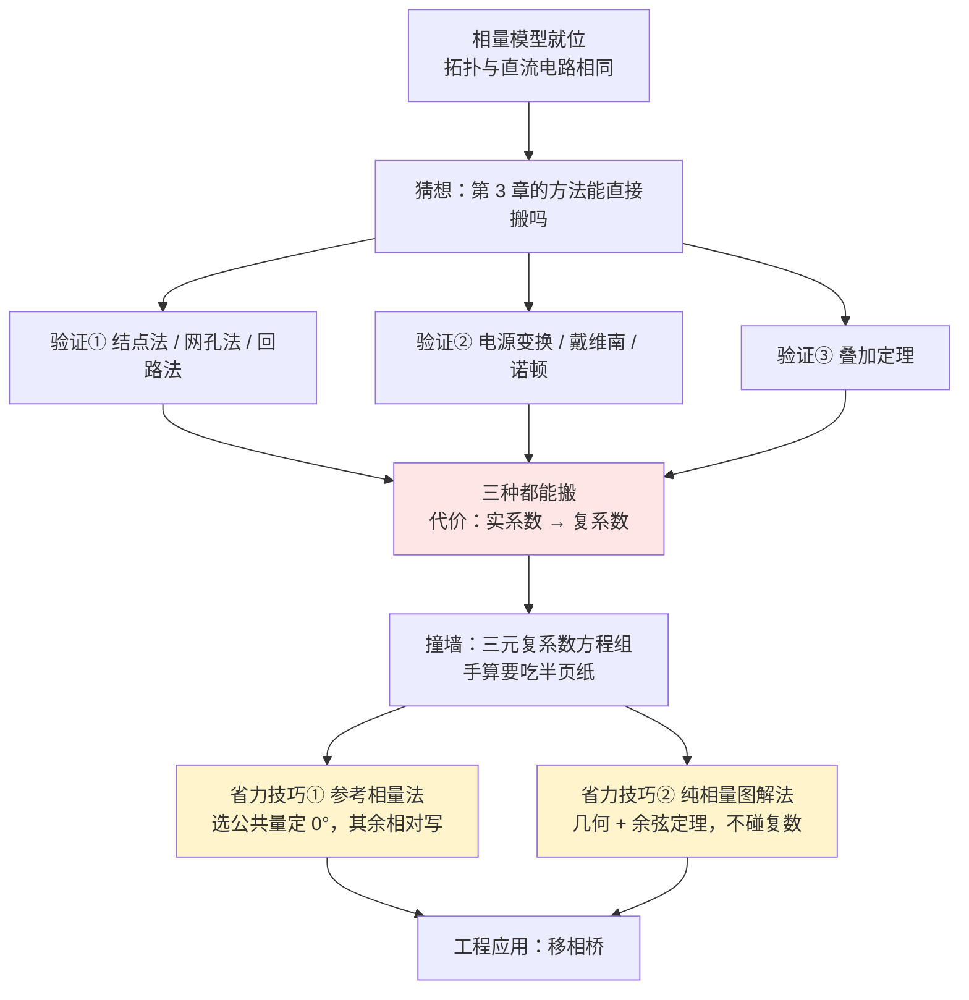

# C4.3 正弦稳态电路的一般分析 General Analysis of Sinusoidal Steady-State Circuits

> [!abstract] 这一讲的任务
> [[C4.2 元件相量模型与阻抗导纳]] 结束时留了一句承诺：相量模型和时域电路的**拓扑一模一样**，元件 VCR 也变成了同一个形状 $\dot U=Z\dot I$，所以第 3 章那一整套解法可以原样搬过来。
> 这一讲就是**把这句话兑现**：结点法、网孔法/回路法、电源变换、叠加、戴维南，逐一在相量域里跑一遍。
> 跑完之后你会看到两件事——**好消息**：方法确实一个字都不用改；**坏消息**：方程从实系数变成复系数，手算量翻好几倍。所以这一讲还要顺手教你两招课件里藏得很深、但考试和工程里都极好用的省力技巧：**参考相量法**和**纯相量图解法**。

> [!info] 怎么读这份讲义
> 第 1 节是方法论总纲（三步走 + 一个关键差别），必须先读。第 2–10 节是九道例题，每题对应一种方法，可以按需跳读。但有三道**建议不要跳**：
> - **例 2（复系数方程组）**——它是"手算量爆炸"这个说法的实证，也是本讲修正课件笔误最集中的一题；
> - **例 6（虚部置零求参数）**——一类很典型的题型：把"相位条件"翻译成"实部为零"；
> - **例 8（移相桥）**——纯相量图解法的代表，很多人从没见过这种解法。
>
> 课件本身在这 18 页里有若干**印刷笔误和数值错误**（相位符号、已知条件重复、单位矛盾等），本讲逐条点名并给出复算结果，凡是与课件不一致的地方都以**方框内的复算值**为准。

---

> [!warning] 授课进度说明（截至第 4 次课）
> 已有的课堂语音转写稿覆盖到**第 4 次课**，内容为第 1 章全部 + 第 2 章全部；**第 4 章尚未讲授**。
> 因此本篇内容全部来自**课件与教材**（课件为 `第4章-交流稳态电路分析-(上集).pdf`，全文无手写笔迹），未经课堂讲解校正，篇内不使用「拓展」标注。等课上讲到本章后，本篇会按课堂实况做一次合并。

---

## 0. 开场：把上一讲的锤子递给你，你打算怎么挥

先看一个具体任务。课件第 36 页给了这样一道题：

> 一个电路里有两个电源：电压源 $u_S(t)=\sqrt2\cdot24\sin(10^3t)\ \mathrm{V}$，电流源 $i_S(t)=\sqrt2\cos(10^3t)$；元件有 $R_1=10\ \Omega$、$R_2=20\ \Omega$、$R_3=15\ \Omega$、$R_4=30\ \Omega$、$L=10\ \mathrm{mH}$、$C=10\ \mu\mathrm{F}$。**求 $R_4$ 两端的电压。**

按 [[C4.1 正弦量与相量]] 的老办法，你要在一个含电感电容的电路里列微分方程组，然后拆三角恒等式——这题有两条储能支路，方程至少二阶，非齐次项还是两个不同相位的正弦。手算基本不可行。

但你现在有相量了。先把元件换成阻抗：

$$
Z_L=\mathrm{j}\omega L=\mathrm{j}\times10^3\times10\times10^{-3}=\mathrm{j}10\ \Omega
\,,\qquad
Z_C=\frac{1}{\mathrm{j}\omega C}=\frac{1}{\mathrm{j}\times10^3\times10\times10^{-6}}=-\mathrm{j}100\ \Omega
$$

再把两个电源换成相量（按本题约定的 $\cos$ 参考：$u_S$ 是 $\sin$，写成 $\cos$ 要减 $90^\circ$）：

$$
\dot U_S=24\angle-90^\circ=-\mathrm{j}24\ \mathrm{V}
\,,\qquad
\dot I_S=1\ \mathrm{A}
$$

一瞬间，电路变成了纯代数问题：三个网孔、六个元件、两个电源。

**然后你开始列网孔方程：**

$$
\begin{cases}
(30+\mathrm{j}10)\dot I_1-(10+\mathrm{j}10)\dot I_2-20\dot I_3=-\mathrm{j}24\\[2pt]
-(10+\mathrm{j}10)\dot I_1+(55+\mathrm{j}10)\dot I_2-15\dot I_3=0\\[2pt]
-20\dot I_1-15\dot I_2+(35-\mathrm{j}100)\dot I_3=\mathrm{j}100
\end{cases}
$$

> [!question] 停一下，先自己想想
> 这三个方程和你在第 3 章列的网孔方程，**有什么不同**？
> 结构完全一样：对角线上是自阻抗、非对角线上是互阻抗（带负号）、右端是回路内的电源。唯一的区别是——**每一个系数都是复数**。
> 那么问题来了：**解一个三元复系数方程组，手算要多久？** 每次消元都要做一次复数除法，除完还要有理化分母。三个未知数就是三次除法，稍不留神一个符号错，整页白算。

这就是本讲的真实处境。课件在总纲页（p.34）把这件事总结成一句话：

> [!important] 实系数 vs 复系数（课件 p.34）
> 直流电阻电路中，电路方程是**实系数**线性方程组；
> 交流稳态电路中，相量分析的电路方程是**复系数**线性方程组。

> [!note] 这句话的真正含义
> 它不是"交流更难"，而是"**交流更烦**"。
> **方法完全没变**——第 3 章的每一条定理、每一个套路都能逐字搬过来（这一讲会把它们逐个验证一遍）。
> **变的只有算术**：实数的加减乘除变成复数的加减乘除。
> 一切"交流电路比直流电路难"的抱怨，本质上都是在抱怨这件事。

既然方法没变、只是算术变难，那省力的方向就很明确了：**能不能少做几次复数除法？** 这一讲后半段的两个技巧，全部是围绕这个问题展开的。

---

## 1. 相量分析法的总纲（课件 p.34）

> [!important] 正弦稳态电路的相量分析法：三步走
> **第 1 步**：把时域电路化为**相量模型**（元件换阻抗、电源换相量、变量加点）。
> **第 2 步**：**用直流电路的分析方法**分析相量模型，解出响应相量。
> **第 3 步**：核对时域函数与相量的对应关系，**把响应相量还原成时间函数**。

这三步里，第 2 步是"白送"的（第 3 章的方法直接用），第 1 步和第 3 步是交流电路**新增的**工作量——而且第 3 步特别容易漏。

> [!warning] 第 3 步不是走过场
> 相量是"扣掉 $\mathrm{e}^{\mathrm{j}\omega t}$、扣掉 $\sqrt2$"之后剩下的东西。还原的时候**两样都要还回去**：
> $$\dot I=1.24\angle29.7^\circ\ \mathrm{A}
> \quad\Longrightarrow\quad
> i(t)=1.24\sqrt2\sin(10^3t+29.7^\circ)\ \mathrm{A}$$
> - 补 $\sqrt2$（如果用的是有效值相量）；
> - 补 $\omega t$（$\omega$ 从题干里找）；
> - 补函数名（**题干用 $\sin$ 就用 $\sin$，题干用 $\cos$ 就用 $\cos$**）。
>
> **只给相量不给时间函数，答案是不完整的。** 后面九道例题的答案，全部落到时间函数或有效值读数上。

另外，本讲的**约定问题**要先说清楚——课件自己在这一点上前后不一致，这也是它若干处"相位符号错误"的根源。

> [!warning] 课件自身的约定冲突：$\sin$ 参考 vs $\cos$ 参考
> - 例 1（p.35）用** $\sin$ 参考**：$10\sin(1000t)\to\dfrac{10}{\sqrt2}\angle0^\circ$，最后还原成 $\sin$。
> - 例 2（p.36）页底却印着** $\cos$ 参考**的映射关系：$\dot U\Longleftrightarrow\sqrt2U\cos(10^3t)$，例 2、例 3 都照 $\cos$ 做。
>
> 两种约定本身都对，但从 $\sin$ 换到 $\cos$，**所有相量会整体旋转 $-90^\circ$**。同一份课件里混用，就会出现"同一个答案时而 $+147^\circ$、时而……"这类混乱。
> **本讲义全局采用 $\sin$ 参考**（与 [[C4.1 正弦量与相量]] 的约定一致），凡课件按 $\cos$ 做的例题，会明确标出"课件用 $\cos$ 参考"，并给出两种约定下的对照。

---

## 2. 例 1：相量域结点法（课件 p.35）

> [!example] 例 1
> 电路：电源 $u_S=10\sin(1000t+\pi/6)\ \mathrm{V}$；左支路 $5\ \Omega$ 串 $5\ \mathrm{mH}$；中间竖支路 $200\ \mu\mathrm{F}$ 电容（电流 $i$ 向下）；右支路 $5\ \Omega$ 串 $200\ \mu\mathrm{F}$。求 $i$。

![[C4-结点法例题电路与相量模型.png]]

**第 1 步：作相量模型。**

$$
Z_L=\mathrm{j}\omega L=\mathrm{j}\times1000\times5\times10^{-3}=\mathrm{j}5\ \Omega
\,,\qquad
Z_C=\frac{1}{\mathrm{j}\omega C}=\frac{1}{\mathrm{j}\times1000\times200\times10^{-6}}=-\mathrm{j}5\ \Omega
$$

两个电容值相同，阻抗都是 $-\mathrm{j}5\ \Omega$。电源相量（有效值）：

$$
\dot U_{S1}=\frac{10}{\sqrt2}\angle0^\circ\ \mathrm{V}
\,,\qquad
\dot U_{S2}=\frac{10}{\sqrt2}\angle30^\circ\ \mathrm{V}
$$

**第 2 步：列结点方程。** 只有上中一个独立结点（设为结点 1），下面那根线是参考结点：

$$
\left(\frac{1}{5+\mathrm{j}5}+\frac{1}{5-\mathrm{j}5}+\frac{1}{-\mathrm{j}5}\right)\dot U_1
=\frac{1}{5+\mathrm{j}5}\cdot\frac{10}{\sqrt2}\angle0^\circ
+\frac{1}{5-\mathrm{j}5}\cdot\frac{10}{\sqrt2}\angle30^\circ
$$

左边三项就是三个支路的自导纳之和；右边两项是每个电源经自己那条支路"注入"结点 1 的等效电流源。**和直流结点法完全一样的套路**，只是每个数都是复数。

解出：

$$
\dot U_1=3.5355\angle-30^\circ\ \mathrm{V}
$$

> [!example] 手算复核（可以自己走一遍）
> 三条支路的导纳：
> $$\frac{1}{5+\mathrm{j}5}=0.1-\mathrm{j}0.1
> \,,\quad
> \frac{1}{5-\mathrm{j}5}=0.1+\mathrm{j}0.1
> \,,\quad
> \frac{1}{-\mathrm{j}5}=\mathrm{j}0.2$$
> 相加：$0.2+\mathrm{j}0.2$。
> 右边：$\dfrac{10}{\sqrt2}=7.0711$，
> $$(0.1-\mathrm{j}0.1)\times7.0711=0.7071-\mathrm{j}0.7071$$
> $$(0.1+\mathrm{j}0.1)\times7.0711\angle30^\circ
> =(0.1+\mathrm{j}0.1)(6.1237+\mathrm{j}3.5355)=0.2588+\mathrm{j}0.9659$$
> 相加得 $0.9659+\mathrm{j}0.2588=1.0\angle15^\circ$。于是
> $$\dot U_1=\frac{1.0\angle15^\circ}{0.2828\angle45^\circ}=3.5355\angle-30^\circ\ \mathrm{V}\ ✓$$

**第 3 步：求响应并还原。**

$$
\dot I=\frac{\dot U_1}{-\mathrm{j}5}=\frac{3.5355\angle-30^\circ}{5\angle-90^\circ}=0.707\angle60^\circ\ \mathrm{A}
$$

$$
\boxed{\ i(t)=0.707\sqrt2\sin(1000t+60^\circ)=\sin(1000t+60^\circ)\ \mathrm{A}\ }
$$

（幅值恰好是 $1$，因为 $0.707\times\sqrt2\approx1.000$。）

> [!warning] 本题的相位约定提醒
> 课件这里直接把 $\sin$ 的初相当作相量相位（$10\sin1000t\to\frac{10}{\sqrt2}\angle0^\circ$），最后也用 $\sin$ 还原——**这是 $\sin$ 参考，和本讲义一致**。
> 如果改用 $\cos$ 参考（$10\sin1000t\to\frac{10}{\sqrt2}\angle-90^\circ$），全部相量整体转 $-90^\circ$：$\dot U_1=3.5355\angle-120^\circ\ \mathrm{V}$，$\dot I=0.707\angle-30^\circ\ \mathrm{A}$，$i(t)=\cos(1000t-30^\circ)\ \mathrm{A}$。
> **幅值完全一样，相位差 $90^\circ$。** 两种答案都对，但你不能在同一道题里混用。

---

## 3. 例 2：网孔法与结点法，两条路都通（课件 p.36–38）

回到开场那道题。课件给了**两种解法**，正是为了说明"第 3 章的方法在相量域一个都不缺"。

![[C4-网孔法与结点法例题电路.png]]

### 3.1 解法一：网孔电流法（课件 p.37）

先把三个网孔电流 $\dot I_1,\dot I_2,\dot I_3$ 按顺时针方向设好，然后**照第 3 章的老规矩**逐条写：

| 网孔 | 自阻抗 | 互阻抗 | 右端源项 |
|---|---|---|---|
| Ⅰ | $30+\mathrm{j}10$（$R_2$ 与 $L+R_1$） | 与 Ⅱ 共用 $(10+\mathrm{j}10)$；与 Ⅲ 共用 $20$ | $\dot U_S=-\mathrm{j}24$ |
| Ⅱ | $55+\mathrm{j}10$（$R_4+R_3+L+R_1$） | 与 Ⅲ 共用 $15$ | $0$ |
| Ⅲ | $35-\mathrm{j}100$（$R_2+R_3+Z_C$） | — | $\mathrm{j}100\dot I_S=\mathrm{j}100$ |

写成方程组：

$$
\begin{cases}
(30+\mathrm{j}10)\dot I_1-(10+\mathrm{j}10)\dot I_2-20\dot I_3=-\mathrm{j}24\\
-(10+\mathrm{j}10)\dot I_1+(55+\mathrm{j}10)\dot I_2-15\dot I_3=0\\
-20\dot I_1-15\dot I_2+(35-\mathrm{j}100)\dot I_3=\mathrm{j}100
\end{cases}
$$

解出 $\dot I_2$，再乘 $R_4$ 就是所求电压。

> [!note] 这里有一个课件没说清的细节：网孔 Ⅲ 的右端项 $\mathrm{j}100$
> 图上只标了 Ⅰ、Ⅱ、Ⅲ 三个网孔，但**电容 $C$ 与电流源 $i_S$ 是两条各自独立的并联竖支路**，它们之间还存在第四个网孔（课件没标）。那个网孔的电流被理想电流源锁死为 $-\dot I_S$。
> 网孔 Ⅲ 的右端出现 $\mathrm{j}100\dot I_S$，正是"电流源独占一条支路"这一点的体现——**含有理想电流源的网孔，方程要按"电流源与网孔电流的关系"改写右端**，这与第 3 章的处理思路一致，只是换成了复数。

> [!warning] 课件笔误：答案的相位符号印反了
> 课件写 $\dot I_2=0.338\angle\boxed{+}147^\circ\ \mathrm{A}$、$u_{R_4}=10.147\sqrt2\cos(10^3t+\boxed{+}147^\circ)\ \mathrm{V}$。
> **按课件自己印出来的这三个方程独立求解**（$\cos$ 参考），得到：
> $$\dot I_1=1.0134\angle-141.1^\circ,\quad
> \dot I_2=0.3382\angle\boxed{-146.97^\circ},\quad
> \dot I_3=0.8197\angle174.0^\circ$$
> **幅值与课件完全一致（$0.338$），相位应为 $-147^\circ$ 而不是 $+147^\circ$。** $u_{R_4}=30\dot I_2=10.147\angle-146.97^\circ\ \mathrm{V}$，幅值 $10.147$ 也对，相位同样应为 $-147^\circ$。

### 3.2 解法二：结点法（课件 p.38）

课件用同一张相量模型重新标了结点号：结点 **1**（$R_2$ 上方）、结点 **0**（左侧竖线，取作参考）、结点 **2**（$R_2$ 与 $R_3$ 之间）、结点 **3**（底线右侧）。因为结点 1 与参考结点 0 之间就是理想电压源，所以

$$
\dot U_1=\dot U_S=-\mathrm{j}24\ \mathrm{V}
$$

剩下两个结点各列一条 KCL：

$$
-\frac{1}{20}\dot U_1+\left(\frac{1}{20}+\frac{1}{15}+\frac{1}{10+\mathrm{j}10}\right)\dot U_2-\frac{1}{15}\dot U_3=0
$$

$$
-\frac{1}{-\mathrm{j}100}\dot U_1-\frac{1}{15}\dot U_2+\left(\frac{1}{30}+\frac{1}{15}+\frac{1}{-\mathrm{j}100}\right)\dot U_3=-1
$$

> [!note] 最后那个 $-1$ 是怎么来的
> 电流源 $\dot I_S=1\ \mathrm{A}$ 从结点 3 流向结点 1（图中箭头向上）。对结点 3 来说电流是**流出**的，按"流入取正"的惯例应取 $-1$。
> 这正是第 3 章结点电压法里"电流源注入项"的规定，一个字没改。

复算结果：

$$
\dot U_2=9.5863\angle-93.18^\circ\ \mathrm{V}
\,,\qquad
\dot U_3=10.1469\angle\boxed{-146.97^\circ}\ \mathrm{V}
$$

而 $R_4$ 两端电压就是 $u_{R_4}=u_3$（$R_4$ 接在结点 3 与参考结点之间）。

> [!important] 两条独立路径给出同一个答案
> 网孔法给 $-147^\circ$，结点法也给 $-147^\circ$。**两条完全独立的路线互相印证**，可以确定课件的 $+147^\circ$ 是印刷笔误，而不是我们在某一步理解错了。
> `两条路都算一遍、看结果是否一致` 是考场上一分钟就能做完的自检，比反复检查符号便宜得多。

> [!warning] 课件还有两处小问题
> - **单位矛盾**：题干写 $i_S(t)=\sqrt2\cos(10^3t)\ \mathrm{mA}$，但相量模型里标的是 $\dot I_S=1\ \mathrm{A}$，网孔方程右端也按 $1\ \mathrm{A}$ 算（$\mathrm{j}100\dot I_S=\mathrm{j}100$）。**mA 与 A 必有一处是笔误**。若真按 $1\ \mathrm{mA}$ 算，全部电流电压要缩小 $1000$ 倍。
> - **$\sin/\cos$ 约定**：本题按 $\cos$ 参考做（$\dot U_S=-j24$ 就是 $24\angle-90^\circ$，来自 $\sin\to\cos$ 的 $-90^\circ$），而例 1 按 $\sin$ 参考做。跨题约定不统一，看课件时要留意。

---

## 4. 例 3：含受控源（课件 p.39–40）

受控源是直流电路里最容易翻车的地方，在相量域里同样。**受控源不移除、不置零，全程保留**——处理方式与第 3 章完全一致。

> [!example] 例 3
> 已知 $u_S=10\sqrt2\sin10^3t\ \mathrm{V}$，$L=4\ \mathrm{mH}$，$C=500\ \mu\mathrm{F}$，受控电压源 $2i_1$（系数 $2\ \Omega$），求 $i_1$、$i_2$。

![[C4-受控源例题电路与相量模型.png]]

**相量模型：**

$$
Z_L=\mathrm{j}\times10^3\times4\times10^{-3}=\mathrm{j}4\ \Omega
\,,\qquad
Z_C=-\mathrm{j}\frac{1}{500\times10^{-6}\times10^3}=-\mathrm{j}2\ \Omega
\,,\qquad
\dot U_S=10\angle0^\circ\ \mathrm{V}
$$

**回路法。** 两个回路，受控源在第二个回路上，先按普通方程写、再把受控源项移到左边：

$$
\begin{cases}
(3+\mathrm{j}4)\dot I_1-\mathrm{j}4\dot I_2=10\\
-\mathrm{j}4\dot I_1+(\mathrm{j}4-\mathrm{j}2)\dot I_2=-2\dot I_1
\end{cases}
\ \Longrightarrow\
\begin{cases}
(3+\mathrm{j}4)\dot I_1-\mathrm{j}4\dot I_2=10\\
(2-\mathrm{j}4)\dot I_1+\mathrm{j}2\dot I_2=0
\end{cases}
$$

> [!note] 移项那一步在做什么
> 第二式的右端 $-2\dot I_1$ 就是受控源电压。因为**受控量 $\dot I_1$ 是未知量**，必须把它和别的未知量一起留在左边——所以移到左边变成 $(2-\mathrm{j}4)\dot I_1$。
> 一句话：**受控源是"方程里的未知量"，不是"方程右端的已知源"。** 这个区别决定了整道题的解法。

解出来：

$$
\dot I_1=1.24\angle29.7^\circ\ \mathrm{A}
\,,\qquad
\dot I_2=2.77\angle56.3^\circ\ \mathrm{A}
$$

$$
\boxed{\ i_1=1.24\sqrt2\sin(10^3t+29.7^\circ)\ \mathrm{A}
\,,\qquad
i_2=2.77\sqrt2\sin(10^3t+56.3^\circ)\ \mathrm{A}\ }
$$

> [!example] 手算复核
> 由第二式：$\mathrm{j}2\dot I_2=-(2-\mathrm{j}4)\dot I_1$，即
> $$\dot I_2=-\frac{2-\mathrm{j}4}{\mathrm{j}2}\dot I_1=\frac{\mathrm{j}(2-\mathrm{j}4)}{2}\dot I_1=(2+\mathrm{j})\dot I_1$$
> 代回第一式：$(3+\mathrm{j}4)\dot I_1-\mathrm{j}4(2+\mathrm{j})\dot I_1=10$，即 $(7-\mathrm{j}4)\dot I_1=10$：
> $$\dot I_1=\frac{10}{7-\mathrm{j}4}=\frac{10(7+\mathrm{j}4)}{65}=\frac{70+\mathrm{j}40}{65}=1.0769+\mathrm{j}0.6154$$
> $$|\dot I_1|=\sqrt{1.0769^2+0.6154^2}=1.2404
> \,,\qquad
> \angle\dot I_1=\arctan\frac{0.6154}{1.0769}=29.74^\circ\ ✓$$
> $$\dot I_2=(2+\mathrm{j})(1.0769+\mathrm{j}0.6154)=1.5385+\mathrm{j}2.3077
> \ \Longrightarrow\ 2.7735\angle56.31^\circ\ ✓$$

**结点法（同页给出的第二种做法）。** 设结点 1 的电压为 $\dot U_1$（底线为参考）：

$$
\begin{cases}
\left(\dfrac13+\dfrac{1}{\mathrm{j}4}+\dfrac{1}{-\mathrm{j}2}\right)\dot U_1=\dfrac{10}{3}+\dfrac{2\dot I_1}{-\mathrm{j}2}\\[8pt]
\dot I_1=\dfrac{10-\dot U_1}{3}
\end{cases}
$$

> [!note] 右端那个 $\dfrac{2\dot I_1}{-\mathrm{j}2}$ 是什么
> 它形式上像"电压除以阻抗"，其实是**右支路（受控电压源所在的支路）折算到结点 1 的等效电流注入项**。
> 因为该支路的电压恰好等于受控源电压 $2\dot I_1$，所以它对结点 1 的注入电流就是 $\dfrac{2\dot I_1}{-\mathrm{j}2}$。
> **含受控源时，结点方程的右端会出现未知量**（这里出现了 $\dot I_1$），所以必须再补一条关系式 $\dot I_1=(10-\dot U_1)/3$——两条方程联立才够。这也是"受控源是未知量"的另一面。

复算：$\dot U_1=7.0165\angle-15.26^\circ\ \mathrm{V}$（顺便验证 $3\dot I_1$ 一致），代回得 $\dot I_1=1.0769+\mathrm{j}0.6154$，与回路法完全相同。

> [!important] 受控源两条铁律（沿用第 3 章）
> **① 受控源不参与"置零"。** 用叠加定理或求等效电阻时，只把**独立源**置零，受控源原样保留。
> **② 受控源引入新的未知量，必须补方程。** 结点法里它会出现在方程右端，回路法里它会出现在方程左端——两种情况都要补一条"控制量与被求量的关系"。

---

## 5. 例 4：电源变换 vs 戴维南，两种解法一个答案（课件 p.41–42）

> [!example] 例 4
> 已知 $\dot I_S=4\angle90^\circ\ \mathrm{A}$，$Z_1=Z_2=-\mathrm{j}30\ \Omega$，$Z_3=30\ \Omega$，$Z=45\ \Omega$，求 $\dot I$。
> 电路：电流源 $\dot I_S$ 与 $Z_1\parallel Z_3\parallel(Z_2+Z)$ 并联。

![[C4-电源变换与戴维南例题电路.png]]

### 5.1 解法一：电源变换

先并联化简：

$$
Z_1\parallel Z_3=\frac{(-\mathrm{j}30)(30)}{-\mathrm{j}30+30}=\frac{-\mathrm{j}900}{30-\mathrm{j}30}=15-\mathrm{j}15\ \Omega
$$

**电流源并阻抗 → 电压源串阻抗**（源变换，$u_S=Z\cdot i_S$ 的相量版）：

$$
\dot U_S=\dot I_S(Z_1\parallel Z_3)=\mathrm{j}4\times(15-\mathrm{j}15)=60+\mathrm{j}60=84.853\angle45^\circ\ \mathrm{V}
$$

于是电路变成单回路，电流直接分压：

$$
\dot I=\frac{\dot I_S(Z_1\parallel Z_3)}{Z_1\parallel Z_3+Z_2+Z}
=\frac{\mathrm{j}4(15-\mathrm{j}15)}{15-\mathrm{j}15-\mathrm{j}30+45}
=\frac{60+\mathrm{j}60}{60-\mathrm{j}45}
=\frac{84.853\angle45^\circ}{75\angle-36.87^\circ}
=1.13\angle81.9^\circ\ \mathrm{A}
$$

（课件把分子分母同除 $15$，写成 $\dfrac{5.657\angle45^\circ}{5\angle-36.9^\circ}$，结果相同。）

### 5.2 解法二：戴维南等效

把负载 $Z$ 以外的部分整体等效成一个电压源串阻抗：

$$
\dot U_0=\dot I_S(Z_1\parallel Z_3)=84.85\angle45^\circ\ \mathrm{V}
\,,\qquad
Z_0=Z_1\parallel Z_3+Z_2=(15-\mathrm{j}15)+(-\mathrm{j}30)=15-\mathrm{j}45\ \Omega
$$

$$
\dot I=\frac{\dot U_0}{Z_0+Z}=\frac{60+\mathrm{j}60}{15-\mathrm{j}45+45}=\frac{60+\mathrm{j}60}{60-\mathrm{j}45}=1.13\angle81.9^\circ\ \mathrm{A}
$$

> [!important] 两种解法给出同一个 $1.13\angle81.9^\circ$
> 这说明**源变换与戴维南定理在相量域里逐字成立**——它们的依据是老朋友：$\dot U=Z\dot I$ 形式的 VCR，加上 KCL/KVL。
> 与第 3 章唯一的不同是：那里的 $R_0$ 是实数，这里的 $Z_0$ 是复数；那里算 $U_{OC}$ 是实数运算，这里是复数乘除。

> [!note] 顺手记一个技巧
> 求戴维南等效时，$Z_0$ 的算法是"**独立源置零后看入端阻抗**"：电压源短路、电流源开路，然后把剩下的阻抗按串并联化简。这里 $Z_0=Z_1\parallel Z_3+Z_2$ 就是把电流源开路后的结果，与直流完全一样。

---

## 6. 例 5：叠加定理（课件 p.43–44）

> [!example] 例 5
> 用叠加定理求电流 $\dot I_2$。已知 $\dot U_S=100\angle45^\circ\ \mathrm{V}$，$\dot I_S=4\angle0^\circ\ \mathrm{A}$，$Z_1=Z_3=50\angle30^\circ\ \Omega$。

![[C4-叠加定理例题与分解.png]]

叠加定理的用法与直流一字不差：**每次只留一个独立源，其余电压源短路、电流源开路，受控源保留**；把各次结果相加。

**（1）$\dot I_S$ 单独作用**（$\dot U_S$ 短路）。此时 $Z_1$ 与 $Z_3$ 并联的电流按分流公式分到 $Z_3$ 一侧：

$$
\dot I_2'=\dot I_S\frac{Z_3}{Z_2+Z_3}
$$

**（2）$\dot U_S$ 单独作用**（$\dot I_S$ 开路）：

$$
\dot I_2''=-\frac{\dot U_S}{Z_2+Z_3}
$$

**（3）叠加：**

$$
\dot I_2=\dot I_2'+\dot I_2''
$$

> [!warning] 课件在本例有两处明显错误
> **错误一：已知条件重复印刷、且漏了一个元件。** 课件写 "$Z_1=Z_3=50\angle30^\circ\ \Omega$，$Z_3=50\angle30^\circ\ \Omega$"，$Z_3$ 印了两次、$Z_2$ 从未出现。
> 但由它自己给出的中间结果可以**反推**出 $Z_2$ 应该是多少：式 (1) 的分母写作 $50\sqrt3$，而
> $$50\angle-30^\circ+50\angle30^\circ=86.60\angle0^\circ=50\sqrt3$$
> 只有取 $Z_2=50\angle\boxed{-30^\circ}\ \Omega$ 才与课件中间结果逐位吻合。所以题干里的第二个 "$Z_3=50\angle30^\circ$" 应为 "$Z_2=50\angle-30^\circ$"（**元件下标和角度符号两处笔误合并**）。
> 按课件印刷的字面值（$Z_2=Z_3=50\angle30^\circ$）重算，会得到 $\dot I_2'=2\angle0^\circ$、$\dot I_2''=1\angle-165^\circ$，与课件中间值对不上。
>
> **错误二：最终合成结果的相位符号印反了。**
> 课件写 $\dot I_2=2.31\angle30^\circ+1.155\angle-135^\circ=1.23\angle\boxed{-15.9^\circ}\ \mathrm{A}$。其实把这两个相量老老实实相加：
> $$2.3094\angle30^\circ+1.1547\angle-135^\circ=(2+\mathrm{j}1.1547)+(-0.8165-\mathrm{j}0.8165)=1.1835+\mathrm{j}0.3382$$
> $$\boxed{\ \dot I_2=1.2309\angle+15.95^\circ\ \mathrm{A}\ }$$
> **幅值 $1.23$ 一致，但相位应为 $+15.9^\circ$，课件印成 $-15.9^\circ$。**

> [!important] 用复算验证物理量级：这题值得记住的两个数
> - $\dot I_2'=\dfrac{4\angle0^\circ\times50\angle30^\circ}{50\sqrt3}=\dfrac{200\angle30^\circ}{86.60}=2.309\angle30^\circ\ \mathrm{A}$（=$4/\sqrt3$，模 $2.31$）；
> - $\dot I_2''=-\dfrac{100\angle45^\circ}{86.60}=1.1547\angle-135^\circ\ \mathrm{A}$（=$2/\sqrt3$，模 $1.155$）。
> 两个分量模长刚好差 2 倍、相位差 $165^\circ$，合成后模长掉到 $1.23$——**这正是"幅值不能相加"的又一个活例**：$2.31+1.155=3.47$，跟 $1.23$ 差了近三倍。

> [!warning] 叠加定理在交流里的两条边界（老规矩，但更值钱）
> **① 只有独立源参与置零，受控源保留。**
> **② 功率不能叠加。** 电流电压是相量（一次量），可以叠加；功率是二次量，必须用叠加**之后**的电压电流去算。这条在 [[C4.4 正弦稳态功率与功率因数]] 会以"平均功率含交叉项"的形式再讲一次。

---

## 7. 例 6：把"相位差 $90^\circ$"翻译成"实部为零"（课件 p.45）

这是一道很典型的**参数设计题**，思路比计算更值得学。

> [!example] 例 6
> 电路：$Z=10+\mathrm{j}50\ \Omega$ 串联在电源与并联结点之间；并联部分由 $Z_1=400+\mathrm{j}1000\ \Omega$ 和受控电流源 $\beta\dot I_1$ 组成。求 $\beta$ 等于多少时，$\dot U_S$ 与 $\dot I_1$ 的相位差为 $90^\circ$？

![[C4-相位差90度例题电路.png]]

**第一步：写出比值。** 相位差 $90^\circ$ 意味着

$$
\frac{\dot U_S}{\dot I_1}=\frac{U_S}{I_1}\angle\varphi
\qquad\text{中}\qquad
\varphi=\pm90^\circ
$$

> [!important] 关键翻译：$\varphi=\pm90^\circ\ \Longleftrightarrow\ \operatorname{Re}\left[\dfrac{\dot U_S}{\dot I_1}\right]=0$
> 一个复数的相角是 $\pm90^\circ$，等价于说它**落在虚轴上**，也就是**实部为零**。
> 反过来也成立：实部为零 ⟺ 相角为 $\pm90^\circ$（除非它恰好是零，另行讨论）。
> **把相位条件翻译成"实部为零"（或"虚部为零"），是这类题的通用套路。**

**第二步：用 KCL 把 $\dot I$ 和 $\dot I_1$ 联系起来。** 结点处 $\dot I$ 分成 $Z_1$ 支路的 $\dot I_1$ 和受控源的 $\beta\dot I_1$：

$$
\dot I=\dot I_1+\beta\dot I_1=(1+\beta)\dot I_1
$$

**第三步：沿电源回路写 KVL。**

$$
\dot U_S=Z\dot I+Z_1\dot I_1=Z(1+\beta)\dot I_1+Z_1\dot I_1
$$

$$
\frac{\dot U_S}{\dot I_1}=(1+\beta)Z+Z_1=(1+\beta)(10+\mathrm{j}50)+(400+\mathrm{j}1000)
$$

**第四步：拆实部虚部、令实部为 0。**

$$
\frac{\dot U_S}{\dot I_1}=\underbrace{\left[410+10\beta\right]}_{\text{实部}}+\mathrm{j}\underbrace{\left[50+50\beta+1000\right]}_{\text{虚部}}
$$

$$
410+10\beta=0
\qquad\Longrightarrow\qquad
\boxed{\ \beta=-41\ }
$$

代入验证：

$$
\frac{\dot U_S}{\dot I_1}=-\mathrm{j}1000
\,,\qquad
\varphi=-90^\circ
$$

**结论**：$\beta=-41$ 时，$\dot I_1$ 的相位比 $\dot U_S$ 大 $90^\circ$，即**电流超前电压 $90^\circ$**。

> [!note] 关于结论里"谁超前谁"的表述
> $\varphi=-90^\circ$ 是 $\dfrac{\dot U_S}{\dot I_1}$ 的相角，即 $\theta_u-\theta_i=-90^\circ$，所以 $\theta_i=\theta_u+90^\circ$——**电流超前电压 $90^\circ$**。课件正是这么写的，没写错。
> 这里很容易绕晕，锚定一句话即可：**看的是比值 $\dot U_S/\dot I_1$ 的角，不是电流的角。**

> [!warning] 注意受控源的符号
> 本题是**受控电流源** $\beta\dot I_1$（菱形里画的是电流箭头），与例 3 的**受控电压源** $2\dot I_1$ 不同。看到菱形先看里面画的是电压的 $+/−$ 还是电流箭头，这决定了它在方程里以什么形式出现。

---

## 8. 例 7：参考相量法 vs 解析法——测线圈参数（课件 p.46–47）

这道题是本讲第一个"省力技巧"的完整展示。

> [!example] 例 7
> 已知 $U=115\ \mathrm{V}$，$U_1=55.4\ \mathrm{V}$，$U_2=80\ \mathrm{V}$，$R_1=32\ \Omega$，$f=50\ \mathrm{Hz}$。求线圈的电阻 $R_2$ 和电感 $L_2$。
> 电路：$R_1$ 串一个待测线圈（$R_2$ 串 $L_2$），三个电压都是**有效值读数**。

![[C4-线圈参数测量电路与相量图.png]]

### 8.1 解一：相量图法（参考相量法）

**串联电路里，电流是公共量——所以选 $\dot I$ 作参考相量。** 这一步是整道题的关键：

> [!important] 参考相量法：选谁当 $0^\circ$
> **串联电路选电流**（各元件共用同一个电流，电压相对它写）；
> **并联电路选电压**（各支路共用同一个电压，电流相对它写）。
> 选对了，参考相量就是一条水平线，所有角度都是相对它的"绝对"角度，图上量一量就能读出来。
> 选错了会怎样？不会算错，但每个表达式里都多一个未知的公共相位 $\theta$，要多做一轮无用的旋转。

以 $\dot I$ 为水平参考，三个电压的关系是：

$$
\dot U=\dot U_1+\dot U_2
\,,\qquad
\dot U_1=R_1\dot I\ \text{与}\ \dot I\ \text{同相}
\,,\qquad
\dot U_2=\dot U_{R_2}+\dot U_L
$$

其中 $\dot U_{R_2}$ 与 $\dot I$ 同相、$\dot U_L$ 超前 $\dot I$ $90^\circ$。于是 $\dot U_1$、$\dot U_2$、$\dot U$ 构成一个三角形，$\dot U_2$ 与水平方向的夹角记作 $\theta_2$。

**先求电流：**

$$
I=\frac{U_1}{R_1}=\frac{55.4}{32}=1.73\ \mathrm{A}
$$

**用余弦定理求 $\theta_2$。** 三角形里 $\dot U_1$ 与 $\dot U_2$ 的夹角是 $180^\circ-\theta_2$：

$$
U^2=U_1^2+U_2^2-2U_1U_2\cos(180^\circ-\theta_2)=U_1^2+U_2^2+2U_1U_2\cos\theta_2
$$

$$
\cos\theta_2=\frac{U^2-U_1^2-U_2^2}{2U_1U_2}
=\frac{115^2-55.4^2-80^2}{2\times55.4\times80}=0.4237
\ \Longrightarrow\
\theta_2=64.9^\circ
$$

**再分量：**

$$
U_L=U_2\sin\theta_2=80\sin64.93^\circ=72.46\ \mathrm{V}
\,,\qquad
X_L=\frac{U_L}{I}=\frac{72.46}{1.731}=41.86\ \Omega
\,,\qquad
L_2=\frac{X_L}{2\pi f}=\frac{41.86}{314.16}=0.133\ \mathrm{H}
$$

$$
U_{R_2}=U_2\cos\theta_2=80\cos64.93^\circ=33.90\ \mathrm{V}
\,,\qquad
R_2=\frac{U_{R_2}}{I}=\frac{33.90}{1.731}=19.58\ \Omega
$$

> [!note] 这里用的"知识"其实只有三条
> ① 电阻电压与电流同相；② 电感电压超前电流 $90^\circ$；③ 有效值满足余弦定理（因为三个相量构成三角形）。
> **一次复数运算都没有做**，全靠几何。这就是相量图解法最大的价值——**在没有计算器的场合（考场上时间紧、或工程现场估算）极其好用**，而且结果自带几何直觉。

> [!warning] 课件"解一"的末位取整不一致
> 课件写 $X_L=41.88\ \Omega$、$U_{R_2}=33.92\ \mathrm{V}$，而用未取整的 $\theta_2=64.9304^\circ$ 精确计算应为 $41.86\ \Omega$ 与 $33.90\ \mathrm{V}$。
> 课件的 $41.88$ 是拿取整后的 $72.46/1.73$ 得到的。**差在末位，不影响两位有效数字的结论**，但顺手提醒：**中间步骤不要取整**。

### 8.2 解二：解析法（联立方程）

不用图，直接把两个电压的有效值关系写成方程。总电压与线圈电压各有一条：

$$
I=\frac{115}{\sqrt{(32+R_2)^2+(\omega L_2)^2}}
\,,\qquad
I=\frac{80}{\sqrt{R_2^2+(\omega L_2)^2}}
\,,\qquad
I=1.731\ \mathrm{A}
$$

两条方程、两个未知数，联立求解。令 $X=\omega L_2$：

$$
(32+R_2)^2+X^2=\left(\frac{115}{1.73125}\right)^2=4412.41
\,,\qquad
R_2^2+X^2=\left(\frac{80}{1.73125}\right)^2=2135.31
$$

两式相减消去 $X^2$：

$$
64R_2+1024=2277.11
\ \Longrightarrow\
R_2=19.58\ \Omega
$$

代回：$X^2=2135.31-19.58^2=1751.8$，$X=41.856\ \Omega$，于是

$$
L_2=\frac{41.856}{2\pi\times50}=0.1332\ \mathrm{H}
$$

> [!important] 两种解法的分工
> | | 相量图法（解一） | 解析法（解二） |
> |---|---|---|
> | 用什么 | 几何 + 余弦定理 | 有效值方程联立 |
> | 优点 | 直观、不碰复数、便于估算和检查 | 通用，几何关系复杂时也能做 |
> | 缺点 | 电路一复杂，图画不出来 | 容易漏掉相位关系（把 $R_2+X$ 直接相加） |
> | 结果 | $R_2=19.6\ \Omega$，$L_2=0.133\ \mathrm{H}$ | $R_2=19.58\ \Omega$，$L_2=0.133\ \mathrm{H}$ |
>
> **两条路都走一遍，就是最好的自检。** 课件把两种解法并列印出，用意正在于此。

---

## 9. 例 8：移相桥——把相量图当计算器用（课件 p.48–49）

这是本讲最漂亮的一道题，也是"纯相量图解法"的代表。

> [!example] 例 8
> 移相桥电路：左侧是两个相等的 $R_1$ 串联（中点记作 a），右侧是可变电阻 $R_2$ 串电容 $C$（中点记作 b），整体接在电源 $\dot U$ 上。
> 当 $R_2$ 由 $0$ 变到 $\infty$ 时，**$\dot U_{\mathrm{ab}}$ 的大小不变，相位从 $180^\circ$ 变到 $0^\circ$**。说明其工作原理。

![[C4-移相桥电路与相量图.png]]

课件的作图步骤是五条，我们跟着走：

> [!important] 移相桥的作图五步（课件 p.48）
> **① 选 $\dot U$ 为参考相量**（水平向右）。
> **② $\dot U_1$、$\dot U_2$ 与 $\dot U$ 同相。** 因为左侧是两个纯电阻串联，分压与总电压同相，且两臂相等，所以 $\dot U_1=\dot U_2=\dfrac{\dot U}{2}$——**a 点正好落在 $\dot U$ 的中点**。
> **③ $\dot I_C$ 超前 $\dot U$ 一个角 $\theta$。** 右支路是 $R_2$ 串 $C$，是容性支路，电流超前电压。
> **④ $\dot U_{\mathrm{ab}}=-\dot U_1+\dot I_C R_2$。** 这是整道题的关键式子，下一小节专门解释。
> **⑤ 改变 $R_2$**，看 b 点怎么动。

### 9.1 第 ④ 步那个式子是怎么来的

从 a 出发走到 b，路径是"a → 左端 → b"：

- 从 a 往左走回电源负端，电压变化是 $-\dot U_1$；
- 再从电源正端经过 $R_2$ 到 b，电压变化是 $+\dot I_C R_2$（$R_2$ 两端电压，与 $\dot I_C$ 同相）。

$$
\dot U_{\mathrm{ab}}=-\dot U_1+\dot I_C R_2
$$

而 $\dot I_C$ 由右支路自己决定：

$$
\dot I_C=\frac{\dot U}{R_2+\frac{1}{\mathrm{j}\omega C}}
=\dot U\cdot\frac{\mathrm{j}\omega C}{1+\mathrm{j}\omega CR_2}
$$

记 $x=\omega CR_2$（一个随 $R_2$ 单调增大的无量纲量），则 $\dot I_C R_2=\dot U\dfrac{\mathrm{j}x}{1+\mathrm{j}x}$，于是

$$
\frac{\dot U_{\mathrm{ab}}}{\dot U}=-\frac12+\frac{\mathrm{j}x}{1+\mathrm{j}x}
=\frac{\dfrac{x^2-1}{2}+\mathrm{j}x}{1+x^2}
$$

### 9.2 结论：幅值恒定、相位单调可调

$$
\left|\frac{\dot U_{\mathrm{ab}}}{\dot U}\right|
=\frac{\sqrt{\left(\frac{x^2-1}{2}\right)^2+x^2}}{1+x^2}
=\frac{\dfrac{x^2+1}{2}}{1+x^2}=\frac12
\qquad\Longrightarrow\qquad
\boxed{\ \left|\dot U_{\mathrm{ab}}\right|=\frac{|\dot U|}{2}\ \text{（与 }R_2\text{ 无关）}\ }
$$

$$
\boxed{\ \angle\dot U_{\mathrm{ab}}=180^\circ-2\arctan x\ }
$$

对这个式子取极限：

| $R_2$ | $x=\omega CR_2$ | $\angle\dot U_{\mathrm{ab}}$ |
|---|---|---|
| $\to0$ | $\to0$ | $\to180^\circ$ |
| 中间某值 | $0.5$ | $126.9^\circ$ |
| $x=1$（即 $R_2=1/(\omega C)$） | $1$ | $90^\circ$ |
| 更大 | $2$ | $53.1^\circ$ |
| $\to\infty$ | $\to\infty$ | $\to0^\circ$ |

**幅值始终是 $|U|/2$，相位随 $R_2$ 从 $180^\circ$ 单调降到 $0^\circ$。** 这就是一个**纯靠一个可变电阻实现的移相器**，而且**输出幅值不随相位变化**——工程上极其有用（比如需要扫相位来测系统的相频特性时）。

> [!note] 几何解释：为什么幅值恒定
> 看相量图：$\dot U_1$ 和 $\dot U_2$ 拼成整条 $\dot U$，a 是中点；而 $\dot I_C R_2$ 与 $\dot U_C=\dot I_C/(\mathrm{j}\omega C)$ 恒成直角（电阻电压与电容电压垂直），所以 b 点**始终落在以 $\dot U$ 为直径的圆周上**（泰勒斯圆 Thales circle）。
> 圆心是 a，半径是 $|U|/2$，于是 $|ab|=|U|/2$ 恒定。
> **一个几何事实（直径所对的圆周角是直角），替代了上面那一大串复数运算。**

> [!warning] 课件在这里有一个符号陷阱
> 课件的第 ③ 步说"$\dot I_C$ 超前 $\dot U$ 角度 $\theta$"，而 p.49 的结论说"$\theta$ 是移相角，范围 $180^\circ\sim0^\circ$"。
> 这两个 $\theta$ **不是同一个角**：前者是 $\dot I_C$ 相对 $\dot U$ 的角（范围 $0^\circ\sim90^\circ$），后者是 $\dot U_{\mathrm{ab}}$ 相对 $\dot U$ 的角（范围 $180^\circ\sim0^\circ$），**两者恰好差两倍**（$\angle\dot U_{\mathrm{ab}}=180^\circ-2\arctan x$）。
> 课件用同一个符号 $\theta$ 表示两个不同的角，读图时务必分清：**"移相范围 $180^\circ\sim0^\circ$"说的是输出 $\dot U_{\mathrm{ab}}$ 的相位。**

> [!note] 移相桥的工程价值
> 移相桥是"用一个可变电阻把输出电压的相位连续调、而幅值不动"的经典电路，广泛用在**相位校准、相敏检波、交流电桥**里。
> 它也是**第 5 章会用到的伏笔**：想画出系统的相频特性，你得有一个能扫相位的信号源——移相桥就是最便宜的那一个。

---

## 10. 等效电源定理的相量域形式（课件 p.50–51）

第 3 章最重要的两个定理，原样搬到相量域：

> [!important] 戴维南定理与诺顿定理（相量域）
> 任意**线性正弦稳态**一端口网络，对外都可以等效成：
> - **戴维南形式**：电压源 $\dot U_{OC}$ 串联阻抗 $Z_0$；
> - **诺顿形式**：电流源 $\dot I_{SC}$ 并联阻抗 $Z_0$。
> 两者由**源变换**相连：
> $$\boxed{\ \dot U_{OC}=Z_0\cdot\dot I_{SC}\ }$$

![[C4-戴维南诺顿定理相量域形式.png]]

> [!warning] 注意这里的 $Z_0$ 是复阻抗
> 第 3 章里 $R_0$ 是一个电阻（实数）。这里 $Z_0$ 一般**是复数**——它同时携带"等效电阻"和"等效电抗"两部分信息。
> 这一点到 [[C4.4 正弦稳态功率与功率因数]] 讲最大功率传输时会变得非常关键：**负载要匹配的是 $Z_0$ 的共轭，而不只是它的模。**

> [!example] 例 9：用戴维南定理求 $\dot I_3$（课件 p.51）
> 已知 $\dot U_{S1}=100\angle0^\circ\ \mathrm{V}$，$\dot U_{S2}=100\angle90^\circ\ \mathrm{V}$，$R=5\ \Omega$，$X_L=5\ \Omega$，$X_C=2\ \Omega$。两条支路并联于 a、b，$R$ 与 $Z_0$ 串联后接在 a、b 之间，求流过 $R$ 的电流 $\dot I_3$。

![[C4-戴维南定理例题电路.png]]

**第一步：确定开路电压 $\dot U_{OC}$。**

把负载支路断开，a、b 之间的电压等于两条并联支路对 $\dot U_{S2}$ 支路的节点电压。用串联分压写：

$$
\dot U_{OC}=\frac{\dot U_{S1}-\dot U_{S2}}{-\mathrm{j}X_C+\mathrm{j}X_L}\cdot\mathrm{j}X_L+\dot U_{S2}
=\frac{100\angle0^\circ-100\angle90^\circ}{-\mathrm{j}2+\mathrm{j}5}\times\mathrm{j}5+100\angle90^\circ
$$

$$
=\frac{100-\mathrm{j}100}{\mathrm{j}3}\times\mathrm{j}5+\mathrm{j}100
=166.7-\mathrm{j}66.7\ \mathrm{V}=179.5\angle-21.8^\circ\ \mathrm{V}
$$

**第二步：确定等效内阻抗 $Z_0$。** 两个独立源置零（短路），从 a、b 看进去是两个电抗并联：

$$
Z_0=-\mathrm{j}X_C\parallel \mathrm{j}X_L=\frac{(-\mathrm{j}2)(\mathrm{j}5)}{-\mathrm{j}2+\mathrm{j}5}=\frac{10}{\mathrm{j}3}=-\mathrm{j}3.33\ \Omega
$$

**第三步：接上负载，用戴维南定理求解。**

$$
\dot I_3=\frac{\dot U_{OC}}{Z_0+R}=\frac{179.5\angle-21.8^\circ}{5-\mathrm{j}3.33}
=\frac{179.5\angle-21.8^\circ}{6.009\angle-33.69^\circ}
=\boxed{29.9\angle11.9^\circ\ \mathrm{A}}
$$

> [!note] 一个可以顺手做的独立校验
> $\dot U_{OC}$ 也可以用密尔曼（两条支路并联的节点电压）算：
> $$\dot U_{OC}=\frac{\dot U_{S1}/(-\mathrm{j}X_C)+\dot U_{S2}/(\mathrm{j}X_L)}{1/(-\mathrm{j}X_C)+1/(\mathrm{j}X_L)}=166.7-\mathrm{j}66.7\ \mathrm{V}$$
> 与分压式结果完全一致。**两种独立算法对得上，才敢相信一个答案。**

> [!warning] 课件本题的图被遮了
> 课件 p.51 的电路图上覆盖了 4 个浅蓝色矩形块，把**两个电压源的位置和负载 $R$ 的画法**挡住了，图面不完整。
> 由公式与给定值可以反推出真实拓扑：左支路 = $\dot U_{S1}$ 与 $-jX_C$ 串联，右支路 = $\dot U_{S2}$ 与 $jX_L$ 串联，两支路并联于 a、b；$R$ 与 $Z_0$ 串联后接在 a、b 之间。
> **公式本身是对的**，只是图上有遮挡。本讲义沿用的就是反推出来的拓扑。

---

## 这一讲的三句话

1. **相量分析法的三步是：化相量模型 → 用直流方法解 → 还原时间函数。** 第 2 步是白送的，第 1、3 步是新增工作量；**还原时 $\sqrt2$、$\omega t$、函数名（$\sin$ 还是 $\cos$）一个都不能少**。
2. **第 3 章的每一种方法都在相量域逐字成立**（结点法、网孔/回路法、电源变换、叠加、戴维南/诺顿），因为它们只依赖 VCR 与 KCL/KVL。**变的不是方法，是算术**：实系数方程组变成复系数方程组，手算量翻几倍——这就是本讲要教省力技巧的原因。
3. **两个省力技巧**：**参考相量法**（串联选电流、并联选电压当 $0^\circ$，让所有角度变成绝对角度）、**纯相量图解法**（用几何 + 余弦定理代替复数运算，如例 7、例 8）。另外记一条通用翻译：**"相位差 $90^\circ$" ⟺ "实部（或虚部）为零"**，这是参数设计题的钥匙。

**速查表一：五种方法在相量域的对应**

| 第 3 章方法 | 相量域写法 | 关键提醒 |
|---|---|---|
| 结点电压法 | $\left(\sum Y\right)\dot U_j-\sum Y_{jn}\dot U_n=\sum \dot I_{Sj}$ | 复导纳直接相加；无伴电压源要特殊处理 |
| 网孔/回路电流法 | $\left(\sum Z\right)\dot I_k-\sum Z_{km}\dot I_m=\sum \dot U_{Sk}$ | 只适用于平面电路（网孔法）；含电流源网孔要改右端 |
| 电源变换 | $\dot U_S=Z\dot I_S$ | 阻抗随源搬家；**等效只对外** |
| 叠加定理 | $\dot I=\sum \dot I_k$ | 只置零**独立**源；**功率不能叠加** |
| 戴维南/诺顿 | $\dot U=\dot U_{OC}-Z_0\dot I$；$\dot U_{OC}=Z_0\dot I_{SC}$ | $Z_0$ 是**复阻抗**，独立源置零后求入端阻抗 |
| 含受控源 | 受控源全程保留，并补一条控制量关系 | 结点法里它出现在**右端**，回路法里出现在**左端** |

**速查表二：本讲九道例题一览**

| 例 | 页 | 方法 | 结果 | 备注 |
|---|---|---|---|---|
| 1 | p.35 | 结点法 | $i(t)=\sin(1000t+60^\circ)\ \mathrm{A}$ | 单结点，最基础的相量域结点法 |
| 2 | p.36–38 | 网孔法 + 结点法 | $\dot I_2=0.338\angle-147^\circ\ \mathrm{A}$；$u_{R_4}=10.147\angle-147^\circ\ \mathrm{V}$ | **课件相位印成 $+147^\circ$**；$i_S$ 单位 mA/A 矛盾 |
| 3 | p.39–40 | 回路法 + 结点法（含受控源） | $\dot I_1=1.24\angle29.7^\circ$；$\dot I_2=2.77\angle56.3^\circ\ \mathrm{A}$ | 受控源引入新未知量，必须补方程 |
| 4 | p.41–42 | 电源变换 + 戴维南 | $\dot I=1.13\angle81.9^\circ\ \mathrm{A}$ | 两种解法互验 |
| 5 | p.43–44 | 叠加定理 | $\dot I_2=1.23\angle+15.9^\circ\ \mathrm{A}$ | **课件 $Z_2$ 漏印、角度符号错；合成相位印成 $-15.9^\circ$** |
| 6 | p.45 | 实部置零解参数 | $\beta=-41$ | 相位差 $90^\circ$ ⟺ 实部为零 |
| 7 | p.46–47 | 相量图法 + 解析法 | $R_2=19.58\ \Omega$，$L_2=0.133\ \mathrm{H}$ | 参考相量法示范；解一末位取整有偏差 |
| 8 | p.48–49 | 纯相量图解法 | $\lvert\dot U_{\mathrm{ab}}\rvert=\lvert\dot U\rvert/2$，$\angle=180^\circ-2\arctan(\omega CR_2)$ | 移相桥；泰勒斯圆；课件 $\theta$ 一符两义 |
| 9 | p.51 | 戴维南定理 | $\dot I_3=29.9\angle11.9^\circ\ \mathrm{A}$ | 课件图被 4 个蓝框遮挡 |

**速查表三：本讲的"撞墙点"与对策**

| 撞墙点 | 症状 | 对策 |
|---|---|---|
| 复系数方程组 | 三元方程手算半天 | 优先选**独立结点/回路最少**的方法；能化简先化简 |
| 相位关系易错 | 超前滞后写反、$\sin/\cos$ 混用 | 全程统一约定；用**参考相量法**把相位变成绝对角度 |
| 分压分流算错 | 把幅值直接相加 | **一切分压分流都在复数域做**（[[C4.2 元件相量模型与阻抗导纳]] §7） |
| 受控源 | 忘记补方程、或者误置零 | 受控源 = 未知量：**保留 + 补关系式** |
| 参数设计题 | 不知从哪下手 | 把"相位差 $\pm90^\circ$"翻译成**实部为零**，把"同相"翻译成**虚部为零** |

**下一讲预告**：到这一讲为止，我们已经能算出交流电路里所有的电压和电流了。但**算出来的是相量，不是钱**。工程上真正要问的是另外三个问题：这份电到底消耗了多少（电费按哪个数算）？设备容量要按哪个数选？为什么工厂的功率因数低了会被罚款、而并联一个电容就能解决？下一讲把瞬时功率拆开，分离出**有功功率 $P$、无功功率 $Q$、视在功率 $S$** 三个量，并给出**功率因数补偿**的完整计算——那是整章最贴近真实工程的一讲。→ [[C4.4 正弦稳态功率与功率因数]]

---

**上一讲 ←** [[C4.2 元件相量模型与阻抗导纳]]
**下一讲 →** [[C4.4 正弦稳态功率与功率因数]]
**课程索引 →** [[电路基础 MOC]]
