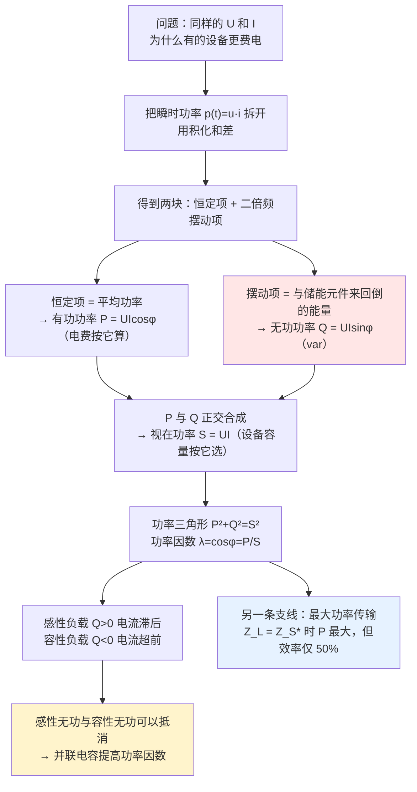

# C4.4 正弦稳态功率与功率因数 Power of Sine Steady-State Circuit and Power Factor

> [!abstract] 这一讲的任务
> 到 [[C4.3 正弦稳态电路的一般分析]] 为止，我们已经能算出交流电路里所有的电压和电流了。但**算出来的是相量，不是钱**。
> 工程上真正要问的是另外三个问题：这份电**到底消耗了多少**（电费按哪个数算）？设备的**容量按哪个数选**？为什么工厂功率因数低了会被加收电费，而**并联一个不耗电的电容**就能解决？
> 这一讲把瞬时功率拆开，分离出三个量——**有功功率 $P$、无功功率 $Q$、视在功率 $S$**——并给出**功率因数补偿**的完整计算。这是整章最贴近真实工程的一讲。

> [!info] 怎么读这份讲义
> 第 1–4 节是概念主干（瞬时功率怎么拆 → 三个量怎么定义 → 为什么 $S$ 不守恒），**第 3 节的"共轭"和第 4 节的"$S$ 不守恒"是两个最容易被忽略的点**，请慢读。
> 第 5–6 节把三个元件和一般阻抗的功率补齐，**第 6 节那三个相似三角形是本章最好用的一张记忆图**。
> 第 7 节是一道综合例题，第 8 节讲功率怎么测，**第 9–10 节（功率因数补偿）是考试和应用的重点**，第 11 节（最大功率传输）是本章最后一个独立话题。
>
> 课件在这 23 页里有若干**术语用错和记号重用**：把"功率因数"写成 Quality Factor（那是谐振里的品质因数）、把三个不同的 $P_{\max}$ 共用一个符号、无功功率 $Q$ 与品质因数 $Q$ 撞名。这些都在对应小节逐条点名。

---

> [!warning] 授课进度说明（截至第 4 次课）
> 已有的课堂语音转写稿覆盖到**第 4 次课**，内容为第 1 章全部 + 第 2 章全部；**第 4 章尚未讲授**。
> 因此本篇内容全部来自**课件与教材**（课件为 `第4章-交流稳态电路分析-(上集).pdf`，全文无手写笔迹），未经课堂讲解校正，篇内不使用「拓展」标注。等课上讲到本章后，本篇会按课堂实况做一次合并。

---

## 0. 开场：两台设备，同样的电压电流，不一样的电费

配电房里并排放着两台设备，铭牌上都写着 `220 V / 10 A`。你把钳形表卡上去，两台确实都是 10 A。可电表转起来差别很大：**接电炉的那一路，电表转得快；接空载电动机的那一路，电表几乎不转。**

同样的电压、同样的电流，凭什么"费电"差这么多？

先把最朴素的猜测算出来：

$$
UI=220\times10=2200\ \mathrm{V\cdot A}
$$

这个 $2200$ 是什么？如果它是电阻负载，那 $2200\ \mathrm{W}$ 是实打实的发热功率；可如果负载里主要是电感，实际发热可能只有几百瓦。**那差值去哪了？**

答案是：**它哪儿也没去，它一直在原地打转。**

电感每一时刻都在和电源交换能量：电流增大时从电源取能、存进磁场；电流减小时又把能量还回电源。一个周期下来**净消耗为零**——但在这个来回的过程中，**导线里一直有电流在流、一直在发热**，这就是"多出来的那部分"给你带来的实际代价：它不消耗能量，却占用你的**导线截面**和**变压器容量**。

> [!question] 停一下，先自己想想
> 如果 $UI$ 既不是"消耗的功率"，又不是"白写的数"，那它到底是什么？
> 提示：它的单位为什么写成 $\mathrm{V\cdot A}$ 而不是 $\mathrm{W}$？

这一讲要回答的，正是这一组问题：

1. **电费按哪个数算？** → 有功功率 $P$（第 2 节）
2. **设备容量按哪个数选？** → 视在功率 $S$（第 2 节）
3. **那个"打转的部分"怎么量化？能不能消掉？** → 无功功率 $Q$ 与功率因数补偿（第 3、9 节）

---

## 1. 瞬时功率：把它拆成两块（课件 p.53–54）

### 1.1 从 $p=ui$ 出发

在**关联参考方向**下，设支路的正弦稳态电压电流为

$$
u(t)=\sqrt2\,U\sin(\omega t+\theta_u)
\,,\qquad
i(t)=\sqrt2\,I\sin(\omega t+\theta_i)
$$

瞬时功率（instantaneous power）就是两者之积：

$$
p(t)=u(t)i(t)=2UI\sin(\omega t+\theta_u)\sin(\omega t+\theta_i)
$$

用积化和差 $2\sin A\sin B=\cos(A-B)-\cos(A+B)$，取 $A=\omega t+\theta_u$、$B=\omega t+\theta_i$：

$$
\boxed{\ p(t)=\underbrace{UI\cos(\theta_u-\theta_i)}_{\text{恒定项}}-\underbrace{UI\cos(2\omega t+\theta_u+\theta_i)}_{\text{二倍频摆动项}}\ }
$$

![[C4-瞬时功率波形与平均分量.png]]

> [!important] 这张图里有三条信息，一条都不能漏
> **① 曲线有正有负。** 负值那一段就是"能量被还回去了"——电源在这一小段时间里不是在输出功率，而是在**吸收**功率。这是直流电路里绝不会出现的现象。
> **② 曲线大部分在横轴上方**，所以平均值是正的——电路总体上是净吸收能量的。
> **③ 摆动项的频率是 $2\omega$**，是电压电流的两倍。图上"平均分量"那条水平虚线的高度，就是 $P$。

### 1.2 为什么频率是两倍

一个小结论，值得顺手讲明白：**两个同频率的正弦量相乘，结果里只有直流项和二倍频项，没有基频项。**

从公式一眼可见：$\cos(A-B)$ 里 $A-B=\theta_u-\theta_i$ 与 $t$ 无关，是**常数**；$\cos(A+B)$ 里 $A+B=2\omega t+\theta_u+\theta_i$，频率是**两倍**。基频项被积化和差消掉了。

> [!note] 这一条在后面的用处
> 正因为 $p(t)$ 里有这么一个"不随时间变的常数项"，我们才能定义**平均功率**：
> $$P=\overline{p(t)}=\frac1T\int_0^Tp(t)\,\mathrm{d}t=UI\cos(\theta_u-\theta_i)$$
> 积分时那个二倍频项在一个整周期上积分为零，只剩下常数项。
> **所以"平均功率"本质上就是 $p(t)$ 拆开后剩下的那一块不动的部分。**

---

## 2. 有功功率与视在功率（课件 p.55）

### 2.1 有功功率：电费按它算

> [!important] 平均功率（有功功率）Active Power
> 正弦稳态电路瞬时功率在一个周期内的平均值，称为**平均功率**，又称**有功功率**。
> $$\boxed{\ P=\overline{p(t)}=\frac1T\int_0^Tp(t)\,\mathrm dt=UI\cos\varphi\ }\qquad\text{单位：W}$$
> 其中 $\varphi=\theta_u-\theta_i$ 是电压与电流的相位差。

课件给了三种等价的写法，第三个等号特别值得看：

$$
P=UI\cos\varphi=I^2|Z|\cos\varphi=I^2R
$$

推导只用了一个几何事实：阻抗三角形里 $R=|Z|\cos\varphi$（水平直角边）。所以

$$
I^2|Z|\cos\varphi=I^2\cdot\underbrace{|Z|\cos\varphi}_{=R}=I^2R
$$

> [!important] 这一行是本讲最重要的一句话
> $$P=I^2R$$
> **有功功率只由电阻决定。** 电感与电容的 $\cos\varphi=0$，无论电流多大，它们在**平均意义**上不消耗任何功率。
> 这也解释了 §0 那个开场：两台设备电流都是 10 A，但"费电"不同，因为它们的**电阻分量**不同——电动机的等效电阻很小，绝大部分电流是"白流"的。
> 一句话记住：**电费买的是 $I^2R$，不是 $UI$。**

### 2.2 视在功率：设备容量按它选

> [!important] 视在功率 Apparent Power
> 电压与电流**有效值的乘积**称为**视在功率**：
> $$\boxed{\ S=UI\ }\qquad\text{单位：}\mathrm{V\cdot A}\ \text{（伏安）}$$
> 它表示**设备的功率容量**——对无源支路而言，是"消耗功率的最高速率"。

> [!question] 课堂追问：为什么单位偏偏写成 $\mathrm{V\cdot A}$ 而不写成 $\mathrm{W}$？
> 因为**它不是功率**，它是**容量**。写成 $\mathrm{W}$ 会让人误以为"这台设备消耗了 2200 W"，而实际上它只消耗了 1300 W、另外 900 瓦当量在来回打转。
> 用 $\mathrm{V\cdot A}$ 是在提醒你：这个数描述的是**设备能承受的规模**（导线要多粗、变压器要多大、绝缘要多好），不是**能量消耗**。

> [!important] 为什么 $S$ 是"上限"
> 由 $\varphi=\theta_u-\theta_i$，对**无源支路**有 $-90^\circ<\varphi<90^\circ$，所以 $0\le\cos\varphi\le1$，于是
> $$P=UI\cos\varphi\le UI=S$$
> **设备实际能拿到的有功，最多等于它的容量。** 差值就是被"打转"占掉的那部分。
> 这个不等式是 §9 讲功率因数提高的全部动机，先记着。

一个直观的类比：$S$ 像一辆卡车的**额定载重**，$P$ 像它**实际运到的货**。中间差的那部分不是丢在路上了，而是**被"空转"占用了车皮**——车没装满货，但你依然要为这趟车付全部运费（导线要按 $S$ 选，变压器要按 $S$ 配）。

---

## 3. 功率因数、复功率与无功功率（课件 p.56）

### 3.1 功率因数

> [!important] 功率因数 Power Factor
> $$\boxed{\ \lambda=\cos\varphi=\frac PS=\frac{P}{\sqrt{P^2+Q^2}}\ }\qquad
> \varphi=\theta_u-\theta_i$$
> $\varphi$ 叫**功率因数角**。对**无源支路**，$-90^\circ<\varphi<+90^\circ$，所以 $0\le\lambda\le1$。

> [!warning] 课件在这里用错了一个术语，必须纠正
> 课件把 $\cos\varphi$ 叫做 **Quality Factor**、把 $\varphi$ 叫做 **quality factor angle**。这是错的：
> - 标准的英文是 **power factor** / **power factor angle**，中文是**功率因数**/**功率因数角**；
> - **Quality Factor（品质因数）在电路里另有专指**，就是本章 4.7 节谐振部分的 $Q$，一个完全不同的量。
>
> 更麻烦的是，课件用同一个字母 $Q$ 表示了两个东西：
> | 符号 | 含义 | 单位 | 出现在 |
> |---|---|---|---|
> | $Q$ | **无功功率** | var（乏） | 本讲（4.3 节） |
> | $Q$ | **品质因数** | 无量纲 | [[C4.6 网络函数与谐振]]（4.7 节） |
>
> **看题目时先看单位**：带 var 的是无功功率，无单位的是品质因数。

### 3.2 复功率：一个把 $P$ 和 $Q$ 装在一起的工具

> [!important] 复功率 Complex Power
> 在相量域中定义支路的复功率为
> $$\boxed{\ \tilde S=\dot U\cdot\dot I^{*}=UI\angle\varphi=P+\mathrm{j}Q=S\angle\varphi\ }$$
> 其中 $\dot I^{*}$ 是电流相量的**共轭**。

> [!question] 停一下，先自己想想
> 为什么必须是 $\dot I^{*}$（共轭），而不是直接 $\dot U\dot I$？
> 试一下不共轭会得到什么：
> $$\dot U\dot I=U\angle\theta_u\cdot I\angle\theta_i=UI\angle(\theta_u+\theta_i)$$
> 角度变成了**相加**。可我们需要的角度是 $\varphi=\theta_u-\theta_i$（电压超前的部分）。**差一个负号，用共轭正好补上**：
> $$\dot U\dot I^{*}=U\angle\theta_u\cdot I\angle(-\theta_i)=UI\angle(\theta_u-\theta_i)=UI\angle\varphi\ ✓$$
> 所以共轭不是形式上的讲究，它是**把"相位差"从"相位和"里救出来**的唯一办法。
> 这也解释了一个常见错误：算复功率时**忘掉共轭**，得到的角度会变成 $\theta_u+\theta_i$（一个物理上没意义的量），而**模长仍然是对的**——所以这种错误往往在检查模长时发现不了，等到看功率因数的正负号时才暴露。

课件还有一句很值得记住的提醒：

> [!note] 复功率没有物理意义（课件原文）
> "Complex power has no physical meaning. It's just a math tool."
> **$P$ 有物理意义（真实消耗），$Q$ 有物理意义（来回交换的量），但 $\tilde S=P+\mathrm{j}Q$ 只是一个把两者打包的数学工具。** 不要试图去"理解"一个复数功率，把它当成记账用的账本就好。

### 3.3 无功功率

> [!important] 无功功率 Wattless / Reactive Power
> 复功率的**虚部**称为无功功率：
> $$\boxed{\ Q=\operatorname{Im}\{\tilde S\}=UI\sin\varphi\ }\qquad\text{单位：var（乏）}$$
> 它定义了支路与所连接的其他电路之间**交换**的功率数量。
> 同样有三种等价写法：
> $$Q=UI\sin\varphi=I^2|Z|\sin\varphi=I^2X$$

> [!important] 无功功率的两条读法
> **① 它的平均值是零。** 既然是"交换"，一来一回就抵消了——所以 $Q$ 不贡献任何真实的能量消耗，**不收电费**。
> **② 但它真实地占用设备容量和线路电流。** 这就是为什么供电局要盯它。
>
> 类比：$P$ 是"运到的货"，$Q$ 是"车上来回搬但最后没卸下的货"。货没少，但车被占满了。

> [!warning] 正负号约定（本节最重要的记忆点，完整版在第 5 节）
> $Q$ 是**有符号的**：
> - **感性**（电感占主导，电流滞后）：$\varphi>0$，$Q=UI\sin\varphi>0$；
> - **容性**（电容占主导，电流超前）：$\varphi<0$，$Q=UI\sin\varphi<0$。
>
> **正号表示"吸收"无功，负号表示"发出"无功。** 记住这个符号，第 9 节的补偿原理就是一句话：**用电容的负无功去抵消电感的正无功。**

---

## 4. 功率三角形与功率守恒（课件 p.57）

### 4.1 功率三角形

由复功率的定义直接读出：

$$
S=|\tilde S|
\,,\qquad
P=\operatorname{Re}\{\tilde S\}=S\cos\varphi
\,,\qquad
Q=\operatorname{Im}\{\tilde S\}=S\sin\varphi
$$

$$
\boxed{\ P^2+Q^2=S^2\ }
$$

这就是**功率三角形**：水平直角边是 $P$、竖直直角边是 $Q$、斜边是 $S$、夹角是 $\varphi$。

### 4.2 功率守恒，但视在功率不守恒

> [!important] 三条守恒、一条不守恒（课件 p.57）
> 对任意正弦稳态电路系统：
> $$P_\Sigma=\sum_kP_k
> \,,\qquad
> Q_\Sigma=\sum_kQ_k
> \,,\qquad
> \tilde S_\Sigma=\sum_k\tilde S_k$$
> **有功功率、无功功率、复功率分别守恒。**
> 但
> $$\boxed{\ S_\Sigma=\sqrt{P_\Sigma^2+Q_\Sigma^2}=\sqrt{\left(\sum P_k\right)^2+\left(\sum Q_k\right)^2}\ \ne\ \sum_kS_k\ }$$
> **视在功率一般不守恒。**

> [!question] 停一下，先自己想想
> 为什么 $P$、$Q$ 能直接相加，$S$ 就不行？
> 因为 $P$ 和 $Q$ 是**两个正交方向上的分量**，可以像矢量的分量那样分方向相加；而 $S=\sqrt{P^2+Q^2}$ 是**合成后的模长**——已经"合过一次"了，再想让模长直接相加，就等于指望两个矢量的模长之和等于合矢量的模长。**这只有在两个矢量同向时才成立。**
> 这和 [[C4.1 正弦量与相量]] 里"幅值不能相加"是**同一个错误**的两种外衣：**分方向的分量可以加，合出来的模不能加。**

> [!example] 手算一个反例（把 $S$ 不守恒钉死）
> 两条支路并联在同一端口：
> - 支路 ①：$P_1=3\ \mathrm{W}$，$Q_1=+4\ \mathrm{var}$ ⟹ $S_1=\sqrt{3^2+4^2}=5\ \mathrm{V\cdot A}$
> - 支路 ②：$P_2=0\ \mathrm{W}$，$Q_2=-4\ \mathrm{var}$ ⟹ $S_2=4\ \mathrm{V\cdot A}$
>
> 先把视在功率加起来：$5+4=9\ \mathrm{V\cdot A}$。
> 再按守恒律算端口的视在功率：
> $$P_\Sigma=3+0=3\ \mathrm{W}
> \,,\qquad
> Q_\Sigma=4-4=0\ \mathrm{var}
> \quad\Longrightarrow\quad
> S_\Sigma=\sqrt{3^2+0^2}=3\ \mathrm{V\cdot A}$$
> **$3\ne9$。** 差了整整三倍。
> 这里的物理含义也很清楚：一条支路的感性无功和另一条支路的容性无功**互相抵消**了，端口对外只看得到 3 W 的有功。**这个"抵消"正是下一节补偿电容的原理。**

---

## 5. 三个元件的功率（课件 p.58）

把 $P=UI\cos\varphi$、$Q=UI\sin\varphi$ 逐个代进三个元件：

| 元件 | $P$ | $Q$ | $\cos\varphi$ | $\varphi$ | 复功率 $\tilde S$ | 相量关系 |
|---|---|---|---|---|---|---|
| **电阻** $R$ | $P=UI$ | $Q=0$ | $1$ | $0^\circ$ | $\tilde S=UI$（实） | $\dot U$ 与 $\dot I$ 同相 |
| **电容** $C$ | $P=0$ | $Q=-UI<0$ | $0$ | $-90^\circ$ | $\tilde S=-\mathrm{j}UI$ | 电流超前电压 $90^\circ$ |
| **电感** $L$ | $P=0$ | $Q=UI>0$ | $0$ | $+90^\circ$ | $\tilde S=\mathrm{j}UI$ | 电压超前电流 $90^\circ$ |

![[C4-三元件功率对照.png]]

> [!important] 这张表里的三条结论
> **① 只有电阻消耗有功。** 电感和电容的 $P$ 都是零——这与 $P=I^2R$ 完全一致。
> **② 电感吃无功（$Q>0$），电容发无功（$Q<0$）。** 这是全章**无功功率正负号约定的唯一出处**，务必背下来。
> **③ 它们的视在功率并不为零。** 电感和电容的 $S=UI\ne0$——**不消耗功率 ≠ 不占用容量**。这正是 §0 开场那个问题的答案。

> [!note] 一个直观的物理解释
> - 电感靠**磁场**储能，建立磁场要"先借后还"，所以它**吸收**无功；
> - 电容靠**电场**储能，建立电场也是"先借后还"，但它借还的时机与电感**正好相反**，所以它**发出**无功。
>
> 一正一负，可以直接抵消——这就是并联补偿电容的全部物理依据。

> [!warning] 课件电阻行的一处简写
> 课件把电阻行写成 $P=S=\tilde S=UI$。严格说 $\tilde S$ 是**复数**、$S$ 是它的**模**，写成同一个等式只在"$\tilde S$ 恰好是实数"（即纯电阻）时成立。课件这里是简写，不是错误，但读者要知道区别。

---

## 6. 一般阻抗元件的功率与三个相似三角形（课件 p.59）

任意阻抗 $Z=R+\mathrm{j}X=|Z|\angle\varphi_z$ 上：

$$
\boxed{\ P=RI^2=UI\cos\varphi_z\ }
\qquad
\boxed{\ Q=XI^2=UI\sin\varphi_z\ }
\qquad
\boxed{\ S=\sqrt{P^2+Q^2}=UI\ }
$$

$$
\tilde S=\dot U\dot I^{*}=(Z\dot I)\dot I^{*}=Z|\dot I|^2=ZI^2
$$

> [!important] 这三个三角形长得一模一样，夹角是同一个角
> | 三角形 | 水平边 | 竖直边 | 斜边 | 夹角 |
> |---|---|---|---|---|
> | **阻抗三角形** | $R$ | $X$ | $|Z|$ | $\varphi_z$ |
> | **电压三角形** | $\dot U_R$ | $\dot U_X$ | $\dot U$ | $\varphi_z$ |
> | **功率三角形** | $P$ | $Q$ | $S$ | $\varphi_z$ |
>
> 三者是**相似三角形**——因为把阻抗三角形整体乘上 $I$ 就得到电压三角形，再乘上 $I$ 就得到功率三角形。
> 由此得到一句极其好用的结论：
> $$\boxed{\ \text{阻抗角}=\text{功率因数角}=\text{电压三角形夹角}=\varphi_z\ }$$
> **判"感性/容性"看 $\varphi_z$ 的符号，也就是看功率三角形里 $Q$ 在横轴上方还是下方。**

> [!warning] 记号陷阱：同一页里带箭头和不带箭头混用
> 电压三角形的三条边是**相量**（$\dot U_R,\dot U_X,\dot U$，带箭头）；阻抗三角形和功率三角形的三条边是**标量**（$R,X,P,Q$，不带箭头）。
> 混起来会出事：比如把 $\dot U_R+\dot U_X$ 直接写成 $U_R+U_X=U$ 就错了（幅值不能相加），而 $R+X=|Z|$ 也错（$|Z|=\sqrt{R^2+X^2}$）。**两条边都要按勾股定理合成。**

> [!example] 手算验证（三条公式互不矛盾）
> 设 $R=3\ \Omega$、$X=4\ \Omega$、$I=1\ \mathrm{A}$，则 $|Z|=5\ \Omega$、$\varphi_z=53.1^\circ$、$U=|Z|I=5\ \mathrm{V}$。
> $$P=RI^2=3\times1=3\ \mathrm{W}
> \,,\qquad
> Q=XI^2=4\ \mathrm{W}
> \,,\qquad
> S=\sqrt{3^2+4^2}=5\ \mathrm{V\cdot A}$$
> 用另一条路验证：$P=UI\cos\varphi_z=5\times1\times0.6=3\ \mathrm{W}$ ✓；$Q=UI\sin\varphi_z=5\times1\times0.8=4\ \mathrm{var}$ ✓；$S=UI=5\ \mathrm{V\cdot A}$ ✓。
> 三边成套，一个都不缺。

---

## 7. 例 1：并联 RLC 电路的功率（课件 p.60–61）

> [!example] 例 1
> 已知 $R=20\ \Omega$，$C=150\ \mu\mathrm{F}$，$L=40\ \mathrm{mH}$，外加电压 $U=230\ \mathrm{V}$、$f=50\ \mathrm{Hz}$。
> 求各支路电流与总电流，绘相量图，计算电路功率（$P$、$Q$、$S$）与功率因数。

**解。** 三个元件**并联**，共用一个端电压，所以选端电压为参考相量最省事：

$$
\dot U=230\angle0^\circ\ \mathrm{V}
\,,\qquad
\omega=314\ \mathrm{rad/s}\quad(\text{课件全程取 }2\pi\times50\approx314)
$$

三条支路电流：

$$
\dot I_1=\frac{\dot U}{R}=\frac{230\angle0^\circ}{20}=11.5\angle0^\circ\ \mathrm{A}
$$

$$
\dot I_2=Y_C\dot U=(\omega C\angle90^\circ)\dot U=(314\times150\times10^{-6}\angle90^\circ)(230\angle0^\circ)=\mathrm{j}10.833\ \mathrm{A}
$$

$$
\dot I_3=\frac{\dot U}{Z_L}=\frac{230\angle0^\circ}{314\times40\times10^{-3}\angle90^\circ}=18.31\angle-90^\circ\ \mathrm{A}=-\mathrm{j}18.31\ \mathrm{A}
$$

总电流（三个相量直接相加）：

$$
\dot I=\dot I_1+\dot I_2+\dot I_3=(11.5+\mathrm{j}10.833-\mathrm{j}18.31)=(11.5-\mathrm{j}7.477)=13.716\angle-33^\circ\ \mathrm{A}
$$

![[C4-电压电流功率三波形.png]]

（相量图上：$\dot U$ 水平向右，$\dot I_1$ 与它同相，$\dot I_2$ 竖直向上，$\dot I_3$ 竖直向下，$\dot I$ 指向右下——这是一张典型的"并联电路以电压为参考"的图。）

功率：

$$
S=UI=230\times13.716=3154.7\ \mathrm{V\cdot A}
$$
$$
P=UI\cos\varphi=2645.8\ \mathrm{W}
\,,\qquad
Q=UI\sin\varphi=1718.2\ \mathrm{var}
\,,\qquad
\lambda=\cos33^\circ=0.8386
$$

> [!warning] 课件这三个数的末位是"舍入的账"，精确值另有算法
> 课件是拿 $I=13.716$、$\varphi=33^\circ$ 这两个**已经舍入过**的数再算一遍，所以末位有偏差。本题有两条**完全精确**的路径：
>
> **路径一：用有功功率只由电阻决定。**
> $$P=I_1^2R=11.5^2\times20=\boxed{2645.0\ \mathrm{W}}$$
> （课件 $2645.8\ \mathrm{W}$，差 $0.8\ \mathrm{W}$，$0.03\%$。）
>
> **路径二：用无功功率按分量相加（$P$、$Q$ 分别守恒）。**
> $$Q=Q_L+Q_C=I_3^2X_L-I_2^2X_C=18.312^2\times12.56-10.833^2\times\frac{1}{0.0471}=4211.8-2491.6=\boxed{1720.2\ \mathrm{var}}$$
> （课件 $1718.2\ \mathrm{var}$，差 $2.0\ \mathrm{var}$，$0.12\%$。）
>
> $\lambda=\cos33^\circ=0.838671$，精确值应为 $0.8387$（课件 $0.8386$，截断未进位）。
>
> 课件的三个数**自身是自洽的**（$2645.8^2+1718.2^2$ 开方得 $3154.75$，与印出的 $S=3154.7$ 吻合），说明它们都是从 $S$ 和 $\varphi$ 反推的。**但考试里不要学这种做法**——中间量取整会污染末位。本题的"免费精确路径"（$P=I_1^2R$、$Q=\sum I_k^2X_k$）一定更可靠。

> [!important] 这道题真正要记住的是两个"加起来"的方式
> 注意到了吗，这道题的 $P$ 和 $Q$ 都可以**按支路分别算再相加**：
> $$P=P_R+P_C+P_L=2645.0+0+0=2645.0\ \mathrm{W}$$
> $$Q=Q_R+Q_C+Q_L=0+(-2491.6)+(+4211.8)=+1720.2\ \mathrm{var}$$
> **电感支路的正无功与电容支路的负无功相减**，剩下的正数说明整个电路**呈感性**（这也与 $\varphi=+33^\circ$、电流滞后一致）。
> 这正是 §4 那条"$P$、$Q$ 分别守恒"的实战用法：**先按支路算，再代数相加**——比"先求总电流再乘 $\cos\varphi$"更精确、也更能看出物理图像。

---

## 8. 功率的测量：功率表与三表法（课件 p.62–63）

### 8.1 单相功率表的原理

![[C4-单相功率表原理.png]]

> [!important] 功率表为什么能直接读出 $P$
> 单相功率表有两个线圈：
> - **电流线圈**（粗线，串在被测支路里），电流 $i_1=i=\sqrt2I\sin\omega t$；
> - **电压线圈**（细线，串一个附加电阻 $R$ 后并在负载两端），电流 $i_2\approx\dfrac uR=\sqrt2\dfrac UR\sin(\omega t-\varphi)$。
>
> 指针受力矩 $M$ 驱动，$M$ 正比于两个线圈电流的**乘积的平均值**：
> $$M=K\frac URI\cos\varphi=K'UI\cos\varphi=K'P$$
> **乘积的平均值里天然就带着 $\cos\varphi$**——这正是功率表比"电压表×电流表"高明的地方。
> 换句话说：**功率表做的就是"取平均值"这个动作。**

> [!warning] 三个使用细节
> **① 两个「\*」是同名端。** 电流必须从电流线圈的「\*」端流入，电压的**正端**要接电压线圈的「\*」端。接反了指针会反向偏转。
> **② $R$ 是附加（倍率）电阻**，而且 $i_2\approx u/R$ 用了近似——严格说电压线圈支路是 $R+\mathrm{j}\omega L$，课件忽略了它的电感。附加电阻的作用就是让这个支路的感抗相对可忽略。
> **③ 课件底部写 $P=UI_1\cos\varphi$**，其中 $I_1=I$（电流线圈的电流就是负载电流），不是"另一个电流"。这个下标容易误读为两个不同支路。

### 8.2 三表法测线圈参数（课件 p.63）

> [!example] 例 2（三表法）
> 已知 $f=50\ \mathrm{Hz}$，用电压表、电流表、功率表测得 $U=50\ \mathrm{V}$、$I=1\ \mathrm{A}$、$P=30\ \mathrm{W}$。求被测线圈的 $R$ 与 $L$。

![[C4-三表法测线圈参数电路.png]]

**思路**：电压表和电流表给出**模长** $|Z|=U/I$；功率表给出**有功** $P=I^2R$，于是能把 $R$ 和 $X$ 分开。

$$
R=\frac{P}{I^2}=\frac{30}{1^2}=30\ \Omega
$$

$$
|Z|=\frac UI=\frac{50}{1}=50\ \Omega
$$

$$
X=\sqrt{|Z|^2-R^2}=\sqrt{50^2-30^2}=\sqrt{1600}=40\ \Omega
$$

$$
L=\frac{X}{\omega}=\frac{40}{314}=0.127\ \mathrm{H}
$$

> [!important] "三表法"这个名字的含义
> 只用电压表和电流表，你只能得到 $|Z|$——**莫尔圆上的一整圈都有可能**，分不出 $R$ 和 $X$。
> 加上功率表，$P=I^2R$ 直接把 $R$ 钉死，剩下的 $X$ 由勾股定理反推。**三个表、三个独立方程、三个未知量，恰好够。**
> 这就是"三表法"这个工程做法的全部逻辑，也是功率表存在的意义。

> [!warning] 课件这一页的数字确认
> 课件印的是 $P=\boxed{30}\ \mathrm{W}$（不是 3 W），配套算式 $R=30/1^2=30\ \Omega$、$\sqrt{50^2-30^2}=40$、$L=40/314=0.127\ \mathrm{H}$ 全部自洽。
> 若按 3 W，则 $R=3\ \Omega$、$X=49.91\ \Omega$、$L=0.159\ \mathrm{H}$——与课件印出的 $0.127\ \mathrm{H}$ 完全对不上。**本页以 30 W 为准。**
>
> 另外，按课件的接线方式，功率表读到的其实是 $I^2(R_{\text{表}}+\ R)$、电压表读到的 $U$ 里也含电流表的压降——**这是三表法固有的仪表系统误差**，课件没有提。工程上按表的准确度等级做修正，考试里忽略。

---

## 9. 功率因数的提高（课件 p.64–66）

### 9.1 问题：为什么要提高

> [!important] 提高功率因数的动机（课件 p.64）
> 设备在给定电压 $U$、电流 $I$（即容量 $S=UI$ 一定）的情况下：
> $$P_{\max}=UI=S\quad\text{（理论上的最大稳态平均功率）}
> \,,\qquad
> P=UI\cos\varphi\quad\text{（实际拿到的）}$$
> $$0\le\cos\varphi\le1$$
> **功率因数越高，无功功率越少，有功功率越接近视在功率。**

课件 p.65 把"提高功率因数"的目的列成三条：

| 目的 | 说明 |
|---|---|
| ① **提高设备功率容量的利用率** | 同样的变压器、同样的导线，能送出更多有用的有功 |
| ② **抑制供电系统的无功功率、减小线路损耗** | 线路电流下来了，$I^2R$ 的线损跟着降 |
| ③ **降低供电线路电流、节省导线材料** | 电流小 → 导线截面可以选小 → 省铜省铝 |

### 9.2 方法：并联补偿电容

> [!important] 四条前提（课件 p.65，缺一不可）
> **① 只能提高"线路的总功率因数"，不能改变"设备本身的功率因数"。** 设备的端电压、电流、功率因数角全都原样不动。
> **② 提高功率因数的同时，不能改变设备的工作状态。**
> **③ 供电系统是电压源供电，各负载并联运行。**（所以"并联"一个元件是唯一合法的加法——串进去会改变设备端电压。）
> **④ 大多数用电设备属于感性负载。**（所以要用容性无功去抵消。）
>
> 结论：**提高功率因数的办法，就是在感性设备两端并联补偿电容器。**

![[C4-功率因数补偿电路与相量图.png]]

> [!note] 相量图怎么读（这张图是"为什么并电容有用"的唯一图示理由）
> 以 $\dot U$ 为水平参考：
> - **补偿前**：感性负载电流 $\dot I_L$ 滞后 $\dot U$ 一个角 $\varphi$（指向右下，比较"陡"）；
> - **补偿后**：并上电容，电容支路电流 $\dot I_C$ **竖直向上**（纯容性，超前 $90^\circ$）；
> - 端口总电流 $\dot I=\dot I_L+\dot I_C$，落在 $\dot I_L$ 的**上方**，与 $\dot U$ 的夹角降到 $\varphi_1<\varphi$。
>
> **注意 $\dot I$ 的模比 $\dot I_L$ 小**——并了一个元件反而让总电流变小了，这是并联补偿最反直觉也最漂亮的一点。
> 关键在于 $\dot I_C$ 的方向：它竖直向上，**正好抵消掉 $\dot I_L$ 那个向下的竖直分量**（无功分量），而对水平分量（有功分量）毫无影响。

### 9.3 补偿电容的推导

设电压有效值为 $U$，设备有功功率为 $P$，补偿前功率因数为 $\cos\varphi$，补偿后为 $\cos\varphi_1>\cos\varphi$。

**第一步：写出两个电流。** 补偿**不改变**设备的有功功率，所以负载支路电流与端口电流分别是

$$
I_L=\frac{P}{U\cos\varphi}
\,,\qquad
I=\frac{P}{U\cos\varphi_1}
$$

**第二步：在无功方向上做分解。** $\dot I=\dot I_L+\dot I_C$，把三个电流都投影到垂直于 $\dot U$ 的方向（无功轴）上。因为 $\dot I_C$ 完全落在无功轴上，得

$$
I\sin\varphi_1=I_L\sin\varphi-I_C
$$

**第三步：解出 $I_C$。**

$$
I_C=I_L\sin\varphi-I\sin\varphi_1
=\frac{P}{U\cos\varphi}\sin\varphi-\frac{P}{U\cos\varphi_1}\sin\varphi_1
=\frac PU\left(\tan\varphi-\tan\varphi_1\right)
$$

**第四步：用 $I_C=\omega CU$ 换成电容。**

$$
\boxed{\ C=\frac{P}{\omega U^2}\left(\tan\varphi-\tan\varphi_1\right)\ }
$$

> [!important] 这个公式里每一项的物理含义
> - $P$：要"搬运"的有功功率（补偿前后不变）；
> - $\omega U^2$：由供电条件决定（频率、电压）；
> - $(\tan\varphi-\tan\varphi_1)$：**要被抵消掉的那一份无功的比例**。
>
> 量纲检查：$\dfrac{\mathrm{W}}{(\mathrm{rad/s})\cdot\mathrm{V}^2}=\dfrac{\mathrm{A\cdot V}}{\mathrm{V^2/s}}=\dfrac{\mathrm A}{\mathrm{V/s}}=\dfrac{\mathrm{C/s}}{\mathrm{V/s}}=\dfrac{\mathrm C}{\mathrm V}=\mathrm F$ ✓（弧度无量纲）。

> [!warning] 三个容易踩的坑
> **坑一：并电容不改变有功功率 $P$。** 电容不消耗有功，所以设备消耗的 $P$ 一分没变。**降低的只是线路电流**，不是电费——如果你的电费表只计有功，电费其实不变。（工厂被罚款是因为**容量费/力率调整电费**，那部分与 $S$ 和 $\lambda$ 挂钩。）
> **坑二：并电容不改变设备本身的功率因数。** 设备两端电压没变、它的阻抗没变，所以它自己的 $\cos\varphi$ 一点没变。**变的是线路端口看进去的总功率因数。**
> **坑三：$\varphi_1<\varphi$。** 因为 $\cos\varphi_1>\cos\varphi$ 且 $\varphi,\varphi_1$ 都在 $(0^\circ,90^\circ)$ 内，$\cos$ 单调递减，所以补偿后的功率因数角更小。**符号写反会把电容算成负的。**

> [!warning] 记号陷阱：课件把两个完全不同的量都叫 $P_{\max}$
> - 本节 p.64：$P_{\max}=UI$（**容量上限**，是"U、I 一定时的最大有功"）；
> - 第 11 节 p.70：$P_{\max}=\dfrac{U_S^2}{4R_S}$（**共轭匹配时的最大传输功率**）。
>
> 这两者**没有任何关系**，仅仅是符号撞了。看题时务必分清语境：说"功率因数"的那一节，$P_{\max}$ 指容量；说"最大功率传输"的那一节，$P_{\max}$ 指匹配。

---

## 10. 例 3：日光灯与补偿电容（课件 p.67–68）

> [!example] 例 3
> 12 W 日光灯接于 220 V、$f=50\ \mathrm{Hz}$ 的交流电源，正常工作时光管两端电压为 100 V。
> ① 镇流器需要多大的电感量？② 功率因数为多少？③ 当 $\cos\varphi=0.9$ 时需补偿多大的电容器？

**建模**：光管等效为**纯电阻**，镇流器等效为**纯电感**，两者串联接在 220 V 电源上。

![[C4-日光灯镇流器电路.png]]

**① 镇流器电感。** 先由直角三角形求镇流器电压：

$$
U_L=\sqrt{U^2-U_R^2}=\sqrt{220^2-100^2}=196\ \mathrm{V}
$$

灯管电流由灯管自己的功率和电压决定：

$$
I_1=\frac{P}{U_R}=\frac{12}{100}=0.12\ \mathrm{A}
$$

$$
L=\frac{U_L}{2\pi fI_1}=\frac{196}{2\pi\times50\times0.12}=5.2\ \mathrm{H}
$$

**② 功率因数。**

$$
\cos\varphi=\frac{U_R}{U}=\frac{100}{220}=0.455
\qquad\Longrightarrow\qquad
\varphi=62.96^\circ
$$

> [!note] 为什么 $\cos\varphi=U_R/U$ 是严格的（不是近似）
> 灯管是纯电阻，所以 $\dot U_R$ 与 $\dot I$ 同相；镇流器是纯电感，$\dot U_L$ 超前 $\dot I$ $90^\circ$。于是 $\dot U_R$ 恰好是总电压 $\dot U$ 的**同相分量**：
> $$\cos\varphi=\frac{\text{同相分量}}{\text{总电压}}=\frac{U_R}{U}$$
> 这其实就是"电压三角形"的读法：**功率因数角就是这个三角形里斜边与水平边的夹角。**

**③ 补偿电容。** 补偿后 $\cos\varphi_1=0.9$：

$$
\varphi_1=\arccos0.9=25.84^\circ
$$

$$
C=\frac{P}{\omega U^2}\left(\tan\varphi-\tan\varphi_1\right)
=\frac{12}{314\times220^2}\left(\tan62.96^\circ-\tan25.84^\circ\right)
=1.16\ \mu\mathrm{F}
$$

![[C4-日光灯并联补偿相量图.png]]

> [!note] 全部数值复算通过
> | 量 | 课件 | 复算 |
> |---|---|---|
> | $U_L$ | 196 V | $\sqrt{220^2-100^2}=195.96$ ✓ |
> | $I_1$ | 0.12 A | $12/100=0.12$ ✓ |
> | $L$ | 5.2 H | $196/(2\pi\times50\times0.12)=5.199$ ✓ |
> | $\cos\varphi$ | 0.455 | $100/220=0.4545$ ✓ |
> | $\varphi$ | 62.96° | $\arccos0.4545=62.964^\circ$ ✓ |
> | $\varphi_1$ | 25.84° | $\arccos0.9=25.842^\circ$ ✓ |
> | $C$ | $1.16\ \mu\mathrm{F}$ | $7.896\times10^{-7}\times(1.9596-0.4843)=1.1649\ \mu\mathrm{F}$ ✓ |
>
> 这一页**一处都没错**。

> [!warning] 这一页有三个"看图会误导"的地方
> **① $L=5.2\ \mathrm{H}$ 看着离谱，其实合理。** 这是"镇流器当纯电感、忽略铁损"的建模结果。真实的铁心镇流器等效电感就是亨利量级——它是靠"大电感限流"工作的。
> **② 相量图没按比例画。** 按计算，$\dot I$ 应在 $-25.84^\circ$、$\dot I_1$ 应在 $-62.96^\circ$，但图上两箭头的倾角明显更小（目测 $-15^\circ$ 和 $-35^\circ$）。**不要从这张图上量角度。**
> **③ 图上只标了补偿前的角 $\varphi$，没标 $\varphi_1$。** 图上也有一支多余的淡紫色虚线箭头（原图残留），不是有效信息。

---

## 11. 最大功率传输（课件 p.69–74）

这是本章最后一个独立话题：**负载取什么值，能从含源网络里"榨"出最多的有功功率？**

### 11.1 一般式

把含源网络等效成戴维南形式（$\dot U_S$ 串 $Z_S=R_S+\mathrm{j}X_S$），负载为 $Z_L=R_L+\mathrm{j}X_L$：

$$
\dot I=\frac{\dot U_S}{Z_S+Z_L}
\,,\qquad
I=\frac{U_S}{\sqrt{(R_S+R_L)^2+(X_S+X_L)^2}}
$$

负载上的有功功率（只有 $R_L$ 消耗有功）：

$$
\boxed{\ P=R_LI^2=\frac{R_LU_S^2}{(R_S+R_L)^2+(X_S+X_L)^2}\ }
$$

> [!note] 为什么 $X_L$ 不出现在分子里
> 因为电抗不消耗有功——**负载吸收的有功功率只由 $R_L$ 决定**。
> $X_L$ 唯一的作用是躲在分母里，通过 $(X_S+X_L)$ 影响电流大小。**这个观察直接决定了后面三种情形的解法顺序。**

### 11.2 三种情形

> [!important] 情形①：$Z_L$ 可任意改变 → 共轭匹配
> **(a) 先固定 $R_L$，改变 $X_L$：** 因为 $X_L$ 只出现在分母的平方项里，分母最小 ⟺ $X_S+X_L=0$：
> $$X_L=-X_S
> \qquad\Longrightarrow\qquad
> P=\frac{R_LU_S^2}{(R_S+R_L)^2}$$
> **(b) 再改变 $R_L$：** 对 $R_L$ 求极值：
> $$\frac{\mathrm dP}{\mathrm dR_L}=U_S^2\frac{(R_S+R_L)^2-2R_L(R_S+R_L)}{(R_S+R_L)^4}=U_S^2\frac{R_S-R_L}{(R_S+R_L)^3}=0
> \ \Longrightarrow\ R_L=R_S$$
> **最佳匹配条件：**
> $$\boxed{\ Z_L=Z_S^{*}=R_S-\mathrm{j}X_S\ }
> \qquad\Longrightarrow\qquad
> \boxed{\ P_{\max}=\frac{U_S^2}{4R_S}\ }$$
>
> **这就是"共轭匹配"。** 注意是**共轭**，不是相等：实部相等、虚部相反。虚部要"反号抵消"，实部要"相等平分"。

> [!warning] 为什么必须先调 $X_L$、再调 $R_L$
> 因为 $X_L$ 只影响分母的平方项、不影响分子；把 $X_L$ 调好之后，分母变成只含 $R_L$ 的一元函数，才谈得上对 $R_L$ 求导。
> **顺序反了会很麻烦**（两个变量耦合），课件只写了 "First / Then" 却没说理由。

> [!important] 情形②：只允许 $X_L$ 改变 → 电抗匹配
> 条件同样是"把虚部抵消掉"：
> $$X_S+X_L=0\qquad\Longrightarrow\qquad X_L=-X_S
> \,,\qquad
> P_{\max}=\frac{R_LU_S^2}{(R_S+R_L)^2}$$
> 注意这个式子里**还有 $R_L$**——所以它**不是全局最大值**，而是"在 $R_L$ 已经定下来之后，调 $X_L$ 能拿到的最大值"。
> 如果 $R_L$ 还能继续调，回到情形①，$R_L=R_S$ 时得到 $U_S^2/(4R_S)$。

> [!important] 情形③：$Z_L=R_L$ 是纯电阻 → 模匹配
> 此时 $X_L\equiv0$，电流分母里保留 $X_S^2$：
> $$P=\frac{R_LU_S^2}{(R_S+R_L)^2+X_S^2}
> \qquad
> \frac{\mathrm dP}{\mathrm dR_L}=0
> \ \Longrightarrow\
> \boxed{\ R_L=\sqrt{R_S^2+X_S^2}=|Z_S|\ }$$
> $$\boxed{\ P_{\max}=\frac{U_S^2}{2\left(R_S+\sqrt{R_S^2+X_S^2}\right)}\ }$$
> 这叫**模匹配**（课件写作 Mode-matching）：**负载电阻等于电源内阻抗的模。**

> [!important] 三种情形的关系（课件完全没讲，但最容易混）
> 取 $R_S=5$、$X_S=5$、$U_S=10$ 具体算一遍：
>
> | 情形 | 最优条件 | 最大功率 |
> |---|---|---|
> | ① $Z_L$ 任意 | $R_L=5$、$X_L=-5$（共轭匹配） | $\dfrac{100}{4\times5}=5.00\ \mathrm W$ |
> | ② 只调 $X_L$（给定 $R_L=R_S=5$） | $X_L=-5$ | $\dfrac{5\times100}{(5+5)^2}=5.00\ \mathrm W$ |
> | ② 只调 $X_L$（给定 $R_L=\lvert Z_S\rvert=7.07$） | $X_L=-5$ | $\dfrac{7.07\times100}{(5+7.07)^2}=4.85\ \mathrm W$ |
> | ③ 纯电阻（模匹配） | $R_L=\lvert Z_S\rvert=7.07$ | $\dfrac{100}{2(5+7.07)}=4.14\ \mathrm W$ |
>
> **结论：① ≥ ② > ③**（在同一个 $R_L$ 下比较时，②严格优于③；只有 $X_S=0$ 时二者才重合）。
> **自由度越多，能拿到的有功越多。** 顺序是"能调虚部 > 只能调实部"。
>
> 特别注意：**② 在 $R_L=|Z_S|$ 处（4.85 W）并不等于 ③ 的最优值（4.14 W）**。很多人以为"令 $R_L=|Z_S|$ 就把两种情形统一了"，其实是错的。

> [!warning] 共轭匹配的效率只有 50%——这一条比公式更重要
> 共轭匹配时 $R_L=R_S$，两个电阻上消耗的功率**相等**，所以
> $$\eta=\frac{P_L}{P_{\text{总}}}=\frac{R_L}{R_S+R_L}=50\%$$
> **一半的能量被电源内阻吃掉了。**
> 这与 §9 讲的"提高功率因数、降低线路损耗"**方向完全相反**——电力系统绝不追求匹配（那意味着把一半的电白白烧在发电机内阻和线路上），而是追求**效率**（让 $R_L\gg R_S$）。
> 最大功率传输只用在**弱信号**场合：无线电接收、传感器、天线馈线——那里"能收到信号"比"省电"重要得多。
> **这个张力是本章一个重要的工程观念，课件完全没提。**

### 11.3 例 4：三种匹配算一遍（课件 p.72–73）

> [!example] 例 4
> 含源网络 $Z_S=R+\mathrm{j}\omega L=(5+\mathrm{j}5)\ \Omega$（$5\ \Omega$ 串 $50\ \mu\mathrm H$），$U_S=10\angle0^\circ\ \mathrm V$，$\omega=10^5\ \mathrm{rad/s}$。求：
> ① $R_L=5\ \Omega$ 时它消耗的功率；
> ② $R_L$ 取多少能获得最大功率（纯电阻）；
> ③ 在 $R_L$ 两端并联一个电容 $C$，$R_L$ 和 $C$ 取多少才能与内阻抗最佳匹配，最大功率是多少。

![[C4-最大功率例题电路.png]]

**① $R_L=5\ \Omega$：**

$$
\dot I=\frac{10}{5+\mathrm{j}5+5}=0.89\angle-26.6^\circ\ \mathrm A
\,,\qquad
P_L=I^2R_L=0.89^2\times5=4\ \mathrm W
$$

> [!note] 这里的精确值恰好是整数
> 精确地：$\dot I=\dfrac{10}{10+\mathrm j5}=0.8944\angle-26.57^\circ\ \mathrm A$，$P_L=0.8944^2\times5=0.8\times5=4.0000\ \mathrm W$。
> 课件先用 $0.89$ 平方得 $3.96$，再写成 $4\ \mathrm W$——**结果凑对了，但方法有风险**：换一组数据，先舍入再平方就会出错。
> 稳妥做法：$P_L=\dfrac{U_S^2R_L}{|Z_S+Z_L|^2}$，一步到底。

**② 纯电阻负载（模匹配，用情形③）：**

$$
R_L=\sqrt{R_S^2+X_S^2}=\sqrt{5^2+5^2}=7.07\ \Omega
$$
$$
P_{\max}=\frac{U_S^2}{2\left(R_S+\sqrt{R_S^2+X_S^2}\right)}=\frac{100}{2(5+7.071)}=4.14\ \mathrm W
$$

**③ 并联电容后做共轭匹配（课件 p.73）：**

$R_L$ 并电容后的阻抗是

$$
Z_L=R_L\left\|\frac{1}{\mathrm j\omega C}\right.=\frac{R_L}{1+\mathrm j\omega CR_L}
=\frac{R_L}{1+(\omega CR_L)^2}-\mathrm j\frac{\omega CR_L^2}{1+(\omega CR_L)^2}
$$

**注意虚部是负的**（并电容后整体呈容性）——它恰好用来抵消 $X_S=+5\ \Omega$。令 $Z_L=Z_S^{*}=5-\mathrm j5\ \Omega$，得两个方程：

$$
\frac{R_L}{1+(\omega CR_L)^2}=5
\,,\qquad
\frac{\omega CR_L^2}{1+(\omega CR_L)^2}=5
$$

两式相除得 $\omega C=\dfrac{1}{R_L}$，代回得 $1+(\omega CR_L)^2=2$，于是

$$
R_L=10\ \Omega
\,,\qquad
C=\frac{1}{\omega R_L}=\frac{1}{10^5\times10}=1\ \mu\mathrm F
$$

$$
P_{\max}=\frac{U_S^2}{4R_S}=\frac{100}{4\times5}=5\ \mathrm W
$$

> [!important] 三个答案排一排，这道题的价值就出来了
> | 情形 | 条件 | 功率 |
> |---|---|---|
> | ① $R_L=5\ \Omega$（不匹配） | — | $4.00\ \mathrm W$ |
> | ② 纯电阻模匹配 | $R_L=7.07\ \Omega$ | $4.14\ \mathrm W$ |
> | ③ 并联电容共轭匹配 | $R_L=10\ \Omega$、$C=1\ \mu\mathrm F$ | $5.00\ \mathrm W$ |
>
> $$4<4.14<5$$
> **自由度越多，榨出来的功率越多**——完美印证了 §11.2 的结论。
> 而且第③问的做法很有代表性：**用一个并联电容"造出"需要的负虚部**，从而把纯电阻负载变成能共轭匹配的负载。这就是"匹配网络"的雏形。

### 11.4 例 5：含电流源的网络（课件 p.74）

> [!example] 例 5
> 电路：电流源 $4\angle90^\circ\ \mathrm A$；与它并联的是 $(-\mathrm j30\ \Omega)$ 和 $30\ \Omega$；再串一个 $-\mathrm j30\ \Omega$；最右端接负载 $Z_L$。求 $Z_L$ 取何值时获得最大功率，并求该功率。

![[C4-最大功率例题2电路.png]]

**第一步：先化简。** 并联部分

$$
Z_p=-\mathrm j30\parallel30=\frac{-\mathrm j30\times30}{30-\mathrm j30}=15-\mathrm j15\ \Omega
$$

**第二步：源变换。** 电流源并阻抗 → 电压源串阻抗：

$$
\dot U_S=\mathrm j4\times(15-\mathrm j15)=60+\mathrm j60=60\sqrt2\angle45^\circ\ \mathrm V
$$

**第三步：等效内阻抗。** 注意**串联的那个 $-\mathrm j30\ \Omega$ 不参与源变换**，它要加在后面：

$$
Z_S=-\mathrm j30+(15-\mathrm j15)=(15-\mathrm j45)\ \Omega
$$

**第四步：共轭匹配。**

$$
Z_L=Z_S^{*}=(15+\mathrm j45)\ \Omega
\,,\qquad
P_{\max}=\frac{U_S^2}{4R_S}=\frac{(60\sqrt2)^2}{4\times15}=\frac{7200}{60}=120\ \mathrm W
$$

> [!warning] 这题的三个易错点
> **① 哪个阻抗参与源变换。** 只有与电流源**并联**的那个（$-j30\parallel30$）参与；**串联的 $-j30$ 是负载侧的元件，不参与源变换**，它后来直接加进 $Z_S$。这是本题最容易读错的地方。
> **② $P_{\max}$ 的分母用 $R_S$，不是 $|Z_S|$。** 共轭匹配只取实部：$R_S=15\ \Omega$，而 $|Z_S|=\sqrt{15^2+45^2}=47.4\ \Omega$。**用错了会算成 38 W。**
> **③ 电流源箭头向上决定了 $\dot U_S$ 的极性。** 课件直接给正号，没有说明这一步；自己画等效电路时要注意箭头方向。

---

## 这一讲的三句话

1. **电费买的是 $P=I^2R$，容量按 $S=UI$ 选，中间那块在打转的量是 $Q$。** 瞬时功率拆开后分成"恒定项（$P$）+ 二倍频摆动项"；$P$、$Q$、$\tilde S$ **分别守恒**，而 **$S$ 一般不守恒**（$S_\Sigma=\sqrt{P_\Sigma^2+Q_\Sigma^2}\ne\sum S_k$）。
2. **复功率 $\tilde S=\dot U\dot I^{*}=P+\mathrm jQ$，共轭不能丢**（丢了会把"相位差"变成"相位和"）。符号约定：**感性 $Q>0$、容性 $Q<0$**；$P$、$Q$、$S$ 与 $R$、$X$、$|Z|$、$\dot U_R$、$\dot U_X$、$\dot U$ 构成**三个共用同一个 $\varphi_z$ 的相似三角形**。
3. **并联补偿电容提高的是"线路的"功率因数，不改变设备本身**：$C=\dfrac{P}{\omega U^2}(\tan\varphi-\tan\varphi_1)$。而**最大功率传输**是另一个话题：$Z_L=Z_S^{*}$ 时 $P_{\max}=\dfrac{U_S^2}{4R_S}$，**此时效率只有 50%**——弱信号追求匹配，电力传输追求效率，两者方向相反。

**速查表一：三个功率量**

| 量 | 定义 | 公式 | 单位 | 谁守恒 | 物理含义 |
|---|---|---|---|---|---|
| **有功功率** $P$ | 瞬时功率的平均值 | $P=UI\cos\varphi=I^2R$ | W | 守恒 | 真实消耗，电费按它算 |
| **无功功率** $Q$ | 复功率的虚部 | $Q=UI\sin\varphi=I^2X$ | var（乏） | 守恒 | 与外部**交换**的功率，均值零 |
| **视在功率** $S$ | 电压电流有效值之积 | $S=UI=\sqrt{P^2+Q^2}$ | V·A | **不守恒** | 设备**容量** |
| 复功率 $\tilde S$ | 相量域的打包工具 | $\tilde S=\dot U\dot I^{*}=P+\mathrm jQ$ | V·A | 守恒 | 无数理意义，纯记账 |

**速查表二：元件与阻抗的功率**

| 对象 | $P$ | $Q$ | $\cos\varphi$ | $\tilde S$ |
|---|---|---|---|---|
| 电阻 $R$ | $UI$ | $0$ | $1$ | $UI$（实） |
| 电感 $L$ | $0$ | $+UI$ | $0$ | $\mathrm jUI$ |
| 电容 $C$ | $0$ | $-UI$ | $0$ | $-\mathrm jUI$ |
| 一般阻抗 $Z=R+\mathrm jX$ | $RI^2=UI\cos\varphi_z$ | $XI^2=UI\sin\varphi_z$ | $P/S$ | $ZI^2$ |

**速查表三：功率因数补偿与最大功率传输**

| 项目 | 公式 | 关键前提 |
|---|---|---|
| 补偿电容 | $C=\dfrac{P}{\omega U^2}(\tan\varphi-\tan\varphi_1)$ | $P$ 不变、$U$ 不变、$\varphi_1<\varphi$、电容支路与 $U$ 正交 |
| 补偿后总电流 | $I=\dfrac{P}{U\cos\varphi_1}<I_L=\dfrac{P}{U\cos\varphi}$ | 只降低**线路**电流 |
| 共轭匹配（①） | $Z_L=Z_S^{*}$，$P_{\max}=\dfrac{U_S^2}{4R_S}$，$\eta=50\%$ | $R_S>0$ |
| 电抗匹配（②） | $X_L=-X_S$，$P=\dfrac{R_LU_S^2}{(R_S+R_L)^2}$ | 是 $R_L$ 的函数，非全局最大 |
| 模匹配（③） | $R_L=\lvert Z_S\rvert$，$P_{\max}=\dfrac{U_S^2}{2(R_S+\lvert Z_S\rvert)}$ | 负载为纯电阻 |
| 三者关系 | ① $\ge$ ② $>$ ③ | 自由度越多，有功越多 |

**速查表四：测量**

| 方法 | 能测的量 | 关键式 | 注意 |
|---|---|---|---|
| 功率表 | 平均功率 $P$ | $M=K'UI\cos\varphi$ | 两个「\*」是同名端；接反指针反转 |
| 三表法（V+A+W） | $R$、$X$、$\lvert Z\rvert$ | $R=P/I^2$，$\lvert Z\rvert=U/I$，$X=\sqrt{\lvert Z\rvert^2-R^2}$ | 三个表三个方程；含仪表系统误差 |

**下一讲预告**：到这里我们一直在享受一个极大的便利——**所有电压电流都是同一个频率**，所以才能把旋转因子 $\mathrm e^{\mathrm j\omega t}$ 整体约掉。可现实里的波形远不这么乖：整流器出来的是脉动的直流，方波、锯齿波更是一眼看去毫无正弦的样子。**可相量法只对单一频率有效**，怎么办？
下一讲给出答案，而且这个答案你已经见过一次：**把非正弦周期波拆成一堆单一频率的正弦**——用傅里叶级数。拆完之后，每个频率各用一次相量法，最后再把结果叠回去。你还会发现一个漂亮的性质：**不同频率的谐波之间不产生平均功率**（三角函数的正交性），所以功率也可以逐次谐波分别算完再相加。→ [[C4.5 非正弦周期电路的谐波分析]]

---

**上一讲 ←** [[C4.3 正弦稳态电路的一般分析]]
**下一讲 →** [[C4.5 非正弦周期电路的谐波分析]]
**课程索引 →** [[电路基础 MOC]]
