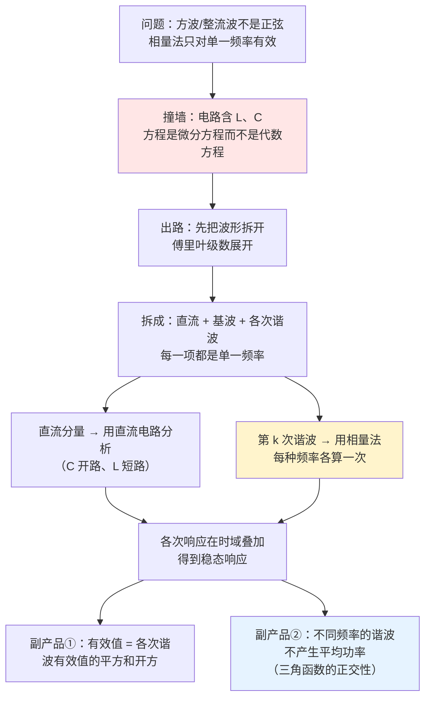
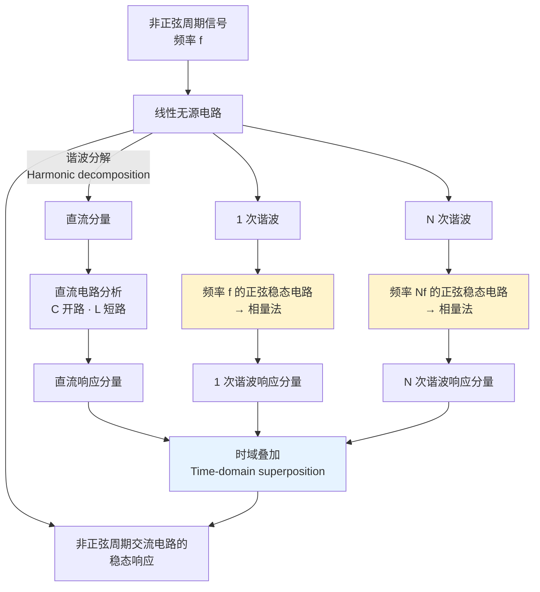

# C4.5 非正弦周期电路的谐波分析 Harmonic Analysis of Non-Sine Periodic Circuits

> [!abstract] 这一讲的任务
> 从 [[C4.1 正弦量与相量]] 开始，我们一直在享受一个极大的便利：**全电路所有电压（voltage）电流（current）都是同一个频率（frequency）**，所以才能把公共的旋转因子 $\mathrm{e}^{\mathrm{j}\omega t}$ 整体约掉，把微分方程压成复数代数方程。
> 可现实里的波形远没有这么乖。整流器出来的是脉动的直流，方波、锯齿波一眼看去毫无正弦的样子。**而相量法（phasor method）只对单一频率有效**——遇到这种波形，前四讲的整套工具全部失效。
> 这一讲给出出路，而且这个出路你其实已经见过一次：**先把非正弦周期（non-sinusoidal periodic）波拆成一堆单一频率的正弦**（傅里叶级数），**再对每个频率分别用一次相量法**，最后把结果叠回去。
> 拆完之后还会掉出两个漂亮的结论：**非正弦量（sinusoid）的有效值（RMS value）是各次谐波（harmonic）有效值的平方和开方**，**不同频率的谐波之间不产生平均功率（average power）**。

> [!info] 怎么读这份讲义
> 第 1 节说清"非正弦从哪来"，第 2–3 节是数学工具（狄里赫利条件 + 傅里叶级数的两种写法，**第 3 节那四个换算式里 $\varphi_k=\arctan(a_k/b_k)$ 的分母是 $b$ 不是 $a$，这是最容易记反的一处**）。
> 第 4 节是五种典型波形的级数表，**建议重点看方波与全波整流两条**——前者是"跳变波形收敛慢"的代表，后者直接对应你手机充电器上的 100 Hz 纹波。
> 第 5–7 节（频谱、有效值、平均功率）是这一讲的三个理论落点，**第 7 节的"正交性"是全讲最核心的一句话**。
> 第 8–9 节两道例题请自己动笔；第 10 节是完整的解题流程。
>
> 课件在这一段里有几处**明确的错误**：p91 说"离散周期（period）时域（time domain）信号的频谱是连续的"与它自己第 (1) 条冲突；p93 的平均功率公式**缺了 $P_0$ 与 $P_k$ 的展开式**；方波系数积分的第二个上限印成了 $T/2$。本讲逐条点名并补全。

---

> [!warning] 授课进度说明（截至第 4 次课）
> 已有的课堂语音转写稿覆盖到**第 4 次课**，内容为第 1 章全部 + 第 2 章全部；**第 4 章尚未讲授**。
> 因此本篇内容全部来自**课件与教材**（课件为 `第4章-交流稳态电路分析-(上集).pdf`，全文无手写笔迹），未经课堂讲解校正，篇内不使用「拓展」标注。等课上讲到本章后，本篇会按课堂实况做一次合并。

---

## 0. 开场：充电器输出上那条 100 Hz 的纹波

把一个手机充电器的输出接上示波器（用交流档、放大看），你会看到一条**频率 100 Hz** 的锯齿状纹波，叠在 5 V 直流上。

奇怪：市电是 **50 Hz**，为什么纹波是 **100 Hz**？

因为充电器先整流。**全波整流把正弦波的负半周翻到正侧**，得到的 $|U_{\mathrm{m}}\sin\omega t|$ 波形——它的周期变成了原来的一半：

$$
\left|U_{\mathrm{m}}\sin\omega t\right|=\left|U_{\mathrm{m}}\sin\omega\left(t+\frac{T}{2}\right)\right|
\qquad\Longrightarrow\qquad
T'=\frac{T}{2}\ ,\quad f'=2f=100\ \mathrm{Hz}
$$

所以 100 Hz 不是笔误，是"整流"这个动作**把频率翻了一倍**。

下一个问题就更实际了：**后面那个滤波电容（capacitance），能不能把这条 100 Hz 的纹波压下去？压到多少？**

要回答它，你需要知道两件事：
1. $|U_{\mathrm{m}}\sin\omega t|$ 里**有哪些频率分量、各自多大**（这决定了电容对谁有效）；
2. 每个分量经过电容分压（voltage division）后衰减了多少。

第 2 件事是 [[C4.2 元件相量模型与阻抗导纳]] 的活——**对每一个频率，电容的阻抗（impedance）都是 $1/(\mathrm{j}\omega C)$，频率越高阻抗越小，滤得越狠**。

第 1 件事就是这一讲要做的：把 $|U_{\mathrm{m}}\sin\omega t|$ 拆成一串单一频率的正弦。而第 2 件事之所以能"逐频率做一遍"，靠的正是**线性电路（linear circuit）的叠加定理（superposition theorem）**。

> [!important] 这一讲的全部策略，一句话
> **把非正弦周期波拆成"直流 + 一堆单一频率正弦"，然后对每一项分别用我们前四讲已经会的工具，最后把结果叠起来。**
> 相量法没有失效，它只是要被**用很多次**。

---

## 1. 非正弦周期信号从哪来（课件 p.76–77）

### 1.1 周期性

一个函数是周期函数，如果存在 $T>0$ 使得

$$
f(t)=f(t+kT)\ ,\qquad k=1,2,3,\dots
$$

课件给了三种典型的非正弦周期波形：

![[C4-非正弦周期波形三例.png]]

方波、锯齿波、半波整流——它们的共同点是"周期重复"，不同点是"形状完全不是正弦"。**只要形状不是正弦，前面四讲的相量法就直接失效**。

### 1.2 三个来源

> [!important] 电路中产生非正弦周期信号的三个原因（课件 p.77）
> **① 非正弦周期电源激励线性电路**，产生非正弦周期信号；
> **② 多个不同频率的正弦激励作用于同一个线性电路**；
> **③ 单一频率正弦激励作用于非线性电路（nonlinear circuit）。**
> **本课程只讨论前两种情况。**

> [!important] 为什么"前两种情况可以互相等效"（课件只给结论，这里补上理由）
> 关键在**狄里赫利条件**。当非正弦周期电源函数满足狄氏条件时，它可以展开成傅里叶级数（Fourier series）：
> $$u_S(t)=U_0+\sum_{k=1}^{\infty}U_{k\mathrm{m}}\sin(k\omega t+\varphi_k)$$
> 展开之后你看到了什么？**一个非正弦电源，等价于"一个直流源 + 无穷多个不同频率的正弦源串联"**——这正是第 ② 种情况！
>
> 所以"情况 ① 等效于情况 ②"的本质就是两步：
> $$\text{傅里叶分解}\ +\ \text{叠加定理}$$
> 前者把非正弦拆成一组正弦，后者告诉我们"线性电路里，各个电源可以分别作用再相加"。
> **这两件事一合，前四讲的全部工具就能重新上岗了。**

> [!note] 第三种情况为什么不讨论
> "单一频率正弦激励非线性电路"会产生谐波——这是**非线性（nonlinear）**的性质（比如二极管、铁芯饱和），与**线性叠加**的原理直接冲突。
> 本课程建立在整个电路理论是"线性"的前提上（[[C3.4 线性电路定理]]），所以这一类问题留到后续课程。**你只需要记住：本讲的方法只对线性电路有效。**

---

## 2. 狄里赫利条件：什么时候能拆（课件 p.78）

不是每个周期函数都能展开成傅里叶级数。能展开的，需要满足**狄里赫利条件 Dirichlet condition**：

> [!important] 狄里赫利条件（三条）
> **① 绝对可积**：$f(t)$ 在任意一个周期内绝对可积，即对任意 $t_0$，积分
> $$\int_{t_0}^{t_0+T}|f(t)|\,\mathrm{d}t$$
> 存在（工程直觉：函数值有限）。
> **② 极值有限**：$f(t)$ 在任意一个周期内只有**有限个**极大值和极小值。
> **③ 间断点有限**：$f(t)$ 在一个周期内连续，或只有**有限个**间断点。

课件补了一句很重要的工程话：**实际电路中的非正弦周期电压电流都是能量有限信号，一般都满足狄里赫利条件。** 所以工程上基本不用担心"能不能展开"，只关心"展到第几项就够用"。

> [!note] 课件没写的两点（补全）
> **（1）收敛到哪里。** 狄里赫利条件保证级数收敛，但收敛值分两种情形：
> - 在 $f(t)$ **连续**的点，级数收敛到 $f(t)$；
> - 在 $f(t)$ 的**间断**点，级数收敛到**左右极限的平均值** $\dfrac{f(t^-)+f(t^+)}{2}$。
>
> 第二条解释了为什么方波的傅里叶逼近在跳变沿处总是"差一口气"：级数在跳变点只能取**中间值**。
> **（2）跳变处的过冲（吉布斯现象）。** 用有限项去逼近方波时，跳变沿附近会出现一个**约 9% 的过冲**，而且项数越多过冲越窄、**幅度却不下降**。这是傅里叶逼近的固有性质，不是算错了。第 4 节看图时留意。

---

## 3. 傅里叶级数：两种写法与四个换算式（课件 p.79–80、p.82）

### 3.1 写法一：振幅—初相形式

> [!important] 傅里叶级数的三角形式（振幅—初相写法）
> 若 $f(t)$ 满足狄里赫利条件，则它可以展开成收敛的傅里叶级数：
> $$\boxed{\ f(t)=A_0+\sum_{k=1}^{\infty}A_{k\mathrm{m}}\sin(k\omega t+\varphi_k)\ }$$

课件逐项命名：

| 项 | 名称 | 含义 |
|---|---|---|
| $A_0$ | **恒定分量 / 直流分量** DC component | 信号在一个周期内的**平均值** |
| $A_{1\mathrm{m}}\sin(\omega t+\varphi_1)$ | **基波 / 一次谐波** fundamental / first harmonic | 频率与原信号相同 |
| $A_{2\mathrm{m}}\sin(2\omega t+\varphi_2)$ | **二次谐波** second harmonic | 频率是基波的两倍 |
| $k\ge2$ 的各项 | **高次谐波** high-order harmonics | 统称 |

> [!warning] $A_0$ 就是"平均值"本身，不是 $\dfrac{a_0}{2}$
> 很多教材把常数项写成 $\dfrac{a_0}{2}$，于是 $a_0=\dfrac2T\int_0^Tf\,\mathrm{d}t$。**本课件统一用 $A_0$ 直接表示平均值**，所以
> $$A_0=\frac1T\int_0^Tf(t)\,\mathrm{d}t$$
> **没有那个 $\frac12$。** 两种写法都对，但混用会整体差一倍——看别的书时先确认它用哪一套。

### 3.2 写法二：$\cos/\sin$ 分解形式

把 $\sin(k\omega t+\varphi_k)$ 用两角和公式展开：

$$
A_{k\mathrm{m}}\sin(k\omega t+\varphi_k)
=\underbrace{A_{k\mathrm{m}}\sin\varphi_k}_{a_k}\cos k\omega t+\underbrace{A_{k\mathrm{m}}\cos\varphi_k}_{b_k}\sin k\omega t
$$

于是得到第二种写法：

> [!important] 傅里叶级数的三角形式（$\cos/\sin$ 分解写法）
> $$\boxed{\ f(t)=A_0+\sum_{k=1}^{\infty}\left(a_k\cos k\omega t+b_k\sin k\omega t\right)\ }$$
> 系数由积分给出（课件同时给了对 $t$ 积分和对 $\omega t$ 积分两种等价写法）：
> $$A_0=\frac1T\int_0^Tf(t)\,\mathrm{d}t=\frac1{2\pi}\int_0^{2\pi}f(t)\,\mathrm{d}(\omega t)$$
> $$a_k=\frac2T\int_0^Tf(t)\cos(k\omega t)\,\mathrm{d}t=\frac1\pi\int_0^{2\pi}f(t)\cos(k\omega t)\,\mathrm{d}(\omega t)$$
> $$b_k=\frac2T\int_0^Tf(t)\sin(k\omega t)\,\mathrm{d}t=\frac1\pi\int_0^{2\pi}f(t)\sin(k\omega t)\,\mathrm{d}(\omega t)$$

> [!note] 那两个积分的物理含义
> - $A_0$ 是**平均值**——把函数在一个周期上摊平；
> - $a_k,b_k$ 是**"这个函数里含有多少 $\cos k\omega t$ / $\sin k\omega t$ 成分"**——计算方法是让 $f(t)$ 乘上那个基准波形再积分。
>
> 为什么这样能"捞出"某个成分？因为**不同频率的正弦/余弦在一个周期上互相正交**（积分等于零，第 7 节详述）。$f(t)$ 乘上 $\cos k\omega t$ 再积分时，所有**其他**成分的积分都归零，只剩下 $\cos k\omega t$ 自己那一份。这是一个"用正交基底做投影"的动作——和你在线性代数里把一个向量投影到基向量上是同一件事。

### 3.3 四个换算式（课件 p.82）

> [!important] 两种写法之间的换算
> $$\boxed{\ a_k=A_{k\mathrm{m}}\sin\varphi_k\ ,\qquad b_k=A_{k\mathrm{m}}\cos\varphi_k\ }$$
> $$\boxed{\ A_{k\mathrm{m}}=\sqrt{a_k^2+b_k^2}\ ,\qquad \varphi_k=\arctan\frac{a_k}{b_k}\ }$$

> [!warning] 这里有一个极容易记反的地方
> $\varphi_k=\arctan\dfrac{\color{red}{a_k}}{\color{red}{b_k}}$ —— **分子是 $a_k$、分母是 $b_k$**。
> 大多数人的肌肉记忆是 $\arctan(\text{虚部}/\text{实部})$ 或 $\arctan(y/x)$，看到 $\arctan$ 就想把"后面的"当分母，很容易写成 $\arctan(b_k/a_k)$——**那样会得到余角，整整错 $90^\circ$**。
>
> **不要背，现推一遍**（三秒钟）：
> $$A_{k\mathrm{m}}\sin(k\omega t+\varphi_k)=A_{k\mathrm{m}}\sin\varphi_k\cos k\omega t+A_{k\mathrm{m}}\cos\varphi_k\sin k\omega t$$
> 对照 $a_k\cos k\omega t+b_k\sin k\omega t$，立刻看出 $a_k=A_{k\mathrm{m}}\sin\varphi_k$、$b_k=A_{k\mathrm{m}}\cos\varphi_k$。
> 两式相除：$\dfrac{a_k}{b_k}=\dfrac{\sin\varphi_k}{\cos\varphi_k}=\tan\varphi_k$，于是 $\varphi_k=\arctan\dfrac{a_k}{b_k}$ ✓。
> **分母之所以是 $b_k$，是因为 $b_k$ 是 $\cos\varphi_k$ 那一份。** 记住这个来路，就永远不会记反。

> [!warning] $\arctan$ 的主值问题
> 课件的 $\varphi_k=\arctan(a_k/b_k)$ 只给了**主值**，值域 $(-90^\circ,90^\circ)$，**覆盖不到第三、第四象限**。
> 当 $b_k<0$ 时（对应的角度落在第二、第三象限），必须补 $\pm180^\circ$。
> 完整的写法是 $\varphi_k=\operatorname{atan2}(a_k,b_k)$——**这与 [[C4.1 正弦量与相量]] 里"算相角必须先定象限"是同一个坑。**

---

## 4. 五种典型波形的分解（课件 p.84–90）

课件把五种工程上最常见的波形逐页展开。它们的结果值得当成一张表记住：

| 波形 | 直流分量 | 傅里叶级数 | 收敛速度 |
|---|---|---|---|
| **方波**（双向，$\pm U_{\mathrm{m}}$） | $U_0=0$ | $u=\displaystyle\sum_{n=1}^{\infty}\frac{4U_{\mathrm{m}}}{(2n-1)\pi}\sin\left[(2n-1)\frac{2\pi}{T}t\right]$ | $\sim\dfrac1n$（**慢**） |
| **三角波** | $U_0=0$ | $u=\displaystyle\sum_{n=1}^{\infty}\frac{(-1)^{n-1}8U_{\mathrm{m}}}{(2n-1)^2\pi^2}\sin\left[(2n-1)\frac{2\pi}{T}t\right]$ | $\sim\dfrac1{n^2}$（**快**） |
| **锯齿波** | $U_0=\dfrac{U_{\mathrm{m}}}{2}$ | $u=\dfrac{U_{\mathrm{m}}}{2}-\displaystyle\sum_{n=1}^{\infty}\frac{U_{\mathrm{m}}}{n\pi}\sin\left(\frac{2n\pi}{T}t\right)$ | $\sim\dfrac1n$ |
| **全波整流** | $U_0=\dfrac{2U_{\mathrm{m}}}{\pi}$ | $u=\dfrac{2U_{\mathrm{m}}}{\pi}-\displaystyle\sum_{n=1}^{\infty}\frac{2U_{\mathrm{m}}}{(4n^2-1)\pi}\cos\left(\frac{4n\pi}{T}t\right)$ | $\sim\dfrac1{n^2}$ |
| **半波整流** | $U_0=\dfrac{U_{\mathrm{m}}}{\pi}$ | $u=\dfrac{U_{\mathrm{m}}}{\pi}+\dfrac{U_{\mathrm{m}}}{2}\sin\frac{2\pi}{T}t-\displaystyle\sum_{n=1}^{\infty}\frac{U_{\mathrm{m}}}{(4n^2-1)\pi}\cos\left(\frac{4n\pi}{T}t\right)$ | $\sim\dfrac1{n^2}$ |

> [!important] 从这张表里要读出的三件事
> **① 对称性决定了"只有哪些项"。**
> - **奇对称**（$f(-t)=-f(t)$，如方波、三角波、锯齿波）→ **只含正弦项**，$a_k=0$；
> - **偶对称**（$f(-t)=f(t)$，如全波整流）→ **只含余弦项**，$b_k=0$。
>
> 利用对称性，**能省掉一半的积分**。课件的三角波页和全波整流页都明确用了这一招（"由于波形是奇对称的，它只含奇函数项"）。做题时先看波形对称性，是最高效的第一步。
>
> **② 波形越"光滑"，系数衰减越快。**
> - 方波有**跳变**（不连续）→ 系数 $\sim1/n$，要用很多项才像样；
> - 三角波**连续但有尖角**（导数不连续）→ 系数 $\sim1/n^2$，几项就很像；
> - 光滑程度与衰减速度的这种关系，是信号分析里的普遍规律（在 [[C4.6 网络函数与谐振]] 讲频带时会再次遇到它的影子）。
>
> **③ 全波整流的谐波频率是 $2n\omega$，不是 $n\omega$。**
> $$\cos\left(\frac{4n\pi}{T}t\right)=\cos(2n\omega t)$$
> 因为整流后**周期减半**，基频翻倍——这正是 §0 里"100 Hz 纹波"的来源。**全波整流的谐波里没有奇次项，只有 $2\omega,4\omega,6\omega,\dots$。**
> 而且整流的直流分量最大（$2U_{\mathrm{m}}/\pi\approx0.637U_{\mathrm{m}}$）——这正是整流电路想给你的东西。

![[C4-方波傅里叶级数逼近.png]]

这张图把方波的合成过程按项数排开。请重点看两件事：**项数越多越接近方波**；**跳变沿附近的过冲始终存在，不会随项数增加而消失**——这就是第 2 节提到的吉布斯现象。

![[C4-三角波与锯齿波傅里叶逼近.png]]

三角波与锯齿波的对比更直观：**三角波的逼近几乎看不出误差**（$\sim1/n^2$ 的收敛速度），而**锯齿波的跳变沿需要很多项**（$\sim1/n$）。同样是"非正弦周期波"，收敛快慢差了整整一个数量级。

![[C4-全波与半波整流波形.png]]

上面那张图把两种整流的区别摆在了一起：**全波整流把负半周翻到正侧，周期减半、基频翻倍**（这就是 §0 里 100 Hz 纹波的来源）；**半波整流把负半周直接砍成零**，直流分量只有全波的一半（$U_{\mathrm{m}}/\pi$ 对 $2U_{\mathrm{m}}/\pi$）。

> [!note] 半波整流有一个漂亮的"凑法"
> 课件在 p.90 没有重新积分，而是**用全波整流的结果凑出半波整流**。
> 设同幅值（amplitude）的全波整流电压为 $u_1(t)=U_{\mathrm{m}}\left|\sin\dfrac{2\pi t}{T}\right|$，则
> $$\boxed{\ u(t)=\frac12\left[U_{\mathrm{m}}\sin\frac{2\pi t}{T}+u_1(t)\right]\ }$$
> **验证一下**：在正半周，$\sin>0$，括号里是 $\sin+|\sin|=2\sin$，乘 $\frac12$ 得 $\sin$ ✓；在负半周，$\sin<0$，括号里是 $\sin-\sin=0$，乘 $\frac12$ 得 $0$ ✓。
> 于是半波 = $\frac12$(原正弦 + 全波)，直接套用已知结果就行——**这比重新做两个积分省一半工作量**，而且结果的形式（直流 + 基波 + 偶次谐波）一眼就解释清楚了：原正弦贡献了那个基波项 $\frac{U_{\mathrm{m}}}{2}\sin\omega t$。
>
> 这种"用已知结果拼新结果"的思路，在工程上比"每次从定义算起"值钱得多。

> [!warning] 课件这一段的几处错误
> **① 方波的 $a_n$ 积分式第二个上限印错了。** 课件写
> $$a_n=\frac2T\int_0^{T/2}U_{\mathrm{m}}\cos(\cdot)\,\mathrm{d}t+\frac2T\int_0^{\boxed{T/2}}(-U_{\mathrm{m}})\cos(\cdot)\,\mathrm{d}t=0$$
> 第二段积分的上限应为 $T$（方波在 $T/2\sim T$ 是 $-U_{\mathrm{m}}$）。因为被积函数在整周期上正负相消，**结果 $a_n=0$ 不受影响**，但印刷确实错了。
> **② 三角波的积分定义与图上波形差了 $T/4$ 的相位。** 按课件印出的积分式复算，$a_1=-4U_{\mathrm{m}}/\pi^2\ne0$，与它自己说的"只含奇函数项"矛盾。**以级数结果（$\frac{8U_{\mathrm{m}}}{\pi^2}$ 那一支）为准**，这是标准的三角波级数。
> **③ 全波整流与半波整流的电路图英文标题互换了**，而且两张图的中文都写成"半波整流"（左图单二极管实为半波、右图四管桥式实为全波）。
> **④ 全波整流的直流分量式里多印了一个 $n$**：被积函数写成 $\left|\sin\frac{2n\pi t}{T}\right|$，应为 $\left|\sin\frac{2\pi t}{T}\right|$。
> **⑤ 锯齿波的谐波符号**：级数写成 $-\sum\frac{U_{\mathrm{m}}}{n\pi}\sin(\cdot)$，负号来自波形在 $0\sim T/2$ 为负、$T/2\sim T$ 为正的画法。**不同教材对锯齿波的相位起点定义不同，符号会随之变化**——用的时候先确认波形画法。

---

## 5. 频谱：把信号换个坐标看（课件 p.82、p.91）

### 5.1 幅度谱与相位谱

傅里叶级数把时间信号变成了一串"频率 + 振幅 + 初相"的三元组。于是我们可以**换一个坐标系**来描述同一个信号：

> [!important] 三种谱
> **幅度谱 Amplitude spectrum**：各次谐波的**振幅**与**频率**的关系图；
> **相位谱 Phase spectrum**：各次谐波的**初相**与**频率**的关系图；
> **频谱 Spectrum = 幅度谱 + 相位谱**。
> 画法上，谱线是从横轴竖起的一条条垂线，**线的位置是频率、线的高度是振幅**。

![[C4-示例信号波形与幅度频谱.png]]

上图是时域，下图是幅度谱——**同一个信号的两种看法**：时域告诉你"波形长什么样"，频域告诉你"它由哪些频率组成、各占多少"。这两种描述是**信息等价**的，只是换了个角度。

### 5.2 周期信号的谱是离散的

> [!important] 离散谱（课件 p.91 第 (1) 条，正确表述）
> **连续周期信号的频谱由一系列离散谱线组成**，这些谱线都出现在**基频的整数倍**频率（即各次谐波）上。
> **周期信号的频谱是离散频谱**，谱线间隔等于基频 $f$。

> [!note] 为什么间隔是基频
> 因为周期信号的频率成分只能是 $\omega,2\omega,3\omega,\dots$——**它们之间最小的间隔就是 $\omega$ 本身**。
> 如果这个周期信号的周期变成 $2T$（基频变成 $\omega/2$），谱线就会**加密一倍**；周期越长，谱线越密。

### 5.3 从离散谱到连续谱

课件 p.91 的后两条讲的是极限情形：

> [!important] 周期 → 无穷，离散谱 → 连续谱
> **周期增大**时，基频减小，**谱线间隔变小**，谱线变得密集；
> 当**周期趋于无穷**时，信号变成**非周期**的，**谱线间隔趋于无穷小**，谱就变成**连续谱**；同时每条谱线的幅度也趋于无穷小，所以要用**谱密度**（单位频率上的幅度）来描述。
> 频谱函数是信号在**频域**中的表示，**傅里叶分析方法**就是用频谱函数来分析信号。

> [!warning] 课件 p.91 第 (2) 条有一处明确的逻辑错误
> 课件原文后半句写的是："**离散周期时域信号的频谱是连续的**"——这与它自己第 (1) 条"周期信号的频谱是离散频谱"**直接冲突**。
> 正确的说法应该是："**非周期信号的频谱是连续的**"。原文里的 `descrete priodical time-domain signal` 本身也是拼错的（`descrete`→`discrete`、`priodical`→`periodical`），**词写错了、意思也错了**。
> 这一条按上框的内容理解即可。

> [!note] 往前接一步：这就是 DSP 的地基
> "时域 ↔ 频域"这套语言在后续课程里会反复出现：
> - **DFT / FFT** 是这条路的数值版——把连续积分换成有限求和，让计算机能算；
> - **采样定理**告诉我们：要无失真地表示最高频率为 $f_{\max}$ 的信号，采样率必须大于 $2f_{\max}$（[[C4.1 正弦量与相量]] 的频段表里"声音 20 Hz–20 kHz → 采样率 44.1 kHz"就是这么来的）；
> - **滤波器设计**（低通、高通、带通）本质上就是在频域上"给不同的谱线乘不同的系数"——而那个系数正是 [[C4.6 网络函数与谐振]] 要讲的**网络函数（network function）**。

---

## 6. 非正弦周期量的有效值（课件 p.92）

### 6.1 定义没变，公式变了

有效值的定义还是那个"均方根"，**一个字都没改**：

$$
U=\sqrt{\frac1T\int_0^Tu^2(t)\,\mathrm{d}t}
\,,\qquad
I=\sqrt{\frac1T\int_0^Ti^2(t)\,\mathrm{d}t}
$$

设 $u(t)=U_0+\sum_{k=1}^{\infty}U_{k\mathrm{m}}\sin(k\omega t+\theta_{uk})$，代进去算——就得到本节的结论：

> [!important] 非正弦周期量的有效值
> $$\boxed{\ U=\sqrt{U_0^2+U_1^2+U_2^2+\cdots}=\sqrt{U_0^2+\sum_{k=1}^{\infty}U_k^2}\ }$$
> 其中
> $$U_k=\frac{U_{k\mathrm{m}}}{\sqrt2}\ ,\qquad I_k=\frac{I_{k\mathrm{m}}}{\sqrt2}$$
> 是各次谐波的**有效值**。
> **非正弦周期量的有效值，等于直流分量与各次谐波分量有效值的平方和再开方。**

### 6.2 为什么是平方和，而不是代数和

课件在 p.92 留了一个红色的 **"Why？"**，这里补上答案——**它就是三角函数的正交性**。

把 $u^2(t)$ 展开，会出现三类项：

| 项的类型 | 例子 | 一周期积分 |
|---|---|---|
| 直流平方 | $U_0^2$ | 保留（$U_0^2$） |
| 直流 × 谐波（交叉） | $2U_0U_{k\mathrm{m}}\sin(\cdot)$ | **0**（正弦在整周期上积分为零） |
| **不同频率**谐波相乘（交叉） | $U_{k\mathrm{m}}U_{j\mathrm{m}}\sin(k\omega t)\sin(j\omega t)$，$k\ne j$ | **0**（正交） |
| **同频率**谐波平方 | $U_{k\mathrm{m}}^2\sin^2(k\omega t+\theta)$ | 保留（$U_{k\mathrm{m}}^2/2$） |

于是只剩两类项，而

$$
\frac1T\int_0^T\sin^2(k\omega t+\theta)\,\mathrm{d}t=\frac12
\qquad\Longrightarrow\qquad
U_{k\mathrm{m}}^2\cdot\frac12=\left(\frac{U_{k\mathrm{m}}}{\sqrt2}\right)^2=U_k^2
$$

**每一条交叉项都因正交性归零，只有"自己乘自己"的项活了下来**，这就得到了平方和开方的形式。

> [!warning] 一个必要的前提
> 有效值公式成立的前提是**各分量频率互不相同**（正交）。
> 如果两个分量频率相同（例如两个同频正弦源叠加），交叉项不为零，**这个公式直接失效**。
> 课件没有写这个前提，但它很重要——"频率相同的东西不能当作两个独立分量"。

> [!note] 这也是"幅值不能相加"的第三次出场
> 从 [[C4.1 正弦量与相量]]（$3+4\ne7$）、到 [[C4.4 正弦稳态功率与功率因数]]（$S$ 不守恒），到这里（有效值用平方和）——**同一个教训换了三件外衣**：
> **只有同一个方向/同一个频率的分量才能直接相加；不同分量必须按"平方和"（勾股）合成。**
> 因为正弦量之间是"正交"的关系，就像平面上的两个垂直方向。

> [!example] 手算验证（用课件 p.81 的信号）
> $$u(t)=80+220\sqrt2\sin(2\pi\cdot50t)+100\sqrt2\sin(2\pi\cdot100t+30^\circ)+45\sqrt2\sin(2\pi\cdot350t-20^\circ)+30\sqrt2\sin(2\pi\cdot700t+65^\circ)\ \mathrm V$$
> 直接按定义做数值积分（FFT 或高密度数值积分）得 $260.2403\ \mathrm V$；
> 按公式：各分量有效值分别是 $80$、$220$、$100$、$45$、$30$（注意每个正弦项前面的系数 $\sqrt2$ 已经把振幅换算成了有效值），于是
> $$U=\sqrt{80^2+220^2+100^2+45^2+30^2}=\sqrt{6400+48400+10000+2025+900}=\sqrt{67725}=260.2403\ \mathrm V$$
> **两条路完全一致（到小数点后四位）。** 公式得到验证。

---

## 7. 非正弦周期电路的平均功率（课件 p.93）

### 7.1 结论

设某支路（端口 N）在关联参考方向（associated reference directions）下的电压电流为

$$
u(t)=U_0+\sum_{k=1}^{\infty}U_{k\mathrm{m}}\sin(k\omega t+\theta_{uk})
\,,\qquad
i(t)=I_0+\sum_{k=1}^{\infty}I_{k\mathrm{m}}\sin(k\omega t+\theta_{ik})
$$

则它吸收的**平均功率**是

> [!important] 非正弦周期电路的平均功率
> $$\boxed{\ P=\frac1T\int_0^Tu(t)i(t)\,\mathrm{d}t=P_0+\sum_{k=1}^{\infty}P_k=P_0+P_1+P_2+\cdots\ }$$
> 其中
> $$\boxed{\ P_0=U_0I_0\ ,\qquad P_k=\frac12U_{k\mathrm{m}}I_{k\mathrm{m}}\cos(\theta_{uk}-\theta_{ik})=U_kI_k\cos\varphi_k\ }$$
> $\varphi_k=\theta_{uk}-\theta_{ik}$ 是**第 $k$ 次谐波**电压超前电流的相位差（phase difference）。
> **非正弦周期交流稳态（steady state）电路的平均功率，等于直流分量的平均功率与各正弦谐波分量平均功率之和。**

> [!warning] 课件 p.93 缺了关键的一步
> 课件只写到 $P=P_0+\sum P_k$ 就停了，**没有给出 $P_0=U_0I_0$ 和 $P_k=\frac12U_{k\mathrm{m}}I_{k\mathrm{m}}\cos\varphi_k$ 的展开式**，也没有定义 $\varphi_k$。
> 而紧接着 p.94–p.96 的两道例题**直接就在用**这两个式子。**读者只能从例题反推公式**——这是我们把它补全的原因。
> 另外课件这个"差角"的记号很混乱：p.93 完全没写，p.94 用正弦形式的角度相减，p.95/p.96 用余弦形式的角度相减。**三种写法，一处统一说明都没有。** 本讲义统一用 $\varphi_k=\theta_{uk}-\theta_{ik}$（取正弦形式）。

### 7.2 为什么不同频率之间不产生功率

这是全讲最核心的一句话，也解释了为什么 $P$ 能**逐次谐波分开算再相加**。

> [!important] 三角函数的正交性
> 对任意整数 $k\ne j$（$k,j\ge1$），在一个整周期上有
> $$\int_0^T\sin(k\omega t+\theta_1)\sin(j\omega t+\theta_2)\,\mathrm dt=0$$
> $$\int_0^T\sin(k\omega t+\theta_1)\cos(j\omega t+\theta_2)\,\mathrm dt=0$$
> $$\int_0^T\sin(k\omega t+\theta)\,\mathrm dt=0
> \qquad\text{（直流与任何正弦也正交）}$$
> 而**同频率**时
> $$\frac1T\int_0^T\sin(k\omega t+\theta_1)\sin(k\omega t+\theta_2)\,\mathrm dt=\frac12\cos(\theta_1-\theta_2)\ne0$$

把 $u(t)i(t)$ 展开，会出现大量的交叉项（$U_{k\mathrm{m}}I_{j\mathrm{m}}$ 型）。**只要 $k\ne j$，这些交叉项在一个周期上的积分全部为零**，被正交性消掉。活下来的只有两类：

| 活下来的项 | 积分结果 |
|---|---|
| $U_0\cdot I_0$ | $U_0I_0=P_0$（直流功率） |
| 同频率的 $U_{k\mathrm{m}}\sin(k\omega t+\theta_{uk})\cdot I_{k\mathrm{m}}\sin(k\omega t+\theta_{ik})$ | $\dfrac12U_{k\mathrm{m}}I_{k\mathrm{m}}\cos(\theta_{uk}-\theta_{ik})=P_k$ |

> [!important] 三条推论，做题时可以直接用
> **① "只有两边都有的频率才产生功率（power）"。**
> 如果电压里有 3 次谐波但电流里没有，那 3 次谐波**不产生任何平均功率**——因为电流在那一频率上的分量是零。反之亦然。
> 这一条能让你**一眼看出哪几次谐波功率为零**，省掉大量计算（下一节两道例题全靠它）。
>
> **② 直流分量只和直流分量产生功率。**
> 直流与任何频率的正弦在一个周期上积分为零。所以 $P_0=U_0I_0$——**只有电压和电流都有直流分量时才有直流功率**。
>
> **③ 谐波功率可以为负。**
> $P_k=U_kI_k\cos\varphi_k$ 里的 $\cos\varphi_k$ 可以为负（当 $|\varphi_k|>90^\circ$ 时）。这意味着**在这个频率上，支路（branch）对外发出功率**——一个电路在某次谐波上呈容性、在另一次上呈感性，是完全可能的。
> 这在单一频率的正弦稳态（sinusoidal steady state）里是"含源支路"才有的现象，而在非正弦电路里**普通无源（passive）支路也会出现**（下一节的 $P_4=-0.25\ \mathrm W$ 就是实例）。

> [!warning] "平均功率守恒"和"有效值公式"不要混
> - **有效值**：$U=\sqrt{U_0^2+\sum U_k^2}$——这是**同一条支路内部**各分量间的合成；
> - **平均功率**：$P=\sum P_k$——这是**逐频率算完再相加**，是普通加法。
>
> 两者形式不同，原因也不同：有效值是"平方和"（因为它是二次量的均方根），功率是"直接和"（因为正交性已经把交叉项消干净了）。**不要因为都是"加"就混为一谈。**

---

## 8. 例 4-6-1：两道谐波算一次功率（课件 p.94）

> [!example] 例 4-6-1
> 已知某二端网络的电压和端电流分别为
> $$u(t)=60+76.4\cos(\omega t)+25.5\cos(3\omega t+180^\circ)\ \mathrm V$$
> $$i(t)=0.764\cos(\omega t)+9.56\times10^{-3}\cos(3\omega t+92.1^\circ)\ \mathrm A$$
> 求该二端网络的平均功率 $P$。

**第一步：统一函数形式。** 两条式子都是 $\cos$ 形式，本来就能算；课件为了"便于计算各次谐波的功率因数（power factor）角"，把它们统一换成 $\sin$（用 $\cos x=\sin(x+90^\circ)$）：

$$
u(t)=60+76.4\sin(\omega t+90^\circ)+25.5\sin(3\omega t+270^\circ)\ \mathrm V
$$

$$
i(t)=0.764\sin(\omega t+90^\circ)+9.56\times10^{-3}\sin(3\omega t+182.1^\circ)\ \mathrm A
$$

**第二步：逐次谐波算功率。** 注意三个"只有一边有"的情形：

| 频率 | 电压 | 电流 | 是否产生功率 |
|---|---|---|---|
| 直流 | $U_0=60\ \mathrm V$ | $I_0=0$ | **否**（电流无直流） |
| 基波 $\omega$ | $76.4\ \mathrm V$ | $0.764\ \mathrm A$ | **是** |
| 3 次谐波 $3\omega$ | $25.5\ \mathrm V$ | $9.56\ \mathrm{mA}$ | **是** |

$$
P_0=U_0I_0=60\times0=0\ \mathrm W
$$

$$
P_1=\frac12\times76.4\times0.764\times\cos(90^\circ-90^\circ)=\frac12\times76.4\times0.764\times1=29.185\ \mathrm W
$$

$$
P_3=\frac12\times25.5\times9.56\times10^{-3}\times\cos(270^\circ-182.1^\circ)
=\frac12\times25.5\times9.56\times10^{-3}\times\cos87.9^\circ=0.00447\ \mathrm W
$$

$$
\boxed{\ P=P_0+P_1+P_3=0+29.185+0.00447=29.19\ \mathrm W\ }
$$

> [!note] 复算通过（两种形式给出同一答案）
> 直接用 $\cos$ 形式也能算，**不需要转换**：
> $$P_1=\frac12\times76.4\times0.764\times\cos(0^\circ-0^\circ)=29.185\ \mathrm W$$
> $$P_3=\frac12\times25.5\times9.56\times10^{-3}\times\cos(180^\circ-92.1^\circ)=0.00447\ \mathrm W$$
> 用数值积分直接算 $\frac1T\int_0^Tui\,\mathrm dt$ 也得 $29.189\ \mathrm W$。**课件印 29.19 W，正确。**

> [!warning] 这道题的三点提醒
> **① $\varphi_k$ 的定义课件没给。** 从数值反推：$\varphi_1=90^\circ-90^\circ=0^\circ$、$\varphi_3=270^\circ-182.1^\circ=87.9^\circ$。**只有把"差角 = 电压谐波相位 − 电流谐波相位"这一步补上，公式才闭合。**
> **② "统一成 $\sin$"不是必须的。** 课件给的理由是"便于计算功率因数角"，但**根本原因是 p.93 的公式是在正弦形式下推的**。实际算的时候，只要**电压和电流用同一种形式**，相减就得到同一个 $\varphi_k$——本题用 $\cos$ 形式算，结果一模一样。
> **③ 3 次谐波电流只有 9.56 mA，贡献 0.0045 W（约 0.015%）。** 课件仍然把它算进去了——这不是多余：它说明"**只要电压和电流在同一个频率上都有分量，就一定有功率贡献，哪怕很小**"。

---

## 9. 例：一般支路的分次谐波功率（课件 p.95–96）

这道题是本讲最完整的一道，值得逐项走一遍——尤其是那个**负的** 4 次谐波功率。

> [!example] 例
> 已知某支路的电压和电流分别为
> $$u(t)=\left[20+100\sin314t-50\cos(628t+30^\circ)+10\sin(1256t-20^\circ)\right]\ \mathrm V$$
> $$i(t)=\left[0.1+\cos(314t-60^\circ)+0.2\cos(942t+45^\circ)+0.1\cos(1256t+10^\circ)\right]\ \mathrm A$$
> 计算该支路的平均功率。

**先把频率对上号**（$314=2\pi\times50$）：

| 角频率（angular frequency） | 次数 | 电压里有？ | 电流里有？ |
|---|---|---|---|
| $0$ | 直流 | ✓ $20\ \mathrm V$ | ✓ $0.1\ \mathrm A$ |
| $314$ | 1 次（50 Hz） | ✓ $100\ \mathrm V$（$\sin$） | ✓ $1\ \mathrm A$（$\cos$） |
| $628$ | 2 次（100 Hz） | ✓ $50\ \mathrm V$（$\cos$） | ✗ |
| $942$ | 3 次（150 Hz） | ✗ | ✓ $0.2\ \mathrm A$（$\cos$） |
| $1256$ | 4 次（200 Hz） | ✓ $10\ \mathrm V$（$\sin$） | ✓ $0.1\ \mathrm A$（$\cos$） |

> [!important] 先看表再动笔，一半的计算可以省掉
> 根据"只有两边都有的频率才产生功率"（§7 推论①）：
> - **2 次谐波**：电压有、电流没有 → $P_2=0$，**不用算**；
> - **3 次谐波**：电流有、电压没有 → $P_3=0$，**不用算**。
>
> 需要真算的只有**直流、1 次、4 次**三项。

**逐项计算：**

$$
P_0=U_0I_0=20\times0.1=2\ \mathrm W
$$

基波：电压是 $\sin$、电流是 $\cos$，先用 $\sin x=\cos(x-90^\circ)$ 把电压转成 $\cos$ 形式：

$$
u_1=100\sin314t=100\cos(314t-90^\circ)
\,,\qquad
i_1=\cos(314t-60^\circ)
$$

$$
P_1=\frac12\times100\times1\times\cos\left[(-90^\circ)-(-60^\circ)\right]
=\frac12\times100\times\cos(-30^\circ)=50\times0.866=43.3\ \mathrm W
$$

$$
P_2=0\ \mathrm W
\qquad\qquad
P_3=0\ \mathrm W
$$

4 次谐波：电压是 $\sin(\cdot-20^\circ)$，同样转成 $\cos$ 需要减 $90^\circ$：

$$
u_4=10\sin(1256t-20^\circ)=10\cos(1256t-20^\circ-90^\circ)
\,,\qquad
i_4=0.1\cos(1256t+10^\circ)
$$

$$
P_4=\frac12\times10\times0.1\times\cos\left[(-20^\circ-90^\circ)-10^\circ\right]
=\frac12\times1\times\cos(-120^\circ)=0.5\times(-0.5)=-0.25\ \mathrm W
$$

**总平均功率：**

$$
\boxed{\ P=P_0+P_1+P_2+P_3+P_4=2+43.3+0+0+(-0.25)=45.05\ \mathrm W\ }
$$

> [!note] 复算通过
> 分项和为 $2+43.3013+0+0-0.25=45.0513\ \mathrm W$，与课件的 $45.05\ \mathrm W$ 一致。
> 用 $u(t)i(t)$ 在一个周期上直接做数值积分，同样得 $45.051\ \mathrm W$。
> （课件的 PDF 文本层把 $P_3$、$P_4$ 抽取成了 `1×0.2/2` 和 `110×0.1/2`——**那是文本抽取故障**（分式的分子 `1` 被并进了后一个数字）。图上实际印的是 $\frac12\cdot0\cdot0.2$ 和 $\frac12\cdot10\cdot0.1$，即 `0` 和 `10`，**课件内容本身是对的**。）

> [!important] $P_4=-0.25\ \mathrm W$ 是这道题最值得记的一点
> 为什么会出现负功率？
> $$\varphi_4=(-110^\circ)-(10^\circ)=-120^\circ
> \qquad\Longrightarrow\qquad
> \cos\varphi_4=\cos(-120^\circ)=-0.5<0$$
> $|\varphi_4|>90^\circ$ 说明**在这个频率上，电流超前电压超过 $90^\circ$**——也就是**在这个频率上支路整体呈容性**。
> 于是这一次谐波的功率是**负的**：支路在 4 次谐波上其实是**发出**功率的。
>
> 一个无源支路在不同频率上呈现不同性质（1 次感性、4 次容性），在非正弦电路里**非常常见**——因为 $X_L=k\omega L$ 和 $X_C=1/(k\omega C)$ 随频率变化的趋势相反，**总有一个频率让它们恰好抵消（谐振），两侧的性质相反**。
> 这正是 [[C4.6 网络函数与谐振]] 要展开的故事。

> [!warning] 课件在这道题里的两处记号问题
> **① $P_2=\frac12\cdot50\cdot0$、$P_3=\frac12\cdot0\cdot0.2$ 这种写法有误导性。** 它把"电流里根本没有 2 次谐波"简化成了"乘 0"。
> 概念上要分清：**"某个振幅恰好为零"和"这个频率的分量根本不存在"，是两回事**（虽然数值结果一样）。规范写法应说明 $I_{2\mathrm{m}}=0$、$U_{3\mathrm{m}}=0$。
> **② 红字的 $-90^\circ$。** 课件在 $P_1$ 的式子里把一个 $-90^\circ$ 标成红字，那是**从 $\sin$ 转成 $\cos$ 的相移**（$\sin x=\cos(x-90^\circ)$）。课件没有写出这条规则，只用红字暗示。
> 另外要注意：这道题用的是**余弦形式**的角度相减（$-90^\circ-(-60^\circ)=-30^\circ$），与例 4-6-1 的**正弦形式**相减（$270^\circ-182.1^\circ=87.9^\circ$）**记法不同**。**两种都对，但不能混用**——混了会差 $180^\circ$。

---

## 10. 谐波分析法：完整的解题流程（课件 p.97–98）

### 10.1 为什么必须这么做

课件的三条理由：

> [!important] 非正弦周期交流电路的三个特点（课件 p.97）
> **① 电路中的电源是非正弦周期电压源（voltage source）或电流源（current source）**，它们一般可以通过傅里叶级数展开成**各次谐波分量的叠加**；
> **② 电路一般含有储能元件（L/C）**，因此描述输入输出关系的**不再是代数方程，而是线性微分方程**；
> **③ 利用叠加定理和相量（phasor）分析法**，当电路被单一频率正弦波（单一谐波）激励时，我们可以分析**电路的每一次谐波输出**。

> [!note] 第 ③ 条背后的完整逻辑（课件没说透，这里补上）
> 非正弦激励下电路方程是**微分方程**，直接解很困难。但拆成各次谐波之后：
> - 对**直流分量**：$\omega=0$，导数项为零 → 退化成**代数方程**；
> - 对**第 $k$ 次谐波**：单一频率，**相量法把 $\mathrm d/\mathrm dt$ 换成乘 $\mathrm jk\omega$** → 也变成**代数方程**。
>
> **所以"拆开"这个动作真正的收益是：把一个困难的微分方程问题，换成了 $N$ 个简单的代数方程问题。** 这正是 [[C4.1 正弦量与相量]] 造相量的初衷——只是这次用了 $N$ 遍。

### 10.2 流程图

### 10.3 五步走

> [!important] 谐波分析法的完整步骤
> **第 1 步：分解。** 把非正弦周期激励展开成傅里叶级数：直流 + 基波 + 各次谐波。
> **第 2 步：直流分量单独处理。** 用**直流电路**的方法算——**电容开路、电感（inductance）短路**（这是 [[C4.2 元件相量模型与阻抗导纳]] 里 $\omega\to0$ 的极限）。
> **第 3 步：对每一次谐波，单独用相量法。** 第 $k$ 次谐波下，$\omega_k=k\omega$，各元件阻抗 $Z_L=\mathrm jk\omega L$、$Z_C=\dfrac{1}{\mathrm jk\omega C}$。**每个频率各算一次，互不干扰。**
> **第 4 步：各自还原成时间函数。** 注意**每个频率的相量都要补回自己的 $\sqrt2$ 和 $k\omega t$**。
> **第 5 步：在时域里叠加。** 把直流分量和所有谐波响应直接相加。

> [!warning] 第 5 步是两个"不能"
> **不能把不同频率的相量加起来。** $\dot I_1=5\angle30^\circ$ 和 $\dot I_3=2\angle-60^\circ$ 这两个相量**不能画在同一张相量图（phasor diagram）上**——它们的旋转速度不同，相对角度一直在变（[[C4.1 正弦量与相量]] 的 Tip 3）。
> **相加必须在时域做**：$i(t)=I_0+\sqrt2I_1\sin(\omega t+\theta_1)+\sqrt2I_3\sin(3\omega t+\theta_3)+\cdots$。
>
> 换句话说：**每个频率的相量是"各自独立的账"，只有还原成时间函数之后才能合并。** 流程图里那个红色的"相量分析（Phasor analysis）"大箭头之所以单独画出来，就是在强调"逐个频率分别做"这件事。

---

## 这一讲的三句话

1. **非正弦周期波 = 直流 + 基波 + 各次谐波（傅里叶级数）**，前提是满足狄里赫利条件（工程信号一般都满足）。两种写法（振幅—初相 / $\cos$-$\sin$）由四个换算式相连，**记住 $\varphi_k=\arctan(a_k/b_k)$ 的分母是 $b_k$**。五种典型波形的级数要能查表；**全波整流的谐波频率是 $2n\omega$（周期减半），这就是 100 Hz 纹波的来源**。
2. **非正弦周期量的有效值是"平方和开方"**：$U=\sqrt{U_0^2+\sum U_k^2}$。它成立的原因是**三角函数的正交性**——不同频率的乘积在一个周期上积分全为零，只有"自己乘自己"的项活下来（每条贡献 $U_{k\mathrm{m}}^2/2=U_k^2$）。
3. **平均功率可以逐次谐波分开算再相加**：$P=P_0+\sum P_k$，$P_0=U_0I_0$，$P_k=U_kI_k\cos\varphi_k$。推论有三条：**只有两边都有的频率才产生功率**、**直流只和直流产生功率**、**谐波功率可以为负**（那一频率上电路呈容性）。所以解题流程是：**分解 → 逐频率（直流用直流法、谐波用相量法）→ 时域叠加**，注意**不同频率的相量不能相加**。

**速查表一：傅里叶级数**

| 项目 | 公式 |
|---|---|
| 振幅—初相形式 | $f(t)=A_0+\sum\limits_{k=1}^{\infty}A_{k\mathrm{m}}\sin(k\omega t+\varphi_k)$ |
| $\cos$-$\sin$ 形式 | $f(t)=A_0+\sum\limits_{k=1}^{\infty}\left(a_k\cos k\omega t+b_k\sin k\omega t\right)$ |
| 直流分量 | $A_0=\dfrac1T\displaystyle\int_0^Tf(t)\,\mathrm dt$ |
| 余弦系数 | $a_k=\dfrac2T\displaystyle\int_0^Tf(t)\cos(k\omega t)\,\mathrm dt$ |
| 正弦系数 | $b_k=\dfrac2T\displaystyle\int_0^Tf(t)\sin(k\omega t)\,\mathrm dt$ |
| 换算（一） | $a_k=A_{k\mathrm{m}}\sin\varphi_k$，$b_k=A_{k\mathrm{m}}\cos\varphi_k$ |
| 换算（二） | $A_{k\mathrm{m}}=\sqrt{a_k^2+b_k^2}$，$\varphi_k=\arctan\dfrac{a_k}{b_k}$（**分母是 $b_k$**，并注意象限） |

**速查表二：五种典型波形**

| 波形 | 直流 | 级数 |
|---|---|---|
| 方波 | $0$ | $\sum\limits_{n=1}^\infty\dfrac{4U_{\mathrm{m}}}{(2n-1)\pi}\sin[(2n-1)\omega t]$ |
| 三角波 | $0$ | $\sum\limits_{n=1}^\infty\dfrac{(-1)^{n-1}8U_{\mathrm{m}}}{(2n-1)^2\pi^2}\sin[(2n-1)\omega t]$ |
| 锯齿波 | $\dfrac{U_{\mathrm{m}}}{2}$ | $\dfrac{U_{\mathrm{m}}}{2}-\sum\limits_{n=1}^\infty\dfrac{U_{\mathrm{m}}}{n\pi}\sin(n\omega t)$ |
| 全波整流 | $\dfrac{2U_{\mathrm{m}}}{\pi}$ | $\dfrac{2U_{\mathrm{m}}}{\pi}-\sum\limits_{n=1}^\infty\dfrac{2U_{\mathrm{m}}}{(4n^2-1)\pi}\cos(2n\omega t)$ |
| 半波整流 | $\dfrac{U_{\mathrm{m}}}{\pi}$ | $\dfrac{U_{\mathrm{m}}}{\pi}+\dfrac{U_{\mathrm{m}}}{2}\sin\omega t-\sum\limits_{n=1}^\infty\dfrac{U_{\mathrm{m}}}{(4n^2-1)\pi}\cos(2n\omega t)$ |

**速查表三：对称性与选用的项**

| 对称性 | 条件 | 结果 | 例子 |
|---|---|---|---|
| 奇对称 | $f(-t)=-f(t)$ | **只含 $\sin$ 项**（$a_k=0$） | 方波、三角波、锯齿波 |
| 偶对称 | $f(-t)=f(t)$ | **只含 $\cos$ 项**（$b_k=0$） | 全波整流 |
| 半波对称 | $f(t+T/2)=-f(t)$ | **只含奇次谐波** | 方波、三角波 |

**速查表四：有效值与功率**

| 量 | 公式 | 关键点 |
|---|---|---|
| 有效值 | $U=\sqrt{U_0^2+U_1^2+U_2^2+\cdots}$ | **平方和开方**，不是代数和；前提是各分量频率不同 |
| 各次谐波有效值 | $U_k=\dfrac{U_{k\mathrm{m}}}{\sqrt2}$ | 与单一正弦的定义一致 |
| 平均功率 | $P=P_0+P_1+P_2+\cdots$ | **直接相加** |
| 直流功率 | $P_0=U_0I_0$ | 直流与任何正弦正交 |
| 第 $k$ 次谐波功率 | $P_k=U_kI_k\cos\varphi_k=\dfrac12U_{k\mathrm{m}}I_{k\mathrm{m}}\cos(\theta_{uk}-\theta_{ik})$ | $|\varphi_k|>90^\circ$ 时为负 |
| 正交性 | $\displaystyle\int_0^T\sin(k\omega t)\sin(j\omega t)\,\mathrm dt=0\quad(k\ne j)$ | 不同频率不产生功率 |

**速查表五：谐波分析法的五步**

| 步 | 做什么 | 注意 |
|---|---|---|
| 1 | 把激励展开成傅里叶级数 | 先看对称性，能省一半积分 |
| 2 | 直流分量用**直流电路**算 | C 开路、L 短路 |
| 3 | 第 $k$ 次谐波用**相量法**算 | $\omega_k=k\omega$，$Z_L=\mathrm jk\omega L$，$Z_C=1/(\mathrm jk\omega C)$ |
| 4 | 各频率各自还原成时间函数 | 每个都要补回 $\sqrt2$ 与 $k\omega t$ |
| 5 | **时域叠加** | **不同频率的相量不能相加** |

**下一讲预告**：这一讲我们反复看到同一个现象——**同一个电路对不同频率的"态度"完全不同**：电容对高次谐波阻抗小（滤得狠），电感对高次谐波阻抗大（挡得住）；第 9 节那道题里，同一个支路在 1 次谐波上呈感性、在 4 次谐波上呈容性。
下一讲把这种"看频率下菜"的性质写成一个函数：**网络函数 $H(\mathrm j\omega)=\dfrac{\text{响应相量}}{\text{激励相量}}$**，它的模就是幅频特性（amplitude-frequency characteristic）、辐角就是相频特性（phase-frequency characteristic）。然后重点研究它最尖锐的一种表现——**谐振（resonance）**：在某个频率上感抗（inductive reactance）与容抗（capacitive reactance）恰好抵消，电路对外表现得像纯电阻（resistance），电流（或电压）冲到极值，而 $Q$ 值决定了这个尖峰有多尖、收音机能不能从一堆电台里把你要的那一个挑出来。→ [[C4.6 网络函数与谐振]]

---

**上一讲 ←** [[C4.4 正弦稳态功率与功率因数]]
**下一讲 →** [[C4.6 网络函数与谐振]]
**课程索引 →** [[电路基础 MOC]]
