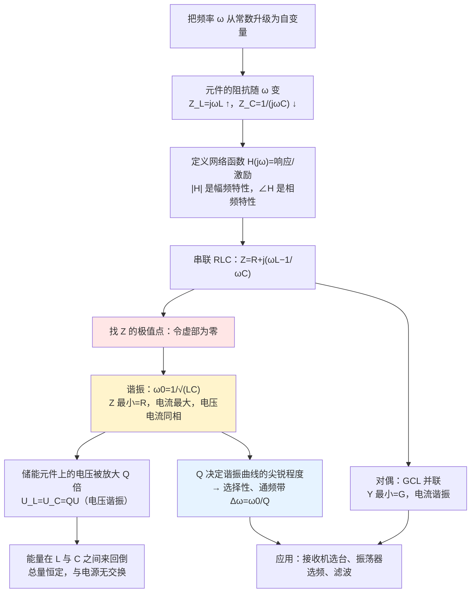

# C4.6 网络函数与谐振 Network Functions and Resonance

> [!abstract] 这一讲的任务
> 前面几讲里，频率一直是一个**已知的常数**：题目给了 $\omega$，我们把它代进 $\mathrm j\omega L$、$\dfrac{1}{\mathrm j\omega C}$ 就行了。
> 这一讲把频率**升级成自变量**。一旦这么看，电路的"性格"就露出来了——**它对不同的频率态度完全不同**：电容对高频很"软"（阻抗小），电感对高频很"硬"（阻抗大）。
> 第一件事是把这种性格写成一个函数：**网络函数 $H(\mathrm j\omega)$**，它的模是幅频特性、辐角是相频特性。
> 第二件事是研究这种性格最尖锐的一种表现：**谐振**。在某个频率上感抗与容抗恰好抵消，电路对外表现得像纯电阻，电流（或电压）冲到极值。**$Q$ 值决定了这个尖峰有多尖**——它决定了收音机能不能从一堆电台里把你要的那一个挑出来。

> [!info] 怎么读这份讲义
> 第 1 节建立网络函数（**六种类型容易混，建议对着"输入输出在不在同一端口"这条线索记**）。
> 第 2–3 节是 RLC 串联谐振的全套结论，**这是本讲的核心**：谐振条件、五个特点、特性阻抗 $\rho$、品质因数 $Q$ 的三种写法、能量交替与总量恒定。第 2 节的"秋千"类比值得先想清楚再看公式。
> 第 4 节是谐振曲线、选择性与通频带，**归一化通用谐振曲线那张图是全讲最值钱的一张**。
> 第 5 节是 GCL 并联的对偶关系与"实际线圈并电容"的处理，第 6 节是应用。
>
> 课件在这一段里有若干**数值问题**，其中两处比较要紧（p.118 的 $L$、$C$ 与 $Q$ 相差 10 倍；p.129 的 $L$ 与题给电阻对不上），都在对应小节逐条点名并给出复算。

---

> [!warning] 授课进度说明（截至第 4 次课）
> 已有的课堂语音转写稿覆盖到**第 4 次课**，内容为第 1 章全部 + 第 2 章全部；**第 4 章尚未讲授**。
> 因此本篇内容全部来自**课件与教材**（课件为 `第4章-交流稳态电路分析-(上集).pdf`，全文无手写笔迹），未经课堂讲解校正，篇内不使用「拓展」标注。等课上讲到本章后，本篇会按课堂实况做一次合并。

---

## 0. 开场：收音机是怎么只听到一个台的

收音机的天线是一根金属杆，它**同时**接收到了空气中所有频率的电磁波：中央台 640 kHz、本地台 820 kHz、另一个台 1026 kHz……还有无数个更弱的信号。

可你转动调谐旋钮，只听到**一个**台，其他的一概听不见。为什么？

打开收音机的输入回路，它其实就是一个 **RLC 串联电路**：一个线圈 $L$、一个电阻 $R$（线圈的损耗），和一个**可变电容** $C$（就是你手上那个旋钮）。

取一组真实参数：

$$
L=250\ \mu\mathrm{H}\ ,\qquad R=20\ \Omega\ ,\qquad C=150\ \mathrm{pF}
$$

先算一下它"最敏感"的频率：

$$
\omega_0=\frac{1}{\sqrt{LC}}=\frac{1}{\sqrt{250\times10^{-6}\times150\times10^{-12}}}=5.16\times10^{6}\ \mathrm{rad/s}
$$

$$
f_0=\frac{\omega_0}{2\pi}=821.9\ \mathrm{kHz}
$$

**正好落在 820 kHz 那个电台上。**

再看别的频率来的时候电流有多大。假设三个电台在天线上感应出的电压幅值相同，都是 $10\ \mu\mathrm{V}$：

| 电台频率 | $\omega L$ | $\dfrac{1}{\omega C}$ | $X=\omega L-\dfrac{1}{\omega C}$ | $\lvert Z\rvert=\sqrt{R^2+X^2}$ | 电流 $I=U/\lvert Z\rvert$ |
|---|---|---|---|---|---|
| 640 kHz | $1005\ \Omega$ | $1658\ \Omega$ | $-653\ \Omega$ | $653\ \Omega$ | $0.0153\ \mu\mathrm{A}$ |
| **820 kHz** | $1290\ \Omega$ | $1290\ \Omega$ | $\mathbf{0}$ | $\mathbf{20\ \Omega}$ | $\mathbf{0.500\ \mu\mathrm{A}}$ |
| 1026 kHz | $1612\ \Omega$ | $1034\ \Omega$ | $+577\ \Omega$ | $578\ \Omega$ | $0.0173\ \mu\mathrm{A}$ |

> [!important] 这张表就是"选台"的全部秘密
> 在 820 kHz 上，感抗和容抗**恰好互相抵消**，阻抗只剩下那个只有 $20\ \Omega$ 的电阻，电流冲到最大 $0.5\ \mu\mathrm{A}$；
> 到了 640 kHz，两个电抗**没有抵消干净**，剩下 $-653\ \Omega$ 的净电抗，把阻抗从 $20\ \Omega$ 撑到 $653\ \Omega$——**大了 33 倍**，电流就被压到只剩 $\dfrac{20}{653}=3.06\%$。
>
> **同一个电路，对 820 kHz"敞开大门"，对 640 kHz"关掉 97%"。** 这就叫**选择性**。
> 你转动旋钮改变 $C$，$\omega_0=1/\sqrt{LC}$ 跟着变，就把"敞开大门"的频点挪到别的电台上去了——**这就是调谐**。

> [!question] 停一下，先自己想想
> 为什么 820 kHz 处的电流最大？换句话说，**为什么"感抗和容抗相等"就是电流的极值点**？
> 提示：把阻抗写成 $Z=R+\mathrm j(X_L-X_C)$，问一句——**$Z$ 的模什么时候最小**？
> 再想一步：$Z$ 的模最小，**为什么就是电流最大**？（提示：$I=U/|Z|$，$U$ 固定。）
> 最后：那两个 $1290\ \Omega$ 的电抗**并没有消失**，它们只是互相抵消了。可它们上面的电压有多大？——$1290\times0.5\ \mu\mathrm{A}=645\ \mu\mathrm{V}$，**是电源电压 $10\ \mu\mathrm{V}$ 的 64 倍**。这个"放大"是从哪来的？

这三个问题的答案，就是这一讲的全部内容。

---

## 1. 频率特性与网络函数（课件 p.100–107）

### 1.1 为什么频率特性重要

> [!important] 频率特性 Frequency Characteristic
> 电路中激励源的频率变化时，**感抗与容抗随频率变化**，从而使电路的**工作状态随频率而变**。电路与系统的工作状态随频率变化的这种现象，称为电路的**频率特性**，又称**频率响应 Frequency Response**。

课件在这一页用一句蓝色大字做了总结：

> **"Matched channel is the big thing!"**

这句话翻译成工程语言就是：**电路和信号必须"对得上频道"**。天线收到了几十个电台，只有那个"频率对上了"的才能通过；滤波器之所以叫滤波器，就是因为它对某些频率"放行"、对另一些"拦截"。

### 1.2 网络函数

光看响应不行——响应的大小还取决于激励有多大。为了**把激励的影响除掉**，只留下电路自己的性质，我们把"响应与激励之比"作为研究对象：

> [!important] 网络函数 Network Function
> 在线性正弦稳态网络中，当**只有一个独立激励源**时，网络**响应**（电压或电流）与**激励源相量**之比，称为该**单输入单输出网络**的网络函数：
> $$\boxed{\ H(\mathrm j\omega)\overset{\text{def}}{=}\frac{\dot R(\mathrm j\omega)}{\dot E(\mathrm j\omega)}\ }$$
> 其中 $R$ 表示 response（响应），$E$ 表示 excitation（激励）。
> $H(\mathrm j\omega)$ 是**激励源频率的函数**。

> [!important] 六种网络函数（按"输入输出是否在同一端口"分两大类）
> **一、策动点函数 Driving point function（输入与输出在同一个端口）**
>
> | 类型 | 定义 | 激励 → 响应 |
> |---|---|---|
> | 策动点阻抗 | $H=\dfrac{\dot U(\mathrm j\omega)}{\dot I(\mathrm j\omega)}=Z_{\mathrm{in}}(\mathrm j\omega)$ | 电流源 → 电压 |
> | 策动点导纳 | $H=\dfrac{\dot I(\mathrm j\omega)}{\dot U(\mathrm j\omega)}=Y_{\mathrm{in}}(\mathrm j\omega)$ | 电压源 → 电流 |
>
> **二、转移函数 Transfer function（输入与输出不在同一端口）**
>
> | 类型 | 定义 |
> |---|---|
> | 转移导纳 | $H=\dfrac{\dot I_2}{\dot U_1}=Y_{\mathrm T}(\mathrm j\omega)$ |
> | 转移阻抗 | $H=\dfrac{\dot U_2}{\dot I_1}=Z_{\mathrm T}(\mathrm j\omega)$ |
> | 转移电压比（电压传输/放大系数） | $H=\dfrac{\dot U_2}{\dot U_1}=A_u(\mathrm j\omega)$ |
> | 转移电流比（电流传输/放大系数） | $H=\dfrac{\dot I_2}{\dot I_1}=A_i(\mathrm j\omega)$ |

> [!note] 记住这六个的窍门：看"分子分母是什么"
> **第一步**：输入输出**同不同端口**？同端口 → 策动点（只有两个：阻抗、导纳）；不同端口 → 转移（四个）。
> **第二步**：看**比值是什么量纲**。
> - $\dot U/\dot I$ → 阻抗（$\Omega$）；
> - $\dot I/\dot U$ → 导纳（S）；
> - $\dot U/\dot U$ 或 $\dot I/\dot I$ → 无量纲的比（$A_u$、$A_i$）。
>
> **策动点阻抗和转移阻抗都是"电压比电流"，策动点导纳和转移导纳都是"电流比电压"**——区别只在端口位置。这样记就不会乱。

> [!important] 网络函数与什么有关、与什么无关（课件 p.105）
> $H(\mathrm j\omega)$ 与以下因素**有关**：
> ① 网络的**拓扑结构**与**参数**；
> ② **输入输出变量的类型**（电压还是电流），以及**端口对的相互位置**。
> 但**与输入输出的幅值无关**。
> **因此网络函数是网络自身特性的体现。**

最后这一句是网络函数存在的全部理由：**它剥离掉"这次加了多少电压"的偶然因素，只留下"这个电路是什么脾气"这个必然因素。**

### 1.3 幅频特性与相频特性

$H$ 是一个复数，把它拆成模和辐角：

> [!important] 两条特性曲线
> **幅频特性 Amplitude-frequency characteristic**：$|H(\mathrm j\omega)|$ 与 $\omega$ 的关系；
> **相频特性 Phase-frequency characteristic**：$\varphi(\mathrm j\omega)=\arg H(\mathrm j\omega)$ 与 $\omega$ 的关系。
> 合起来就是"这个电路对不同频率的**放大倍数**和**相移**"。

> [!note] 从"一个数"到"两条曲线"
> 前一讲我们算的是"给一个频率、算一个结果"；这一讲画的是"把频率扫一遍、每个频率算一个结果，连成曲线"。
> 同一套公式（阻抗串并联、分压分流），**只是把 $\omega$ 留成符号而不代入数字**。
> 这个转变在 [[C4.5 非正弦周期电路的谐波分析]] 里已经埋下伏笔了：那次我们逐个频率地算，本质上就是在手工描一条幅频曲线。

### 1.4 阶数

> [!important] 网络函数的阶数
> 网络函数中 $\mathrm j\omega$ 的**最高次数**，定义为网络（函数）的**阶数**。

阶数反映了电路的复杂度（本质上等于电路中独立储能元件的个数）。一阶电路的网络函数里 $\mathrm j\omega$ 最高一次，二阶最高两次——这与第 5 章"一阶/二阶动态电路"的分类是同一条线索。

**知道了网络函数，任意正弦输入的响应都能算：**

$$
H(\mathrm j\omega)=\frac{\dot R(\mathrm j\omega)}{\dot E(\mathrm j\omega)}
\qquad\Longrightarrow\qquad
\boxed{\ \dot R(\mathrm j\omega)=H(\mathrm j\omega)\cdot\dot E(\mathrm j\omega)\ }
$$

> [!note] 这是一种"查表式"的思维方式
> 电路的特性（$H$）和这次的输入（$\dot E$）是**两件独立的事**，响应就是两者相乘。
> 所以工程上做滤波器设计时，先确定"我要一个什么样的 $H(\mathrm j\omega)$"，再去凑电路参数——**而不是反过来**。这正是上面那句 "Matched channel is the big thing" 的工程含义。

### 1.5 例题：用网孔法求网络函数（课件 p.106）

> [!example] 例
> 求图示电路的转移导纳 $\dfrac{\dot I_2}{\dot U_S}$ 和转移电压比 $\dfrac{\dot U_L}{\dot U_S}$。

![[C4-网络函数例题电路.png]]

**网孔方程**（两个网孔，两个电感各标 $\mathrm j\omega$，即取 $L=1\ \mathrm H$）：

$$
\begin{cases}
(2+\mathrm j\omega)\dot I_1-2\dot I_2=\dot U_S\\
-2\dot I_1+(4+\mathrm j\omega)\dot I_2=0
\end{cases}
$$

**解出 $\dot I_2$。** 由第二式得 $\dot I_1=\dfrac{4+\mathrm j\omega}{2}\dot I_2$，代回第一式：

$$
\left[\frac{(2+\mathrm j\omega)(4+\mathrm j\omega)}{2}-2\right]\dot I_2=\dot U_S
$$

$$
(2+\mathrm j\omega)(4+\mathrm j\omega)=8+\mathrm j6\omega+(\mathrm j\omega)^2=8+\mathrm j6\omega-\omega^2
$$

$$
\frac{8+\mathrm j6\omega-\omega^2}{2}-2=\frac{8+\mathrm j6\omega-\omega^2-4}{2}=\frac{4-\omega^2+\mathrm j6\omega}{2}
$$

所以

$$
\dot I_2=\frac{2\dot U_S}{4-\omega^2+\mathrm j6\omega}
$$

**两个网络函数：**

$$
\boxed{\ Y_{\mathrm T}(\mathrm j\omega)=\frac{\dot I_2}{\dot U_S}=\frac{2}{4-\omega^2+\mathrm j6\omega}\ }
$$

$$
\boxed{\ A_u(\mathrm j\omega)=\frac{\dot U_L}{\dot U_S}=\frac{\mathrm j\omega\dot I_2}{\dot U_S}=\frac{\mathrm j2\omega}{4-\omega^2+\mathrm j6\omega}\ }
$$

> [!note] 从这两个式子里能直接读出很多东西
> - 它在 $\omega=\sqrt4=2\ \mathrm{rad/s}$ 处分母的实部为零，此时 $Y_{\mathrm T}=\dfrac{2}{\mathrm j6}=-\mathrm j\dfrac13$——**纯虚数**，说明这时候 $A_u$ 与 $Y_{\mathrm T}$ 相差 $90^\circ$，这个电路在 $\omega=2$ 附近有"谐振"的味道（分母只有虚部）。
> - 分母是 $\omega$ 的二次式 → **二阶网络**（两个电感）。
> - $\omega\to0$ 时 $Y_{\mathrm T}\to\dfrac24=0.5\ \mathrm S$；$\omega\to\infty$ 时 $Y_{\mathrm T}\to0$——**高频被"挡"住了**，这是一个低通性质。
>
> **网络函数写出来之后，这些性质不用算就能看出来**——这就是它作为"网络特性体现"的价值。

---

## 2. 谐振现象与定义（课件 p.108–110）

### 2.1 一个非常好的类比：秋千

课件用"荡秋千"来引入谐振，这个类比值得完整讲一遍：

> [!important] 谐振现象的物理图像（课件 p.108）
> 电路里同时含有 $L$ 和 $C$ 时：
> ① 电路中**同时存在磁场储能与电场储能**；
> ② **两种储能之间可能相互交换**；
> ③ 电路工作时，**既有与外部电源的能量交换，也有内部两种储能之间的交换**；
> ④ 就像**荡秋千**：势能与动能来回交换，外部推力只负责补充消耗掉的那一点能量；
> ⑤ 此时会出现一个特殊现象——**谐振**：电路内部电磁能量的大量交换。

> [!note] 秋千这个类比为什么贴切
> 荡秋千时，你**不会**每一次都使劲推——你只在它荡到最高点、速度为零的那一瞬**轻轻补一下**，秋千就越来越高。
> 如果你推的节奏不对（频率不匹配），你出的力全被浪费，秋千甚至会被你推停。
> **谐振就是"推的节奏正好对上"**：电源只需要补充电阻消耗掉的那一点能量，能量的大头在 $L$ 和 $C$ 之间自己来回倒。
>
> 这也解释了为什么谐振时电流（或电压）能达到很大：**电源不是能量的主要来源，内部交换才是。**

### 2.2 定义

> [!important] 谐振的两个要素与两个指标（课件 p.109）
> **两个要素（必要前提）：**
> ① 必须**同时存在两种储能**（即电路里同时有 $L$ 和 $C$）；
> ② 外加电源必须是**交流信号**。
>
> **两个指标（怎么判断发生了谐振）：**
> ① 当电源频率为**某一特定值**（由电路组成决定）时，电路对外呈现**纯电阻特性**（电压电流同相）；
> ② 电路的**阻抗或导纳达到极值**，相应地电路的响应电压或电流也达到极值。

> [!warning] 课件 p.109 第②条表述不严谨，必须纠正
> 课件写的是"电路的阻抗或导纳**达到最大**"。这在**串联**谐振里是错的——串联谐振时阻抗是**最小**（$|Z|_{\min}=R$），并联谐振时阻抗才是**最大**。
> 课件自己在 p.111（串联）和 p.134（并联）都给出了正确结论（串联：$|Z|=|Z|_{\min}=R$；并联：$|Y|=|Y|_{\min}=G$、$|Z|$ 最大），**只有 p.109 这一定义页写成了"最大"**。
> 更严谨的说法是："阻抗（或导纳）的**模达到极值**"——串联取最小、并联取最大，**取决于电路结构**。或者干脆只用第 ① 条（纯电阻 + 电压电流同相）作为定义，那一条是普适的。

### 2.3 谐振的种类

课件列了三种：

- **RLC 串联谐振**（下一节详讲）
- **GCL 并联谐振**（第 5 节，与串联完全对偶）
- **串并联谐振**（复合谐振／双谐振，本课程不展开）

---

## 3. RLC 串联谐振（课件 p.111–118）

### 3.1 条件与谐振频率

串联 RLC 的阻抗：

$$
Z=R+\mathrm j\left(\omega L-\frac{1}{\omega C}\right)=|Z|\angle\varphi
$$

看它的虚部：$\omega L-\dfrac{1}{\omega C}$。

- $\omega L>\dfrac{1}{\omega C}$：虚部为正 → **感性**；
- $\omega L<\dfrac{1}{\omega C}$：虚部为负 → **容性**；
- $\omega L=\dfrac{1}{\omega C}$：**虚部为零** → 电压与电流**同相**。

> [!important] 串联谐振的条件与谐振频率
> $$\boxed{\ \omega_0L=\frac{1}{\omega_0C}\ }
> \qquad\Longrightarrow\qquad
> \boxed{\ \omega_0=\frac{1}{\sqrt{LC}}\ ,\qquad f_0=\frac{1}{2\pi\sqrt{LC}}\ }$$
> 此时
> $$|Z|=|Z|_{\min}=R
> \,,\qquad
> |Y|=|Y|_{\max}=\frac1R$$

![[C4-串联谐振电路.png]]

> [!question] 停一下，先自己想想
> 为什么"虚部为零"就是"阻抗模最小"？
> 把 $|Z|=\sqrt{R^2+(\omega L-1/\omega C)^2}$ 写出来看一眼就明白了：**$R$ 是固定的，能变的只有那个平方项**。平方项非负，最小值是 $0$——**在虚部为零时取到**。
> 所以 $|Z|_{\min}=R$，然后电流 $I=U/|Z|$ 在 $U$ 固定时**最大**：$I_0=U/R$。
> 这一串推理里没有任何"谐振"的神秘感——**它就是一个配方法求最小值的问题。**

> [!important] 实现谐振的两种手段（课件 p.112）
> ① **调节外加电源（信号源）的频率** $\omega$，使 $\omega=\omega_0$；
> ② **调节电路参数 $L$、$C$**（工程上**常改变 $C$**，因为电容做成可调最便宜）——叫**调谐 tuning**。
>
> 收音机上那个旋钮，转的就是第 ② 种：**固定 $L$，改变 $C$**。

### 3.2 谐振时的五个特点

> [!important] RLC 串联谐振时的特点
> **① $\dot U$ 与 $\dot I$ 同相。**（阻抗为纯电阻）
> **② 阻抗为纯电阻，$Z=R$，且 $|Z|$ 最小。**
> **③ 电流最大**：$I_0=\dfrac UR$（$U$ 一定时）。
> **④ 电阻上的电压等于电源电压，$LC$ 上的总电压为零**：
> $$\dot U_{R0}=\dot U\ ,\qquad \dot U_{L0}+\dot U_{C0}=0$$
> 且
> $$\dot U_{L0}=\mathrm jQ\dot U\ ,\qquad \dot U_{C0}=-\mathrm jQ\dot U\ ,\qquad Q=\frac{U_{L0}}{U}=\frac{U_{C0}}{U}$$
> **⑤ 串联谐振又称"电压谐振"**（因为 $LC$ 上的电压被放大 $Q$ 倍）。

第 ④ 条的推导值得走一遍：

$$
\dot U_{L0}=\mathrm j\omega_0L\dot I_0=\mathrm j\omega_0L\cdot\frac{\dot U}{R}=\mathrm j\frac{\omega_0L}{R}\dot U=\mathrm jQ\dot U
$$

$$
\dot U_{C0}=\frac{1}{\mathrm j\omega_0C}\dot I_0=-\mathrm j\frac{1}{\omega_0CR}\cdot\frac{\dot U}{1}=-\mathrm jQ\dot U
$$

（用到了定义 $Q\equiv\dfrac{\omega_0L}{R}=\dfrac{1}{\omega_0CR}$，见下一小节。）

![[C4-串联谐振相量图.png]]

> [!note] 这张相量图就是"电压谐振"的全部画面
> 以 $\dot I_0$ 为水平参考：$\dot U_{R0}$ 与它同向（长度等于电源电压 $U$）；$\dot U_{L0}$ **竖直向上**、$\dot U_{C0}$ **竖直向下**，两者**等长反向**（长度都是 $QU$）。
> **它们完全抵消**，所以电源"看到"的只有 $\dot U_{R0}$——这就是为什么谐振时电路表现得像纯电阻。
> 但如果 $Q$ 很大，那两个竖直箭头会**长得远超水平箭头**——**电源只给了 $U$，$L$ 和 $C$ 上却各有 $QU$**。
> **这个"放大"不需要额外能源，它靠的是两个电抗之间能量的来回倒腾。**

> [!warning] 电压谐振的另一面：危险
> $Q=60$ 意味着 $LC$ 上的电压是电源电压的 **60 倍**。接在 220 V 市电上的串联谐振电路，如果 $Q$ 达到 60，电容两端会出现 **13 200 V**——足以击穿电容和绝缘。
> 工程上对"可能发生串联谐振"的电路必须做防护；反过来，**测量高电压或微弱高频信号时，也正靠这个放大倍数来"以小见大"**（下一节的接收机例题就是这种用法）。

### 3.3 特性阻抗与品质因数

谐振时两个电抗相等，这个公共值有一个专门的名字：

> [!important] 特性阻抗 Characteristic Impedance
> $$\boxed{\ \rho=\omega_0L=\frac{1}{\omega_0C}=\sqrt{\frac LC}\ }\qquad\text{单位：}\Omega$$
> **推导**：$\omega_0L=\dfrac{1}{\sqrt{LC}}L=\sqrt{\dfrac LC}$；$\dfrac{1}{\omega_0C}=\dfrac{\sqrt{LC}}{C}=\sqrt{\dfrac LC}$。两者相等 ✓

> [!important] 品质因数 Quality Factor（串联）
> $$\boxed{\ Q=\frac{\rho}{R}=\frac{\omega_0L}{R}=\frac{1}{\omega_0CR}=\frac{1}{R}\sqrt{\frac LC}\ }\qquad\text{无量纲}$$
> **课件特别标注了 "Dimensionless（无量纲）"**——因为它是两个电阻（特性阻抗与 $R$）之比。

> [!warning] 这个 $Q$ 与 [[C4.4 正弦稳态功率与功率因数]] 里的 $Q$ 是两个东西
> | 符号 | 名称 | 单位 | 在哪一讲 |
> |---|---|---|---|
> | $Q$ | **无功功率** | var（乏） | [[C4.4 正弦稳态功率与功率因数]] |
> | $Q$ | **品质因数** | **无量纲** | 本讲 |
>
> 看单位就能分开。而且有意思的是，**谐振时无功功率 $Q_0=0$，而品质因数 $Q$ 达到它最有意义的地方**——两个 $Q$ 在谐振这一点上"擦肩而过"，一点都不含糊。

> [!note] 三种写法各有各的用处
> - $Q=\dfrac{\omega_0L}{R}$：**看电感**。这个电路的电感相对其损耗有多大；
> - $Q=\dfrac{1}{\omega_0CR}$：**看电容**。同一个量的另一种说法；
> - $Q=\dfrac1R\sqrt{\dfrac LC}$：**看参数**。由此得出一条极其实用的设计原则——
> $$\boxed{\ \text{要提高 }Q\text{，就提高 }\frac LC\text{ 或减小 }R\ }$$
> 工程上做高 $Q$ 谐振回路，就是"大电感、小电容、低损耗电阻"。收音机的中周、晶振的等效电路，全都是这么设计的。

### 3.4 谐振时的能量关系（课件 p.115–116）

设 $u=U_{\mathrm m}\sin\omega t$，且恰好 $\omega=\omega_0$。则电流与电源同相：

$$
i=\frac{U_{\mathrm m}}{R}\sin\omega t=I_{\mathrm m0}\sin\omega t
$$

电容电压滞后电流 $90^\circ$：

$$
u_C=\frac{I_{\mathrm m0}}{\omega_0C}\sin(\omega t-90^\circ)=-\sqrt{\frac LC}\,I_{\mathrm m0}\cos\omega t
$$

于是两种储能分别是

$$
W_C=\frac12Cu_C^2=\frac12LI_{\mathrm m0}^2\color{red}{\cos^2}\omega t
\qquad
W_L=\frac12Li^2=\frac12LI_{\mathrm m0}^2\color{red}{\sin^2}\omega t
$$

> [!important] 总储能恒定
> $$\boxed{\ W_{\text{总}}=W_L+W_C=\frac12LI_{\mathrm m0}^2=\frac12CU_{C\mathrm m0}^2=\frac12CQ^2U_{\mathrm m}^2\ }\qquad\text{（与时间无关！）}$$
> 其中最大磁场能与最大电场能相等：$W_{LM}=W_{CM}=\dfrac12LI_{\mathrm m0}^2$。

![[C4-谐振能量交替.png]]

> [!note] 三条曲线讲的故事
> 上面那张图里有三条线：$W_L\propto\sin^2\omega t$（磁场能）、$W_C\propto\cos^2\omega t$（电场能）、以及它们的和（一条水平直线）。
> - **$W_L$ 和 $W_C$ 此消彼长**——磁场能最大的时刻电场能为零，反之亦然。能量在电感和电容之间**来回倒**；
> - **总和恒定**——不管倒到哪一步，总量一点不变。
>
> 这就是"电路内部电磁能量的大量交换"的精确含义：**谐振时，电路内部在自娱自乐，电源几乎插不上手。**

> [!important] 谐振时的功率关系（课件 p.115）
> **负载（电阻）吸收的平均功率**：$P=RI_0^2=\dfrac{U^2}{R}$
> **无功功率**：$Q_{L0}=\omega_0LI_0^2$，$Q_{C0}=-\dfrac{1}{\omega_0C}I_0^2$，两者之和
> $$\boxed{\ Q_0=Q_{L0}+Q_{C0}=0\ }$$
> **电源发出的**：$P=UI_0\cos\varphi=RI_0^2$，$Q_0=UI_0\sin\varphi=0$。
>
> 课件用红字总结：**"$L$ 与 $C$ 之间交换能量，与电源之间没有能量交换。"**

> [!note] "无功之和为零"和"能量在交换"并不矛盾
> $Q_{L0}=+I_0^2\omega_0L$ 是电感**吸收**的无功，$Q_{C0}=-I_0^2/(\omega_0C)$ 是电容**发出**的无功（注意符号）。两者大小相等、符号相反，**加起来是零**。
> 意思是：**电感这一秒从电源要走的，下一秒就被电容还回去了**——它们自己成交，电源只是那个"过路的账房"，净收支为零。
> 这正是第 [[C4.4 正弦稳态功率与功率因数]] "感性无功与容性无功可以互相抵消"的**完全抵消版**。那里的补偿电容只能**部分**抵消，这里因为 $\omega$ 恰好等于 $\omega_0$，抵消得**干干净净**。

### 3.5 品质因数的物理意义

> [!important] $Q$ 的物理意义（课件 p.117）
> $$\boxed{\ Q=2\pi\cdot\frac{\text{谐振时电路中电磁场的总储能}}{\text{谐振时一周期内维持振荡电路消耗的能量}}\ }$$
> 课件用式子对了一遍：
> $$Q=\frac{\omega_0L}{R}=\omega_0\cdot\frac{LI_0^2}{RI_0^2}=2\pi\cdot\frac{LI_0^2}{RI_0^2T_0}
> \quad\text{（因为 }\omega_0=\frac{2\pi}{T_0}\text{）}$$
> 分子 $LI_0^2$ 是电磁总储能（的一个比例常数），分母 $RI_0^2T_0$ 是一周期内电阻消耗的能量。
>
> 课件原文："$Q$ 是反映谐振回路中**电磁振荡程度**的量。$Q$ 越大，**总能量越大**，**维持振荡所消耗的能量越小**，**振荡程度越强**，振荡回路的'品质'越好。因此，**在需要谐振的电路中应尽量提高 $Q$ 值**。"

> [!note] 用秋千再翻译一遍
> $Q$ 就是**秋千的"省劲程度"**：
> - $Q$ 大 → 内部储存的能量远大于每周期损耗的能量 → **轻轻推一下就能维持很大的摆动**；
> - $Q$ 小 → 每周期损耗的能量和储存的量一个量级 → **要一直使劲推，秋千也摆不高**。
>
> $Q=60$ 意味着"储存的能量是一个周期损耗的 $60/(2\pi)\approx9.5$ 倍"——**存起来的比漏掉的多一个数量级**，所以能维持很强的振荡。

### 3.6 例题：串联谐振求参数（课件 p.118）

> [!example] 例
> 某接收器的电路参数为：$\omega=5\times10^3\ \mathrm{rad/s}$，$U=10\ \mathrm{V}$，调 $C$ 使电路中电流最大，$I_{\max}=200\ \mathrm{mA}$，测得电容电压为 $600\ \mathrm{V}$。求 $R$、$L$、$C$ 及 $Q$。

![[C4-串联谐振例题电路.png]]

**解。** "调 $C$ 使电流最大"就是"调到谐振"——所以此时 $|Z|=R$、$I_0=U/R$。

$$
R=\frac{U}{I_0}=\frac{10}{200\times10^{-3}}=50\ \Omega
$$

"电容电压 = $Q$ 倍电源电压"这条可以直接用：

$$
U_C=QU
\qquad\Longrightarrow\qquad
Q=\frac{U_C}{U}=\frac{600}{10}=60
$$

$$
L=\frac{RQ}{\omega_0}=\frac{50\times60}{5\times10^3}\ \mathrm{H}
\,,\qquad
C=\frac{1}{\omega_0^2L}
$$

> [!warning] 课件这一页内部不自洽：$L$ 与 $C$ 相差 10 倍
> 课件印的结果是 $L=\boxed{60\ \mathrm{mH}}$、$C=\boxed{0.67\ \mu\mathrm{F}}$。**但把它自己的数代进去算并不是这两个值**：
> $$L=\frac{50\times60}{5\times10^3}=0.6\ \mathrm{H}=600\ \mathrm{mH}\quad(\textbf{不是 }60\ \mathrm{mH})$$
> $$C=\frac{1}{(5\times10^3)^2\times0.6}=6.67\times10^{-8}\ \mathrm{F}=0.0667\ \mu\mathrm{F}\quad(\textbf{不是 }0.67\ \mu\mathrm{F})$$
> 也就是说，**课件的 $L$ 和 $C$ 都比正确值小了 10 倍**（但这两个错值彼此是自洽的：$1/\sqrt{60\ \mathrm{mH}\times0.67\ \mu\mathrm{F}}=4987\approx5000\ \mathrm{rad/s}$）。
>
> 两套数只有一套能同时成立：
> | 读法 | $Q$ | $U_C$ | $L$ | $C$ | $\omega_0=1/\sqrt{LC}$ |
> |---|---|---|---|---|---|
> | 按题干 $U_C=600\ \mathrm V$ | $60$ | $600\ \mathrm V$ | $\mathbf{0.6\ H}$ | $\mathbf{0.0667\ \mu F}$ | $5000$ ✓ |
> | 按课件印的 $L$、$C$ | $\mathbf{6}$ | $\mathbf{60\ V}$ | $60\ \mathrm{mH}$ | $0.67\ \mu\mathrm F$ | $4987$ ✓ |
>
> **结论：课件的题干、$R$、$Q$ 都对，唯独最后印出的 $L$ 与 $C$ 落到了另一套数上（小了 10 倍）。按题干 $U_C=600\ \mathrm V$，正确答案是 $L=0.6\ \mathrm H$、$C=0.0667\ \mu\mathrm F$。**

---

## 4. 谐振曲线、选择性与通频带（课件 p.119–131）

### 4.1 阻抗的频率特性

串联 RLC 的阻抗随频率变化：

$$
Z=R+\mathrm j\left(\omega L-\frac{1}{\omega C}\right)=|Z(\omega)|\angle\varphi(\omega)
$$

$$
\boxed{\ |Z(\omega)|=\sqrt{R^2+\left(\omega L-\frac{1}{\omega C}\right)^2}\ }
\qquad
\boxed{\ \varphi(\omega)=\arctan\frac{\omega L-\dfrac{1}{\omega C}}{R}\ }
$$

![[C4-RLC串联阻抗幅频与相频特性.png]]

> [!note] 左边那张图有四条线，别只看一条
> - **红色 $|Z(\omega)|$**：一个"V"形，最低点在 $\omega_0$ 处、高度是 $R$。**这就是谐振点**；
> - **橙色 $X_L(\omega)=\omega L$**：一条从原点出发的直线，随频率线性上升；
> - **蓝色 $X_C(\omega)=1/(\omega C)$**：从左上向右下的一条双曲线，频率越高越小；
> - **蓝色 $X(\omega)=X_L-X_C$**：前面两条的差。它在低频段为负（容性）、在 $\omega_0$ 处**过零**、在高频段为正（感性）。
>
> **$|Z|$ 的 V 形是 $X(\omega)$ 过零的直接后果**：$|Z|=\sqrt{R^2+X^2}$，$X$ 越接近零，$|Z|$ 越接近 $R$。
>
> 右边那张是相频特性 $\varphi(\omega)$：一个从 $-\pi/2$ 升到 $+\pi/2$ 的"S"形，在 $\omega_0$ 处过零。**过零点就是同相点。** 频率很低时电路呈强容性（$\varphi\to-90^\circ$），很高时呈强感性（$\varphi\to+90^\circ$）。

### 4.2 电流谐振曲线

> [!important] 电流谐振曲线（课件 p.121）
> $$I(\omega)=\frac{U}{\sqrt{R^2+\left(\omega L-\dfrac{1}{\omega C}\right)^2}}$$
> 峰值在 $\omega=\omega_0$ 处，峰高 $I_0=U/R$。

![[C4-电流谐振曲线.png]]

注意这条曲线**不对称**：左端从零快速上升（因为低频时 $1/(\omega C)$ 很大），右端缓慢下降（高频时 $\omega L$ 线性增长）。**这条不对称性是 RLC 串联谐振的固有特征**，做题时不要指望它左右对称。

### 4.3 归一化：通用谐振曲线

不同的电路有不同的 $L$、$C$、$R$，画出来的曲线五花八门，没法比较。**把横纵坐标都"除掉"自己的特征值**，就能得到一条**与具体参数无关**的通用曲线：

> [!important] 归一化（课件 p.122）
> $$\omega\to\frac{\omega}{\omega_0}=\eta
> \,,\qquad
> I(\omega)\to\frac{I(\omega)}{I(\omega_0)}=\frac{I}{I_0}$$
> 推导（把 $I=U/|Z|$ 与 $I_0=U/R$ 相除，再上下同除 $R$）：
> $$\frac{I}{I_0}=\frac{R}{|Z|}=\frac{1}{\sqrt{1+\left(\dfrac{\omega_0L}{R}\cdot\dfrac{\omega}{\omega_0}-\dfrac{1}{\omega_0CR}\cdot\dfrac{\omega_0}{\omega}\right)^2}}$$
> 注意括号里那两项恰好都是 $Q$（因为 $Q=\dfrac{\omega_0L}{R}=\dfrac{1}{\omega_0CR}$）：
> $$\boxed{\ \frac{I}{I_0}=\frac{1}{\sqrt{1+Q^2\left(\eta-\dfrac1\eta\right)^2}}\ }$$

> [!important] 这个式子最漂亮的地方
> 归一化之后，**曲线只由一个参数 $Q$ 决定**——$L$、$C$、$R$ 各自是多少已经不重要了，重要的只是它们的组合 $Q$。
> 这意味着：**你研究了一条曲线，就研究了所有 RLC 串联谐振电路。** 这就是归一化的全部价值（也是所有"通用曲线"的价值）。

![[C4-通用谐振曲线族与半功率点.png]]

> [!note] 三族曲线看什么
> 图里画了 $Q=0.5$、$Q=1$、$Q=10$ 三条曲线，都过点 $(1,1)$（谐振点归一化后必然是 1）：
> - **$Q=0.5$**（黄色）：又矮又平——**"挑不出"什么频率**；
> - **$Q=1$**（蓝色）：中等；
> - **$Q=10$**（红色）：又高又尖——**只在 $\eta=1$ 附近放行**。
>
> 课件结论：**"$Q$ 越大，谐振曲线越尖锐，选择性越好。"**

### 4.4 选择性与通频带

> [!important] 选择性 Selectivity（课件 p.124）
> 偏离 $\omega_0$ 时输出下降。**串联谐振电路对不同频率的信号有不同的响应**：在谐振频率处响应最突出，对远离谐振频率的信号有抑制能力。
> **这种"选择不同输入信号"的能力，称为选择性。**
> **选择性正比于 $Q$**：$Q$ 越大，谐振曲线越陡峭，抑制非谐振频率信号的能力越强，选择性越好。

**那"通过"和"不通过"的分界线画在哪？**

> [!important] 半功率点 Half Power Point（课件 p.125）
> 课件给了一个**工程（声学）理由**：声学研究表明，**如果信号功率不低于原最大值的一半，人耳分辨不出差别**。
> 所以把"归一化响应降到 $\dfrac{1}{\sqrt2}=0.707$"的那两个频率定为边界：
> $$\boxed{\ |H_R(\mathrm j\eta)|>\frac{1}{\sqrt2}=0.707\ }$$
> - $\eta_1=\dfrac{\omega_1}{\omega_0}$：**下截止频率 Lower cut-off frequency**；
> - $\eta_2=\dfrac{\omega_2}{\omega_0}$：**上截止频率 Upper cut-off frequency**（$\omega_2>\omega_1$）。

> [!question] 停一下，先自己想想
> 为什么是 $\dfrac{1}{\sqrt2}\approx0.707$，而不是 $\dfrac12=0.5$？
> 因为**功率正比于电压的平方**。要求"功率降到一半"，就是要求
> $$\frac{P}{P_{\max}}=\left(\frac{I}{I_0}\right)^2=\frac12
> \qquad\Longrightarrow\qquad
> \frac{I}{I_0}=\frac{1}{\sqrt2}=0.707$$
> **0.707 是"功率一半"在"电流/电压幅度"上的表现**——这是 [[C4.4 正弦稳态功率与功率因数]] 里"功率是二次量"的又一次露面。

**通频带。**

> [!important] 通频带 Passband（课件 p.126）
> 半功率点方程为
> $$\frac{1}{\sqrt{1+Q^2\left(\eta-\dfrac1\eta\right)^2}}=\frac{1}{\sqrt2}$$
> 解得两个根
> $$\eta_1=\frac{-1+\sqrt{1+4Q^2}}{2Q}
> \,,\qquad
> \eta_2=\frac{1+\sqrt{1+4Q^2}}{2Q}$$
> 于是**通频带**
> $$\boxed{\ \Delta\eta=\eta_2-\eta_1=\frac1Q\ }$$
> 换成角频率和频率：
> $$\boxed{\ \Delta\omega=\frac{\omega_0}{Q}
> \,,\qquad
> \Delta f=\frac{f_0}{Q}\ }$$

> [!note] 这个结果有多好记
> $$\text{通频带}=\frac{\text{中心频率}}{Q}$$
> **$Q$ 越大，通频带越窄，曲线越尖，选择性越好**——但代价是**能通过的频率范围也越小**。
> 这是一对**必然的矛盾**：**选择性和带宽不可兼得**。这是所有谐振回路设计的核心权衡，也是通信系统里"窄带抗干扰"与"宽带传信息"之间永恒的取舍。
> 课件结论："$Q$ 是比较与设计谐振电路的指标。"

### 4.5 例题：接收机选台（课件 p.127–128）

> [!example] 例
> 某接收器输入回路：$L=250\ \mu\mathrm{H}$，$R=20\ \Omega$，电容调至 $C=150\ \mathrm{pF}$ 时谐振。天线感应出的三个电台信号电压都是 $U_0=U_1=U_2=10\ \mu\mathrm{V}$，频率分别为 0 号 820 kHz、1 号 640 kHz、2 号 1026 kHz。求各情况下回路电流，并判断收到哪个台。

![[C4-接收机输入回路电路.png]]

**第一步：算谐振频率。**

$$
\omega_0=\frac{1}{\sqrt{LC}}=\frac{1}{\sqrt{250\times10^{-6}\times150\times10^{-12}}}=5.16\times10^6\ \mathrm{rad/s}
$$

$$
f_0=\frac{\omega_0}{2\pi}=821.9\ \mathrm{kHz}\approx820\ \mathrm{kHz}
$$

> [!warning] 课件把 $\omega_0$ 印成了 $5.5\times10^6\ \mathrm{rad/s}$
> 按 $L=250\ \mu\mathrm{H}$、$C=150\ \mathrm{pF}$ 精确计算是 $\boxed{5.16\times10^6\ \mathrm{rad/s}}$，课件印的 $5.5\times10^6$ 偏大 6.1%。
> 而且课件自己下一页写的 $f_0=820\ \mathrm{kHz}$ 反推回去是 $\omega_0=2\pi\times820\times10^3=5.15\times10^6\ \mathrm{rad/s}$——**与 $5.5\times10^6$ 自相矛盾**，与 $5.16\times10^6$ 吻合。所以 $5.5\times10^6$ 是笔误。

**第二步：逐个频率算阻抗和电流。**

$$
X=\omega L-\frac{1}{\omega C}
\,,\qquad
I=\frac{U}{|Z|}=\frac{U}{\sqrt{R^2+X^2}}
$$

| 电台 | $f$ | $\omega$ | $\omega L$ | $\dfrac1{\omega C}$ | $X$ | $\lvert Z\rvert$ | $I$ |
|---|---|---|---|---|---|---|---|
| 1 号 | 640 kHz | $4.021\times10^6$ | $1005\ \Omega$ | $1658\ \Omega$ | $-653\ \Omega$ | $653\ \Omega$ | $0.0153\ \mu\mathrm A$ |
| 0 号 | 820 kHz | $5.152\times10^6$ | $1288\ \Omega$ | $1294\ \Omega$ | $\approx0$ | $20\ \Omega$ | $0.500\ \mu\mathrm A$ |
| 2 号 | 1026 kHz | $6.446\times10^6$ | $1612\ \Omega$ | $1034\ \Omega$ | $+577\ \Omega$ | $578\ \Omega$ | $0.0173\ \mu\mathrm A$ |

（表中 $\omega L$、$1/(\omega C)$ 与课件略有末位差异，因为课件做了圆整。）

**第三步：算抑制比。**

$$
\frac{I_1}{I_0}=\frac{0.0153}{0.5}=3.06\%
\,,\qquad
\frac{I_2}{I_0}=\frac{0.0173}{0.5}=3.46\%
$$

> [!important] 结论
> **0 号台（820 kHz）的电流是另外两个台的近 33 倍**——所以**收到的是 820 kHz 的节目**。
> 另外两个台被压到只剩 3% 左右，人耳基本听不见。

> [!note] 顺便算一下这个回路的 $Q$
> $$Q=\frac{\omega_0L}{R}=\frac{5.16\times10^6\times250\times10^{-6}}{20}=\frac{1290}{20}=64.5$$
> $$\Delta f=\frac{f_0}{Q}=\frac{821.9\times10^3}{64.5}=12.7\ \mathrm{kHz}$$
> 也就是说这个回路只放行 820 kHz 附近**约 13 kHz 宽**的一段——而相邻电台一般间隔 9 kHz（中波）或更宽，所以**能分开**。
> 如果把 $R$ 从 $20\ \Omega$ 增大到 $200\ \Omega$（$Q$ 降到 6.45），通频带会宽到 127 kHz，**三个台就全进来了**——**选择性和通频带的权衡在这里看得非常清楚。**

> [!warning] 课件表里还有一处前后不一致
> p.127 的表格里第三个频率写的是 **1026 kHz**，但 p.128 的曲线横轴右端标的是 **1200**。两页对不上，**按表格的 1026 kHz 理解**（上面的复算也是按 1026 kHz 做的，结果与课件的 $0.0173\ \mu\mathrm A$、$3.46\%$ 吻合）。

### 4.6 例题：设计一个线性电路（课件 p.129）

> [!example] 例
> 信号源与 $R$、$L$、$C$ 电路串联，要求 $f_0=10^4\ \mathrm{Hz}$，$\Delta f=100\ \mathrm{Hz}$，$R=5\ \Omega$，试设计一个线性电路。

**第一步：由通频带求 $Q$。**

$$
Q=\frac{\omega_0}{\Delta\omega}=\frac{f_0}{\Delta f}=\frac{10^4}{100}=100
$$

**第二步：由 $Q$ 求 $L$。**

$$
L=\frac{Q\,R_{\text{总}}}{\omega_0}
\,,\qquad
\omega_0=2\pi f_0=2\pi\times10^4=6.283\times10^4\ \mathrm{rad/s}
$$

**第三步：由谐振频率求 $C$。**

$$
C=\frac{1}{\omega_0^2L}
$$

> [!warning] 课件这一页的 $L$ 与题给电阻对不上（差 10 Ω）
> 课件写 $L=\dfrac{Q(R+10)}{\omega_0}=\dfrac{100\times15}{2\pi\times10^4}\ \mathrm H=39.8\ \mathrm{mH}$，$C=6360\ \mathrm{pF}$。
> **但 $\dfrac{100\times15}{62832}=23.9\ \mathrm{mH}$，不是 39.8 mH。** 反推 39.8 mH 需要总电阻
> $$R_{\text{总}}=\frac{\omega_0L}{Q}=\frac{62832\times0.0398}{100}=25.0\ \Omega$$
> 也就是 **(R+10) 应该等于 25**，而课件把它算成了 15。
>
> 两种可能：**① 图上那个 10 Ω 之外的 $R$ 实际是 15 Ω**（那么 $R_{\text{总}}=25\ \Omega$，课件的 $L=39.8\ \mathrm{mH}$、$C=6360\ \mathrm{pF}$ 就完全正确）；**② $R=5\ \Omega$ 是对的**（那么 $R_{\text{总}}=15\ \Omega$，$L$ 应为 $23.9\ \mathrm{mH}$、$C$ 应为 $1/(\omega_0^2L)=10.6\ \mathrm{nF}$）。
>
> 课件把两套混在了一起。**建议按题干 $R=5\ \Omega$、图上另串 $10\ \Omega$ 理解，即 $L=23.9\ \mathrm{mH}$、$C=10.6\ \mathrm{nF}$。**
>
> 顺便注意：这里的 $10\ \Omega$ 是**信号源内阻**（图上画在电源支路里）。**设计谐振电路时必须把电源内阻算进总电阻**——因为 $Q=\omega_0L/R_{\text{总}}$ 里的 $R_{\text{总}}$ 是回路里所有串联损耗的总和。这是本题唯一真正要学的点。

### 4.7 一个反直觉的结论：$U_L$、$U_C$ 的峰值不在谐振点（课件 p.130–132）

前面说"谐振时 $U_L=U_C=QU$"——那是不是说 **$U_L$、$U_C$ 在 $\omega_0$ 处取最大值**？

**不是。** 这是一个非常容易被想当然搞错的地方。

> [!important] 两个归一化公式（课件 p.130）
> $$U_L(\omega)=\omega LI=\frac{\omega LU}{\sqrt{R^2+\left(\omega L-\dfrac{1}{\omega C}\right)^2}}
> =\frac{QU}{\sqrt{\dfrac{1}{\eta^2}+Q^2\left(1-\dfrac{1}{\eta^2}\right)^2}}$$
> $$U_C(\omega)=\frac{I}{\omega C}=\frac{U}{\omega C\sqrt{R^2+\left(\omega L-\dfrac{1}{\omega C}\right)^2}}
> =\frac{QU}{\sqrt{\eta^2+Q^2(\eta^2-1)^2}}$$

![[C4-UL与UC频率特性曲线.png]]

> [!important] 结论（课件 p.131 红字）
> **"$U_L(\omega)$、$U_C(\omega)$ 的最大值不在谐振频率处！"**
> 对 $U_C$ 的分母求导并令其为零：
> $$\frac{\mathrm d}{\mathrm d\eta}\left[\eta^2+Q^2(\eta^2-1)^2\right]=0
> \ \Longrightarrow\
> \eta_{C1}=0\ ,\quad \eta_{C2}=\sqrt{1-\frac{1}{2Q^2}}<1$$
> 同理对 $U_L$：
> $$\eta_{L2}=\sqrt{\frac{2Q^2}{2Q^2-1}}>1$$
> 而峰值为
> $$\boxed{\ U_{L\mathrm m}=U_{C\mathrm m}=\frac{QU}{\sqrt{1-\dfrac{1}{4Q^2}}}>QU\ }$$

> [!note] 为什么峰值会"偏出去"
> 因为 $U_L=\omega L\cdot I(\omega)$ 是**两个函数的乘积**：$\omega L$ 随频率**单调递增**，而 $I(\omega)$ 在 $\omega_0$ 处**最大**。
> 一个上升、一个先升后降，**乘积的峰值必然落在 $\omega_0$ 的右侧**（同理 $U_C$ 的峰值落在 $\omega_0$ 左侧，因为 $1/(\omega C)$ 是递减的）。
> 这是一个纯粹的"两函数相乘取极大值"的数学后果，和物理直觉没有冲突。
>
> 还要注意两个补充结论：
> - **$\eta_{C2}=\sqrt{1-\dfrac{1}{2Q^2}}$ 只有在 $Q>\dfrac{1}{\sqrt2}$ 时才存在**（否则根号里是负数）。$Q$ 太小时，$U_C$ 根本没有峰值，它是单调下降的；
> - **$Q$ 越高，这两个峰值频率越靠近 $\omega_0$**。当 $Q\to\infty$ 时 $\eta_{Cm}\to1$、$\eta_{Lm}\to1$——**只有在"理想谐振回路"的极限下，三个峰值才重合**。
>
> 这解释了为什么"谐振时 $U_L=QU$"和"$U_L$ 的峰值大于 $QU$"两句话不矛盾：**$QU$ 是 $\omega_0$ 处的值，而峰值取在别处、比它略大一点**。

---

## 5. 对偶：GCL 并联谐振与实际线圈并联谐振（课件 p.133–138）

### 5.1 RLC 串联 ↔ GCL 并联

把串联电路里的量做一个系统替换，就能得到并联电路的全部结论。这种对应关系叫**对偶 dual**：

| RLC 串联 | GCL 并联 |
|---|---|
| 电压源 $u_S$ | 电流源 $i_S$ |
| 阻抗 $Z=R+\mathrm j\left(\omega L-\dfrac{1}{\omega C}\right)$ | 导纳 $Y=G+\mathrm j\left(\omega C-\dfrac{1}{\omega L}\right)$ |
| 串联 | 并联 |
| $R$ | $G$ |
| $\lvert Z\rvert$ 最小 $=R$ | $\lvert Y\rvert$ 最小 $=G$（即 $\lvert Z\rvert$ 最大） |
| 电流最大 $I_0=U_S/R$ | 电压最大 $U_0=I_S/G$ |
| **电压谐振** | **电流谐振** |
| $U_L(\omega_0)=U_C(\omega_0)=Q_\text{串}U_S$ | $I_L(\omega_0)=I_C(\omega_0)=Q_\text{并}I_S$ |
| $Q_\text{串}=\dfrac{\omega_0L}{R}=\dfrac{1}{\omega_0RC}=\dfrac1R\sqrt{\dfrac LC}$ | $Q_\text{并}=\dfrac{\omega_0C}{G}=\dfrac{1}{\omega_0GL}=\dfrac1G\sqrt{\dfrac CL}$ |
| $\omega_0=\dfrac{1}{\sqrt{LC}}$ | $\omega_0=\dfrac{1}{\sqrt{CL}}$ |

![[C4-并联谐振电路与相量图.png]]

> [!note] 对偶的正确读法：把"电压"和"电流"对调
> 串联谐振叫**电压谐振**，因为**电压**被放大 $Q$ 倍（$U_L=U_C=QU_S$）；
> 并联谐振叫**电流谐振**，因为**电流**被放大 $Q$ 倍（$I_L=I_C=QI_S$）。
> 串联时我们关心**电流最大**（因为 $U_S$ 固定，$I=U/|Z|$）；并联时我们关心**端电压最大**（因为 $I_S$ 固定，$U=I/|Y|$）。
>
> **一句话记住：串联看阻抗最小、并联看导纳最小；串联放大电压、并联放大电流。**

> [!warning] 并联谐振的 $Q$ 里是 $C/L$，不是 $L/C$
> $$Q_\text{并}=\frac1G\sqrt{\frac CL}$$
> 与串联的 $Q_\text{串}=\dfrac1R\sqrt{\dfrac LC}$ **正好是倒数关系**（在 $G\leftrightarrow R$ 的对应下）。
> 记反了会导致设计时把"大电感小电容"和"小电感大电容"搞颠倒。**验证方法**：$Q$ 必须无量纲，而 $\sqrt{C/L}$ 的量纲是 $\sqrt{\mathrm{F/H}}=\sqrt{\mathrm{A\cdot s/V}\big/\mathrm{V\cdot s/A}}=\mathrm{A/V}=\mathrm S$——乘上 $1/G$（也是 $\Omega\cdot\mathrm S$... ）嗯，直接看：$\dfrac1G\cdot\sqrt{\dfrac CL}$ 的量纲是 $\Omega\cdot\mathrm S=1$ ✓ 无量纲。

### 5.2 实际电感线圈与电容并联（课件 p.136–138）

真实的电感线圈**总是带损耗**（铜损、铁损），必须用一个电阻 $r$ 串在电感上表示。所以"线圈并电容"的谐振电路长这样：

$$
Y=\mathrm j\omega C+\frac{1}{r+\mathrm j\omega L}=G+\mathrm jB
$$

把第二项有理化：

$$
\frac{1}{r+\mathrm j\omega L}=\frac{r-\mathrm j\omega L}{r^2+(\omega L)^2}
$$

$$
\boxed{\ Y=\frac{r}{r^2+(\omega L)^2}+\mathrm j\left(\omega C-\frac{\omega L}{r^2+(\omega L)^2}\right)\ }
$$

> [!important] 谐振条件与谐振频率（课件 p.136）
> 谐振 ⟺ 虚部为零：
> $$\omega_0C-\frac{\omega_0L}{r^2+(\omega_0L)^2}=0
> \ \Longrightarrow\
> \boxed{\ \omega_0=\sqrt{\frac{1}{LC}-\left(\frac rL\right)^2}\ }$$
> **存在条件**：$\dfrac1{LC}>\left(\dfrac rL\right)^2$，即
> $$\boxed{\ r<\sqrt{\frac LC}=\rho\ }$$
> 课件在这里标注了 "(Underdamped, 欠阻尼)"。

> [!note] 这个结果和理想 LC 差在哪
> 理想情况是 $\omega_0=\dfrac{1}{\sqrt{LC}}$；有损耗之后根号里**减掉了一项 $(r/L)^2$**，所以**实际谐振频率比理想值低**。
> 物理上很好理解：线圈的损耗电阻 $r$ 也在消耗能量，为了维持谐振（能量收支平衡），频率必须略微降低。
>
> **存在条件 $r<\rho$ 的重要性**：如果线圈损耗太大（$r\ge\rho$），这个电路**根本无法谐振**，无论怎么调 $C$ 都不行。所以做高 $Q$ 回路必须先选低损耗的线圈——这是器件的硬约束，不是设计技巧能绕过去的。
>
> 这个"欠阻尼"的措辞直接呼应第 5 章的**二阶电路阻尼**：$r<\rho$ 对应振荡（欠阻尼），$r=\rho$ 对应临界，$r>\rho$ 对应过阻尼（不振）。**两个章节说的是同一件事**。

> [!important] 谐振时的等效阻抗（课件 p.137）
> 谐振时电路**对外等效成一个纯电阻**：
> $$\boxed{\ Z(\omega_0)=\frac{r^2+(\omega_0L)^2}{r}=\frac{L}{rC}\ }$$
> 当 $\omega L\gg r$（正常情况）时：
> $$\boxed{\ \omega_0\approx\frac{1}{\sqrt{LC}}\ }$$

![[C4-实际线圈与电容并联谐振电路.png]]

> [!note] 相量图怎么读
> 以 $\dot U$ 为水平参考：电容支路电流 $\dot I_C$ **竖直向上**（超前 $90^\circ$），电感支路电流 $\dot I_1$ **向右下**（滞后不到 $90^\circ$，因为支路里还有 $r$）。
> 总电流 $\dot I=\dot I_1+\dot I_C$ **与 $\dot U$ 同相**——**这就是谐振的标志**：两个支路电流的竖直分量（无功分量）恰好抵消，只剩下一个水平的、纯有功的 $\dot I$。
> 这个图和第 [[C4.4 正弦稳态功率与功率因数]] 里"功率因数补偿"的相量图**几乎一模一样**——**本质上是同一件事**：那里是用并联电容把感性负载的功率因数补到 1，这里是把功率因数补到 1 之后的状态叫做谐振。

> [!important] 高 $Q$ 时的等效变换（课件 p.138）
> 当 $\omega L\gg r$ 时，导纳可以近似为
> $$Y\approx\frac{r}{(\omega L)^2}+\mathrm j\left(\omega C-\frac{1}{\omega L}\right)$$
> 由此得到
> $$\omega_0=\frac{1}{\sqrt{LC}}
> \,,\qquad
> Q_\text{并}=\frac{R}{\omega_0L}=Q_L
> \,,\qquad
> \boxed{\ R\approx\frac{(\omega L)^2}{r}\ }
> \,,\qquad
> L'\approx L$$
> 电路工作在窄带 $\omega\approx\omega_0$。

> [!note] "$R\approx(\omega L)^2/r$"这条变换关系有多实用
> 它说的是：**一个"小电阻 $r$ 串大电感 $L$"的支路，从端口看进去相当于一个"大电阻 $R$ 并大电感"**。
> 而且 $R/r=\dfrac{(\omega L)^2}{r^2}=\left(\dfrac{\omega L}{r}\right)^2=Q_L^2$——**并联等效电阻是串联损耗的 $Q^2$ 倍**。
> 取 $r=1\ \Omega$、$Q=100$，则并联等效电阻是 $10\ \mathrm{k}\Omega$——**一个损耗 1 Ω 的线圈，做成并联回路后对外呈现出 10 kΩ 的高阻抗**。
> **这正是 LC 并联回路在放大器里当"负载"用的原因**：只用一个小损耗的线圈，就能造出一个大阻值的谐振负载，从而获得高增益（第 6、7 章放大电路里会大量用到）。这条"串并联等效变换"是高频电子线路的基本功。

---

## 6. 谐振电路的应用（课件 p.139）

> [!important] 三个典型应用
> **① 接收机的调谐装置。** 从天线感应出的众多无线电信号中，选出所需的那一个。（本讲开场那道题）
> **② 振荡电路的选频网络。** 选择设定的频率进行反馈，从而形成正弦振荡。（振荡器要"只在一个频率上自激"）
> **③ 滤波电路。** 从输入信号中选出某些频率的信号输出。

---

## 这一讲的三句话

1. **把频率从常数升级成自变量，电路的"性格"就露出来了——这个性格就是网络函数 $H(\mathrm j\omega)=\dfrac{\text{响应}}{\text{激励}}$**，$|H|$ 是幅频特性、$\arg H$ 是相频特性。六种类型按"输入输出是否同端口"分两大类（策动点 vs 转移）。$H$ 只与拓扑、参数、端口位置有关，**与输入幅值无关**。
2. **谐振 = 感抗与容抗恰好抵消**：$\omega_0=\dfrac{1}{\sqrt{LC}}$。串联谐振时 $|Z|$ 最小 $=R$、电流最大、电压电流同相、$U_L=U_C=QU$（故称**电压谐振**）；储能元件里的能量在 $L$ 与 $C$ 之间来回倒、**总量恒定**、与电源无净交换。$Q=\dfrac{\rho}{R}=\dfrac{\omega_0L}{R}=\dfrac1R\sqrt{\dfrac LC}$ 是"储存能量 ÷ 每周期损耗能量"的 $2\pi$ 倍，反映了**振荡的品质**。
3. **$Q$ 决定一切**：$Q$ 越大 → 谐振曲线越尖 → 选择性越好 → 但通频带越窄（$\Delta\omega=\dfrac{\omega_0}{Q}$，即 $\Delta f=\dfrac{f_0}{Q}$）。半功率点取 $\dfrac{1}{\sqrt2}=0.707$，因为**功率降一半对应幅度降 $\sqrt2$ 分之一**。**并联谐振（GCL）与串联完全对偶**：把电压电流对调、$R$ 与 $G$ 对调、$L$ 与 $C$ 对调即可；并联谐振放大的是**电流**。

**速查表一：网络函数**

| 类别 | 类型 | 定义 | 量纲 |
|---|---|---|---|
| 策动点（同端口） | 策动点阻抗 | $Z_{\mathrm{in}}=\dot U/\dot I$ | Ω |
| 策动点（同端口） | 策动点导纳 | $Y_{\mathrm{in}}=\dot I/\dot U$ | S |
| 转移（异端口） | 转移导纳 | $Y_{\mathrm T}=\dot I_2/\dot U_1$ | S |
| 转移（异端口） | 转移阻抗 | $Z_{\mathrm T}=\dot U_2/\dot I_1$ | Ω |
| 转移（异端口） | 转移电压比 | $A_u=\dot U_2/\dot U_1$ | — |
| 转移（异端口） | 转移电流比 | $A_i=\dot I_2/\dot I_1$ | — |

**速查表二：RLC 串联谐振**

| 项目 | 公式 |
|---|---|
| 谐振条件 | $\omega_0L=\dfrac{1}{\omega_0C}$ |
| 谐振频率 | $\omega_0=\dfrac{1}{\sqrt{LC}}$，$f_0=\dfrac{1}{2\pi\sqrt{LC}}$ |
| 阻抗/导纳 | $\lvert Z\rvert_{\min}=R$，$\lvert Y\rvert_{\max}=1/R$ |
| 电流 | $I_0=U/R$（最大） |
| 元件电压 | $\dot U_{R0}=\dot U$，$\dot U_{L0}+\dot U_{C0}=0$，$U_{L0}=U_{C0}=QU$ |
| 特性阻抗 | $\rho=\omega_0L=\dfrac{1}{\omega_0C}=\sqrt{\dfrac LC}$ |
| 品质因数 | $Q=\dfrac{\rho}{R}=\dfrac{\omega_0L}{R}=\dfrac{1}{\omega_0CR}=\dfrac1R\sqrt{\dfrac LC}$ |
| 功率 | $P=\dfrac{U^2}{R}$，$Q_{L0}+Q_{C0}=0$（与电源无净交换） |
| 能量 | $W_C\propto\cos^2\omega t$，$W_L\propto\sin^2\omega t$，$W_{\text{总}}=\dfrac12LI_{\mathrm m0}^2$（恒定） |
| 别名 | **电压谐振** |
| 谐振曲线 | $\dfrac{I}{I_0}=\dfrac{1}{\sqrt{1+Q^2\left(\eta-\frac1\eta\right)^2}}$，$\eta=\dfrac{\omega}{\omega_0}$ |
| 通频带 | $\Delta\omega=\dfrac{\omega_0}{Q}$，$\Delta f=\dfrac{f_0}{Q}$ |
| 半功率点 | $\dfrac{1}{\sqrt2}=0.707$（功率降一半） |
| 元件电压峰值 | $\eta_{Cm}=\sqrt{1-\dfrac{1}{2Q^2}}<1$，$\eta_{Lm}=\sqrt{\dfrac{2Q^2}{2Q^2-1}}>1$，$U_{L\mathrm m}=U_{C\mathrm m}=\dfrac{QU}{\sqrt{1-\frac{1}{4Q^2}}}>QU$ |

**速查表三：串联与并联的对偶**

| RLC 串联 | GCL 并联 |
|---|---|
| $Z=R+\mathrm j\left(\omega L-\dfrac{1}{\omega C}\right)$ | $Y=G+\mathrm j\left(\omega C-\dfrac{1}{\omega L}\right)$ |
| $\omega_0=\dfrac{1}{\sqrt{LC}}$ | $\omega_0=\dfrac{1}{\sqrt{LC}}$ |
| $\lvert Z\rvert$ 最小 $=R$ | $\lvert Y\rvert$ 最小 $=G$（$\lvert Z\rvert$ 最大） |
| 电流最大 $I_0=U_S/R$ | 电压最大 $U_0=I_S/G$ |
| 电压谐振 $U_L=U_C=Q_\text{串}U_S$ | 电流谐振 $I_L=I_C=Q_\text{并}I_S$ |
| $Q_\text{串}=\dfrac1R\sqrt{\dfrac LC}$ | $Q_\text{并}=\dfrac1G\sqrt{\dfrac CL}$ |

**速查表四：实际线圈并电容**

| 项目 | 公式 | 条件 |
|---|---|---|
| 导纳 | $Y=\dfrac{r}{r^2+(\omega L)^2}+\mathrm j\left(\omega C-\dfrac{\omega L}{r^2+(\omega L)^2}\right)$ | — |
| 谐振频率 | $\omega_0=\sqrt{\dfrac{1}{LC}-\left(\dfrac rL\right)^2}$ | $r<\sqrt{L/C}=\rho$ |
| 谐振时等效阻抗 | $Z(\omega_0)=\dfrac{r^2+(\omega_0L)^2}{r}=\dfrac{L}{rC}$ | — |
| 高 $Q$ 近似 | $\omega_0\approx\dfrac{1}{\sqrt{LC}}$，$R\approx\dfrac{(\omega L)^2}{r}=Q^2r$，$L'\approx L$ | $\omega L\gg r$ |

**本讲课件问题清单（供复习时对照）**

| 页 | 问题 | 说明 |
|---|---|---|
| p.109 | 定义里写"阻抗或导纳达到**最大**" | 串联是**最小**。p.111/p.134 都写对了，只有定义页写错 |
| p.118 | $L$、$C$ 与 $Q$ 相差 10 倍 | 按 $Q=60$ 应为 $L=0.6\ \mathrm H$、$C=0.0667\ \mu\mathrm F$ |
| p.127 | $\omega_0$ 印成 $5.5\times10^6$ | 应为 $5.16\times10^6\ \mathrm{rad/s}$，与它自己的 $f_0=820\ \mathrm{kHz}$ 也不符 |
| p.128 | 曲线横轴标 1200 | 表格里是 1026 kHz |
| p.129 | $(R+10)=15$ 与 $L=39.8\ \mathrm{mH}$ 矛盾 | 39.8 mH 对应总电阻 25 Ω |
| p.132 | 符号混用 | $\eta_{L2}$ 与 $\eta_{Lm}$、自变量在 $\omega$ 与 $\eta$ 之间混用 |
| p.122 | `batter` 应为 `better` | 拼写笔误 |
| p.133 | 同页 `LC` 与 `CL` 写法不统一 | 无实质影响 |

**作业（课件 p.140）**

> **No.** E4-2、E4-4、E4-10、E4-11、E4-18、E4-19、E4-20、E4-21、E4-23、E4-30、E4-31、E4-34（共 12 题）
> **DDL**：A week later.（一周后）

---

## 第 4 章结语

第 4 章到这里结束。回头看这一整章的路线，它其实只做了一件事：

> **把"解微分方程"这件事，翻译成"做复数算术"。**

- [[C4.1 正弦量与相量]] 造出翻译表（正弦量 ↔ 相量）；
- [[C4.2 元件相量模型与阻抗导纳]] 把元件一个个翻译过去，发现它们可以用同一个 $\dot U=Z\dot I$ 统一，代价是 $Z$ 必须是复数；
- [[C4.3 正弦稳态电路的一般分析]] 证明第 3 章的一整套方法可以原样搬过来（只是算术变复杂）；
- [[C4.4 正弦稳态功率与功率因数]] 把工程真正关心的三个功率量分离出来，并给出功率因数补偿的完整计算；
- [[C4.5 非正弦周期电路的谐波分析]] 处理相量法失效的情形——**分解成单一频率，再各用一次相量法**；
- 本讲把频率升级成自变量，研究电路的"选频性格"与它最尖锐的表现——谐振。

**这套东西的适用范围远不止"电路基础"这门课。** 只要系统是**线性**的、激励是**正弦**的，"用复数表示幅度与相位、用模与辐角描述系统对不同频率的态度"这个思路就一直有效——它是信号与系统、自动控制、通信原理、模拟电路共用的语言。

**下一章预告**：整个第 4 章都建立在一个前提上——**正弦稳态**，也就是"过渡过程已经走完、电路已经稳定下来"。可现实中这个前提经常不成立：你按下开关的那一瞬间，电路里会发生什么？为什么电感上的电流不会突变、电容上的电压不会突变？为什么二阶电路会"振荡"或"不振荡"？下一章（第 5 章）要正面处理这个被我们绕开了一整章的问题：**动态电路的暂态分析**。→ [[C5.1 动态电路与换路定则]]

---

**上一讲 ←** [[C4.5 非正弦周期电路的谐波分析]]
**下一讲 →** [[C5.1 动态电路与换路定则]]
**课程索引 →** [[电路基础 MOC]]
