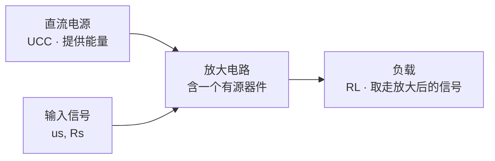

# C6.1 放大电路的基本概念与性能指标

> [!abstract] 这一讲的任务
> 前五章我们一直在算"已知电路求响应"：给一个网络，求电压、求电流、求功率、求暂态。这一章反过来——**要造一个电路，让微弱的信号变大**。
> 但"变大"这两个字骗人：变压器也能把电压变大，却不叫放大。所以第一件事是把"放大"这个词定死：**放大的是功率，而且波形不能变**。定死了之后，放大电路就只剩下一个身份——**一个受控的电源**（受控源）。
> 既然是受控源，它就不是理想的：**输入端会向信号源要电流，输出端会被负载拉低电压**。这两个"不理想"就是输入电阻 $R_i$ 与输出电阻 $R_o$。此外它还会失真、会有频带、会有输出上限。这一讲就是 **把这七八个指标一个一个问出来：它是什么、为什么这么定义、希望它大还是小、为什么**。

> [!info] 授课进度说明
> 目前拿到的课堂语音转写稿只覆盖 **第 1–4 次课（第 1–2 章）**，**第 6 章还没有转写稿**。
> 本篇按 **授课版材料** 整理，未经课堂讲解核对，篇内 **不使用「拓展」标注**。等第 6 章的转写稿到手后，会按第 1–2 章相同的规则补标课堂讲过的内容与课堂未讲的延伸部分。

---

## 1. 开场：为什么非得要一个放大电路

先看两个东西（p.4）。

一个是 **音响**：手机或播放器输出的电信号只有毫伏到伏的量级，而要让喇叭推出足够的声压，得灌进几瓦到几十瓦。中间那段差距，只能由放大电路补上。

另一个是 **无线通信设备**：天线收到的电磁波，感应出的电压是微伏级的；Wi-Fi、4G 之所以能工作，是因为接收机前端把这点微伏级信号一级一级放大，直到能被解调。

**信号本来就在那里，只是太小了。** 放大电路要做的，就是把"小"变成"够用"，而且 **不能在这个过程中把信号的形状弄坏**——声音放大后还得好听，图像放大后还得能认人。

这就给出了放大电路的定义里的三个关键词：

> [!important] 放大电路（amplifier，放大电路）要同时做到三件事
> 1. **放大功率（power amplification）**：输出信号的功率比输入大；
> 2. **不失真（without distortion，无失真）**：输出波形与输入波形形状相同；
> 3. **能量来自直流电源**：多出来的那部分功率，不是凭空产生的。

第 3 条最容易被忽略，也最能分辨"真放大"和"假放大"。

> [!question] 停一下：变压器也能把 1 V 变成 10 V，为什么它不算放大电路
>
> 因为 **功率没变**。理想变压器的输入功率等于输出功率（[[C1.4 理想电路元件]] 里算过：$u_1=nu_2$、$i_1=-i_2/n$，两者相乘功率不变），电压升高 10 倍，电流就降到 $1/10$。
>
> 放大电路不一样：输出电压变大，输出电流也可以同时变大，**功率真的增加了**。这部分多出来的功率由 **直流电源** 供给——放大电路只是一个"搬运工＋控制器"，把直流电源的能量按输入信号的形状搬到输出端。

---

## 2. 放大电路到底是什么：一个受控的电源

把上一节的三条合起来看，放大电路的内部结构就只剩一种可能（p.6–7）：

**直流电源供能，输入信号当"控制量"，有源器件（active device）当"执行机构"。** 输入信号只负责"指挥"，不负责"出力"——出力的是直流电源。

所以：

> [!important] 放大电路 = 线性受控的能量转换装置（linear controlled energy conversion device）
> - 从 **能量** 看，它是把直流功率转换成信号功率的 **转换器**；
> - 从 **控制** 看，输出被输入控制，它本质上是 **受控电源（controlled power source）**；
> - 从 **结构** 看，它是 **二端口功能模块**（two-port function module）：输入端口收信号，输出端口送负载；
> - 从 **器件** 看，它必须包含 **有源器件**（晶体管、场效应管等）——因为没有有源器件就没有"用小的控制大的"这回事。

**"受控电源"这四个字是全章的主线。** 理想放大电路就是一个受控源；实际放大电路与它的差别，全部可以写成"多串了一个电阻、多并了一个电阻"。

先看"不失真"长什么样，以及"失真"长什么样：

![[C6-失真波形对比.png]]

图中虚线小的是输入信号，虚线大的是 **线性放大后** 的输出（形状一模一样，只是幅度大），实线是 **失真后** 的输出：正峰被压平了、负峰还是尖的，上下不对称。这种"形状变了"的失真，第 6 节会给出定量的指标（THD）；它的根源是器件特性的 **非线性**。

至于为什么"必须有源器件"，回忆第 2 章：**BJT 是 CCCS（电流控制电流源），FET 是 VCCS（电压控制电压源）**（[[C2.3 双端口器件的电路模型]]）。受控源在电路里就只有这两种用法，放大电路也就是围着它们搭。

### 2.1 理想放大电路 = 受控电源

既然本质是受控源，那"理想"的放大电路就非常好写：一个受控源，输入功率为零（$R_i=\infty$ 不取电流，或 $R_i=0$ 不取电压），输出端不受负载影响（$R_o=0$ 或 $R_o=\infty$）。

这种理想件在现实里不存在。**真实放大电路的"不理想"恰好集中在两个电阻上**：

- 输入端不是开路，它要从信号源取电流 → 用一个 **输入电阻 $R_i$** 代表；
- 输出端不是理想源，带负载后电压会掉 → 用一个 **输出电阻 $R_o$** 代表。

把钱花在这两个电阻上的分析，就是下一节的全部内容。

---

## 3. 四种模型：按"读哪个变量"分类

输入端口有一个电压 $u_i$ 和一个电流 $i_i$（两个量，取一个作自变量）；输出端口也有一个电压 $u_o$ 和一个电流 $i_o$（取一个作因变量）。$2\times2=4$ 种组合，于是有四种模型（p.9）：

![[C6-放大电路四种模型.png]]

| 模型 | 自变量（输入） | 因变量（输出） | 受控源类型 | 增益记号 | 量纲 |
|---|---|---|---|---|---|
| 电压放大电路模型 | $u_i$ | $u_o$ | VCVS（电压控制电压源） | $A_{uo}$ | 无量纲 |
| 电流放大电路模型 | $i_i$ | $i_o$ | CCCS（电流控制电流源） | $A_{is}$ | 无量纲 |
| 导纳放大电路模型 | $u_i$ | $i_o$ | VCCS（电压控制电流源） | $A_{gs}$ | S（A/V） |
| 阻抗放大电路模型 | $i_i$ | $u_o$ | CCVS（电流控制电压源） | $A_{ro}$ | Ω（V/A） |

四个模型的骨架完全一样，只有两处随模型变：

1. **受控源是"电压源"还是"电流源"**——输出量是电压就用电压源串 $R_o$（左图、右下），输出量是电流就用电流源并 $R_o$（右上、左下）；
2. **增益的量纲**——输出电压比输入电压无量纲，输出电压比输入电流是电阻，输出电流比输入电压是电导，输出电流比输入电流无量纲。

> [!warning] 名词坑：`trans-conductance` 的中文
> 这张表里 $A_{gs}=\dot I_o/\dot U_i$ 的英文是 **trans-conductance**，量纲是 **电导**（S）。规范的中文模拟电子技术教材称它为 **互导增益** 或 **转移电导**；原稿括注写成「转移导纳」，字面上对应的是 trans-admittance。**按 $A_{uo}$ / $A_{ro}$ / $A_{gs}$ / $A_{is}$ 依次是"电压比、电阻、电导、电流比"来记，量纲就不会错。**

这四种模型不是四套理论，**只是同一个二端口网络的四种"读数方式"**。后面遇到具体的共射放大电路时，我们要做的是判断"它更接近哪一种"：共射级的输入是 $i_B$、输出是 $i_C$，所以它天然靠近 **电流放大模型**（CCCS，$A_{is}$），但工程上又常把它当电压放大用（因为负载是电阻，$u_o=i_oR_L$）——这就是为什么下面要先讲清"带载与开路"的区别。

---

## 4. 放大倍数：同一个"放大"，四个名字

> [!important] 放大倍数（amplification factor，又称增益）的定义
> 输出信号与输入信号的比值。它是二端口网络的 **传输函数**（transfer function），是衡量"放大能力"的第一指标。
> $$A=\frac{\text{输出信号}}{\text{输入信号}}$$

四个名字对应四种比值（p.10）：

$$
A_u=\frac{\dot U_o}{\dot U_i},\qquad
A_r=\frac{\dot U_o}{\dot I_i},\qquad
A_g=\frac{\dot I_o}{\dot U_i},\qquad
A_i=\frac{\dot I_o}{\dot I_i}
$$

分别叫 **电压放大倍数**、**转移阻抗**（trans-impedance）、**转移导纳/转移电导**（trans-conductance）、**电流放大倍数**。

### 4.1 带载值与开路/短路值：差的是一个分压比

p.10 给出的四条式子右边都多了一个因子，这才是要理解的地方：

$$
A_u=\frac{\dot U_o}{\dot U_i}=\frac{R_L}{R_o+R_L}A_{uo},\qquad
A_r=\frac{\dot U_o}{\dot I_i}=\frac{R_L}{R_o+R_L}A_{ro}
$$
$$
A_g=\frac{\dot I_o}{\dot U_i}=\frac{R_o}{R_o+R_L}A_{gs},\qquad
A_i=\frac{\dot I_o}{\dot I_i}=\frac{R_o}{R_o+R_L}A_{is}
$$

其中 $A_{uo}$ 是 **开路** 电压放大倍数、$A_{ro}$ 是 **开路** 转移阻抗、$A_{gs}$ 是 **短路** 转移导纳、$A_{is}$ 是 **短路** 电流放大倍数。

**这四个带下标 $o$ 或 $s$ 的量，才是这个放大电路自己的属性**；不加下标的 $A_u$、$A_i$ 是"接了某一只 $R_L$ 之后的表现"。为什么？

看电压放大那一条。放大电路内部是"受控电压源 $A_{uo}\dot U_i$ 串 $R_o$"，接上 $R_L$ 之后，输出端口就是一个最简单的分压：

$$
\dot U_o=\frac{R_L}{R_o+R_L}\cdot A_{uo}\dot U_i
\quad\Longrightarrow\quad
A_u\equiv\frac{\dot U_o}{\dot U_i}=\frac{R_L}{R_o+R_L}A_{uo}
$$

**所以"放大倍数"这个词天生有歧义**：换一只负载，$A_u$ 就变。工程上要标称一台放大器的能力，只能标它与负载无关的那个值，即 $A_{uo}$（负载开路）或 $A_{is}$（负载短路）：

- **输出电压** 的场合，把负载拿掉（开路）测 $A_{uo}$——因为分压因子里 $R_o/(R_o+R_L)$ 在 $R_L\to\infty$ 时趋于 1；
- **输出电流** 的场合，把负载短掉（短路）测 $A_{is}$——因为分流因子里 $R_L/(R_o+R_L)$ 在 $R_L\to0$ 时趋于 1。

同一个道理推 $A_r$ 与 $A_g$：前者输出是电压，所以用开路值乘以电压分压比；后者输出是电流，所以用短路值乘以电流分流比。**四条式子不必背，认准"输出量是电压就分压、是电流就分流"即可。**

> [!warning] 两个最容易混的记号
> - $A_u$（带载）与 $A_{uo}$（开路）差一个 $\dfrac{R_L}{R_o+R_L}$，$A_u<A_{uo}$ **恒成立**。
> - $A_i$ 与 $A_{is}$ 差一个 $\dfrac{R_o}{R_o+R_L}$，同样 $A_i<A_{is}$。
> 换算时 **别把 $R_o$ 与 $R_L$ 放反**：分压比里"想要的"在分子（$R_L$），分流比里"想要的"也在分子（$R_o$）。

---

## 5. 输入电阻与输出电阻：两个分压比

这两个电阻是本节最实在的内容，也是全课程反复出现的"戴维南思路"在放大器上的落地（[[C3.4 线性电路定理]]）。

### 5.1 输入电阻：放大电路向信号源要了多少

> [!important] 输入电阻（input resistance）$R_i$（或输入阻抗 $Z_i$）
> $$Z_i=\frac{\dot U_i}{\dot I_i}=R_i=\frac{U_i}{I_i}$$
> 定义在 **输入端口的电压与电流之比**，反映 **放大电路对信号源的影响程度**。

输入端口接在信号源上，信号源有内阻 $R_s$。于是输入电压就是一处分压：

$$
u_i=\frac{R_i}{R_s+R_i}u_s
$$

**$R_i$ 越大，$u_i$ 越接近 $u_s$**，放大电路从信号源"拿走"的电压越多、要走的电流越少，信号源被"拖累"的程度越轻。

![[C6-输入输出电阻的分压作用.png]]

> [!example] 补充算例：$R_i$ 差一个数量级，差多少
> 设信号源 $u_s=10\ \mathrm{mV}$、$R_s=10\ \mathrm{k\Omega}$，只改 $R_i$：
>
> | $R_i$ | $u_i=\dfrac{R_i}{R_s+R_i}u_s$ | 说明 |
> |---|---|---|
> | $1\ \mathrm{k\Omega}$ | $0.909\ \mathrm{mV}$ | 九成电压丢在 $R_s$ 上 |
> | $10\ \mathrm{k\Omega}$ | $5.00\ \mathrm{mV}$ | 对半开 |
> | $100\ \mathrm{k\Omega}$ | $9.09\ \mathrm{mV}$ | 只损失约 9% |
>
> 这三个数就是左边那张图上的三个红点。**"输入电阻要足够大"到底多算大，看的就是它和 $R_s$ 的比较：同量级损失一半，大一个数量级损失约 10%。**

反过来的情形也要记住：

- **信号源是电压源**（希望取出电压）→ **$R_i$ 越大越好**；
- **信号源是电流源**（希望取出电流）→ **$R_i$ 越小越好**，因为电流源的内阻很大，$R_i$ 越大越"挡道"。

所以 p.11 的结论是：**输入回路要按信号源的要求来设计**，没有绝对的"越大越好"。

### 5.2 输出电阻：带负载后电压掉了多少

> [!important] 输出电阻（output resistance）$R_o$（或输出阻抗 $Z_o$）
> $$Z_o=-\frac{\dot U_o}{\dot I_o}=R_o=-\frac{U_o}{I_o}$$
> 反映 **放大电路的输出受负载影响的程度**。

**那个负号不是笔误。** $i_o$ 的参考方向是从输出端口 **流出**（送给负载），而 $R_o$ 是网络 **内部** 串联的电阻；在 $R_o$ 上电流是 **流进** 网络的，所以量 $R_o$ 上的电压电流比时要加负号。一句话：**"从端口往外看"与"从内部往外看"电流方向相反。**

带负载之后：

$$
u_o=\frac{R_L}{R_o+R_L}u_{o,\rm oc}
$$

其中 $u_{o,\rm oc}$ 是负载开路时的输出。**$R_o$ 越小，$u_o$ 越接近开路值**，也就是输出越像一个"理想电压源"，带负载能力越强。

> [!example] 补充算例：$R_o$ 对输出的影响（右图）
> 设开路输出 $u_{o,\rm oc}=1\ \mathrm V$、$R_o=1\ \mathrm{k\Omega}$：
>
> | $R_L$ | $u_o=\dfrac{R_L}{R_o+R_L}u_{o,\rm oc}$ | 说明 |
> |---|---|---|
> | $100\ \mathrm{\Omega}$ | $0.0909\ \mathrm V$ | 掉了九成，根本带不动 |
> | $1\ \mathrm{k\Omega}$ | $0.500\ \mathrm{V}$ | 一半 |
> | $10\ \mathrm{k\Omega}$ | $0.909\ \mathrm{V}$ | 只掉 9% |
>
> 同样地：
> - **输出电压** 的场合 → **$R_o$ 越小越好**（分压小）；
> - **输出电流** 的场合 → **$R_o$ 越大越好**（分流小）。

### 5.3 这两个电阻怎么量

- **$R_i$**：在输入端加一个测试源，量端口电压与电流之比；或直接对输入端求等效电阻。
- **$R_o$**：把 **独立源置零、受控源保留**，从输出端口往里看求等效电阻——这就是第 3 章"入端等效电阻"的做法（[[C3.2 电阻网络等效化简]]）。也可以按第 3 章的 **测量法**：改变负载读两次 $U$、$I$，用 $R_o=\dfrac{U_1-U_2}{I_2-I_1}$ 反算。

> [!warning] 求 $R_o$ 时为什么受控源不能置零
> 独立源置零是"关掉外部激励"，而受控源是 **器件本身的物理性质**（$i_C=\beta i_B$），关掉它等于把放大电路拆了。这一点与第 3 章求戴维南电阻时"含受控源要保留"是同一句话。

---

## 6. 非线性失真：多出来的那些谐波

前面说"波形不能变"。变在哪？两种，先看第一种（p.13）。

> [!important] 非线性失真系数（nonlinear distortion factor）
> 由于器件输入、输出特性的 **非线性**，输出波形不可避免地产生非线性失真。具体表现是：**输入一个某频率的正弦信号，输出里多出了一批原信号没有的谐波**。
> $$THD=\frac{\sqrt{\displaystyle\sum_{n=2}^{\infty}U_{nm}^{2}}}{U_{1m}}$$
> 用电流表示同式：$THD=\dfrac{\sqrt{\sum_{n=2}^{\infty}I_{nm}^2}}{I_{1m}}$。

分母是 **基波**（$n=1$），分子是 **全部谐波的有效值平方和再开方**——注意这个"平方和开方"的形状，它和第 4 章非正弦有效值用平方和（[[C4.5 非正弦周期电路的谐波分析]]）是同一个道理：**不同频率的分量在功率上互不干涉，所以平方后相加。**

![[C6-非线性失真的谐波频谱.png]]

左边是输入：只有一个频率 $f$。右边是输出：$f$ 还在，但 $2f$、$3f$、$4f$ 都长出来了。

> [!example] 补充算例：按定义算一次 THD
> 设输出各次谐波幅值为 $U_{1m}=1.00\ \mathrm{V}$、$U_{2m}=0.10\ \mathrm{V}$、$U_{3m}=0.05\ \mathrm{V}$、$U_{4m}=0.02\ \mathrm{V}$：
> $$THD=\frac{\sqrt{0.10^2+0.05^2+0.02^2}}{1.00}=\sqrt{0.0129}=0.1136\approx11.4\%$$
> 若为了省事"只取最大的那一项"，会得到 $10.0\%$——**偏低**。这就是为什么工程上规定"取前几阶高次项"，而不是只取一项：平方和开方会把小项也算进去，但小项的影响是二阶的（$0.05^2$ 只占 $0.0129$ 的 19%），所以取到前三项已足够。

工程上的两条实用口径（p.13 原话）：

- **一般只取前几阶高次项** 计算；
- **个别场合只取最大的谐波项**。

> [!warning] THD 是"非线性"的账，别和线性失真混
> 有些放大器带内的频率响应也不平，但那不叫非线性失真——它 **不产生新频率**，只是把原有频率的幅度和相位改了。见下一节。

---

## 7. 线性失真：原来的频率还在，只是幅度和相位变了

第二种失真是"线性"的（p.14）：

> [!important] 线性失真（linear distortion）：幅度失真 + 相位失真
> 输入信号含 **多个频率分量** 时，由于放大电路 **频率特性** 的原因，它 **对不同频率分量的放大倍数不同、附加相移也不同**，于是输出信号各频率分量之间的 **大小比例与相位关系** 被改变。

p.14 用两个频率写清楚了这件事：

$$
u_i=A_1\sin(\omega_1t+\theta_1)+A_2\sin(\omega_2t+\theta_2)
$$
$$
u_o=A_1B_1\sin(\omega_1t+\theta_1+\theta_3)+A_2B_2\sin(\omega_2t+\theta_2+\theta_4)
\quad\text{其中 }B_1\ne B_2,\ \theta_3\ne\theta_4
$$

逐个符号读：

- $B_1$、$B_2$：两个频率各自的 **放大倍数**。$B_1\ne B_2$ → **幅度失真**（比例被改了）；
- $\theta_3$、$\theta_4$：两个频率各自的 **附加相移**。$\theta_3\ne\theta_4$ → **相位失真**（相对位置被改了）。

**为什么不叫"非线性"？** 因为每一项仍然是同频率的正弦，**没有产生新频率**。这种失真完全可以用一个线性时不变网络的频率特性 $H(\mathrm j\omega)$ 描述——每个频率各自乘一个复数，互不干涉。而第 6 节的非线性失真里，$2f$ 在输入里根本没有，是"无中生有"。

一句话分辨：

| | 有没有 **新频率** | 数学上是什么 | 根源 |
|---|---|---|---|
| **非线性失真** | **有**（$2f,3f,\dots$） | 非线性关系（$i_C=\beta i_B$ 只在放大区成立） | 器件特性弯曲 |
| **线性失真** | **没有** | 各频率乘不同复数 $H(\mathrm j\omega_k)$ | 电路里含电抗元件（电容/电感/寄生） |

---

## 8. 频带范围：3 dB 是怎么来的

放大倍数其实是频率的函数 $A(\mathrm j\omega)$。真实的放大电路 **只在中间一段频率上放得平坦，两头都会掉下来**（p.15）。

![[C6-放大电路幅频特性与通频带.png]]

> [!important] 通频带（bandwidth）与上下限截止频率
> 放大电路的频率特性通常具有 **带通性质**，工程上用 **3 dB 频带** 表示"有效、不失真放大"的频率范围。
> - 放大倍数比中频值 **下降 3 dB**（降到中频值的 $0.707$ 倍）对应的两个频率，分别称 **上限截止频率** $f_H$ 与 **下限截止频率** $f_L$；
> - $$BW=f_H-f_L$$

**3 dB 为什么等于 0.707？** 因为"下降 3 dB"说的是 **功率** 减半：

$$
10\lg\frac{P}{P_m}=-3\ \mathrm{dB}\ \Longrightarrow\ \frac{P}{P_m}=10^{-0.3}=0.50
$$

而功率与电压平方成正比，于是电压比 $\dfrac{|A|}{|A_m|}=\sqrt{0.50}=0.707$。**记住这一条就不会在"3 dB 到底是电压减半还是功率减半"上出错：电压 0.707，功率 0.5。**

（顺带：$f_H\gg f_L$ 时 $BW\approx f_H$，工程上常这么估。）

**是什么把两头拽下来的？** p.15 给了两类原因，正好一头一个：

1. **有源器件的寄生电抗**（结电容、极间电容）→ 高频时容抗变小，把信号旁路掉 → **高频跌**；
2. **电路里的耦合电容、旁路电容** → 低频时容抗变大，串联容抗挡住信号（耦合电容）或失去旁路作用（旁路电容）→ **低频跌**。

这两件事都与频率有关，本质上是第 4 章的阻抗随频率变化（[[C4.2 元件相量模型与阻抗导纳]]）。**串联谐振的 $Q$、通频带 $\Delta\omega=\omega_0/Q$ 也是在讲"多宽的带能通过"（[[C4.6 网络函数与谐振]]）——名字不同，数学是同一套。**

---

## 9. 不失真输出范围与输入信号范围

最后两个指标是一对"上下限"（p.16）。

> [!important] ⑦ 不失真输出范围（undistorted output range）
> 能保持输出与输入 **线性关系（不失真）** 的 **最大输出信号幅度**。它同时也描述了放大电路 **最大不失真输出功率**。

> [!important] ⑧ 输入信号范围（input signal range）
> 输入幅度过大，会让有源器件进入 **非线性特性区**，输出不再与输入成正比，波形失真，**甚至会损坏器件**。因此放大电路通常要 **规定输入信号的幅度范围**。

p.16 给的例子是：**小信号电压放大器 $|u_i|\le10\ \mathrm{mV}$**。

这两个指标为什么必须存在？因为它们标出了"线性"这件事的 **有效期**：

- 往上，器件被推出放大区（BJT 会撞到截止或饱和，见 [[C6.2 双极型晶体管及其线性化模型]]）→ 输出削顶或削底，出现第 6 节那种非线性失真；
- 往内，信号太小会被噪声淹没（这条超出本课范围）。

> [!tip] 这里藏着一个前面讲过的建模方法论
> "小信号工作"正是[[C1.3 电路模型]]里 **微分线性化** 的适用条件：信号幅值足够小，就可以在静态工作点附近把曲线当直线。所以 $|u_i|\le10\ \mathrm{mV}$ 不是随手定的数——它保证"特性曲线在这一小段内足够直"。
> 反过来，**大信号** 就要用 **分段线性化**（同一篇的另一种线性化），这也是下一讲分析共射放大电路静态工作点时要用的大信号模型。

---

## 10. 八个指标一览

把这一讲的账合起来，一台放大电路要说清楚，至少要报这八个数：

| 序号 | 指标 | 定义 | 期望 | 与什么有关 |
|---|---|---|---|---|
| ① | 放大倍数 $A_u$/$A_i$/$A_r$/$A_g$ | 输出/输入（四个比值） | 越大越好 | 器件、$R_L$（带载会掉） |
| ② | 输入电阻 $R_i$ | $\dot U_i/\dot I_i$ | **电压源输入：越大越好** 电流源输入：越小越好 | 输入回路结构 |
| ③ | 输出电阻 $R_o$ | $-\dot U_o/\dot I_o$ | **电压输出：越小越好** 电流输出：越大越好 | 输出回路结构 |
| ④ | 非线性失真系数 $THD$ | $\dfrac{\sqrt{\sum_{n\ge2}U_{nm}^2}}{U_{1m}}$ | 越小越好 | 器件非线性程度、信号幅度 |
| ⑤ | 线性失真 | 幅度失真 + 相位失真 | 越小越好 | 电抗元件的频率特性 |
| ⑥ | 频带范围 $BW$ | $f_H-f_L$ | 够用就行（越宽越好） | 寄生电容、耦合/旁路电容 |
| ⑦ | 不失真输出范围 | 最大不失真输出幅度 | 越大越好 | 电源电压、静态工作点 |
| ⑧ | 输入信号范围 | 允许的输入幅度 | 越大越好 | 小信号条件（$\lvert u_i\rvert\le10\ \mathrm{mV}$） |

**这八个数不是并列的，它们互相拉扯**：想放大倍数大，往往要牺牲带宽；想输出范围大，就得把静态工作点往中间调（下一讲的内容）；想 $R_i$ 大 $R_o$ 小，就得在电路结构上做文章（下一讲开始的共射、共集、共基三种组态各有所长）。

> [!question] 停一下，检验一下自己
> 一台"电压放大器"，如果 $R_i=10\ \mathrm{k\Omega}$、$R_o=1\ \mathrm{k\Omega}$、$A_{uo}=100$，信号源 $u_s=10\ \mathrm{mV}$、$R_s=10\ \mathrm{k\Omega}$，负载 $R_L=1\ \mathrm{k\Omega}$，输出端电压是多少？
>
> 三步：① 输入分压 $u_i=\frac{10}{10+10}\times10=5.00\ \mathrm{mV}$（第一处损失）；② 开路输出 $A_{uo}u_i=100\times5\ \mathrm{mV}=0.500\ \mathrm{V}$；③ 输出分压 $u_o=\frac{1}{1+1}\times0.500=0.250\ \mathrm{V}$。
> **两级分压各砍一半，总共只剩 25 倍**，尽管放大器本身的 $A_{uo}=100$。这就是为什么"放大倍数"这一项单独看没有意义，必须和 $R_i$、$R_o$ 一起报。

---

## 11. 课堂实录

（待补：本节暂无转写稿。）

从已有的第 1–2 章转写稿看，这门课的讲法是"先问为什么需要，再把定义逼出来"，本节结构与之对应；等第 6 章转写稿到手后，会把课上补充的口头例子、随堂问答与作业口径补进这里。

---

## 12. 勘误

| 页码 | 原稿写的 | 实际 / 说明 |
|---|---|---|
| p.8 | `What kind fo device?` | 应为 `What kind of device?`（拼写笔误，不影响内容） |
| p.10 | `Trans-conductance(转移导纳)` | `transconductance` 的量纲是电导（S），规范中文为"互导增益 / 转移电导"；"转移导纳"对应的是 trans-admittance。**按 $A_{gs}=\dot I_o/\dot U_i$ 理解即可** |
| p.10 | 四条式子中的分压/分流因子 | 经复算正确：输出为电压时乘 $\frac{R_L}{R_o+R_L}$，输出为电流时乘 $\frac{R_o}{R_o+R_L}$ |
| p.12 | $Z_o=-\dot U_o/\dot I_o$ 的负号 | 正确。$i_o$ 参考方向从端口流出，与 $R_o$ 上的电流方向相反 |
| p.15 | "下降 3 dB（降到正常值的 0.707 倍）" | 正确：$10^{-3/20}=0.7079\approx0.707$ |

---

## 13. 速查

| 名称 | 公式 | 要点 |
|---|---|---|
| 四种增益 | $A_u=\frac{\dot U_o}{\dot U_i}$、$A_r=\frac{\dot U_o}{\dot I_i}$、$A_g=\frac{\dot I_o}{\dot U_i}$、$A_i=\frac{\dot I_o}{\dot I_i}$ | 量纲依次：无量纲、Ω、S、无量纲 |
| 带载与开路 | $A_u=\frac{R_L}{R_o+R_L}A_{uo}$，$A_i=\frac{R_o}{R_o+R_L}A_{is}$ | 输出量是电压就"分压"，是电流就"分流" |
| 输入分压 | $u_i=\frac{R_i}{R_s+R_i}u_s$ | 电压源输入 → $R_i$ 越大越好 |
| 输出分压 | $u_o=\frac{R_L}{R_o+R_L}u_{o,\rm oc}$ | 电压输出 → $R_o$ 越小越好 |
| 非线性失真 | $THD=\frac{\sqrt{\sum_{n\ge2}U_{nm}^2}}{U_{1m}}$ | 分子是谐波，分母是基波 |
| 3 dB 点 | $\frac{\lvert A\rvert}{\lvert A_m\rvert}=0.707$（功率一半） | $10^{-3/20}=0.7079$ |
| 通频带 | $BW=f_H-f_L\approx f_H$ | 下限由耦合/旁路电容决定，上限由寄生电容决定 |
| 小信号条件 | $\lvert u_i\rvert\le10\ \mathrm{mV}$ | 保证器件特性"够直"，对应微分线性化 |

---

## 14. 下一讲

这一讲只给了"放大器应该做到什么"，一个具体电路都还没画。

下一讲把有源器件装进去：**双极型晶体管（BJT）**。要先把器件本事的账算清——它的输入特性与输出特性各长什么样、三个工作区怎么分、大信号下能简化成什么样子、五个主要参数各自意味着什么危险。这些账算清了，才谈得上"用一只三极管搭一个共射放大电路"，那才是 Part B 的内容。

---

## 相关笔记 Related Notes

- [[C1.3 电路模型]]——分段线性化（大信号）与微分线性化（小信号）是本讲"小信号条件"的出处
- [[C1.4 理想电路元件]]——受控源四种类型；变压器为什么不放大功率
- [[C2.3 双端口器件的电路模型]]——BJT / FET 的器件侧建模（与 C6.2 互为上下游）
- [[C3.4 线性电路定理]]——戴维南等效与输出电阻的求法
- [[C4.6 网络函数与谐振]]——通频带的另一套讲法
- [[C6.2 双极型晶体管及其线性化模型]]——本讲的"器件"落地

上一讲：[[C5.5 阶跃冲激与卷积积分]]　|　下一讲：[[C6.2 双极型晶体管及其线性化模型]]　|　返回：[[电路基础 MOC]]
