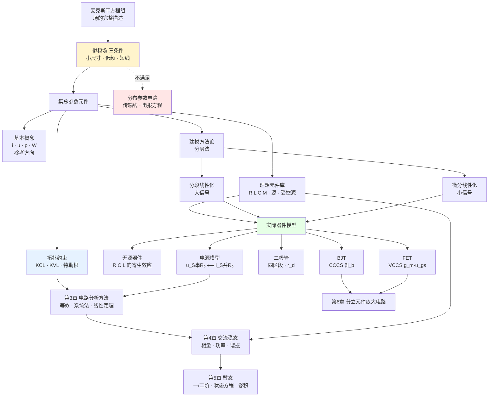

# 电路基础 MOC · 课程索引

> [!info] 课程信息
> **Fundamentals of Electric Device and Circuit Analysis** · 华南理工大学未来技术学院
> 授课：区俊辉（Jun-Hui Ou）、邓佳丽（Jiali Deng，实验）
> 48 学时理论 + 16 学时实验 · 第 18 周闭卷考试
> 成绩：平时 70%（考勤 20 + 作业 30 + 期末 50 + 奖励）+ 实验 30%

---

## 笔记目录

| 笔记 | 内容 | 核心概念 | 课件页 |
|---|---|---|---|
| [[C0 课程基本介绍]] | 课程安排、考核规则 | 成绩构成、清零规则、奖励分 | 第0章 全 |
| [[C1.1 电路分析的演化]] | 从场到路 | 麦克斯韦方程组、**似稳场**、**集总参数元件**、电长度伏笔 | C1 p3–9 |
| [[C1.2 电路的基本概念]] | 四个基本量 | 电流/电压/功率/电能、**参考方向**、**相关参考方向**、功率守恒、拓扑术语 | C1 p10–31 |
| [[C1.3 电路模型]] | 建模方法论 | **分层法**、**分段线性化**、**微分线性化** | C1 p32–38 |
| [[C1.4 理想电路元件]] | 元件"字母表" | R/M/C/L、电压源/电流源/理想二极管、**四种受控源**、理想变压器 | C1 p39–63 |
| [[C1.5 电路分析的基本定律]] | 拓扑约束 | **KCL**、**KVL**（含场论推导）、广义形式、**特勒根定理** | C1 p64–88 |
| [[C2.1 元件互连与传输线模型]] | 导线也是器件 | **电长度**、趋肤效应、分布电容/电感/电纳、**UTL 的 RLGC 模型**、电报方程 | C2 p2–12 |
| [[C2.2 单端口器件的电路模型]] | 实际器件建模（一） | 电阻器三频段、**ESR/ESL**、**品质因数 Q**、实际电源模型、**二极管四区段**、$r_d=V_T/I_D$ | C2 p13–32 |
| [[C2.3 双端口器件的电路模型]] | 实际器件建模（二） | **BJT** 三区三极、**FET** 三区三极、大信号/低频小信号/高频小信号模型、$\beta$、$g_m$ | C2 p33–53 |
| [[C3.1 直流稳态与电路分析总览]] | 分析路线 | 电路分析定义、直流稳态（C 开路 L 短路）、三条路线（等效/系统/定理） | C3-3版 p1–7 |
| [[C3.2 电阻网络等效化简]] | 端口等效 | 串并联、分压分流、电导、源变换、**入端等效电阻**、**负电阻**、Y–Δ、四端网络为何不做等效 | C3-3版 p8–36 |
| [[C3.3 电阻网络的系统分析]] | 全网求解（**本章最长**） | 全电路方程、支路电流法、**网孔电流法**（观察法/三国杀记忆法、电流源三情形、受控源）、结点电压法、无伴电压源、通用支路方程 | C3-3版 p37–89 |
| [[C3.4 线性电路定理]] | 线性网络快工具 | 叠加、替代、等效电源（戴维南/诺顿）、参数三法（二步/一步/测量）、最大功率传输；综合举例来自旧版 | C3-3版 p90–113 |
| [[C4.1 正弦量与相量]] | 相量法之基 | 交流稳态、**正弦量三要素**、**有效值 RMS**、相位差、**相量**、相量图、相量法的合法性 | C4上 p3–18 |
| [[C4.2 元件相量模型与阻抗导纳]] | 元件搬家 | R/L/C 相量模型、**求导 = 乘 $\mathrm j\omega$**、KCL/KVL 相量形式、**阻抗 $Z$**、导纳 $Y$、感性/容性、串并联分压分流 | C4上 p19–33 |
| [[C4.3 正弦稳态电路的一般分析]] | 全套方法搬过去 | 结点法、网孔/回路法、电源变换、叠加、戴维南、**含受控源**、**参考相量法**、**纯相量图解法**、移相桥 | C4上 p34–51 |
| [[C4.4 正弦稳态功率与功率因数]] | 功率 | 瞬时功率分解、**$P$/$Q$/$S$**、**复功率与共轭**、功率三角形、**功率因数补偿**、功率表与三表法、**最大功率传输** | C4上 p52–74 |
| [[C4.5 非正弦周期电路的谐波分析]] | 多频率怎么办 | 狄里赫利条件、**傅里叶级数两种写法**、五种典型波形、**频谱**、**有效值的平方和**、**平均功率与正交性**、谐波分析法 | C4上 p75–98 |
| [[C4.6 网络函数与谐振]] | 频率选择 | **网络函数 $H(\mathrm j\omega)$** 六型、幅频/相频、**谐振**、$\omega_0$、**特性阻抗 $\rho$**、**品质因数 $Q$**、能量交替、**通频带 $\Delta\omega=\omega_0/Q$**、串并联对偶 | C4上 p99–141 |
| [[C5.1 动态电路与换路定则]] ～ [[C5.3 三要素法与微积分电路]] | 一阶动态电路 | 初始值、零输入/零状态/全响应、三要素法 | C5 p2–54 |
| [[C5.4 二阶电路与状态变量法]] | 二阶与状态空间 | 阻尼类型、特征根、状态方程、输出方程 | C5 p55–100 |
| [[C5.5 阶跃冲激与卷积积分]] | 任意激励 | 阶跃、冲激、阶跃/冲激响应、卷积 | C5 p101–139 |

---

## 全课程知识地图

---

## 课程整体章节安排（第0章第7页）

| 章 | 名称 | 讲授范围 | 笔记状态 |
|---|---|---|---|
| 1 | 电路的基本概念与基本定律 | ALL | ✅ 已整理 |
| 2 | 电子器件的基本电路模型 | ALL | ✅ 已整理 |
| 3 | 电路分析的基本方法 | ALL | ✅ 已整理（按 **1007-v2** 版增量合并） |
| 4 | 交流稳态电路分析 | 4.1–4.3、功率、4.6–4.7 | ✅ 已整理（按**上集**中英双语版重做） |
| 5 | 线性动态电路的暂态分析 | 5.1–5.5 | ✅ 已整理 |
| 6 | 分立元件放大电路基础 | 6.1–6.3, 6.5–6.6 | ⏳ 待课件 |
| 7 | 集成放大器及其应用 | 2.1, 2.2, 2.3, part of 2.4 | ⏳ 待课件 |

### 授课进度与「拓展」标注约定

> [!important] 截至第 4 次课
> **课堂语音转写稿已覆盖第 1–4 次课**，内容为 **第 1 章全部 + 第 2 章全部**。
> - **C1.1 – C2.3**：已按转写稿合并，课堂讲过的内容为主干；**课堂未讲、仅由课件/教材补充**的部分标注 **（拓展）** 或 **【拓展】**，篇首附有标注图例。
> - **C3.1 – C5.5**：**尚未讲授**，内容全部来自课件与教材，篇首附有「授课进度说明」。等课上讲到后会按课堂实况合并并补标注。
>
> **标注含义**：标有 **（拓展）/【拓展】** 的内容是**课堂上没有讲到**的延伸部分。复习时先掌握未标注的主干，行有余力再看拓展。

### 第 3 章课件情况说明（务必对照着读）

> [!note] 用哪一份第 3 章课件
> 第 3 章有**两份课件**：
> - `第3章-电路分析的基本方法-0926.pdf`（**旧版**，99 页，中文）
> - **`第3章-电路分析的基本方法-1007-v2.pdf`（新版，115 页，中英双语）** ← 四篇讲义**全部按这一版**，`source` 里的页码一律指它
>
> **两版的主要差别**（页数账：$99+21-6+1=115$）：
>
> | 变化 | 内容 | 页数 |
> |---|---|---|
> | **新增** | **整整一节「网孔电流法」**（v2 p.50–71）——旧版 0926 **完全没有这一节**，是从支路电流法直接跳到结点电压法的 | $+21$ |
> | **新增** | 作业页（v2 p.114，9 道题 E3-1…E3-30） | $+1$ |
> | **删去** | 「分析举例」两题（叠加+功率、放大器+戴维南+最大功率），旧版 p.93–98 | $-6$ |
> | **删去** | 旧版 p.50 里「回路电流法 + 基本回路 + 树（基于图论的回路法）」那一段 | — |
> | 改写 | v2 把中文正文改写成英文（中文只保留术语与括注）；个别地方 v2 反而**更简略**（见下面问题清单） | — |
>
> **页码对应**（供对照旧版资料）：旧 p1–49 → v2 p1–49（**相同**）；旧 p51–68 → v2 p72–89（**+21**）；旧 p69–92 → v2 p90–113（**+21**）；旧 p50 并入 v2 p72；旧 p93–98 在 v2 中不存在。
>
> **知识只增不减**：被 v2 删掉的内容（综合举例、「回路电流法/基本回路/树」）**均已保留**，并标为「旧版课件」；[[C3.4 线性电路定理]] 的 `source` 因此是**双来源**。

> [!warning] 第 3 章课件问题清单（均已在本篇对应小节点名）
> | 课件页 | 问题 | 说明 / 复算结论 | 所在篇目 |
> |---|---|---|---|
> | p23 | **本讲义早先误判过**：曾称「第 5、6 条文字重复」 | 高分辨率核对后确认**两条内容不同**（电压源并非电压源 / 电流源串非电流源）。该误判已在本次更正 | [[C3.2 电阻网络等效化简]] §9.1 |
> | p24 | 英文术语自相矛盾：第一段 `two-port`、第二段 `one-port` | 本页讲的是**单端口（一对端钮）**网络，课件 `two-port` 是「二端」的直译，**不要**与第 4 章真正的二端口网络混淆 | [[C3.2 电阻网络等效化简]] §9.2 |
> | p26 | **图与公式对不上**：梯形网络的 $1/2$ 逐级链代数自洽（$U_4=3\ \mathrm V$ 正确），但按图上元件逐节推**重现不出来**（$\approx2.26\ \mathrm V$） | **以公式为准，不要照图数**；属图示缺陷 | [[C3.2 电阻网络等效化简]] §10.2 |
> | p22 | 例题答案 $I=1.1\ \mathrm A$ | 按同一份课件 p.48 自己的「3~4 位有效数字」规矩应为 **$1.111\ \mathrm A$** | [[C3.2 电阻网络等效化简]] §8.2 |
> | p53 | 图论第 3 条把「KCL 方程数」写成 $B-N+1$ | **应为 $N-1$**；$B-N+1$ 是独立**回路（KVL）**数 | [[C3.3 电阻网络的系统分析]] §3.4 |
> | p56 | 说「遇到电流源就变换成电压源」 | **只对有伴电流源成立**；无伴电流源要「设 $u$」或「挪到最外层」，p.63 已修正 | [[C3.3 电阻网络的系统分析]] §3.11 |
> | p57 | 三个方程名为「赵国/蜀国/魏国方程」，但图上阵营是「吴国/蜀国/魏国」 | 「赵国」不在三国里，第一个方程应为**吴国方程** | [[C3.3 电阻网络的系统分析]] §3.7 |
> | p57 | 观察法口诀只讲电源项符号，**没讲互电阻为何恒为负** | 隐含前提：**所有网孔电流取同一绕行方向** | [[C3.3 电阻网络的系统分析]] §3.7 |
> | p58 / p71 | 同一个方法的「五步」给了**两套口径**（p58 第 1 步是电源变换，p71 取消了它） | 本讲义合并成一条完整流程 | [[C3.3 电阻网络的系统分析]] §3.8 |
> | p62 | 标题写成「**网络**电流法」 | 应为「网孔电流法」。**同页 4 道方程与 4 个电流解经复算逐位吻合，无误** | [[C3.3 电阻网络的系统分析]] §3.12 |
> | p59/61/64/65/70 | 整理后的方程右端单位标成 **A** | 应为 **V**（严格说 $5\ \mathrm V/\Omega=5\ \mathrm A$，缺了 $/\Omega$）；共 5 处 | [[C3.3 电阻网络的系统分析]] §3.9 |
> | p65 / p71 | 无伴电流源的条件两处口径不一：「在**外围边界**」vs「只属于**一个网孔**」 | **后者更准确**（内层也可能只属于一个网孔） | [[C3.3 电阻网络的系统分析]] §3.14 |
> | p51/66/71 | 英文拼写：`can only applied`、`spurce`、`euation`、`convinience` | 印刷笔误 | [[C3.3 电阻网络的系统分析]] §3.15 |
> | p76/p77 | v2 的英文版**丢掉了**旧版中文里的限定语 | 规则②丢「（理想、受控）」、规则③丢「（包括受控电源）」、步骤 1 丢「（熟练后可不转化）」。**这些限定语本讲义按旧版保留**（v2 更简略） | [[C3.3 电阻网络的系统分析]] §4.4 |
> | p107 | 一步法的推荐解法从「网孔电流法或结点电压法」改成「**支路电流法或结点电压法**」 | 因为网孔法只能用于平面电路，v2 的改法更稳妥 | [[C3.4 线性电路定理]] §3.6 |
> | p109 起 | 最大功率传输那几页**没有画** $P_L$、$\eta$ 随 $R_L$ 的曲线 | 讲义里的曲线图是**自行绘制**的（已在图注标明） | [[C3.4 线性电路定理]] §4.3 |
> | p114 | Tips 英文 `Use any method that you've learn` | 应为 `learnt` / `learned` | [[C3.4 线性电路定理]] 篇末 |
>
> **笔迹检查结论**：`第3章-电路分析的基本方法-1007-v2.pdf` **全 115 页无手写笔迹**——`annots=0`、无整页空白页，逐页渲染读图也没有与印刷字体不同的笔画。因此第 3 章**没有板书图**，配图全部来自课件裁切或自行复现。

### 第 4 章课件情况说明（务必对照着读）

> [!note] 用哪一份第 4 章课件
> 第 4 章有**两份课件**：`第4章-交流稳态电路分析-1007.pdf`（旧，纯中文，142 页）与 **`第4章-交流稳态电路分析-(上集).pdf`（新，中英双语，141 页）**。
> 六篇讲义**全部按上集重做**，`source` 里的页码一律指上集。两份内容同源，页序整体差约 1 页；上集删去了旧版的互感耦合谐振例题，并把作业清单更新为 **E4-2…E4-34 共 12 题**。
> 上集是**中英双语重导版**，英文部分有若干拼写错误（`Initianl`、`euqation`、`Addmittance`、`Quarlity`、`apperant`、`Anaylsis`、`Nonesine` 等），**不影响内容**，不逐条列入下表。
> 目录页只列 **4.1 / 4.2 / 4.3 / 4.6 / 4.7**（没有 4.4、4.5）；vault 按**讲授顺序**拆成 C4.1–C4.6 六篇，对应关系见上面的笔记目录表。

> [!warning] 第 4 章课件问题清单（均已在本篇对应小节点名并给出复算值）
> | 课件页 | 问题 | 正确值 / 说明 | 所在篇目 |
> |---|---|---|---|
> | p14 | 复平面坐标轴标反（纵轴标 Re、横轴标 Im） | 以 p13 为准：横实纵虚 | [[C4.1 正弦量与相量]] §6 |
> | p15 | 合成相量的 $\theta=\arctan(\cdot)$ 未做象限修正，与 p16 自相矛盾 | 先定象限再补 $\pm180^\circ$ | [[C4.1 正弦量与相量]] §7.1 |
> | p25 | 导纳的定义句误写成 "impedance" | 应为 admittance（$\dot I/\dot U$） | [[C4.2 元件相量模型与阻抗导纳]] §5.1 |
> | p37、p38 | 例 2 答案相位印 $+147^\circ$ | 应为 $-147^\circ$（网孔法、结点法两条路径均复算为 $-147^\circ$；幅值 0.338 / 10.147 正确） | [[C4.3 正弦稳态电路的一般分析]] §3 |
> | p36 | $i_S$ 单位印 mA，p37 却按 1 A 计算 | 数量级矛盾，必有一处笔误 | [[C4.3 正弦稳态电路的一般分析]] §3.2 |
> | p43 | 例 5 已知条件把 $Z_2$ 误印成第二个 $Z_3$ | 应为 $Z_2=50\angle-30^\circ\ \Omega$（由中间结果反推） | [[C4.3 正弦稳态电路的一般分析]] §6 |
> | p44 | 例 5 合成相位印 $1.23\angle-15.9^\circ$ | 应为 $+15.9^\circ$（幅值 1.23 正确） | [[C4.3 正弦稳态电路的一般分析]] §6 |
> | p46 | 解一 $X_L=41.88\ \Omega$、$U_{R_2}=33.92\ \mathrm V$ | 精确值 41.86 Ω / 33.90 V（p47 解二才对） | [[C4.3 正弦稳态电路的一般分析]] §8.1 |
> | p48、p49 | 符号 $\theta$ 一符两义（$\dot I_C$ 超前角 0–90° 与移相角 0–180°） | 移相角 $=180^\circ-2\arctan(\omega CR_2)$ | [[C4.3 正弦稳态电路的一般分析]] §9.2 |
> | p50 | 等效名印成 `Devining`、`Norden` | 应为 Thevenin、Norton | [[C4.3 正弦稳态电路的一般分析]] §10 |
> | p51 | 电路图被 4 个浅蓝矩形遮挡，$R$ 与两个电源画法不可见 | 由公式反推拓扑正确 | [[C4.3 正弦稳态电路的一般分析]] §10 |
> | p56 | 把功率因数误称 `Quality Factor` | 应为 power factor；Quality Factor 是谐振里的 $Q$ | [[C4.4 正弦稳态功率与功率因数]] §3.1 |
> | p61 | $P=2645.8\ \mathrm W$、$Q=1718.2\ \mathrm{var}$、$\lambda=0.8386$ | 精确值 $2645.0\ \mathrm W$、$1720.2\ \mathrm{var}$、$0.8387$（课件用已舍入的 $I$、$\varphi$ 反算） | [[C4.4 正弦稳态功率与功率因数]] §7 |
> | p64 | 与 p70 共用符号 $P_{\max}$（一个是容量上限、一个是共轭匹配） | 两者毫无关系，看语境区分 | [[C4.4 正弦稳态功率与功率因数]] §9.3 |
> | p72 | 第(1)问先舍入 $\dot I=0.89$ 再平方 | 精确值恰为 4.0000 W，本题侥幸；方法有风险 | [[C4.4 正弦稳态功率与功率因数]] §11.3 |
> | p84 | 方波 $a_n$ 第二个积分上限印成 $T/2$ | 应为 $T$（结果 $a_n=0$ 不受影响） | [[C4.5 非正弦周期电路的谐波分析]] §4 |
> | p86 | 三角波积分式与图上波形差 $T/4$ 相位，复算 $a_1\ne0$，与"只含奇函数项"矛盾 | 以级数结果 $\frac{8U_m}{\pi^2}$ 那一支为准 | [[C4.5 非正弦周期电路的谐波分析]] §4 |
> | p88 | 全波/半波整流电路图英文标题互换，中文都写成"半波整流" | 左单管为半波、右四管桥式为全波 | [[C4.5 非正弦周期电路的谐波分析]] §4 |
> | p89、p90 | 被积函数多印一个 $n$；$n=1$ 时 $a_n$ 为 $0/0$ 未说明 | 应为 $|\sin(2\pi t/T)|$ | [[C4.5 非正弦周期电路的谐波分析]] §4 |
> | p91 | 第(2)条"离散周期时域信号的频谱是连续的"与第(1)条冲突 | 应为"**非周期**信号的频谱是连续的" | [[C4.5 非正弦周期电路的谐波分析]] §5.3 |
> | p93 | 平均功率只写到 $P=P_0+\sum P_k$，**缺 $P_0$、$P_k$ 的展开式**，也未定义 $\varphi_k$ | 补：$P_0=U_0I_0$，$P_k=U_kI_k\cos\varphi_k$ | [[C4.5 非正弦周期电路的谐波分析]] §7.1 |
> | p109 | 谐振定义写"阻抗或导纳达到**最大**" | 串联是**最小**（p111/p134 已写对，仅定义页错） | [[C4.6 网络函数与谐振]] §2.2 |
> | p118 | $L$、$C$ 与 $Q$ 相差 10 倍 | 按 $Q=60$ 应为 $L=0.6\ \mathrm H$、$C=0.0667\ \mu\mathrm F$ | [[C4.6 网络函数与谐振]] §3.6 |
> | p127 | $\omega_0$ 印成 $5.5\times10^6\ \mathrm{rad/s}$ | 应为 $5.16\times10^6$（与它自己的 $f_0=820\ \mathrm{kHz}$ 也不符） | [[C4.6 网络函数与谐振]] §4.5 |
> | p128 | 曲线横轴标 1200，表格里是 1026 kHz | 按表格的 1026 kHz 理解 | [[C4.6 网络函数与谐振]] §4.5 |
> | p129 | $(R+10)=15$ 与 $L=39.8\ \mathrm{mH}$ 矛盾 | 39.8 mH 对应总电阻 25 Ω，不是 15 Ω | [[C4.6 网络函数与谐振]] §4.6 |
> | p132 | $\eta_{L2}$ 与 $\eta_{Lm}$、自变量 $\omega$ 与 $\eta$ 混用 | 记号不统一 | [[C4.6 网络函数与谐振]] §4.7 |
>
> **笔迹检查结论（六份课件逐段核过）**：`第4章-交流稳态电路分析-(上集).pdf` **全部 141 页无手写笔迹**——pymupdf 报 `annots=0`、无整页空白页，逐页渲染读图也没有与印刷字体不同的笔画。因此第 4 章**没有板书图**，配图全部来自课件裁切或自行复现（见每篇正文的图注）。

### 课堂给出的考试与作业口径（务必记住）

| 事项 | 口径 |
|---|---|
| **第 2 章** | **没有作业**；考试**只考选择题和填空题（概念题）**，不出计算题与分析题 |
| 第 1 章作业 | 因第 2 章无作业，DDL 由一周**延长到两周** |
| 作业形式 | **交纸质版**，不交电子版（批改后发还，便于复习） |
| 评分铁律 | **只写答案不写过程 = 0 分**；考试同样讲究过程分，**不会做也不要交白卷** |
| 计算精度 | 最终结果保留 **3~4 位有效数字**，**不允许只给分数**（第 3 章 p.48 明确要求） |
| **第 3 章作业** | **E3-1、E3-4、E3-6、E3-9、E3-14、E3-17、E3-20、E3-29、E3-30**（共 9 题）；DDL：**本章讲完后的下一个周三**；**提示：用你学过的任何方法**（等效化简 / 支路电流法 / 网孔电流法 / 结点电压法 / 四个定理都不限） |
| 特勒根定理 | 考得不多，但**看到两个拓扑相同的电路图**就要想到它 |
| 电源/负载判别 | 相关参考方向下 $P>0$ 负载、$P<0$ 电源——**五年考过三次** |
| BJT/FET 公式 | $r_{be}$、$g_m$ 等公式**考试会给**，但必须知道**怎么用**（先求静态工作点）|

---

## 关键公式索引

### 基本量
| 公式 | 出处 |
|---|---|
| $i = \dfrac{\mathrm{d}q}{\mathrm{d}t}$，$u_{ab}=v_a-v_b=\dfrac{\mathrm{d}W}{\mathrm{d}q}$ | [[C1.2 电路的基本概念]] |
| $p = ui$（相关参考方向）/ $p=-ui$（非相关） | [[C1.2 电路的基本概念]] |
| $\sum P = 0$（功率守恒） | [[C1.2 电路的基本概念]] |

### 理想元件伏安关系
| 元件 | 公式 | 储能 |
|---|---|---|
| 电阻 | $u = Ri$，$p_R = Ri^2 \ge 0$ | — |
| 电容 | $i = C\dfrac{\mathrm{d}u}{\mathrm{d}t}$，$u=u(0)+\dfrac1C\int_0^t i\,\mathrm{d}t$ | $W_C=\frac12Cu^2$ |
| 电感 | $u = L\dfrac{\mathrm{d}i}{\mathrm{d}t}$，$i=i(0)+\dfrac1L\int_0^t u\,\mathrm{d}t$ | $W_L=\frac12Li^2$ |
| 忆阻 | $\varphi = Mq$，$u = Mi$ | — |
| 理想变压器 | $u_1=nu_2$，$i_1=-i_2/n$，$R_{in}=n^2R_L$ | 不储不耗 |
→ [[C1.4 理想电路元件]]

### 基本定律
| 定律 | 公式 | 物理基础 |
|---|---|---|
| KCL | $\sum_{k} i_{kn}=0$（任一结点 / 任一闭合面） | 电荷守恒 |
| KVL | $\sum_L u_k = 0$（任一回路 / 任一路径） | 能量守恒 |
| 特勒根 | $\sum_k u_k\hat i_k = 0$，$\sum_k \hat u_k i_k=0$ | **纯拓扑** |
→ [[C1.5 电路分析的基本定律]]

### 电路分析方法（第3章）
| 方法/定理 | 公式 | 要点 |
|---|---|---|
| 直流稳态 | C 视为开路、L 视为短路 | 仅稳态成立；暂态失效（第5章） |
| 串联/并联 | $R_{eq}=\sum R_k$；$G_{eq}=\sum G_k$ | 分压用 R、分流用 G |
| 源变换 | $u_S = R\, i_S$ | 电阻随源搬家；**等效只对外** |
| 入端等效电阻 | $R_{eq}=U/I$ | 无**独立**源（受控源保留，可为负） |
| 一步法求等效电源参数 | 外加 $U$ 求 $I$：$U=U_{OC}+R_0I$ | **含受控源时首选** |
| 测量法 | $R_0=\dfrac{U_1-U_2}{I_2-I_1}$ | 内部未知时的工程做法 |
| 通用支路方程 | $u=u_S+R(i-i_S)$ | $R=0$ 无伴压源；$R=\infty$ 无伴流源 |
| Y→Δ / Δ→Y | $R_\Delta=3R_Y$（对称）；$G_\Delta=\dfrac{Y\text{相邻乘积}}{\sum G_Y}$ | 桥式网络解桥 |
| 全电路方程 | B·VCR + (N−1)·KCL + (B−N+1)·KVL | 2B 个方程，理论完备 |
| 支路电流法 | 变量 $=B$ 个支路电流：$(N-1)$ 个 KCL $+(B-N+1)$ 个 KVL | 第 5 步**用功率守恒自检** |
| **网孔电流法** | $R_{jj}I_j+\sum_{n\ne j}R_{jn}I_n=U_{jS}$ | **仅平面电路**；自电阻正、互电阻负；**KCL 自动满足**；含受控源时 $R_{jk}\ne R_{kj}$ |
| 网孔法电源项口诀 | 电源 $+\to-$ 与网孔电流同向 → **取负**，反向 → **取正** | 前提：所有网孔电流**同向** |
| 无伴电流源（内层/最外层） | 内层**设 $u$ + 补电流源方程**；最外层**该网孔电流 = 电流源电流** | 判据是「只属于一个网孔」 |
| 结点电压法 | $G_{jj}U_j+\sum_{n\ne j}G_{jn}U_n=I_{jS}$ | 自电导正、互电导负、右端流入电流；**KVL 自动满足**；适用任意电路 |
| 叠加定理 | $U=\sum a_nU_{Sn}+\sum r_mI_{Sm}$ | **功率不满足叠加** |
| 替代定理 | 已知 $u_0,i_0$ → 同值电压源/电流源 | 线/非线性均可 |
| 戴维南/诺顿 | $u=U_{OC}-R_0i$；$U_{OC}=R_0I_{SC}$ | 参数三法：二步/一步/测量 |
| 最大功率传输 | $R_L=R_0$，$P_{max}=\dfrac{U_{OC}^2}{4R_0}$ | 效率仅 50%；匹配时 $U_L=U_{OC}/2$（自检） |
→ [[C3.2 电阻网络等效化简]]、[[C3.3 电阻网络的系统分析]]、[[C3.4 线性电路定理]]

### 交流稳态：正弦量与相量（第4章上·4.1–4.2）

| 名称 | 公式 | 关键点 |
|---|---|---|
| 正弦量三要素 | $i(t)=I_m\sin(\omega t+\theta)$ | 幅值 · 频率 · 初相；$\theta\in(-\pi,\pi]$ |
| 频率关系 | $f=\dfrac1T$，$\omega=2\pi f$ | 工频 50 Hz → $\omega=314\ \mathrm{rad/s}$ |
| 有效值（**通式**） | $U=\sqrt{\dfrac1T\displaystyle\int_{t_0}^{t_0+T}u^2\,\mathrm dt}$ | 对任何周期波形成立 |
| 峰值↔有效值（**正弦专有**） | $U_m=\sqrt2U$ | 表读数默认有效值 |
| 相位差 | $\varphi_{12}=\theta_1-\theta_2$ | **仅同频率可比**；先统一函数与符号 |
| 相量（有效值） | $\dot U=U\mathrm e^{\mathrm j\theta}=U\angle\theta$ | 本课程全局采用 |
| 求导 ↔ 乘 $\mathrm j\omega$ | $\dfrac{\mathrm d}{\mathrm dt}\Longleftrightarrow\times\mathrm j\omega$ | **相量法的技术核心** |
| 元件相量 VCR | $\dot U=Z\dot I$：$R$、$\mathrm j\omega L$、$\dfrac{1}{\mathrm j\omega C}$ | 感抗 $X_L=\omega L$、容抗 $X_C=1/(\omega C)$ **均为正** |
| 阻抗与导纳 | $Z=\dfrac{\dot U}{\dot I}$，$Y=\dfrac1Z$；$|Z|=\sqrt{R^2+X^2}$，$\varphi_z=\arctan\dfrac XR$ | $\varphi_z>0$ 感性、$<0$ 容性 |
| 相量域铁律 | $\sum\dot I=0$、$\sum\dot U=0$ | 拓扑与直流相同 → 第 3 章方法全部可搬 |
→ [[C4.1 正弦量与相量]]、[[C4.2 元件相量模型与阻抗导纳]]

### 交流稳态：功率（第4章上·4.3）

| 名称 | 公式 | 关键点 |
|---|---|---|
| 瞬时功率 | $p(t)=UI\cos\varphi-UI\cos(2\omega t+\theta_u+\theta_i)$ | 平均分量 + 二倍频摆动项 |
| 有功功率 | $P=UI\cos\varphi=I^2R$ | 电费按它算 |
| 无功功率 | $Q=UI\sin\varphi=I^2X$ | 单位 var；**感性 $Q>0$、容性 $Q<0$** |
| 视在功率 | $S=UI=\sqrt{P^2+Q^2}$ | 单位 V·A；设备容量 |
| 复功率 | $\tilde S=\dot U\dot I^{*}=P+\mathrm jQ$ | **共轭不能丢** |
| 功率三角形 | $P^2+Q^2=S^2$，$\lambda=\cos\varphi=P/S$ | $P,Q,\tilde S$ 守恒，**$S$ 不守恒** |
| 补偿电容 | $C=\dfrac{P}{\omega U^2}(\tan\varphi-\tan\varphi_1)$ | 不改变设备本身，只提高线路功率因数 |
| 共轭匹配 | $Z_L=Z_S^{*}$，$P_{\max}=\dfrac{U_S^2}{4R_S}$，$\eta=50\%$ | 电抗匹配 $X_L=-X_S$；模匹配 $R_L=\lvert Z_S\rvert$；①≥②>③ |
→ [[C4.4 正弦稳态功率与功率因数]]

### 交流稳态：非正弦周期与谐振（第4章上·4.6–4.7）

| 名称 | 公式 | 关键点 |
|---|---|---|
| 傅里叶级数 | $f(t)=A_0+\sum A_{km}\sin(k\omega t+\varphi_k)$ | $A_0$ 就是平均值 |
| 两种写法换算 | $a_k=A_{km}\sin\varphi_k$，$b_k=A_{km}\cos\varphi_k$；$\varphi_k=\arctan\dfrac{a_k}{b_k}$ | **分母是 $b_k$**，并注意象限 |
| 方波 | $\sum\dfrac{4U_m}{(2n-1)\pi}\sin[(2n-1)\omega t]$ | 收敛 $\sim1/n$ |
| 三角波 | $\sum\dfrac{(-1)^{n-1}8U_m}{(2n-1)^2\pi^2}\sin[(2n-1)\omega t]$ | 收敛 $\sim1/n^2$ |
| 锯齿波 | $\dfrac{U_m}{2}-\sum\dfrac{U_m}{n\pi}\sin(n\omega t)$ | 直流 $U_m/2$ |
| 全波整流 | $\dfrac{2U_m}{\pi}-\sum\dfrac{2U_m}{(4n^2-1)\pi}\cos(2n\omega t)$ | **谐波是 $2n\omega$**（周期减半，100 Hz 纹波） |
| 半波整流 | $\dfrac{U_m}{\pi}+\dfrac{U_m}{2}\sin\omega t-\sum\dfrac{U_m}{(4n^2-1)\pi}\cos(2n\omega t)$ | $=\frac12[\text{原正弦}+\text{全波}]$ |
| 非正弦有效值 | $U=\sqrt{U_0^2+\sum U_k^2}$ | **平方和开方**（正交性） |
| 非正弦平均功率 | $P=U_0I_0+\sum U_kI_k\cos\varphi_k$ | 只有两边都有的频率才产生功率 |
| 网络函数 | $H(\mathrm j\omega)=\dot R/\dot E$ | 六型：策动点 2 + 转移 4 |
| 串联谐振 | $\omega_0=\dfrac{1}{\sqrt{LC}}$，$|Z|_{\min}=R$，$I_0=U/R$，$U_L=U_C=QU$ | 又称**电压谐振** |
| 特性阻抗与 $Q$ | $\rho=\sqrt{L/C}$，$Q=\dfrac{\rho}{R}=\dfrac{\omega_0L}{R}=\dfrac1R\sqrt{\dfrac LC}$ | 无量纲；与无功功率 $Q$ 同名不同物 |
| 谐振能量 | $W_C\propto\cos^2\omega t$，$W_L\propto\sin^2\omega t$，$W_{\text{总}}=\frac12LI_{m0}^2$ | 总量恒定，与电源无净交换 |
| 通频带 | $\dfrac{I}{I_0}=\dfrac{1}{\sqrt{1+Q^2(\eta-1/\eta)^2}}$，$\Delta\omega=\dfrac{\omega_0}{Q}$，$\Delta f=\dfrac{f_0}{Q}$ | 半功率点 $1/\sqrt2=0.707$ |
| 串并联对偶 | $Z\leftrightarrow Y$，$R\leftrightarrow G$，串↔并；$Q_\text{并}=\dfrac1G\sqrt{\dfrac CL}$ | 并联放大**电流**（电流谐振） |
| 线圈并电容谐振 | $\omega_0=\sqrt{\dfrac1{LC}-\left(\dfrac rL\right)^2}$，$Z(\omega_0)=\dfrac{L}{rC}$ | 条件 $r<\sqrt{L/C}$；高 $Q$ 时 $R\approx Q^2r$ |
→ [[C4.5 非正弦周期电路的谐波分析]]、[[C4.6 网络函数与谐振]]

### 第 1、2 章补充要点

| 项目 | 结论 |
|---|---|
| 似稳场三条件 | 小尺寸、低频、短线（均相对**工作波长**） |
| 波长 | $\lambda=c/f$；介质中 $\lambda=c/(f\sqrt{\varepsilon_r})$；50 Hz → 6000 km |
| 电长度判据 | $l/\lambda\ll1$ 为集总；工程门槛约 **0.01λ** |
| 电容/电感对偶 | $q=Cu\leftrightarrow\psi=Li$；$W_C=\frac12Cu^2\leftrightarrow W_L=\frac12Li^2$；C 压不突变 / L 流不突变 |
| 受控源四型 | CCCS $\beta$（放大倍数）、CCVS $r$（Ω）、VCCS $g$（S）、VCVS $\mu$（放大倍数）；**系数 = 输出÷输入** |
| 理想变压器 | $u_1=nu_2$、$i_1=-i_2/n$、$R_{in}=n^2R_L$；**不能用于直流** |
| 各类电源电动势 | 干电池 1.5 V / 钮扣 1.35 V / 燃料 1.23 V / 太阳能 0.6 V / 蓄电池 2 V |
| 二极管工程值 | $r_d=V_T/I_D$，$V_T\approx26$ mV；硅 $U_{on}\approx0.7$ V |
| BJT 工程值 | $U_{BE}\approx0.7$ V；$U_{CES}\approx0.3$ V；$i_E=(1+\beta)i_B$ |
| BJT vs FET | BJT = **CCCS**（$\beta i_b$）；FET = **VCCS**（$g_mu_{gs}$） |
| MOSFET 胜出 | **绝缘层** → 控制电流 pA 级 → 百亿晶体管才能集成 |
| 术语陷阱 | **BJT 饱和区 ≠ FET 饱和区（恒流区）**，含义相反 |
→ [[C1.1 电路分析的演化]] ～ [[C2.3 双端口器件的电路模型]]

### 器件参数
| 参数 | 公式 | 典型值 |
|---|---|---|
| 电长度判据 | $l/\lambda \ll 1$（工程取 $l<\lambda/20$） | — |
| 特性阻抗 | $Z_0=\sqrt{L_0/C_0}$，$v=1/\sqrt{L_0C_0}$ | 50 Ω / 100 Ω |
| 品质因数 | $Q = \omega L/R$ | 越大越理想 |
| 电容自谐振 | $f_0 = 1/(2\pi\sqrt{ESL\cdot C})$ | — |
| 电源等效互换 | $u_S = i_S R_0$ | — |
| 温度电压当量 | $V_T = kT/q$ | **26 mV**（室温） |
| 二极管动态电阻 | $r_d = V_T/I_D$ | 1 mA → 26 Ω |
| BJT 输入电阻 | $r_{be}=r_{bb'}+(1+\beta)V_T/I_{EQ}$ | 几百 Ω–几 kΩ |
| BJT 高频电容 | $C_{b'e}=\beta/(2\pi r_{b'e}f_T)$ | pF |
| FET 跨导 | $g_m = 2\sqrt{I_{DQ}I_{DO}}/U_{GS(th)}$ | $\propto\sqrt{I_{DQ}}$ |
| 硅管 $U_{BE}$ / $U_{CES}$ | — | 0.7 V / 0.3 V |
→ [[C2.1 元件互连与传输线模型]]、[[C2.2 单端口器件的电路模型]]、[[C2.3 双端口器件的电路模型]]

---

## 复习路线建议

**第一遍（理解主线）**：C1.1 → C1.2 → C1.5
把"为什么可以用路的方法"和"路的两条铁律"打通，这是全课程的骨架。

**第二遍（建立工具箱）**：C1.4 → C1.3
先熟悉理想元件的伏安关系，再理解两种线性化方法。

**第三遍（器件建模）**：C2.1 → C2.2 → C2.3
按"实物 → 非理想因素 → 集总模型"的固定套路对照着看，三节结构完全平行。

**第四遍（电路分析方法）**：C3.1 → C3.2 → C3.3 → C3.4
C3.1 是地图；C3.2（等效）适合"只问一条支路"；C3.3 是系统解法主力——**按"全电路方程 → 支路电流法 → 网孔电流法 → 结点电压法"的顺序读**，前一个是后一个的动机：支路电流法暴露了"独立回路难找"，网孔法把找回路变成数格子（代价是只能用于平面电路），结点法再把这个限制也去掉。C3.4（叠加/替代/戴维南/最大功率）是考试高频。**第 4 章会把整套方法原样搬到相量域**，第 3 章务必扎实。

> [!note] 关于 C3.3 的篇幅
> C3.3 现在是全课程最长的一篇（对应新版课件 53 页、正文约 1400 行），因为它一个人装下了**四个系统方法**。读起来觉得重的话，可以按上面的顺序**分四次读**，每次读一个方法加上它的例题。

**第五遍（交流稳态）**：C4.1 → C4.2 → C4.3
一条线走下来：**造工具（正弦量→相量）→ 换元件（R/L/C→阻抗）→ 搬方法（第 3 章全套）**。C4.1 的第 6 节（相量怎么被逼出来）和 C4.2 的第 2 节（求导 = 乘 $\mathrm j\omega$）是全章的技术心脏，两处都不能跳。

**第六遍（交流稳态的工程落点）**：C4.4 → C4.6
C4.4 是"算出来的相量怎么变成钱"（$P$/$Q$/$S$、补偿电容、最大功率传输），C4.6 是"频率从常数变成自变量"（网络函数、谐振、通频带）。两篇都是考试与应用的双高频，而且 C4.4 的补偿电容相量图与 C4.6 的并联谐振**是同一个物理**。

**第七遍（非正弦）**：C4.5
放在 C4.4/C4.6 之后读更顺：它用到的"逐频率分别算"依赖 C4.3 的方法，用到的"功率逐次谐波相加"依赖 C4.4 的正交概念，最后又直接引出 C4.6 的谐振。

**易混淆点清单：**
- 参考方向 vs 真实方向；相关 vs 非相关参考方向 → [[C1.2 电路的基本概念]]- 分段线性化（大信号）vs 微分线性化（小信号）→ [[C1.3 电路模型]]
- 独立源 vs 受控源（叠加定理中只置零独立源）→ [[C1.4 理想电路元件]]
- 电压源怕短路 vs 电流源怕开路 → [[C1.4 理想电路元件]]
- 集总 vs 分布（判据是电长度）→ [[C2.1 元件互连与传输线模型]]
- **BJT 饱和区 vs FET 饱和区（含义相反！）** → [[C2.3 双端口器件的电路模型]]
- **等效 vs 替代**（等效对任意外电路成立；替代只在当前电路的工作点成立）→ [[C3.4 线性电路定理]]
- **电压/电流可叠加，功率不可叠加**（二次量有交叉项）→ [[C3.4 线性电路定理]]
- 有伴 vs 无伴电压源（结点法处理方式完全不同）→ [[C3.3 电阻网络的系统分析]]
- $i_D$（总量）/ $I_D$（直流）/ $i_d$（交流）三种下标写法 → [[C1.3 电路模型]]
- **网孔电流法 vs 结点电压法**：前者列 KVL、KCL 自动满足、**只能用于平面电路**；后者列 KCL、KVL 自动满足、**任意电路都行**。两者都适用时**谁方程少用谁**（$B-N+1$ vs $N-1$）→ [[C3.3 电阻网络的系统分析]] §3.18
- **平面电路 ≠ 三维空间不交叉**（判据是"能不能画在一张平面上而不交叉"，芯片层叠结构就是非平面）→ [[C3.3 电阻网络的系统分析]] §3.2
- **网孔 ⊂ 回路**：网孔一定是回路，回路不一定是网孔（"你圈的那一圈不是网孔" ≠ "没有网孔"）→ [[C3.3 电阻网络的系统分析]] §3.3
- **无伴电流源的两种处境**：在内层要"设 $u$"、在最外层直接等于网孔电流；判据其实是"**只属于一个网孔**"→ [[C3.3 电阻网络的系统分析]] §3.14
- **含受控源后"自参数为正、互参数对称"全部失效**（网孔法 $R_{jk}\ne R_{kj}$、结点法 $G_{jk}\ne G_{kj}$；自电阻/自电导可能为负）→ [[C3.3 电阻网络的系统分析]] §3.16
- **"二端网络"（one-port，一对端钮）vs "二端口网络"（two-port，两对端钮）**——课件里的 `two-port` 是"二端"的直译，别与第 4 章的两端口混淆 → [[C3.2 电阻网络等效化简]] §9.2
- **幅值相量 vs 有效值相量**（差 $\sqrt2$ 倍，全程只能选一种）→ [[C4.1 正弦量与相量]]
- **$\sin$ 参考 vs $\cos$ 参考**（换约定会让所有相位整体转 $90^\circ$）→ [[C4.1 正弦量与相量]]
- **感抗/容抗 $X$ 都是正数，$-j$ 的符号归阻抗管** → [[C4.2 元件相量模型与阻抗导纳]]
- **判"感性/容性"要用阻抗角 $\varphi_z$**，用导纳角会得到相反结论 → [[C4.2 元件相量模型与阻抗导纳]]
- **复功率必须取电流共轭**（不共轭，角度会从"差"变成"和"）→ [[C4.4 正弦稳态功率与功率因数]]
- **两个 $Q$**：无功功率（var）vs 品质因数（无量纲）→ [[C4.4 正弦稳态功率与功率因数]]、[[C4.6 网络函数与谐振]]
- **$S$ 不守恒**（$S_\Sigma=\sqrt{P_\Sigma^2+Q_\Sigma^2}\ne\sum S_k$）→ [[C4.4 正弦稳态功率与功率因数]]
- **两个 $P_{\max}$**：容量上限 $UI$ vs 共轭匹配 $U_S^2/(4R_S)$ → [[C4.4 正弦稳态功率与功率因数]]
- **最大功率传输 ≠ 高效率**（共轭匹配效率仅 50%，电力系统绝不追求匹配）→ [[C4.4 正弦稳态功率与功率因数]]
- **有效值用平方和、平均功率用直接和**（一个靠勾股、一个靠正交性）→ [[C4.5 非正弦周期电路的谐波分析]]
- **不同频率的相量不能相加**（只能在时域叠加）→ [[C4.5 非正弦周期电路的谐波分析]]
- **$U_L$、$U_C$ 的峰值不在谐振频率处**（$U_{Lm}=U_{Cm}=\frac{QU}{\sqrt{1-1/(4Q^2)}}>QU$）→ [[C4.6 网络函数与谐振]]
- **串联放大电压、并联放大电流**；$Q_\text{串}$ 里是 $L/C$、$Q_\text{并}$ 里是 $C/L$ → [[C4.6 网络函数与谐振]]

---

## 素材

- 课件 PDF 存于 `pdfs/`
- 裁切插图存于 `attachments/`，命名前缀 `C1-` / `C2-` / `C3-` / `C4-` 对应章节（前缀只到章，不带小节号）
- 第 3 章的 `C3-*.png` 大多裁自旧版 0926（内容与新版的对应页相同）；**新增的「网孔电流法」9 张图裁自新版 1007-v2**；`C3-最大功率与效率随负载变化曲线.png` 为按公式自行绘制
- 第 4 章的 `C4-*.png` 全部裁自 **`第4章-交流稳态电路分析-(上集).pdf`**，少量（方波/三角波锯齿波合成、谐振能量交替、全波半波整流对比、有效值均方根示意）为按课件公式用 matplotlib 复现
- 课堂语音转写稿存于 `transscript/`（第一节 ～ 第四节）
- 第 4 章的旧版讲义整批留在 `Legacy/` 目录（基于旧课件 `-1007.pdf` 写成，**不作为现行版本**）
