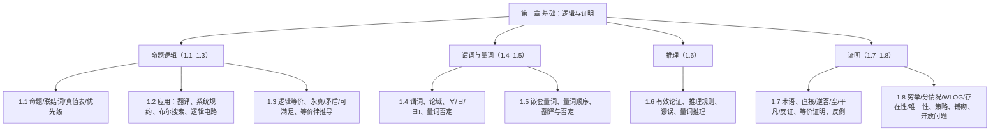

\---  
title: "C1 复习提纲 Review Outline"  
course: 离散数学 Discrete Mathematics  
chapter: "1 基础：逻辑与证明 The Foundations: Logic and Proofs"  
type: 复习提纲  
tags:  
  \- 离散数学  
  \- 复习提纲  
  \- 逻辑  
  \- 证明  
  \- 期中复习  
created: 2026-09-18  
\---

# C1 复习提纲 Review Outline（完整版·不漏知识点）

> [!abstract] 使用说明  
> 本提纲由第一章全部笔记（[[C1 基础：逻辑与证明 MOC]] + C1.1–C1.8）整理而成，**覆盖全部知识点**，按“考试极简版 → 知识地图 → 分节详解 → 三张必背表 → 术语表”组织。
>
> - 标注 **⭐** = 老师明示的考点或往年真题；
> - 标注 **（拓展）** = 课堂上未讲、教材补充内容，期中前按主干掌握即可。
> - 考试情报与答题规范详见 [[C1 基础：逻辑与证明 MOC]]，本提纲开篇摘要。

---

## 0. 考试极简版（考前 3 分钟）

第一章期中考试（**2026-09-24 周四，闭卷，只考第一章**）的题**试卷全英文、全部为解答题，以 Rosen 教材例题和课后习题为蓝本改编**（英文术语对照见第 11 节）；老师点名的方向是：**tautology 的定义**（去年期末）、**把 $\forall x\exists y\,P(x,y)$ 在 $\{1,2,3\}$ 上展开**（某年期末）、**用直接证明证“$n$ 奇 ⇒ $n^2$ 奇”**（上学期期末）、**自然语言 ↔ 量词表达式翻译**（本次期中预告）、**等价律推导**（本次期中预告“一定有推导题”）。答题三条铁律：① 每一步表达式右侧写规则名或公式（记不住名字写公式也给分）；② 结论是复合表达式时必须推出**整个表达式**为真；③ $\mathbf T$ / $\mathbf F$ 不能当变量用（用 $S,R$ 或 $A,B$ 代换），$\equiv$ 与 $\Leftrightarrow$ 全卷统一。必须背下来的硬货：**六个联结词真值表 truth tables**（$\neg,\wedge,\vee,\oplus,\to,\leftrightarrow$）、**老师版优先级 precedence of logical operators** $\neg(1)>\wedge(2)>\vee,\oplus(3)>\to(4)>\leftrightarrow(5)$（同级从左到右）、**§1.3 常用逻辑等价律 logical equivalences**（重点是德摩根 De Morgan's laws、分配 distributive laws、吸收 absorption laws、蕴涵改写 $p\to q\equiv\neg p\vee q$）、**§1.6 九条命题推理规则 + 四条量词规则 rules of inference**（MP、MT、假言三段论 hypothetical syllogism、析取三段论 disjunctive syllogism、附加 addition、化简 simplification、合取 conjunction、消解 resolution；US、UG、ES、EG）、**四种基本证明方法**（直接 direct proof、逆否 proof by contraposition、空/平凡 vacuous/trivial proof、反证 proof by contradiction——考试可能**指定**方法）、**反例与证伪 counterexamples**、**证明中的错误 mistakes in proofs**（除以零 division by zero、肯定后件 affirming the conclusion、否定前件 denying the hypothesis、循环论证 circular reasoning）。复习顺序建议：先刷 MOC 复习题速答与全章自测，再刷各节精选习题，最后回到本提纲查漏。

---

## 1. 全章知识地图

---

## 2. §1.1 命题逻辑 Propositional Logic（[[C1.1 命题逻辑 Propositional Logic]]）

### 2.1 核心概念

- **命题 (proposition)**：陈述句，具有**唯一真值**（真 T / 假 F）。疑问句、感叹句、祈使句、悖论不是命题。
- **命题变量 (propositional variable)**：用小写字母 $p,q,r,s,\dots$ 表示命题。
- **原子命题 (atomic proposition)**：不能再分解的命题；**复合命题 (compound proposition)**：由原子命题经逻辑运算符连接而成。
- **真值表 (truth table)**：$n$ 个变元的复合命题有 **$2^n$ 行**；列变元时按“折半交替”填 T/F（第一个变元前一半 T 后一半 F，逐列减半），中间列**按优先级由内向外**逐列添加，最后一列为整个复合命题真值。

### 2.2 六个逻辑联结词（必背真值表）

| 联结词                   | 名称                     | 读法       | 真值要点                             |
| --------------------- | ---------------------- | -------- | -------------------------------- |
| $\neg p$              | 否定 negation            | 非 p      | 取反                               |
| $p \wedge q$          | 合取 conjunction         | p 且 q    | 仅两者皆真为真                          |
| $p \vee q$            | 析取 disjunction（**含或**） | p 或 q    | 两者皆假才假（相容或）                      |
| $p \oplus q$          | 异或 exclusive or        | p 异或 q   | 恰一真为真（不相容或）                      |
| $p \to q$             | 蕴涵 implication         | 若 p 则 q  | 仅 p 真 q 假时为假；**假前提蕴涵任何结论为真**（空真） |
| $p \leftrightarrow q$ | 双条件 biconditional      | p 当且仅当 q | 同真同假为真                           |

- **蕴涵术语**：$p$ 是**前提/前件 (hypothesis/premise/antecedent)**，$q$ 是**结论/后件 (conclusion/consequence)**。
  - **逆命题 (converse)** $q \to p$；**逆否命题 (contrapositive)** $\neg q \to \neg p$；**反命题 (inverse)** $\neg p \to \neg q$。
  - **$p \to q$ 与它的逆否命题逻辑等价**（§1.3 会系统化）。
- **$p\to q$ 的常见英文说法**（翻译题必备）：if $p$, then $q$ · $p$ implies $q$ · $p$ only if $q$ · $q$ if $p$ · $q$ when/whenever $p$ · $p$ is sufficient for $q$ · $q$ is necessary for $p$ · $q$ follows from $p$ · $q$ unless $\neg p$。
- **充分条件 sufficient condition / 必要条件 necessary condition**：sufficient 的放箭头左边，necessary 的放箭头右边。

> [!bug] 模拟卷错题（2026-09-23）  
> “Li gets an A **only if** he passes … and submits …”我写成了 $r\leftrightarrow(p\wedge q)$。only if 是单向的，应为 $r\to(p\wedge q)$；只有 if and only if 才是 $\leftrightarrow$。

- **双条件**的常用说法：“p 当且仅当 q”（p if and only if q，简写 p iff q）、“p 是 q 的充要条件”（p is necessary and sufficient for q）。
- **位运算 bit operations**：T=1、F=0，对**位串 bit string** 做按位 bitwise AND/OR/XOR 与 $\wedge/\vee/\oplus$ 对应。

### 2.3 运算符优先级 Precedence of Logical Operators（⭐ 老师版，考试以此为准）

$\boxed{\neg\ (1)\ >\ \wedge\ (2)\ >\ \vee,\ \oplus\ (3)\ >\ \to\ (4)\ >\ \leftrightarrow\ (5)}$

- 教材 Table 8 **没有列 $\oplus$**；老师课件把 **$\oplus$ 与 $\vee$ 并列为第 3 级**——**以课件为准**。
- 同级运算符**从左到右**结合；加括号的通用算法：**按优先级 1→5 逐级扫描，每级把该级运算连同操作数括起来**，最外层（$\leftrightarrow$）不加。
- 例：$p \vee q \wedge r$ = $p \vee (q \wedge r)$；$\neg s \wedge f$ = $(\neg s)\wedge f$；$A \leftrightarrow f \to b$ = $A \leftrightarrow (f \to b)$。
- 类比编程：$\neg \leftrightarrow \text{取反}$，$\wedge \leftrightarrow \times$，$\vee \leftrightarrow +$（先取反、再乘、再加）。
- ⭐ 课堂原话：“优先级这种东西太容易出成考题了”，闭卷必须背下。

### 2.4 构建复合命题真值表 Constructing Truth Tables 的实操要点（课件强调）

1. 数变元 $n$ → $2^n$ 行；2. 变元列折半交替填；3. **中间列按优先级顺序添加，不跳步，每列只算一个运算符**；4. 算某列时只看它依赖的两列；5. 最后一列是整个复合命题。

---

## 3. §1.2 命题逻辑的应用 Applications（[[C1.2 命题逻辑的应用 Applications of Propositional Logic]]）

### 3.1 翻译自然语言句子 Translating English Sentences

- 把自然语言句翻译成命题逻辑表达式：识别原子命题、选择联结词（注意 but / however = ∧；“$q$ unless $p$” ≡ $\neg p\to q$）、处理“或”的歧义（含或 inclusive or vs 异或 exclusive or）。
- 例：微积分/计算机选课、“成龙：歌手 **or** 演员（$\vee$）；男 **or** 女（$\oplus$）”。

### 3.2 系统规约与一致性 System Specifications and Consistency

- **系统规约 (system specifications)**：用命题表达系统应满足的规则；一个规约是**一致的 (consistent)**，如果**存在一组真值赋值使所有规约命题同时为真**。
- 判断一致性：列出所有命题 → 真值表/推理找满足赋值；不一致即无解。

### 3.3 布尔搜索 Boolean Searches

- 网页搜索用布尔运算符 $\wedge$（AND）、$\vee$（OR）、$\neg$（NOT）组合关键词，如 "AI AND (ML OR DL) AND NOT (1950)"。

### 3.4 逻辑电路 Logic Circuits

- **逻辑门 logic gates**：反相器 inverter（NOT）、与门 AND gate、或门 OR gate；异或门 XOR gate、与非 NAND / 或非 NOR 等。
- **组合电路 (combinational circuit)**：输入经门网络得到输出；电路输出与命题表达式对应，**等价电路 = 逻辑等价的表达式**（衔接 §1.3）。

---

## 4. §1.3 命题等价 Propositional Equivalences（[[C1.3 命题等价 Propositional Equivalences]]）

### 4.1 三个基本概念 Tautology / Contradiction / Contingency（⭐ 必背定义）

- **永真式 (tautology)**：**所有真值赋值下都为真**的复合命题（去年期末考过“什么是 tautology”）。
- **矛盾式 (contradiction)**：所有真值赋值下都为假。
- **可能式 (contingency)**：既不是永真式也不是矛盾式（教材术语，定义题可能用到）。
- **可满足式 (satisfiable)**：**存在**一种真值赋值使其为真；可满足当且仅当**不是矛盾式**。
- **SAT 问题（可满足性问题 satisfiability problem）**：判定命题公式是否可满足，是 **NP-完全 (NP-complete)** 问题（课件/教材提，了解即可）。

> [!bug] 模拟卷错题（2026-09-23）
>
> - contingency 我写成“can either be true or false”，太含糊，任何命题都能这么说。应写：neither a tautology nor a contradiction。
> - 判断 tautology / contradiction / contingency 时只写了结论，没写理由，题目要 justify 就会扣分。
> - 证“$A$ 矛盾 ⇒ $\neg A$ 永真”时只写了 $A=F$，漏了关键词 **under every truth assignment**。

### 4.2 逻辑等价 Logical Equivalence

- **定义**：$p$ 与 $q$ 逻辑等价（记 $p \equiv q$ 或 $p \Leftrightarrow q$），当且仅当对**所有真值赋值**，$p$ 与 $q$ 真值相同；等价于 $p \leftrightarrow q$ 是**永真式**。
- 证明方法：① **真值表法 truth tables**（两列逐行相同）；② **等价推导法 a series of logical equivalences**（从一边用已知等价律推到另一边）。

### 4.3 ⭐ 常用逻辑等价律（必背，推导题直接使用）

**同一律 Identity laws**：$p\wedge \mathbf T \equiv p$，$p\vee \mathbf F \equiv p$  
**支配律 Domination laws**：$p\vee \mathbf T \equiv \mathbf T$，$p\wedge \mathbf F \equiv \mathbf F$  
**幂等律 Idempotent laws**：$p\vee p \equiv p$，$p\wedge p \equiv p$  
**双重否定律 Double negation law**：$\neg(\neg p) \equiv p$  
**交换律 Commutative laws**：$p\vee q \equiv q\vee p$，$p\wedge q \equiv q\wedge p$  
**结合律 Associative laws**：$(p\vee q)\vee r \equiv p\vee(q\vee r)$，$(p\wedge q)\wedge r \equiv p\wedge(q\wedge r)$  
**分配律 Distributive laws**：$p\vee(q\wedge r) \equiv (p\vee q)\wedge(p\vee r)$，$p\wedge(q\vee r) \equiv (p\wedge q)\vee(p\wedge r)$  
**德摩根律 De Morgan's laws**：$\neg(p\wedge q) \equiv \neg p\vee \neg q$，$\neg(p\vee q) \equiv \neg p\wedge \neg q$  
==**吸收律 Absorption laws**：$p\vee(p\wedge q) \equiv p$，$p\wedge(p\vee q) \equiv p$==  
**否定律 Negation laws**：$p\vee\neg p \equiv \mathbf T$，$p\wedge\neg p \equiv \mathbf F$

**含蕴涵的等价 Logical equivalences involving conditional statements**：$p\to q \equiv \neg p\vee q$；$p\to q \equiv \neg q\to\neg p$；$p\vee q \equiv \neg p\to q$；$p\wedge q \equiv \neg(p\to\neg q)$；$\neg(p\to q) \equiv p\wedge\neg q$；$(p\to q)\wedge(p\to r) \equiv p\to(q\wedge r)$；$(p\to r)\wedge(q\to r) \equiv (p\vee q)\to r$；$(p\to q)\vee(p\to r) \equiv p\to(q\vee r)$；$(p\to r)\vee(q\to r) \equiv (p\wedge q)\to r$

**含双条件的等价 Logical equivalences involving biconditional statements**：$p\leftrightarrow q \equiv (p\to q)\wedge(q\to p)$；$p\leftrightarrow q \equiv \neg p\leftrightarrow \neg q$；$p\leftrightarrow q \equiv (p\wedge q)\vee(\neg p\wedge\neg q)$；$\neg(p\leftrightarrow q) \equiv p\leftrightarrow \neg q$

> [!bug] 模拟卷错题（2026-09-23）  
> 我把 $\neg A\to B\equiv A\vee B$ 和 $p\vee r\equiv\neg p\to r$ 都标成了 De Morgan's law。这两个都是**蕴涵等价** $p\to q\equiv\neg p\vee q$（加 double negation）。德摩根律只处理 $\neg(\cdots\wedge\cdots)$ 和 $\neg(\cdots\vee\cdots)$。

### 4.4 推导题答题规范（⭐ 老师三次强调）

- **每一步表达式 | 右侧写规则名或该规则公式**（记不住名字写公式同样给分）。
- **结论是复合表达式时，必须推出整个表达式为真**，不是推出各分量再口头组合。
- **$\mathbf T$ / $\mathbf F$ 不能当变量用**，代换用 $S,R$ 或 $A,B$；$\equiv$ 与 $\Leftrightarrow$ 一份答卷统一。

---

## 5. §1.4 谓词与量词 Predicates and Quantifiers（[[C1.4 谓词与量词 Predicates and Quantifiers]]）

### 5.1 谓词 Predicates

- **谓词 (predicate)**：含变量的陈述，如 $P(x)$；变量取定值后成为命题；$P(x)$ 也叫**命题函数 propositional function**。
- **论域 (domain of discourse / universe of discourse)**：变量取值的集合（**必须非空**）。
- 谓词的真值取决于变量取值；**自由变量 (free)** 与**约束变量 (bound)**：被量词约束的变量是约束变量。

### 5.2 三个量词 Quantifiers（⭐ 必背）

| 量词                 | 读法                                                 | 为真的条件                     | 记法 |
| ------------------ | -------------------------------------------------- | ------------------------- | -- |
| $\forall x\,P(x)$  | 全称量词 universal quantifier，for all x                | $P(x)$ 对**论域中所有** x 为真    | ∀  |
| $\exists x\,P(x)$  | 存在量词 existential quantifier，there exists x         | 论域中**至少一个** x 使 $P(x)$ 为真 | ∃  |
| $\exists! x\,P(x)$ | 唯一量词 uniqueness quantifier，there exists a unique x | **恰好一个** x 使 $P(x)$ 为真    | ∃! |

- 注意 $\forall$ 与 $\exists$ **不可互换**；真值判断要看论域（空论域上 $\forall$ 真、$\exists$ 假）。
- **受限论域 restricted domain**：$\forall x<0\,(x^2>0)$ 意为“对所有**满足 $x<0$** 的 $x$”；$\exists z>0\,(z^2=2)$ 同理。其否定要**保留限制条件**：$\neg\forall x<0 P(x) \equiv \exists x<0\neg P(x)$。

### 5.3 量词优先级 Precedence of Quantifiers

- **量词（$\forall,\exists$）的优先级高于所有逻辑运算符**：$\forall x P(x)\vee Q(x)$ = $(\forall x P(x))\vee Q(x)$，不是 $\forall x(P(x)\vee Q(x))$。

### 5.4 量词的否定 Negating Quantified Expressions（⭐ 必背，量词的德摩根律 De Morgan's laws for quantifiers）

$\neg\forall x P(x) \equiv \exists x \neg P(x),\qquad \neg\exists x P(x) \equiv \forall x \neg P(x)$

- 直观：全称不成立 = 存在反例；存在不成立 = 全都不是。
- **连续否定多个量词时，量词逐个翻转**（衔接 §1.5）：$\neg\forall x\exists y P(x,y) \equiv \exists x\forall y \neg P(x,y)$。

> [!bug] 模拟卷错题（2026-09-23）  
> 写否定句的英文时我用了“It is not the case that all cats like fish”，这是题目明确禁止的写法。要把否定推进去再说人话：Some cat does not like fish。

### 5.5 翻译自然语言 Translating from English into Logical Expressions（⭐ 期中预告考点）
- 典型对应：“所有人/每个” → ∀；“有些/至少一个/存在” → ∃；“没有人” → $\neg\exists$ 或 $\forall\neg$；“并非所有” → $\neg\forall$。
- **英文信号词**：every / all / each → $\forall$；some / at least one / there is → $\exists$；no / none / nobody → $\neg\exists$；not every / not all → $\neg\forall$；exactly one → $\exists!$。**$\forall$ 配 $\to$，$\exists$ 配 $\wedge$**。
- **量词顺序反映语义**（见 §1.5）。

> [!bug] 模拟卷错题（2026-09-23）
> “There is a student who can solve every problem”我写成了 $\exists x\forall y\,((Q(x)\wedge R(y))\to P(x,y))$。**∃ 配了 →**：随便取一个非学生的 $x$，这个式子就成立了。应为 $\exists x\,(Q(x)\wedge\forall y\,(R(y)\to P(x,y)))$。

---

## 6. §1.5 嵌套量词 Nested Quantifiers（[[C1.5 嵌套量词 Nested Quantifiers]]）

### 6.1 定义与顺序 Nested Quantifiers and the Order of Quantifiers
- **嵌套量词 nested quantifiers**：一个量词出现在另一个量词的作用域内，如 $\forall x\exists y(x+y=0)$。
- ⭐ **量词顺序非常重要，不能随意交换**：
  - $\forall x\forall y P(x,y) \equiv \forall y\forall x P(x,y)$（同型可换）；
  - $\exists x\exists y P(x,y) \equiv \exists y\exists x P(x,y)$（同型可换）；
  - **混合量词不可交换**：$\forall x\exists y$（每个 x 都有个 y，**y 可依赖 x**）与 $\exists y\forall x$（存在一个 y 对所有 x 成立，**y 不依赖 x**）语义不同。
- 例：$\forall x\exists y(x+y=0)$ 在整数论域真（对每个 x 取 y=-x）；$\exists y\forall x(x+y=0)$ 假（不存在对所有 x 都成立的常数 y）。
- **阅读理解**：从**左往右**读量词，内层量词依赖外层变量。

### 6.2 翻译与真值 Translation and Truth Values
- **展开求值**（⭐ 某年期末题）：把 $\forall x\exists y\,P(x,y)$ 在有限论域 $\{1,2,3\}$ 上展开为合取/析取嵌套：
  $\forall x\exists y P(x,y) \equiv [\exists yP(1,y)]\wedge[\exists yP(2,y)]\wedge[\exists yP(3,y)] \equiv \big(P(1,1)\vee P(1,2)\vee P(1,3)\big)\wedge\cdots$
- 数学语句翻译：极限 $\forall\varepsilon>0\,\exists\delta>0\,\forall x\,(0<|x-a|<\delta \to |f(x)-L|<\varepsilon)$ 是典型例子。

### 6.3 嵌套量词的否定 Negating Nested Quantifiers
- **规则：从左到右，量词逐个翻转（∀↔∃），否定移到最内层谓词上**。
  - $\neg\forall x\exists y\forall z P(x,y,z) \equiv \exists x\forall y\exists z \neg P(x,y,z)$。
- 用于证明“某性质不存在”或翻译否定句（“不是所有人都有朋友”等）。

### 6.4 一阶逻辑中的逻辑等价（了解）
- 量词对合取/析取的分配：$\forall x(P(x)\wedge Q(x)) \equiv \forall xP(x)\wedge\forall xQ(x)$；$\exists x(P(x)\vee Q(x)) \equiv \exists xP(x)\vee\exists xQ(x)$。
- 量词对析取/合取**不**分配：$\forall x(P(x)\vee Q(x)) \not\equiv \forall xP(x)\vee\forall xQ(x)$（除非条件成立）。

---

## 7. §1.6 推理规则 Rules of Inference（[[C1.6 推理规则 Rules of Inference]]）

### 7.1 有效论证 Valid Arguments
- **论证 (argument)**：一串命题，最后一个为**结论 (conclusion)**，其余为**前提 (premises)**。
- **有效论证 (valid argument)**：**只要前提全真，结论必真**（即 $(p_1\wedge\cdots\wedge p_n)\to q$ 是永真式）。
- **论证形式 (argument form)**：把命题换成变量的结构；论证有效性由形式决定。

### 7.2 ⭐ 九条命题推理规则 Rules of Inference for Propositional Logic（必背：名字 + 形式）
| 规则 Rule | 形式 Form |
|---|---|
| 假言推理 modus ponens (MP) | $p,\ p\to q \Rightarrow q$ |
| 拒取式 modus tollens (MT) | $\neg q,\ p\to q \Rightarrow \neg p$ |
| 假言三段论 hypothetical syllogism | $p\to q,\ q\to r \Rightarrow p\to r$ |
| 析取三段论 disjunctive syllogism | $p\vee q,\ \neg p \Rightarrow q$ |
| 附加 addition | $p \Rightarrow p\vee q$ |
| 化简 simplification | $p\wedge q \Rightarrow p$ |
| 合取 conjunction | $p,\ q \Rightarrow p\wedge q$ |
| 消解 resolution | $p\vee q,\ \neg p\vee r \Rightarrow q\vee r$ |
| （消解特例） | $p\vee q,\ \neg p \vee q \Rightarrow q$ |

> [!bug] 模拟卷错题（2026-09-23）
> - 我从 $(p\wedge q)\vee(r\wedge s)$ 直接“by simplification”得到 $p\vee r$。推理规则只能用于**整行**，这一行是析取，不能化简。要么先用分配律，要么用 $\neg r$、De Morgan 和 disjunctive syllogism 得到 $p\wedge q$ 再化简。
> - 由 $\neg p\to r$ 和 $\neg r$ 用 modus tollens 只能得到 $\neg\neg p$，还要再补一步 double negation 才得到 $p$。
> - 由 $Q(a)$、$T(a)$ 得到 $Q(a)\wedge T(a)$ 是 **conjunction**，我写成了 addition。addition 是 $p\Rightarrow p\vee q$。

### 7.3 ⭐ 四条量词推理规则 Rules of Inference for Quantified Statements
| 规则 Rule | 形式 Form | 说明 |
|---|---|---|
| 全称实例化 universal instantiation (US / UI) | $\forall xP(x) \Rightarrow P(c)$ | 由全体到个别 |
| 全称推广 universal generalization (UG) | $P(c)\ (\text{任意 }c) \Rightarrow \forall xP(x)$ | 由任意的个别到全体，**c 必须任意** |
| 存在实例化 existential instantiation (ES / EI) | $\exists xP(x) \Rightarrow P(c)$（c 为新变量） | 取一个**特定的** c |
| 存在推广 existential generalization (EG) | $P(c) \Rightarrow \exists xP(x)$ | 由个别到存在 |

- 组合规则：**全称假言推理 universal modus ponens**（$\forall x(P(x)\to Q(x))$，$P(a)$ ⇒ $Q(a)$）；**全称拒取式 universal modus tollens**（$\forall x(P(x)\to Q(x))$，$\neg Q(a)$ ⇒ $\neg P(a)$）。

### 7.4 谬误 Fallacies（必会识别，常考判断题）
- **肯定后件谬误 (affirming the conclusion)**：从 $q$ 和 $p\to q$ 推出 $p$（错）。
- **否定前件谬误 (denying the hypothesis)**：从 $\neg p$ 和 $p\to q$ 推出 $\neg q$（错）。
- 其他常见错误：**循环论证 circular reasoning / begging the question**、**由反例不当归纳**（见 §1.7/§1.8）。

### 7.5 用推理规则构造论证 Using Rules of Inference to Build Arguments
- 方法：把自然语言论证翻译成命题/谓词 → 每步用一条规则，右侧标注规则名（答题规范）。
- 结合命题规则与量词规则（US/ES 引入个体 → 命题规则 → UG/EG 收尾）。

> [!bug] 模拟卷错题（2026-09-23）
> - 论域取“所有人”时，结论“some **student** who passed the quiz …”漏掉了 $P(x)$（在本班）。应为 $\exists x\,(P(x)\wedge Q(x)\wedge T(x))$，前提 2 也漏了这个限定。更省事的做法是把论域直接设为本班学生。
> - 步骤编号用了 a、b、c，常元也叫 $a$，读起来会混。步骤改用 (1)(2)(3) 编号。

---

## 8. §1.7 证明导论 Introduction to Proofs（[[C1.7 证明导论 Introduction to Proofs]]）

### 8.1 术语（拓展，名词解释可能考）
| 术语 | 英文 | 定义 |
|---|---|---|
| 定理 | theorem | 可被证明为真且**有一定重要性**的陈述 |
| 命题 | proposition | 不太重要的定理（注意与 §1.1 的命题不同用法） |
| 事实/结果 | fact/result | 定理的其他称呼 |
| 证明 | proof | 确立定理为真的**有效论证** |
| 公理/公设 | axiom/postulate | 假定为真、不加证明的陈述 |
| 引理 | lemma | 帮助证明其他结果的次要定理 |
| 推论 | corollary | 可从已证定理**直接得到**的定理 |
| 猜想 | conjecture | 提出但尚未证明的陈述；被证明后成为定理 |

### 8.2 形式证明 vs 非形式证明 Formal vs Informal Proofs
- **形式证明**：每一步都用推理规则补齐（§1.6）；**非形式证明**：人可以跳步、一步用多条规则、公理和规则不显式写出——**人类实际写的是非形式证明**。
- 定理陈述常**省略全称量词**（如 "if $x>y$ …" 实为“对所有正实数”）；证明时第一步取**任意**元素，最后用 UG（通常不写出）。

### 8.3 ⭐ 四种基本证明方法 Methods of Proving Theorems（考试可能指定方法！）
**目标**：证明 $\forall x(P(x)\to Q(x))$，即证 $P(c)\to Q(c)$ 对任意 $c$ 成立。

1. **直接证明 (direct proof)**：假设 $p$ 真 → 用公理/定义/已证定理/推理规则推出 $q$ 真。
   - ⭐ **必背例**：$n$ 奇 ⇒ $n^2$ 奇（上学期期末题）：$n=2k+1$ ⇒ $n^2=2(2k^2+2k)+1$，指出括号内是整数。
   - 完全平方数 perfect square：$a=b^2$（例：$m,n$ 为完全平方数 ⇒ $mn$ 为完全平方数）。
   - 有理数 rational number 定义：$r=p/q$（$p,q$ 整数，$q\ne0$）；**两个有理数之和是有理数**（注意验证 $qu\ne0$）。
2. **逆否证明 (proof by contraposition)**：证 $\neg q \to \neg p$（依据 $p\to q \equiv \neg q\to\neg p$）。
   - ⭐ 必背例：$3n+2$ 奇 ⇒ $n$ 奇（直接证明走死胡同，逆否成功：$n=2k$ ⇒ $3n+2=2(3k+1)$ 偶）。
   - $n^2$ 奇 ⇒ $n$ 奇；$n=ab$ 正整数 ⇒ $a\le\sqrt n$ 或 $b\le\sqrt n$（否定析取用德摩根）。
   - 多前提时**只需证伪其中一个前提**（恒真的前提打不动，挑含结论变量的那个）。
3. **空证明 (vacuous proof)**：前提 $p$ 为假 ⇒ $p\to q$ 自动真（只看前件）。例：$P(0)$：“若 $0>1$ 则 $0^2>0$”。
   **平凡证明 (trivial proof)**：结论 $q$ 为真 ⇒ $p\to q$ 真（只看后件）。例：$a\ge b \Rightarrow a^0\ge b^0$（$1\ge1$）。
4. 🌟**反证法 (proof by contradiction)**：证 $p$：假设 $\neg p$，推出矛盾 $r\wedge\neg r$；证 $p\to q$：假设 $p\wedge\neg q$ 推出矛盾（依据 $p\to q \equiv (p\wedge\neg q)\to\mathbf F$）。
   - ⭐ **必背例：$\sqrt2$ 无理**。骨架：反设 $\sqrt2=a/b$ 最简分数（in lowest terms） ⇒ $2b^2=a^2$ ⇒ $a$ 偶 ⇒ $a=2c$ ⇒ $b$ 偶 ⇒ $a,b$ 有公因子 2 与“最简”矛盾。
   - 例：22 天中至少 4 天落在一周同一天（**鸽巢原理 pigeonhole principle**应用）；无理数+有理数=无理数；$r^3+r+1=0$ 无有理根（最简分数+奇偶性）。
   - **逆否 vs 反证**：逆否可改写为反证（加“前提也真”），计算常完全相同，能用逆否尽量用逆否；否定性结论（不存在/无理）用反证更自然。

### 8.4 等价性证明 Proofs of Equivalence（拓展）
- 证 $p\leftrightarrow q$：**分别证 $p\to q$ 和 $q\to p$**（两方向都要写，可用不同方法）。
- ⭐ **多命题等价用循环蕴涵**：证 $p_1\to p_2\to\cdots\to p_n\to p_1$ 只需 $n$ 个条件语句，而两两互证要 $n^2-n$ 个。链可任意选择（选最容易证的）。
- 例：$n$ 偶、$n-1$ 奇、$n^2$ 偶三者等价。

### 8.5 反例 Counterexamples（拓展）
- 证伪 $\forall xP(x)$：**只需一个反例**，且必须**严格验证**它使命题为假（不能只写“取 $n=3$”不给验证）。
- 例：并非每个正整数都是两个整数的平方和（反例 3）。

### 8.6 证明中的错误 Mistakes in Proofs（拓展）
1. **代数/算术错误**：典型**除以零 division by zero**（"$1=2$"假证明第 5 步除 $a-b=0$）；开平方、平方引入增根、乘负数要翻不等号。
2. **肯定后件谬误**、**否定前件谬误**（§1.6 详述）。
3. **循环论证 / 窃取论题 (begging the question)**：用待证结论本身（或等价说法）当证明步骤，如“设 $n=2l$”直接假设 $n$ 偶。

### 8.7 一点证明策略 Proof Strategy
- 面对 $\forall x(P(x)\to Q(x))$：① 先试**直接证明**；② 展开前提定义（奇数/有理数/完全平方数）；③ 推不动就试**逆否**；④ 再不行试**反证**。

---

## 9. §1.8 证明方法与策略 Proof Methods and Strategy（[[C1.8 证明方法与策略 Proof Methods and Strategy]]）

### 9.1 穷举证明 Exhaustive Proof
- 检查**相对少量**的有限个例子（分情况证明的特例）。例：$n\le4$ 时 $(n+1)^3\ge3^n$。
- ⚠️ 穷举只证明有限范围；例子再多也不能证明“对所有正整数成立”。

### 9.2 分情况证明 Proof by Cases
- 依据永真式：$[(p_1\vee\cdots\vee p_n)\to q] \leftrightarrow [(p_1\to q)\wedge\cdots\wedge(p_n\to q)]$。
- **必须覆盖所有可能情形**（⚠️ 常见错误：漏情形，如“正/负”漏掉 0；实数要三分：正/负/零）。
- 例：$n$ 整数 ⇒ $n^2\ge n$（分 $n=0$、$n\ge1$、$n\le-1$）；$|xy|=|x||y|$（四情形）。

### 9.3 不失一般性 WLOG
- 断言“其他情形可由本情形的论证经显然改动得到”——**必须能说出那个具体变换**（如交换 $x,y$ 的角色）。说不出的 WLOG 是错误根源。
- 例：$xy$ 与 $x+y$ 偶 ⇒ $x,y$ 偶（逆否 + WLOG + 分情况）。

### 9.4 存在性证明 Existence Proofs
- 证 $\exists xP(x)$：
  - **构造性 (constructive)**：给出**见证 (witness)** $a$ 使 $P(a)$ 真。例：$1729=10^3+9^3=12^3+1^3$（**出租车数**）。
  - **非构造性 (nonconstructive)**：不给出具体元素，常用反证法。例：存在无理数 $x,y$ 使 $x^y$ 有理（$\sqrt2^{\sqrt2}$ 分两情形，**用排中律**，不知道是哪一对）；**Chomp 游戏先手必胜**（策略窃取论证）。

### 9.5 唯一性证明 Uniqueness Proofs
- 两部分：**① 存在性**（存在满足性质的 $x$）；**② 唯一性**（若 $y$ 也满足则 $y=x$，或若 $y\ne x$ 则 $y$ 不满足）。
- 形式化：$\exists x(P(x)\wedge\forall y(P(y)\to y=x))$。
- 例：$a\ne0$ 时 $ar+b=0$ 有唯一解 $r=-b/a$（存在性给出构造，唯一性设两解相等推导，除以 $a$ 需说明 $a\ne0$）。

### 9.6 证明策略 Proof Strategies
- **总策略**：替换定义 → 分析前提结论含义 → 条件语句先直接、再逆否、再反证。
- **正向推理 (forward reasoning)**：前提出发推结论；**逆向推理 (backward reasoning)**：从结论找可证的 $p$ 使 $p\to q$（⚠️ 方向绝不能反：找 $q\to r$ 且 $r$ 可证是**窃取论题/肯定后件**谬误）。
  - 例：AM–GM 不等式 $(x+y)/2>\sqrt{xy}$（$x\ne y$ 正实数）：逆向构造等价链到 $(x-y)^2>0$，**写证明时倒成正向**，取平方根那步注明两边为正。
  - 取石子博弈（Nim）：必败位置 $n\equiv0\pmod{4}$，策略“每轮总取 $m+1$ 颗”。
- **改编已有证明**：把 $\sqrt2$ 无理改编为 $\sqrt3$ 无理（用 $3\mid d^2\Rightarrow 3\mid d$，需数论弹药——**欧几里得引理**；注意对合数不成立）。
- **寻找反例**：先试最小/最简单的例子（0、1、2、负数、边界）；找不到反例再回头证。

### 9.7 铺砌与染色论证 Tilings（⭐ 高光技巧）
- 术语：棋盘、**多米诺骨牌**（1×2）、**多联骨牌 polyominoes**、三格骨牌（直线型/直角 L 型）。
- **染色论证 (coloring argument)**（组合数学核心技巧）：
  1. 给格子染色使**每块拼图无论怎么放覆盖的各色格数固定**（骨牌 2 格用 2 色 → 一白一黑；直线三格骨牌 3 格用 3 色）；
  2. 计算目标板各色格数；
  3. 与“块数 × 每块覆盖数”不符 ⇒ 不可能铺砌。
  - 例 20：标准棋盘去掉对角两角（同色）剩 30:32 或 32:30，与 31 白 31 黑矛盾 ⇒ 不能铺砌。
  - 例 22：三色染色 20:21:22 vs 21:21:21 ⇒ 直线三格骨牌不能铺去掉一角的棋盘。
- 图论视角：棋盘二分图，多米诺铺砌 = 完美匹配。

### 9.8 开放问题 Open Problems
- **费马大定理**：$x^n+y^n=z^n$（$n>2$）无 $xyz\ne0$ 整数解；费马提出，**Andrew Wiles 1990 年代**用椭圆曲线理论证明（数百页）。
- **$3x+1$ 猜想（Collatz）**：偶数送 $x/2$、奇数送 $3x+1$，反复施加最终到 1；至今未证，已验证到 $5.6\times10^{13}$。别名：Hasse 算法、Ulam 问题、Syracuse 问题、角谷问题。
- 结论性注记：**不存在证明定理的通用程序**——哥德尔不完备性定理与丘奇–图灵不可判定性。

---

## 10. 三张必背的表（综合）

### TABLE A｜命题逻辑真值表汇总（§1.1）
| $p$ | $q$ | $\neg p$ | $p\wedge q$ | $p\vee q$ | $p\oplus q$ | $p\to q$ | $p\leftrightarrow q$ |
|:-:|:-:|:-:|:-:|:-:|:-:|:-:|:-:|
| T | T | F | T | T | F | T | T |
| T | F | F | F | T | T | F | F |
| F | T | T | F | T | T | T | F |
| F | F | T | F | F | F | T | T |

### TABLE B｜最常用逻辑等价（§1.3）
（完整列表见第 4.3 节：同一/支配/幂等/双重否定/交换/结合/分配/德摩根/吸收/否定 + 蕴涵与双条件等价。）

### TABLE C｜推理规则（§1.6）
（完整列表见第 7.2–7.3 节：九条命题规则 + 四条量词规则。）

---

## 11. 关键术语表 Key Terms（中英对照速查）

> [!important] 试卷全英文
> 左列是笔记里的中文叫法，右列是**考卷上会出现的教材原文术语**。答题时推导依据也用右列写法（如 by De Morgan's law、by modus tollens）。

### §1.1–§1.2 命题逻辑及其应用

| 中文 | English |
|---|---|
| 命题 | proposition |
| 真值 | truth value |
| 命题变量 | propositional variable |
| 原子命题 / 复合命题 | atomic proposition / compound proposition |
| 否定 | negation ($\neg p$) |
| 合取 | conjunction ($p\wedge q$) |
| 析取（相容或） | disjunction, inclusive or ($p\vee q$) |
| 异或（不相容或） | exclusive or ($p\oplus q$) |
| 蕴涵 / 条件语句 | implication / conditional statement ($p\to q$) |
| 双条件 | biconditional statement ($p\leftrightarrow q$) |
| 前件 / 后件 | hypothesis (antecedent, premise) / conclusion (consequence) |
| 逆命题 / 逆否命题 / 反命题 | converse / contrapositive / inverse |
| 充分条件 / 必要条件 | sufficient condition / necessary condition |
| 真值表 | truth table |
| 运算符优先级 | precedence of logical operators |
| 位 / 位串 / 按位运算 | bit / bit string / bitwise operations |
| 系统规约 / 一致的 | system specifications / consistent |
| 布尔搜索 | Boolean searching |
| 逻辑门：反相器 / 与门 / 或门 | logic gates: inverter / AND gate / OR gate |
| 组合电路 | combinational circuit |
| 骑士与无赖谜题 | knights and knaves puzzle |

### §1.3 命题等价

| 中文 | English |
|---|---|
| 永真式（重言式） | tautology |
| 矛盾式 | contradiction |
| 可能式（非永真非矛盾） | contingency |
| 可满足的 / 不可满足的 | satisfiable / unsatisfiable |
| 逻辑等价 | logically equivalent ($\equiv$) |
| 同一律 / 支配律 / 幂等律 | identity laws / domination laws / idempotent laws |
| 双重否定律 | double negation law |
| 交换律 / 结合律 / 分配律 | commutative laws / associative laws / distributive laws |
| 德摩根律 | De Morgan's laws |
| 吸收律 / 否定律 | absorption laws / negation laws |
| 对偶式（拓展） | dual |
| 析取范式（拓展） | disjunctive normal form (DNF) |
| 功能完备（拓展） | functionally complete |

### §1.4–§1.5 谓词与量词

| 中文 | English |
|---|---|
| 谓词 / 命题函数 | predicate / propositional function |
| 论域 | domain of discourse (universe of discourse) |
| 全称量词 / 全称量化 | universal quantifier ($\forall$) / universal quantification |
| 存在量词 / 存在量化 | existential quantifier ($\exists$) / existential quantification |
| 唯一量词 | uniqueness quantifier ($\exists!$) |
| 受限论域 | restricted domain |
| 自由变量 / 约束变量 | free variable / bound variable |
| 作用域 | scope |
| 量词的德摩根律 | De Morgan's laws for quantifiers |
| 嵌套量词 | nested quantifiers |
| 反例 | counterexample |

### §1.6 推理规则

| 中文 | English |
|---|---|
| 论证 / 前提 / 结论 | argument / premises / conclusion |
| 有效论证 / 论证形式 | valid argument / argument form |
| 推理规则 | rules of inference |
| 假言推理 | modus ponens |
| 拒取式 | modus tollens |
| 假言三段论 | hypothetical syllogism |
| 析取三段论 | disjunctive syllogism |
| 附加 / 化简 / 合取 / 消解 | addition / simplification / conjunction / resolution |
| 全称实例化 / 全称推广 | universal instantiation / universal generalization |
| 存在实例化 / 存在推广 | existential instantiation / existential generalization |
| 全称假言推理 / 全称拒取式 | universal modus ponens / universal modus tollens |
| 谬误 | fallacy |
| 肯定后件谬误 | fallacy of affirming the conclusion |
| 否定前件谬误 | fallacy of denying the hypothesis |

### §1.7 证明导论

| 中文 | English |
|---|---|
| 定理 / 命题 / 引理 / 推论 / 猜想 | theorem / proposition / lemma / corollary / conjecture |
| 公理 / 公设 | axiom / postulate |
| 形式证明 / 非形式证明 | formal proof / informal proof |
| 直接证明 | direct proof |
| 逆否证明（间接证明） | proof by contraposition (indirect proof) |
| 空证明 / 平凡证明 | vacuous proof / trivial proof |
| 反证法 | proof by contradiction |
| 等价性证明 | proofs of equivalence |
| 奇数 / 偶数 / 奇偶性 | odd / even / parity |
| 有理数 / 无理数 | rational number / irrational number |
| 最简分数 | in lowest terms (no common factors) |
| 完全平方数 | perfect square |
| 鸽巢原理 | pigeonhole principle |
| 循环论证 | circular reasoning / begging the question |
| 除以零 | division by zero |

### §1.8（未讲，了解即可）

| 中文 | English |
|---|---|
| 穷举证明 / 分情况证明 | exhaustive proof / proof by cases |
| 不失一般性 | without loss of generality (WLOG) |
| 存在性证明（构造性 / 非构造性） | existence proof (constructive / nonconstructive) |
| 唯一性证明 | uniqueness proof |
| 正向推理 / 逆向推理 | forward reasoning / backward reasoning |
| 铺砌 / 多米诺骨牌 | tiling / domino |

### 答题常用英文表达

| 场景 | English |
|---|---|
| 设定前提 | Let $n$ be an odd integer. / Suppose that … / Assume that … |
| 写出定义 | Then $n = 2k + 1$ for some integer $k$. |
| 指出整数 | Since $2k^2 + 2k$ is an integer, $n^2$ is odd. |
| 逆否证明开头 | We prove the contrapositive: if $n$ is even, then … |
| 反证法开头与收尾 | Suppose, for the sake of contradiction, that … This contradicts … |
| 结论 | Hence / Therefore / Consequently, … $\blacksquare$ |
| 推导依据 | by De Morgan's law · by the distributive law · by modus ponens from (1) and (3) |
| 判断等价 | … are (not) logically equivalent, because … |
| 给反例 | The statement is false. Counterexample: take $x = …$ Then … |
| 判断真值 | The statement is true (false), since … |

---

## 12. 关键结果 RESULTS（中英对照，证明方法范例）

- “若 $n$ 是奇整数，则 $n^2$ 是奇整数” *If $n$ is an odd integer, then $n^2$ is odd.*（**直接证明**，⭐期末真题）。
- “若 $n$ 是整数且 $3n+2$ 是奇数，则 $n$ 是奇数” *If $n$ is an integer and $3n+2$ is odd, then $n$ is odd.*（**直接走不通 → 逆否**）。
- “若 $n=ab$（$a,b$ 正整数），则 $a\le\sqrt n$ 或 $b\le\sqrt n$” *If $n=ab$, where $a$ and $b$ are positive integers, then $a\le\sqrt n$ or $b\le\sqrt n$.*（**逆否 + 德摩根**；试除到 $\sqrt n$ 判素数）。
- “两个有理数之和是有理数” *The sum of two rational numbers is rational.*（**直接**；验证分母非零）。
- “$n$ 是奇数 ⟺ $n^2$ 是奇数” *$n$ is odd if and only if $n^2$ is odd.*（**等价性证明**：例 1 + 例 8 两个方向）。
- “$\sqrt2$ 是无理数” *$\sqrt2$ is irrational.*（**反证法 + 最简分数**，⭐ 必默写）。
- “$n$ 偶 ⟺ $n-1$ 奇 ⟺ $n^2$ 偶” *$n$ is even, $n-1$ is odd, and $n^2$ is even are equivalent.*（**循环蕴涵**）。
- “每个正整数是四个整数的平方和” *Every positive integer is the sum of the squares of four integers.*（拉格朗日四平方和定理；两个不够-反例 3、三个不够-反例 7）。
- "$|xy|=|x||y|$"（**分情况**）；“$x^2+x$ 末位数字 ∈ {0,1,4,5,6,9}”（**发现→猜想→分情况证明**）。
- “$x^2+3y^2=8$ 无整数解”（**估界 + 穷举**）。
- “AM–GM：$(x+y)/2>\sqrt{xy}$（$x\ne y$ 正实数）”（**逆向推理**）；"HM ≤ GM ≤ AM ≤ QM"。
- “$1729$ 是能以两种方式写成两个立方和的最小正整数”（**构造性存在性**）。
- “$x^y$ 有理（$x,y$ 无理）存在”（**非构造性**）；“Chomp 先手必胜”（**策略窃取**）。
- “去掉对角两角的棋盘不能铺砌”（**染色论证**）；“去掉一角的棋盘不能铺砌”（**奇偶性**）。

---

## 13. 复习路线建议（摘自 MOC）

1. **先**：过一遍本提纲，标记不会的点；
2. **再**：[[C1 基础：逻辑与证明 MOC]] 的“章末复习题速答” + “全章自测 30 题”快速过关；
3. **然后**：刷各节笔记“精选习题”（重点：C1.7 例 1/3/10、C1.8 例 20/22、C1.1 优先级、C1.3 等价推导、C1.4 翻译）；
4. **对照 syllabus** 圈出讲过的部分，刷 **Rosen 教材课后练习**（考题大部分来自这里，改动有限），用教材末页答案自查；
5. **考前**：默写三张表 + 四种证明方法模板 + $\sqrt2$ 无理骨架 + 量词否定规则。

---

## 关联
- 章索引：[[C1 基础：逻辑与证明 MOC]]
- 各节：[[C1.1 命题逻辑 Propositional Logic]] · [[C1.2 命题逻辑的应用 Applications of Propositional Logic]] · [[C1.3 命题等价 Propositional Equivalences]] · [[C1.4 谓词与量词 Predicates and Quantifiers]] · [[C1.5 嵌套量词 Nested Quantifiers]] · [[C1.6 推理规则 Rules of Inference]] · [[C1.7 证明导论 Introduction to Proofs]] · [[C1.8 证明方法与策略 Proof Methods and Strategy]]
> [!important] 一、命题符号与真值
> - 小写字母 $p,q,r$ 是**命题变元**，代表完整陈述句，本身不带真值；真值（T/F）是命题在具体情境下才有的属性
> - **真值"未知"≠真值"不存在"**——一个命题必然有确定真值，只是可能暂时无法判定（如哥德巴赫猜想）
> - **取否定是语法/语义操作**，跟真值是否已知无关：可以先写出 $\neg p$，即使 $p$ 的真值尚未可知

> [!important] 二、推理规则（8 条）
> 推理规则关心**形式不关心内容**——每条对应一个永真式，套用时不需要重新验证真值表
>
> | 规则 | 结构 |
> |---|---|
> | Modus ponens | $p,\ p\to q\ \therefore q$ |
> | Modus tollens | $\neg q,\ p\to q\ \therefore\neg p$ |
> | Hypothetical syllogism | $p\to q,\ q\to r\ \therefore p\to r$ |
> | Disjunctive syllogism | $p\vee q,\ \neg p\ \therefore q$ |
> | Addition | $p\ \therefore p\vee q$ |
> | Simplification | $p\wedge q\ \therefore p$ |
> | Conjunction | $p,\ q\ \therefore p\wedge q$ |
> | Resolution | $p\vee q,\ \neg p\vee r\ \therefore q\vee r$ |
>
> 还有两条常用于一阶逻辑证明：**Universal instantiation**（全称量词具体化到个体）、**Existential generalization**（从具体个体推出存在性）
>
> **前提是否为真 ≠ 推理规则要回答的问题**：推理规则只保证"前提真则结论真"，前提本身的真假来自题目已知条件、已证定理，或反证法中的临时假设

> [!important] 三、量词与连接词的搭配规律 ⭐核心易错点
> $$\forall x \text{ 配 } \to \qquad\qquad \exists x \text{ 配 } \wedge$$
> - $\forall$ 用 $\to$：只对满足前提的对象做承诺，不相关对象自动放过（前提为假，蕴含式自动为真）
> - $\exists$ 用 $\wedge$：需要真的找到一个对象，同时满足所有列出的条件
> - 用错的后果：$\forall+\wedge$ 会把不相关对象强行拉入要求；$\exists+\to$ 会让命题因无关对象"躺平过关"而失去实际约束力

> [!important] 四、含常量 $A$ 的八条等价式（$A$ 不含自由变元 $x$）
> **不带箭头（可直接进出量词）：**
> - $\forall x(A\wedge P(x))\equiv A\wedge\forall x\,P(x)$，$\exists x(A\wedge P(x))\equiv A\wedge\exists x\,P(x)$
> - 对 $\vee$ 同理
>
> **带箭头（⭐核心规律：量词在前件会翻转，后件不翻转）：**
> $$\boxed{\text{量词站在箭头左边（前件）→ 翻转（}\forall\leftrightarrow\exists\text{）；站在右边（后件）→ 不翻转}}$$
>
> | 原式 | 位置 | 结果 |
> |---|---|---|
> | $\forall x\,P(x)\to A$ | 前件 | $\equiv\exists x(P(x)\to A)$ |
> | $A\to\forall x\,P(x)$ | 后件 | $\equiv\forall x(A\to P(x))$ |
> | $\exists x\,P(x)\to A$ | 前件 | $\equiv\forall x(P(x)\to A)$ ⭐最容易记反 |
> | $A\to\exists x\,P(x)$ | 后件 | $\equiv\exists x(A\to P(x))$ |
>
> **原因**：消箭头（$p\to q\equiv\neg p\vee q$）会给前件加一个 $\neg$，$\neg\forall$ 变 $\exists$，$\neg\exists$ 变 $\forall$；后件不受影响
> **同源机制**：与命题逻辑 $(p\to r)\wedge(q\to r)\equiv(p\vee q)\to r$ 的"前件联结词翻转"是同一回事
> **推导范例**：$\forall x\,P(x)\to A\equiv\neg\forall x\,P(x)\vee A\equiv\exists x\neg P(x)\vee A\equiv\exists x(\neg P(x)\vee A)\equiv\exists x(P(x)\to A)$

> [!important] 五、$\neg(p\to q)$ 的否定
> $$\neg(p\to q)\equiv p\wedge\neg q$$
> - 蕴含式唯一为假的情况是"前真后假"，否定就是直接把这个情况写出来
> - **易错**：不要写成 $\neg p\to\neg q$（这跟原命题既不等价也不是逆否命题）；逆否命题是 $\neg q\to\neg p$，与原命题**等价**

> [!important] 六、嵌套量词翻译成自然语言：两个方向配合使用
> - **"钉变量"是从外向内**：最外层量词先假装拿到一个具体值（如把 $x$ 想象成"小明"），再带着这个已知量去读内层，内层立刻从"黑箱"变得可读
> - **"读懂+组织成完整句子"是从内向外**：先读通最内层，再一层层把外层的量词包裹进去，拼成完整自然语言
> - 两者顺序相反、缺一不可：不先钉变量就直接读内层会看不懂；只钉变量不组装读不出完整句子

> [!important] 七、"Exactly one" 存在唯一 标准模板
> $$\exists x\Big[P(x)\;\wedge\;\forall z\big(P(z)\to z=x\big)\Big]$$
> - 内层新开一层量词要换新变量名（如 $z$、$w$），避免辖域混淆，即使语义上重名不会出错也是好习惯
> - **唯一性检查的对象要对**：检查的应该是"另一个候选是否也具备同样性质"，不能把无关的限制（比如"施爱者是否只爱一个人"）错误地塞进去
> - **"exactly one ... besides X"** 结构：在划定的范围内做一次标准存在唯一，注意要排除 $X$ 本身（如 $z\ne x$），且这个排除要在**两处独立起作用**：一次声明目标对象本身不是 $X$，一次确保唯一性检查时不把 $X$ 算作候选
> - **"no one besides X"**（全称否定）≠ **"only X"**（肯定+唯一）：前者只划定上界，不保证一定发生（"除自己外不爱任何人"≠"一定爱自己"，类比"空集是任意集合的子集"的空满足逻辑）

> [!important] 八、混合论域（人+物混合）
> - 论域可以是任意集合的并集，没有类型限制，但**每次用量词取到变量时，通常需要额外谓词（如 $S(x)$、$Q(y)$）来筛选身份**，否则会把不相关类型的对象也卷入讨论
> - 例："有一个会做所有考题的考生"：$\exists x[S(x)\wedge\forall y(P(y)\to C(x,y))]$——外层 $\exists x$ 配 $\wedge$（找具体对象+验证身份），内层 $\forall y$ 配 $\to$（只约束"是题目"的对象）
> - 不依赖 $y$ 的条件（如 $S(x)$）**可以**写在 $\forall y$ 内部或外部（由"含常量 $A$"等价式保证等价），但写在 $\forall y$ 括号外能更清晰体现"该条件与 $y$ 无关，只需判断一次"，是表达清晰度而非对错问题

> [!important] 九、集合/元组/笛卡尔积
> - $\varnothing\subseteq B$ 对任意集合 $B$ 恒成立（含 $B=\varnothing$），因为空集没有任何元素违反子集要求（vacuously true）；这跟 $\varnothing\in B$（属于关系）是完全不同的问题，互不影响
> - $\varnothing$ 与 $\{\varnothing\}$ 不是一回事：前者 0 个元素，后者 1 个元素（这个元素是空集本身）
> - 元组允许元素重复、有顺序；集合自动去重、无序
> - 笛卡尔积 $A\times B$：**元素（有序对）内部有顺序**（$(a,b)\ne(b,a)$），但**结果这个大集合本身是无序的**，一般 $A\times B\ne B\times A$

> [!important] 十、Relation / Function / 单射 / 满射 / 双射
> $$\text{Relation}\supseteq\text{Function}\supseteq\text{单射 Function}\qquad\text{Function}\supseteq\text{满射 Function}$$
> - **Relation**：$A\times B$ 的任意子集
> - **Function**：多两条规矩——① 每个 $a\in A$ 都必须有输出（不能空缺）② 每个 $a$ 的输出必须唯一（不能一对多）
> - **值域 Range ⊆ 陪域 Codomain**（恒成立），只有满射时两者相等
> - **陪域存在的意义**：陪域是函数类型声明的一部分（提前划定），值域是实际算出的结果；没有陪域就无法定义"满射"（依赖跟固定目标比较）
> - **单射**：不同输入给不同输出；**满射**：陪域每个元素都被打中；**双射**：两者都满足，是函数可逆的充要条件（$f^{-1}\circ f=\iota_A$，$f\circ f^{-1}=\iota_B$）
> - **恒等函数** $\iota_A(a)=a$：判断反函数、复合函数性质的参照基准
> - 函数定义域/陪域不限于数字，可以是任意集合（字符串、人、集合本身等）

> [!important] 十一、反证法 Proof by Contradiction
> **核心依据**：$(\neg p\to F)\to p$ 恒真（$F$ 为恒假的矛盾式）
> **标准套路**：假设 $\neg p$，推导出某个命题 $r$ 和 $\neg r$ 同时成立（即凑出矛盾式 $q=r\wedge\neg r$），因为 $\neg p\to q$ 为真而 $q$ 恒假，只能是 $\neg p$ 为假，即 $p$ 为真
> **经典例子**：证明 $\sqrt2$ 是无理数——假设 $\sqrt2=a/b$（$r$: $\gcd(a,b)=1$），推出 $a,b$ 都是偶数（$\neg r$: $\gcd(a,b)\ne1$），矛盾
> **反证法 = 间接证明**：不直接从 $p$ 正向推导，而是绕道假设 $\neg p$ 推出矛盾