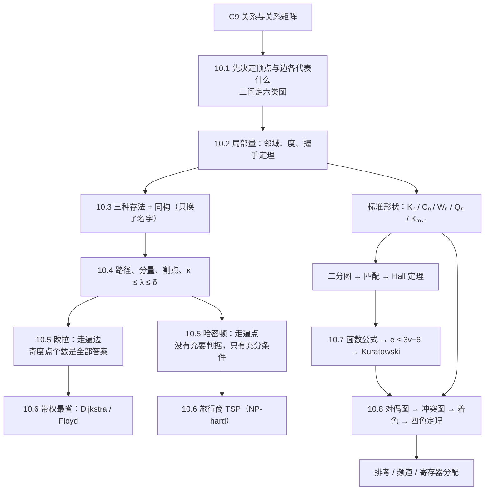

# C10 图 Graphs MOC

> [!abstract] 这一章在解决什么
> 第 9 章把"关系"画成了有向图，但从没说清一个点、一条边到底代表现实里的什么。本章走完一条完整的链子：
> **先定模型**（10.1）→ **有了一套说法**（度、邻域、图族、匹配，10.2）→ **存进计算机并认出"同一张图"**（10.3）
> → **问"走得到吗、结实吗"**（连通性，10.4）→ **问"能一笔画完吗、能恰好走遍每个点吗"**（10.5）
> → **边上带代价时怎么最省**（10.6）→ **能不能不交叉画在平面上**（10.7）→ **资源冲突怎么分配**（10.8）。
> 全章只有一条主线：**先确定模型，再选与目标相符的判据**。判据分两类——充要条件（欧拉、Kuratowski、Hall）与只给方向的条件（Dirac/Ore、$e\le3v-6$、$\chi\le4$），
> 分不清这两类，做题时会用"必要条件"去"证明存在"。
>
> 本篇是**学习讲义**，不是课后习题解答集：85 个编号例题全部讲到位，章末 22 道复习题只做"回查入口"，补充练习里出现的新概念按主题并入各篇的延伸小节。

## 📖 本章笔记索引

下表页码是**印刷页**（物理页 = 印刷页 − 640）；共享页上的内容按节标题归位，不重复计。

| 笔记 | 物理页／印刷页 | 核心问题 | 例题 | 配图 | 状态 |
|---|---|---|---|---|---|
| [[C10.1 图与图模型 Graphs and Graph Models]] | 1–10／641–650 | 一份现实记录，三问定出六类图里的一个 | 例 1–14 | 4 | 已合并第 19 节末（章首） |
| [[C10.2 图的术语与特殊类型 Graph Terminology and Special Types of Graphs]] | 11–28／651–668 | 度与握手定理；四族标准图；二分与匹配；Hall 定理 | 例 1–19 | 12 | 已合并第 20 节；§6–§7 课堂未讲 |
| [[C10.3 图的表示与图同构 Representing Graphs and Graph Isomorphism]] | 28–38／668–678 | 三种存法；"两个图什么时候算同一个" | 例 1–11 | 5 | 已合并第 20–21 节；§1–§4 课堂未讲 |
| [[C10.4 连通性 Connectivity]] | 39–52／679–692 | 走得到吗；删几个点才断；$A^r$ 数走法 | 例 1–15 | 7 | 已合并第 21 节 |
| [[C10.5 欧拉路径与哈密顿路径 Euler and Hamilton Paths]] | 53–66／693–706 | 走遍每条边（有判据）vs 走遍每个点（没判据） | 例 1–8 | 11 | 已合并第 21 节 |
| [[C10.6 最短路径问题 Shortest-Path Problems]] | 67–78／707–718 | Dijkstra、Floyd、旅行商 | 例 1–2 | 7 | **课堂未讲（整篇拓展）** |
| [[C10.7 平面图 Planar Graphs]] | 79–86／719–726 | $v-e+r=2$ 榨出的三道关；Kuratowski | 例 1–9 | 7 | 已合并第 22 节 |
| [[C10.8 图着色 Graph Coloring]] | 87–95／727–735 | 冲突图→着色；四色定理；排程与寄存器 | 例 1–7 | 6 | 已合并第 22 节 |

## 🗺️ 内容地图与阅读顺序

**第一遍就按 10.1 → 10.8 顺读。** 三条依赖要提前知道：

- **10.2 的握手定理是 10.5 的地基**：欧拉判据"奇度点的个数"就是握手定理推论（奇度点必为偶数）的直接产物。跳过 10.2 直接读 10.5，会觉得"为什么要数奇度点"突然冒出来。
- **10.3 的邻接矩阵是 10.4 §7 的地基**：$(A^r)_{ij}$ 数走法，用的是矩阵乘法（[[C2.6 矩阵 Matrices]]）；若矩阵幂生疏，先补那一节。
- **10.5 的哈密顿定义是 10.6 TSP 的前提**，但 **Dijkstra 不依赖哈密顿**——最短路可以先学，TSP 放在最后当"哈密顿 + 权重"的合体。
- **10.7 与 10.8 次序不能换**：四色定理的"平面"来自 10.7 的 $e\le3v-6$；反过来 10.8 的对偶图又给 10.7 的"面"一个具体用途。

**编号与教材一致**，没有重排：本篇 8 节的顺序就是教材顺序。这也是全章唯一一处"名字容易混"的地方——
**三个"欧拉"**（欧拉回路 §10.5、欧拉公式 §10.7、以及欧拉数 $e$）与**一个"哈密顿"**的对照表在 [[C10.7 平面图 Planar Graphs]] §10.1。

## 🔑 六张必背表

### 表 1：三问定六类图（p.644 表 1）

| 图 | 边有方向 | 允许多重边 | 允许自环 | 典型模型 |
|---|---|---|---|---|
| 简单图 simple graph | 无 | 否 | 否 | 相识图、合作图、$K_n$ |
| 多重图 multigraph | 无 | **是** | 否 | 同一对城市间多条航班/备用链路 |
| 伪图 pseudograph | 无 | **是** | **是** | 带自测回环的链路、带环路的道路 |
| 简单有向图 simple directed graph | **有** | 否 | 否 | 影响图、引用图、先序图、循环赛 |
| 有向多重图 directed multigraph | **有** | **是** | **是** | 电话记录、单向多车道 |
| 混合图 mixed graph | 有无并存 | 是 | 是 | 既有双向光纤又有单向链路的骨干网 |

三问的顺序是：**方向有没有意义 → 同一对端点会不会有多条边 → 会不会自己连自己**。
"允许"不等于"一定出现"；反过来，一旦模型需要记录重数或方向，就只能升级到更宽的那一类，**升级不可逆**。

### 表 2：五个标准图族（p.655–658）

| 图族 | 顶点数 | 边数 | 每个点的度 | 要点 |
|---|---|---|---|---|
| $K_n$ 完全图 | $n$ | $\binom n2$ | $n-1$ | 每对点恰一条边；$\chi(K_n)=n$；只有 $n\le4$ 可平面 |
| $C_n$ 圈 | $n\ge3$ | $n$ | $2$ | 二分 **⟺** $n$ 是偶数；$\chi=2$（偶）／$3$（奇） |
| $W_n$ 轮 | $n+1$ | $2n$ | 中心 $n$，轮缘 $3$ | $W_n=C_n$ 再加一个连着所有点的中心；$\chi=3$（$n$ 偶）／$4$（$n$ 奇） |
| $Q_n$ $n$ 立方体 | $2^n$ | $n2^{n-1}$ | $n$ | 顶点是长度 $n$ 的位串，只差一位则相邻；二分；可平面仅 $n\le3$ |
| $K_{m,n}$ 完全二分图 | $m+n$ | $mn$ | $m$／$n$ | 每对跨侧点之间有边；$\chi=2$；可平面 **⟺** $\min(m,n)\le2$ |

自查办法（每一条都用握手定理验一遍）：$\sum_v\deg v=2m$。例如 $W_n$：$n+(3n)=4n=2\cdot2n$ ✓。

### 表 3：连通性的三级精度（p.679–689）

| 概念 | 定义的一句话 | 量 | 备注 |
|---|---|---|---|
| 连通 connected | 任意两点之间有路径 | 是／否 | 有向图要分强连通、弱连通 |
| 连通分量 component | 极大连通子图 | 个数 | 例 5、例 12 |
| 割点 cut vertex（= 割边式的点） | 删掉它，图就不连通 | 集合 | "单点故障" |
| 桥 bridge（= 割边 cut edge） | 删掉它，图就断成两半 | 集合 | 与柯尼斯堡那七座桥只是同名 |
| 点连通度 $\kappa(G)$ | 最少删几个**点**才断 | 数 | $K_n$ 取 $n-1$；不连通或 $K_1$ 取 $0$ |
| 边连通度 $\lambda(G)$ | 最少删几条**边**才断 | 数 | 同上 |
| 三条不等式 | $\kappa(G)\le\lambda(G)\le\delta(G)$ | — | **简单图**；教材是正文论断，不是编号定理（$\kappa\le\lambda$ 留作习题 55） |
| 走法数 | $(A^r)_{ij}$ = 从 $v_i$ 到 $v_j$ 长 $r$ 的**走法**数 | 数 | 定理 2；允许重复点，不是简单路径数 |

**术语陷阱**：这本教材的 `path` **允许重复边**（= 通行的 walk），`simple path` 才禁重边（= 通行的 trail）；
`circuit` 是长度 $\ge1$ 的闭合路径。所以 $A^r$ 数出来的东西和"简单路径"是两回事，$r>n-1$ 时必然重复。

### 表 4：欧拉 vs 哈密顿（p.693–706）

| | 欧拉 Euler（走遍**边**） | 哈密顿 Hamilton（走遍**点**） |
|---|---|---|
| 回路定义 | 包含每条边**恰好一次**的简单回路 | 经过每个顶点**恰好一次**的回路 |
| 充要判据 | **有**：非孤立部分连通 + 奇度点 0 个（回路）／恰 2 个（路径） | **没有已知的**；判定是 NP-完全的 |
| 有向版 | 每个点入度 = 出度（路径版：仅起点出度多 1、终点入度多 1） | 同样没有实用判据 |
| 充分条件 | — | Dirac：$\delta(G)\ge n/2$；Ore：任意非邻点对 $\deg u+\deg v\ge n$（都是充分非必要，$C_5$ 是反例） |
| 算法 | Fleury（$O(m^2)$，纪律式）；Hierholzer（$O(m)$，拼接式） | 已知最好算法是指数最坏时间 |
| 在 $K_n$ 上 | 有欧拉回路 **⟺** $n$ 为奇数（$\deg=n-1$ 须为偶） | $n\ge3$ 一律有哈密顿回路 |
| 应用 | 七桥、一笔画、扫街/邮递员、DNA 片段拼装 | 环游世界十二面体、Gray 码与旋转编码、TSP |

### 表 5：平面性的三道关（p.719–724）

| 结论 | 条件 | 作用 |
|---|---|---|
| $v-e+r=2$（定理 1） | 连通平面图 | 一切不等式的源头 |
| $v-e+r=1+c$ | $c$ 个连通分量 | 同上，推广版 |
| $\sum_R\deg(R)=2e$ | 任何平面表示 | 每条边被两个面各数一次；**桥被同一个面数两次** |
| $e\le3v-6$（推论 1） | 简单、连通、$v\ge3$ | 排除 $K_5$（$10>9$） |
| 存在 $\deg\le5$ 的顶点（推论 2） | 连通平面简单图 | 5 色／6 色归纳的入场券 |
| $e\le2v-4$（推论 3） | 再加"无三角形" | 排除 $K_{3,3}$（$9>8$） |
| Kuratowski（定理 2） | 任意图 | 非平面 **⟺** 含 $K_5$ 或 $K_{3,3}$ 的细分子图 |

**必要非充分的活教材**：$K_{3,3}$ 过得了 $e\le3v-6$ 却非平面；Petersen 图**两条不等式全过**（$10,15$：$3v-6=24$、$2v-4=16$）却仍非平面。
所以不等式只能用来**排除**，要"确认不平面"必须找到障碍子图。

### 表 6：着色的上下界（p.727–735）

| 图 | $\chi$ | 一句话理由 |
|---|---|---|
| $K_n$ | $n$ | 两两相邻，只能各用一色 |
| $K_{m,n}$（$m,n\ge1$） | $2$ | 同侧不相邻，两侧各一色 |
| $C_n$ | $2$（$n$ 偶）／$3$（$n$ 奇） | 交替涂色；奇数绕回来撞色 |
| $W_n$ | $3$（$n$ 偶）／$4$（$n$ 奇） | 轮缘用 2 或 3 色，中心再占一色 |
| 平面图 | $\le4$（四色定理） | 4 是紧的：$K_4$、某些平面图要 4 色 |
| **一般图** | $\omega(G)\le\chi(G)\le\Delta(G)+1$ | 下界来自团（$K_\omega$），上界来自贪心 |
| 边色数 $\chi'(G)$ | $\Delta\le\chi'\le\Delta+1$（Vizing） | 只有两个可能值 |

## 🧮 本章关键数值（全部独立复算过）

| 场景 | 数值 |
|---|---|
| 10.1 计算机网络的三种建模（图 1/2/3） | 7 个顶点，边数 $9\to14\to21$（初版 +5 条重边 +7 个自环） |
| 10.1 循环赛（6 队）与单淘汰赛（16 队） | 各 $15$ 场（$\binom62=15$；$16\to8\to4\to2\to1$ 共 15 场） |
| 10.2 例 3 | $6\times10/2=30$ 条边 |
| 10.2 四族 | $K_n:\binom n2$；$C_n:n$；$W_n:2n$；$Q_n:n2^{n-1}$（$Q_3$ 是 12） |
| 10.2 例 14 | 项目 1 可完全匹配；项目 2 只有 1 处 Hall 违规（3 件活只有 2 人），最大匹配 3 |
| 10.3 $n!$ 个候选映射 | $8!=40320$、$10!=3\,628\,800$、$20!\approx2.43\times10^{18}$ |
| 10.4 并行网络 | $P_6$：$\kappa=1$、直径 5；$P_4\times P_4$：24 边、$\kappa=2$、直径 6；$Q_3$：12 边、$\kappa=3$、直径 3 |
| 10.4 例 15 | $A^4$ 的 $(a,d)$ 元 = $8$ 条长 4 的走法 |
| 10.5 十二面体 | 20 点、30 边、3-正则、直径 5、**有**哈密顿回路 |
| 10.5 Petersen | 10 点、15 边、3-正则、围长 5、**无**哈密顿回路（删任一点则有） |
| 10.6 例 1 | 最短路长 $6$：$a\to d\to e\to z$（$2+3+1$） |
| 10.6 例 2 | 最短路长 $13$：$a\to c\to b\to d\to e\to z$ |
| 10.6 五城 TSP | 不同回路 $12=\frac{(5-1)!}{2}$ 条，最短 $458$ 英里（底特律–托莱多–卡拉马祖–大急流城–萨吉诺） |
| 10.7 例 4 | 20 点每点度 3 ⇒ $e=30$、$r=12$ |
| 10.7 $K_5$／$K_{3,3}$／$Q_3$／$K_4$ | $(5,10)$ 被 $3v-6=9$ 排除；$(6,9)$ 被 $2v-4=8$ 排除；$(8,12)$ 可平面、$r=6$；$(4,6)$ 可平面、$r=4$ |
| 10.8 例 5 排考 | 7 门课、16 条冲突边、$\chi=4$ ⇒ 4 个时段（I={1,6}, II={2}, III={3,5}, IV={4,7}） |
| 10.8 例 1 | $G$（7 点 12 边）$\chi=3$；$H=G+ag$（13 边）$\chi=4$——**加一条边色数 +1** |

## 📌 Key Terms 术语表（教材原词，中英对照）

### 10.1 图的类型
| 中文 | English | 落点 |
|---|---|---|
| 无向边／有向边 | undirected edge / directed edge | C10.1 §1 |
| 顶点、结点、边、端点、关联 | vertex, node, edge, endpoint, incident | C10.1 §1 |
| 自环、重边、重数 | loop, multiple edges, multiplicity | C10.1 §2 |
| 简单图、多重图、伪图、混合图 | simple graph, multigraph, pseudograph, mixed graph | C10.1 §2、§4 |
| 有向图（digraph）、弧 | directed graph, arc | C10.1 §3 |
| 有限图／无限图 | finite / infinite graph | C10.1 §1 |
| 各类图模型 | acquaintanceship, influence, collaboration, call, web, citation, module dependency, precedence, airline, road, niche overlap, protein interaction, tournament | C10.1 §6–§11 |

### 10.2 术语与特殊类型
| 中文 | English | 落点 |
|---|---|---|
| 邻接、邻域 $N(v)$、度 $\deg v$ | adjacent, neighborhood, degree | C10.2 §1 |
| 悬挂点、孤立点、正则图 | pendant vertex, isolated vertex, regular graph | C10.2 §1、§4 |
| 握手定理 | the handshaking theorem | C10.2 §2 |
| 入度、出度、底层无向图 | in-degree, out-degree, underlying undirected graph | C10.2 §3 |
| 完全图、圈、轮、$n$ 立方体 | $K_n$, $C_n$, $W_n$, $Q_n$ | C10.2 §4 |
| 二分图、二分划分、完全二分图 | bipartite graph, bipartition, $K_{m,n}$ | C10.2 §5 |
| 匹配、最大匹配、完全匹配 | matching, maximum matching, complete matching | C10.2 §6 |
| Hall 婚姻定理（相异代表系） | Hall's marriage theorem (SDR) | C10.2 §7 |
| 子图、诱导子图、生成子图、并图、收缩 | subgraph, induced subgraph, spanning subgraph, union, contraction | C10.2 §9 |
| 补图、自补图、度序列、图形序列 | complement, self-complementary, degree sequence, graphical sequence | C10.2 §10 |

### 10.3 表示与同构
| 中文 | English | 落点 |
|---|---|---|
| 邻接表、邻接矩阵 | adjacency list, adjacency matrix | C10.3 §1–§2 |
| 关联矩阵 | incidence matrix | C10.3 §3 |
| 稀疏／稠密 | sparse / dense | C10.3 §4 |
| 同构、非同构、同构映射 | isomorphic, nonisomorphic, isomorphism | C10.3 §5 |
| 不变量 | invariant | C10.3 §7 |
| 反向图、带宽 | converse, bandwidth | C10.3 §10 |

### 10.4 连通性
| 中文 | English | 落点 |
|---|---|---|
| 路径、回路、简单路径、走法 | path, circuit, simple path, walk | C10.4 §1 |
| 连通、连通分量 | connected, connected component | C10.4 §2 |
| 割点、桥（割边）、不可分图 | cut vertex (articulation point), bridge (cut edge), nonseparable graph | C10.4 §3 |
| 点割、边割、点连通度 $\kappa$、边连通度 $\lambda$、$k$-连通 | vertex cut, edge cut, $\kappa(G)$, $\lambda(G)$, $k$-connected | C10.4 §4 |
| 强连通、弱连通、强连通分量 | strongly / weakly connected, strongly connected component | C10.4 §5 |
| 距离、离心率、直径、半径 | distance, eccentricity, diameter, radius | C10.4 §8 |

### 10.5 欧拉与哈密顿
| 中文 | English | 落点 |
|---|---|---|
| 欧拉回路、欧拉路径 | Euler circuit, Euler path | C10.5 §1 |
| 一笔画、弯刀谜题 | continuous motion puzzle, scimitars | C10.5 §4 |
| Fleury 算法、Hierholzer 算法 | Fleury's algorithm, Hierholzer's algorithm | C10.5 §5 |
| 哈密顿回路、哈密顿路径 | Hamilton circuit, Hamilton path | C10.5 §8 |
| Dirac 定理、Ore 定理 | Dirac's theorem, Ore's theorem | C10.5 §10 |
| Gray 码、旋转编码、骑士周游 | Gray code, rotary encoder, knight's tour | C10.5 §11、§13 |

### 10.6 最短路
| 中文 | English | 落点 |
|---|---|---|
| 带权图、路线的长度 | weighted graph, length of a path | C10.6 §1 |
| 松弛 | relaxation | C10.6 §3 |
| 最短路问题、Dijkstra 算法 | shortest-path problem, Dijkstra's algorithm | C10.6 §4–§6 |
| Floyd 算法（全对最短路） | Floyd's algorithm | C10.6 §8 |
| 旅行商问题（TSP）、近似比 | traveling salesperson problem, approximation ratio | C10.6 §9 |

### 10.7 平面图
| 中文 | English | 落点 |
|---|---|---|
| 平面图、平面表示、面（区域） | planar graph, planar representation, region (face) | C10.7 §1 |
| 面的度 | degree of a region | C10.7 §4 |
| 欧拉公式 | Euler's formula | C10.7 §3 |
| 初等细分、细分、同胚 | elementary subdivision, subdivision, homeomorphic | C10.7 §6 |
| Kuratowski 定理 | Kuratowski's theorem | C10.7 §7 |
| 交叉数、厚度 | crossing number, thickness | C10.7 §9 |

### 10.8 图着色
| 中文 | English | 落点 |
|---|---|---|
| 着色、真着色 | coloring, proper coloring | C10.8 §2 |
| 色数 $\chi(G)$ | chromatic number | C10.8 §2 |
| 四色定理 | the four color theorem | C10.8 §5 |
| 对偶图、冲突图 | dual graph, conflict graph | C10.8 §1 |
| 边色数、$k$ 重色数 | edge chromatic number $\chi'(G)$, $k$-tuple coloring $\chi_k(G)$ | C10.8 §9 |
| 独立集、独立数、支配集 | independent set, independence number $\alpha$, dominating set | C10.8 §9 |

## 📐 主要结论一览（RESULTS）

教材 p.737 的 RESULTS 只列了 8 条，那是"必背"；下面第 9–12 条是全章反复要用、但散在正文里的工程性结论。

> [!important] 八条必背
> 1. **握手定理**：$2m=\sum_{v\in V}\deg(v)$（无向图，自环计 2）。
> 2. **Hall 婚姻定理**：二分图 $(V_1,V_2)$ 存在从 $V_1$ 到 $V_2$ 的完全匹配 **⟺** 对一切 $A\subseteq V_1$ 有 $|N(A)|\ge|A|$。
> 3. **欧拉回路**：连通多重图有欧拉回路 **⟺** 每个顶点度为偶数。
> 4. **欧拉路径**：连通多重图有欧拉路径 **⟺** 至多两个顶点度为奇数。
> 5. **Dijkstra**：非负权连通简单无向图上，求出两点间最短路长度（$O(n^2)$）。
> 6. **欧拉公式**：连通平面图 $r=e-v+2$。
> 7. **Kuratowski**：图非平面 **⟺** 含与 $K_{3,3}$ 或 $K_5$ 同胚的子图（证明超出本书范围）。
> 8. **四色定理**：每个平面图都可用不超过 4 种颜色着色（证明远超本书范围）。

> [!note] 另外四条（正文里的常客）
> 9. **二分图判据**：简单图二分 **⟺** 可二着色 **⟺** 不含奇圈（定理 4 + §5.5 的等价判据）。
> 10. **连通度链**：$\kappa(G)\le\lambda(G)\le\delta(G)$（有限简单图）。
> 11. **平面图两条边数上界**：$e\le3v-6$；无三角形时 $e\le2v-4$。
> 12. **色数夹逼**：$\omega(G)\le\chi(G)\le\Delta(G)+1$；平面图上界是 4，边色数只有 $\Delta$ 或 $\Delta+1$ 两个可能值。

## ❓ 章末复习题回查（22 题）

只作**回查入口**：每题指向该自己去复述的段落，不在这里给答案。

| 原题号 | 要能自己回答的问题 | 回查落点 |
|---|---|---|
| 1–2 | 五类图的定义 + 各举一个建模例子（至少四类建模） | C10.1 §2、§6–§11 |
| 3–5 | 无向握手、奇度点偶数个、有向入出度相等，各自"为什么" | C10.2 §2、§3 |
| 6–7 | 五个图族的描述 + 各自的点边数 | C10.2 §4 |
| 8 | 二分的定义；$K_n,C_n,W_n$ 谁二分；怎么判定二分 | C10.2 §5 |
| 9 | 三种表示法；自己画一个 ≥5 点 8 边的图并三种都写一遍 | C10.3 §1–§3 |
| 10 | 同构定义、不变量（≥5 例）、同点同边同度却不同构的例子、是否有效率算法 | C10.3 §5、§7、§9 |
| 11 | 连通与连通分量 | C10.4 §2 |
| 12 | 邻接矩阵判同构；$A^r$ 数长 $r$ 路径 | C10.3 §8；C10.4 §7 |
| 13 | 欧拉回路/路径定义；七桥如何重述；两个判据 | C10.5 §1–§4 |
| 14 | 哈密顿回路定义；哪些性质能**排除**它 | C10.5 §8–§9 |
| 15–16 | 两个能用最短路建模的问题；自己造 ≥10 点 20 边的图跑 Dijkstra | C10.6 §1、§4–§6 |
| 17–19 | 平面性定义、非平面例子、Euler 公式怎么用来排除、Kuratowski 陈述 | C10.7 §1–§7 |
| 20–21 | 色数定义；$K_n,C_n,K_{m,n}$ 的色数；四色定理陈述；有没有不能用 4 色染的图 | C10.8 §2、§4、§5 |
| 22 | 着色怎么建模，至少两个例子（排考、频道、寄存器） | C10.8 §6–§8 |

## 🖼️ 本章图索引

全部用裸文件名引用，实际文件在 `离散数学/attachments/`。**本章没有课堂手写板书**，59 张图分两类：
**原图**（按矢量裁切，保真）与**自绘**（matplotlib，英文标签；用来把"关系"讲清楚，如判据、边界、分层）。

| 讲义 | 原图（裁切） | 自绘 |
|---|---|---|
| C10.1 | 同一批机房的三种建模（p.642 图 1/2/3）、模块依赖与程序先序（p.647 图 9/10）、两种赛制的图模型（p.649 图 13/14） | 三问选图判据 |
| C10.2 | 邻域与度两例（p.652）、有向图入度出度（p.654）、$K_n$（p.655）、$C_n$（p.655）、$W_n$（p.655）、$Q_n$（p.656）、二分图两例（p.656–657）、$K_{m,n}$（p.658）、员工与任务匹配（p.659）、局域网三拓扑（p.661）、并图与 $G_1G_2$（p.664） | 握手定理计数示意 |
| C10.3 | 邻接表一例（p.668）、伪图邻接矩阵一例（p.670）、关联矩阵一例（p.671）、同构不变量两例（p.673） | 同构即重排行列 |
| C10.4 | 路径判读一例（p.679）、连通与分量（p.682）、割点与割边（p.683）、连通度五例（p.684）、强弱连通两例（p.686）、圈与同构两例（p.687） | 矩阵幂数走法 |
| C10.5 | 七桥与多重图（p.693）、欧拉有向无向六例（p.694）、拼接子回路（p.696）、弯刀欧拉回路（p.697）、欧拉路径三例（p.697）、十二面体环游（p.699）、哈密顿路径三例（p.699）、无哈密顿回路两例（p.700）、旋转编码两种标法（p.702）、旋转编码与 Gray 码（p.703） | 欧拉与哈密顿的区别 |
| C10.6 | 航线三种权重（p.708）、网络三种权重（p.709）、例 1 的带权图（p.710）、Dijkstra 逐步标签（p.713）、五城距离图（p.714） | 贪心为什么能钉死、Floyd 的 $k$ 分层 |
| C10.7 | $K_4$ 与 $Q_3$ 的平面表示（p.719）、$K_{3,3}$ 不可平面论证（p.719）、面与面度（p.722）、同胚细分三例（p.723）、$K_5$ 细分障碍（p.724）、Petersen 细分障碍（p.725） | 不等式可行区域 |
| C10.8 | 地图与对偶图（p.727）、地图对应的对偶图（p.727）、加边改变色数（p.729）、三色与四色两组着色（p.729）、考试排程的着色与时段表（p.732） | 地图 → 冲突图 → 着色 |

## ⚠️ 材料问题与处理记录

**数学内容没有发现真正的错误**；下面 14 条是印刷笔误、表述不严、量级错误与画法问题，逐条在正文对应位置点了名。

| 位置 | 原文／问题 | 影响 | 处理与落点 |
|---|---|---|---|
| p.656 | "This leads us to **Definition 5**"，紧接的定义框是 **Definition 6** | 定位错一号 | 按"二分图定义"归位，写作定义 6；C10.2 §5.1 勘误块 |
| p.657 例 12 | "so that **no edge** connects a red vertex and a blue vertex" 与二着色要求反向（同段结论句才对） | 照抄会得出相反判据 | 正文给正确表述（相邻顶点必异色）；C10.2 §5.4 |
| p.659 | "this matching is a **maximun** matching" | 拼写 | 提示一句，不单列 |
| p.660 定理 5 必要性 | 把子集 $A$ 写成 $V_1$，字面推不出 $|N(A)|\ge|A|$ | 证明读起来断链 | 按 $A$ 重写必要性；C10.2 §7.3 |
| p.664 收缩 | "merges $u$ and $w$ into a new vertex $w$"，前文端点是 $u,v$ | 变量写错 | 写为把 $u,v$ 合成新点 $w$；C10.2 §9.4 |
| p.674 | 称"判定同构最好的已知算法是指数最坏时间" | 旧版技术状态过时 | 更新为已知准多项式上界（Babai 2015），并保留"仍不知是否有多项式算法"；C10.3 §9 |
| p.697 | "the **premble** to Exercise 50" | 拼写（preamble） | 不必记，但说明 Fleury 出自该习题前言；C10.5 §5 |
| p.710 例 1 | "$a,d,e$ of length **7**"，按边权 $2+3$ 应为 **5**（同页第三步自己写的也是 5） | 会把候选路线算错 | 全文按 5 用，最短 $a$–$d$–$e$–$z$ 长 6；C10.6 §5 |
| p.711 | "只含 $S_k$ 中顶点"的路线，字面排除了终点自身 | 字面读不通 | 读作"内部顶点来自 $S_k$"；C10.6 §6 |
| p.712 | 归纳基始情形称 $S=\varnothing$ 时到任何非 $a$ 点都是 $\infty$，但对 $a$ 的邻居不成立 | 不变量 (ii) 在第 0 轮对不上 | 给出两种修法（从 $k=1$ 起／初值取 $w(a,v)$）；C10.6 §6 |
| p.713 定理 1 | 单列陈述只写"连通简单无向带权图"，未重申"权重为正" | 可能误用负权 | 明写非负条件 + 负权反例；C10.6 §7 |
| p.714 | "**Supplmentary**" | 拼写 | 不必记 |
| p.717 | "this algorithm cannot be used to construct shortest paths" | 容易误读成"Floyd 原理上算不出路线" | 准确含义是原伪代码只存距离；给出 `next[i][j]` 补法；C10.6 §8.5 |
| p.685 页边注 | 2010 年网页图"550 亿顶点、1 万亿条边"，据此称邻接矩阵"需要 40 TB 以上内存" | 量级差了六七个数量级：$5.5\times10^{10}$ 个顶点的邻接矩阵有 $(5.5\times10^{10})^2\approx3.03\times10^{21}$ 个元素，按每元素 1 比特就是 $3.78\times10^{20}$ 字节 ≈ $3.78\times10^{8}$ TB（约 378 EB）；倒过来看 40 TB 更像"存 1 万亿条边的邻接表"的开销 | 该数字不可引用，定性结论（稠密表示存不下、必须用稀疏结构）仍成立；C10.4 §8.7 |

另外两处**不是错、是画法与表述的坑**（已写成正文里的 `[!warning]`）：

- **p.648 图 11（生态位重叠图）**：两条长边分别从 Hawk、Squirrel 的点上穿过，正文要求的"松鼠—浣熊竞争"这条边在画上读不出来。
  结论：**图是记录，画法是记法**——数邻接要看端点，不看线是否经过某个点。C10.1 §10。
- **p.644 表 1**：只写"允许／不允许"，没说"允许 ≠ 必然出现"，也没说 $2^3=8$ 种组合只对应 5 个名字（混合图是"方向"的第三个答案）。C10.1 §4。

## 🕒 材料与授课状态

> [!info] 原件体检
> - **原件**：`pdfs/第十章.pdf`，104 页（物理 1–104 ＝ 印刷 641–744，页码偏移 640）。全 104 页**都有文本层**，不是扫描件。
> - **手写笔迹**：`pdf_tools.py survey` 逐页检查 **0 处 Ink 注释、0 个整页空白页**；逐页读渲染图复核，**未发现手写**。本章**没有任何板书内容**可言，所以本篇没有板书图，也没有"还原板书"这一项。
> - **未收到 pptx**：本章不存在"墨迹被 LibreOffice 丢弃"的风险项。
> - **动画重复页**：无（这是教材页，不是分步动画幻灯片），104 页逐页读过，**没有跳读任何正文页**。

> [!info] 授课证据与标注口径
> 第 10 章在第 19–22 节课讲完：第 19 节课末尾进入 §10.1，第 20 节讲 §10.2–§10.3，第 21 节讲同构判据、§10.4 与 §10.5，第 22 节讲 §10.7–§10.8。
> 对应课件 `Ch10.1`–`Ch10.5`、`Ch10.7`、`Ch10.8` 也是这一批陆续发布的（10-15 至 10-22）。
>
> **§10.6（最短路径）既没有课件，也没有课堂讲授**：第 21 节课只在讲生成树时顺带提了一句"带权最短路 / 最小生成树"，
> 紧接着说"这更像人工智能的内容，我不展开"。所以 [[C10.6 最短路径问题 Shortest-Path Problems]] **整篇按（拓展：课堂未讲解）处理**。
>
> 另外三处**课堂明确跳过**的地方，记在上面的索引表"状态"列里，正文不逐段贴标记（否则半篇都是标记，反而看不出重点）：
> - [[C10.2 图的术语与特殊类型 Graph Terminology and Special Types of Graphs]] **§6–§7**（二分图的匹配、Hall 定理）：讲完子图就直接进了 §10.3；
> - [[C10.3 图的表示与图同构 Representing Graphs and Graph Isomorphism]] **§1–§4**（邻接表、邻接矩阵、关联矩阵）：第 20 节课到 §10.3 时句子断在"Represented graph means…"，表示法那一半没讲；
> - 各篇末尾"习题区延伸"（如 C10.5 的 Gray 码例题、C10.7 的球面/环面追问）按教材与习题补足，属自习内容。
>
> 判断依据只有一条：转写稿里有没有讲。补充练习（p.739–744）里出现的新概念已按主题并入各篇的延伸小节。

> [!warning] 期末考试信息（第 17、22 节课两次宣布，以第 22 节为准）
> - **时间**：**11 月 19 日（周四）8:50–10:50**，两小时。**地点：53A 210**（也在 QQ 群通知）。
> - **范围**：期中之后的内容为主——第 **9**、**6**、**8**、**10** 章；第 1 章只保留 **1 道题**（不会再像期中那样重点考）。
> - **重点**：老师第 19 节课原话是"**第十章最重要**"——"图既有助于学 AI，也有助于学数据库原理"；哈密顿路径"两年前考过一次"。
> - **题库**：教材课后习题与部分例题（原话："把例题和习题做完，大概率也能拿高分"）。
> - **本章的复习优先级**：10.2（度与握手）→ 10.5（欧拉/哈密顿）→ 10.7（平面性判据）→ 10.8（着色）→ 10.4（连通度），
>   §10.6 知道"有这回事"即可，考不到。

## 🎯 复习建议

> [!tip] 三轮复习法
> **第一轮（懂）**：按 10.1 → 10.8 顺读，只求每篇的"三句话"能自己复述。重点看每篇 §0 的场景与"撞墙"那一段——考"为什么"的题都出自那里。
> **第二轮（算）**：只做本章的三类手算——① 度数与握手定理（含自环计 2）；② $\kappa,\lambda,\delta$ 与割点、割边；③ 平面图的 $v,e,r$ 与两条不等式。每一类各十道，限时。
> **第三轮（辨）**：把六张必背表默写一遍，特别是表 4（欧拉 vs 哈密顿）与表 5（平面性三道关）。**最容易考错的不是记不住，是把"充分条件"当成"充要条件"**：Dirac/Ore 只给充分、$e\le3v-6$ 只能排除、$\chi\le4$ 只管平面图。

> [!warning] 三个高频失分点
> 1. **自环算 2 度**（握手定理里最容易错的一处），而且邻接矩阵里自环只记 1——两处约定不同，别混。
> 2. **$A^r$ 数的是走法，不是简单路径**（本书 `path` 允许重边）。题目问"不重复点的路径"时不能套 $A^r$。
> 3. **Kuratowski 与四色定理都不要求证**，但要求能**陈述**并会用：前者用来判不平面，后者用来给"$\chi\le4$"这个上界。

---

**上一章** ← [[C9 关系 Relations MOC]] ｜ **本章起点** → [[C10.1 图与图模型 Graphs and Graph Models]] ｜ **下一章** → 第 11 章 树 Trees（尚无讲义）
