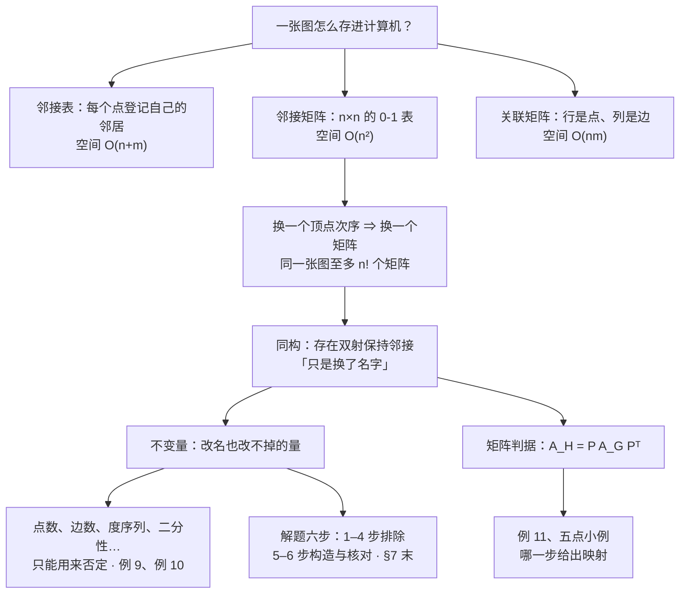

# C10.3 图的表示与图同构 Representing Graphs and Graph Isomorphism

> [!abstract] 这一讲的任务
> 上一讲把图这件事说清楚了：顶点、边、度、邻域，还有 $K_n$、$C_n$、$Q_n$ 这些反复出现的标准形状。但图那时还只活在纸上。这一讲办两件事。**第一，把图存进计算机**：同一张图有三种存法——邻接表（每点一张邻居名单）、邻接矩阵（一张 $n\times n$ 的 0-1 表格）、关联矩阵（一张"顶点乘边"的表格）——存法选错，同一个算法能从毫秒变分钟。**第二，回答"两个图算不算同一个"**：顶点名字可以随便改，结构没变就是同一个，这叫同构。第二件事比看上去难得多——核对一个候选的"改名方案"只要 $O(n^2)$，可候选方案有 $n!$ 个。整讲的一半篇幅都在教你怎么在不硬试 $n!$ 次的前提下做出判断，以及为什么"哪个量一样"永远不能替你下结论。

> [!info] 怎么读这份讲义
> 顺着读。§1–§4 是存法，§5–§9 是同构，§10 是延伸，赶时间可以跳过。
> 用到的旧知识只有两处：**第 2.6 节的矩阵**（下标 $(i,j)$、转置、乘法）和**第 9.3 节"关系用 0-1 矩阵表示"**——后者其实就是有向图的邻接矩阵，这里只是换了名字，看到 $a_{ij}$ 别慌。
> 一句话先说清勘误：这一节末尾那句"判定两个图是否同构，已知最好的算法是指数最坏时间"是旧状况（2015 年之前），现在已知有准多项式时间的算法，详见 §9。这一节其余的数字我都复算过，见各节。



---

## 0. 开场：两张网表，谁是谁

你在做固件安全。厂商 A 和厂商 B 各交来一份电路网表（netlist）：六千个元件，一万多条连线，元件编号是两家自己随便起的。你要回答两个问题。

**第一个问题**：这份网表怎么装进内存？如果每一行写成"元件 `Q1207` 与元件 `R88` 之间有连线"，那就是一张一万多行的清单。工程师每周要问几百万次"这两个元件之间有没有直接连线"——每次都从第一行扫到最后一行，一万多行扫一遍，谁都受不了。所以你得换个存法：要么给每个元件开一张"我挨着谁"的邻居名单，要么干脆铺一张 $6000\times 6000$ 的表格，格子填 0 或 1。

**第二个问题**：这两份网表是不是同一张电路图，只是元件编号不同？这不是学术问题。厂商 B 的芯片里如果含了厂商 A 的模块，两边的网表在"把元件名字对上"之后会一模一样；如果只是功能相同、结构不同，那怎么对都对不上。你手上有两份编号不同的六千点图，要判断它们"结构上是不是同一个东西"。

现在把六千换成五个，问题一模一样。同一个班的两份通讯录：一份按学号记"张三和谁玩得好"，另一份用昵称记。你要判断这两份名单记的是不是同一个朋友圈——**该比的不是名字，而是"谁挨着谁"这张关系网**。张三对应昵称"老三"以后，张三的朋友必须恰好是老三的朋友，一个不多一个不少。

你刚才做的这两件事，正是这一讲的全部内容：**表示 represent**（怎么把图写成机器能处理的东西）和**同构 isomorphism**（两个图什么时候算"同一个"）。它们的联系比看上去紧：一旦图被写成矩阵，"同构"就变成了一个纯粹的矩阵问题——**把一张矩阵的行和列重新排一排，能不能变成另一张**。

---

## 1. 邻接表：一个点一个点地登记它的邻居（p.668–669）

先说最省事的存法。图没有重边的时候，把边直接列成一张两列的清单——每行一条边，写它的两个端点。这叫**边清单 edge list**，是人都会写。

**撞墙**：边清单只能回答"一共有哪些边"。可图上大部分问题都是从一个点出发的——"$a$ 的邻居是谁""$a$ 的度是多少""$a$ 和 $c$ 之间有没有边"。为了回答"$a$ 的邻居有哪些"，你得把整张边清单从头读一遍，看哪些行里有 $a$：$m$ 行就是 $m$ 次比较。$m$ 是一万的时候还能忍，$m$ 是一百万的时候不能忍。

**朴素尝试**：既然问题总是"从一个点出发"，那就按点来组织。给每个顶点开一行，右列把它的邻居一个一个抄进去。

> [!important] 邻接表 Adjacency List
> 一张两列的表：左列每个顶点各占一行，右列是"这个顶点挨着谁"的名单——把每一个与它**相邻**的顶点都写进去（相邻、邻域这些词是上一讲的定义 1、2）。
> 无向图里，一条边 $\{u,v\}$ 会被登记两次：$u$ 的名单里有 $v$，$v$ 的名单里也有 $u$。

名字是字面意思：adjacency（邻接）+ list（表）。这就是一张"邻接关系"的表。

它依赖什么？什么都不依赖，就是数组或链表，任何语言用两层列表就能实现：

```text
a: b, c, e
b: a
c: a, d, e
d: c, e
e: a, c, d
```

> [!example] 例 1 一个简单图的邻接表
> 把下面这张图的邻接关系写成表：顶点 $a,b,c,d,e$，边是 $ab, ac, ae, cd, ce, de$。

![[C10.3-原图-邻接表一例.png]]

左边是图，右边是同一条信息的另一种写法。右边这张表编号为**表 1**。**同一张图的两份记录**：图让人一眼看出形状，表让机器一条一条读。这张表要逐格核对一遍，别照抄：

| 顶点 | 相邻顶点 | 记录个数 | 度 |
|---|---|---|---|
| $a$ | $b, c, e$ | 3 | 3 |
| $b$ | $a$ | 1 | 1 |
| $c$ | $a, d, e$ | 3 | 3 |
| $d$ | $c, e$ | 2 | 2 |
| $e$ | $a, c, d$ | 3 | 3 |

手算三件事：

1. **每行的记录个数正好等于这个点的度。** 这不是巧合：度就是"与它相邻的顶点个数"，而这一行记的正是全部相邻顶点。
2. **全部记录加起来是 12，而图只有 6 条边。** 每条边被记了两次（$ab$ 既出现在 $a$ 的行里，也出现在 $b$ 的行里），所以记录总数恒等于 $2m$。这正是上一讲握手定理 $\sum_v \deg(v)=2m$ 在数据结构里的样子——$3+1+3+2+3=12=2\times 6$。
3. **$b$ 那一行只有一个名字。** 所以 $\deg(b)=1$，$b$ 是悬挂点。反过来，如果某一行是空的，那个点就是孤立点。

**有向图要变一下**：边的方向不同，就不能笼统说"邻居"。有向图里只登记"从这个点出发的弧，终点是谁"。终点（terminal vertex）就是箭头指向的那个顶点。

> [!example] 例 2 有向图的邻接表
> 下图有五个顶点，弧包括 $a\to b$、$a\to c$、$a\to d$、$a\to e$、$b\to b$、$b\to d$、$c\to a$、$c\to c$、$c\to e$、$e\to b$、$e\to c$、$e\to d$；顶点 $d$ 没有出发的弧。用邻接表表示它。

| 起点 | 终点 | 出度 |
|---|---|---|
| $a$ | $b, c, d, e$ | 4 |
| $b$ | $b, d$ | 2 |
| $c$ | $a, c, e$ | 3 |
| $d$ | （空） | 0 |
| $e$ | $b, c, d$ | 3 |

手算：

- 一共 **12** 条弧。自环 $b\to b$、$c\to c$ 各算一条弧，各贡献 1 个出度和 1 个入度——上一讲有向图的度就是这么规定的。
- **$d$ 那一行是空的**，所以 $\text{outdeg}(d)=0$：$d$ 只有进、没有出。表里一眼能看出谁出度为 0，这就是"按起点组织"的好处。
- **入度在这张表里查不出来。** 想知道 $\text{indeg}(b)$，得把五行全扫一遍数 $b$ 出现了几次：$a$ 行有、$b$ 行有（自环）、$e$ 行有，共 3 次，所以 $\text{indeg}(b)=3$。出度和入度加起来都是 12，和有向握手定理一致。

**代价**：邻接表一共 $n$ 个表头加 $m$ 条记录（无向图是 $2m$ 条），所以空间是 $O(n+m)$。查一条边 $\{u,v\}$ 存不存在，最坏要把 $u$ 的整张名单扫完，是 $O(\deg u)$，最坏 $\Theta(|V|)$——这个数字在 §4 会用来和矩阵比。

---

## 2. 邻接矩阵：把"谁挨着谁"铺成一张表（p.669–670）

§1 的存法对"度数不大"的图很舒服。但通信网、赛程表、完全图这类图，每个点都连着几百个点，邻居名单长得像一本书。这时每次查一条边都要在那本"书"里翻，太亏。

**换一个视角**：既然顶点可以排成 $v_1,v_2,\dots,v_n$，那就画一张 $n\times n$ 的方格纸，第 $i$ 行第 $j$ 列这个格子回答一个问题："$v_i$ 和 $v_j$ 之间有没有边？"有就填 1，没有就填 0。

> [!important] 邻接矩阵 Adjacency Matrix
> 设简单图 $G=(V,E)$，$|V|=n$，顶点按某个次序排成 $v_1,v_2,\dots,v_n$。$G$ 关于这个次序的**邻接矩阵**是 $n\times n$ 的 0-1 矩阵 $\mathbf A=[a_{ij}]$：
> $$a_{ij}=\begin{cases}1, & \{v_i,v_j\}\ \text{是}\ G\ \text{的边},\\ 0, & \text{否则}.\end{cases}$$
> 名字里 adjacency（邻接）说的是：这个矩阵存的是"谁和谁邻接"，每个格子只回答一个是非题。

这个矩阵依赖第 2.6 节的矩阵下标约定：$a_{ij}$ 是第 $i$ 行第 $j$ 列。一句话人话：**行是"起点"，列是"终点"，格子填 0/1**。

动手之前必须先做一件事：**给顶点排个次序**。这一步看着无关紧要，却是整讲的伏笔——换一个排法，同一张图就得到另一张矩阵。

> [!example] 例 3 给图写邻接矩阵
> 图有四个顶点 $a,b,c,d$，边是 $ab, ac, ad, bc$。按 $a,b,c,d$ 的次序写出它的邻接矩阵。

第 1 行管 $a$：它和 $b,c,d$ 都相邻，所以是 $0,1,1,1$（对角格 $a_{11}$ 是"$a$ 和 $a$"，没有自环就是 0）。第 2 行管 $b$：它只和 $a,c$ 相邻，所以 $1,0,1,0$。往下照做：

$$\mathbf A=\begin{bmatrix}
0&1&1&1\\
1&0&1&0\\
1&1&0&0\\
1&0&0&0
\end{bmatrix}$$

**逐项核对**：

- 第 1 行三个 1，所以 $\deg(a)=3$；第 4 行只有一个 1，所以 $\deg(d)=1$。一般地，**无自环时第 $i$ 行的 1 的个数（行和）就是 $\deg(v_i)$**，第 $i$ 列的 1 的个数也一样。
- 矩阵**对称**：$a_{12}=a_{21}=1$，$a_{23}=a_{32}=1$。原因很直接：$\{a,b\}$ 是边和 $\{b,a\}$ 是边是同一句话。
- **对角线全是 0**，因为简单图没有自环。

> [!example] 例 4 反着来：给矩阵画图
> 画出以 $a,b,c,d$ 为次序、邻接矩阵如下的图：
> $$\begin{bmatrix}0&1&1&0\\1&0&0&1\\1&0&0&1\\0&1&1&0\end{bmatrix}$$

读第 1 行：$a$ 和 $b$、$c$ 相邻。读第 2 行：$b$ 和 $a$、$d$ 相邻。第 3 行：$c$ 和 $a$、$d$ 相邻。第 4 行：$d$ 和 $b$、$c$ 相邻。于是四条边是 $ab, ac, bd, cd$。画的时候把 $a,b$ 放上面、$c,d$ 放下面：$a$ 连 $b$ 和 $c$，$b$ 再连 $d$，$d$ 再连 $c$——正好是一个 4 圈 $a$-$b$-$d$-$c$-$a$。四个行和全是 2，每个点的度都是 2，和画出来的图对得上。

**自环和重边怎么办**？简单图的两个约定要松一松：对角线上出现 1 就表示这个点上有**自环**；格子里出现大于 1 的数就表示**重边**，数字就是重数。这时矩阵不再是 0-1 矩阵。

> [!example] 例 5 伪图的邻接矩阵
> 下图有四个顶点 $a,b,c,d$：$a$ 与 $b$ 之间有 3 条边，$a$ 与 $d$ 之间有 2 条，$b$ 与 $c$、$b$ 与 $d$ 之间各 1 条，$c$ 与 $d$ 之间有 2 条，$c$ 上还有 1 个自环。

![[C10.3-原图-伪图邻接矩阵一例.png]]

按 $a,b,c,d$ 的次序写出来：

$$\mathbf A=\begin{bmatrix}
0&3&0&2\\
3&0&1&1\\
0&1&1&2\\
2&1&2&0
\end{bmatrix}$$

**逐格核对**（这一步最容易抄错）：

| 格子 | 值 | 图上是什么 |
|---|---|---|
| $a_{12}=a_{21}$ | 3 | $a$ 与 $b$ 之间 3 条重边 |
| $a_{14}=a_{41}$ | 2 | $a$ 与 $d$ 之间 2 条 |
| $a_{23}=a_{32}$ | 1 | $b$ 与 $c$ 之间 1 条 |
| $a_{24}=a_{42}$ | 1 | $b$ 与 $d$ 之间 1 条 |
| $a_{34}=a_{43}$ | 2 | $c$ 与 $d$ 之间 2 条 |
| $a_{33}$ | 1 | $c$ 上 1 个自环 |

再算总账：五对顶点之间的重数 $3+2+1+1+2=9$ 条普通边，再加 1 个自环，一共 **10** 条边。度（自环按上一讲算 2）：$\deg(a)=3+2=5$，$\deg(b)=3+1+1=5$，$\deg(c)=1+2+2=5$，$\deg(d)=2+1+2=5$，度数和 $20=2\times10$ ✓。这个伪图四个点全是度 5。

> [!warning] 易错点：这里**自环在矩阵里只记 1**
> 注意上面 $a_{33}=1$，而 $\deg(c)$ 里这个自环贡献了 2。两者不矛盾——它们是两套约定。后果是：**有自环时，行和不再等于度**。第 3 行加起来是 $0+1+1+2=4$，而 $\deg(c)=5$，差的正好是"这个点上的自环数"（这里 1）。
> 记法：$\text{行和}=\deg(v_i)-(\text{该点的自环数})$。无自环的图上，两者才相等。

**有向图的邻接矩阵**更简单：$a_{ij}=1$ 当且仅当 $(v_i,v_j)$ 是弧。这时矩阵一般不**对称**——存在 $v_i\to v_j$ 不等于存在 $v_j\to v_i$。多重有向图同理，$a_{ij}$ 就是 $v_i\to v_j$ 方向上的弧数。行和是出度，列和是入度：

| | 行和 | 列和 |
|---|---|---|
| 无向图（无自环） | $\deg(v_i)$ | $\deg(v_i)$ |
| 有向图 | 出度 $\text{outdeg}(v_i)$ | 入度 $\text{indeg}(v_i)$ |

这一节的习题 28–31 专门问这两行，值得背下来：**行和看出度、列和看入度**，无向图时行列一致。

> [!note] 顺手一个伏笔：$\mathbf A^2$ 里有什么
> 按矩阵乘法，$(\mathbf A^2)_{ij}=\sum_k a_{ik}a_{kj}$，每一项 $a_{ik}a_{kj}$ 恰好在"$v_i$ 与 $v_k$ 相邻**且** $v_k$ 与 $v_j$ 相邻"时等于 1，所以求和就是"$v_i$ 到 $v_j$ 长度为 2 的走法数"。特别地，无自环时对角元 $(\mathbf A^2)_{ii}=\deg(v_i)$（每个邻居贡献一条来回），非对角元是共同邻居数。这一点会一路用到第 10.4 节"用 $\mathbf A^r$ 数走法"，这里只要记住：**矩阵的幂在数路径**。

> [!note] 专业关联
> 图神经网络（GNN）的每一层本质上都在做 $\tilde{\mathbf A}\mathbf X\mathbf W$：$\tilde{\mathbf A}$ 是邻接矩阵（常加自环、常按度归一化），$\mathbf X$ 是每个顶点的特征。$L$ 层堆叠就是 $\tilde{\mathbf A}^{L}$ 在起作用——也就是"每个点把 $L$ 跳以内邻居的信息聚合过来"。所以本节讲的"邻接矩阵 + 矩阵幂"，正是 GNN 那套消息传递的骨架；而真实图（社交网络、分子、知识图谱）几乎都是稀疏的，工程上必须用稀疏矩阵存，见 §4。

---

## 3. 关联矩阵：让顶点和边各占一边（p.671）

邻接矩阵有一个信息缺口：**边没有身份**。两条边如果端点相同（重边），矩阵里只能记个数字 3，你说不出"第 2 条边"和"第 3 条边"分别是哪条。可有些算法就是要逐条处理边，比如 10.5 的欧拉回路——它必须能标记"这条边已经走过了没有"。这时需要一种把**每条边单独占一列**的存法。

> [!important] 关联矩阵 Incidence Matrix
> 设无向图 $G=(V,E)$，顶点排成 $v_1,\dots,v_n$，边排成 $e_1,\dots,e_m$。**关联矩阵**是 $n\times m$ 的矩阵 $\mathbf M=[m_{ij}]$：
> $$m_{ij}=\begin{cases}1, & \text{边}\ e_j\ \text{与顶点}\ v_i\ \text{关联（即}\ v_i\ \text{是}\ e_j\ \text{的一个端点）},\\ 0, & \text{否则}.\end{cases}$$
> 一句话人话：**行是一个个顶点，列是一条条边，格子填 1 表示"这个点是这条边的端点"。**

名字里的 incidence 是"关联"，正是上一讲定义 1 里的 incident：顶点和边相接叫关联。注意形状：邻接矩阵是方的 $n\times n$，关联矩阵是**长条**的 $n\times m$。

> [!example] 例 6 给图写关联矩阵
> 下图有五个顶点 $v_1,\dots,v_5$ 和六条边 $e_1,\dots,e_6$：$e_1$ 连 $v_1v_4$，$e_2$ 连 $v_1v_5$，$e_3$ 连 $v_2v_4$，$e_4$ 连 $v_2v_5$，$e_5$ 连 $v_3v_5$，$e_6$ 连 $v_2v_3$。

![[C10.3-原图-关联矩阵一例.png]]

$$\mathbf M=\begin{array}{c|cccccc}
 & e_1&e_2&e_3&e_4&e_5&e_6\\ \hline
v_1&1&1&0&0&0&0\\
v_2&0&0&1&1&0&1\\
v_3&0&0&0&0&1&1\\
v_4&1&0&1&0&0&0\\
v_5&0&1&0&1&1&0
\end{array}$$

**三件事必须自己数一遍**：

1. **每一列恰好两个 1。** 因为每条边正好有两个端点。图里那两条交叉的边（$e_2$ 从 $v_1$ 斜下到 $v_5$、$e_3$ 从 $v_2$ 斜下到 $v_4$）看着乱，但列一对就清楚了：$e_2$ 的列是 $v_1,v_5$，$e_3$ 的列是 $v_2,v_4$。
2. **行和就是度。** 逐行数 1 的个数：$2,3,2,2,3$，和图上数的一致。理由：一个点每接一条边，它这一行就多一个 1。
3. **全部 1 的总数 $=12=2m$。** 又一次"每条边两个端点"。这也说明关联矩阵的每一列都是"把一条边的两个端点各点亮一次"。

> [!example] 例 7 伪图的关联矩阵
> 下图是伪图：$v_1$ 上 1 个自环，$v_1$ 与 $v_2$ 之间有 2 条边（$e_2,e_3$），$v_2$ 与 $v_3$ 之间 1 条（$e_4$），$v_3$ 与 $v_5$ 之间 1 条（$e_5$），$v_2$ 与 $v_5$ 之间 1 条（$e_6$），$v_2$ 与 $v_4$ 之间 1 条（$e_7$），$v_4$ 上 1 个自环（$e_8$）。

$$\mathbf M=\begin{array}{c|cccccccc}
 & e_1&e_2&e_3&e_4&e_5&e_6&e_7&e_8\\ \hline
v_1&1&1&1&0&0&0&0&0\\
v_2&0&1&1&1&0&1&1&0\\
v_3&0&0&0&1&1&0&0&0\\
v_4&0&0&0&0&0&0&1&1\\
v_5&0&0&0&0&1&1&0&0
\end{array}$$

这里两个新现象，都要记：

- **重边 = 两列一模一样。** $e_2$ 与 $e_3$ 的列都是 $(1,1,0,0,0)^{\mathsf T}$，因为它们是同一对顶点之间的两条边。所以关联矩阵里"列重复"不奇怪，正是重边的标志。
- **自环 = 那一列只有一个 1。** $e_1$ 的列只有 $v_1$ 一个 1，$e_8$ 的列只有 $v_4$ 一个 1。原因：自环的两个端点都是同一个顶点，写成"列"时只点一次灯。（和邻接矩阵的约定一致：那边自环只在对角线上记一个 1。）

算账：$m=8$ 条边（含 2 个自环），列和是 $(1,2,2,2,2,2,2,1)$，其中两个 1 就是两个自环列。行和是 $(3,5,2,2,2)$；而真正的度（自环按 2 计）是 $(4,5,2,3,2)$，差的正是各自的自环数。**度数和 $=16=2\times8$** ✓。

> [!tip] $\mathbf M\mathbf M^{\mathsf T}$ 把邻接信息装回来了
> 无重无环时，$(\mathbf M\mathbf M^{\mathsf T})_{ij}=\sum_k m_{ik}m_{jk}$ 数的是"同时是 $v_i$ 和 $v_j$ 端点的边数"：$i=j$ 时对角元 $=\deg(v_i)$，$i\neq j$ 时就是 $v_i$ 与 $v_j$ 之间的边数。例 6 算出来是
> $$\begin{bmatrix}2&0&0&1&1\\0&3&1&1&1\\0&1&2&0&1\\1&1&0&2&0\\1&1&1&0&3\end{bmatrix},$$
> 对角线上是度数，对角线外正是邻接矩阵的那些 1。所以关联矩阵没有丢信息，还能反推邻接矩阵（习题 69 问的就是这个）。但代价很大：$n\times m$ 个格子，比邻接矩阵的 $n^2$ 还多。

---

## 4. 表还是矩阵：稀疏与稠密的取舍（p.670–671）

三种存法都学会了，现在要回答"到底选哪个"。答案不在于哪个"更高级"，而在于**图有多稠密**。

先看空间。设 $n$ 个点、$m$ 条边：

| 存法 | 空间 | 查边 $\{v_i,v_j\}$ 在不在 | 列出 $v_i$ 的全部邻居 |
|---|---|---|---|
| 邻接表 | $O(n+m)$（无向是 $2m$ 条记录） | 最坏 $\Theta(n)$（扫 $v_i$ 的名单） | $O(\deg v_i)$，最优 |
| 邻接矩阵 | $O(n^2)$ | $O(1)$，一次下标 | $O(n)$（扫一整行） |
| 关联矩阵 | $O(nm)$ | 要扫两条边列 | 要扫所有列 |

**判据只有一句话：把 $m$ 和 $n^2$ 比。**

- 若 $m$ 是 $O(n)$ 量级（也就是"每个点的度不超过某个常数 $c\ll n$"），邻接表总共只有 $cn$ 条记录，而矩阵要 $n^2$ 个格子。这个差距是压倒性的，选表。
- 若边数已经超过"全部可能边 $n(n-1)/2$ 的一半"，即 $m>\frac{n(n-1)}{4}\approx\frac{n^2}{4}$，图就是**稠密 dense**的，选矩阵：空间差不多，但查边从 $O(n)$ 变成 $O(1)$，算法里这一步通常在最内层循环。

几个实数（都复算过）：

| $(n,m)$ | 邻接表项数 $n+m$ | 矩阵格子 $n^2$ | 关联矩阵格子 $nm$ | 谁赢 |
|---|---|---|---|---|
| $(8,10)$ | 18 | 64 | 80 | 表 |
| $(100,300)$ | 400 | 10 000 | 30 000 | 表（差 25 倍） |
| $(1000,3000)$ | 4 000 | 1 000 000 | 3 000 000 | 表（差 250 倍） |
| $(1000,499500)$，即 $K_{1000}$ | 500 500 | 1 000 000 | $4.995\times10^8$ | 矩阵（图太稠：多花 2 倍空间，换 $O(1)$ 查边，值） |

**稀疏 sparse / 稠密 dense** 这两个词就是字面意思：稀疏 = 边少，格子里绝大多数是 0；稠密 = 边多，格子大半是 1。

还有两点容易被忽略：

- 稀疏图的邻接矩阵乘出来是一个**稀疏矩阵**，可以只存非零元（每行存"列号 + 值"），那就退化成邻接表了。所以"矩阵"和"表"不是死对头，工程上真正的答案常常是稀疏矩阵格式。
- 关联矩阵是三种里最贵的（$nm$ 个格子）。只在算法必须**逐条处理边**时才值得，比如欧拉回路的"标记走过的边"、或者要存每条边的权。平时想都别想。

---

## 5. 同构：只换了名字（p.671–672）

现在换到第二个问题：两个图什么时候算"同一个"。

先把问题说清楚。你手上两张图，顶点名字不同、画法不同，但"结构"可能一样。化学上就是这样：分子式相同、原子成键方式不同的两种化合物叫**结构异构体**，它们对应的"分子图"（顶点是原子、边是化学键）不同构；反过来，一个"新合成"的化合物，如果它的分子图和数据库里某个旧化合物同构，那它其实早就被研究过了。电路也一样：自动化工具布完局，要验证"这个版图和原始电路图是不是同一张图"，靠的就是同构判定。指纹比对也是同一个思路：把指纹上的分叉点、端点当顶点，脊线连接当边，做成一张小图，两张指纹图若同构，就判为同一枚指纹。指纹比对和分子结构检验这两件事之所以能这么办，理由只有一条：**同一张图可以换无数种画法，而结构只有一套**。

**先拿三组画法问自己。** 同一张图，把顶点名字全换掉（$a,b,c,d$ 改成 $1,2,3,4$），还是同一张图吗？名字不动、只把某个顶点挪到别的位置，还是同一张图吗？名字和位置一起换呢？三个问题的答案都是"是"——**只要"哪个点和哪个点之间有边"没变，标签和位置怎么动都不影响**。这也是同构最短的说法：顶点有映射，边也有映射；原图里有一条边，映射过去还得有一条边，一条不多、一条不少。

三问背后是同一个道理，也正是这一整节的立足点：

> [!important] 结构才是本质，名字可以换
> 图的价值在结构，不在顶点叫什么。名字是人起的，位置是人摆的，真正属于这张图的只有**"谁挨着谁"这张关系网**。
> 所以"两个图是同一个"只有一种合理的含义：**存在一份顶点的一一对应，它同时把边也一一对应过去**——对照表换掉的是名字，换不掉的是结构。

**朴素尝试**：既然是"换名字"，那就把 $G$ 的点一个一个改名成 $H$ 的点，再看边对不对得上。改成什么名字？试试看。

**撞墙**：$n$ 个点改名为 $n$ 个点，一共有 $n!$ 种改法（§6 会算这笔账）。$n=20$ 时是 $2.4\times10^{18}$ 种。暴力试是不可能的。

先不管理论，把"算同一个"这句话写成精确定义。关键要求是：**改名要是一一对应的**，而且**改名前相邻的两个点，改名后一定还相邻**——反过来也要成立，不能"改完以后多出一条边"。

> [!important] 定义 1 同构 isomorphic
> 简单图 $G_1=(V_1,E_1)$ 与 $G_2=(V_2,E_2)$ **同构**，如果存在一个从 $V_1$ 到 $V_2$ 的**双射** $f$（一对一且到上 one-to-one and onto），使得对 $V_1$ 中所有的 $a,b$：
> $$a\ \text{与}\ b\ \text{在}\ G_1\ \text{中相邻}\iff f(a)\ \text{与}\ f(b)\ \text{在}\ G_2\ \text{中相邻}.$$
> 这样的 $f$ 称为一个**同构 isomorphism**。不同构的两个简单图称为**非同构 nonisomorphic**。

一句话人话：**同构就是一个"改名方案"——点一一对上，而且"谁挨着谁"这张关系网一个字没变。** 同构的两个图，从图论的角度看就是同一个对象。

名字来源：iso-（相等）+ morphe（形状），希腊词根，意思是"同形"。这一页的脚注特意标了这一点，因为这不是人名，是可以拆开看的。

**"边也被映射"这句要落到手上。** 同构常被一句话概括成**保持邻接的双射 edge-preserving vertex matching**：双射管的是**顶点**，保持邻接管的是**边**。两件事分开记，核的时候才不漏：手上要同时有两份清单——一份**顶点对照表** $u\mapsto f(u)$，一份是它带出来的**边对照表** $uv\mapsto f(u)f(v)$。下面例 8 就是把两份表都摆出来核一遍。

> [!warning] 易错点：为什么必须是双射、为什么用"当且仅当"
> **为什么双射？** 如果只要求"一一"（单射）不要求"到上"，那么任何小图都能"塞进"大图：$C_4$ 的四个点可以映到 $K_{100}$ 的四个点上，相邻还是相邻。可 $C_4$ 和 $K_{100}$ 根本不是同一个东西——前者只有 4 条边，后者有 4950 条。**双射保证两边点数相同，也保证 $f$ 可以反着用。**
> **为什么用"当且仅当"而不是单向？** 因为只核"相邻 $\Rightarrow$ 相邻"是不够的：这时 $f$ 把 $G_1$ 的 $m_1$ 条边映成 $G_2$ 的 $m_1$ 条互不相同的边，只能推出 $m_1\le m_2$。若再核一下 $m_1=m_2$，那么多出来的边无处可去，反向自动成立。定义 1 直接把两边都写进去了，省掉这一步。**考试里给一个映射让你验证时，两条都要核**（或者核一条 + 数边数）。

> [!example] 例 8 一个保持邻接的双射
> 两个图都是 4 个点。$G$ 的顶点是 $u_1,u_2,u_3,u_4$，边是 $u_1u_2,u_1u_3,u_2u_4,u_3u_4$；$H$ 的顶点是 $v_1,v_2,v_3,v_4$，边是 $v_1v_3,v_1v_4,v_2v_3,v_2v_4$（画出来像个"领结"，和 $G$ 的正方形样子完全不同）。证明它们同构。

取 $f(u_1)=v_1$，$f(u_2)=v_4$，$f(u_3)=v_3$，$f(u_4)=v_2$。这是一个双射（四个点各去一个、各来一个）。

把 $G$ 的四条边搬过去：

| $G$ 的边 | 搬到 $H$ 里 | 在 $H$ 的边集里？ |
|---|---|---|
| $u_1u_2$ | $v_1v_4$ | ✓ |
| $u_1u_3$ | $v_1v_3$ | ✓ |
| $u_2u_4$ | $v_4v_2$ | ✓ |
| $u_3u_4$ | $v_3v_2$ | ✓ |

四条边一条不多一条不少，正好是 $H$ 的全部边。所以 $f$ 是同构，$G$ 与 $H$ 同构。

**这件事的教训**：画得像不像跟同构没关系。$G$ 画成方框、$H$ 画成交叉，纯粹是画法；两张图的边数、度数、结构全一样。**判定同构要看关系网，不要看图形。**

**同构是等价关系**（习题 45）。三条各一句理由：

- 自反：$G$ 到自己的恒等映射是双射且保持邻接，所以 $G\cong G$。
- 对称：若 $f$ 是同构，那么 $f^{-1}$ 也是双射；"$f(a),f(b)$ 相邻 $\iff$ $a,b$ 相邻"反过来写就是 $f^{-1}$ 保持邻接，所以 $G_2\cong G_1$。
- 传递：若 $f:G_1\to G_2$、$g:G_2\to G_3$ 都是同构，则 $g\circ f$ 是双射，且相邻性一路传递，所以 $G_1\cong G_3$。

这一条不是装饰：正因为同构是等价关系，"把所有 $n$ 点简单图按同构分类"才有意义（比如 4 个点的简单图一共只有 11 类）。

---

## 6. 为什么不能硬试：$n!$ 个双射（p.672）

两个 $n$ 点图之间有多少个双射？给 $G$ 的第一个点挑一个去向：$n$ 种；第二个点：$n-1$ 种；……乘起来就是 $n!$。这个数字长得极快：

| $n$ | $n!$ | 按每秒核对 $10^9$ 个映射 |
|---|---|---|
| 5 | 120 | 眨眼之间 |
| 6 | 720 | 眨眼之间 |
| 7 | 5 040 | 眨眼之间 |
| **8** | **40 320** | 无需一秒 |
| 10 | 3 628 800 | 0.004 秒 |
| 12 | 479 001 600 | 0.5 秒 |
| 15 | 1 307 674 368 000 | 约 22 分钟 |
| 20 | 2 432 902 008 176 640 000 | 约 77 年 |

（$8!=40320$ 这个数记一下：小到能手工验证，大到已经不可能"随手列一遍"，是个很好的分水岭。）

所以判定同构的算法必须做两件事，也就是后面两节的主题：

1. **先用不变量砍**：找出一些"同构必然相同"的量，两边对不上就立刻否定，一秒钟结束（§7）。
2. **再用结构钉死映射**：从度数最特殊的点开始，用"相邻的点必须映到相邻的点"一步步把映射逼出来，不给它自由（例 11）。

而"到底要试多少个"这件事本身，就是 §9 的复杂度问题。

---

## 7. 不变量：只能用来否定（p.672–673）

上一节说"先砍"。砍的工具叫不变量。

> [!important] 不变量 Graph Invariant
> 一个在同构下保持不变的性质（或数值）叫**图的（同构）不变量**：两个图同构，则它们在这条性质上必然一致。换句话说，不变量是"同构的两个图都必须通过"的体检项。

一句话人话：**不变量就是"改名字改不掉的东西"**。名字能改，点数和边数改不掉；一个点连几条边，改名也改不掉。所以只要发现两张图在某个体检项上不一样，就可以立刻宣布不同构。

这里有个方向上的不对称，先把它说透：**证明同构要交出一份映射，证明不同构只要抓住一条被违反的不变量。** 前者得把整张对照表摆出来逐条核对；后者发现"有一项对不上"就当场收工。所以拿到两个图，第一反应永远是"先找不同"，而不是"先找映射"——本节末尾那条六步顺序就是从这里来的。

为什么最基本的三个是点数、边数、度序列？

- **点数**：$f$ 是双射，$|V_1|=|V_2|$。
- **边数**：$f$ 把 $G_1$ 的每条边映成 $G_2$ 的一条边，而且不同边映成不同边（因为 $f$ 一对一），反过来也一样，所以 $m_1=m_2$。
- **度序列**：若 $v$ 在 $G_1$ 中的邻居是 $w_1,\dots,w_d$，那么 $f(w_1),\dots,f(w_d)$ 就是 $f(v)$ 在 $G_2$ 中的邻居——一个不多一个不少（因为 $f$ 是双射，$f(v)$ 的每个邻居都必须是某个 $f(w)$）。所以 $\deg(f(v))=\deg(v)$。**度序列（把度排好序的多重集）因此是不变量。**

> [!example] 例 9 五秒钟就能否定
> 两个图都 5 个点、6 条边，判断它们是否同构。

![[C10.3-原图-同构不变量两例.png]]

左边是这两个图（图 9）。$G$ 的边是 $ab,bc,cd,de,ea$ 再加 $ec$——一个五边形加一条弦。$H$ 的边是 $ab,bc,cd,da,ac,ae$。

**点数 5 = 5，边数 6 = 6，看起来还得再算。** 那就数度：

| | 各点度 | 度序列 |
|---|---|---|
| $G$ | $a\,2,\ b\,2,\ c\,3,\ d\,2,\ e\,3$ | $(3,3,2,2,2)$ |
| $H$ | $a\,4,\ b\,2,\ c\,3,\ d\,2,\ e\,1$ | $(4,3,2,2,1)$ |

**$H$ 里 $e$ 的度是 1（它只连着 $a$），$G$ 里一个度 1 的点都没有。** 排除，不同构。

这就是最省力的一步：不用找映射、不用比结构，数一下度就够了。

> [!example] 例 10 不变量全部通过之后
> 两个图都 8 个点、10 条边，判断它们是否同构。

还是上面那张图（图 10）。先数不变量：

| | 点数 | 边数 | 度 2 的点 | 度 3 的点 |
|---|---|---|---|---|
| $G$ | 8 | 10 | $a,c,e,g$ | $b,d,f,h$ |
| $H$ | 8 | 10 | $t,u,x,y$ | $s,v,w,z$ |

**全部一致。** 不变量一点用都没有了——这一步之后，还没有任何理由说它们不同构。得换武器。这里有两条独立的排除路径，都能走通。

**路径一：抓住"度 2 的点里最特殊的那一个"。**

$G$ 里的 $a$ 度是 2，它的两个邻居是 $b$ 和 $d$，**两个都是度 3**。所以 $a$ 的特点是：**它不与任何度 2 的点相邻**。

那 $a$ 在 $H$ 里能去哪儿？$f$ 必须把度 2 映到度 2，所以候选只有 $t,u,x,y$。可是这四个点在 $H$ 里都挨着至少一个度 2 的点：$t$ 挨 $u$（度 2），$u$ 挨 $t$（度 2），$x$ 挨 $y$（度 2），$y$ 挨 $x$（度 2）。**四个候选点全都不合格，$a$ 无处安放**，所以不同构。

这一步的机理解释清楚：$f$ 保持邻接，所以 $f(a)$ 的邻居集合必须是 $\{f(b),f(d)\}$，全是度 3 的点；而 $H$ 里四个度 2 的点没有一个是这样的。

**路径二：只看度 3 的点，把它们之间的边也留下来。**

这个"只取出度 3 的点和它们之间的边"得到的东西叫**诱导子图**（上一讲末尾讲子图时定义过：顶点集定死，边要么全取、要么全不取，不能取一半）。

- $G$ 侧：度 3 的点是 $b,d,f,h$，它们之间只有两条边 $bf$ 和 $dh$，所以这个子图是"两条互不相邻的边"。
- $H$ 侧：度 3 的点是 $s,v,w,z$，它们之间的边是 $sv, sw, vz, wz$，正好围成一个 4 圈 $s$-$w$-$z$-$v$-$s$。

**为什么这也算不变量？** 因为 $f$ 把度 3 的点映到度 3 的点，还保持边，所以 $G$ 的度 3 子图在 $f$ 之下必须整个落进 $H$ 的度 3 子图里，而且仍然同构。两条孤立边怎么可能同构于一个 4 圈？**不同构。**

结论：不变量只完成了"初筛"，真正的判决要靠"找出一个改名方案必须满足、但两边不可能同时满足的要求"。

> [!question] 停一下，先自己想想
> 例 10 其实还有第三条排除路径，前面两条都用不着：只取"度 2 的点和它们之间的边"。
> 在 $G$ 里，$a,c,e,g$ 这四个度 2 的点的邻居**全是**度 3 的点，所以它们之间一条边都没有——这个子图是四个孤立点。在 $H$ 里，$t$ 与 $u$ 相邻、$x$ 与 $y$ 相邻，这个子图是两条孤立边。
> 一边是 $4K_1$，一边是 $2K_2$，**不同构**，照样能立刻否定。
> 那为什么另外两条路更常被想到？因为**没有哪一层保证一定管用**——哪层先出现不一致，就在哪层收工。经验顺序：先看度数最特殊的点（$a$ 那种"邻居都比自己度高"的点最值得先看），再按度数分层做诱导子图，一层层往下挖。

### 不变量清单

按"要好算"到"要费劲"排，实际做题按这个顺序往上试：

| 层级 | 不变量 | 怎么用 |
|---|---|---|
| 一眼 | 点数、边数 | 不同就否定 |
| 数一数 | 度序列、度 1 的点数、度 0 的点数 | 不同就否定 |
| 数一数 | 连通分量个数、二分性 | 不同就否定 |
| 要算 | 圈的长度谱、直径、割点/割边、$k$ 连通度 | 不同就否定 |
| 要算 | 里面"长着"哪些小结构：三角形个数、含哪几棵小树、某个固定图的出现次数 | 不同就否定（结构计数是不变量：$f$ 把 $G$ 的每棵子树原样搬到 $H$ 里） |
| 挖结构 | "度 $\ge k$ 的点 + 它们之间的边"诱导出的子图 | 不同构就否定（例 10 的路径二） |
| 线性代数 | 邻接矩阵的特征值谱（同构 $\Rightarrow$ 相似 $\Rightarrow$ 同谱） | 谱不同就否定 |

> [!warning] 易错点：不变量相同**什么都不能证明**
> 这正是例 10 的局面：所有初筛项都通过了，两个图仍然不同构。三个经典反例记住：
> - $C_3\cup C_3$ 与 $C_6$：度序列全是 $2$，但前者含三角形（不二分），后者二分；
> - $K_{1,4}$ 与 $C_4\cup K_1$（四点圈加一个孤立点）：两者邻接矩阵的特征值谱都是 $2,0,0,0,-2$，却不同构——度数一看就露馅：一个是"一个度 4 加四个度 1"，一个是"四个度 2 加一个度 0"；
> - 例 10 那两个 8 点图。
> 所以"没有好用的不变量能判定同构"这句话要读准——不是没有不变量，而是**没有一套既好算、又完备的**。完备的不变量当然有（把整个图存下来就是），但那样它就等于图本身，判定还得回到原点。

### 判同构的解题顺序：先排除，再构造

§6 末尾那两件事（先用不变量砍、再构造映射钉住）落到纸面上，就是一条固定的六步流程。**顺序不能换**：前四步便宜，一旦不符立刻结束；从第五步起才开始花力气。

| 步 | 问什么 | 拿什么比 | 不符时 |
|---|---|---|---|
| 1 | 点数一样吗 | $\lvert V_1\rvert$ 与 $\lvert V_2\rvert$ | 写"不同构"，收工 |
| 2 | 边数一样吗 | $\lvert E_1\rvert$ 与 $\lvert E_2\rvert$ | 同上 |
| 3 | 度序列一样吗 | 两边排好序的**多重集** | 同上 |
| 4 | 更细的不变量一样吗 | 度 1／度 0 的点数、连通分量数、二分性、三角形个数、"度 $\ge k$ 的点诱导出的子图"……（完整清单见上表） | 同上 |
| 5 | 能构造出映射吗 | 从**最特殊**的点下手，顺着邻接一个个逼出来（例 11 的做法） | 换一个映射重试，**不能**据此说不同构 |
| 6 | 这个映射真保边吗 | 逐条搬边，或行列同步重排后逐格比矩阵（§8） | 同上 |

**1–4 步只能否定，5–6 步才能肯定。** 整条流程的意义就在这条分界上。还要注意第 4 步和"结构不同"是同一件事的两种说法：所谓"结构不一样"，最终必须落实成某个**数得出来的差异**（多一个三角形、少一个连通块、诱导子图不同构），否则它只是个感觉。

> [!example] 6 点 4 边：前三项全过，仍然不同构
> 两张图都是 6 个顶点、4 条边，度序列都是 $(2,2,2,1,1,0)$。按上表的顺序走一遍。

| 步 | $G_1$ | $G_2$ | 结论 |
|---|---|---|---|
| 1 点数 | 6 | 6 | 过 |
| 2 边数 | 4 | 4 | 过 |
| 3 度序列 | $(2,2,2,1,1,0)$ | $(2,2,2,1,1,0)$ | 过 |
| 4 三角形个数 | 1 | 0 | **否** |

第 4 步为什么一定能分开？因为**这一组参数（6 点、4 边、度序列 $(2,2,2,1,1,0)$）一共只容得下两类图**。$K_6$ 有 $\binom62=15$ 条候选边，从里面选 4 条一共 $\binom{15}{4}=1365$ 种选法，其中度序列正好是 $(2,2,2,1,1,0)$ 的有 420 张；把这 420 张按同构归类，只剩两类（60 张一类、360 张一类）：

- **一个三角形 + 一条边 + 一个孤立点**：度数是 $2,2,2$、$1,1$、$0$，正好凑成 $(2,2,2,1,1,0)$；
- **一条 5 点路径 + 一个孤立点**：度数是 $2,2,2,1,1$ 再加一个 $0$，也正好是 $(2,2,2,1,1,0)$。

差别一眼可见：前一类**含三角形**，后一类是森林（一堆互不相连的树），一个三角形也数不出来。既然这一组参数只有这两类，那么两张"前三项全同却不同构"的图只能是一类各一张——数一下三角形就分开了，根本用不着构造映射。

> [!warning] 正反两问别答反
> $G_1\cong G_2$ **推出**：点数相同、边数相同、度序列相同（这三问都答 yes）。
> 反方向**一条都不成立**：点数相同 $\Rightarrow$ 同构？否。边数相同 $\Rightarrow$ 同构？否。度序列相同 $\Rightarrow$ 同构？否。
> 这一栏最容易顺手答反。逻辑上的说法是：这三个量都是**必要**条件，不是**充分**条件；必要条件各自成立推不出同构，必须所有条件同时成立才"有可能"同构，然后还要过第 5 步。

习题里那类"给一张 $G_1$、再从几个候选图里挑出与它同构的那一个"的题，就按这个顺序做：先用 1–4 步把候选砍到一两个，再对剩下的构造映射、用 §8 的矩阵核对。省力的地方正在这里——不变量便宜且能一次砍掉大半，映射贵，只该留给最后那一两个。

> [!note] 专业关联
> "用不变量迭代加强"这件事，在机器学习里有个一模一样的版本。把每个点的初始标签设成它的度，然后反复做"我的新标签 = 我的旧标签 + 邻居旧标签的多重集"，几轮之后比较两边每个点的标签——这就是 **Weisfeiler–Leman 检验**。它比单看度序列强得多，但仍然**判不了同构**（有同构但 WL 分不开的反例）。而 GNN 的消息传递在表达力上恰好不超过 1-WL（这是 2019 年前后的著名结论）。所以这一节讲的"不变量只能否定"，不是一句保守的告诫，而是**任何"逐点聚合邻居信息"的方法都逃不掉的天花板**。

---

## 8. 把 $A_G$ 重排成 $A_H$：同构的矩阵判据（p.673–674）

§7 教的是"怎么否定"。可要证明**同构**，你必须拿出一个映射，并且证明它保持邻接——例 8 就是这么做的。图大了以后，"逐条边搬一遍"容易漏，需要一种机械的核对法。

**核对法的思路**：同构 $f$ 说"$u$ 和 $v$ 相邻 $\iff$ $f(u)$ 和 $f(v)$ 相邻"。那么在 $A_G$ 里，如果**把第 $i$ 行、第 $i$ 列的名字从 $u_i$ 改成 $f(u_i)$**（行列同时改，保持"对角线上还是同一个点"），得到的矩阵跟 $A_H$ 应该是同一张——因为两个矩阵的 $(a,b)$ 格子记录的都是"$a$ 和 $b$ 是否相邻"这同一件事。

例 11 就是这么核的：把 $A_G$ 的行列标成 $u_1,\dots,u_6$，把 $A_H$ 的行列标成 $v_6,v_3,v_4,v_5,v_1,v_2$（正好是 $f(u_1),\dots,f(u_6)$），然后发现两个矩阵**逐格相同**。

### 这个"只差行列重排"为什么等价于双射条件

这是本讲最值得讲清的一步。设 $f:V_G\to V_H$ 是双射，定义 $n\times n$ 的**置换矩阵 permutation matrix** $P$：它的第 $f(u)$ 行、第 $u$ 列填 1，其余全 0：

$$P_{f(u),\,u}=1\quad(u\in V_G).$$

因为 $f$ 是双射，$P$ 的**每一行恰有一个 1，每一列恰有一个 1**（一行管一个 $v$，一列管一个 $u$：每个 $v$ 恰好是一个 $u$ 的像，所以列满了；每个 $u$ 恰好有一个像，所以行也满了）。

现在算 $P\mathbf A_G P^{\mathsf T}$ 的 $(a,b)$ 格：

$$(P\mathbf A_G P^{\mathsf T})_{ab}=\sum_{i,j}P_{ai}\,(\mathbf A_G)_{ij}\,P_{bj}=\sum_{i,j}P_{ai}\,(\mathbf A_G)_{ij}\,(P^{\mathsf T})_{jb}.$$

$P_{ai}$ 只在 $a=f(i)$ 时为 1，即 $i=f^{-1}(a)$；同理 $j=f^{-1}(b)$。所以求和只剩一项：

$$(P\mathbf A_G P^{\mathsf T})_{ab}=(\mathbf A_G)_{f^{-1}(a),f^{-1}(b)}.$$

而 $(\mathbf A_G)_{f^{-1}(a),f^{-1}(b)}=1$ $\iff$ $f^{-1}(a)$ 与 $f^{-1}(b)$ 在 $G$ 中相邻 $\iff$ $a$ 与 $b$ 在 $H$ 中相邻 $\iff$ $(\mathbf A_H)_{ab}=1$。**两个方向都用上了**：从 $1$ 推 $1$ 用的是"相邻 $\Rightarrow$ 相邻"；从 $0$ 推 $0$ 用的是"不相邻 $\Rightarrow$ 不相邻"。这正是定义 1 为什么要把话说成"当且仅当"——少写一半，这个矩阵等式就只能推出单向的包含关系，反推不过来。于是

$$\boxed{\ P\mathbf A_G P^{\mathsf T}=\mathbf A_H\ }$$

反过来也成立：若存在这样的置换矩阵 $P$，就令 $f(u)$ 为 $P$ 在第 $u$ 列那一行的行标，$f$ 自动是双射，上面的等式倒着读就给出"$a,b$ 相邻 $\iff$ $f(a),f(b)$ 相邻"。所以

> [!important] 同构的矩阵判据
> 两个 $n$ 点简单图 $G,H$ 同构 $\iff$ 存在 $n\times n$ 的置换矩阵 $P$，使 $P\mathbf A_G P^{\mathsf T}=\mathbf A_H$。
> 一句话人话：**同构 = 两张邻接矩阵只差一次"行列同步重排"。** 左乘 $P$ 换行的次序，右乘 $P^{\mathsf T}$ 换列的次序，两个动作必须用同一个置换，因为"第 $i$ 行"和"第 $i$ 列"说的是同一个顶点。

这也顺手解释了 §2 那句"同一张图至多有 $n!$ 个邻接矩阵"：$n!$ 个排法对应 $n!$ 个 $P$，对应 $n!$ 张矩阵。而"同构"问的是：**$G$ 那一堆里，有没有一张正好等于 $H$ 那一堆里的某一张**。

> [!example] 例 11 六点七边：先钉死，再核对
> 两个图都 6 个点、7 条边，判断是否同构。

两个图的邻接矩阵（$G$ 的行列按 $u_1,\dots,u_6$；$H$ 的行列按 $v_1,\dots,v_6$）：

$$\mathbf A_G=\begin{array}{c|cccccc}
 & u_1&u_2&u_3&u_4&u_5&u_6\\ \hline
u_1&0&1&0&1&0&0\\
u_2&1&0&1&0&0&1\\
u_3&0&1&0&1&0&0\\
u_4&1&0&1&0&1&0\\
u_5&0&0&0&1&0&1\\
u_6&0&1&0&0&1&0
\end{array}$$

先数不变量：两边都 6 点 7 边；$G$ 的度是 $(2,3,2,3,2,2)$，$H$ 也是四个度 2、两个度 3。再往下挖一层——只取度 2 的点和它们之间的边：$G$ 侧是 $u_5u_6$ 这一条边，加上两个不相邻的 $u_1,u_3$；$H$ 侧是 $v_1v_2$ 这一条边，加上两个孤立的 $v_4,v_6$。两边都是"一条边 + 两个孤立点"，**这一层也一致**。初筛全过，值得动手找映射。

**第一步：钉 $u_1$。** $\deg(u_1)=2$，而且它的两个邻居 $u_2,u_4$ 都是度 3——所以 $u_1$ 只能去 $H$ 里"度为 2、且邻居全是度 3"的点。$H$ 中度 2 的四点是 $v_1,v_2,v_4,v_6$，逐个查：$v_1$ 挨着 $v_2$（度 2）——不合格；$v_2$ 挨着 $v_1$（度 2）——不合格；$v_4$ 的两个邻居是 $v_3,v_5$，都是度 3——合格；$v_6$ 的两个邻居也是 $v_3,v_5$——合格。所以 **$f(u_1)$ 只能是 $v_4$ 或 $v_6$**。不妨取 $f(u_1)=v_6$（走不通就回头试 $v_4$）。

**第二步：顺着邻接往下压。** $u_2$ 挨 $u_1$，所以 $f(u_2)$ 必须是 $v_6$ 的邻居：$v_3$ 或 $v_5$。取 $f(u_2)=v_3$。$u_3$ 挨 $u_2$（且不和 $u_1$ 相邻），$v_3$ 的邻居里排除已用掉的 $v_6$，还剩 $v_4,v_2$；取 $f(u_3)=v_4$。$u_4$ 度是 3 且挨 $u_3$，$v_4$ 的邻居里只剩 $v_5$ 可用，取 $f(u_4)=v_5$。$u_5$ 挨 $u_4$，$v_5$ 的邻居里只剩 $v_1$，取 $f(u_5)=v_1$。最后 $u_6$ 只能去剩下的 $v_2$，检查它挨 $u_2$ 和 $u_5$：$v_2$ 确实挨 $v_3$ 和 $v_1$ ✓。

得到的对应是：

$$f(u_1)=v_6,\quad f(u_2)=v_3,\quad f(u_3)=v_4,\quad f(u_4)=v_5,\quad f(u_5)=v_1,\quad f(u_6)=v_2.$$

**第三步：用矩阵核。** 把 $A_G$ 的行列按上面这个顺序改名为 $v_6,v_3,v_4,v_5,v_1,v_2$，得到

$$\mathbf A_H=\begin{array}{c|cccccc}
 & v_6&v_3&v_4&v_5&v_1&v_2\\ \hline
v_6&0&1&0&1&0&0\\
v_3&1&0&1&0&0&1\\
v_4&0&1&0&1&0&0\\
v_5&1&0&1&0&1&0\\
v_1&0&0&0&1&0&1\\
v_2&0&1&0&0&1&0
\end{array}$$

逐格和 $A_G$ 比：一模一样（注意这是 $H$ 的邻接矩阵**按 $f$ 的顺序重排**之后的版本，不是 $H$ 按 $v_1,\dots,v_6$ 排的版本）。所以 $f$ 保持邻接，$G\cong H$。

> [!warning] 易错点：这一条不能倒过来用
> 这里有个必须强调的坑：**如果你试的这个 $f$ 失败，并不能说明两个图不同构**——因为可能有另一个对应才是同构。$f$ 成功 $\Rightarrow$ 同构；$f$ 失败 $\Rightarrow$ 什么都不知道，换一个 $f$ 再试。要否定，得用 §7 的不变量（例 9、例 10 的做法）。

### 五点上手算一遍：$P\mathbf A_G P^{\mathsf T}=\mathbf A_H$

把例 11 的做法压到 5 个点，全部手算，正好看清置换矩阵在做什么。

$G$ 的顶点是 $u_1,\dots,u_5$，边是 $u_1u_2,\ u_2u_3,\ u_3u_4,\ u_4u_5,\ u_5u_1,\ u_1u_3$（五边形加一条弦）。$H$ 的顶点是 $v_1,\dots,v_5$，边是

$$v_1v_3,\ v_1v_5,\ v_2v_4,\ v_2v_5,\ v_3v_4,\ v_4v_5.$$

两张图各画成什么形状都行；重要的是它们**度数都是** $(3,2,3,2,2)$：$G$ 里 $u_1,u_3$ 是度 3，$H$ 里 $v_4,v_5$ 是度 3。

取对应 $f$：$u_1\mapsto v_4$，$u_2\mapsto v_2$，$u_3\mapsto v_5$，$u_4\mapsto v_1$，$u_5\mapsto v_3$。逐条核边：

| $G$ 的边 | 搬过去 | 在 $H$ 的边集里？ |
|---|---|---|
| $u_1u_2$ | $v_4v_2$ | ✓ |
| $u_2u_3$ | $v_2v_5$ | ✓ |
| $u_3u_4$ | $v_5v_1$ | ✓ |
| $u_4u_5$ | $v_1v_3$ | ✓ |
| $u_5u_1$ | $v_3v_4$ | ✓ |
| $u_1u_3$ | $v_4v_5$ | ✓ |

六条全中，所以它们同构。现在用矩阵把这件事算一遍：

$$\mathbf A_G=\begin{bmatrix}
0&1&1&0&1\\
1&0&1&0&0\\
1&1&0&1&0\\
0&0&1&0&1\\
1&0&0&1&0
\end{bmatrix},\qquad
P=\begin{bmatrix}
0&0&0&1&0\\
0&1&0&0&0\\
0&0&0&0&1\\
1&0&0&0&0\\
0&0&1&0&0
\end{bmatrix},\qquad
\mathbf A_H=\begin{bmatrix}
0&0&1&0&1\\
0&0&0&1&1\\
1&0&0&1&0\\
0&1&1&0&1\\
1&1&0&1&0
\end{bmatrix}$$

$P$ 的读法：**第 $j$ 列的那个 1 落在第 $f(u_j)$ 行**。所以第 1 列（$u_1$）的 1 在第 4 行（$v_4$），第 2 列的 1 在第 2 行，第 3 列在第 5 行，第 4 列在第 1 行，第 5 列在第 3 行。每一行、每一列都恰好一个 1。

挑三个格子手验 $P\mathbf A_G P^{\mathsf T}$：

- $(a,b)=(1,3)$：$f^{-1}(1)=u_4$，$f^{-1}(3)=u_5$，查 $(\mathbf A_G)_{45}=1$；右边 $(\mathbf A_H)_{13}=1$ ✓。
- $(a,b)=(1,2)$：$f^{-1}(1)=u_4$，$f^{-1}(2)=u_2$，查 $(\mathbf A_G)_{42}=0$；右边 $(\mathbf A_H)_{12}=0$ ✓。
- $(a,b)=(2,4)$：$f^{-1}(2)=u_2$，$f^{-1}(4)=u_1$，查 $(\mathbf A_G)_{21}=1$；右边 $(\mathbf A_H)_{24}=1$ ✓。

全部 25 个格子这么对一遍（写个小程序 3 行就够），结果 $P\mathbf A_G P^{\mathsf T}=\mathbf A_H$，确认同构。

有意思的是**不相等的那部分**：$A_G\neq A_H$（第 1 行就不一样），可它们同构。比较行和：$A_G$ 的行和是 $(3,2,3,2,2)$，$A_H$ 的是 $(2,2,2,3,3)$——**同一个多重集、不同排列**。这正是"重排"两个字的来历：同构在这张矩阵上留下的痕迹，就是行和列被重排过。

![[C10.3-同构即重排行列.png]]

上排左边是 $G$ 按 $u_1,\dots,u_5$ 绕圈画出来（橙色是弦 $u_1u_3$），右边是 $H$ 按 $v_1,\dots,v_5$ 绕圈画出来——同一个五边形加弦，但名字换了位置，看上去完全不像；下排三张矩阵分别是 $A_G$、$P$、$A_H$。图只是印证：**"结构相同"这件事落在矩阵上，就是一句 $P\mathbf A_G P^{\mathsf T}=\mathbf A_H$。**

> [!note] 这个判据能当算法用吗
> 不能直接当。判据里那个"存在 $P$"要你从 $n!$ 个 $P$ 里挑一个——不过是把 §6 那 $n!$ 个映射换了身矩阵的衣服。它的价值有三个：
> ① **手算时的机械核对法**——例 11 用它一眼看出"两张矩阵是不是逐格相同"，比搬六条边更不容易漏；
> ② **解释"同构是等价关系"**：置换矩阵对乘法封闭、$P^{-1}=P^{\mathsf T}$，于是"同构"就是"在 $P$ 作用下的同一个轨道"，自反、对称、传递全部自动成立；
> ③ **引出真正可算的量**：矩阵在"行列同步重排"下不变的量（特征值、秩、行列式）都是不变量——这就是 §7 清单最后一行的来源。而这些量只能用来否定，又是 §7 的结论。
> 一个循环：表示 → 同构 → 不变量 → 表示。这就是这一讲的结构。

---

## 9. 判定要多久：从指数到准多项式（p.674）

这一节只需要知道结论，不需要会证。

**先看容易的部分：验证一个给定的映射是多项式时间的**（习题 72）。$f$ 是双射，要核的就是所有顶点对：$a,b$ 相邻 $\iff$ $f(a),f(b)$ 相邻。顶点对一共 $\binom n2=\frac{n(n-1)}{2}$ 个；每对只查两个矩阵元素，所以总共 $O(n^2)$ 次比较（若用邻接表存，每对最坏 $O(n)$，总共 $O(n^3)$）。**所以"给我一个 $f$，我能在多项式时间内告诉你它对不对"。**

这句话的含义：同构问题有一个"短证书"（$n$ 个数的排列）且能快速验证，**所以它在 NP 里**。

**再看难的部分：怎么找到那个 $f$。** 这一页的旁注段落说：

- 已知最好的算法，最坏情况是指数时间；
- 但平均情况有线性时间的算法；
- 实践中的通用软件 NAUTY 能在一秒内判定 100 个顶点的图；
- 判定同构是少数**既不知道有多项式算法、也不知道是 NP-完全**的 NP 问题之一。

> [!warning] 勘误（p.674）：指数最坏时间已经过时
> 原文："The best algorithms known for determining whether two graphs are isomorphic have exponential worst-case time complexity."
> 这句话在成书时（2012 年前后）是准确的，但**现在已经不是**。2015 年 László Babai 公布了图同构的**准多项式时间**算法：时间复杂度形如 $\exp\big(O((\log n)^c)\big)$，其中 $c$ 是常数（初版 $c\approx 3$，后续有改进）。准多项式正卡在多项式和指数之间：它比任何固定次数的多项式增长都快，却比任何 $2^{n^{\varepsilon}}$ 都慢。所以这个结果把"最坏是指数"彻底推翻了，却**没有**回答"有没有多项式算法"。
> 所以要改写成：**最坏情况目前已知的上界是准多项式的（Babai 2015）；是否存在多项式时间算法仍然未知；也仍然不知道它是不是 NP-完全的（事实上，如果图同构是 NP-完全的，多项式层级会塌缩，因此学界普遍相信它不是）。**
> 这些都不属于本课程要证的内容，只用一句"判定不便宜，但也不是无计可施"记住即可。

顺带说清"为什么平均情况很快"：真实世界的图（社交网络、分子、电路）都带着大量可以立刻区分顶点的局部特征，几乎所有点在第一轮比度数时就被分开了，需要搜索的情况极少。这正好接上 §7：**不变量在实践里确实管用，只是不能作为完备判据。**

---

## 10. 延伸：习题区里的三件事（p.675–678）

这一节的习题区（以及章末补充练习）里出现了几个新概念，按主题收在这里。

### 10.1 反向图 converse：把每条弧掉个头

有向图的邻接矩阵不对称，因为"$u\to v$"和"$v\to u$"是两回事。把所有弧的方向反过来，得到一个"镜像"图：

> [!important] 反向图 Converse
> 有向图 $G=(V,E)$ 的**反向图** $G^{\text{conv}}=(V,F)$，其中 $F$ 是把 $E$ 中每条弧的方向都反过来得到的弧集。即 $(v,u)\in F$ 当且仅当 $(u,v)\in E$。

人话：**把每根箭头调个头，图的骨架一点不动。** 名字 converse 在逻辑里是"逆命题"的那个 converse。

四条性质，各一句就够：

1. **再反一次回到原图**：$(G^{\text{conv}})^{\text{conv}}=G$（习题 68）。因为每条弧调两次头就回去了。
2. **换成矩阵就是转置**：$\mathbf A_{G^{\text{conv}}}=\mathbf A_G^{\mathsf T}$。因为 $a_{ij}$ 记的是 $v_i\to v_j$，反过来以后这个位置记的自然就是原来的 $v_j\to v_i$。这条也解释了为什么"对称矩阵"对应"无向图"。
3. **$G$ 是自己的反向图 $\iff$ 对应的关系是对称的**（习题 69）。$v_i\to v_j$ 有就必有 $v_j\to v_i$，这正是第 9.3 节"关系的对称性"$\mathbf A=\mathbf A^{\mathsf T}$，一回事。
4. 顺手一条：**同构的两个有向图，反向图也同构**（习题 65）。因为对每条弧调头这件事，在改名方案下是 commute 的。

### 10.2 带宽 bandwidth：把 1 挤到对角线附近

§8 说"同构 = 允许重排行列"。那么一个自然的问题：**如果只允许重排、不要求变成另一个指定的矩阵，我能不能把所有的 1 都挤到对角线附近一条窄带里？** 这个"最窄要多窄"就是带宽。

> [!important] 带宽 Bandwidth
> 简单图 $G$ 的**带宽** $B(G)$ 是：在所有把顶点排成一列 $a_1,a_2,\dots,a_n$ 的方式中，$\max\{|i-j|: a_i\ \text{与}\ a_j\ \text{相邻}\}$ 的最小值。
> 人话：**给顶点重新编个号，让"相邻的两个点编号尽量接近"，这个"最远的一对相邻点差多少"的最小可能值就是带宽。**

它和本讲的关系是直接的：把顶点按 $a_1,\dots,a_n$ 排，$A$ 的行列同步重排，带宽就是"所有 1 距离主对角线的最大偏移"。带宽为 1 的图，重排后 1 只出现在紧贴主对角线的两条斜线上——这正是"路径 $P_n$ 的子图"的样子。

章末的补充练习（第 51 题）让大家求这几个图的带宽。下面的答案用穷举全部 $n!$ 个排列验证过：

| 图 | $B(G)$ | 一句话理由 |
|---|---|---|
| $K_5$ | 4 | 完全图里 1 号和 5 号点必然相邻，差 4 跑不掉 |
| $K_{1,3}$ | 2 | 把中心放在第 2 位、三个叶子分列第 1、3、4 位。压不到 1：那要求中心和三个叶子都紧挨着，而一个位置只有两个邻位 |
| $K_{2,3}$ | 3 | 三个点的那一边排中间、另两个点分列两端（最远相邻对差 3）；压到 2 时两端必须同属一边，无论选哪一边都摆不下其余的点 |
| $K_{3,3}$ | 4 | 最左、最右必须属于同一边（否则它们相邻、跨距 5）；压到 3 时，中间那一边的 3 个点要同时离两端 ≤ 3，只剩两个位置可用 |
| $Q_3$ | 4 | 按二进制数 $000,001,\dots,111$ 排序时恰好取到 4（这就是相邻只差一位那种排法） |
| $C_5$ | 2 | 五边形沿一圈排，最远的相邻点差 2 |

（$K_{3,3}$ 那条值得自己推一遍：两个部分各 3 个点，跨部分的任意一对都相邻。若最左、最右分属不同部分，它们就相邻、跨距 5，所以必须同属一部分——不妨设两端都是 $A$ 边的点。于是 $B$ 边的三个点全在中间四个位置上。若跨距压到 3，这三点得同时离最左 ≤3、离最右 ≤3，可用位置只剩两个，装不下；跨距 4 时把它们放在第 3、4、5 位即可（排成 $A,A,B,B,B,A$）。故 $B=4$。）

带宽在工程上不是玩具：解线性方程组时，把矩阵的行列按带宽小的顺序重排，能让消元时的"填充"（本来 0 的位置被迫变成非 0）大幅减少——**Cuthill–McKee 算法**干的就是这件事，它和这里"重排行列把 1 挤到对角线附近"是同一个念头。

### 10.3 习题区里的其他概念

零散但有用，收成一张表：

| 概念 | 结论 / 用法 | 出处 |
|---|---|---|
| 同构是等价关系 | 自反、对称、传递（§5 给了三句理由） | 习题 45 |
| 补图与同构 | $G\cong H\Rightarrow\bar G\cong\bar H$（因为双射把"有边"和"没边"同时对应起来） | 习题 46 |
| 自补图 self-complementary | $G\cong\bar G$；$v$ 个点的自补图必须 $v\equiv0$ 或 $1\pmod 4$（因为边数要满足 $2m=\binom v2$） | 习题 50–53 |
| 非同构图的计数 | 2 点：2 类；3 点：4 类；4 点：11 类；5 点 3 边：4 类；6 点 4 边：9 类（都穷举核对过） | 习题 54–56 |
| devil's pair | 一对"骗过某个检验"的非同构图。对"只比度序列"这个检验来说，$C_3\cup C_3$ 与 $C_6$ 就是一对 | 习题 71 |
| 同度序列但一个二分一个不二分 | 还是上面那一对：$C_3\cup C_3$ 含三角形，$C_6$ 二分 | 习题 67 |
| 有向图的同构 | 定义同无向版，只是"相邻"换成"有弧"。**入度序列、出度序列也都是不变量** | 习题 59–64 |
| 二分图的矩阵形态 | 存在一个顶点次序，把两部分分别排在前面和后面，使 $A=\begin{bmatrix}0&B\\B^{\mathsf T}&0\end{bmatrix}$（两块大的 0） | 习题 49 |
| 存储量 | 邻接表 $O(n+m)$，邻接矩阵 $O(n^2)$，关联矩阵 $O(nm)$ | 习题 70 |
| 验证一个映射要多久 | $O(n^2)$ 次比较（核 $\binom n2$ 对），所以同构问题有短证书 | 习题 72 |
| 矩阵幂与路径 | $(\mathbf A^r)_{ij}$ = 从 $v_i$ 到 $v_j$ 长度 $r$ 的走法数，第 10.4 节正式用 | 与 10.4 衔接 |

表里"自补图"那一行值得配一个能画出来的例子。**五边形 $C_5$ 是自补的**：$C_5$ 有 5 条边，补图也是 $\binom52-5=5$ 条边；把补图画出来正是一个**五角星**，而五角星本身就是五边形，所以 $C_5\cong\overline{C_5}$。这也和上面那条取模条件对得上：$5\equiv1\pmod4$。

> [!warning] 别顺手把 $C_4$ 也当成自补图
> $C_4$ 的补图只有 $\binom42-4=2$ 条边（两条互不相邻的边，即 $2K_2$），边数先就对不上，$C_4\not\cong\overline{C_4}$。4 个点里真正自补的是**路径 $P_4$**：它的补图是 $13,14,24$ 三条边，正好又是一条 4 点路径。所以"$v\equiv0$ 或 $1\pmod4$"只是**必要**条件（$4\equiv0$、$5\equiv1$ 都合格），到底自不自补，还得把补图画出来看。

其中"二分图的矩阵形态"值得多看一眼：它就是"重排行列"这件事的典型用法——**换一个顶点次序，矩阵的样子会大变，但结构没变**。同构这一整节，翻来覆去说的就是这一句。

---

## 这一讲的三句话

> [!important] 这一讲的三句话
> 1. **图的三种存法是三个取舍**：邻接表 $O(n+m)$ 省空间、列邻居最快；邻接矩阵 $O(n^2)$ 查一条边 $O(1)$；关联矩阵 $O(nm)$ 只在要逐条处理边时才用。选哪个看 $m$ 与 $n^2$ 的比值。
> 2. **同构就是"换了名字"**：存在双射 $f$ 使 $a,b$ 相邻 $\iff$ $f(a),f(b)$ 相邻。它落在矩阵上就是一句 $P\mathbf A_G P^{\mathsf T}=\mathbf A_H$——**两张邻接矩阵只差一次行列同步重排**。
> 3. **判同构的顺序是"先排除、再构造"**：不变量（点数、边数、度序列、二分性、圈结构、谱）只能用来否定，不能用来肯定——全都一致也可能不同构（例 10）；而"试一个映射失败了"同样什么都不能说明。判定没有便宜的完备判据——最坏情况已知准多项式（Babai 2015），不是"指数"。

> [!tip] 下一讲预告
> 矩阵的幂 $\mathbf A^r$ 已经悄悄在数路径了：$(\mathbf A^r)_{ij}$ 就是从 $v_i$ 到 $v_j$ 长度 $r$ 的走法数。下一讲把这个工具正式拿出来，回答"这个网络还通不通、断一个点会不会散架、靠几条独立的路径才不断"——连通性。

---

## 相关笔记 Related Notes

- 上一讲：[[C10.2 图的术语与特殊类型 Graph Terminology and Special Types of Graphs]]
- 下一讲：[[C10.4 连通性 Connectivity]]
- 返回：[[C10 图 Graphs MOC]]
- 前置：[[C2.6 矩阵 Matrices]]（转置、乘法、置换矩阵）、[[C9.3 关系的表示 Representing Relations]]（有向图的 0-1 矩阵与关系性质）
