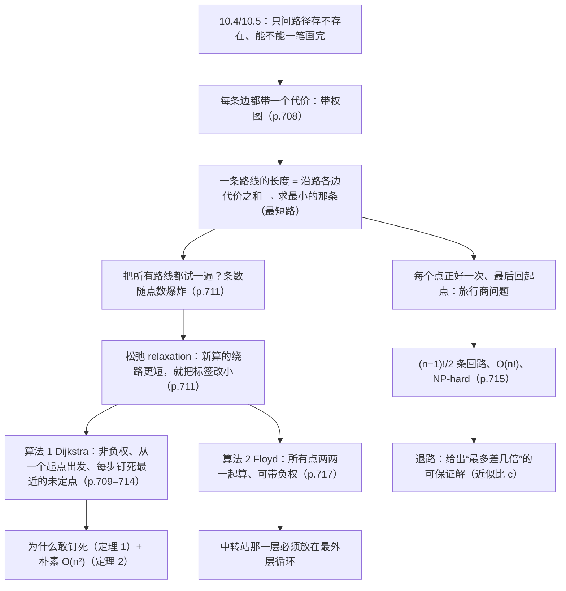

# C10.6 最短路径问题 Shortest-Path Problems

> [!abstract] 这一讲的任务
> 上一讲问的是"能不能从 $a$ 走到 $z$"——只要走得通就行，走多远不管。可现实里每条路都有代价：机票多少钱、多少公里、飞多久。
> 这一讲给边加上数字，然后回答两个问题：**从一点到另一点，总代价最小的路线怎么找**（Dijkstra、Floyd），
> 以及**要挨个走遍所有点再回来，怎么排最省**（旅行商问题）。
> 前一个是多项式时间的漂亮算法，后一个至今没有多项式算法——这个反差本身就是本章最值得记住的事。

> [!info] 怎么读这份讲义
> 阅读顺序：§1 把"带权"这件事说清 → §2 看清穷举为什么会崩 → §3 学唯一的前置工具**松弛**（"新算的绕路更短就替换旧标签"）→
> §4–§7 Dijkstra（含例 1、例 2 两遍手算与一个负权反例）→ §8 Floyd → §9 旅行商问题 → §10 延伸。
> 用到第 10.4 讲的路径与连通、第 10.2 讲的完全图、第 10.5 讲的哈密顿回路，都是名字层面的调用，不必回头翻。
> **一处已知勘误**：例 1 里 $a\to d\to e$ 的长度印作 7，按边权 $2+3$ 应为 **5**，§5.3 把这件事讲透，后文一律用 5。
> 另外 §6.3 会指出定理 1 的归纳证明里一个"基始情形"的小口子（不是结论错，是表述不严），读的时候留意。

> [!warning] （拓展：课堂未讲解）整节内容都不在课堂范围内
> 第 21 节课讲到"生成树"时顺带提了一句"带权的话就要看每条边的 weight，找最短路径"，
> 紧接着说"这更像人工智能的内容，我不展开"——**Dijkstra、Floyd、旅行商问题都没有在课上讲过，也没有配套的课堂材料**。
> 所以这一篇整篇按【拓展】处理：它是为了把第 10 章的图论闭环补完整而按教材写全的，
> **复习时知道"有这回事"即可，考试不从这里出题**。真要考，也只可能出在"带权图 + 最短路"的建模小问里，
> 而那一小问的解法在第 10.5 讲的欧拉/哈密顿路径里已经够用了。



---

## 0. 开场：同一个行程，三种"最省"（p.707–709）

你要从迈阿密（Miami）飞丹佛（Denver）。打开第一个网站，它给的路是**迈阿密 – 亚特兰大 – 芝加哥 – 丹佛**，
告诉你这是**里程最短**的走法：595 + 606 + 908 = 2109 英里。你觉得不错。
换个网站，它按**总飞行时间**排，给的还是这条：1:30 + 1:40 + 2:10 = 5 小时 20 分。
再换个网站，选**最低票价**，它给的却是另一条：**迈阿密 – 纽约 – 芝加哥 – 丹佛**，69 + 59 + 69 = 197 美元。

于是你面对一个尴尬的事实：这条最便宜的路线要飞 1090 + 722 + 908 = **2720 英里**，
比里程最优的 2109 英里多飞 **611 英里**，飞行时间 6 小时 45 分，比最快的 5:20 多花 85 分钟——
就为了省下 40 美元。三个网站都对，因为它们优化的东西不一样。

三个网站脚下踩的是**同一张地图**：同样的城市，同样那几条航线。变的只是每条边上那个数字。

你刚才做的，就是一次完整的**最短路径问题 shortest-path problem** 的求解。用一句人话说清它：

> 在一张每条边都标了数字的图里，给两个点，找出**一路上数字加起来最小**的那条路线。

这一讲就干三件事：

1. 把"边上的数字"正式说清楚（§1），并解释为什么同一批点、同一批边，换个数字答案就变了；
2. 给出两个算法。一个是**从一个点出发**、飞快且漂亮的 Dijkstra（§4–§7）；
   一个是**所有点两两之间**一起算的 Floyd（§8）；
3. 再问一个看起来只难一点、实际上难得多的问题：**每个点都恰好去一次、最后回到出发地**，怎么排最省（§9）。
   它叫旅行商问题，五个城市只要比较 12 条路线，二十五个城市就要比 $3.1\times10^{23}$ 条。

上一讲（10.5）也有"路径"这个词，但那里只关心**存不存在**：这幅图有没有一条走遍所有边一次的路线。
这一讲关心**代价**：走得通只是入场券，接下来要问哪条最便宜。

---

## 1. 带权图与"路线的长度"（p.708–709）

### 1.1 边上写数字

现实里"两地之间有条航线"这句话信息太少。你还想知道：多远？飞多久？多少钱？

于是我们给每条边配一个数。**每条边上都写着一个数的图，叫带权图 weighted graph**，那个数叫这条边的**权重 weight**。
一句人话：**权重就是走这条边要付的代价**——油价、时长、过路费、延迟、金额，都行。

图 1 把这件事摆得很直白：八座城市、十四条航线（这批点边是固定的），配了三套权重。

![[C10.6-原图-航线三种权重.png]]

三张子图里，波士顿—纽约那条边分别是 191 英里、0:50、39 美元；芝加哥—旧金山是 1855 英里、2:55、99 美元。
点没变、边没变，只有数字换了三遍。

换成数据网络，同一个道理：图 2 有七座城市的机房，边的权重可以是**距离**、**响应时间**或**月租费**。
这三套数字之间的差别比航线那张图更刺眼：租一条光纤最贵的那一段，未必是延迟最大的那一段。

![[C10.6-原图-网络三种权重.png]]

### 1.2 路线的长度不等于边的条数

有了权重，一条路线的"长度"就有新定义了：

> [!important] 定义（带权图中路线的长度 length）
> 带权图中一条路线（路径）的**长度**，是它经过的**所有边的权重之和**。
> 两个点之间长度最小的路线叫**最短路 shortest path**，这个最小长度记作 $d(a,z)$（从 $a$ 到 $z$ 的距离）。

这个"长度"和 10.4 讲的那个"长度"**不是一回事**，这是本篇第一个坑：

> [!warning] 易错点：同一个"长度"，两种含义
> - **不带权的图**里，"路径长度"= 经过的**边数**。所以在 10.4 里我们说"长度 3 的路径"就是三步。
> - **带权图**里，"路径长度"= 经过的**边权之和**。一条只有一条边、但边权是 1855 的路线，比一条五条边、总权 40 的路线"长"得多。
>
> 做题时先看图上有没有数字。有数字，一律按求和算；只有"最少几条边"这种问法（习题里那种）才回到数边数。
> 顺带一句：**想要"最少几条边"，把每条边的权重都设成 1 就行**，于是最短路算法自动退化成逐层外扩——这就是广度优先搜索。

### 1.3 同一批点边，三个答案

现在回到 §0 的迈阿密—丹佛。三条路线、三套权重，逐项算出来是这样：

| 你优化的指标 | 最优值 | 它选的路线 | 这条路的里程 | 这条路的飞行时间 | 这条路的票价 |
|---|---|---|---|---|---|
| 里程 | **2109 mi** | 迈阿密 – 亚特兰大 – 芝加哥 – 丹佛 | 2109 | 5:20 | 237 美元 |
| 飞行时间 | **5:20** | 迈阿密 – 亚特兰大 – 芝加哥 – 丹佛 | 2109 | 5:20 | 237 美元 |
| 票价 | **197 美元** | 迈阿密 – 纽约 – 芝加哥 – 丹佛 | 2720 | 6:45 | 197 美元 |

注意最后一行的错位：**票价最优的那条路线，在另外两列上都不是最优**（多飞 611 英里、多花 85 分钟）。
这就是"同一批点边、三个不同答案"的准确含义——不是三个算法给三个答案，而是**三个目标函数**给三个答案。
换权重等价于换目标，最优解当然可能换。

> [!warning] 易错点：最便宜的路 $\ne$ 最短的路 $\ne$ 最快的路
> 三者只有在权重恰好成比例时才一致（比如所有航线速度相同、票价按里程等比例计价）。
> 现实中它们经常打架，这就是为什么导航软件要让你选"少走高速""避开收费"。

顺带回答一个会被反复问的问题：**最短路唯一吗？**

一般不唯一。看一个最小的例子：四个点 $a,b,c,z$，边 $a\text{–}b$ 权 1、$a\text{–}c$ 权 1、$b\text{–}z$ 权 2、$c\text{–}z$ 权 2。
两条路线 $a\to b\to z$ 和 $a\to c\to z$ 的长度都是 $1+2=3$，都最短，谁也不是"那个"最短路。

反过来说，本篇用的两张教学图（Figure 3 与 Figure 4(a)）里，每对点的最短路**恰好都唯一**——
这是巧合，不是定理。别把"算出来的那条"当成唯一解。

---

## 2. 撞墙：为什么不能把所有路线都试一遍（p.711）

最短路最直白的做法是：**把从 $a$ 到 $z$ 的所有路线列出来，一条条加，挑最小的**。

对例 1 那张六点小图，这完全可行——从 $a$ 到 $z$ 的简单路线一共只有 4 条：

$$a\to d\to e\to z \;(2+3+1=6),\quad a\to b\to e\to z \;(4+3+1=8),\quad a\to b\to c\to z \;(4+3+2=9),\quad a\to d\to e\to b\to c\to z \;(13)$$

最小的 6 一眼可见。但"这张图能这么干"和"一般情形能这么干"是两件事。数一下路线条数：

| 点数 $n$ | 从 $a$ 到 $z$ 的简单路线条数（完全图） | 说明 |
|---|---|---|
| 4 | 5 | 手算还行 |
| 5 | 16 | 手算吃力 |
| 6 | 65 | 例 1 的图远没有这么密，所以只有 4 条 |
| 10 | 109 601 | 已经没法手写了 |
| 15 | 16 926 797 486 | 计算机开始吃力 |
| 20 | 17 403 456 103 284 421（约 $1.74\times10^{16}$） | 每秒十亿条也要算半年 |

这些数字怎么来的？在完全图 $K_n$ 里，一条从 $a$ 到 $z$ 的简单路线，中间可以塞 $0,1,2,\dots,n-2$ 个点，
塞 $k$ 个点的方案数是排列数 $P(n-2,k)$，全加起来

$$\sum_{k=0}^{n-2} P(n-2,k)=\sum_{k=0}^{n-2}\frac{(n-2)!}{(n-2-k)!}.$$

$n=20$ 时是 $1.74\times10^{16}$。而一旦**允许重复经过点**（一般图里最短路根本不需要重复，但"所有路线"这个集合里包含它们），
只要图里有一个圈，路线就有**无穷多条**。所以"枚举所有路线"在定义上就已经站不住了。

> [!question] 停一下，先自己想想
> 那能不能"只枚举不重复经过点的路线"？上面那张表算的就是这个。
> 20 个点 $1.74\times10^{16}$ 条——够呛。60 个点呢？大致是 $n!$ 量级，比宇宙年龄的秒数还大。
> 更关键的是：**这些路线里有大量重复劳动**。"$a\to b\to c$ 这一段"会在几百条路线里被反复重新加一遍。
> 有没有办法把"到某个点为止的最短前缀"存下来，只算一次？

有。存下来的东西叫**标签 label**，更新的动作叫**松弛 relaxation**——这就是下一节。

---

## 3. 松弛 relaxation：先把唯一的前置工具讲清（p.711）

Dijkstra 算法只依赖一个动作。它小到不值得单开一章，但没有它，后面的每一步都读不懂。

一句人话：

> **松弛 = 用"新算出来的绕路距离"去比"旧标签"，小就把标签改小，否则不动。**

"标签"是什么？给每个点挂一个数 $L(v)$，意思是"**目前已知的、从起点 $a$ 到 $v$ 的最好长度**"。
一开始我们什么都不知道，所以除了起点 $L(a)=0$，其余全是 $\infty$。

然后看一条边 $u\to v$（权 $w(u,v)$）：既然已经知道"到 $u$ 要 $L(u)$"，那么"先到 $u$、再走这条边到 $v$"就是一条
长度为 $L(u)+w(u,v)$ 的候选路线。拿它去比 $L(v)$：

$$L(v)\leftarrow\min\{\,L(v),\;L(u)+w(u,v)\,\}.$$

取小的那个，留在 $L(v)$ 上。就这一行。

**为什么叫"松弛"？** 想象每个点用一根橡皮筋连着起点，橡皮筋的长度就是 $L(v)$。初值 $\infty$ 等于橡皮筋没绷上。
每找到一条更短的绕法，我们就把它**放松一点**（换一根更短的橡皮筋）。
$L(v)$ 只会**单调变小**，永远不会变大——这个单调性后面会反复用到。

**不带图论符号的例子**：从家到公司，你目前知道"走环线 50 分钟"（$L(\text{公司})=50$）。
同事说"先到我家（20 分钟），再从我家到公司（15 分钟）"。你算 20+15=35，比 50 小，于是把"到公司 50 分钟"改成 35。
这就是一次松弛。你没重新研究整张地图，只用了"到同事家的已知最好时间"加"一段新路"。

> [!important] 松弛 relaxation 的三条性质（后面全靠它们）
> 1. **只减不增**：$L(v)$ 每次更新都严格变小，所以每个点的标签最多被改有限次。
> 2. **上界性**：任何时刻的 $L(v)$ 都对应**某条真实的路线**，所以 $L(v)\ge d(a,v)$ 恒成立。松弛只能逼近真值，不会低于真值。
> 3. **局部性**：更新 $v$ 时只需要 $L(u)$ 和一条边的权，不需要知道 $a\to u$ 这条路具体怎么走。

把这三条记住，Dijkstra 就只剩一个"选谁"的问题了：每一轮，从还没定的点里挑 $L$ 最小的那个。

---

## 4. 算法 1（Dijkstra）：五个问题一次说清（p.709–711）

### 4.1 它解决什么问题

§2 已经撞过墙了：路线条数指数增长，枚举不可行。
真正卡住的地方不是"数太大"，而是**我们不知道该把计算资源花在哪**。
一个走了 20 步才到某个穷乡僻壤的路线，几乎不可能成为到终点的最短前缀；但我们没有依据提前把它砍掉。

Dijkstra 的答案是：**从小到大排队**。先确定"离起点最近的那个点是谁"，再确定第二近的，再第三近的……
一直到终点被确定为止。它不去枚举路线，它去**给点排远近**。

### 4.2 一句人话

> **从起点开始一圈一圈往外扩，每一圈把"当前离起点最近的那个还没定的点"钉死，钉死之后再也不改它的标签。**

三个词要抠一下：

- **一圈一圈**：先钉距离 0 的起点，再钉距离 2、4、5 的点（例 1 就是这个节奏）……像往水里扔石头，波纹一层层推开。
- **钉死**：这个点的标签从此刻起**封存**，后面任何发现都不会再改它。这是全篇最反直觉的一步——凭什么敢封？
- **贪心 greedy**：每一步都只挑"当前看起来最好"的那个，不回头、不反悔、不做全局规划。

### 4.3 为什么叫这个名字

**Dijkstra 是人名，不是方法名。** 全名 Edsger Wybe Dijkstra（1930–2002），荷兰人，这个算法是他在 1959 年给出的。
他原本在莱顿大学念理论物理，1952 年发现自己更喜欢写程序，就赶紧把物理学位修完，转行去当程序员——
那年头"程序员"还不是一个被承认的职业（1957 年阿姆斯特丹的官员在他的结婚证上拒绝把职业填成"programming"，
他改成"theoretical physicist"，通过了）。他后来在操作系统（死锁避免）、程序设计语言（结构化程序设计）和算法三个方向
都留下了奠基性工作，1972 年拿了图灵奖。所以这个算法既不叫"最短路径法"，也不叫"标号法"——
名字里那个人是真有其人。

> [!note] 名字对照
> 本篇还有第二个算法叫 **Floyd**，同样是**人名**（Robert Floyd）。而 **旅行商问题 traveling salesperson problem**
> 不是人名，是一个**场景名**：背着样品挨家挨户跑的推销员。

### 4.4 它依赖哪个前置工具

只依赖 §3 的**松弛**。整个算法的每一轮就是两件事：

1. 从"未定点"里挑标签最小的那个 $u$，把它移进"已定集合" $S$（**钉死**）；
2. 对 $u$ 的每个未定邻居 $v$ 做一次松弛：$L(v)\leftarrow\min\{L(v),\,L(u)+w(u,v)\}$。

就这样。没有递归、没有回溯、没有分治。**唯一的技巧在第一句：挑最小的那个钉死。**

### 4.5 凭什么敢钉死它

问题来了：凭什么说"当前标签最小的那个点，它的标签已经是对的"？万一有一条更短的路线，只是我们还没发现呢？

Dijkstra 的答案建立在一个条件上：**所有边的权重都是非负的**。理由是——

> 假设 $v$ 是当前未定点里 $L$ 最小的。取任何一条从 $a$ 到 $v$ 的路线，只要它途中有**不在 $S$ 里**的点
> （不看 $v$ 自己），就记它第一次踩到的这种点为 $u$。两件事：
> ① $u$ 还没定，而 $v$ 是所有未定点里标签最小的，所以 $L(u)\ge L(v)$；
> ② 这条路线的**前缀** $a\to\cdots\to u$ 内部全在 $S$ 里，所以它的长度 $\ge L(u)$（$L(u)$ 是这类路线里最短的）。
> 再从 $u$ 走到 $v$ 还要加一段**非负**的路。合起来，整条的长度 $\ge L(u)\ge L(v)$，不可能比 $L(v)$ 短。

一句话：**非负权 ⇒ 任何"绕出去"的走法都只会更长，所以比当前最小值更小的路线根本不存在。**
这就是"钉死"的许可证。

下面这张图把这句话画成了结构：左边绿色是已定集合 $S$，右边橙色是未定点，
$u$ 是一条假想路线**第一次离开 $S$** 时踩到的点，$v$ 是这一轮要钉死的点。

![[C10.6-贪心为什么能钉死.png]]

读图的口诀：**前缀已经定好，后缀只会变长**。前缀 $a\to\cdots\to u$ 的长度至少是 $L(u)$，
而后缀 $u\to\cdots\to v$ 的长度 $\ge 0$。所以整条 $\ge L(u)\ge L(v)$——
想比 $L(v)$ 还小，没门。

反过来说，如果权重可以是负的，这个"后缀 $\ge 0$"就没了：先飞到某个地方、再倒贴钱飞回来，总账可能更便宜。
所以**非负权不是"顺便提一句"的技术条件，它是整个论证的承重墙**。§7.2 给一个具体的负权反例，一次负边就把钉死搞坏。

> [!warning] 易错点：钉死的是"标签"，不是"路线"
> 算法钉死 $L(v)$ 的值，但你并不知道这条最短路具体怎么走。要走出来，得另存"每个点是从谁松弛过来的"（前驱 $prev$）。
> 教材这里只算长度；习题 16 要求补上路线构造，§10.2 讲怎么补。Floyd 那边有一模一样的问题（§8.5）。

---

## 5. 例 1 手算：一圈圈往外扩（p.710）

先不写代码，人工做一遍。图是这样的（六点七边）：

![[C10.6-原图-例1的带权图.png]]

边权：$w(a,b)=4$、$w(a,d)=2$、$w(b,c)=3$、$w(b,e)=3$、$w(d,e)=3$、$w(c,z)=2$、$w(e,z)=1$。
问 $a$ 到 $z$ 的最短路长度。

> [!example] 例 1 求 Figure 3 中 $a$ 到 $z$ 的最短路长度
> 题面就一句话。教材的解法不是"找一条路线"，而是**按离 $a$ 由近到远，一个一个点确定**：
> 先定第一近的，再定第二近的，再第三、第四，定到 $z$ 就收工。

### 5.1 第一圈：只有起点

一开始只有起点有标签（$L(a)=0$），其余点全是 $\infty$。从 $a$ 出发能一步走到的只有 $b$ 和 $d$：

- $a\to b$：长度 4
- $a\to d$：长度 2

所以**第一近的点是 $d$（距离 2）**，$a\to d$ 就是最短的。

### 5.2 第二圈：从 $\{a,d\}$ 往外看

现在把 $d$ 钉死。候选路线只能是"到 $\{a,d\}$ 里某点的最短路 + 一条边跨出这个集合"：

- $a\to b$：4（跨出去到 $b$）
- $a\to d\to e$：$2+3=5$（跨出去到 $e$）

最小的 4，所以**第二近的是 $b$，距离 4**。

### 5.3 第三圈：从 $\{a,d,b\}$ 往外看（这里有一处勘误）

跨出 $\{a,d,b\}$ 的边有三条：

- $b\to c$：$4+3=7$
- $b\to e$：$4+3=7$
- $d\to e$：$2+3=5$

> [!warning] 勘误：$a\to d\to e$ 的长度不是 7，是 5
> 这一页的第 2 步把候选写成"$a,d,e$ of length **7**"。按图上边权，$w(a,d)=2$、$w(d,e)=3$，$2+3=5$。
> 有两处独立证据证明 7 是印错的：
> 1. 紧接着的第 3 步，同一份材料自己写的是"$a,d,e$ of length **5**"，并且据此判定第三近的点是 $e$；
> 2. 如果真是 7，第 3 步的三个候选就变成 $7,7,7$ 三个**并列**，那就没有理由说"$a,d,e$ 最短"，整段推理会自相矛盾。
>
> **正确值 5。** 本篇后文一律用 5；做习题时若看到 7，按 5 算。

所以**第三近的是 $e$，距离 5**（$a\to d\to e$）。

### 5.4 第四圈：从 $\{a,d,b,e\}$ 往外看，$z$ 到手

跨出去的边只剩两条：

- $b\to c$：7
- $e\to z$：$5+1=6$

最小的 6，所以**第四近的就是 $z$，最短路长度 6**，路线 $a\to d\to e\to z$。

### 5.5 把四圈并成一张表

把"每钉死一个点之后，各点的标签是多少"排成表，就是 Dijkstra 的标准手算格式。
起点 $a$ 的标签恒为 0。每一行记录这一轮的结果：**粗体是这一轮被改过的标签**，最后一列写这一轮做了什么。

| 轮次 | 钉死的点 $u$ | 已定集合 $S$ | $L(a)$ | $L(b)$ | $L(c)$ | $L(d)$ | $L(e)$ | $L(z)$ | 这一轮的松弛 |
|---|---|---|---|---|---|---|---|---|---|
| 0 | — | $\varnothing$ | 0 | $\infty$ | $\infty$ | $\infty$ | $\infty$ | $\infty$ | 初始化 |
| 1 | $a$ | $\{a\}$ | 0 | **4** | $\infty$ | **2** | $\infty$ | $\infty$ | $b\leftarrow 0+4$，$d\leftarrow 0+2$ |
| 2 | $d$ | $\{a,d\}$ | 0 | 4 | $\infty$ | 2 | **5** | $\infty$ | $e\leftarrow 2+3=5$ |
| 3 | $b$ | $\{a,d,b\}$ | 0 | 4 | **7** | 2 | 5 | $\infty$ | $c\leftarrow 4+3=7$；$e$：$4+3=7>5$，不动 |
| 4 | $e$ | $\{a,d,b,e\}$ | 0 | 4 | 7 | 2 | 5 | **6** | $z\leftarrow 5+1=6$ |
| 5 | $z$ | 全部 | 0 | 4 | 7 | 2 | 5 | 6 | $z$ 已定，结束 |

读这张表要注意三件事：

1. **钉死顺序**是 $a,d,b,e,z$，和教材正文里"第一近 $d$、第二近 $b$、第三近 $e$、第四近 $z$"完全一致（$a$ 是第 0 个）。
2. 第 3 轮发生了一件"什么都没发生"的事：$b$ 想给 $e$ 一个 $4+3=7$，但 $e$ 已经是 5 了，**松弛拒绝了更大的值**。
   这就是"只减不增"。
3. 表里 $c$ 到最后是 7，可我们从没钉死它——因为 $z$ 先被钉死了，算法就停了。
   如果继续跑到所有点都定完，$L(c)=7$ 也是真的（$a\to b\to c$），这正好对应教材那句话：**算法顺手就能求出到所有点的最短距离**。

手算到这儿，例 1 的答案 6 和路线 $a\to d\to e\to z$ 都对上了。

---

## 6. 算法 1 的伪代码、例 2 与定理 1（p.711–713）

### 6.1 伪代码

> [!important] 算法 1（Dijkstra）
> ```
> procedure Dijkstra(G: 带权连通简单图，所有边权为正)
>   {G 的顶点是 a = v0, v1, …, vn = z；无边相连时记 w(vi,vj) = ∞}
>   for i := 1 to n
>       L(vi) := ∞
>   L(a) := 0
>   S := ∅
>   while z ∉ S
>       u := S 之外 L(u) 最小的顶点
>       S := S ∪ {u}
>       for all vertices v not in S
>           if L(u) + w(u,v) < L(v) then L(v) := L(u) + w(u,v)
>   return L(z)          {L(z) 就是 a 到 z 的最短路长度}
> ```

对着 §4.4 的两步看：`while` 里的第一行是"挑最小的"，第二行是"钉死"，内层 `for` 是"松弛"。
伪代码里 `w(vi,vj)=∞` 这个约定很妙：**没有边就当成一条权无穷大的边**，"$L(u)+w(u,v)<L(v)$" 自然永远不成立，
于是内层循环可以粗暴地对所有点跑一遍，不用先判断邻接。

> [!warning] 易错点：`while z ∉ S` 不是 `while S ≠ V`
> 循环条件是"**终点被钉死就停**"，不是"所有点都钉死才停"。例 1 里 $c$ 始终没进 $S$，算法就结束了。
> 想让所有点的距离都算出来，把条件换成 `while S ≠ V`（这是习题 15 要你改的那一行）。

### 6.2 例 2：跟着伪代码走一遍（p.712–713）

> [!example] 例 2 用 Dijkstra 求 Figure 4(a) 中 $a$ 到 $z$ 的最短路长度
> 图有六个点，九条边：$w(a,b)=4$、$w(a,c)=2$、$w(b,c)=1$、$w(b,d)=5$、$w(c,d)=8$、$w(c,e)=10$、$w(d,e)=2$、$w(d,z)=6$、$w(e,z)=3$。

先看这张图。它比 §5 的 Figure 3 那张图多一层看点：**某个点的标签会先拿到一个粗估值，后来又被改小**，
正好用来体会松弛的"改小"动作。

| 轮次 | 钉死的点 $u$ | 已定集合 $S$ | $L(a)$ | $L(b)$ | $L(c)$ | $L(d)$ | $L(e)$ | $L(z)$ | 这一轮的松弛 |
|---|---|---|---|---|---|---|---|---|---|
| 0 | — | $\varnothing$ | 0 | $\infty$ | $\infty$ | $\infty$ | $\infty$ | $\infty$ | 初始化 |
| 1 | $a$ | $\{a\}$ | 0 | **4** | **2** | $\infty$ | $\infty$ | $\infty$ | $b\leftarrow 4$，$c\leftarrow 2$ |
| 2 | $c$ | $\{a,c\}$ | 0 | **3** | 2 | **10** | **12** | $\infty$ | $b:2+1=3<4$ ✓；$d:2+8=10$；$e:2+10=12$ |
| 3 | $b$ | $\{a,c,b\}$ | 0 | 3 | 2 | **8** | 12 | $\infty$ | $d:3+5=8<10$ ✓（改小） |
| 4 | $d$ | $\{a,c,b,d\}$ | 0 | 3 | 2 | 8 | **10** | **14** | $e:8+2=10<12$ ✓；$z:8+6=14$ |
| 5 | $e$ | $\{a,c,b,d,e\}$ | 0 | 3 | 2 | 8 | 10 | **13** | $z:10+3=13<14$ ✓ |
| 6 | $z$ | 全部 | 0 | 3 | 2 | 8 | 10 | 13 | $z$ 被钉死，返回 13 |

第 3 轮那一行是全表的重点：$d$ 的标签先被定成 10（经 $c$），然后被 $b$ 改成 8（$a\to c\to b\to d$）。
**标签被改小，就是一次成功的松弛。** 第 5 轮同理，$z$ 从 14 降到 13。

把 $z$ 的 13 逆推回去：$z$ 是从 $e$ 松弛来的，$e$ 从 $d$，$d$ 从 $b$，$b$ 从 $c$，$c$ 从 $a$，于是
$a\to c\to b\to d\to e\to z$，长度 $2+1+5+2+3=13$，与教材一致。

同一张图还有一个更"机器"的看法：把每一轮画成一张小图，已定的点加圈，标签写在点旁边。
教材给的就是这一串图；如果你更习惯表格，上面那张表就是它的表格版。

![[C10.6-原图-Dijkstra逐步标签.png]]

两种看法各有各的用处：**图看结构**（哪一圈扩到哪了），**表看数字**（谁的标签被改了，改成多少）。
考试里用手算，表更不容易漏，因为它逼你每轮把所有未定点的标签抄一遍。

### 6.3 定理 1：为什么它一定对

> [!important] 定理 1
> Dijkstra 算法能求出**连通简单无向带权图**中两点之间最短路的长度。

教材用归纳法证。把"第 $k$ 轮结束时成立"的不变量写成两条：

> **不变量** 设第 $k$ 轮结束时已定集合是 $S$。
> (i) 每个 $v\in S$ 的标签 $L(v)=d(a,v)$，即**已定点的标签就是真正的最短距离**；
> (ii) 每个 $v\notin S$ 的标签 $L(v)$，是"从 $a$ 到 $v$、且**内部顶点全在 $S$ 里**"的那些路线中最短的长度。

> [!warning] 教材注意：p.711 那句"只含 $S$ 中顶点"要读成"内部顶点来自 $S$"
> 这一页说"$v$ 的标签是从 $a$ 到 $v$、只包含 $S_k$ 中顶点的最短路的长度"。字面读有问题：$v$ 自己**不在** $S_k$ 里，
> 一条"只含 $S_k$ 中顶点"的路线根本到不了 $v$。正确理解是：**路线的两个端点 $a$ 与 $v$ 可以在 $S_k$ 外面，
> 只有中间经过的点必须来自 $S_k$**。例 2 第 2 轮算 $L(d)=10$ 时，路线 $a\to c\to d$ 里的 $d$ 就还不在 $S$ 里——
> 按字面读会把这唯一一条候选也排除掉，那就没法算了。下文一律按"内部顶点来自 $S$"来用这个说法。

**基始情形。** 第 0 轮 $S=\varnothing$，$L(a)=0$，其余 $L(v)=\infty$。
(i) 对 $v=a$ 成立（$d(a,a)=0$）；(ii) 说"内部顶点全在空集里"，只允许"一条边直达"这种路线。

**归纳步。** 设在第 $k$ 轮结束时两条都成立，第 $k+1$ 轮挑中的是 $v$（未定点里标签最小的那个）。分两半证。

*第一半：$v$ 的标签已经是真值。* 用反证。假设存在一条从 $a$ 到 $v$ 的路线 $P$，长度小于 $L(v)$。
$P$ 既然没被 (ii) 覆盖，它必然走出了 $S$。取 $P$ 上**第一个**不在 $S$ 里的点，记为 $u$。
那么 $P$ 从 $a$ 到 $u$ 的前缀，内部顶点全在 $S$ 里，按 (ii) 它的长度 $\ge L(u)$；
又因为 $v$ 是所有未定点里标签最小的，$L(u)\ge L(v)$。于是

$$\text{长度}(P)\ \ge\ \text{长度}(a\to u)\ +\ \text{长度}(u\to v)\ \ge\ L(u)\ \ge\ L(v),$$

与"$P$ 比 $L(v)$ 短"矛盾。**这一步的第二个不等号用了"$u\to v$ 段长度 $\ge 0$"，也就是正权假设。**
所以 (i) 对 $v$ 成立；对 $S$ 里的老点，标签在这一轮没动过，(i) 继续成立。

*第二半：其余未定点的标签满足 (ii)。* 设 $u\notin S\cup\{v\}$。一条"内部顶点全在 $S\cup\{v\}$ 里"的最短路线，
要么根本不用 $v$（长度 $\ge L(u)$，即旧标签，本轮 $L(u)$ 会取 $\min$ 所以不会变大），
要么最后一次经过 $v$，长度恰是 $[\text{到 }v\text{、内部全在 }S]$ + $w(v,u)=L(v)+w(v,u)$。
两者取最小，正是伪代码里那条松弛式

$$L_{k+1}(u)=\min\{\,L_k(u),\;L_k(v)+w(v,u)\,\}.$$

证完。

> [!warning] 教材注意：基始情形的表述有个小口子
> 这一页写基始时说"$S=\varnothing$ 时，从 $a$ 到除 $a$ 以外任何点的最短路长度都是 $\infty$"。
> 这句对**不相邻**的点成立，但对 $a$ 的邻居不成立：$a\to b$ 是一条真实存在的路线，长度是 $w(a,b)$，
> 而按 (ii) 的措辞（"除自身外只含 $S$ 中的点"，$S$ 为空），它恰恰是最该被算进去的那一条。
> 也就是说：**初值 $\infty$ 与不变量 (ii) 在第 0 轮并不吻合**，算法是在第一次迭代（把 $a$ 加进 $S$ 并松弛）之后才让 (ii) 成立的。
>
> 修法有两条，任选其一：
> 1. **把归纳从 $k=1$ 开始**（第一轮做完 $a$ 的邻居都拿到了正确标签，(ii) 成立），基始直接手验；
> 2. **初值就写成 $L(v)=w(a,v)$**（无边则 $\infty$），这样 (ii) 在第 0 轮字面成立。
>
> 这不影响结论，定理 1 是对的；但自己写证明时别照抄这一句，否则被追问会答不上来。

> [!warning] 教材注意：定理 1 的陈述漏了"正权"
> 算法 1 的开头明写 `all weights positive`，正文推导里也处处用"后缀 $\ge 0$"，
> 但定理 1 单列出来的那一句只说了"连通简单无向带权图"，没再重申权重为正。
> 这不是结论错，而是**陈述不完整**：少了"非负"这个前提，定理不成立（§7.2 有反例）。
> 自己写答案时，务必把"非负权"写进前提里。

### 6.4 定理 2：复杂度是 $O(n^2)$

> [!important] 定理 2
> 对有 $n$ 个顶点的连通简单无向带权图，Dijkstra 算法用 $O(n^2)$ 次运算（加法与比较）求出两点间最短路的长度。

不必逐项复述教材那一页的常数计数，抓住两个层次就够：

- **外层**：每轮钉死一个点，最多 $n-1$ 轮（终点钉死就停，更少）。
- **每轮**：① 在未定点里找标签最小的，最多 $n-1$ 次比较；② 对每个未定点做一次"加法 + 比较"，最多 $n-1$ 个点。

所以每轮 $O(n)$，总共 $O(n^2)$。取 $n=6$（例 2 那张图）：$2\times5^2=50$ 次左右的运算，手算当然快。
取 $n=1000$：约 $2\times10^6$ 次，毫秒级。

> [!note] 为什么朴素版是 $O(n^2)$ 而不是更快
> 因为"找最小标签"是**线性扫描**。如果改用**优先队列（堆）**维护未定点的标签，这一步降到 $O(\log n)$，
> 总复杂度变成 $O(m\log n)$（$m$ 为边数）。对稀疏图（$m$ 远小于 $n^2$，比如路网）这是数量级的提升，
> 现代导航引擎用的都是这一版。教材讲的是邻接矩阵上的朴素版，因为它的界干净、好证。
> 注意：**堆优化不改变算法的正确性论证**，只是换了个找最小值的容器。

---

## 7. 非负权到底用在哪一步（p.713–714）

### 7.1 一张图看懂"每轮在干什么"

把 Dijkstra 的两步写成对照：

| 步骤 | 动作 | 依赖什么 | 出错会怎样 |
|---|---|---|---|
| 选点 | 未定点里挑 $L$ 最小的，钉死 | 非负权（§4.5 的论证） | 钉早了 ⇒ 后面发现更短路也改不动它 ⇒ 答案偏大 |
| 松弛 | $L(v)\leftarrow\min\{L(v),L(u)+w(u,v)\}$ | 没有额外条件 | 漏做 ⇒ 标签停在旧值 ⇒ 答案偏大 |

可以看到，**两个错误都让结果偏大，不会偏小**。这不是巧合：$L(v)$ 永远对应一条真实路线（§3 的上界性），
所以算法给出的答案永远是某个真实路线的长度，也就是**真实最短距离的上界**。
算法的全部工作就是把上界压到等于真值。

### 7.2 负权反例：一次负边就够

> [!example] 负权反例（习题 24 要求证明的现象）
> 三个点 $a,b,c$，无向边权：$w(a,b)=3$、$w(a,c)=4$、$w(b,c)=-2$。
>
> - 第一轮：钉死 $a$（0），松弛得 $L(b)=3$、$L(c)=4$。
> - 第二轮：未定点里最小的是 $b$（3），**钉死 $b$**，$L(b)=3$ 从此不许改。
> - 第三轮：钉死 $c$（4），松弛 $b$：$L(c)+w(c,b)=4+(-2)=2<3$，但 $b$ 已经钉死了，**改不动**。
>
> 输出 $L(b)=3$。而真实最短路是 $a\to c\to b$，长度 $4+(-2)=2$。
> **答案偏大**，与 §7.1 表格的预言一致。

错在哪？错在 §4.5 的那句"后缀只会变长"。$c\to b$ 这一段是负的，于是"绕出去"反而更短，
"当前最小 ⇒ 已经最终"这条推理直接失效。这不是实现的 bug，是**前提不成立**：
非负权是算法的许可证，撤掉它，算法就没有许可证了。

> [!note] 负权也要算怎么办
> 如果图里有负边但**没有负圈**，可以用 **Bellman–Ford**（或 SPFA）：每一轮把所有边都松弛一遍，做 $n-1$ 轮，
> 复杂度 $O(nm)$，比 Dijkstra 慢，但不要求非负。
> 如果存在**从起点能走到的负圈**，最短路根本不存在（绕圈可以无限变小），任何算法都只能报"无界"。
> Floyd 恰好能处理负边（§8.4），这是它比 Dijkstra 更"耐用"的地方。

---

## 8. 算法 2（Floyd）：每个点轮流当中转站（p.717）

### 8.1 它解决什么问题

Dijkstra 一次只回答**一个起点**的问题：$a$ 到所有点的距离。
如果问"所有城市两两之间的最短路"呢？你可以把 Dijkstra 跑 $n$ 遍，代价 $O(n^3)$。
但还有更整齐的做法：**一张表一次算完**。

更妙的是，这个做法**不要求权重非负**（只要没有负圈）。这在图论里是很难得的宽容。

### 8.2 一句人话

> **轮流让每个点当一次"中转站"：凡是"从 $i$ 到 $j$、中途只准经过已经当过中转站的那些点"的路线，
> 都拿 $i\to k\to j$ 去试一遍，短就更新。**

关键在于"**已经当过中转站的那些点**"这个限定。中转站是一个一个加进来的：
第 1 轮只许 $v_1$ 当中转站，第 2 轮许 $v_1,v_2$，第 3 轮许 $v_1,v_2,v_3$……
第 $n$ 轮所有点都许，那就是真正的最短路。

下面三帧图就是这个"许可名单"逐步变长的过程。绿色是中转站，空心虚线是还不许用的点：

![[C10.6-Floyd的k分层.png]]

### 8.3 名字与符号

**Floyd 也是人名**：Robert W. Floyd（1936–2001），美国计算机科学家，1978 年图灵奖得主。
这个算法常被叫做 **Floyd–Warshall 算法**（Warshall 独立给出了传递闭包的版本）。

符号约定：把顶点编号成 $v_1,\dots,v_n$（注意**不是**用 $a,z$ 表示起终点），令

$$D^{(k)}_{ij}=\text{只准用 }v_1,\dots,v_k\text{ 当中转点时，}v_i\text{ 到 }v_j\text{ 的最短距离。}$$

$D^{(0)}$ 就是邻接矩阵：有边取边权，无边取 $\infty$，自己到自己取 0。递推式是

$$D^{(k)}_{ij}=\min\{\,D^{(k-1)}_{ij},\ \ D^{(k-1)}_{ik}+D^{(k-1)}_{kj}\,\}.$$

念出来就是一句话：**"不用 $v_k$ 的老答案" 对比 "从 $v_k$ 绕一下的新答案"，取小的。**
括号里第二项为什么能拆成两半？因为一条经过 $v_k$ 的路线，可以取 $v_k$ 的**最后一次出现**，
把它切成"$i\to v_k$"和"$v_k\to j$"两段，而这两段的内部顶点都已经在 $\{v_1,\dots,v_{k-1}\}$ 里了——
正好是上一轮算好的东西。

> [!important] 算法 2（Floyd）
> ```
> procedure Floyd(G: 带权简单图)
>   {顶点 v1,…,vn，无边时 w(vi,vj) = ∞}
>   for i := 1 to n
>       for j := 1 to n
>           d(vi,vj) := w(vi,vj)
>   for i := 1 to n               {i 是中转站}
>       for j := 1 to n           {j 是起点}
>           for k := 1 to n       {k 是终点}
>               if d(vj,vi) + d(vi,vk) < d(vj,vk)
>                   then d(vj,vk) := d(vj,vi) + d(vi,vk)
>   return d(vi,vj)
> ```

> [!warning] 读伪代码时的第一个坑：这里的 $i$ 是中转站
> 教材的伪代码把**中转站**记成 $i$，把两个端点记成 $j,k$。所以看起来"$i$ 在最外层"，
> 与常见的"$k$ 在最外层"写法只是**字母不同，结构一样**：中转站那个循环在最外面。
> 本篇统一按 $D^{(k)}_{ij}$ 的记法讲，$k$ 是中转站，$i,j$ 是端点。**别被字母骗了**，看的是"谁在最外层"。

### 8.4 为什么 $k$ 必须在最外层

这是本篇第二个必须讲透的地方。把三件事分开看。

**(1) 递推式是对 $k$ 归纳的。** 上面那句"取 $v_k$ 的最后一次出现"已经把证明写完了：
$D^{(k)}$ 只用 $D^{(k-1)}$，而 $D^{(k-1)}$ 在第 $k$ 轮开始时**必须已经算完**。
"已经算完"的唯一保证就是"第 $k-1$ 轮整个循环跑完了"。

**(2) 如果 $k$ 在最里层，每一对 $(i,j)$ 只有一次机会。** 伪代码变成

```
for i, for j, for k:  d(i,j) = min(d(i,j), d(i,k)+d(k,j))
```

对固定的 $(i,j)$，它扫一遍所有中转站 $k$ 就再也不回来了。
可是扫的时候，$d(i,k)$、$d(k,j)$ 这两个数**本身可能还没算好**——它们要靠别的 $(i,k)$、$(k,j)$ 组合才能改小，
而那些组合排在后面。于是"用还没算好的数去算"，结果就停在偏大的值上。

**(3) 一个具体的反例。** 四个点，边权 $w(1,2)=5$、$w(1,4)=1$、$w(4,3)=1$、$w(3,2)=1$。
真实的 $d(1,2)$ 是 $1\to4\to3\to2$，长度 $1+1+1=3$。

正确做法（$k$ 在外层）一轮一轮的矩阵是：

| 轮次 | 允许的中转点 | $d(1,2)$ | $d(1,3)$ | $d(2,4)$ | 这一轮发生了什么 |
|---|---|---|---|---|---|
| $D^{(0)}$ | 无 | 5 | $\infty$ | $\infty$ | 只有直连边 |
| $D^{(1)}$ | $\{1\}$ | 5 | $\infty$ | **6** | $2\to1\to4$ |
| $D^{(2)}$ | $\{1,2\}$ | 5 | **6** | 6 | $1\to2\to3$（不是最优） |
| $D^{(3)}$ | $\{1,2,3\}$ | 5 | 6 | **2** | $2\to3\to4$ |
| $D^{(4)}$ | $\{1,2,3,4\}$ | **3** | **2** | 2 | $1\to4\to3\to2$；$1\to4\to3$ |

看清 $d(1,2)=3$ 是怎么来的：它出现在**最后一轮**，用的是 $D^{(3)}$ 里的 $d(1,4)=1$ 和 $d(4,2)=2$。
而 $d(4,2)=2$ 是**第 3 轮**才算出来的，$d(1,3)=2$ 也是最后一轮才出来的。
**每一轮只多加一个中转站，长路线就是这样一轮一轮拼起来的。**

如果 $k$ 在最里层，处理 $(1,2)$ 这一对时扫到 $k=3$ 需要 $d(1,3)$，此刻它还是 $\infty$；
扫到 $k=4$ 需要 $d(4,2)$，它也还没算（第 4 行还没轮到）。
于是 $d(1,2)$ 停在 5，**答案错了**（真值 3）。

> [!warning] 易错点：三个循环的顺序不是风格问题
> 很多人觉得"三重循环换个顺序结果一样"。**不一样。**
> 判据是：递推式右边用的必须是"上一轮的成品"，所以**中转站那一层必须在最外面**。
> 这和矩阵乘法里的循环顺序可以随便换是两回事——那里三层循环做的是一件事，这里三层循环做的是**归纳**。

> [!note] 复杂度
> 三个循环各 $n$ 次，内层一次加法加一次比较，共 $O(n^3)$。$n=100$ 是 $10^6$ 量级，$n=1000$ 是 $10^9$ 量级。
> 与"Dijkstra 跑 $n$ 遍"同阶，但 Floyd 的常数更小、代码只有四行、还能带负权，所以小图全对距离一律用它。

### 8.5 "Floyd 不能构造最短路径"是什么意思

教材在 Floyd 前面那句话很容易被误读：

> "Floyd's algorithm … can be used to find the length of a shortest path between all pairs of vertices …
> However, this algorithm cannot be used to construct shortest paths."

这句不是说"Floyd 算不出路线"，而是说**这段伪代码只存了距离**：
矩阵 $d(v_i,v_j)$ 里只有一个数，没有任何"这条路怎么走"的信息。要恢复路线，得**另存一张表**。

办法很短：再开一个 $n\times n$ 的 `next` 表，`next[i][j]` 记"从 $i$ 到 $j$ 的最短路，第一步该去哪个点"。
初值：有边 $i\text{–}j$ 就 `next[i][j] = j`，无边就空。
每当 $d(v_i,v_j)$ 被 $v_k$ 改小时，顺手写 `next[i][j] = next[i][k]`。
算完之后，从 $i$ 出发一路 `j = next[i][j]` 跳到 $j$ 就还原出路线了。

Dijkstra 那边是一模一样的道理：加一个 $prev$ 数组记"我是被谁松弛的"（习题 16 就要这个）。
**"算法只算数"是课本为了讲清主干做的简化，不是能力上限。**

### 8.6 拿例 2 那张图跑一遍 Floyd

还是 Figure 4(a) 的六个点。只看 $a$ 这一行（其他行同理），每一步都在扩大"允许的中转点"：

| 轮次 $k$ | 允许的中转点 | $a\to b$ | $a\to c$ | $a\to d$ | $a\to e$ | $a\to z$ |
|---|---|---|---|---|---|---|
| 初值 | 无 | 4 | 2 | $\infty$ | $\infty$ | $\infty$ |
| $k=a$ | $\{a\}$ | 4 | 2 | $\infty$ | $\infty$ | $\infty$ |
| $k=b$ | $\{a,b\}$ | 4 | 2 | **9** | $\infty$ | $\infty$ |
| $k=c$ | $\{a,b,c\}$ | **3** | 2 | **8** | **12** | $\infty$ |
| $k=d$ | $\{a,b,c,d\}$ | 3 | 2 | 8 | **10** | **14** |
| $k=e$ | $\{a,b,c,d,e\}$ | 3 | 2 | 8 | 10 | **13** |
| $k=z$ | 全部 | 3 | 2 | 8 | 10 | 13 |

几个值得停一下的地方：

- $k=b$ 时 $a\to d$ 先被估成 9（$a\to b\to d=4+5$），到 $k=c$ 又被改成 8（$a\to c\to b\to d=2+1+5$）。
  **Floyd 也会"先给个粗估值，后来改小"**，和 Dijkstra 一样。
- $k=d$ 时 $a\to z$ 首次有值 14，$k=e$ 时降到 13。**中转站名单越长，答案只会越好，不会更差**——
  因为递推式里有 $\min$，旧值永远保底。
- 最终 $a$ 行是 $(0,3,2,8,10,13)$，与例 2 里 Dijkstra 给出的标签 $(0,3,2,8,10,13)$ **完全一致**。
  两个算法算同一件事，一致性是最好的自检。

跑完六轮的完整矩阵（对称，对角线为 0）：

| $d$ | $a$ | $b$ | $c$ | $d$ | $e$ | $z$ |
|---|---|---|---|---|---|---|
| $a$ | 0 | 3 | 2 | 8 | 10 | 13 |
| $b$ | 3 | 0 | 1 | 5 | 7 | 10 |
| $c$ | 2 | 1 | 0 | 6 | 8 | 11 |
| $d$ | 8 | 5 | 6 | 0 | 2 | 5 |
| $e$ | 10 | 7 | 8 | 2 | 0 | 3 |
| $z$ | 13 | 10 | 11 | 5 | 3 | 0 |

顺手可以检验几件事：$d(b,z)=10$ 走 $b\to d\to e\to z$（$5+2+3$）；
$d(c,z)=11$ 走 $c\to b\to d\to e\to z$（$1+5+2+3$）；
$d(a,z)=13$ 与 Dijkstra 一致。对角线全 0，矩阵对称，看起来都对。

---

## 9. 旅行商问题：五个城市，十二条回路（p.714–716）

### 9.1 问题

前面两个算法都在问"**一段**路怎么走最省"。现在换一个问法：

> 一个推销员要**把每个城市都恰好去一次，最后回到出发地**，怎么排顺序总里程最短？

一句人话：**不是"从甲到乙怎么走"，而是"绕一圈，顺序怎么排"。**

这就是**旅行商问题 traveling salesperson problem（TSP）**。名字不是人名，说的事就是它的字面意思。
（页边有一条史料小注：1832 年的一本手册 *Der Handlungsreisende*（《旅行商》）就提到过这个问题，
还附了在德国、瑞士境内巡回的示例路线——它比图论本身还老。）

形式化地说：在**带权、完全、无向**图里，找一条**经过每个顶点恰好一次、最后回到起点**的回路，使总权最小。
"经过每个顶点恰好一次再回来"正是 10.5 讲的**哈密顿回路**（Hamilton circuit），所以 TSP 就是
**"带权完全图中总权最小的哈密顿回路"**。10.5 里我们只问"有没有"，现在问"哪个最便宜"。

### 9.2 五城实例：把 12 条回路全部列出来

> [!example] 五城旅行商问题（p.714–715；教材正文里的实例，未编为例题）
> 密歇根州五座城市：底特律（Detroit）、托莱多（Toledo）、萨吉诺（Saginaw）、大急流城（Grand Rapids）、
> 卡拉马祖（Kalamazoo），两两之间都有公路。问按什么顺序走一圈，总里程最短。

![[C10.6-原图-五城距离图.png]]

十条边的里程是：

| 边 | 里程 | 边 | 里程 |
|---|---|---|---|
| 底特律 – 托莱多 | 58 | 托莱多 – 大急流城 | 167 |
| 底特律 – 萨吉诺 | 98 | 托莱多 – 萨吉诺 | 142 |
| 底特律 – 大急流城 | 147 | 托莱多 – 卡拉马祖 | 133 |
| 底特律 – 卡拉马祖 | 135 | 萨吉诺 – 大急流城 | 113 |
| 大急流城 – 卡拉马祖 | 56 | 萨吉诺 – 卡拉马祖 | 137 |

**第一步：数一数要比较多少条路线。** 回路可以反转着走，
所以随便定一个起点（底特律）不影响答案——**任何一条回路都一定经过底特律，从哪起步都会得到同一批回路**。
固定起点后，剩下四座城市的访问顺序有 $4!=24$ 种；而一条回路正着走和反着走的里程完全一样，
所以真正不同的只有 $24/2=12$ 条。

**第二步：把 12 条列出来，逐条加。** 全表如下（每条都以底特律起、底特律终）：

| # | 路线 | 总里程 |
|---|---|---|
| 1 | 底特律–托莱多–大急流城–萨吉诺–卡拉马祖 | 610 |
| 2 | 底特律–托莱多–大急流城–卡拉马祖–萨吉诺 | 516 |
| 3 | 底特律–托莱多–卡拉马祖–萨吉诺–大急流城 | 588 |
| 4 | **底特律–托莱多–卡拉马祖–大急流城–萨吉诺** | **458** |
| 5 | 底特律–托莱多–萨吉诺–卡拉马祖–大急流城 | 540 |
| 6 | 底特律–托莱多–萨吉诺–大急流城–卡拉马祖 | 504 |
| 7 | 底特律–萨吉诺–托莱多–大急流城–卡拉马祖 | 598 |
| 8 | 底特律–萨吉诺–托莱多–卡拉马祖–大急流城 | 576 |
| 9 | 底特律–萨吉诺–卡拉马祖–托莱多–大急流城 | 682 |
| 10 | 底特律–萨吉诺–大急流城–托莱多–卡拉马祖 | 646 |
| 11 | 底特律–大急流城–萨吉诺–托莱多–卡拉马祖 | 670 |
| 12 | 底特律–大急流城–托莱多–萨吉诺–卡拉马祖 | 728 |

**第三步：挑最小。** 458 最小，路线是 4 号：底特律–托莱多–卡拉马祖–大急流城–萨吉诺–底特律。
逐段加一遍：$58+133+56+113+98=458$。反过来走（底特律–萨吉诺–大急流城–卡拉马祖–托莱多–底特律）一样是 458，
是同一条回路。

> [!tip] 表怎么读才不走眼
> - 12 行的总里程两两不同，所以**最优解唯一**（不算反向）。次优是 504，只比它多 **46 英里**——
>   最优解很脆，顺序差一点就选错。反过来，最差的那条（728）比最优的（458）多出 **59%**，
>   说明总里程对顺序的微小改动非常敏感：**没有"慢慢逼近"的梯度可走**，只能一条条比。
> - 数一遍 12 行是不是真的"两两不互为反向"：把每行倒过来念，找不到第二行与之相同。这是 12 这个数没算错的自检。
> - 表里的数字都能用上面那张边权表独立复算，比如 2 号 $58+167+56+137+98=516$。**别信记忆，逐行加。**

### 9.3 为什么这个问题让人头疼

把"12 条"这个数字一般化。$n$ 个城市：

1. 固定起点（任何回路都经过它，从它起步不损失任何方案）；
2. 剩下 $n-1$ 个城市排顺序，$(n-1)!$ 种；
3. 正反等价，除以 2。

所以一共要比较

$$\frac{(n-1)!}{2}$$

条互不相同的回路。代进去看：

| 城市数 $n$ | $\frac{(n-1)!}{2}$ | 相当于 |
|---|---|---|
| 5 | 12 | 五城那个例子，手算十分钟 |
| 6 | 60 | 手算还能撑 |
| 8 | 2 520 | 手算放弃 |
| 10 | 181 440 | 计算机一瞬间 |
| 15 | 43 589 145 600（约 $4.4\times10^{10}$） | 每秒十亿条也要 43 秒 |
| 20 | 约 $6.1\times10^{16}$ | 每秒十亿条要 **1.9 年** |
| 25 | 约 $3.1\times10^{23}$ | 每秒十亿条要 **980 万年** |

$\frac{(n-1)!}{2}$ 增长得有多凶？从 20 城到 25 城，只多 5 个城市，工作量翻了约 **500 万倍**。

教材给的那个估算值得亲手复核一遍：25 个城市要比较 $24!/2=310\,224\,200\,866\,619\,719\,680\,000$ 条回路。
如果每条只花 1 纳秒（$10^{-9}$ 秒），总时间是

$$\frac{3.1\times10^{23}\times10^{-9}}{3600\times24\times365.25}\approx 9.8\times10^{6}\ \text{年},$$

也就是**约一千万年**——与教材的说法吻合。注意这个数字的历史感：一千万年前人类还没出现。

> [!important] 复杂度与"NP-hard"
> $n$ 个城市的穷举法需要 $O(n!)$ 次运算。$n!$ 比指数还快：$n=25$ 时已经超过 $10^{23}$。
>
> **NP-hard** 是一个复杂度类的名字，用一句人话说：**目前没有人找到多项式时间的算法，而且学界普遍相信不存在。**
> 教材的说法更精确：如果哪天有人给 TSP 找到了多项式算法，那么一大类"难"问题（包括判断 $n$ 个变元的命题是不是重言式）
> 都会跟着有多项式算法，因为 TSP 是 **NP-complete** 的——这就是"P 是否等于 NP"这个最著名的开放问题的核心。
>
> 所以 TSP 的困难不是"我们还没聪明到想出算法"，而是"如果它真有快算法，整个复杂度理论的大厦要重写"。

### 9.4 退路：近似算法与近似比

既然求最优不现实，就求"够好"。

> [!important] 近似比 approximation ratio
> 设最优回路的长度是 $W$，某算法给出的回路长度是 $W'$。如果总能保证 $W\le W'\le cW$，
> 就说这个算法是 **$c$-近似**的，$c$ 叫**近似比**。
> 一句人话：**最差情况下，它给出的答案最多是最优解的 $c$ 倍。**

已知的结果（都值得记住量级）：

- **满足三角不等式**（绕路不会更短：$w(u,v)\le w(u,x)+w(x,v)$）的 TSP，有 $c=3/2$ 的多项式算法（Christofides）。
  它为什么能卡在 $3/2$：最优回路删掉一条边就是一棵生成树，所以**最小生成树的权不超过最优回路**；
  再把这些奇度点两两配对、让配对边的权和最小，这一段**不超过最优回路的一半**（把最优回路按奇度点"掰"成两段交替的边即得）。
  两段加起来 $\le \tfrac32\cdot\mathrm{OPT}$。
- **一般带权图**：对任何常数 $k$，都没有已知的多项式算法能保证 $k$ 倍以内。若存在，就推出 $P=NP$。
- **实践中**：现代启发式算法在几分钟内能对**上千个城市**给出与最优解相差 2% 以内的路线。
  所以 TSP 在工业上"能用"，只是不能保证最优。

最朴素的近似叫**最近邻 nearest neighbor**：从起点出发，每次去"还没去过的城市里最近的那个"，最后回起点。
它快（$O(n^2)$），但在构造好的反例上可以比最优解差很多（比的倍数随 $n$ 增长，不是一个常数）。
这就是为什么"近似比"这个指标比"平均表现"重要——它管的是最坏情况。

> [!question] 课堂追问：为什么不能直接把 TSP 化成最短路？
> 因为最短路允许"绕路"。如果允许重复经过城市，最优解就是"沿最短路把每个城市连起来再回来"，
> 那和哈密顿回路（每个城市恰好一次）**不是同一个问题**。
> 习题 29–30 就是在处理这个缝隙：TSP 的"每点恰好一次"版本与"每点至少一次"版本，
> 后者可以用"先把所有点对的最短路算出来、把边权换成最短路距离"（这叫**度量闭包**）化归成前者。
> 换句话说：**Floyd 的输出恰好是 TSP 近似算法的输入**，两个算法在这里握了手。

---

## 10. 延伸：单源/全对、构造路线、DAG 与 A*（p.715–718）

### 10.1 单源 vs 全对：两种问题的分界

| | 单源最短路 | 全对最短路 |
|---|---|---|
| 问的是 | 一个起点到所有点 | 任意两点之间 |
| 主力算法 | Dijkstra（非负权）／Bellman–Ford（可负权） | Floyd（可负权，不可负圈） |
| 典型复杂度 | 朴素 $O(n^2)$，堆优化 $O(m\log n)$ | $O(n^3)$ |
| 什么时候用 | 导航问"我到各处怎么走"、路由表 | 一张距离矩阵、传递闭包、全网延迟表 |

两者可以互相模拟：跑 $n$ 遍 Dijkstra 就是 $O(n^3)$（堆优化后 $O(nm\log n)$），
稀疏图上比 Floyd 快；稠密图（$m\approx n^2$）上两者同阶，而 Floyd 代码短、常数小，所以用它。

### 10.2 只要长度不够，还要那条路线

两个算法默认输出**一个数**。要输出路线，加一张"前驱表"：

- **Dijkstra**：松弛成功时写 `prev[v] = u`；结束后从 $z$ 一路回退到 $a$，倒过来就是路线。这就是习题 16。
- **Floyd**：被 $k$ 改小时写 `next[i][j] = next[i][k]`；结束后从 $i$ 沿着 `next` 跳到 $j$。§8.5 有完整说明。

存储代价都是 $O(n)$（Dijkstra）或 $O(n^2)$（Floyd），不改变复杂度。

### 10.3 最少边数：把权全设成 1

习题 14 问"怎么用最短路算法求边数最少的路径"。答案：**每条边权重都设成 1**，
于是"长度"退化成"边数"，Dijkstra（或直接 BFS）给出的就是跳数最少的那条。
这个小技巧说明一件事：**带权最短路是不带权最短路的严格推广**。

### 10.4 DAG 上可以线性时间，而且能求最长路

习题 31 提到一个漂亮的特殊情形：**有向无环图（DAG）**上求最长路。

一般图里"最长简单路径"是 NP-hard 的（习题 19–20 就是让你感受这件事：Figure 4 里 $a$ 到 $z$ 的
最长简单路径是 $a\to b\to d\to c\to e\to z$，长度 $4+5+8+10+3=30$——比最短路 13 长出一倍多，
而且"多绕一个点"未必更长、"少绕一个点"未必更短，没有单调性可抓）。
但在 DAG 上，只要**先做一次拓扑排序**，然后按拓扑序把每条出边松弛一遍（求最长就把 $\min$ 换成 $\max$），
复杂度只有 $O(n+m)$。

原因一句话：**DAG 上没有回路，所以"最长"不会无限增长；拓扑序保证了轮到某个点时，所有能到它的点都已经算完。**
这也解释了为什么"最长路"在一般图上是难的——难在环。

### 10.5 A*：给 Dijkstra 装一个方向感

Dijkstra 是"四面均匀外扩"，在水里扔石头；导航却知道目的地在东北方。**A\*** 于是给每个点加一个估计
$h(v)$（到终点的乐观估计，比如直线距离），每次挑"$L(v)+h(v)$ 最小"的点钉死。

一句话记住适用条件：**只要 $h$ 不高估真实剩余距离（可采纳 admissible），A\* 返回的仍然是最短路**；
$h\equiv 0$ 时它就退化成 Dijkstra。这就是为什么游戏和地图里的寻路几乎都是 A\* 而不是裸 Dijkstra。

> [!note] 专业关联
> - **Dijkstra ↔ 路由与导航**：OSPF 协议里那个"最短路径优先（SPF）"算的就是它，
>   每台路由器拿全网的链路状态当带权图，算自己到各网段的最短代价；地图 App 的"最快路线"同理，只是权重换成了实时车速。
> - **Floyd ↔ 全对距离与传递闭包**：一张 $n\times n$ 的距离矩阵是很多系统的核心数据（数据中心两两延迟、社交网络两两可达性）；
>   把 $\min$ 换成逻辑或、$+$ 换成与，Floyd 就变成求**传递闭包**的 Warshall 算法——同一套三重循环。
> - **TSP ↔ 工程排程**：电路板钻孔机要走遍所有孔位再回原点（走位越短越省时间），
>   物流的"最后一公里"环线、除冰车巡场、甚至望远镜的观测序列，都是 TSP 的变体；
>   这类问题的工程做法不是求最优，而是"贪心构造 + 局部搜索（2-opt/3-opt）+ 时间预算"。

---

## 这一讲的三句话

> [!important] 这一讲的三句话
> 1. **带权图里"路线的长度"是边权之和**（不是边数）；同一批点边换一套权重，最优路线可能整个换掉——最便宜的路、最短的路、最快的路是三件事。
> 2. **Dijkstra 的全部胆量来自"非负权"**：一圈圈往外扩，每次把标签最小的未定点钉死；因为非负权保证"绕出去只会更长"，所以钉死不会错，一次负边这个论证就崩。
> 3. **Floyd 是"中转站名单一轮加一个"的动态规划**，所以中转站那一层必须在最外层；而**旅行商问题**要比较 $\frac{(n-1)!}{2}$ 条回路、属 NP-hard，工程上只能求近似（近似比 $c$）。

> [!tip] 下一讲预告
> 这一讲的地图可以画在纸上，边交叉就交叉了。下一讲要问：**有些图能不能一笔不交叉地画在平面上？**
> 会发现一个惊人的公式 $v-e+r=2$，一条不等式 $e\le 3v-6$，以及一个"三个房子接三种公用设施"的经典死局。

## 相关笔记 Related Notes

- 上一讲：[[C10.5 欧拉路径与哈密顿路径 Euler and Hamilton Paths]]
- 下一讲：[[C10.7 平面图 Planar Graphs]]
- 返回：[[C10 图 Graphs MOC]]
- 前置：[[C10.4 连通性 Connectivity]]（路径、连通）、[[C10.2 图的术语与特殊类型 Graph Terminology and Special Types of Graphs]]（完全图、二分图）、[[C10.3 图的表示与图同构 Representing Graphs and Graph Isomorphism]]（邻接矩阵）
