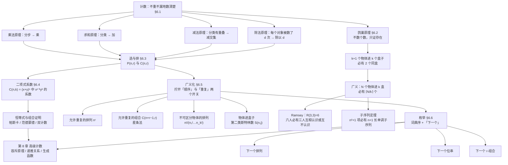

# C6 计数 Counting MOC

要看的难点：6.2 6.4 6.6

> [!abstract] 这一章讲什么
> 前面五章一直在**证明**："对一切 $n$，某某成立"。第 6 章换了个问法：**有多少个？**
> 问法一换，工具全变——不再需要推理规则和对角线法，需要的是一套**保证不重不漏**的清点办法。
>
> **一句话概括全章**：计数的全部难点只有两个——**"分类还是分步"**（决定加还是乘），
> 以及**"顺序算不算、重复算不算"**（决定用四个公式里的哪一个）。围绕这两句话，全章分四条线：
> - **四个原理**（§6.1）：乘法（分步）、求和（分类）、减法（分类有重叠）、除法（被数重了）——这是全章的地基。
> - **选与排**（§6.3 → §6.4 → §6.5）：从 $P(n,r)$、$C(n,r)$ 出发，逐步拧开"顺序"和"重复"两个开关，
>   走到允许重复的组合 $\binom{n+r-1}{r}$（**星条法**）和物体进盒子的**第二类斯特林数** $S(n,j)$。
> - **鸽巢原理**（§6.2）：它**不数个数，只证存在**——"一定有至少两个撞在一起"。这是全章唯一一条
>   "算不出具体数也要给出结论"的路线，$R(3,3)=6$ 是它最漂亮的例子。
> - **枚举算法**（§6.6）：怎么让机器**按词典序一个一个吐出**排列与组合，不重复不遗漏。
>
> 这一章是**第 8 章（高级计数）**的直接前奏：容斥原理会补上"多集合的减法原理"，
> 递推关系的系统解法会让本章那些"先分类再数"的技巧变成可机械执行的流程。

> [!info] 这一章的笔记情况
> 本章笔记**依据教材 Rosen 第 6 章（pp.385–444）撰写**，按教材六节拆成六篇，体例与
> [[C1 基础：逻辑与证明 MOC]]、[[C2 基本结构：集合、函数、序列、求和与矩阵 MOC]]、[[C9 关系 Relations MOC]] 一致。
> 全章共 **14 张图**，全部已逐张回看核对：**12 张用 Python 重绘**（树形图、帕斯卡三角、星条法、位串对应等，
> 比原书扫描件清楚），**2 张直接从教材页面裁切**——IPv4 位段表（p.392 FIGURE 1）与鸽子与巢三连图（p.399 FIGURE 1）：
> 这两张的"排版本身就是信息"，重画反而会失真。每张图都用在正文里，图索引在本页末尾。

> [!note] 课件与转写稿情况（2026-10-24 更新）
> **第 6 章的材料这一轮补齐了**：教材正文 `pdfs/第六章.pdf`（60 页，印刷页 385–444）之外，
> 老师从 10 月 13 日起陆续发布了本章的配套幻灯片——`Ch6.1`（10-13）、`Ch6.2`（10-13）、`Ch6.2&Ch6.3`（10-14）、
> `Ch6.5`（10-14）、`Ch6.6`（10-15），共 23 页；课堂转写稿第 **17–19** 节课覆盖全章。
>
> 本章的讲法顺序与教材一致，但**重心明显偏移**：老师在 §6.1 用"黑客暴力破解 5 位密码"开场，
> 在 §6.2 用生日问题与 Ramsey 理论收尾，§6.5 只讲了"物体进盒子"的分类框架，
> §6.6 则明确说了"可能考你**为什么这是下一个排列**"。
> 他给本章的定位是：**为第 10 章（图）与算法复杂度服务的工具课**，所以"会算"比"会证"重要。
>
> 本章正文已按转写稿重新对齐：课堂讲到的内容不再标（拓展），只有课堂上跳过、由教材补足的段落（如部分组合证明的细节）保留【拓展】。
>
> **手写笔迹检查**：`第六章.pdf` **无任何手写笔迹**；五份 `Ch6.x` 幻灯片同样**逐页体检无 Ink 注释、无整页空白页**。
> 教材正文与幻灯片都不是 pptx，所以也不存在"墨迹在 `ppt/ink/*.xml` 里、被 LibreOffice 转 PDF 时整体丢弃"这一类问题。
> **本章没有任何一处"以为是动画丢帧、其实是被丢弃的板书"的情况。**

> [!warning] 课件问题清单
> **本页所有页码均为教材印刷页码**（PDF 页 = 印刷页 − 384）。
>
> 目前的结论分两类：**数值全部复算通过，没有一处算错**（下表）；**排版上有 1 处原印缺陷**（见下表之后）。
> 已逐条独立复算的数值：
>
> | 位置 | 教材数值 | 复算结果 | 结论 |
> |---|---|---|:-:|
> | p.392 IPv4 例题 | $x_A=127\times16{,}777{,}214=2{,}130{,}706{,}178$ | 一致 | ✓ |
> | p.392 | $x_B=16{,}384\times65{,}534=1{,}073{,}709{,}056$ | 一致 | ✓ |
> | p.392 | $x_C=2{,}097{,}152\times254=532{,}676{,}608$ | 一致 | ✓ |
> | p.392 | 合计 $3{,}737{,}091{,}842$ | 一致 | ✓ |
> | p.425 星条例题 | $\binom{11}{5}=462$ | 一致 | ✓ |
> | p.430 小球入箱 | $\binom{17}{10}=19{,}448$ | 一致 | ✓ |
> | p.428 | $7!/(3!\,2!)=420$ | 一致 | ✓ |
> | p.430–431 | $S(4,1..3)=1,7,6$，合计 $14$ | 一致 | ✓ |
> | p.436 下一排列 | $362541\to364125$ | 一致 | ✓ |
>
> **已回页面图片 / 原文逐字核实的原印缺陷（3 处，都不影响任何结论）**：
> - **p.408 例 3 末尾整句重复**。该页印作
>   "…we see that $P(3,2)=3\cdot2=6$. **the first element. By the product rule,
>   it follows that $P(3,2)=3\cdot2=6$.**"
>   —— 后半句是前半句的重复，还多出一个孤立的短语 "the first element."。
>   **这是印在纸上的（已回 page-024 图片确认），不是文本层伪影**，属该版的排版缺陷。
>   重复的数值本身正确，笔记里只按规范写法给一次。
> - **p.417 推论 2 的证明里，$(-1)$ 的指数写在了 $y$ 那一侧**：证明开头声明"用二项式定理，取
>   $x=-1,\ y=1$"，但展开写成 $\sum_k\binom{n}{k}(-1)^k1^{n-k}$；按所声明的代入应当是
>   $(-1)^{n-k}1^k$。（顺带说：这个印出来的式子本身也**没算错**——它对应的是另一组代入
>   $x=1,y=-1$，而 $n\ge1$ 时两种代入的和都等于 0，所以结论 $=0$ 不受影响。）
>   见 [[C6.4 二项式系数与恒等式 Binomial Coefficients and Identities]] §4。
> - **p.421 定理 4 的证明收尾把位串长度写错了**：同一条证明开头写的是
>   "the bit strings of **length $n+1$** containing $r+1$ ones"，收尾却写成
>   "bit strings of **length $n$** containing exactly $r+1$ ones"。按左边 $\binom{n+1}{r+1}$ 与
>   $k$ 的取值范围，收尾处应是 $n+1$。**只是描述句的笔误，恒等式本身正确。**
>   见 [[C6.4 二项式系数与恒等式 Binomial Coefficients and Identities]] §8。
>
> 关于五处**容易误读、但不是错误**的地方，一并记下免得日后误改：
> - p.392 的 hostid 数字是 $2^{24}-2$ 与 $2^{16}-2$，**减 2 不是减 1**——
>   全 0 与全 1 两个 hostid 都不可用（原书正文写清了这一点）；
> - **从文本层提取本页时会出现"花括号丢失"的假象**：p.430 例 10 列举四个员工分三个
>   不可区分办公室的分法时，文本层抽出来是 `{{B, D}}, {A}, {C}}`，
>   而**核对页面图片，原书印的是 `{{B, D}, {A}, {C}}`，完全正确**。
>   这不是印刷错误，是 PDF 文本层的提取伪影——**遇到"看起来少个括号"这类疑点，先回图核对再下结论**；
> - **p.408 推论 1 证明的末句看着像"$1=1$ 所以成立"，其实没错**：印作
>   "Because $\frac{n!}{(n-0)!}=\frac{n!}{n!}=1$ …, we see that the formula also holds when $r=0$."
>   它引的是**上两段刚刚建立的** $P(n,0)=1$（"there is exactly one way to order zero elements"），
>   于是 $r=0$ 时两边都等于 1。**要连着上文读**，不要当成循环论证；
> - p.436 的算法用 1 起始下标 $a_j$、$a_k$（$j$ 是"从右往左第一个满足 $a_j<a_{j+1}$ 的位置"），
>   而许多程序实现用 0 起始下标，算出的 $j$ 会差 1——**这是记号约定差异，不是错误**；
> - **p.437 ALGORITHM 3 的过程头写的是"真子集 proper subset"，这隐含了 $r<n$**：$r=n$ 时
>   那唯一一个组合 $\{1,\dots,n\}$ 已经取到最右端的最大值，$i$ 会一路退到 0 而越界。
>   原书把这种输入排除在外是对的，**别当成"漏了 $r=n$ 的情形"去"修正"**。
>   （同类提醒：本节两处"留给读者"的最小性证明——Algorithm 1 与 Algorithm 3——
>   教材只留作习题，笔记里补的是**通行讲法的证明**，见
>   [[C6.6 生成排列与组合 Generating Permutations and Combinations]] §2 与 §5。）

---

## 📖 本章笔记索引

| 笔记 | 教材页码 | 核心内容 | 难度 |
|---|---|------|:-:|
| [[C6.1 计数基础 The Basics of Counting]] | pp.385–398 | 组合数学与枚举、**乘法原理**、**求和原理**、**减法原理**（两集合容斥）、**除法原理**、**树形图**、IPv4 地址计数、函数与子集计数 | ⭐⭐⭐ |
| [[C6.2 鸽巢原理 The Pigeonhole Principle]] | pp.399–406 | **鸽巢原理**及其反证法证明、**推论 1**（不单射）、**广义鸽巢原理**（$\lceil N/k\rceil$）、**拉姆齐理论** $R(3,3)=6$、**子序列定理**（$n^2+1$ 项必有 $n+1$ 长单调子序列） | ⭐⭐⭐ |
| [[C6.3 排列与组合 Permutations and Combinations]] | pp.407–414 | **$r$-排列 $P(n,r)$** 的推导、**$r$-组合 $C(n,r)$** 的推导（$P=C\cdot r!$）、$C(n,r)=C(n,n-r)$、相邻限制类计数、扑克牌与位串例题 | ⭐⭐⭐⭐ |
| [[C6.4 二项式系数与恒等式 Binomial Coefficients and Identities]] | pp.415–422 | **二项式定理**的来路与三个推论、**帕斯卡恒等式**、**范德蒙德恒等式**、$\sum_k\binom{k}{r}$ 型恒等式、**组合证明 / 双计数**方法论 | ⭐⭐⭐⭐ |
| [[C6.5 广义排列与组合 Generalized Permutations and Combinations]] | pp.423–434 | 允许重复的排列 $n^r$、**允许重复的组合 $\binom{n+r-1}{r}$ 与星条法**、**不可区分物体的排列**、**物体进盒子五种情形**、**第二类斯特林数 $S(n,j)$** | ⭐⭐⭐⭐ |
| [[C6.6 生成排列与组合 Generating Permutations and Combinations]] | pp.435–438 | **词典序**、**生成下一个排列的算法**、**下一个位串**、**下一个 $r$-组合**，以及"不重不漏"的枚举思想 | ⭐⭐ |

**推荐阅读顺序**：按 6.1 → 6.6 顺序读。**依赖关系是硬的**——§6.5 的每个公式都是 §6.1 的某个原理
（星条法用乘法原理数位置、重复组合用除法原理去掉顺序、不可区分排列用除法原理去掉同类内部顺序），
所以 §6.1 没读透，§6.5 就只剩背公式。

**若时间紧张**：§6.1（四个原理）→ §6.3（$P$、$C$）→ §6.4（二项式定理与帕斯卡）是主干；
§6.2 的鸽巢原理**独立于其余各节**，是最容易拿分、也最容易考"证明题"的一节，性价比最高，别跳过；
§6.5 的星条法与斯特林数、§6.6 的三个算法按考试要求取舍。

> [!warning] 课堂实际覆盖到哪（第 17–19 节课的实测）
> 六篇都已按转写稿合并，但**课堂不是平均用力**的，读之前先知道重点在哪：
>
> | 节 | 课堂情况 |
> |---|---|
> | §6.1 | 讲了乘法/求和/减法（容斥）三个原理与一批例子；**除法原理只在"圆桌排列"处顺带用到，树形图没有展开**（教材正文与习题范围内，仍属可考内容） |
> | §6.2 | 讲完（含广义鸽巢、生日问题、Ramsey $R(3,3)=6$），是本章讲得最完整的一节 |
> | §6.3 | 讲完，配了班委会、缩到 5 个人、圆桌三个例题 |
> | §6.4 | 讲了帕斯卡、范德蒙德、曲棍球棒三条恒等式；**二项式定理本身的推导没有当堂展开**（按教材写全） |
> | §6.5 | 讲了"物体/盒子可区分与否"的四象限与星条法，**斯特林数一带而过** |
> | §6.6 | 讲完"下一个排列/下一个组合"的算法，并明确说**可能考"为什么这是下一个排列"** |
>
> 本章的定位是"**为第 10 章与算法复杂度服务的工具课**"：会算、会手算过程比会证明重要。

---

## 🗺️ 全章知识地图

---

## 🔑 五张必背表

### 表 1｜四个计数原理：看到什么信号，用哪一条

| 原理 | 什么时候用（信号） | 公式 | 用错会怎样 |
|---|---|---|---|
| **乘法原理** Product Rule | 任务能拆成**依次执行的若干步** | 第 1 步 $n_1$ 种、第 2 步 $n_2$ 种 ⇒ 共 $n_1n_2$ 种 | 把"也可以"当成"接着做"⇒ 少数（漏掉分支） |
| **求和原理** Sum Rule | 任务能拆成**互不相交的几类** | 类 1 有 $n_1$ 种、类 2 有 $n_2$ 种 ⇒ 共 $n_1+n_2$ 种 | 两类有重叠还相加 ⇒ **多数**（重复计数，最常见的错误） |
| **减法原理** Subtraction Rule | 分类时**有重叠**，且重叠部分好数 | $n_1+n_2-|\text{重叠}|$（= 容斥，两集合） | 忘了减 ⇒ 多数 |
| **除法原理** Division Rule | 同一种结果**被数了 $d$ 次** | 结果数 $=n/d$ | 不除 ⇒ 把同一件事数成不同的事 |

> [!important] 一句话判"加还是乘"
> **"接着做/然后" ⇒ 乘；"或者/分类" ⇒ 加。** 先把这个判断做对，再谈公式——
> 本章所有的错题，一半错在这一步上。

### 表 2｜鸽巢原理家族

| 名称 | 条件 | 结论 |
|---|---|---|
| **鸽巢原理**（抽屉原理 Dirichlet drawer principle） | $k+1$ 个（或更多）物体放进 $k$ 个盒子 | 至少有 1 个盒子含 $\ge2$ 个物体 |
| **推论 1** | $f$ 的定义域有 $k+1$ 个以上元素，陪域只有 $k$ 个 | $f$ **不是单射** |
| **广义鸽巢原理** | $N$ 个物体放进 $k$ 个盒子 | 至少有 1 个盒子含 $\ge\lceil N/k\rceil$ 个物体 |
| **拉姆齐 Ramsey** | 6 个人，任意两人或为朋友或为敌人 | 必有 3 人两两为友，或 3 人两两为敌（$R(3,3)=6$） |
| **子序列定理** | $n^2+1$ 个**互不相同**的实数排成一个序列 | 必含长度 $n+1$ 的**递增**或**递减**子序列 |

### 表 3｜选与排：两个开关决定一切

| 类型 | 顺序算不算 | 允许重复吗 | 公式 | 例（$n=7,r=5$ 数量级参考） |
|---|:-:|:-:|---|---|
| $r$-排列 | 算 | 不允许 | $P(n,r)=\dfrac{n!}{(n-r)!}$ | $P(7,5)=2520$ |
| $r$-组合 | 不算 | 不允许 | $C(n,r)=\dbinom{n}{r}=\dfrac{n!}{r!\,(n-r)!}$ | $C(7,5)=21$ |
| $r$-排列 | 算 | 允许 | $n^r$ | $7^5=16807$ |
| $r$-组合（**星条法** stars and bars） | 不算 | 允许 | $C(n+r-1,r)=\dbinom{n+r-1}{r}$ | $C(11,5)=462$ |

**星条法的一句话**：$r$ 颗星与 $n-1$ 条竖线共 $r+n-1$ 个位置，
**选出哪 $r$ 个位置放星**就是 $r$-组合——$\dbinom{r+n-1}{r}$。
（它同时是"$x_1+\cdots+x_n=r$ 的非负整数解个数"和"$r$ 个不可区分小球放进 $n$ 个可区分盒子"的答案。）

### 表 4｜二项式系数恒等式

| 名称 | 恒等式 | 组合证明的思路（一句话） |
|---|---|---|
| **二项式定理** | $(x+y)^n=\displaystyle\sum_{k=0}^{n}\binom{n}{k}x^{n-k}y^k$ | 从 $n$ 个括号里选 $k$ 个贡献 $y$，有 $\binom{n}{k}$ 种选法 |
| 推论 1 | $\displaystyle\sum_{k=0}^{n}\binom{n}{k}=2^n$ | 数所有子集：按大小分类相加 = 每个元素取/不取 |
| 推论 2 | $\displaystyle\sum_{k=0}^{n}(-1)^k\binom{n}{k}=0$ | 偶大小子集与奇大小子集一样多（$n\ge1$） |
| 推论 3 | $\displaystyle\sum_{k=0}^{n}2^k\binom{n}{k}=3^n$ | 每个元素三种状态：不取 / 取作第一类 / 取作第二类 |
| **帕斯卡恒等式** | $\dbinom{n+1}{k}=\dbinom{n}{k-1}+\dbinom{n}{k}$ | 固定一个元素：含它（再从 $n$ 个里取 $k-1$）与不含它（取 $k$ 个） |
| **范德蒙德恒等式** | $\dbinom{m+n}{r}=\displaystyle\sum_{k=0}^{r}\dbinom{m}{k}\dbinom{n}{r-k}$ | 从 $m$ 个与 $n$ 个两堆里共取 $r$ 个，按"从第一堆取了几个"分类 |
| 推论 4 | $\dbinom{2n}{n}=\displaystyle\sum_{k=0}^{n}\binom{n}{k}^2$ | 范德蒙德取 $m=n=r$ 的特例 |
| 曲棍球棒 | $\displaystyle\sum_{k=r}^{n}\binom{k}{r}=\binom{n+1}{r+1}$ | 反复用帕斯卡恒等式，中间项两两抵消 |

> [!important] 两种本事
> **算出数**（代数/公式代入）和**讲出为什么**（组合证明 combinatorial proof，也叫双计数 double counting）
> 是两种不同的本事。考试里"证明恒等式"基本只认后者：
> **找一个集合，用两种方式数它**，两种数法给出同一个数——恒等式就出来了。

### 表 5｜把物体放进盒子：五种情形

| 物体 | 盒子 | 方案数 | 本篇位置 |
|---|---|---|---|
| 可区分 | 可区分 | $k^n$（每个物体自由选） | §6.5 允许重复的排列 |
| 不可区分 | 可区分 | $\dbinom{n+k-1}{n}$（星条法） | §6.5 允许重复的组合 |
| 可区分 | 不可区分，**不许空盒** | $S(n,k)$（第二类斯特林数） | §6.5 |
| 可区分 | 不可区分，**允许空盒** | $\displaystyle\sum_{j=1}^{k}S(n,j)$ | §6.5 |
| 不可区分 | 不可区分，允许空盒 | $n$ 的**整数拆分**数（无闭式，只能枚举） | §6.5 |

**第二类斯特林数的递推**：$S(n,j)=S(n-1,j-1)+j\,S(n-1,j)$，初始条件 $S(0,0)=1$、$S(n,0)=0\ (n>0)$。
（读法：看最后一个物体——**自己独占一个新盒子**，或**进入已有的 $j$ 个盒子之一**。）
> [!note] 这条递推是**通行补充**，教材正文并没有给
> 教材只给了定义（"$n$ 个可区分物体放进 $j$ 个不可区分**非空**盒子的方案数"）、几个数值
> （$S(4,1)=1$、$S(4,2)=7$、$S(4,3)=6$，即 p.430–431 的例 10）以及下面那条**闭式**；
> **递推式是组合数学的标准结果，由本篇补上并给出了"看最后一个物体"的推导**。
> 闭式：$S(n,j)=\dfrac{1}{j!}\displaystyle\sum_{i=0}^{j-1}(-1)^i\binom{j}{i}(j-i)^n$
> （教材 p.431 给出，注明"用容斥原理可证，见 §8.6"——第 8 章才会讲容斥原理）。
> 复算抽查：$S(6,3)=\frac{1}{3!}\bigl(3^6-3\cdot2^6+3\cdot1^6\bigr)=\frac{729-192+3}{6}=90$，与递推结果一致。

---

## 📌 Key Terms 术语表（教材章末原词，中英对照）

### §6.1 计数基础
| 英文 | 中文 | 一句话 |
|---|---|---|
| combinatorics | 组合数学 | 研究物体的安排方式 |
| enumeration | 枚举 / 计数 | 把安排方式的个数数出来 |
| product rule | 乘法原理 | 分步做 ⇒ 各步方式数相乘 |
| sum rule | 求和原理 | 分类做且各类不相交 ⇒ 相加 |
| subtraction rule / inclusion–exclusion | 减法原理 / 容斥 | 两类有重叠 ⇒ 相加后减交集 |
| division rule | 除法原理 | 每个结果被数了 $d$ 次 ⇒ 除以 $d$ |
| tree diagram | 树形图 | 由根、分支、子分支构成的计数图 |
| Cartesian product（乘法原理的集合版） | 笛卡尔积 | $\lvert A\times B\rvert=\lvert A\rvert\lvert B\rvert$ |

### §6.2 鸽巢原理
| 英文 | 中文 | 一句话 |
|---|---|---|
| pigeonhole principle | 鸽巢原理 | $k+1$ 个物体进 $k$ 个盒子，必有盒含 $\ge2$ |
| Dirichlet drawer principle | 抽屉原理 | 同上，冠以 Dirichlet 之名 |
| generalized pigeonhole principle | 广义鸽巢原理 | $N$ 个物体进 $k$ 盒，必有盒含 $\ge\lceil N/k\rceil$ |
| Ramsey theory | 拉姆齐理论 | "足够大就一定出现某种规律"的分支；$R(3,3)=6$ |
| monotonic subsequence | 单调子序列 | 递增或递减的子序列 |

### §6.3–§6.4 排列、组合与二项式系数
| 英文 | 中文 | 一句话 |
|---|---|---|
| permutation | 排列 | 集合元素的**有序**安排 |
| $r$-permutation | $r$-排列 | 取 $r$ 个的**有序**安排，$P(n,r)$ |
| $r$-combination | $r$-组合 | 取 $r$ 个的**无序**选择，$C(n,r)$ |
| binomial coefficient | 二项式系数 | $\binom{n}{r}$，既是组合数也是 $(x+y)^n$ 的系数 |
| binomial theorem | 二项式定理 | $(x+y)^n=\sum_k\binom{n}{k}x^{n-k}y^k$ |
| Pascal's triangle | 帕斯卡三角形 | 第 $i$ 行放 $\binom{i}{j}$ 的三角阵 |
| Pascal's identity | 帕斯卡恒等式 | $\binom{n+1}{k}=\binom{n}{k-1}+\binom{n}{k}$ |
| Vandermonde's identity | 范德蒙德恒等式 | $\binom{m+n}{r}=\sum_k\binom{m}{k}\binom{n}{r-k}$ |
| combinatorial proof / double counting | 组合证明 / 双计数 | 用计数论证而非代数变形证明恒等式 |

### §6.5 广义排列与组合
| 英文 | 中文 | 一句话 |
|---|---|---|
| stars and bars | 星条法 | 用 $r$ 颗星与 $n-1$ 条竖线编码重复组合 |
| indistinguishable objects | 不可区分物体 | 彼此视为相同，如全同的书 |
| distinguishable / labeled | 可区分 / 有标号 | 彼此不同，如人 |
| unlabeled boxes | 无标号盒子 | 盒子之间不可区分 |
| Stirling number of the second kind $S(n,j)$ | 第二类斯特林数 | $n$ 个可区分物体放进 $j$ 个不可区分**非空**盒子的方案数 |
| partition of an integer | 整数拆分 | 把一个整数写成若干正整数之和（不计顺序） |

### §6.6 生成排列与组合
| 英文 | 中文 | 一句话 |
|---|---|---|
| lexicographic order | 词典序 | 先比第一位、再比第二位……的排序 |
| next permutation | 下一个排列 | 词典序意义下的直接后继 |
| bit string（组合的编码） | 位串 | 长度为 $n$ 的位串与 $r$-组合一一对应 |
| algorithm（Algorithm 1/2/3） | 算法 | 生成下一个排列 / 下一个位串 / 下一个 $r$-组合 |

---

## 📐 主要结论一览（教材章末 RESULTS 原条目）

| 结论 | 内容 |
|---|---|
| 乘法原理（计数版 / 集合版） | 分两步的任务：$n_1n_2$；有限集的笛卡尔积：$\lvert A\times B\rvert=\lvert A\rvert\lvert B\rvert$ |
| 求和原理（计数版 / 集合版） | 两类不相交的任务：$n_1+n_2$；两两不交有限集的并：元素数相加 |
| 减法原理（计数版 / 集合版） | 两类可重叠的任务：$n_1+n_2-(\text{公共部分})$；$\lvert A\cup B\rvert=\lvert A\rvert+\lvert B\rvert-\lvert A\cap B\rvert$ |
| 除法原理（计数版 / 集合版） | 每个结果被数 $d$ 次 ⇒ $n/d$；$A$ 是 $n$ 个各含 $d$ 元的互不相交子集之并 ⇒ $n=\lvert A\rvert/d$ |
| 鸽巢原理 | $k+1$ 个物体进 $k$ 个盒子 ⇒ 有盒含 $\ge2$ |
| 广义鸽巢原理 | $N$ 个物体进 $k$ 个盒子 ⇒ 有盒含 $\ge\lceil N/k\rceil$ |
| 排列与组合 | $P(n,r)=\dfrac{n!}{(n-r)!}$；$C(n,r)=\dbinom{n}{r}=\dfrac{n!}{r!\,(n-r)!}$ |
| 帕斯卡恒等式 | $\dbinom{n+1}{k}=\dbinom{n}{k-1}+\dbinom{n}{k}$，配合 $\binom{n}{0}=\binom{n}{n}=1$ 可递推定义二项式系数 |
| 二项式定理 | $(x+y)^n=\displaystyle\sum_{k=0}^{n}\binom{n}{k}x^{n-k}y^k$ |
| 允许重复的 $r$-排列 | 共 $n^r$ 个 |
| 允许重复的 $r$-组合 | 共 $C(n+r-1,r)$ 个 |
| 不可区分物体的排列 | $n$ 个物体、$k$ 类、第 $i$ 类有 $n_i$ 个相同 ⇒ $\dfrac{n!}{n_1!n_2!\cdots n_k!}$ |
| 生成排列的算法 | 从 $\{1,2,\dots,n\}$ 的任一排列出发，反复求"下一个词典序排列"即可列出全部 $n!$ 个 |

---

## 🖼️ 本章图索引

> 全部图片都在 `离散数学/attachments/` 下，正文用裸文件名嵌入。
> "来源"一列区分 **自绘**（Python 重画，比原书清楚）与 **裁切**（原书排版本身就是信息，重画会失真）。

| 图片 | 来源 | 用在哪 | 它要说明的那句话 |
|---|---|---|---|
| `C6.1-IPv4地址分类与位段.png` | 裁切（教材 p.392 FIGURE 1） | [[C6.1 计数基础 The Basics of Counting]] | 五类地址的位段划分决定了 netid/hostid 各占多少位，因而决定各类地址的个数 |
| `C6.1-无连续1的位串树.png` | 自绘 | [[C6.1 计数基础 The Basics of Counting]] | 树形图把"所有可能"摊开，遇到"不允许连续 1"的分支自然截断，叶子数就是答案 |
| `C6.1-五局三胜的树形图.png` | 自绘（依教材 p.395 FIGURE 3 重画） | [[C6.1 计数基础 The Basics of Counting]] | 三胜即止的比赛，"分支在第几层断掉"取决于前面谁赢，所以叶子数只有 $2+6+12=20$ 而不是 $2^5$ |
| `C6.1-T恤尺寸与颜色树.png` | 自绘 | [[C6.1 计数基础 The Basics of Counting]] | 每个尺寸可选的颜色数不同时，只能逐个尺寸数叶子再相加（求和原理） |
| `C6.2-鸽巢原理示意.png` | 裁切（教材 p.399 FIGURE 1） | [[C6.2 鸽巢原理 The Pigeonhole Principle]] | 物体比盒子多，就一定有盒子装了至少两个 |
| `C6.2-广义鸽巢原理.png` | 自绘 | [[C6.2 鸽巢原理 The Pigeonhole Principle]] | 最平均的放法给出下界：一定有盒子至少装 $\lceil N/k\rceil$ 个 |
| `C6.2-K6二色染色必有同色三角形.png` | 自绘 | [[C6.2 鸽巢原理 The Pigeonhole Principle]] | 从一个顶点出发的 5 条边按"两种颜色"分，必有 3 条同色，再分情况就逼出同色三角形 |
| `C6.3-排列与组合的区别.png` | 自绘 | [[C6.3 排列与组合 Permutations and Combinations]] | 每个 $r$-组合恰好对应 $r!$ 个 $r$-排列，所以 $P(n,r)=C(n,r)\cdot r!$ |
| `C6.4-帕斯卡三角形.png` | 自绘 | [[C6.4 二项式系数与恒等式 Binomial Coefficients and Identities]] | 每个数等于肩上两数之和，这正是帕斯卡恒等式 |
| `C6.4-二项式系数从哪来.png` | 自绘 | [[C6.4 二项式系数与恒等式 Binomial Coefficients and Identities]] | $(a+b)^3$ 的 8 个乘积项按"含几个 $b$"分成 4 组，得到 $1,3,3,1$ |
| `C6.5-星条法示意图.png` | 自绘 | [[C6.5 广义排列与组合 Generalized Permutations and Combinations]] | $r$ 颗星与 $n-1$ 条竖线的每种排法，恰好对应一种允许重复的 $r$-组合 |
| `C6.5-不可区分物体的排列.png` | 自绘 | [[C6.5 广义排列与组合 Generalized Permutations and Combinations]] | 逐类占位相乘与 $\dfrac{n!}{n_1!\cdots n_k!}$ 是同一件事 |
| `C6.6-字典序下一排列的四个动作.png` | 自绘 | [[C6.6 生成排列与组合 Generating Permutations and Combinations]] | 找升序对 → 换最小的大者 → 交换 → 反转后缀，一步不差地得到下一个排列 |
| `C6.6-生成组合的位串对应.png` | 自绘 | [[C6.6 生成排列与组合 Generating Permutations and Combinations]] | $r$-组合与长度 $n$ 的位串一一对应；两种"下一个"**方向相反**——$r$-组合按词典序往下走，而"下一个更大的位串"沿整数值往上走 |

---

## 🎯 复习建议

**主干（务必先做）**

1. **把"加还是乘"判成条件反射**。拿到任何一题，先问：这件事是**分步**还是**分类**？分类之间**有没有重叠**？
   本章 80% 的错误发生在这一步，而不是公式。
2. **四个公式要能自己推出来，而不是背**：
   - $P(n,r)$：第一位 $n$ 种、第二位 $n-1$ 种……共 $r$ 位 ⇒ $n(n-1)\cdots(n-r+1)$；
   - $C(n,r)$：每个组合对应 $r!$ 个排列 ⇒ $C=P/r!$；
   - $n^r$：选 $r$ 次、每次都有 $n$ 种；
   - $\binom{n+r-1}{r}$：星条法数位置。
   **能推出来，才不会在"相邻限制""至少一个"这类变形题上崩掉。**
3. **二项式定理的两向使用**：正向代入求系数；反向把 $\binom{n}{k}$ 看作"选 $k$ 个"来做组合证明。
4. **鸽巢原理的固定套路**：① 找出"盒子"（要按什么分类）② 数出物体数 $N$ 与盒子数 $k$
   ③ 用 $\lceil N/k\rceil$ 或"$k+1$ 个进 $k$ 盒"。**难点永远在第 ① 步**（盒子是自己造的）。

**容易混的三组概念**

| 容易混 | 区分 |
|---|---|
| 求和原理 vs 减法原理 | 两类**不相交**用加法；**有重叠**必须先减交集 |
| 排列 vs 组合 | 问一句"交换两个选中的元素，算不算新方案"——算就是排列 |
| 不可区分物体进盒子 vs 整数拆分 | 盒子**有标号**（可区分）用星条法；盒子**无标号**就是整数拆分，只能枚举 |

**行有余力再看**

- §6.2 的 $R(3,3)=6$ 与子序列定理（漂亮，但考试通常只要求会用鸽巢原理本身）；
- §6.5 的斯特林数闭式与 §6.6 的三个算法伪代码细节（属于"知道有这么回事"的层次）；
- 二项式系数恒等式的**组合证明技巧**（第 8 章与后续算法课程会反复用到，值得花时间）。

**通往下一章**：本章回答"一共多少个"。第 8 章回答"**当计数条件互相纠缠时怎么办**"——
容斥原理（把减法原理推广到 $n$ 个集合）、递推关系与生成函数（把"先分类再数"变成可解的方程，
从而得到像斐波那契那样的闭式）。本章的四个原理，是那三种方法共同的底座。

> [!tip] 接着读第8章（2026-10-20）
> 从 [[C8.1 递推关系的应用 Applications of Recurrence Relations]] 开始，把本章的分类与分步计数用于受限位串、卡特兰数与动态规划。完整入口见 [[C8 高级计数技巧 Advanced Counting Techniques MOC]]；当前只完成8.1，其余分节待整理，讲授状态待确认。
