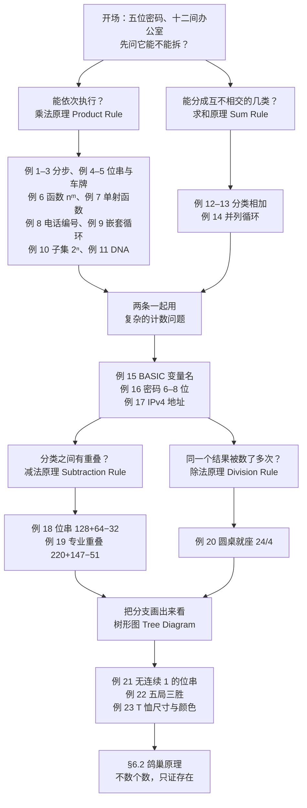

# C6.1 计数基础 The Basics of Counting

> [!abstract] 这一讲的任务
> 前五章我们一直在**证明**："对一切 $n$，某某成立"。这一讲换了一个问法：**有多少个？**
> 问法一换，手上就没有工具了——没有真值表、没有量词、没有归纳法可用。**计数的全部难点只有两件事：把任务拆对（分步还是分类），以及别把同一个东西数两遍。**
> 这一讲给出四条最基础的规则：**乘法原理**（分步 → 乘）、**求和原理**（分类 → 加）、**减法原理**（分类有重叠 → 减掉重叠）、**除法原理**（同一个东西被数了 $d$ 次 → 除以 $d$），外加一件把"分支"画出来的工具——**树形图**。
> 这四条规则本身简单到近乎显然，但它们能解决的问题从一台猜五位密码的暴力破解机、BASIC 的变量名，一直排到 IPv4 地址耗尽。**这一讲是整章的地基**：§6.3 的排列、§6.5 的星条法，全都只是这四条规则的反复应用。

> [!info] 怎么读这份讲义
> 顺序建议：第 0 节（五位密码、12 间办公室）→ 第 1 节（乘法原理，含例 1–11）→ 第 2 节（求和原理，含例 12–14）→ 第 3 节（两条原理混用，含例 15–17）→ 第 4 节（减法原理，含例 18–19）→ 第 5 节（除法原理，例 20）→ 第 6 节（树形图，例 21–23）。
> **必须能默写的四句话**：分步用乘、分类用加、重叠要减、数重了要除。
> **本章的推进路线**（六章共四讲）：6.1 计数基础 → 6.2 鸽巢原理"不算个数、只证存在" → 6.3 排列与组合 → 6.5 泛化的排列与组合 → 6.6 怎样把排列组合一个个生成出来。6.1 是后面每一讲的工具来源。
> 前置：集合与幂集（[[C2.1 集合 Sets]]，用来理解 $2^{|S|}$ 和并集公式）、函数与单射（[[C2.3 函数 Functions]]，例 6、例 7）、笛卡尔积与矩阵（[[C2.6 矩阵 Matrices]]）。
> 第 3 节的例 17（IPv4）和第 6 节的三道树形图例题是本节最常考的地方。



---

## 0. 开场：一间楼层、两位员工

进入这一章之前，先看两个场景。第一个是当下最现实的那种：**有人正拿着你的密码一台机器一台机器地试**。第二个是同一个结构缩到一栋楼里：两把椅子、两个人。第一个场景值钱，第二个场景好算。

### 0.1 先算一笔黑客的账

计算机安全里最笨、但最常用的攻击叫**暴力破解** brute force attack：不去找系统哪里写错了，直接把所有可能的密码一个一个试过去。它慢，可它对"密码规则定得松"的系统几乎总能成功——**而它到底要花多久，只取决于一件事：这个密码一共有多少种可能的串。**

现在有个系统，密码固定 **5 位**，每一位可以是数字 `0–9`、小写字母 `a–z` 或大写字母 `A–Z`。黑客在最坏情况下要试多少次？

> [!question] 停一下，先自己想想
> 每一个位置上，一共有多少种字符可选？五个位置拼起来呢？
> **先别写 $10\times26\times26$**——这个式子很容易脱口而出，而它是错的。错在哪？

答案要分两层，这两层正好就是这一讲的两条规则：

- **同一个位置上"能放什么"，是分类。** 一个字符要么是数字（10 种）、要么是小写字母（26 种）、要么是大写字母（26 种），三类互不重合，所以每个位置有
  $$10+26+26=62$$
  种字符可选。**这一步是加法。**
- **五个位置拼成一个密码，是分步。** 第 1 位有 62 种；定下第 1 位之后，第 2 位**仍然是** 62 种（不受前一位影响），第 3、4、5 位同样 62 种。**这一步是乘法。**

$$62^5 = 916{,}132{,}832.$$

> [!warning] 为什么 $10\times26\times26$ 是错的
> 那个式子描述的是"**一位**是数字、**另一位**是小写字母、**第三位**是大写字母"这种**三位分工**的串——三个位置各有各的规矩。可这里的规矩是"每一位都可以是三者之一"，**一个字符不可能同时是数字和字母**，三类之间是"或"不是"且"，该加不该乘。
> $10\times26\times26=6760$，与 $62^5$ 差着五个数量级。**加法和乘法用反，答案不是错一点，而是错到根本没法拿来判断安全性。**

"最坏情况"这四个字也要落实：**要试到最后一次才撞对**，所以最坏情况就是把 $62^5$ 个串全试一遍。9.16 亿次是什么概念，取决于攻击者的手速：

| 攻击者的速度 | 试完 $62^5$ 要多久 |
|---|---|
| 手敲，每秒 1 次 | 约 29 年 |
| 一个脚本，每秒 1000 次 | 约 10.6 天 |
| 专门跑哈希的机器，每秒 100 万次 | 约 15 分钟 |

于是"这个密码够不够安全"在写代码之前就能答出来：**先数清楚有多少种可能，再看攻击者每秒能试多少次，两个数一除就是攻击的代价。**

长度在这里是**乘法级的杠杆**：每多一位，要试的次数就乘 62。5 位是 10.6 天（按每秒 1000 次），6 位就是 $62^6=56{,}800{,}235{,}584$ 种、约 **657 天**。反过来，一条"密码不区分大小写"的规定会把每个位置的候选从 62 降到 $10+26=36$，于是 $36^5=60{,}466{,}176$，只有原来的 **1/15**。**一条工程规范值多少钱，是可以数出来的。**

### 0.2 同一件事，缩到一层楼里

新公司刚租下一层楼，这层有 **12 间办公室**。今天入职的是两个人：Sanchez 和 Patel。行政来找你确认一件事：

> "给他们俩分办公室，一间一人、不能合住，一共**有几种分法**？我要在系统里预先生成所有可能的分配方案。"

你手上没有公式。你能做的只是把它想清楚：

1. 先让 **Sanchez 挑**。12 间空着，他怎么挑都行——**12 种**。
2. 再让 **Patel 挑**。这时有一间被占了，剩下 **11 间**——**11 种**。

两件事是**接着做**的：定了 Sanchez 那间，Patel 才有 11 种。所以总的方案数是

$$12\times 11 = 132.$$

再换一件事。第二天你又收到一个请求，这次的问法是：

> "从**数学系 37 位教师**或**数学专业 83 位学生**里推一名代表进校委员会，有几种选法？"

这次不是"接着做"了——选一名代表，要么从教师里选，**或者**从学生里选：$37+83=120$。

两件请求，两种结构。**第一个是"分步"，第二个是"分类"。**

> [!question] 停一下，先自己想想
> 刚才这两问，你觉得是巧合还是规律？
> 如果把 132 那个问题换成"Sanchez 和 Patel 可以共用一间办公室"，答案会变成多少？还是 $12\times11$ 吗？
> 再看一个：如果那 37 位教师里有 5 位同时也在读数学专业（在职研究生），"$37+83$"还对吗？

**你刚才做的，就是一次完整的计数**：把任务拆成能一步步说清的结构，然后数每一步有几种走法。

**这件事为什么值得专门用一整章来练？** 因为"数得出多少种"是很多问题的第一步，而且往往是决定性的那一步：

- **算法复杂度**：说一个算法是 $O(n^2)$ 还是 $O(n\log n)$，说的就是"它做了多少次基本操作"。**数不清操作次数，就谈不上比较快慢。** 做算法题时这道坎很实在：题目往往限时六十秒，**跑不完的话，就算答案写对了也算错**。例 9 会把"数操作次数"这件事当场做一遍。
- **实验与概率**：说某件事发生的概率是 $1/13$，那个 13 就是"一共有多少种可能结果"。**概率的分母永远是一个计数结果。**
- **图上的搜索与最短路**：想找一条最优路线，先得知道一共有多少条路线要走、每种走法怎么数。**第 10 章的数路径、数生成树，用的还是这里这四条规则。**
- **工程上的判断**：像 $62^5$ 那样，一个数字直接决定"这个密码策略够不够"。

这一讲要做的，就是把"拆"这个动作变成四条不会出错的规则。先看最常用的第一条。

---

## 1. 乘法原理 Product Rule（p.386–389）

### 1.1 规则本身

> [!important] 乘法原理 Product Rule
> 设一项任务可以拆成**依次执行的两个任务**。如果第一个任务有 $n_1$ 种做法，并且**对第一个任务的每一种做法**，第二个任务都有 $n_2$ 种做法，那么完成这项任务共有
> $$n_1n_2$$
> 种做法。

这句话里最要紧的字眼是 **"对每一种做法都有"**。它保证了第二个任务的方法数**不随第一个任务的结果而变**——这正是"分步相乘"能成立的全部依据。例 1 里 Patel 永远是 11 种（而不是"看他被分到哪间"有时 11 有时 12），所以才能直接乘。

**先用一个不涉及公式的例子把它说透。** 一个旅行者要从中国去美国，中途在英国转机：从中国到英国有三种走法（飞机、火车、船），从英国到美国有四种走法。那么"从中国经英国到美国"一共有多少种行程？

**先到英国、再去美国，一段接一段**，所以是

$$3\times4=12 \text{ 种}.$$

注意 $3+4=7$ 错在哪：那个 7 是"从中国到英国有 3 种，加上从英国到美国有 4 种"，它数的是**两段路各自有多少走法**，而不是"走完全程有多少种行程"。真正的行程是"第一段选哪种"与"第二段选哪种"配成的一对，配对数要相乘。

**"先……再……"这两个词，就是乘法原理出现的信号。**

**把它推广到多步**（教材明确写了这一步，并且说可用数学归纳法从两任务版本证出）：

> [!important] 乘法原理（多步版）
> 任务依次执行 $T_1,T_2,\dots,T_m$。若每个 $T_i$ 都有 $n_i$ 种做法，**且与前面各步怎么做的无关**，则共有
> $$n_1\cdot n_2\cdots n_m$$
> 种做法。

**用集合的语言说同一件事**（教材给的这个改写很好用）：

$$|A_1\times A_2\times\cdots\times A_m| = |A_1|\cdot|A_2|\cdots|A_m|.$$

理由：在笛卡尔积里选一个元素，就是"从 $A_1$ 选一个、从 $A_2$ 选一个……"，正好是 $m$ 步。（笛卡尔积的记号见 [[C2.1 集合 Sets]]。）

### 1.2 十个例子（外加一笔真实的账）

> [!example] 例 1（开场那道题，写全）
> **问**：两位员工 Sanchez、Patel 分到 12 间办公室，一间一人，有多少种分法？
> **解**：分两步。给 Sanchez 分：12 种；给 Patel 分一间**不同于 Sanchez 的**：11 种。
> 由乘法原理，$12\times11=132$ 种。$\blacksquare$

> [!example] 例 2（椅子编号）
> **问**：礼堂的椅子用"一个大写英文字母 + 一个不超过 100 的正整数"编号，最多能标出多少把不同的椅子？
> **解**：分两步：先定字母（26 种），再定整数（100 种）。
> $$26\times100=2600.$$
> 所以最多 2600 把。$\blacksquare$

> [!example] 例 3（端口）
> **问**：计算中心有 32 台微机，每台 24 个端口。中心里一共有多少个不同的端口？
> **解**：分两步：先选微机（32 种），再选该微机上的端口（**无论选了哪台，都是 24 种**）。
> $$32\times24=768. \qquad\blacksquare$$

> [!example] 例 4（长度 7 的位串）
> **问**：长度为 7 的位串 bit string 有多少个？
> **解**：7 个比特一位一位地定，每一位都能取 0 或 1，共 2 种，且各步互不影响：
> $$2^7=128. \qquad\blacksquare$$
> **顺手记一个一般结论**：长度为 $n$ 的位串一律有 $2^n$ 个。第 3 节的例 10 会反过来用它数子集。

> [!example] 例 5（车牌）
> **问**：车牌由"3 个大写字母 + 3 个数字"组成（不禁止任何字母组合，哪怕读起来不雅），共能做出多少种车牌？
> **解**：六步，各步独立：前三位各有 26 种，后三位各有 10 种。
> $$26\cdot26\cdot26\cdot10\cdot10\cdot10 = 26^3\cdot10^3 = 17{,}576{,}000. \qquad\blacksquare$$

> [!example] 例 6（数函数：$m$ 元集到 $n$ 元集的函数有几个）
> **问**：从 $m$ 个元素的集合到 $n$ 个元素的集合，共有多少个函数？
> **解**：一个函数就是给定义域里**每一个**元素指定陪域里的一个值。
> 于是任务拆成 $m$ 步：给第 1 个元素定值（$n$ 种）、给第 2 个元素定值（$n$ 种）……**每一步都是 $n$ 种，因为不同的元素可以取到同一个值**（函数不要求单射）。
> $$n\cdot n\cdots n = n^m.$$
> 例如从 3 元集到 5 元集有 $5^3=125$ 个函数。$\blacksquare$

> [!example] 例 7（数单射函数）⭐
> **问**：从 $m$ 个元素的集合到 $n$ 个元素的集合，共有多少个**单射** one-to-one 函数？
> **解**：分两种情形。
>
> **若 $m>n$**：由鸽巢原理（§6.2 正是讲它的那一节），把 $m$ 个东西塞进 $n$ 个盒子且 $m>n$，必有两只挤进同一个盒子，即必有两个定义域元素取到同一个值。所以此时**一个单射函数也没有**。
>
> **若 $m\le n$**：把定义域的元素记作 $a_1,a_2,\dots,a_m$，一步一步定值：
> - $a_1$ 的值：$n$ 种；
> - $a_2$ 的值：**因为单射，$a_1$ 已经用掉的那个值不能再用**，剩 $n-1$ 种；
> - $a_3$ 的值：前两个值都不能用，剩 $n-2$ 种；
> - ……
> - $a_k$ 的值：前 $k-1$ 个值都不能用，剩 $n-(k-1)=n-k+1$ 种。
>
> 由乘法原理，
> $$n(n-1)(n-2)\cdots(n-m+1).$$
> 例如从 3 元集到 5 元集有 $5\cdot4\cdot3=60$ 个单射函数（对照例 6：全部函数有 125 个，单射只占其中 60 个）。$\blacksquare$
>
> **注意这里"单射"这个条件干了什么**：它让每一步的候选数**逐次减一**。这正是 §6.3 排列 $P(n,m)$ 的定义式——**排列就是"单射函数的个数"**，两处是同一件事（[[C2.3 函数 Functions]]）。至于满射（onto）的个数，教材明确说"数满射更难，留到第 8 章"，那里要用容斥原理。

> [!example] 例 8（北美电话编号方案，两道答案）
> **背景**：北美编号方案 NANP 把电话号码分成三段：3 位**区号** area code、3 位**局号** office code、4 位**站号** station code。出于信号上的考虑，某些位有取值限制。记
> - $X$ = 可取 $0\sim9$ 的任意数字；
> - $N$ = 可取 $2\sim9$ 的数字（**8 种**）；
> - $Y$ = 只能是 $0$ 或 $1$ 的数字（**2 种**）。
>
> **旧方案**（1960 年代使用，现已被取代）：区号格式 $NYX$，局号 $NNX$，站号 $XXXX$，号码形如 $NYX\text{-}NNX\text{-}XXXX$。
> **新方案**：区号格式 $NXX$，局号 $NXX$，站号 $XXXX$，号码形如 $NXX\text{-}NXX\text{-}XXXX$。
>
> **问**：旧方案与新方案各有多少个不同的北美电话号码？
> **解**：先分别数各种码。
>
> | 码 | 格式 | 有几种 | 算式 |
> |---|---|---|---|
> | 旧区号 | $NYX$ | 160 | $8\cdot2\cdot10$ |
> | 新区号 | $NXX$ | 800 | $8\cdot10\cdot10$ |
> | 局号 | $NNX$ | 640 | $8\cdot8\cdot10$ |
> | 站号 | $XXXX$ | 10,000 | $10\cdot10\cdot10\cdot10$ |
>
> 号码由三段依次拼成，所以再乘一次：
> $$\text{旧方案}: 160\cdot640\cdot10{,}000 = 1{,}024{,}000{,}000;$$
> $$\text{新方案}: 800\cdot800\cdot10{,}000 = 6{,}400{,}000{,}000.$$
> 新方案把可用号量从约 10.2 亿提到 64 亿。$\blacksquare$
>
> **教材在边上补了一句值得留意的话**：这里**忽略了**"多数区号不许出现 $N11$ 局号"这类限制。也就是说上面两个数是**上界**。另外教材也点出：移动设备和物联网带来的号码需求增长，最终会让新方案也不够用；按当时的预测，到 2038 年就得给北美号码再加一位或几位。**这正好是第 3 节例 17（IPv4 地址耗尽）的同一个故事，只是换了个对象。**

> [!example] 例 9（嵌套循环被执行了多少次）
> **问**：下面这段代码执行完后 $k$ 是多少？其中 $n_1,n_2,\dots,n_m$ 都是正整数。
> ```
> k := 0
> for i₁ := 1 to n₁
>   for i₂ := 1 to n₂
>     ⋮
>     for iₘ := 1 to nₘ
>       k := k + 1
> ```
> **解**：$k$ 初值为 0，嵌套循环**每走一遍就加 1**，所以 $k$ 的终值就是"嵌套循环走了几遍"。
> 把"走第 $i$ 层循环"看成第 $i$ 项任务 $T_i$：第 $i$ 层循环对应 $i_j$ 从 1 到 $n_i$ 的每一个整数，**恰好走 $n_i$ 遍**。
> 由乘法原理，嵌套循环共走
> $$n_1n_2\cdots n_m$$
> 遍。所以 $k$ 的终值是 $n_1n_2\cdots n_m$。$\blacksquare$
>
> **这一段的意义**：它把"乘法原理"和"多层循环的迭代次数"接上了。以后看到"三重循环里做一个常数操作"，复杂度立刻可以写成 $n_1n_2n_3$——**这是乘法原理在算法分析里的第一次出场，不是最后一次**（第 3 节的例 14 是它的"加法版"）。
> 再往前看一步：第 10 章的图上"一条路径有几种走法""生成树有几棵"用的也是同一套动作——**数清楚有多少种走法，才知道该不该用搜索去硬试**。这就是第 0 节那句"先会数，才谈得上比较快慢"的回收。

> [!example] 例 10（子集的个数是 $2^{|S|}$）⭐
> **问**：用乘法原理证明：有限集 $S$ 的子集共有 $2^{|S|}$ 个。
> **解**：把 $S$ 的元素**任意排一个顺序**。回忆（[[C2.1 集合 Sets]]）$S$ 的子集与长度为 $|S|$ 的位串之间存在**一一对应**：
> $$S \text{ 的一个子集} \longleftrightarrow \text{一个位串},\quad \text{位串第 } i \text{ 位是 } 1 \iff \text{第 } i \text{ 个元素在子集里}.$$
> 于是"数子集"变成"数位串"。**每个比特都能独立地取 0 或 1**，也就是 $|S|$ 步、每步 2 种，由乘法原理共有
> $$2^{|S|} \text{ 个位串}.$$
> 因为是一一对应，子集也就有 $2^{|S|}$ 个，即 $|\mathcal{P}(S)|=2^{|S|}$。$\blacksquare$
>
> **教材在这里加了一个交叉引用**：这个事实在第 5 章例 10（§5.1）已经用**数学归纳法**证过一次。**同一个结论，两条路**——一条是"对 $|S|$ 归纳"，一条是"每位两种、分步相乘"。后面这种证法不用归纳假设、不用分类讨论，只是把一个结构看清楚了。**能看结构的时候，不要动手归纳。**

> [!example] 例 11（DNA 与基因组，乘法原理的一次真实应用）
> **背景**：DNA 是双链分子，每条链由**核苷酸** nucleotide 连成，每个核苷酸含一个**碱基** base，碱基是腺嘌呤 A、胞嘧啶 C、鸟嘌呤 G、胸腺嘧啶 T 之一。两条链靠氢键相连，且 **A 只与 T 配、C 只与 G 配**。RNA 是单链，用**尿嘧啶 U** 代替 T，所以 RNA 里碱基对是 A–U 与 C–G。DNA 上编码某一种蛋白质的片段叫**基因** gene，一个生物全部遗传信息叫它的**基因组** genome。
>
> **第一件事（本节的核心推理）**：DNA/RNA 上的碱基序列编码氨基酸，人体必需氨基酸有 **22 种**，为什么至少需要**三个**碱基一组？
> - 每个位置有 4 种碱基，由乘法原理：**两个**碱基的序列有 $4^2=16$ 种，而 $16<22$——**不够用**；
> - **三个**碱基的序列有 $4^3=64$ 种，**够用**（即使考虑到"几个不同三联体编码同一种氨基酸"这种冗余）。
>
> 所以"三碱基一密码子"不是随便定的，是 $4^2<22\le4^3$ 逼出来的。
>
> **第二件事（数量级为什么会爆炸）**：藻类、细菌这类简单生物的 DNA 有 $10^5\sim10^7$ 个"链节"，每个链节是四种碱基之一，所以由乘法原理，简单生物可能的碱基序列**至少**有
> $$4^{10^5} \text{ 种};$$
> 昆虫、鸟类、哺乳动物有 $10^8\sim10^{10}$ 个链节，对应的下界是
> $$4^{10^8} \text{ 种}.$$
> 两个都是天文数字，**这正是生物界变异如此之大的数学解释**。人类基因组约有 23,000 个基因，每个基因 1000 个以上链节。$\blacksquare$
>
> 顺带一句：确定基因组的第一步是在 DNA 里给每个基因定位，接着要做的**基因测序** gene sequencing 就是确定每个基因上的链节序列——这些技术建立在大量组合数学的新想法上，是"生物信息学 / 计算生物学"这门学科的入口。

刚才那个 $4^{10^5}$ 是"**可能有多少种序列**"的爆炸。同一条乘法还能解释另一种爆炸：**一条消息能传多远**。

> [!example] 一笔真实的传播账：Melissa 病毒（乘法原理与求和原理各用一次）
> **背景**：1999 年，David L. Smith 用 Microsoft Word 的**宏** macro 写了一个邮件病毒，取名 Melissa。它把带毒文档当附件，用受害者的名义发给通讯录里**前 50 个人**，正文是一句很像正经同事的话：*"Here is that document you asked for, don't show it to anybody else."* 收件人一打开，病毒就再用**他**的通讯录发 50 封。
>
> **宏是什么？** 就是 Word 里那段"打开文档就自动运行"的小程序——Word 自带一套编程语言，本来是给人写小工具用的。**邮件内容骗人、程序自动执行，两件事合起来，病毒才不需要你点"运行"。**
>
> **问**：这样一轮一轮传下去，**四轮传播之后**一共发出了多少封邮件？
> **解**：账要分两层记。
>
> **每一轮发出多少——乘法原理。** 上一轮的每一封邮件都来自一个点开附件的人，他会带来 50 封新的，轮与轮之间是"接着乘"：
> $$1 \;\to\; 50 \;\to\; 50^2=2{,}500 \;\to\; 50^3=125{,}000 \;\to\; 50^4=6{,}250{,}000.$$
>
> **总共发出多少——求和原理。** 各轮之间**互不重合**（第 3 轮发出的邮件不可能同时是第 4 轮发出的），把各轮加起来就是累计数：
>
> | 阶段 | 这一阶段发出 | 累计 |
> |---|---:|---:|
> | 最初的种子邮件 | 1 | 1 |
> | 传播第 1 轮 | 50 | 51 |
> | 传播第 2 轮 | 2,500 | 2,551 |
> | 传播第 3 轮 | 125,000 | 127,551 |
> | 传播第 4 轮 | 6,250,000 | **6,377,551** |
>
> 五笔之和 $6{,}377{,}551$ 封——**从一个人点开附件，到六百多万封信，只要四轮传播。** 这就是"指数"在现实里的样子，也是前两条规则搭起来用的第一次：**每一轮用乘，轮与轮之间用加。** 一条"每人发 50 封"的小规则，乘四次之后就超出了任何人工处理的能力。$\blacksquare$

> [!warning] 原稿的轮次标错了一位，复算如下
> 原稿把 $2{,}500\times50=6{,}250{,}000$ 标作**第 4 轮**——它把最初那封种子邮件算作第 1 轮。那个算式不成立：$2{,}500\times50=125{,}000$；**$6{,}250{,}000$ 是再下一轮**（$125{,}000\times50$）的数。
> 于是"**四轮之后**"有两种口径，都自圆其说，但答案差 50 倍：
> - 把种子邮件算作第 1 轮 → 前四轮之和 $1+50+2{,}500+125{,}000=127{,}551$；
> - 把"四轮"读成"种子之外再传播四轮"（上面用的就是这个读法，它与原稿给出的总数一致）→ $1+50+2{,}500+125{,}000+6{,}250{,}000=6{,}377{,}551$。
>
> 原稿旁边的总数 $6{,}377{,}551$ 与后一种口径一致，说明它算的是**五轮之和**。**引用这个例子时要把"轮次"和"总数"一起说清**——计数只报一个数、不报中间过程，这类"标签错一位"的错误因此特别难被发现。

> [!note] 停一下，我们刚才干了什么
> 到这里只有**一条**规则：**分步 → 乘**。它的全部要求是两个——任务能拆成**依次执行**的步骤，且**每一步的做法数与前面几步的结果无关**。
> 例 1–3 是最直白的分步；例 4–5 是"每一位独立"；**例 6、例 7 是本节最值钱的两个**：它们告诉我们"函数的个数"可以按定义域逐个元素地分步来数，而"是否单射"这个条件就体现在**每一步的候选数是否递减**；例 8–11 则是同一条规则在不同场景里的重复出场。最后那笔 Melissa 的账又多走了一步——**每一轮用乘，轮与轮之间用加**，所以它其实已经悄悄用上了下一节的规则。
> 现在换一种结构：如果任务不是"接着做"，而是"**从几类里挑一类**"呢？

---

## 2. 求和原理 Sum Rule（p.389–390）

### 2.1 规则本身

> [!important] 求和原理 Sum Rule
> 如果一项任务可以用**$n_1$ 种方式之一**完成，也可以用**$n_2$ 种方式之一**完成，并且**第一组的 $n_1$ 种方式与第二组的 $n_2$ 种方式没有任何重合**，那么完成这项任务共有
> $$n_1+n_2$$
> 种方式。

**与乘法原理的对照，一句话**：

| | 任务结构 | 运算 |
|---|---|---|
| 乘法原理 | **接着做**：做完第一步再做第二步 | $\times$ |
| 求和原理 | **或者**：两类里挑一类 | $+$ |

**"没有重合"这四个字是求和原理的命门。** 少了它，相加就会把同一件事数两遍——第 4 节的减法原理就是专门来补这个漏的。

**还是刚才那个旅行者，这次换成另一问**：从中国到英国这一程，一共有几种走法？

- 坐飞机：广州、香港都有直飞伦敦的航线，共 **4** 种；
- 或者——说出来有点滑稽，但确实是一种走法——**游过去**：**1** 种。

这一次要完成的是**一件事**（"到英国"），而它有几个并列的办成方式：坐飞机（4 种里任一种都算办成），或者游泳（1 种）。**这几类走法两两不重合**，所以由求和原理

$$4+1=5 \text{ 种}.$$

**把两个旅行问题并排放，判据就出来了：**

| 问法 | 任务的结构 | 运算 |
|---|---|---|
| 中国 → 英国 → 美国，一共几种行程？ | 一段**接**一段：前一段定了，才轮到后一段 | $3\times4=12$ |
| 中国 → 英国，一共几种走法？ | 若干种**并列**的走法里挑一种，挑到就完成了 | $4+1=5$ |

**速判窍门**：把任务用一句大白话说出来，只听里面的连词——**"先……再……"就是乘法，"要么……要么……"就是加法**。如果两个都对不上，说明这个任务还拆得不够：它往往是一部分分步、一部分分类，那就得两条一起用，第 3 节专门干这个。

> [!important] 求和原理（多类版）
> 任务可以用 $n_1$ 种方式之一、$n_2$ 种方式之一、……、或 $n_m$ 种方式之一完成，且**对一切 $1\le i<j\le m$，第 $i$ 组方式和第 $j$ 组方式都没有重合**，则共有
> $$n_1+n_2+\cdots+n_m$$
> 种方式。（可由两类版本用数学归纳法证出，即教材习题 71。）

**用集合的语言说同一件事**：若 $A_1,\dots,A_m$ 是**两两不交** pair-wise disjoint 的有限集，则

$$|A_1\cup A_2\cup\cdots\cup A_m| = |A_1|+|A_2|+\cdots+|A_m|,\qquad \text{当 } A_i\cap A_j=\varnothing\ (i\ne j).$$

理由：从并集里选一个元素，就是"从某一个 $A_i$ 里选一个"，有 $|A_i|$ 种；因为两两不交，**从 $A_i$ 选了一个就不会同时算成从 $A_j$ 选的**，各组的"选法"天然互斥，可以直接相加。

> [!warning] 这个等号只在"两两不交"时成立
> 教材在这里明确留了一句话：这套等式只适用于两两不交的情形，**集合之间有公共元素时情况复杂得多**，本节稍后只作简要讨论，第 8 章会有更深入的展开。
> 那一句"稍后简要讨论"指的就是第 4 节的**减法原理**。**这里先埋下，第 4 节回收。**

### 2.2 三个例子

> [!example] 例 12（选代表）
> **问**：从数学系 37 位教师、83 位数学专业学生里推一名代表，且**没有人同时是教师和学生**，有多少种选法？
> **解**：选教师有 37 种方式，选学生有 83 种方式。**因为没人身兼两职，这两组方式不可能重合**（选中同一个人）。
> 由求和原理，$37+83=120$ 种。$\blacksquare$
>
> **注意这个前提有多关键**：它正是"没有重合"。如果存在 5 位在职研究生既是教师又是学生，120 就把这 5 个人数了两遍，那时要改成 $37+83-5=115$。

> [!example] 例 13（三张项目清单）
> **问**：学生要从三张清单里选一个计算机项目，三张清单分别有 23、15、19 个项目，**没有项目同时出现在两张清单上**，共有多少种选法？
> **解**：从第一张、第二张、或第三张里选一个。因为清单之间无重叠，由求和原理
> $$23+15+19=57. \qquad\blacksquare$$

> [!example] 例 14（并列循环做了什么）
> **问**：下面这段代码执行完后 $k$ 是多少？
> ```
> k := 0
> for i₁ := 1 to n₁   k := k + 1
> for i₂ := 1 to n₂   k := k + 1
>         ⋮
> for iₘ := 1 to nₘ   k := k + 1
> ```
> **解**：这是一段由 $m$ 个**互相独立**的循环拼起来的代码（不是嵌套！）。每走一遍循环 $k$ 加 1。
> 第 $i$ 个循环能走 $n_i$ 遍。**因为每次只走其中一个循环**，由求和原理，
> $$k = n_1+n_2+\cdots+n_m. \qquad\blacksquare$$
>
> 把例 9 和例 14 并排看：**两层缩进的 `for` 相乘，平级的 `for` 相加。** 这就是"分步"与"分类"在代码里的样子。

> [!note] 停一下，我们刚才干了什么
> 现在手上有两条规则了，而且它们是一对反义词：**"然后"用乘，"或者"用加**。
> 但两条规则都各自有一个前提——乘法原理要求"每步方法数与前几步无关"，求和原理要求"两类方式不重合"。**前提不成立的时候，规则就失效**，这是第 4 节要处理的事。
> 先看看把两条规则一起用会发生什么。

---

## 3. 更复杂的计数问题 More Complex Counting Problems（p.391–392）

很多计数问题**单独用乘法或单独用求和都做不出来**，但两者搭配就能做。这一节三个例子就是三种搭配方式。

### 3.1 例 15：BASIC 的变量名（分类之后各自分步）

> [!example] 例 15
> **问**：某版本 BASIC 里，变量名是**一到两个**字母数字字符（alphanumeric character：26 个英文字母或 10 个数字之一；**不区分大小写**）。变量名**必须以字母开头**，并且不能是**保留作编程用的那 5 个两字符串**。这个版本的 BASIC 有多少个不同的变量名？
> **解**：设总数为 $V$。把它**按长度分类**：$V_1$ 是一位变量名的个数，$V_2$ 是两位的个数。
> **一位和两位不可能重合**（长度不同），所以由求和原理
> $$V=V_1+V_2.$$
>
> - **求 $V_1$**：一位变量名必须是字母，$V_1=26$。
> - **求 $V_2$**：两位变量名 = "首字符是字母 + 次字符是字母数字"，两步相乘，先不管保留字：
>   $$26\cdot36$$
>   其中 $36=26+10$ 是字母数字的总数。**再扣掉 5 个保留串**：
>   $$V_2 = 26\cdot36-5 = 936-5 = 931.$$
> - **合起来**：
>   $$V = 26+931 = 957. \qquad\blacksquare$$
>
> **这道题的结构值得记下来**：先**分类**（按长度分成两类，类内不重叠 → 用加），再在**类内分步**（两位名字先定首字符再定次字符 → 用乘），最后在类内**减掉一个例外**。这是本节后面所有题目的通用套路。

> [!question] 课堂追问：只允许一位字符，能有多少个变量名？
> 先只答这一小问，别看上面的解。
> **答**：一位变量名必须以字母开头，而字母**只有 26 个**——大写与小写不区分，`A` 和 `a` 算同一个字。**如果区分大小写**，这一位就有 $26+26=52$ 种，后面整个答案都会跟着变；正因为不区分，才是 26。

> [!note] $36$ 这个数本身就是一次加法
> 两位变量名的算式是 $26\times36$。前一个 26 是"首字符必须是字母"，后一个 $36$ 却不是一个"步"——它是
> $$26+10=36,$$
> 因为次字符**要么**是字母、**要么**是数字，两类不重合，先把两类加起来。
> **所以 $26\times36$ 里同时藏着乘法和加法：外面是分步（先定首字符、再定次字符），里面是分类（次字符属于哪一类）。** 写计数式时最容易漏掉这种"合起来的类数"——$36$ 看起来像一个天生就有的数，其实它已经做过一次加法。
>
> 顺便把"保留"说清：reserved 就是"留着不给你用"——座位被 reserved，你就不能坐。这 5 个两字符串被语言本身留作关键字、命令之类，所以变量名里不许出现，要从总数里扣掉。**扣掉，是第 4 节的规则，这里先用一次。**

### 3.2 例 16：密码（正面数不出来，就绕到反面用减法）

开场那个五位密码是这条线上的第一站。这里把规则稍微改复杂一点：**长度不固定、而且必须至少含一个数字**。想清楚它，要同时用上"分类"和"数补集"两个动作。

> [!example] 例 16
> **问**：每个用户的密码长度是 **6 到 8** 个字符，每个字符是**大写字母或数字**，且密码**必须至少含一个数字**。共有多少个可能的密码？
> **解**：设总数为 $P$，长度为 6、7、8 的密码数分别为 $P_6,P_7,P_8$。三种长度互不重合，由求和原理
> $$P=P_6+P_7+P_8.$$
>
> **先解决"怎么数 $P_6$"这件事。** 直接数"至少含一个数字"很别扭——"至少一个"意味着"1 个或 2 个或……或 6 个"，要分成 6 类再加。**换一条路**：先数**不设限制**的全部 6 字符串，再数**违反限制**的那种（一个数字都没有）：
> - 6 个字符、每个可以是 36 种（26 个大写字母 + 10 个数字）→ 共 $36^6$ 个；
> - 一个数字都没有的，每个字符只能是大写字母 → 共 $26^6$ 个。
>
> 于是由**减法**（这是第 4 节减法原理的最简单形态：两集合，一个包含另一个）：
> $$P_6 = 36^6-26^6 = 2{,}176{,}782{,}336-308{,}915{,}776 = 1{,}867{,}866{,}560.$$
> 同法算另外两种长度：
> $$P_7 = 36^7-26^7 = 78{,}364{,}164{,}096-8{,}031{,}810{,}176 = 70{,}332{,}353{,}920,$$
> $$P_8 = 36^8-26^8 = 2{,}821{,}109{,}907{,}456-208{,}827{,}064{,}576 = 2{,}612{,}282{,}842{,}880.$$
> 最后相加：
> $$P = P_6+P_7+P_8 = 2{,}684{,}483{,}063{,}360 \approx 2.68\times10^{12}. \qquad\blacksquare$$
>
> **"至少一个"这个措辞是一条信号**：看到它，先想"能不能数它的补集"。上面的减法是本节最常考的一步。

### 3.3 例 17：IPv4 地址（两条规则三次出场）

> [!example] 例 17
> **问**：互联网上每台计算机（更准确地说，是每台计算机的每个网络连接）都有一个**互联网地址**。IPv4 的地址是一个 **32 比特**的串：开头是**网络号** netid，后面跟**主机号** hostid**（hostid 标明这台机器是某个特定网络里的成员）。
> 地址分三类，各类给 netid 和 hostid 分派的位数不同：
> - **A 类**（给最大的网络用）：`0` + 7 位 netid + 24 位 hostid；
> - **B 类**（中型网络）：`10` + 14 位 netid + 16 位 hostid；
> - **C 类**（最小网络）：`110` + 21 位 netid + 8 位 hostid。
>
> 另外有几条**特殊用途带来的禁止项**：`1111111` 不能作 A 类网络的 netid；**任何网络里，全 0 和全 1 的 hostid 都不可用**。互联网上的计算机只可能拿 A、B、C 三类地址（另有 D 类 `1110` + 28 位，保留给多播；E 类 `11110` + 27 位，保留待用；D、E 都不分配给具体计算机）。
> 问：互联网上可用的 IPv4 地址共有多少个？

下面这张图把 32 个比特位按类切开——**上方是比特编号标尺，每一行是一类地址的位段划分**：

![[C6.1-IPv4地址分类与位段.png]]

**怎么读它**：横轴是 bit number（0 到 31，从左到右，只标出了 0、1、2、3、4、8、16、24、31 这几个刻度）；每一行的左侧格子写的是这一类的**前缀比特**（A 类是 `0`，B 类是 `10`，C 类是 `110`，D 类是 `1110`，E 类是 `11110`）；剩下的格子被分成 `netid` 与 `hostid` 两段，**格子横跨多少个刻度就是多少位**。看 A 类那一行：前缀 `0` 占 1 位（刻度 0 到 1），netid 从刻度 1 到 8 共 7 位，hostid 从刻度 8 一直延到 31 共 24 位——**正是"1 + 7 + 24 = 32"**。

> [!example] 例 17（解答写全）
> **解**：设可用地址总数为 $x$，A、B、C 三类分别为 $x_A,x_B,x_C$。**一台机器只会拿三类中的一类地址，三类互不重合**，所以由求和原理
> $$x=x_A+x_B+x_C.$$
>
> **先算 $x_A$（这一步用了两次乘法、一次减法）**
> - A 类 netid 有 7 位，本来能表示 $2^7$ 个串，但 `1111111` 不可用，所以净剩
>   $$2^7-1=127$$
>   个 netid；
> - **对每一个 netid**，hostid 有 24 位，本来 $2^{24}$ 个串，但全 0 与全 1 两个不可用，净剩
>   $$2^{24}-2=16{,}777{,}214$$
>   个 hostid；
> - 一个 A 类地址 = "选一个 netid + 选一个 hostid"，两步相乘：
>   $$x_A = 127\times16{,}777{,}214 = 2{,}130{,}706{,}178.$$
>
> **再算 $x_B,x_C$（无禁止项，纯乘法）**
> $$x_B = 2^{14}\times(2^{16}-2) = 16{,}384\times65{,}534 = 1{,}073{,}709{,}056,$$
> $$x_C = 2^{21}\times(2^{8}-2) = 2{,}097{,}152\times254 = 532{,}676{,}608.$$
>
> **相加**
> $$x = 2{,}130{,}706{,}178+1{,}073{,}709{,}056+532{,}676{,}608 = 3{,}737{,}091{,}842. \qquad\blacksquare$$
>
> （以上每个数值都已独立复算，与原稿一致。）

> [!warning] 读这道题时最容易错的两个地方
> 1. **"减 2"不是"减 1"。** hostid 要减掉的是全 0 与全 1 **两个**串（全 0 表示"本网络"、全 1 表示广播，都不能分配给单台机器）；而 A 类 netid 只减 **1** 个（`1111111`）。两处的减数不同，不要套用。
> 2. **前缀比特不算进 netid。** A 类那 7 位 netid 是"前缀 `0` 之后的那 7 位"，前缀本身固定为 0、没有自由度，所以是 $2^7$ 而不是 $2^8$。图上一眼看得出：A 类的 `netid` 格子从刻度 1 才开始。
>
> **还有一句题外话值得记**：A 类与 B 类 netid 的数目限制，使得 IPv4 的地址空间在实践中早就不够用——这正是 IPv6 出现的原因，它用 **128 位**地址把空间从 $2^{32}$ 扩到 $2^{128}$。**"够不够用"这个问题，本身就是一次计数。**

> [!question] 停一下，先自己想想
> $3{,}737{,}091{,}842$ 约为 37.4 亿。而 IPv4 一共能表示 $2^{32}=4{,}294{,}967{,}296$ 个 32 位串。
> 两者差了多少？**这个差值是"被三类地址结构浪费掉"的部分**——你能说出它由哪些块组成吗？（提示：D 类、E 类各占了多少？前缀比特本身"锁死"了多少？全 0 全 1 的 hostid 又扣掉了多少？）
> 后面第 4 节讲完减法原理，我们再回来看这个数。

> [!note] 停一下，我们刚才干了什么
> 例 15–17 展示了"两条规则搭配"的三种典型结构：
> - **例 15**：先按长度分类（加），类内分步（乘），再扣掉保留字（减）；
> - **例 16**：分类（加）之后，"至少一个"改成"全部减掉不含的"（减），减法在里面挑大梁；
> - **例 17**：分类（加）之后，每类内分步（乘），其中 A 类还各自扣掉禁止项（减）。
>
> 三者都出现了"减"。**减，就是下一节的正式规则。**

---

## 4. 减法原理 Subtraction Rule（= 两集合容斥）（p.392–394）

### 4.1 撞墙：两件事重叠时不能直接相加

看这样一个任务：

> 从"会写 Python 的人"或"会写 C 的人"里挑一个人。会 Python 的 10 人，会 C 的 8 人。
> 由求和原理，$10+8=18$ 人？

**这里出事了**：如果那 8 人里有 3 人两种都会，这 3 个人被数了**两遍**（一遍算在"会 Python"里，一遍算在"会 C"里）。正确的答案是 $10+8-3=15$。

**画两个相交的圆就一目了然**：左圆是"会 Python 的 10 人"，右圆是"会 C 的 8 人"，相交的那块是"两种都会的 3 人"。**左圆单独看时这 3 人在里面，右圆单独看时这 3 人也在里面**——$10+8$ 把它们各算了一遍；而我们要的是并集（至少会一门的人），并集里每个人只该算一次。**多出来的那一份正好是交集，减掉它。**

**失败的原因很明确**：求和原理要求两组方式**没有重合**，而这里恰好有重合。**朴素做法为什么会错，比结论更重要**——教材把这句话直接印在页边：

> 重复计数大概是枚举里最常见的错误。
> *Overcounting is perhaps the most common enumeration error.*

### 4.2 规则

> [!important] 减法原理 Subtraction Rule
> 如果一项任务可以用 $n_1$ 种方式完成，也可以用 $n_2$ 种方式完成，那么完成这项任务的方式数是
> $$n_1+n_2-\text{（两种方式共同的方式数）}.$$

**用集合的语言说**（这也是它另一个名字的来历）：

> [!important] 两集合的容斥原理 principle of inclusion–exclusion
> $$|A_1\cup A_2| = |A_1| + |A_2| - |A_1\cap A_2|.$$

推理过程（把教材那段话拆成四步）：

1. 从 $A_1$ 里选一个元素有 $|A_1|$ 种，从 $A_2$ 里选有 $|A_2|$ 种；
2. "从 $A_1$ 或 $A_2$ 里选一个元素"＝"从并集里选一个元素"，方式数就是 $|A_1\cup A_2|$；
3. 直接相加会**重复计数**那些同时属于两边的元素——这类元素有 $|A_1\cap A_2|$ 种选法；
4. 把重复的那一份减掉：$|A_1\cup A_2|=|A_1|+|A_2|-|A_1\cap A_2|$。

这与 [[C2.2 集合运算 Set Operations]] 里给出的并集公式是同一个等式——**这里只是把它当成一条计数规则来用**。

> [!note] 一般化先记一句
> 减法原理可以推广到 $n$ 个任务 / $n$ 个集合的并，但形式会迅速变复杂（加单集合、减两两交、加三三交……）。教材明确说这个一般形式与它的许多应用**留到第 8 章**。本节只处理两个集合的情形。

### 4.3 例 18：位串的容斥

> [!example] 例 18
> **问**：长度为 8 的位串中，**以 1 开头**或者**以 00 结尾**的有多少个？
> **解**：分三步。
>
> **第一类：以 1 开头。** 第 1 位锁死（1 种），后面 7 位各 2 种：
> $$2^7 = 128.$$
> **第二类：以 00 结尾。** 前 6 位各 2 种，最后两位锁死（1 种）：
> $$2^6 = 64.$$
> **两类的交集：以 1 开头且以 00 结尾。** 第 1 位锁死、最后两位锁死，中间第 2 到第 6 位共 5 位自由：
> $$2^5 = 32.$$
> 由减法原理：
> $$128+64-32 = 160. \qquad\blacksquare$$
>
> **为什么交集正好是 32 个**：以 1 开头且以 00 结尾的位串形如 $1\,\underset{5\text{ 位}}{\underline{\ \cdots\ }}\,00$——第 1 位固定、后两位固定、**中间 5 位随便**，所以 $2^5$。数交集的时候，把"两部分都固定住、只数剩下的自由位"是最快的算法。

### 4.4 例 19：容斥原理的"补集"用法

> [!example] 例 19
> **问**：某计算机公司收到 **350** 份计算机专业毕业生的求职申请，招聘方向是规划一条新的 Web 服务器产品线。其中 **220** 人主修计算机科学，**147** 人主修商科，**51** 人两个专业都主修。有多少人**两个专业都没主修**？
> **解**：设
> $$A_1 = \text{主修计算机科学的申请人},\qquad A_2=\text{主修商科的申请人}.$$
> 则 $A_1\cup A_2$ 是"主修计算机科学**或**商科（或两者）"的人，$A_1\cap A_2$ 是"两者都主修"的人。由减法原理：
> $$|A_1\cup A_2| = 220+147-51 = 316.$$
> **要求的是"两个都没主修"，也就是在全集里、不在并集里**，所以用总数减掉并集：
> $$350-316 = 34. \qquad\blacksquare$$
>
> **这道题的关键动作是"从全集往回减"**。容斥原理算的是并集，而题目问的是补集——**先把并集算出来，再从总数里减掉**，这是"至少一个"和"一个都没有"这类问法的标准解法。（这也回答了第 3 节那个问题的思路：可用地址数 = 全部串数 − 不能用的串数。）

### 4.5 回头算完那道题

> [!note] 回收：$2^{32}$ 与 37.4 亿的差额
> 全部 32 位串有 $2^{32}=4{,}294{,}967{,}296$ 个，可用地址只有 $3{,}737{,}091{,}842$ 个，差额是
> $$4{,}294{,}967{,}296-3{,}737{,}091{,}842 = 557{,}875{,}454.$$
> 它由这些块组成（都能一块一块数出来）：
> - **D 类**占 $2^{28}=268{,}435{,}456$ 个串，**E 类**占 $2^{27}=134{,}217{,}728$ 个串——它们分别被前缀 `1110`、`11110` 锁死，不分配给任何计算机；
> - **hostid 全 0 / 全 1 的浪费**：A、B、C 三类各网络分别白扔 2 个，合计 $2\times(127+16{,}384+2{,}097{,}152)=2\times2{,}113{,}663=4{,}227{,}326$ 个；
> - **A 类里 netid `1111111` 那整块**：$2^{24}=16{,}777{,}216$ 个串，它不属于任何可用 A 类网络；
> - 前三项相加：
>   $$268{,}435{,}456+134{,}217{,}728+4{,}227{,}326+16{,}777{,}216 = 423{,}657{,}726;$$
> - 还差 $557{,}875{,}454-423{,}657{,}726 = 134{,}217{,}728 = 2^{27}$。**这一块是"B 类与 C 类的前缀窗口之外、又不在 D/E 类里"的那些 32 位串**——即把三类地址的位段划分与 32 位全空间对齐时，被前缀边界切掉的零碎区间之和。
>
> **这一段不是本节要求掌握的计算**，贴在这里只是想说明：**"总数减去不合要求的"这条思路一旦建立，任何"有多少个能用"的问题都能拆成几块、一块一块数清楚**，而不是靠背一个数字。**注意到"减"在这里出现了三次：一次扣 D/E 类、一次扣非法 hostid、一次扣非法 netid。**

> [!note] 停一下，我们刚才干了什么
> 三条规则现在是一套完整的工具箱：
> - **分步 → 乘**（乘法原理）；
> - **分类 → 加**（求和原理，要求类间不重叠）；
> - **分类有重叠 → 加完减去交**（减法原理）。
> "减"这一下补上了"加"的前提漏洞。**还剩最后一种漏洞**：如果同一种结果被我们从不同角度数了 $d$ 次，既不重叠也不多算——而是**同一个东西被算了 $d$ 遍**。这时要除。

---

## 5. 除法原理 The Division Rule（p.394）

> [!question] 停一下，先自己想想
> 已经有了乘、加、减三条规则，**能不能再来一条除法规则**？
> 先想一个具体的：4 个人围一张圆桌坐，如果"每人的左邻右舍都相同"就算同一种坐法，有多少种不同的坐法？
> 注意"4 个人排成一排"是容易的：$4!=24$。**圆桌和排队的区别在哪？**

### 5.1 规则

> [!important] 除法原理 Division Rule
> 如果一项任务可以用一个**有 $n$ 种做法**的过程来完成，并且**对每一种做法 $w$，恰好有 $d$ 种（在 $n$ 种之内的）做法与它对应的是同一个结果**，那么这项任务有
> $$\frac{n}{d}$$
> 种做法。

**它的两种改写**（教材都给了，用哪个看场合）：

- **用集合说**："若有限集 $A$ 是 $n$ 个**两两不交**、每个恰有 $d$ 个元素的子集之并，则 $n=|A|/d$。"
  （把 $A$ 按"同一个结果"分组，每组恰好 $d$ 个。）
- **用函数说**："若 $f$ 是从有限集 $A$ 到有限集 $B$ 的函数，且**对每个 $y\in B$ 恰有 $d$ 个 $x\in A$ 使 $f(x)=y$**（这时我们说 $f$ 是 **$d$ 对一的** $d$-to-one），则 $|B|=|A|/d$。"
  （$A$ 是"过程的做法集合"，$B$ 是"结果集合"，$f$ 把做法送到它对应的结果。单射/满射的语言见 [[C2.3 函数 Functions]]。）

**除法原理和减法原理的区别，一句话**：减法处理**不同结果被重复计入不同的类别**；除法处理**同一个结果在同一个过程里被数了多次**——**多出来的那 $d$ 次是你的数法带来的，不是结果本身的**。

### 5.2 例 20：圆桌就座

> [!example] 例 20
> **问**：4 个人围一张圆桌坐，**当每人的左邻和右邻都相同时**，两种坐法算同一种。有多少种不同的坐法？
> **解**：先随便选一个座位，标成"1 号座"，然后按顺时针依次编号 2、3、4 号座。
> - 1 号座坐谁：4 种；
> - 2 号座：剩下 3 人，3 种；
> - 3 号座：2 种；
> - 4 号座：1 种。
>
> 由乘法原理，把这 4 个人安排到这些座位上有
> $$4! = 24$$
> 种。**但问题在于**：1 号座选谁，只是一个"从哪里开始编号"的人为选择，**它并不改变任何人的左邻右舍**。换句话说，上面 24 种做法里，每一个真正的坐法都被数了 **4** 次（对应 1 号座上坐的是 4 个人中的哪一个）。
> 由除法原理：
> $$\frac{24}{4}=6. \qquad\blacksquare$$
>
> **把这句话再说清楚一点**：24 是"**带座位编号**的坐法数"，$d=4$ 是"同一张圆桌被编号的方式数"，6 才是"**不带编号**、只看左邻右舍的坐法数"。
> **推广（为 §6.3 铺垫）**：$n$ 个人围圆桌坐，不同的坐法是 $\dfrac{n!}{n}=(n-1)!$ 种。**圆桌排列比排队排列少一个因子 $n$，那个 $n$ 就是被除法原理除掉的。**

---

## 6. 树形图 Tree Diagrams（p.394–395）

### 6.1 什么叫树形图

计数问题还可以用**树形图**来解。

> [!important] 定义（树 tree，非正式版）
> 一棵树由一个**根** root、若干条**从根出发的分支** branch、以及**可能继续从分支末端长出的分支**组成。
> 用树来计数时：**每一条分支代表一个可能的选择**；**叶** leaf（不再有分支从它开始的端点）代表一个可能的结果。

树形图的价值在于：**它把"分类"和"分步"画在同一张图上，让"哪些分支该长、哪些该停"一眼可见。** 教材特意提醒一句：用树形图解计数问题时，**到叶子的分支数可以逐条不同**——例 21 就是典型。

> [!note] 顺带一句
> 树本身会在第 11 章系统学。本节只需要"根、分支、叶"这三个词。

### 6.2 例 21：长度 4、不含连续两个 1 的位串

> [!example] 例 21
> **问**：长度为 4、**不含两个连续 1** 的位串有多少个？
> **解**：一位一位地选，每种选择画成一条分支：

![[C6.1-无连续1的位串树.png]]

**怎么读这张图**：从"start"出发，每一层对应"决定第几个比特"。每一位都有两条可能的分支——选 0、或选 1；**但如果前一位已经选了 1，这一位就不能再选 1**（图上标注 "no 1 branch here" 的节点，那个分支根本不长出来）。走到第 4 位之后，每个叶子上写的就是一个合法的位串。

从上到下数一遍：$0000,0001,0010,0100,0101,1000,1001,1010$——**共 8 个**。$\blacksquare$

> [!warning] 这张图不是"完整的二叉树"，这正是它的重点
> 一棵完整的 4 层二叉树会有 $2^4=16$ 个叶子，而这里只有 8 个。**少的 8 个不是我们漏数了，而是那些分支被规则禁止了根本不存在**（凡是含有 `11` 的串都不会长到叶子上）。
> **"分支在第几层断掉，取决于前面选了什么"——这是树形图最需要看懂的一点**，例 22 会把这一点放大到极致。

### 6.3 例 22：五局三胜的季后赛

> [!example] 例 22
> **问**：两支队伍打季后赛，**最多五局**，**先赢三局者获胜**。这个季后赛一共可能以多少种不同的方式展开？

按"先赢三局"的规则把整棵树画完整：

![[C6.1-五局三胜的树形图.png]]

**怎么读这张图**：根是"季后赛开始"，每一层的分支是"这一局谁赢"（橙色分支 = Team 1 赢，绿色分支 = Team 2 赢）。**只要某一方已经赢满 3 局，那个节点就不再往下长分支**——它已经是一个叶子；所以这棵树**不是**完整的 $2^5=32$ 个叶子的满二叉树。把叶子按"打到第几局才结束"分组数一遍：

| 打了第几局结束 | 叶子数 | 怎么算出来的 |
|---|:-:|---|
| 第 3 局（3:0） | 2 | 一方连赢三局，Team 1 一种、Team 2 一种 |
| 第 4 局（3:1） | 6 | 前 3 局里胜方赢 2 局、负方赢 1 局：$\binom{3}{2}=3$ 种排法，再乘 2 支队伍 |
| 第 5 局（3:2） | 12 | 前 4 局里胜方赢 2 局、负方赢 2 局：$\binom{4}{2}=6$ 种排法，再乘 2 支队伍 |
| **合计** | **20** | $2+6+12=20$ |

所以共有 **20** 种不同的展开方式。$\blacksquare$

> [!warning] 读这张图的关键：**叶子不在同一层**
> 三胜即止意味着**树不是满的**——比赛随时可能提前结束，所以叶子会停在三个不同的深度上。
> 按结束的局数分层数叶子，才不会多数或漏数：
> - 第 3 局就结束（3:0）：**2** 个叶子；
> - 第 4 局结束（3:1）：**6** 个叶子；
> - 第 5 局结束（3:2）：**12** 个叶子。
>
> 图上第 4 局那一层的 12 个点里，**只有 6 个是叶子**（比分 3:1），另外 6 个是比分 2:2 的**中间节点**，
> 它们各自还要往下再分两支、到第 5 局才结束。**所以不要看到第 4 局那一层就以为树到底了。**
> 合计 $2+6+12=20$，与上面算出来的答案一致。

> [!note] 一个可以用来自查的算术
> 不画树也能算 20：一方赢下整个系列，可以在第 3、4、5 局锁定胜局。
> - 第 3 局锁定：**1** 种（连赢三局）；
> - 第 4 局锁定：最后一局必赢，之前 3 局里赢 2 局，$\binom{3}{2}=3$ 种；
> - 第 5 局锁定：最后一局必赢，之前 4 局里赢 2 局，$\binom{4}{2}=6$ 种。
>
> 一方共有 $1+3+6=10$ 种，两支队伍共 $2\times10=20$ 种。**与树上一片一片数出来的结果一致。**
> （这里出现的 $\binom{n}{k}$ 是 §6.3 的组合数，现在只要会照着上表手数就行。）

### 6.4 例 23：T 恤的尺寸与颜色

> [!example] 例 23
> **问**："I Love New Jersey" T 恤有五种尺寸 S、M、L、XL、XXL。每种尺寸有四种颜色：white、red、green、black；但 **XL 只有 red、green、black 三色**，**XXL 只有 green、black 两色**。一家纪念品店要想"每种可得的尺寸/颜色组合都至少备一件"，需要进多少种不同的 T 恤？

![[C6.1-T恤尺寸与颜色树.png]]

**怎么读这张图**：一根主干分出五个尺寸分支（S、M、L、XL、XXL），每个尺寸分支下再按可得颜色分叉（W = white、R = red、G = green、B = black）。**叶子的总数就是要进的 T 恤种数**——每个叶子就是"某个尺寸 + 某个颜色"的一个具体组合。

数一遍：$4+4+4+3+2=17$。所以纪念品店老板需要进 **17** 种不同的 T 恤。$\blacksquare$

> [!note] 这道题把三条规则串在了一起
> - **尺寸与颜色是分步的**（先定尺寸再定颜色）→ 乘法原理的思路；
> - **不同尺寸的可得颜色数不一样**（4、4、4、3、2）→ 没法统一乘一个常数，只能**按尺寸分类相加** → 求和原理；
> - 而**树形图把这两件事画在了同一张纸上**：横着看是"分类"（五个尺寸），纵着看是"分步"（尺寸 → 颜色）。
>
> 教材还顺带提醒过：**分支到叶子的长度/数量可以逐条不同**（XL 只有 3 条、XXL 只有 2 条），这正是树形图比"统一公式"更适合这类问题的原因。

> [!note] 停一下，我们刚才干了什么
> 三个树形图例题各演示了一件事：
> - **例 21**：规则会让某些分支**根本不长出来**（不能有 `11`），叶子数因此少于满二叉树的叶子数；
> - **例 22**：规则会让分支**提前停住**（赢满三局就结束），所以叶子分布的层数各不相同；
> - **例 23**：不同分支的**分叉数可以不同**（XL 3 色、XXL 2 色），树形图照样能一个一个数清。
>
> **共同点**：树形图不给你公式，它给你一张"所有可能性都在这上面"的图。**当分类和分步纠缠在一起、又说不清该先加还是先乘的时候，先画树。**

---

## 这一讲的三句话

> [!success] 三句话
> 1. **两条基本规则互为反义**：任务**接着做**就用**乘法原理**（各步方法数相乘）；任务**从几类里挑一类**就用**求和原理**（各类方法数相加，前提是类之间**没有重合**）。
> 2. **两条补漏规则各修一个漏洞**：分类**有重叠**时用**减法原理**（加完减去交，即两集合容斥 $|A_1\cup A_2|=|A_1|+|A_2|-|A_1\cap A_2|$）；同一个结果被**数了 $d$ 遍**时用**除法原理**（$n/d$，圆桌就座 $\frac{4!}{4}=6$ 就是它）。
> 3. **说不清先加还是先乘的时候，画树形图。** 规则决定哪些分支该停、哪些根本不该长——叶子的个数就是答案（例 21 得 8、例 22 得 20、例 23 得 17）。

### 速查表

| 信号（看到什么） | 用哪条规则 | 式子 | 典型例子 |
|---|---|---|---|
| 任务能拆成**依次执行的几步**，且每步方法数与前几步无关 | 乘法原理 Product Rule | $n_1n_2\cdots n_m$ | 例 1 分办公室 132、例 5 车牌 $26^3\cdot10^3$、例 6 函数 $n^m$、例 7 单射 $n(n-1)\cdots$、五位密码 $62^5=9.16$ 亿 |
| 任务能分成**互不相交的几类** | 求和原理 Sum Rule | $n_1+n_2+\cdots+n_m$ | 例 12 选代表 120、例 13 三张清单 57、例 14 并列循环、Melissa 累计 $6{,}377{,}551$（种子 + 四轮传播） |
| 分类**有重叠**，且重叠好数 | 减法原理 / 容斥 Subtraction Rule | $n_1+n_2-|A_1\cap A_2|$ | 例 18 位串 $128+64-32=160$、例 19 专业 $220+147-51$ |
| 同一个结果被**数了 $d$ 遍** | 除法原理 Division Rule | $n/d$ | 例 20 圆桌 $4!/4=6$；一般 $n$ 人圆桌 $(n-1)!$ |
| **分类与分步纠缠在一起**、说不清先加还是先乘 | 树形图 Tree Diagram | 数叶子的个数 | 例 21 得 8、例 22 得 20、例 23 得 17 |

| 常用计数结果 | 公式 | 出处 |
|---|---|---|
| 长度为 $n$ 的位串 | $2^n$ | 例 4（$n=7$ 得 128） |
| 每一位 $k$ 种、共 $n$ 位的密码 | $k^n$ | 第 0 节（$k=10+26+26=62$、$n=5$ 得 916,132,832） |
| $m$ 元集到 $n$ 元集的**全部函数** | $n^m$ | 例 6 |
| $m$ 元集到 $n$ 元集的**单射函数**（$m\le n$） | $n(n-1)\cdots(n-m+1)$ | 例 7 |
| 有限集 $S$ 的**子集个数** | $2^{|S|}$ | 例 10（与位串一一对应） |
| 笛卡尔积的基数 | $|A_1\times\cdots\times A_m|=|A_1|\cdots|A_m|$ | 乘法原理的集合版 |
| 两两不交集合之并的基数 | $|A_1\cup\cdots\cup A_m|=\sum|A_i|$ | 求和原理的集合版 |
| 两个集合之并的基数 | $|A_1\cup A_2|=|A_1|+|A_2|-|A_1\cap A_2|$ | 减法原理／容斥 |
| $n$ 人围圆桌就座（左右邻为准） | $(n-1)!$ | 例 20 的推广 |

| 本节复算过的数值 | 结果 | 与教材 |
|---|:-:|:-:|
| $12\times11$（例 1） | 132 | 一致 ✓ |
| $26\times100$（例 2） | 2600 | 一致 ✓ |
| $32\times24$（例 3） | 768 | 一致 ✓ |
| $2^7$（例 4） | 128 | 一致 ✓ |
| $26^3\cdot10^3$（例 5） | 17,576,000 | 一致 ✓ |
| $5^3$、$5\cdot4\cdot3$（例 6、7） | 125、60 | 一致 ✓ |
| $160\cdot640\cdot10^4$（例 8 旧方案） | 1,024,000,000 | 一致 ✓ |
| $800\cdot800\cdot10^4$（例 8 新方案） | 6,400,000,000 | 一致 ✓ |
| $4^2,4^3$（例 11） | 16、64 | 一致 ✓ |
| $26\cdot36-5$、$26+931$（例 15） | 931、957 | 一致 ✓ |
| $36^k-26^k$，$k=6,7,8$（例 16） | 1,867,866,560；70,332,353,920；2,612,282,842,880 | 一致 ✓ |
| $P_6+P_7+P_8$（例 16） | 2,684,483,063,360 | 一致 ✓ |
| $2^7-1$、$2^{24}-2$（例 17） | 127、16,777,214 | 一致 ✓ |
| $127\times16{,}777{,}214$（例 17） | 2,130,706,178 | 一致 ✓ |
| $2^{14}$、$2^{16}-2$、$16{,}384\times65{,}534$（例 17） | 16,384；65,534；1,073,709,056 | 一致 ✓ |
| $2^{21}$、$2^8-2$、$2{,}097{,}152\times254$（例 17） | 2,097,152；254；532,676,608 | 一致 ✓ |
| IPv4 地址总数（例 17） | 3,737,091,842 | 一致 ✓ |
| $128+64-32$（例 18） | 160 | 一致 ✓ |
| $220+147-51$、$350-316$（例 19） | 316、34 | 一致 ✓ |
| $4!/4$（例 20） | 6 | 一致 ✓ |
| 例 21 树上的叶子 | 8 | 一致 ✓ |
| 例 22 的展开方式 | 20 | 一致 ✓（配图按 3:0 / 3:1 / 3:2 分层，见第 6.3 节） |
| 例 23 的 T 恤种数 | 17 | 一致 ✓ |
| $62^5$（五位密码，每位 $10+26+26$ 种） | 916,132,832 | 复算 ✓ |
| $10\times26\times26$（**用错的那个式子**，见 §0.1） | 6,760 | 与 $62^5$ 差五个数量级 |
| $36^5$（若不区分大小写，每位 36 种） | 60,466,176 | 约为 $62^5$ 的 $1/15$ ✓ |
| $62^6$（六位密码） | 56,800,235,584 | 复算 ✓ |
| Melissa 累计 $1+50+2{,}500+125{,}000+6{,}250{,}000$（种子 + 四轮传播） | 6,377,551 | 与原稿一致 ✓（轮次标签错一位，见 §1.2） |
| 把种子邮件算作第 1 轮的前四轮之和 $1+50+2{,}500+125{,}000$ | 127,551 | 原稿未列，复算得出 |

---

## 下一讲预告

这一讲我们学会了**把一个数算出来**。但计数问题里有一类，**根本算不出具体数、也不需要算**——只需要证明"一定有"。

比如：一个有 15 名以上学生的班级里，**至少有 3 个人出生在同一个星期几**。你不需要知道班里多少人，也不需要知道生日分布，只要知道"一周只有 7 天"就够了。

再比如那句流传很广的话：**任意 6 个人里，必有 3 个人互相认识，或者必有 3 个人互相不认识**。这也不是算出来的，是被"逼"出来的。

下一讲的主角叫**鸽巢原理** Pigeonhole Principle，它只有一句话：**东西比盒子多，就一定有盒子装了两件以上**。但这句话能推出上面两个结论，还能推出一个更惊人的定理——**$n^2+1$ 个互不相同的数排成一列，必含一段长度 $n+1$ 的递增子序列或递减子序列**。

---

**上一章** ← [[C2 基本结构：集合、函数、序列、求和与矩阵 MOC]]
**下一节** → [[C6.2 鸽巢原理 The Pigeonhole Principle]]
**本章索引** → [[C6 计数 Counting MOC]]

---

### 本篇配图清单（元数据层）

| 图片 | 来源 | 说明 |
|---|---|---|
| `C6.1-IPv4地址分类与位段.png` | 裁切（教材 p.392 FIGURE 1） | IPv4 三类地址的位段划分与 bit number 标尺；"排版本身就是信息"，自绘反而失真，故从教材页面裁切 |
| `C6.1-无连续1的位串树.png` | 自绘（Python + matplotlib） | 长度 4、不含连续两个 1 的位串树；把"某节点之后不允许再选 1"标在图上，叶子标出 8 个合法串 |
| `C6.1-五局三胜的树形图.png` | 自绘（Python + matplotlib） | 五局三胜的完整树形图，20 个叶子按 3:0（2 个）/3:1（6 个）/3:2（12 个）分层。自绘是为了把**叶子不在同一层**这件事画清楚，原书 FIGURE 3 结构与答案一致。 |
| `C6.1-T恤尺寸与颜色树.png` | 自绘（Python + matplotlib） | 五个尺寸分支、各尺寸下按可得颜色分叉，叶子数 $4+4+4+3+2=17$ |

### 本篇勘误（元数据层）

**§6.1 的教材例题数值全部复算一致，配图与正文自洽；本轮新接入的 Melissa 病毒一例有一处轮次标注错误（见下）。**

已独立复算：$12\cdot11$、$26\cdot100$、$32\cdot24$、$2^7$、$26^3 10^3$、$5^3$、$160\cdot640\cdot10^4$、
$800\cdot800\cdot10^4$、$4^2/4^3$、$26\cdot36-5$、$36^k-26^k$、例 16 的 $2{,}684{,}483{,}063{,}360$、
例 17 的 $127\times16{,}777{,}214=2{,}130{,}706{,}178$（$=x_A$）、$16{,}384\times65{,}534=1{,}073{,}709{,}056$（$=x_B$）、
$2{,}097{,}152\times254=532{,}676{,}608$（$=x_C$）、合计 $3{,}737{,}091{,}842$、
$128+64-32=160$、$220+147-51=316$、$4!/4=6$、例 21 $=8$、例 22 $=20$、例 23 $=17$、
$62^5=916{,}132{,}832$、$62^6=56{,}800{,}235{,}584$、$36^5=60{,}466{,}176$、Melissa 累计 $6{,}377{,}551$ 与另一种轮次读法的 $127{,}551$。

**Melissa 病毒一例的轮次与总数**：原稿把 $2{,}500\times50=6{,}250{,}000$ 标作**第 4 轮**，该式不成立（$2{,}500\times50=125{,}000$）；
$6{,}250{,}000$ 实为**第 5 轮**（$125{,}000\times50$）。原稿给出的总数 $6{,}377{,}551=1+50+2{,}500+125{,}000+6{,}250{,}000$
与"种子邮件 + 四轮传播"这一口径自洽；正文已把两种口径并列说明（见第 1.2 节）。

**p.395 FIGURE 3（五局三胜树形图）已单独核对过结构**：该图共 39 个节点、38 条线段
（$2L-1$ 与 $2L-2$ 同时成立 ⇒ 叶子数 $L=20$），叶子分布在三个深度上（第 3/4/5 局各有 $2/6/12$ 个），
与正文答案 $2+6+12=20$ 完全一致。**原图完整，无截断、无非法叶子。**

