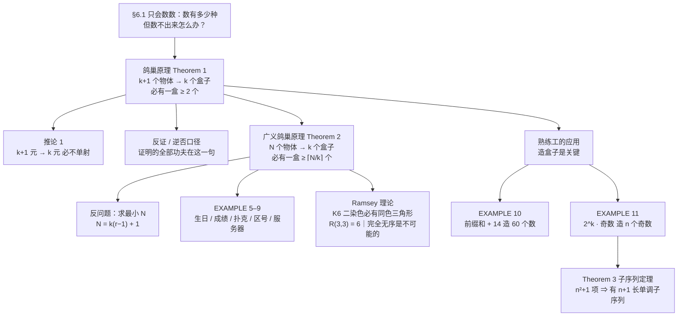

# C6.2 鸽巢原理 The Pigeonhole Principle

> [!abstract] 这一讲的任务
> 上一讲我们一直在**数**：数有多少种选法、有多少个密码串、有多少条路径。这一讲反过来用——**不去数，只去比大小**，然后逼出一个"必然发生"的结论。
> 具体地说：只要**物体比盒子多**，就一定有某个盒子至少装了两个。就这么一句话，它能证明"任意 367 人里必有两人生日相同"，能证明"任何整数都有一个只由 0 和 1 组成的倍数"，还能证明"任意六个人里必有三个互相认识或互相不认识"。
> 但这句话本身**不告诉你是谁**、**也不告诉你在哪个盒子里**——它只保证存在。学会用它的全部难点，在于**怎么把题目里那些不像物体和盒子的东西，硬造成物体和盒子**。

> [!info] 怎么读这份讲义
> 第 1–2 节是最小配置（一句话原理 + 一个推论），第 3–4 节才是本讲的主体：**广义鸽巢原理**（$N$ 个物体、$k$ 个盒子）以及它的十来个应用。第 5–6 节是原理的"用法升级"——拉姆齐理论与子序列定理，这两处都要求你先**巧妙地把物体造出来**，是考试里最容易卡住的地方。其中 §5.1 那一步"把关系翻译成颜色"是整篇最值得慢读的地方：盒子是在那一步里造出来的。
> 需要的前置知识：反证法与逆否命题 [[C1.7 证明导论 Introduction to Proofs]]、单射的定义 [[C2.3 函数 Functions]]；第 3 节会用到乘积法则（上一讲 [[C6.1 计数基础 The Basics of Counting]]）。
> 每节的例题都与教材正文的 EXAMPLE 编号一一对应，**十三个例题一个不少**，手算步骤全部写出来。
> 标有 **（拓展）** / **【拓展】** 的内容，是课堂上没有展开、由教材与通行讲法延伸的部分。

---

## 0. 开场：一个下午都在"撞车"的哈希表

你在写一个稀疏特征查找表：把字符串键映射到一个长度为 $12$ 的数组上，散列函数取字符串长度对 $12$ 取余。测试集里放 $100$ 个键。

你以为均匀散列会把它们摊平，结果打印出来一看——**某个桶里挤了 9 个键**，你怀疑自己的散列函数有 bug。

于是你把散列函数换成"字符串所有字符的 ASCII 码之和 mod 12"，再跑，还是有一堆桶挤着十几个，某个桶 11 个。

这里发生的事情和散列函数写得好不好**无关**：

- $100$ 个键，只有 $12$ 个桶；
- 如果每个桶最多装 $8$ 个，那么总共最多装 $12\times 8 = 96$ 个键；
- 可你有 $100$ 个键，$100 > 96$——**装不下**。

所以必然有一个桶装了 $9$ 个或更多。这不是散列函数的锅，是**桶不够多**这个事实本身在说话。任何散列函数都一样。

> [!question] 停一下，先自己想想
> 把 $100$ 个键塞进 $12$ 个桶，**最均匀**的塞法是什么样子的？在这种最均匀的情况下，那个最挤的桶里有多少个键？
> 你能不能靠"更聪明地塞"让每个桶都不超过 $8$ 个？

答案其实你已经在心里算出来了：最均匀就是尽量平分，$100 = 12\times 8 + 4$，所以最均匀的放法是**四个桶各 9 个、八个桶各 8 个**——最挤的桶还是 $9$ 个。想压到 $8$ 个以下，需要 $12\times 8=96 \ge 100$，而这是假的。**"塞得聪明"救不了你，只有"桶够多"才行。**

这一节要做的，就是把上面这三句推理变成一条可以到处用的定理，然后学会一件事：**在每一道题里，什么是"物体"、什么是"盒子"。** 上面那道题里，物体是键，盒子是桶——这还算好认；后面你会遇到"物体是序列的前缀和"、"物体是 2 的幂乘一个奇数"这种题目，那时候认出盒子就是全部的解法。

---

## 1. 鸽巢原理 Theorem 1（p.399–400）

### 1.1 从鸽子和巢说起

想象 $20$ 只鸽子飞进 $19$ 个巢里过夜。因为鸽子比巢多，**至少有一个巢里挤了两只或更多鸽子**。

为什么？反过来想一秒就够了：假如每个巢最多住 $1$ 只鸽子，那么 $19$ 个巢最多住得下 $19$ 只——可你有 $20$ 只，第 $20$ 只鸽子无处可去，只能挤进某个已经有鸽子的巢里。矛盾。

这个故事还有一个更常被引用的版本，数是 **$26$ 只鸽子、$25$ 个巢**。数字大小无关紧要，要紧的是"多出来的那一只"——先把 $25$ 只各塞进一个巢，$25$ 个巢都住上了；**还剩 $1$ 只**，它已经没有空巢可去，只能挤进某个已经有鸽子的巢。所以"至少有一巢两只"不是运气、不是概率，是那只鸽子**无处可去**。

这里还要顺手拆掉一个多余的前提。讲这个例子时很自然会补一句"假设每个巢里至少有一只鸽子"，这句话让推理看起来更顺，但**定理本身并不需要它**：盒子可以是空的，也可以一口气装下全部 $k+1$ 个物体。定理 1 只承诺"至少有**一个**盒子装了两个"，对别的盒子一个字都没说。$k+1$ 只鸽子全挤进一个巢，也照样满足结论。

把"鸽子"换成任何东西、"巢"换成任何容器，这句话就是本节的定理。

> [!important] 定理 1（鸽巢原理 The Pigeonhole Principle）
> 设 $k$ 是正整数。如果把 $k+1$ 个或更多的物体放进 $k$ 个盒子里，那么**至少有一个盒子装了两个或更多的物体**。

中文里这条定理有两个叫法：**鸽巢原理**和**鸽子洞原理**——前者把盒子叫"巢"，后者把盒子叫"洞"（鸽子洞 = pigeonhole），说的完完全全是同一句话。名字土一点反而有好处：每看到"$k+1$ 个物体、$k$ 个盒子"，脑子里就该浮出一群鸽子挤在洞口的样子，比记符号管用。

![[C6.2-鸽巢原理示意.png]]

三幅图摆的是同一件事的三个不同"塞法"：只要格子数少于鸽子数，无论怎么摆，总有一格出现重叠——(a)、(b)、(c) 分别是三种摆法，重叠的位置各不相同，但**都躲不掉**。

### 1.2 证明：一句话，但是要把口径说清楚

> [!important] 定理 1 的证明（反证法／逆否口径）
> 假设没有哪个盒子装了多于 $1$ 个物体。那么物件的总数至多是 $k$。这与"物体至少有 $k+1$ 个"矛盾。

这个证明短到容易被当成废话，但里面有一个**必须分清的措辞问题**，考试里就爱考这个。

要证的命题是：

$$P:\quad \text{“$k+1$ 个以上物体放进 $k$ 个盒子”} \Longrightarrow Q:\quad \text{“某个盒子至少装了两个物体”}$$

教材原文用的是 *proof by contraposition*（逆否证明）。逆否命题是

$$\neg Q \Longrightarrow \neg P: \quad \text{“每个盒子最多装一个物体”} \Longrightarrow \text{“物件的总数不超过 $k$”}$$

然后它补了一句 *This is a contradiction*（这是个矛盾）。**这两句要放在一起读，才不别扭**：先按逆否的口径写出 $\neg Q \Longrightarrow \neg P$，走到"总数不超过 $k$"这一步；而题目给的前提是"物体至少有 $k+1$ 个"，于是 $\neg P$ 与已知前提直接对撞，矛盾。结论是 $\neg Q$ 不成立，即 $Q$ 成立。

所以这段证明的骨架是**逆否推理 + 一次与已知条件的矛盾收尾**。口头上说"这是反证法"没错——反证法的定义就是"假设结论不成立，推出矛盾"，逆否证明是它的一个具体走法。但你要能说清楚：**矛盾出现在"推出的 $\neg P$"与"题设的 $P$"之间**，而不是出现在推理内部。这两条口径别混着讲。

再补一句"为什么偏偏是 $k+1$，不是 $k$"：$k$ 个物体放进 $k$ 个盒子，可以**每盒恰好一个**，谁也没撞——这就是证明里那句"最理想的情况下每个盒子一个，最多 $k$ 个物体"。所以这个门槛**一分都让不得**，$k+1$ 里那个 $+1$ 是整条定理的命门，不是凑数。

> [!note] 一句来历：为什么又叫"抽屉原理"
> 鸽巢原理还有个名字叫 **Dirichlet 抽屉原理 Dirichlet drawer principle**，因为十九世纪德国数学家 G. Lejeune Dirichlet（1805–1859）在数论工作里频繁使用它。
> 但他并不是第一个用的人：**"巴黎至少有两个人头发根数相同"** 这个论证在十七世纪就有了——当时人们相信人头上不超过 20 万根头发，而巴黎人口超过 80 万（教材习题 33 就是这道题）。
> 教材把它放在本章的理由也顺手说清了：它是一个**独立的证明技术**，与第 1 章那些证明方法并列，只是因为它对组合学的用处太大，才在计数这一章里介绍。

### 1.3 推论 1：把鸽巢原理翻译成函数语言（p.400）

原理的第一种用法是把它翻译成集合与函数的语言——因为这个版本在后面几乎不用解释就能直接引用。

> [!important] 推论 1（Corollary 1）
> 从**含 $k+1$ 个或更多元素**的集合到**含 $k$ 个元素**的集合的函数 $f$，**一定不是单射**。

**证明**：对陪域里每个元素 $y$，给它配一个盒子，盒子里装所有满足 $f(x)=y$ 的定义域元素 $x$。

- 定义域有 $k+1$ 个或更多元素——这是"物体"；
- 陪域只有 $k$ 个元素，也就是只有 $k$ 个盒子；
- 由定理 1，某个盒子里至少有两个定义域元素，也就是说存在 $x_1 \ne x_2$ 使 $f(x_1) = f(x_2) = y$。

按单射的定义（$x_1\ne x_2 \Rightarrow f(x_1)\ne f(x_2)$），$f$ 不是单射。$\blacksquare$

**画出来看最清楚**：取 $k=3$、定义域是四个元素 $a,b,c,d$，让 $a\mapsto 3$、$b\mapsto 2$、$c\mapsto 1$ 先各就各位。第四个元素 $d$ 不能不动——函数要求**每个**定义域元素都有像——它的去处只有 $1,2,3$ 三个，无论选哪个，那个位置就挤了两个。比如 $d\mapsto 1$，$c$ 和 $d$ 当场撞在 $1$ 上，单射失败。

**顺手看清"盒子"是谁**：盒子是**陪域的那三个元素**，不是"已经有人占的格子"。空着的盒子也算盒子，挤了才叫冲突——这一点跟定理 1 完全一致（那里盒子也可以空着）。

**这条推论的直观**：$k+1$ 个东西往 $k$ 个位置上放，**一定有位置被放两次**。单射的定义（见 [[C2.3 函数 Functions]]）要求的恰恰是"每个位置最多被放一次"，所以只要有元素被放两次，单射就当场失败。

> [!warning] ⭐ 一次典型的滥用
> 推论 1 是**单向**的：物体多 $\Rightarrow$ 必有碰撞。
> **反过来不成立**：物体少，也照样可能有碰撞（$3$ 个元素映到 $5$ 个位置上，也可能有两个撞在一起）。
> 所以看到"存在 $x_1\ne x_2$ 使 $f(x_1)=f(x_2)$"这句话，**不能**倒推出"定义域一定比陪域大"。鸽巢原理只给充分条件，不给必要条件。

**用推论 1 秒杀两个经典题**：$367$ 个人（物体）分到 $366$ 个生日（盒子），必有两人同生日；$27$ 个英文单词分到 $26$ 个首字母，必有两个首字母相同。这两道题就是下面的例 1 和例 2。

> [!question] 停一下，先自己想想
> 定理 1 只说"至少两个"。那"**至少 $9$ 个**"这种话该怎么证明？$600$ 个人分到 $12$ 个月里，你能保证**至少多少人**同月出生？先凭直觉猜一个数。

先记着你猜的那个数——它马上会被 Theorem 2 拿去验证，而且十有八九会猜大。

---

## 2. 例 1–3：最小配置的三个基本动作（p.400）

这三道题都不需要动脑筋，但建议你**把"物体是什么、盒子是什么"逐字写出来**——第 4 节那些难题全靠这个习惯。

> [!example] 例 1：生日
> **问**：任意 $367$ 个人里，必有两人同一天生日。
> **答**：把"生日"当盒子。一年的生日只有 $366$ 个（含 2 月 29 日），人数 $367 > 366$。由鸽巢原理，必有两人落在同一个盒子里，即同一天生日。$\blacksquare$
>
> 顺带说清这个数字的来历：**如果只考虑 $365$ 天，那就是 $366$ 人**。$367$ 这个数之所以印成 $367$，是因为教材把闰年算进去了。这属于"取最坏情况"的写法——**保证**成立就必须把闰年这第 $366$ 个盒子也算上。
>
> **换个问法就是一般版**：设一年有 $m$ 天（$365$ 或 $366$），要**保证**出现同一天生日，人数就是 $\boxed{m+1}$。注意这里**没有 $\lceil\cdot\rceil$ 可算**——它是 $k$ 个盒子对 $k+1$ 个物体，定理 1 的直接套用，不是定理 2 的除法。$365$ 天一版得 $366$ 人、$366$ 天一版得 $367$ 人，两个数只差一天，最容易在考场上一顺手写错（已复算：$365+1=366$，$366+1=367$）。

先记住这里的两个数字：**$366$（盒子数）和 $367$（保证需要的人数）**。它们给的是"一定"，而且没有半点余量——这是鸽巢原理的性格。

> [!note] 【拓展】$367$ 是"保证"，不是"通常"：真正让人吃惊的是 $23$
> 一说生日，几乎所有人都跟着问："那到底要多少人才**可能**撞上？"——这是另一个问题，答案小到违反直觉：**$23$ 个人，就有一半以上的把握出现同生日**。
> 两者问的完全不是一件事。$367$ 回答的是"**一定**有"，它连"运气最差"那种排法都堵死了；$23$ 回答的是"**多半**有"。概率那条路是从反面走的：$N$ 个人全都不同生日的概率是
> $$\prod_{i=0}^{N-1}\frac{m-i}{m}$$
> 令它小于 $\tfrac12$，就得到"至少有一对同生日"的概率过半。取 $m=366$ 手算：$22$ 人时全不同约 $0.5252$（同生日约 $0.4748$），$23$ 人时全不同约 $0.4937$（同生日约 $0.5063$）——**分界线正好落在 $23$**（已复算）。
> 粗算用的闭式是 $N \approx \sqrt{2m\ln 2}$：$m=366$ 时 $\sqrt{2\times 366\times 0.6931\cdots} = \sqrt{507.3\cdots} \approx 22.53$，往上取整就是 $23$，与逐项相乘的结果对上。
> **为什么差这么多**：鸽巢原理数的是"物体 vs 盒子"，而生日问题里真正被比较的是**人对**——$23$ 个人有 $\binom{23}{2} = 253$ 对，$253$ 个机会去撞 $366$ 天，早就不稀罕了。这也是"$\sqrt{m}$ 量级"的来历：$N$ 个人有约 $N^2/2$ 对，要让对数追上 $m$，就得 $N \approx \sqrt{2m}$。
> **两者别混**：题目问"**保证**"，套 $m+1$（阶梯式、零余量，鸽巢原理管这个）；问"**可能 / 概率**"，走 $\approx\sqrt{2m\ln 2}$（是期望意义下的分界线，鸽巢原理管不了）。

先把这个概率画出来看一眼——同一件事，把人数横着排开，概率是这样长上去的：

![[C6-生日问题概率曲线.png]]

要盯的是曲线穿过 $0.5$ 和 $0.9$ 的那两处：$22$ 人时还只有 $0.4748$，到 $23$ 人就是 $0.5063$，刚过一半；$40$ 人时 $0.8905$，$41$ 人 $0.9025$，过了九成；再往右，曲线一路贴着 $1$，而"必为 $1$"要等到 $367$ 人。

**同一条曲线上，"多半有"只花 $23$ 个人，"一定有"却要 $367$ 个人——中间隔着 $344$ 人。** 这 $344$ 个人就是"概率"与"保证"的距离：曲线说的是平均意义上多久撞一次，鸽巢原理说的是无论怎么排都躲不掉。

> [!example] 例 2：首字母
> **问**：任意 $27$ 个英文单词里，必有两个以同一个字母开头。
> **答**：把 $26$ 个英文字母当盒子。单词 $27 > 26$，由鸽巢原理，某个字母下面至少挂了两个单词，即有两个单词首字母相同。$\blacksquare$
>
> **"$26+1$"这个加法就是全部**：盒子 $26$ 个，问到第 $27$ 个单词时，不管它是什么词、有多长，首字母只能落进这 $26$ 个盒子，必然与前面某个撞上。**单词长度完全不参与计算**——这也是本题最常见的误读：有人跑去除"三个字母能拼多少种"，那算的是另一件事（单词有多少种），而不是"首字母必然重复"。

> [!example] 例 3：考试分数
> **问**：期末考试按 $0$ 到 $100$ 分计分，班上至少要有多少学生，才能保证至少有两人分数相同？
> **答**：可能的分数是 $0,1,2,\dots,100$，一共 $101$ 个盒子（**注意 $0$ 分也算一种分数**，别数成 $100$ 个）。
> 由鸽巢原理，只要学生数达到 $102$，就必有两人分数相同。
> **最小性**：$101$ 个人够不够？不够——可以让 $101$ 个人正好一人占一个分数，谁也不撞。所以答案是 $102$。$\blacksquare$

三道题是一个套路：**先把盒子数 $k$ 数出来，答案就是 $k+1$。** 现在换个更常见的问题——不是"至少两个"，而是"至少 $r$ 个"。

---

## 3. 广义鸽巢原理 Theorem 2（p.401–402）

### 3.1 从"至少两个"到"至少几个"

**物体数超过盒子数时，就能保证有一盒装两个。可如果物体数超过盒子数的很多倍呢？** 显然能保证更多。

先把这句话往下推三格，一般结论自己就跳出来了：

| 物体数 | 盒子数 | 最平均的放法 | 必然结论 |
|---|---|---|---|
| $k+1$ | $k$ | 每盒 $1$ 个，余 $1$ 个 | 必有某盒 $\ge 2$ |
| $2k+1$ | $k$ | 每盒 $2$ 个，余 $1$ 个 | 必有某盒 $\ge 3$ |
| $3k+2$ | $k$ | 每盒 $3$ 个，余 $2$ 个 | 必有某盒 $\ge 4$（$k\ge 2$；$k=1$ 时只有一盒，结论是 $\ge 5$） |
| $nk+1$ | $k$ | 每盒 $n$ 个，余 $1$ 个 | 必有某盒 $\ge n+1$ |

四行看完，规律就明了了：把物体数除以盒子数、**再往上取整**，就是"最满那一盒至少几个"（上表四个数都与 $\lceil\text{物体数}/k\rceil$ 一致，已复算）。

先看一个最小的例子：任意 $21$ 个十进制数字（$0$–$9$ 这些**数位**），必有 $3$ 个相同。为什么？把 $10$ 个数位当盒子，$21$ 个数字往里放。每盒最多 $2$ 个的话，总共最多装 $20$ 个，装不下 $21$ 个。所以某盒至少 $3$ 个。

把"每盒最多 $2$ 个"换成"每盒最多 $\lceil N/k\rceil - 1$ 个"，就得到一般结论。

> [!important] 定理 2（广义鸽巢原理 The Generalized Pigeonhole Principle）
> 如果把 $N$ 个物体放进 $k$ 个盒子，那么**至少有一个盒子装了至少 $\lceil N/k \rceil$ 个物体**。
> （$\lceil \cdot \rceil$ 是**上取整函数**：不小于 $N/k$ 的最小整数。）

> [!warning] ⭐ $N$ 和 $k$ 谁是谁，是这类题的第一个失分点
> $k$ 永远是**盒子**——鸽巢、鸽子洞、抽屉、桶、月份、花色；$N$ 永远是**物体**——鸽子、人、牌、电话。两个字母长得像，混了以后整道题就套反了。
> 记法：**先摆洞，再赶鸽子**。$k$ 个洞先摆好，$N$ 只鸽子往里赶，所以 $\lceil N/k \rceil$ 的分子是物体、分母是盒子；写成 $\lceil k/N \rceil$ 就完全是另一道题了。

**回收刚才那个问题**：$600$ 个人、$12$ 个月，$\lceil 600/12 \rceil = 50$——**刚好 $50$**，因为 $600$ 正好被 $12$ 整除。所以那个数不算难猜；真正容易猜错的是"除不尽"的情形，比如例 5 的 $\lceil 100/12 \rceil = 9$（很多人会脱口而出 $8$）。而"每盒最多 $8$ 个、$12$ 个盒子一共只能装 $96$ 个，装不下 $100$ 个"这句话，就是下面这个证明的具体样子。

**证明**（与定理 1 同一套口径：逆否推理，末端与已知条件对撞）：假设每个盒子装的都不多于 $\lceil N/k\rceil - 1$ 个。那么物体总数至多是

$$k\left(\left\lceil \frac{N}{k} \right\rceil - 1\right) < k\left(\left( \frac{N}{k} + 1 \right) - 1 \right) = N$$

其中用到了不等式 $\lceil N/k \rceil < N/k + 1$（上取整的定义：$\lceil x \rceil$ 比 $x$ 大，但大不过 $1$）。也就是"总数 $< N$"，与"一共有 $N$ 个物体"矛盾。$\blacksquare$

> [!warning] ⭐ 证明里那个 $+1$ 不是凑出来的
> 关键一步是 $\lceil N/k \rceil - 1 < N/k$，也就是 $\lceil N/k \rceil < N/k + 1$。**上取整比原数最多大不到 $1$**——正是这个"不到 $1$"把 $k$ 乘上去之后压住了 $N$。
> 换成下取整就崩了：$\lfloor N/k \rfloor \le N/k$，那么 $k(\lfloor N/k \rfloor - 1) < N$ 不一定成立，结论也不再是真命题。**上取整与下取整在这里的区别就是"盒子多装一个"的区别。**

**为什么必须上取整：$\lceil N/k\rceil$ 就是"平均每盒几个"往上取。** 把 $N$ 个物体尽量平分，每盒 $\lfloor N/k\rfloor$ 个，剩下 $N \bmod k$ 个只好塞进某几盒，那些盒子就变成 $\lfloor N/k\rfloor + 1 = \lceil N/k \rceil$ 个。而"最平均的放法"是**最不利于出现大盒子**的放法——它都压不到 $\lceil N/k\rceil$ 以下，别的放法就更不行。

**把"平分"想象成撒盐**：第一遍撒，保证每个盒子至少落一颗；第二遍撒，保证每个盒子至少两颗；一直撒到撒不动为止——最后那层盐只能落在某几个盒子里，落完为止。"撒得匀不匀"你能控制，"最上面那个盒子有几颗"**你控制不了**：撒得再均匀，最满的盒子也得是 $\lceil N/k\rceil$。想让每个盒子都恰好一样多，除非 $k \mid N$。

**上取整的手感**（这几个数值得背下来，考试全是它们）：$\lceil 5/2 \rceil = \lceil 2.5 \rceil = 3$、$\lceil 100/12 \rceil = \lceil 8.33\cdots \rceil = 9$、$\lceil 25/4 \rceil = \lceil 6.25 \rceil = 7$、$\lceil 25/8 \rceil = \lceil 3.125 \rceil = 4$；而 $\lceil 24/4 \rceil = 6$ **一步都不多取**——整除时上取整等于本身，这时"平均"真的可以做到。整除恰好是最容易掉以轻心的情形，下面 §3.2 会专门撞它一次。

![[C6.2-广义鸽巢原理.png]]

图上这一格一格画的就是这件事：$25$ 个物体，$4$ 个盒子，最平均的放法是 $7,6,6,6$（$7+6+6+6=25$），最挤的盒子有 $7$ 个，正好是 $\lceil 25/4\rceil = \lceil 6.25 \rceil = 7$。旁边那个算式 $k(\lceil N/k\rceil - 1) = 4\times 6 = 24 < 25$ 就是证明里那一步的具体样子：**你想让每盒都不超过 $6$，$4$ 个盒子最多装 $24$ 个，还剩一个没地方去。**

### 3.2 反问题：给定"至少 $r$ 个"，求最小的 $N$（p.401）

教材接下来讲的是这类题最常见的问法——**不是问"能保证几个"，而是问"至少要多少物体，才能保证某盒里有 $r$ 个"**。答法是套公式：

> [!important] 最小 $N$ 的公式
> 要让 $N$ 个物体放进 $k$ 个盒子后**必有某盒至少 $r$ 个**，最小的 $N$ 是
> $$\boxed{N = k(r-1) + 1}$$

**为什么**：由定理 2，我们需要的条件是 $\lceil N/k \rceil \ge r$，即 $N/k > r-1$（注意这里用的是严格不等号：$\lceil x\rceil \ge r \iff x > r-1$）。满足 $N/k > r-1$ 的最小整数 $N$ 就是 $N = k(r-1)+1$。

> [!warning] ⭐ 口头上常说"$N/k$ 要比 $r$ 大"，严格说是"要比 $r-1$ 大"
> 这句话在口头推导里最容易被说滑。正确的是 $N/k > r-1$，不是 $N/k > r$。差别不小：$N = k(r-1)+1$ 时 $N/k = r-1+\frac1k$，**只比 $r-1$ 大一丁点**，却已经"够"了；若按 $N/k > r$ 去算，会解出 $N \ge kr+1$，比真答案 $kr-k+1$ 整整多出 $k$ 个物体（已复算）。
> 记法：**要凑到 $r$ 个，先让每盒都停在 $r-1$ 个，再多一个就成。** 上取整只是把"多出来的那一个"抬成整数：$r-1+\frac1k$ 往上取，正好是 $r$。

**为什么再小就不行**（这是"最小性"的那一半，写答案时不能漏）：如果只有 $k(r-1)$ 个物体，就把 $r-1$ 个放进每个盒子——**每个盒子都恰好不到 $r$ 个**，结论不成立。所以 $k(r-1)+1$ 是紧的。

> [!note] 一个很好用的"数着加"心法
> 想避开"某盒有 $r$ 个"，你能做的就是**每盒先放满 $r-1$ 个**，一直放到每盒都是 $r-1$ 个。这时候再拿一个新物体进来，**无论放哪一盒都会把那一盒凑到 $r$ 个**。
> 于是总数 $k(r-1)$ 是你能拖到的极限，**第 $k(r-1)+1$ 个物体一定会让某盒达到 $r$**。
> 做反问题时按这个顺序数一遍，比套公式更不容易记错方向。

---

## 4. 例 4–9：广义鸽巢原理的六个应用（p.401–403）

> [!question] 停一下，先自己想想
> 下面这道题里，题目**通篇没有出现"盒子"**：给你 $n+1$ 个数 $1, 11, 111, \dots$，要你证明其中必有两个的差只含数字 $0$ 和 $1$。
> 那么——**什么东西的总数是"有限多种"的？** 除了它，别的都不重要。

（这个问题的答案就是例 4 的全部内容。）

### 4.1 例 4：每个整数都有一个"只由 0 和 1 组成"的倍数

这道题属于教材说的 *surprising results*——结论本身就不像真的。它的漂亮之处在于：**"物体"和"盒子"都不是题目里现成的，得自己造。**

> [!example] 例 4
> **问**：证明对每个整数 $n$，都存在一个 $n$ 的倍数，它的十进制表示里只有 $0$ 和 $1$。
> **解**：设 $n$ 是正整数，看下面这 $n+1$ 个数：
> $$1,\ 11,\ 111,\ \dots,\ \underbrace{11\cdots 1}_{n+1\text{ 个}}$$
> 也就是 $n+1$ 个"全由 1 组成"的数（最后那个有 $n+1$ 个 1）。
>
> **盒子是哪个？** 除以 $n$ 的**余数**一共只有 $n$ 种：$0,1,\dots,n-1$。
> 现在有 $n+1$ 个数要分进 $n$ 个余数里，由鸽巢原理，**必有两个数除以 $n$ 的余数相同**。
>
> 设这两个数是较大的 $A$ 和较小的 $B$（也就是 $A > B$，两个都是"一串 1"）。那么：
> - $A - B$ 是 $n$ 的倍数，因为两个余数相减为 $0$；
> - 把 $A$ 与 $B$ 做竖式减法：$A$ 的末尾 $|B|$ 位全是 $1$，$B$ 也是全 $1$，一减就**全部变成 $0$**；$A$ 多出来的高位还是 $1$。
>
> 所以 $A - B$ 的十进制表示形如 $11\cdots100\cdots0$，**只含 0 和 1**，且是 $n$ 的倍数。$\blacksquare$

**手算一遍更放心**：取 $n=7$。看 $1,11,111,1111,11111,111111,1111111,11111111$（$8$ 个数，$8 = 7+1$），余数依次是

$$1,\ 4,\ 6,\ 5,\ 2,\ 0,\ 1,\ 4 \pmod 7$$

第 1 个和第 7 个余数都是 $1$，相减得 $1111111 - 1 = 1111110$。而 $1111110 = 7 \times 158730$，确实只有 $0$ 和 $1$（已用程序复算：对 $n = 1,\dots,59$ 逐个验证，每个 $n$ 都能这样找出一个只含 $0,1$ 的倍数）。

**这道题真正教的东西**：题目里没有"盒子"，我们**自己造**了一个盒子的集合（$n$ 种余数）。造盒子的依据是"**这类东西一共只有这么多种**"——余数只有 $n$ 种、奇数的个数只有那么多、有序对只有那么多。后面每一道难题都是这个动作。

### 4.2 例 5–8：四个"至少几个"的标准题

> [!example] 例 5：出生月份
> **问**：$100$ 个人里，至少有多少人同一个月出生？
> **三问定位**（做所有这类题都先过这三遍）：物体是谁？——人，$N = 100$；盒子是谁？——月份，$k = 12$，这个数不用找，日历上现成；要求什么？——同一盒里至少几个，也就是 $r$。
> **解**：$12$ 个月当盒子，$N = 100$，由定理 2：至少 $\lceil 100/12 \rceil = \lceil 8.33\cdots \rceil = 9$ 人同月出生。$\blacksquare$
>
> **这个"9"是怎么冒出来的**：$8\times 12 = 96 < 100$，所以每盒放 $8$ 个是装不下的。**$8.33$ 往上取一位就是 $9$。**
> 换个公式验一遍，答案应该一样：设 $r$ 就是那个"至少几"，由 $12(r-1)+1 \le 100$ 得 $r-1 \le 8.25$，即 $r \le 9.25$，最大的整数 $r$ 是 $9$。**正着算（$\lceil N/k\rceil$）和反着算（$N = k(r-1)+1$）必须对得上**，对不上就是 $r$ 取错了（已复算：两条路都是 $9$）。

> [!example] 例 6：五个等级的成绩
> **问**：一门离散数学课至少要有多少学生，才能保证至少 $6$ 个人拿到同一个成绩等级？假设等级只有 A、B、C、D、F 五个。
> **解**：这题的 $k=5$、$r=6$，直接套 §3.2 的公式：
> $$N = k(r-1)+1 = 5\times(6-1)+1 = 5\times 5 + 1 = 26$$
> **最小性**：如果只有 $25$ 人，可以让每个等级各 $5$ 人，这样没有任何等级达到 $6$ 人。所以 $26$ 就是最小的学生数。$\blacksquare$
>
> 用定理 2 的语言验一遍：$\lceil 26/5 \rceil = \lceil 5.2 \rceil = 6$ ✓，而 $\lceil 25/5 \rceil = 5$ ✗。**正好卡在 $5$ 的倍数上**——这时上取整"不多取一位"，所以必须靠多出来的那个 $+1$ 把结果推上去。

> [!example] 例 7：扑克牌的两问（这题的第二问是陷阱）
> **问 a)**：从一副 $52$ 张的标准扑克牌里抽多少张，才能保证至少有 $3$ 张花色相同？
> **问 b)**：抽多少张，才能保证至少有 $3$ 张是红心？
>
> **解 a)**：$4$ 个花色当盒子，$k=4$、$r=3$：
> $$N = 4\times(3-1)+1 = 4\times 2 + 1 = 9$$
> 验算：$\lceil 9/4 \rceil = \lceil 2.25 \rceil = 3$ ✓；而抽 $8$ 张时可以"每种花色各 $2$ 张"，所以 $8$ 张不够。**答案 $9$。**
>
> **解 b)**：⚠️ **这里不能用广义鸽巢原理。** 我们要的是"三张红心"，不是"三张同一花色"——目标被限定在**一个**盒子里，不再是"某个盒子"。
> 按最坏情况数：前 $39$ 张可以全是梅花、方块、黑桃（$13\times 3 = 39$），一张红心都没有；接下来抽的第 $40$、$41$、$42$ 张才轮到红心。
> **答案 $42$。**
>
> **两问的差别就是这道题的全部价值**：a) 是"**存在某个**盒子装满"，归广义鸽巢原理管；b) 是"**指定的那个**盒子装满"，只能按最坏情况数。$9$ 和 $42$ 差了四倍多，混用公式就会得到荒谬的答案。$\blacksquare$

> [!example] 例 8：区号最少要几个
> **问**：某州有 $2500$ 万部电话，要给它们分配**互不相同**的 10 位电话号码。电话号码的形式是 `NXX-NXX-XXXX`，前三位是区号，$N$ 表示 $2$–$9$ 的数字，$X$ 表示任意数字。至少要几个区号？
>
> **解**：先算**一个区号**能提供多少个号码。号码的后七位形如 `NXX-XXXX`，各位的选择数是
> $$\underbrace{8}_{N}\times\underbrace{10}_{X}\times\underbrace{10}_{X}\times\underbrace{10}_{X}\times\underbrace{10}_{X}\times\underbrace{10}_{X}\times\underbrace{10}_{X} = 8\times 10^6 = 800\text{ 万}$$
> （$8\times 10^6$ 正是上一讲 [[C6.1 计数基础 The Basics of Counting]] 的例 8 算过的数，直接用。）
>
> **先卡住最容易想错的一步：盒子到底是谁？** 盒子不是"电话号码"这个整体，而是**某一个区号底下的那些号码位**。区号本身并不要求互不相同——题目只要求**电话号码**互不相同，所以 $2500$ 万部电话可以全挤在同一个区号里，只要后七位不撞。而固定一个区号之后，它只发得出 $8\times 10^6$ 个互不相同的后七位，也就是**只能装 $800$ 万部电话**。盒子数就这么定下来了：一个区号 = $8{,}000{,}000$ 个盒子。
>
> 现在把 $2500$ 万部电话当"物体"、把"号码位"当盒子：由广义鸽巢原理，$2500$ 万部电话分到 $8{,}000{,}000$ 个号码位上，
> $$\left\lceil \frac{25{,}000{,}000}{8{,}000{,}000} \right\rceil = \left\lceil \frac{25}{8} \right\rceil = \lceil 3.125 \rceil = 4$$
> 也就是说，**同一个号码位上会挤至少 $4$ 部电话**。可题目要求号码互不相同，撞车就不能接受——所以必须多给号码位，也就是多给区号。
>
> 换个更好记的说法——直接比"容量够不够"：**$A$ 个区号一共提供 $A \times 8{,}000{,}000$ 个号码位**，要装下 $2500$ 万部互不相同的电话，需要
> $$A\times 8{,}000{,}000 \ \ge\ 25{,}000{,}000 \quad\Longleftrightarrow\quad A \ \ge\ \frac{25}{8} = 3.125$$
> 所以 $A$ 至少是 $4$：**$3$ 个区号只有 $2400$ 万个号码位（$3\times 8 = 24 < 25$），装不下 $2500$ 万部电话；$4$ 个区号有 $3200$ 万位（$4\times 8 = 32 \ge 25$），够。**
> 两种说法给出同一个数（已复算：$\lceil 25/8 \rceil = 4$）。建议记住"容量够不够"那个版本，它不容易被绕晕。$\blacksquare$

> [!example] 例 9：$15$ 台工作站、$10$ 台服务器（这题不是鸽巢原理）
> **问**：实验室有 $15$ 台工作站（$W_1,\dots,W_{15}$）和 $10$ 台服务器（$S_1,\dots,S_{10}$）。一根电缆把一台工作站直连到一台服务器；**每台服务器在任意时刻只能有一条活动直连**。要求：任意时刻，**任意不超过 $10$ 台**的工作站都能同时连上互不相同的服务器。全部直连要 $150$ 根电缆，问最少要多少根？
>
> **解**：
> **上界——$60$ 根够用。** 连法：$W_k$ 连 $S_k$（$k=1,\dots,10$），共 $10$ 根；再把 $W_{11},\dots,W_{15}$ 各自连到**全部 $10$ 台**服务器，共 $5\times 10 = 50$ 根。合计
> $$10 + 50 = 60 \text{ 根}$$
> 为什么够：设被选中的工作站有 $m\le 10$ 台。**先把 $W_1,\dots,W_{10}$ 里被选中的那些**各自连到对应的 $S_j$（它们两两不同）；假设这样的工作站有 $p$ 台，那么 $S_1,\dots,S_{10}$ 里还空着 $10-p$ 台服务器。而被选中的 $W_{11},\dots,W_{15}$ 最多有 $m - p \le 10 - p$ 台，**空着的服务器比它们多**，所以可以让它们一一对上。$\checkmark$
>
> **下界——少于 $60$ 根不行。** 假设电缆少于 $60$ 根。则**某台服务器连的工作站不超过** $\lfloor 59/10 \rfloor = 5$ 台。（如果每台服务器都连了至少 $6$ 台，那总数就至少 $6\times 10 = 60$ 根，与"少于 $60$"矛盾。）
> 挑出这 $10$ 台工作站：它们**都不能**用那台服务器，于是只剩 $9$ 台服务器可用——$10$ 台工作站抢 $9$ 台服务器，**不可能同时连上互不相同的服务器**。所以少于 $60$ 根做不到。$\blacksquare$
>
> **注意这题的骨架**：它用的不是鸽巢原理，而是与它同一族的思想——"**平均一下，必有一台服务器偏少**"（$\lfloor 59/10 \rfloor = 5$ 这一步）以及"一一对应时要数够不够"。教材特意说明这一点，这种"平均数论证"在算法复杂度、负载均衡里到处都是。

> [!note] 停一下，我们刚才干了什么
> 到这儿，广义鸽巢原理的标准用法已经过完了：**数出盒子数 $k$、看清"至少 $r$ 个"，答案不是 $\lceil N/k \rceil$ 就是 $k(r-1)+1$。**
> 但请回头看例 4：那题的盒子（余数）是**我们自己造出来的**。而接下来的 §5、§6，题目会变得更"不像鸽巢"——序列、前缀和、有序对，全是人造盒子。**造盒子的本事才是这一节的真正考点。**

---

## 5. 拉姆齐理论：六个人里必有三个互相认识（p.404–405）

### 5.1 先把"认识"翻译成颜色

这一节的问题长这样：**一群人之间的关系网不管怎么长，里面总有些结构是躲不掉的。** 研究"躲不掉"的这门学问叫**拉姆齐理论 Ramsey theory**，它的全部结论都是这个形状：**结构够大，某种规整的子结构就必然出现。**

可是"六个人里必有三个互相认识或互相不认识"这句话里，哪个是物体、哪个是盒子？**一个都不是。** 原题里根本没有盒子——所以做这道题的第一步不是找盒子，而是**造一个能长出盒子的场景**。这一步叫建模，做法是给关系上色：

- 把人画成**点**：$n$ 个人就是 $n$ 个点，**任意两点之间都连一条边**（两两都连线，这叫完全图，记作 $K_n$；图的语言下一章才正式讲，这里只要记住"每对人都有一条线"）。
- 每条边**必须**染成**红**（这两人是朋友）或**蓝**（这两人是敌人）之一，**而且只能一种颜色**。
- 于是"三个人互相认识"= 一个**三条边全红**的三角形；"三个人互相不认识"= 一个**三条边全蓝**的三角形。

翻译完，题目变成一句纯图形的话：**$K_6$ 的任意红蓝二染色里，一定有一个同色三角形。**

> [!note] 哪一色代表"朋友"，其实无所谓
> 课堂上板书写的是**蓝=朋友、红=敌人**，与我们这里的约定正好相反。这不影响任何结论——两条颜色只是用来把两种关系**分得开**，
> 而且"三个朋友"和"三个敌人"在命题里是对称的。本文统一用**红=朋友、蓝=敌人**，好和下面那张图对上；
> 你自己做题时，开头写一句"设红边表示两人认识"把约定钉死就行，别做到一半再换。

> [!warning] ⭐ 这道题的全部前提，都藏在那句"要么是朋友、要么是敌人"里
> 现实里人与人还有"既不熟、也不算敌人"的中间态，题目把它**砍掉**了。这个砍法是题干给的**许可证**，不是我们要证的结论。
> 许可证一旦被收回，整道题立刻崩：六个人可以两两都是"点头之交"，既没有三个互相认识、也没有三个互相不认识。
> 所以看到"要么…要么…"这种句式，先停一秒——它正是在把问题塞进鸽巢原理的模具里：**只有两色，才谈得上把"从某点出发的 5 条边"往"两类"里塞。**

### 5.2 例 13：$R(3,3) \le 6$

场景搭好了，现在把这道题一字不改地念一遍，看证明怎么在里面挑出那 $5$ 条边。

> [!example] 例 13
> **问**：假设六个人中任意两人要么是朋友、要么是敌人。证明其中必有**三个人互相认识**，或者**三个人互相不认识**。
>
> **解**：任取其中一个人，记为 $A$。剩下五个人按与 $A$ 的关系分成两类：
> - 朋友：若干人；
> - 敌人：若干人。
>
> 这是把 $5$ 个物体分进 $2$ 个盒子，由广义鸽巢原理，**必有一类至少有 $\lceil 5/2 \rceil = 3$ 个人**。
>
> **情形一：至少有 $3$ 个人是 $A$ 的朋友。** 设他们是 $B, C, D$。看这三个人**彼此之间**的关系：
> - 如果 $B,C,D$ 中有**任意一对**是朋友——设是 $B,C$——那么 $A, B, C$ 三人两两都是朋友，**三人互相认识** ✓
> - 如果 $B,C,D$ 中**没有任何一对**是朋友——那他们三人两两都是敌人，**三人互相不认识** ✓
>
> **情形二：至少有 $3$ 个人是 $A$ 的敌人。** 完全对称：把这三人记为 $B,C,D$，看他们之间——
> - 有任意一对是敌人 ⇒ 这两人和 $A$ 组成三人互相不认识 ✓
> - 没有一对是敌人 ⇒ 三人两两都是朋友，三人互相认识 ✓
>
> **情形二看着是废话，但它必须写。** 因为鸽巢原理给的是"必有一类有 $3$ 个"，**没说哪一类**——可能全是朋友，也可能全是敌人，两条路都得堵死，证明才闭合。写解答时两边都摆出来更稳：省掉的那几行，往往正好是扣分的地方。
>
> 两种情形都逃不掉。$\blacksquare$

![[C6.2-K6二色染色必有同色三角形.png]]

把六个人画成 $K_6$ 的六个顶点、**红边表示"朋友"、蓝边表示"敌人"**，上面那段证明就是这张图：从 $A$ 出发有 $5$ 条边，按鸽巢原理至少有 $3$ 条同色（图上画的是红色，连到 $B,C,D$）。接下来只看 $B,C,D$ 之间的三条边：只要有一条是红的，它就和 $A$ 拼出一个红色三角形；如果一条红的都没有，那么三条全是蓝的，$B,C,D$ 自己就是一个蓝色三角形。**"三个人互相认识"就是红色三角形，"三个人互相不认识"就是蓝色三角形。**

### 5.3 拉姆齐数：$R(3,3) = 6$ 而不是 $\le 6$

> [!important] 定义（拉姆齐数 Ramsey number）
> $R(m,n)$（$m,n \ge 2$）表示**最少**要有多少人在场，才能保证其中**要么有 $m$ 个人互相认识、要么有 $n$ 个人互相不认识**。前提是任意两人要么是朋友、要么是敌人。

例 13 证明的是 $R(3,3) \le 6$。要把它收紧成等号，还得说明 **$5$ 个人不够**：

**为什么 $R(3,3) > 5$**：在 $5$ 个人里安排得下一组"既没有三人互相认识、也没有三人互相不认识"的关系。构造方法是**把五个人摆成一个圈**，让每个人都只跟**左右的邻居**做朋友，跟**另外两个（隔一个的）人**做敌人。此时任意三人都凑不出同色三角形（已用程序复算：这个 $5$ 人构造确实不含同色三角形，而所有 $6$ 人构造都含——这正是 $R(3,3) = 6$ 的两半）。

**这个构造为什么成立，一句话就能验**：换成颜色的说法，红色正好是五边形的 $5$ 条边，蓝色正好是五边形的 $5$ 条**对角线**。要红三角形，得有 3 个点两两相邻——五边形里做不到；要蓝三角形，得有 3 个点两两不相邻——而五边形最多只挑得出 $2$ 个互不相邻的点。两种三角形都出不来，$5$ 个人确实不够。

**看一眼这两个数怎么来的**：$R(3,3)\le 6$ 是"鸽巢 + 分情况"逼出来的上界，$R(3,3) > 5$ 是手画一个反例压出来的下界。上界靠证明、下界靠构造——**拉姆齐数的每一个精确值都是这样两头夹出来的**，而难的永远是下界那一头。

$$\boxed{R(3,3) = 6}$$

**关于拉姆齐数，值得记住的几条**：

| 事实 | 出处 |
|---|---|
| 由对称性 $R(m,n) = R(n,m)$ | 习题 30 |
| $R(2,n) = n$（对一切 $n\ge 2$） | 习题 29 |
| $R(4,4) = 18$ | 正文 |
| $3\le m\le n$ 的拉姆齐数里，**精确值已知的只有九个**，$R(4,4)=18$ 是其中一个 | 正文 |
| $R(5,5)$ 只知范围 $43 \le R(5,5) \le 49$ | 正文（2017 年前后的状态） |

**为什么拉姆齐数这么难**：$R(3,3)=6$、$R(4,4)=18$ 之后就爆掉了。$R(5,5)$ 至今没有人算出来，只知道它在 $43$ 到 $49$ 之间。这一段值的下界在最近几年被挤到了 $43 \le R(5,5) \le 46$（见 [R(5,5) ≤ 46](https://onlinelibrary.wiley.com/doi/10.1002/jgt.70029)、[Angeltveit–McKay](https://arxiv.org/abs/2409.15709)），但**精确值仍然是公开问题**。这就是为什么教材说"关于拉姆齐数能证明一些有用的性质，但多数情况下**找精确值非常困难**"。

> [!note] 拉姆齐理论是什么
> 这门分支以英国数学家 F. P. Ramsey（1903–1930）命名，他 1928 年那篇 *On a Problem of Formal Logic* 里的组合论证是它的开端。教材给了一句话概括：**拉姆齐理论研究的是"集合的元素子集如何分布"**。
> 它在计算机科学里的近亲不少：数据库中"必然出现的模式"、程序里不可避免的代码结构、以及各种"无论怎么分配都逃不掉"的结构性结论。
> **它与鸽巢原理是什么关系**：拉姆齐理论是鸽巢原理的**推广**（generalization）。鸽巢原理说"物体比盒子多，就有一个盒子装两个"——它只数数量；拉姆齐说"图的点够多，就有一个某种颜色的完整小块"——它管的是**结构**。后者能推前者，前者是后者最粗的一档。

### 5.4 「完全无序是不可能的」

$R(3,3)=6$ 这个结论值得往后退一步看。它讲的不只是"六个人里总有三个人关系一样"，而是一件更普遍的事：

> [!important] 拉姆齐式的断言
> **只要对象足够多，任何"随手安排"出来的配置里都一定藏着某种规整的子结构。**
> 一句话版：**完全无序是不可能的（complete disorder is impossible）。**
> 它和"看起来乱"并不矛盾——**无序不等于无结构**。你可以让每个人的朋友关系长得毫无章法，但只要人数够，三角形一定会冒出来。

这句话带着很强的社会味道。常有人说人的行为是随机的、总结不出来的；拉姆齐式的结论却说：**结构一旦足够大，规律就必然存在**，而且这种规律迟早能被找出来、写成一条能用的规则。

对做 AI 的人来说，这几乎是统计学习的地基信念：数据再大再乱，也总能从里面读出规律——"人工智能很多时候是统计学的总结"，说的正是这件事。**先承认规律存在（拉姆齐管这一半），再去把它找出来（统计与优化管另一半）。**

**【拓展】** 但"存在"和"可用"之间还隔着一层，值得记住：拉姆齐只保证"够大的图里**有**同色三角形"，它既不给构造，也不保证这个结构**大到值得找**——$R(5,5)$ 至今只知在 $43$ 到 $49$ 之间，连这么一个不大的数都算不出来。现实里"规律一定存在"多数时候成立，但"规律一定有用"不成立：数据里必然存在的那个模式，可能只是三个人之间的巧合，规模小到没有预测价值。这是拉姆齐式结论最容易被误读的地方。

---

## 6. 子序列定理 Theorem 3（p.403–404）

### 6.1 先搞清楚"子序列"是什么

回到 §4 例 4 那种"人造盒子"的思路。这次造盒子的工具是**子序列的长度**。

> [!question] 停一下，先自己想想
> 给你一个序列，要你找出"最长的一路递增下去"的项：**这些项必须在原序列里挨着吗？**
> 比如 $3, 1, 4, 1, 5, 9, 2, 6$ 里，$1,4,5,9$ 算不算"一路递增"？$9$ 前面明明隔着个 $1$（第 4 项）。
> 顺便再想：$9,5,1$ 呢？它算不算这个序列的"一路递减"？

先把"挨不挨着"这件事定下来——它决定了定理 3 到底在说什么。答案：**不用挨着，只要先后顺序不变就行**（$1,4,5,9$ 的下标是 $2<3<5<6$，确实递增）；而 $9,5,1$ 的下标是 $6>5>2$，顺序反了，**它不是**子序列。

> [!important] 定义（子序列 subsequence、严格单调）
> 设 $a_1,a_2,\dots,a_N$ 是一个实数序列。它的一个**子序列**形如
> $$a_{i_1}, a_{i_2}, \dots, a_{i_m}, \qquad 1 \le i_1 < i_2 < \cdots < i_m \le N$$
> 也就是说：从原序列里挑出若干项，**保持它们在原序列里的先后顺序**，可以跳过一些项。
> 如果每一项都比前一项大，称为**严格递增**；如果每一项都比前一项小，称为**严格递减**。

> [!warning] ⭐ 子序列不是子串，也不是子集
> - **不是子串**：子序列的项在原序列里**不必相邻**。$1,4,6,12$ 是例 12 那个序列的子序列，虽然它们中间隔着别的数。
> - **顺序不能换**：$\{1,4,6,12\}$ 作为集合和作为子序列是两回事。判断是不是子序列，看的是**下标严格递增**。
> - **"严格"两个字不能省**：定理 3 要求序列的各项**互不相同**，所以不会出现"相等但不增不减"的边界情况。
> - **同一组数里可以同时出现"是"和"不是"**：在 $5,8,2,3,1$ 里，$5,3,1$（下标 $1<4<5$）是子序列，$8,1$（下标 $2<5$）也是子序列；而 $2,3,5,8$ **不是**——它的下标是 $3,4,1,2$，取到 $8$ 时下标从 $4$ 掉回了 $2$，顺序断了。**判据只有一条：下标严格递增。**

### 6.2 例 12：$n=3$ 时的具体情形

> [!example] 例 12
> 序列 $8, 11, 9, 1, 4, 6, 12, 10, 5, 7$ 一共 $10$ 项。注意 $10 = 3^2 + 1$，所以按定理 3，它应该含一个长度 $4$ 的严格递增或严格递减子序列。
>
> **严格递增、长度 $4$ 的子序列有四个**：
> $$1,4,6,12; \qquad 1,4,6,7; \qquad 1,4,6,10; \qquad 1,4,5,7$$
> **严格递减、长度 $4$ 的子序列有一个**：
> $$11,9,6,5$$
>
> （已用程序穷举全部 $\binom{10}{4}$ 个下标组合复算：长度 $4$ 的严格递增子序列恰好 $4$ 个、严格递减恰好 $1$ 个，与上述一致；同时最长递增与最长递减子序列的长度都是 $4$，没有更长的。教材原文在排列这四项时印的顺序是 $1,4,6,12;\ 1,4,6,7;\ 1,4,6,10;\ 1,4,5,7$，与上表一致。）
>
> **怎么自己找一个出来的**：盯着最大的那个 $12$ 往前找——$12$ 是第 $7$ 项，之前的 $1,4,6$ 递增地排在它前面（第 $4,5,6$ 项），于是 $1,4,6,12$ 就是一个递增子序列。$\blacksquare$

把这 $10$ 个数按位置摆开、把两条长度 $4$ 的子序列连起来看，就是下面这张图（横轴是第几项，纵轴是数值）：

![[C6-10个数的递增递减子序列.png]]

值得盯的是两处：$1,4,6,12$ 在原序列里**并不相邻**（它们在第 $4,5,6,7$ 项），可是位置一路往右、数值一路往上——"不挨着也能连成一路"，这正是子序列；$11,9,6,5$（第 $2,3,6,9$ 项）则是一路往右、数值一路往下。**定理担保的只是"递增到 $n+1$"和"递减到 $n+1$"至少有一个；这一组数里两个都出现了。** §6.3 要证的，就是"两个都没有"的那种排列根本不存在。

### 6.3 定理 3 与它的证明

> [!important] 定理 3
> **由 $n^2+1$ 个互不相同的实数组成的序列，必含一个长度 $n+1$ 的、严格递增或严格递减的子序列。**

**证明**（这是一次"用乘积法则数出盒子数、再用鸽巢原理压出碰撞"的组合拳）：

设序列为 $a_1, a_2, \dots, a_{n^2+1}$，各项互不相同。对**每一项** $a_k$ 配一个有序对
$$(i_k,\ d_k)$$
其中

- $i_k$ = **以 $a_k$ 开头**的最长严格递增子序列的长度；
- $d_k$ = **以 $a_k$ 开头**的最长严格递减子序列的长度。

**先在五个数上把这套标签真算一遍**，符号才不会空。取 $5,8,2,3,1$：

| $k$ | $a_k$ | $i_k$（从 $a_k$ 起最长递增） | $d_k$（从 $a_k$ 起最长递减） | 标签 $(i_k,d_k)$ |
|---|---|---|---|---|
| $1$ | $5$ | $2$：$5,8$ | $3$：$5,2,1$ | $(2,3)$ |
| $2$ | $8$ | $1$：后面没有比 $8$ 大的 | $3$：$8,2,1$ | $(1,3)$ |
| $3$ | $2$ | $2$：$2,3$ | $2$：$2,1$ | $(2,2)$ |
| $4$ | $3$ | $1$：后面只有 $1$ | $2$：$3,1$ | $(1,2)$ |
| $5$ | $1$ | $1$ | $1$ | $(1,1)$ |

五个标签恰好**互不相同**——这组数只有 $5$ 项，离 $n^2+1$ 还远，撞不上是正常的。定理要说的正是另一半：**一旦项数到了 $n^2+1$，而标签的种类只有 $n^2$，就非撞不可**（已复算：五个 $(i_k,d_k)$ 如表中所示）。

**第一步（反设）**：假设序列里没有长度 $n+1$ 的递增子序列，也没有长度 $n+1$ 的递减子序列。那么对每个 $k$ 都有
$$1 \le i_k \le n, \qquad 1 \le d_k \le n$$

**第二步（数盒子）**：$i_k$ 有 $n$ 种可能、$d_k$ 有 $n$ 种可能，由**乘积法则**，有序对 $(i_k,d_k)$ 一共只有
$$n \times n = n^2$$
种可能。

**第三步（鸽巢）**：现在有 $n^2+1$ 个有序对要塞进 $n^2$ 种可能里，由鸽巢原理，**必有两个有序对相等**。也就是说存在下标 $s < t$ 使
$$i_s = i_t \quad\text{且}\quad d_s = d_t$$

**第四步（这个碰撞不可能发生）**：因为序列各项互不相同，$a_s$ 与 $a_t$ 要么 $a_s < a_t$、要么 $a_s > a_t$。

- **若 $a_s < a_t$**：因为 $i_s = i_t$，而从 $a_t$ 出发有一条长度 $i_t$ 的递增子序列，那么在它前面接上 $a_s$，就得到一条**以 $a_s$ 开头、长度 $i_t + 1$ 的递增子序列**。这与"$i_s$ 是以 $a_s$ 开头的最长递增子序列的长度"矛盾（$i_s$ 应该 $\ge i_t+1$，可它等于 $i_t$）。
- **若 $a_s > a_t$**：同理，把 $a_s$ 接到"从 $a_t$ 出发的长度 $d_t$ 的递减子序列"前面，得到以 $a_s$ 开头、长度 $d_t+1$ 的递减子序列，与 $d_s = d_t$ 矛盾。

两种情形都矛盾，所以"没有长度 $n+1$ 的单调子序列"这个假设是错的。$\blacksquare$

> [!warning] ⭐ 为什么必须是 $s<t$，以及这一步为什么是全部的关键
> $i_k,d_k$ 都是"**从 $a_k$ 往后**"看的长度，所以 $s<t$ 意味着"从 $a_t$ 出发的那条子序列，整个都排在 $a_s$ 后面"——**这样才允许把 $a_s$ 接在它前面**。
> 如果把 $i_k$ 定义成"从 $a_k$ 往前"的长度，$s<t$ 时就没有这个拼接方向了，证明会断在这里。**定义里"以 $a_k$ 开头"这四个字，就是为了让最后一步接得上。**

> [!note] 拆开看这个证明的三块拼图
> 1. **给每个物体配一个标签**（这里是有序对），且标签的取值只有有限多种；
> 2. **数出标签的种类数**（乘积法则：$n^2$ 种）；
> 3. **物体数超过标签种类数**（$n^2+1 > n^2$），于是两个物体标签相同——**再由标签的定义把这个"相同"翻译成矛盾**。
>
> 这个三步走是**所有鸽巢原理难题的通用骨架**，例 4、例 10、例 11 都是它的变体，只是标签各不相同（余数、前缀和、有序对）。

### 6.4 例 10 与例 11：两个"造盒子"的范本

这两道题都印在定理 3 之前，是"熟练工"级别的应用——它们的盒子造法你以后会一再遇到。

> [!example] 例 10：棒球队的连续 14 天
> **问**：某月有 $30$ 天，一支棒球队**每天至少打一场**，但整月**不超过 $45$ 场**。证明：必有一段**连续若干天**，这段时间里球队恰好打了 $14$ 场。
>
> **解**：设 $a_j$ 是**到第 $j$ 天为止（含第 $j$ 天）**一共打的场数。于是
> $$a_1 < a_2 < \cdots < a_{30}, \qquad 1 \le a_j \le 45$$
> （严格递增，因为每天至少一场；上界 $45$ 来自"整月不超过 $45$ 场"。）
>
> 关键一步：**把 $a_j + 14$ 也拿来当物体**。同样
> $$a_1+14 < a_2+14 < \cdots < a_{30}+14, \qquad 15 \le a_j + 14 \le 59$$
>
> 现在有 $30 + 30 = 60$ 个正整数
> $$a_1,\dots,a_{30},\quad a_1+14,\dots,a_{30}+14$$
> **它们全都 $\le 59$**。由鸽巢原理（$60$ 个物体、$59$ 个可能的取值），**必有两个相等**。
>
> 这两者相等不可能发生在前 $30$ 个内部（它们互不相同），也不可能发生在后 $30$ 个内部（它们互不相同）。所以只能是
> $$a_i = a_j + 14$$
> 对某对下标 $i, j$ 成立。这表示**从第 $j+1$ 天到第 $i$ 天**这一段连续的日子里，恰好打了
> $$a_i - a_j = 14 \text{ 场}$$
> $\blacksquare$
>
> **手算感受一下**：$14$ 这个数字是从哪来的？因为"整月不超过 $45$ 场"和"$30$ 天"给出了一堆 $\le 59$ 的数，而 $59 - 45 = 14$。所以 $14$ 不是题目随便挑的，它是**"两倍天数减一"减去"场数上界"**：$2\times 30 - 1 - 45 = 14$。
> **这套论证能管到哪个 $k$**：把上面那句换成 $k$，要能和 $a_j \le 45$ 拼成 $60$ 个数塞进 $59$ 个取值里，就得有 $a_j + k \le 59$，也就是 $k \le 14$。$k = 30$ 时 $a_j + 30$ 会冲到 $75 > 59$，鸽巢那一步立刻失效。
> 课后那道"$75$ 小时、至少每小时一场、总数不超过 $125$ 场"的题（习题 41）是同一个模子刻的，只是把 $30$ 天换成 $75$ 小时、$45$ 场换成 $125$ 场、$14$ 换成 $24$：范围变成 $a_j + 24 \le 149$，配 $a_j \le 125$ 正好凑出 $150$ 个数、$149$ 个取值（**已复算：同一套论证对这道题能保证一切 $1 \le k \le 24$，而 $k=24$ 正是 $2\times 75 - 1 - 125$**）。所以随后的习题问"把 $24$ 换成 $2$、$23$、$25$、$30$ 还成不成立"时，该查的就是这个上界：**$2$ 和 $23$ 落在 $k \le 24$ 之内，$25$ 和 $30$ 已经出界，鸽巢原理本身不再为它们担保**。（$25$、$30$ 在某一份具体赛程里当然可能出现，那要靠赛程的具体数据，不是这条原理保证的。）

> [!example] 例 11：$n+1$ 个不超过 $2n$ 的正整数，必有一个整除另一个
> **问**：证明任意 $n+1$ 个不超过 $2n$ 的正整数中，必有一个整数整除另一个。
>
> **解**：把每个整数写成"**$2$ 的幂 $\times$ 奇数**"：
> $$a_j = 2^{k_j} q_j, \qquad j = 1,2,\dots,n+1$$
> 其中 $k_j$ 是非负整数，$q_j$ 是奇数。（这一步总是能做到：把 $a_j$ 里的因子 $2$ 全部提出去，剩下的就是奇数。）
>
> **盒子是奇数**：所有 $q_j$ 都是**小于 $2n$ 的正奇数**。而小于 $2n$ 的正奇数一共只有
> $$1, 3, 5, \dots, 2n-1 \quad\text{——恰好 } n \text{ 个}$$
>
> 现在有 $n+1$ 个 $q_j$ 要塞进 $n$ 个可能的奇数值，由鸽巢原理，**必有两个相等**：存在 $i\ne j$ 使 $q_i = q_j$。记这个共同的奇数值为 $q$，于是
> $$a_i = 2^{k_i} q, \qquad a_j = 2^{k_j} q$$
> 比较两个指数：
> - 若 $k_i < k_j$：$a_j / a_i = 2^{k_j - k_i}$ 是整数，所以 $a_i \mid a_j$；
> - 若 $k_i > k_j$：$a_j \mid a_i$；
> - 若 $k_i = k_j$：那么 $a_i = a_j$，两个数相等（这也算"一个整除另一个"）。
>
> 三种情况都成立。$\blacksquare$
>
> **小例子（$n=3$）**：从 $1,\dots,6$ 里任取 $4$ 个数，比如 $4,5,6,1$。拆成 $2$ 的幂乘奇数：$4 = 2^2\cdot 1$、$5 = 2^0\cdot 5$、$6 = 2^1\cdot 3$、$1 = 2^0\cdot 1$。四个奇数是 $1,5,3,1$——**只有 $3$ 个可能的奇数 $\{1,3,5\}$**，所以必有两个相同：这里 $1$ 出现了两次，对应 $4 = 2^2\cdot 1$ 和 $1 = 2^0\cdot 1$，指数 $2 > 0$，所以 $1\mid 4$ ✓（已用程序对 $n=1,\dots,12$ 穷举验证每个 $n+1$ 元子集都成立）。

---

## 这一讲的三句话

> [!success] 三句话
> 1. **鸽巢原理只做一件事：比大小。** $k+1$ 个物体放进 $k$ 个盒子 ⇒ 某盒至少两个（定理 1）；$N$ 个放进 $k$ 个 ⇒ 某盒至少 $\lceil N/k\rceil$ 个（定理 2）；反问题的最小值是 $N = k(r-1)+1$。它**只保证存在，不告诉你是谁**，也不给必要条件。
> 2. **证明的口径要分清**：定理 1、定理 2 都是"按逆否写推理、末端与已知前提对撞"；而"下界"那一半（$k(r-1)$ 个不够、$5$ 个人不够）是**构造反例**，不是鸽巢原理本身。
> 3. **难点从来不是原理，而是造盒子。** 例 4 造"余数"、例 10 造"前缀和 $+14$"、例 11 造"奇数部分"、定理 3 造"$(i_k,d_k)$ 有序对"、例 13 造"在 $A$ 眼里的朋友/敌人"。**盒子造对了，题就结束了。**

### 速查表

| 问法 | 公式 / 结论 | 出处 |
|---|---|---|
| $k+1$ 个物体 → $k$ 个盒子 | 必有一盒 $\ge 2$ 个 | 定理 1 |
| $k+1$ 元集 → $k$ 元集 | 必**不单射** | 推论 1 |
| $N$ 个物体 → $k$ 个盒子 | 必有一盒 $\ge \lceil N/k \rceil$ 个 | 定理 2 |
| 要必有一盒 $\ge r$ 个，最小 $N$ | $N = k(r-1)+1$ | §3.2 |
| 要必有两人同一天生日 | $366 + 1 = 367$ | 例 1 |
| $100$ 人同一月份出生 | $\ge \lceil 100/12\rceil = 9$ 人 | 例 5 |
| $5$ 个成绩等级，必 $6$ 人同级 | $5(6-1)+1 = 26$ 人 | 例 6 |
| $4$ 花色必 $3$ 张同花 | $4(3-1)+1 = 9$ 张 | 例 7a |
| 必 $3$ 张红心 | $39 + 3 = 42$ 张（**不能用定理 2**） | 例 7b |
| $2500$ 万部电话，一号段 $800$ 万容量 | 至少 $4$ 个区号（$\lceil 25/8\rceil$） | 例 8 |
| $n^2+1$ 项互异实数 | 含长 $n+1$ 的严格递增**或**递减子序列 | 定理 3 |
| 六人（朋友/敌人） | 必有三人互相认识或互相不认识 | 例 13 |
| 六人关系题怎么建模 | 人 = 顶点、关系 = 边色（红朋友 / 蓝敌人），求同色三角形 | §5.1 |
| 拉姆齐数 | $R(3,3)=6$、$R(4,4)=18$、$R(2,n)=n$、$R(m,n)=R(n,m)$ | §5.3 |
| $R(5,5)$ 已知范围 | $43 \le R(5,5) \le 49$（教材印的值；近年下界已被压到 $\le 46$） | §5.3 |

---

## 下一讲预告

这一讲我们学会了"**只比大小、不去数**"就能逼出结论。但请注意它**给不出精确答案**：它会告诉你"必有 $9$ 人同月出生"，却不会告诉你有多少种分配方式；它会告诉你"必有三个互相认识或互相不认识的人"，却算不出这种情况有多少种。

下一讲要回到"**精确地数**"这条线上，而且要把 §6.1 的乘法法则升级——**从"每一步选一个"升级到"选完之后顺序还算不算数"**。那里会出现两个你最熟悉又最容易混的记号：$P(n,r)$ 与 $C(n,r)$。开场那个哈希表的例子，到时候我们会换一个问法：**"这 $100$ 个键在 $12$ 个桶里，一共有多少种分布方式？"**

---

**上一节** ← [[C6.1 计数基础 The Basics of Counting]]
**下一节** → [[C6.3 排列与组合 Permutations and Combinations]]
**本章索引** → [[C6 计数 Counting MOC]]
