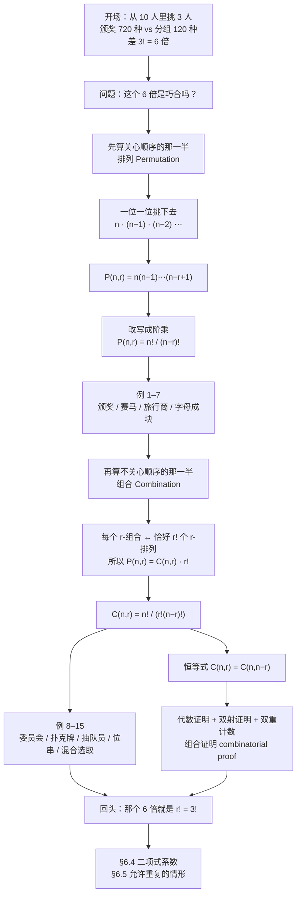
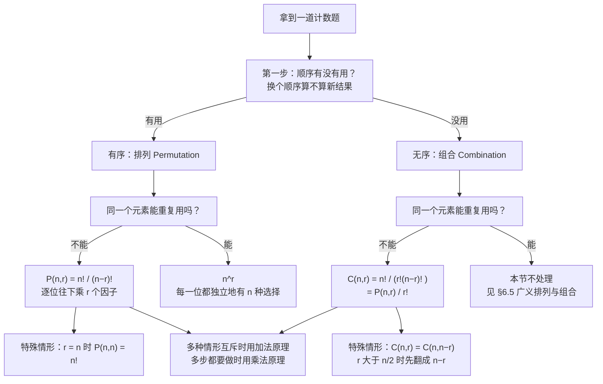

# C6.3 排列与组合 Permutations and Combinations

> [!abstract] 这一讲的任务
> §6.1 给了我们乘法原理：一件事分几步做，各步方法数相乘。它是对的，但**它不告诉你该乘什么**。
> 这一讲要解决的是乘法原理最常遇到的那一类问题：**从 $n$ 个东西里挑 $r$ 个，有几种挑法？** 答案只有两个——看你关不关心挑出来的**顺序**。关心就是**排列 Permutation**，不关心就是**组合 Combination**。
> 这两个数只差一个因子 $r!$，却对应现实里完全不同的两类问题：颁奖和分组、排座位和选委员、密码和彩票。**分不清这两者，是这一章最常见的失分点。**

> [!info] 怎么读这份讲义
> 顺序建议：第 0 节（两种问法）→ 第 2 节（把 $P(n,r)$ 逼出来，本节最重要的一段推理）→ 第 5 节（把 $C(n,r)$ 逼出来，第二段重要推理）→ 第 8 节（组合数的算法）。
> 第 3 节的公式 $P(n,r)=\dfrac{n!}{(n-r)!}$ 和第 6 节的 $C(n,r)=\dfrac{n!}{r!\,(n-r)!}$ 是必须能默写的两条；第 8 节的 $C(n,r)=C(n,n-r)$ 是必考的一条恒等式。
> 前置：乘法原理与除法原理（[[C6.1 计数基础 The Basics of Counting]]）、阶乘与求和记号（[[C2.4 序列与求和 Sequences and Summations]]）、单射与双射（[[C2.3 函数 Functions]]）。
> 本节默认**元素互不相同**、**每个元素最多用一次**；允许重复的情形留到 §6.5。

---

## 0. 开场：同一个"挑 3 个"，两种答案

校庆晚会上有 10 位同学上台抽奖。主持人宣布了 A、B 两种玩法：

**玩法 A（颁奖）**：设一等奖、二等奖、三等奖各一名，**奖金不同**，获奖的三个人站到台前，按奖项从高到低站成一排拍照。

**玩法 B（分组）**：三个人**拿同样的纪念品**，站到台前拍一张照，谁站左边谁站右边无所谓。

两种玩法的候选池完全一样：10 个人，挑出 3 个。可算法完全不一样。

玩法 A 用乘法原理顺着挑：第一个位置（一等奖）有 10 种人选，定了之后第二个位置（二等奖）剩 9 种，第三个位置（三等奖）剩 8 种：

$$10\cdot 9\cdot 8=720$$

玩法 B 呢？不许你直接写 $10\cdot9\cdot8$——因为这里的 $720$ 把**同一批三个人**按站位的不同顺序数成了很多次。就拿 $\{甲,乙,丙\}$ 这一组来说，这 6 种排法

$$甲乙丙,\quad 甲丙乙,\quad 乙甲丙,\quad 乙丙甲,\quad 丙甲乙,\quad 丙乙甲$$

在 $720$ 里被算成了 6 个不同的结果，而这 6 个结果在玩法 B 眼里是**同一件事**（"就是他们三个"）。所以玩法 B 的数法多算了 $3!=6$ 倍：

$$720\div 6=120$$

**同一句"从 10 个里挑 3 个"，一个答案 720，一个答案 120，差了整整 6 倍。**

这 6 倍不是偶然。它就是"三个人有几种排法"这个数。换句话说：

$$\underbrace{720}_{\text{关心顺序}}=\underbrace{120}_{\text{不关心顺序}}\times\underbrace{3!}_{\text{同一批人的排法种数}}$$

> [!question] 停一下，先自己想想
> 上面这个关系式 $720=120\times 3!$ 里的 $6$，只是因为这批人有 3 个才恰好等于 $6$ 吗？
> 换成"从 10 个里挑 4 个"（挑 4 个颁奖 vs 挑 4 个分组），这两者之间还差一个固定的倍数吗？差多少？
>
> 答案在后面第 4 节末尾给出，你读的时候留意一下。

这一讲后面所有内容，就是把开场这两笔账**做成两条公式**，再搞清楚它们各自用在什么地方。

---

## 1. 两种挑法，两个名字（p.407）

先给两个东西起名字——注意"顺序"这个词在定义里出现了几次。

> [!important] 定义（排列 Permutation 与 r-排列 r-permutation）
> 一个集合的**排列 Permutation** 是这些元素的**有序摆放**（an ordered arrangement）。
> 从集合中挑出 $r$ 个元素做的有序摆放，叫做集合的一个 **$r$-排列（$r$-permutation）**。

> [!important] 定义（组合 Combination 与 r-组合 r-combination）
> 集合中 $r$ 个元素的**无序选取**（an unordered selection）叫做一个 **$r$-组合**。
> 也就是说：**一个 $r$-组合就是一个含 $r$ 个元素的子集。**（子集天生不记顺序。）

两个定义放在一起看，唯一的差别就是"有序"和"无序"。

**用小例子把两个定义摸一遍。** 令 $S=\{1,2,3\}$：

- $3,1,2$ 是 $S$ 的一个**排列**（把三个元素全用上、排成一串）；
- $3,2$ 是 $S$ 的一个 **2-排列**（只用了两个元素，但按 $3$ 在前 $2$ 在后）。

再令 $S=\{1,2,3,4\}$：

- $\{1,3,4\}$ 是 $S$ 的一个 **3-组合**；
- $\{4,1,3\}$ **和 $\{1,3,4\}$ 是同一个** 3-组合——集合里的元素写出来是先写 4 还是先写 1，不改变它是哪个集合。**这一点是"无序"的全部含义**，很多人算错组合题就是因为心里偷偷还留着顺序。

> [!important] 两个记号
>- **含 $n$ 个元素的集合的 $r$-排列的个数记作 $P(n,r)$；**
>- **含 $n$ 个元素的集合的 $r$-组合的个数记作 $C(n,r)$。**

$C(n,r)$ 还有个更常见的写法 $\binom{n}{r}$，叫**二项式系数 binomial coefficient**。**为什么叫"二项式"**，§6.4 会给出答案（剧透一句：它正好是 $(a+b)^n$ 展开式里的系数）。现在先把两个记号都记住：$C(n,r)=\binom{n}{r}$。

> [!question] 停一下，先自己想想
> 含 3 个元素的集合 $\{a,b,c\}$ 有几个 2-排列？几个 2-组合？
> 动手把两种都列出来再继续。**不要用公式**——公式我们还没推呢。

先手算：$2$-排列要求"有序"，所以 $(a,b)$ 与 $(b,a)$ 是两个不同的东西。全部列出来是

$$a,b;\quad a,c;\quad b,a;\quad b,c;\quad c,a;\quad c,b$$

六个。而 $2$-组合是子集，$\{a,b\}$ 和 $\{b,a\}$ 是同一个，所以

$$\{a,b\},\quad \{a,c\},\quad \{b,c\}$$

三个。

**注意 $6=3\times 2$。** 这和第 0 节那个 $720=120\times 3!$ 是同一件事，只是规模小到能一眼看到。待会儿我们就把这个观察变成定理。

---

## 2. 把 $P(n,r)$ 一位一位逼出来（p.408）

不要急着记公式。我们先把 $P(n,r)$ 是怎么长出来的走一遍——**这段推导本身就是考点**，因为考试里换个说法（"密码有多少种""座位有多少排法"）你就得自己重新推一次。

### 2.1 三个学生站一排

先从最小的例子开始：从 5 个学生里挑 3 个，站成一排拍照。

**一位一位地选下去**，把乘法原理的每一步都写清楚：

| 位置 | 还有几个人可选 | 为什么 |
|---|:-:|---|
| 第 1 位（队首） | 5 | 5 个人谁都能站 |
| 第 2 位 | 4 | 第 1 位已经用掉一个人，剩下 4 个 |
| 第 3 位 | 3 | 前两位用掉了两个，剩下 3 个 |

乘法原理把这几步乘起来：

$$5\cdot 4\cdot 3=60$$

顺手把"5 个人全部站一排"也算掉：第 4 位剩 2 种、第 5 位剩 1 种，

$$5\cdot 4\cdot 3\cdot 2\cdot 1=120$$

**为什么每一步的选项数都在减 1？** 因为"站的是一队人"，一个人不能同时站两个位置——**同一个元素不能重复用**。这就是本节的隐含前提：**元素互不相同，且每个只能用一次**。

### 2.2 数一数：选到第 $r$ 位时，手里还剩几个？

把上面的表推广到一般情形。设集合有 $n$ 个元素，我们要填 $r$ 个位置：

| 位置 | 可选个数 | 这个数怎么写 |
|:-:|:-:|:-:|
| 第 1 位 | $n$ | $n-0$ |
| 第 2 位 | $n-1$ | $n-1$ |
| 第 3 位 | $n-2$ | $n-2$ |
| $\vdots$ | $\vdots$ | $\vdots$ |
| 第 $r$ 位 | $?$ | $n-(r-1)$ |

关键在于**最后一行**：填到第 $r$ 位时，前面已经用掉了 $r-1$ 个元素，所以手里剩下

$$n-(r-1)=n-r+1$$

个。**这个 $n-r+1$ 是整条公式里唯一容易记错的地方**——很多人会写成 $n-r$。检验办法：代入 $r=1$，应该得到 $n$；$n-1+1=n$ ✓，而 $n-r=n-1$ ✗。**记不住就代 $r=1$。**

> [!important] 定理 1（$r$-排列计数公式，p.408）
> 设 $n$ 是正整数，$r$ 是满足 $1\le r\le n$ 的整数。则含 $n$ 个不同元素的集合有
> $$P(n,r)=n(n-1)(n-2)\cdots(n-r+1)$$
> 个 $r$-排列。

**证明**就是上面那张表：第 1 个元素有 $n$ 种选法，第 2 个有 $n-1$ 种（第一个已经用过），第 3 个有 $n-2$ 种，依此类推，直到第 $r$ 个有 $n-(r-1)=n-r+1$ 种。由乘法原理，总数是这些因子之积。$\blacksquare$

### 2.3 两个端点：$r=0$ 和 $r=n$

- $r=n$ 时公式给出 $P(n,n)=n(n-1)\cdots 2\cdot 1=n!$。**"$n$ 个元素的全排列有 $n!$ 种"**，这条后面要反复用。
- $r=0$ 时，$P(n,0)=1$。**这需要解释**：从集合里挑 0 个元素做有序摆放，有多少种？恰好一种——**那张空名单**。空名单也只有一张，不是零张。所以 $P(n,0)=1$，而不是 0。

> [!warning] 为什么必须规定 $P(n,0)=1$
> 如果强行把 $n(n-1)\cdots$ 里塞进 $r=0$，会得到一个"从 $n$ 开始连乘 0 个数"的怪东西。规定成 1 不只是为了好看：第 5 节推组合公式时要除以 $P(r,r)$，而 $r=0$ 的情形（"一个都不选"）在计数题里天天出现（比如第 9 节例 14 里 $r=0$ 的位串）。
> **约定：$0!=1$，$P(n,0)=1$，$C(n,0)=1$。** 这三条是一伙的。

**手算验证**（先用公式，再用枚举核对）：

- $P(5,3)=5\cdot4\cdot3=60$ ✓，与 2.1 节逐位相乘的结果一致。
- $P(3,2)=3\cdot2=6$ ✓，与第 1 节列出的六个 2-排列一致。
- $P(5,5)=5\cdot4\cdot3\cdot2\cdot1=120$ ✓。

---

## 3. 阶乘写法：$P(n,r)=\dfrac{n!}{(n-r)!}$（p.408）

定理 1 那个连乘形式在 $n$ 小时好用（$P(8,3)=8\cdot7\cdot6$ 一眼能算），但 $r$ 一大就不方便。把它改写成阶乘：

> [!important] 推论 1（Corollary 1，p.408）
> 设 $n,r$ 是满足 $0\le r\le n$ 的整数，则
> $$\boxed{\,P(n,r)=\frac{n!}{(n-r)!}\,}$$

**证明**：当 $1\le r\le n$ 时，把 $n!$ 从 $(n-r+1)$ 处截断：

$$n!=\underbrace{n(n-1)(n-2)\cdots(n-r+1)}_{\text{这就是 }P(n,r)}\cdot\underbrace{(n-r)(n-r-1)\cdots 1}_{=(n-r)!}$$

两边同除 $(n-r)!$ 就得到 $P(n,r)=\dfrac{n!}{(n-r)!}$。

$r=0$ 时：$\dfrac{n!}{(n-0)!}=\dfrac{n!}{n!}=1$，而 $P(n,0)=1$，公式同样成立。$\blacksquare$

> [!note] 这条公式的记法窍门
> $P(n,r)=\dfrac{n!}{(n-r)!}$ 就是**"从 $n$ 开始往下乘 $r$ 个"**的紧凑写法：分子是 $n!$，分母把"没乘到的尾巴" $(n-r)!$ 除掉。
> 一句话：**$P$ 的分母只有一个阶乘**。第 6 节 $C$ 的分母有两个阶乘，多的那一个正是 $r!$——这就是排列与组合的全部差别。

**手算验证**：$P(8,3)=\dfrac{8!}{5!}=\dfrac{40320}{120}=336$ ✓，与 $8\cdot7\cdot6=336$ 一致。

---

## 4. 例题：排列公式的六种用法（p.407–409）

下面这六道例题覆盖了排列题的全部基本套路。**每道都先问自己一句"顺序有没有用"，再动笔。**

### 例 1（p.407）——5 个学生里挑 3 个站一排

**题目**：从 5 个学生中挑 3 个站成一排拍照，有多少种排法？把 5 个人全部排成一排，又有多少种？

**解**：**顺序有用**——站队伍的左边和右边是两种不同的照片。所以这是 $3$-排列问题。

逐位选：第 1 位 5 种，第 2 位 4 种，第 3 位 3 种，乘法原理得

$$5\cdot 4\cdot 3=60$$

全部 5 人排队：继续逐位选下去，第 4 位 2 种、第 5 位 1 种，

$$5\cdot 4\cdot 3\cdot 2\cdot 1=120$$

这正是 $5!=120$、也就是 $P(5,5)$。**"排 $n$ 个人的全队"就是"$n$ 的全排列"。**

### 例 2（p.408）——认识定义

**题目**：$S=\{1,2,3\}$。$3,1,2$ 是 $S$ 的一个排列；$3,2$ 是 $S$ 的一个 2-排列。

**解**：无需计算。注意两处细节：$3,1,2$ 用完了三个元素（是**排列**）；$3,2$ 只用了两个（是 **2-排列**，不是排列）。**"$r$-排列"里 $r<n$ 时它就不叫"排列"了**——术语上要把这两件事分开。

### 例 3（p.408）——$\{a,b,c\}$ 的 2-排列

**题目**：$S=\{a,b,c\}$，列出所有 2-排列并计数。

**解**：$S$ 的 2-排列是

$$a,b;\quad a,c;\quad b,a;\quad b,c;\quad c,a;\quad c,b$$

共 6 个。逐位算：第 1 位有 3 种，第 2 位必须与第 1 位不同，所以有 2 种，乘法原理得 $P(3,2)=3\cdot2=6$ ✓。

**这道题的价值**：它把"为什么是 $3\cdot2$ 而不是 $3\cdot3$"摆在了明面上——**第 2 位不能再用第 1 位用过的元素，这就是"每个元素最多用一次"约束的第一次登场**。如果允许重复（$aa$ 也算），答案会是 $3^2=9$，那是 §6.5 的内容。

> [!note] 原文此处有一处排印重复
> 这一段在原文里"…$=6$"之后又重复印了一遍"the first element. By the product rule, it follows that $P(3,2)=3\cdot2=6$"，属于排版重复，不影响内容。（图片页上确认是印出来的重复，不是文本层的识别错误。）
> **同类问题还有一处**：推论 1 的证明末句，原文印作
> $$\frac{n!}{(n-0)!}=\frac{n!}{n!}=1$$
> 这句的**衔接出了错**——它想说的是"$\dfrac{n!}{(n-0)!}=\dfrac{n!}{n!}=1$，而 $P(n,0)=1$，所以公式在 $r=0$ 时也成立"，但印出来把 $P(n,0)=1$ 这一步漏掉了，读起来像在说"$1=1$ 所以成立"。**正确读法补上这一句就通了**：$\dfrac{n!}{n!}=1=P(n,0)$。

### 例 4（p.409）——100 人里评前三名 ⭐

**题目**：100 个参赛者中选出第一名、第二名、第三名，有多少种结果？

**解**：**名次就是顺序**——谁得哪一项奖是有区别的（这正是第 0 节的玩法 A）。所以答案是 100 元集合的 $3$-排列个数：

$$P(100,3)=100\cdot 99\cdot 98=970{,}200$$

（已用程序复算：$\dfrac{100!}{97!}=970200$ ✓，与原文一致。）

**顺带对一下第 0 节**：同样是"100 人里挑 3 人"，如果三个人**拿同样的奖、不排名次**，答案就是 $970{,}200\div 3!=161{,}700$。**这就是玩法 A 和玩法 B 的差别在 $n=100$ 上的样子。**

### 例 5（p.409）——8 名选手发金银铜牌

**题目**：8 名赛跑选手，冠军得金、亚军得银、季军得铜，无并列。有多少种发奖方式？

**解**：还是"顺序有用"（金和银不能互换）。所以是 8 元集合的 $3$-排列个数：

$$P(8,3)=8\cdot 7\cdot 6=336$$

（复算：$\dfrac{8!}{5!}=336$ ✓。）

### 例 6（p.409）——旅行商的行程

**题目**：一位销售员要访问 8 座城市，**必须从指定的那座城市出发**，其余 7 座任意排序。有多少种可能的访问顺序？

**解**：第 1 座城市被指定死了，没有选择余地。剩下 7 座城市的顺序随便排，这就是 7 个元素的全排列：

$$7!=7\cdot6\cdot5\cdot4\cdot3\cdot2\cdot1=5040$$

**为什么不能写成 $P(7,7)$ 之外的东西**：如果起点也能随便选，就该是 $8!=40320$ 种（8 座城市的全排列）；固定起点把每种走法开头的 8 种可能砍掉了 7 种，正好 $40320\div 8=5040$ ✓。**"有一个位置被钉死"是最常见的减速模式**，见到就先把它拿走，再数剩下的。

原文还点了一句实际后果：销售员若想找**最短**路线，就得把 5040 条路线的总距离**一条一条算出来**。这就是著名的旅行商问题的雏形——**8 座城市只要算 5040 次，20 座城市就是 $20!\approx 2.43\times10^{18}$ 次，彻底算不动**。计数在这里不是练习，它是"这条路走不通"的证据。

### 例 7（p.409）——字母必须连成一块

**题目**：$ABCDEFGH$ 的排列中，有多少个包含连续子串 $ABC$？

**解**：关键在于**把 $ABC$ 打包**。既然 $ABC$ 必须原样连着出现，那把这三个字母**用胶带粘成一个"大字母"**，这个整体和 $D,E,F,G,H$ 一样，只是一个**不可分割的对象**：

$$\boxed{[ABC]},\;D,\;E,\;F,\;G,\;H$$

于是问题变成"6 个对象排一排"，即

$$6!=720$$

（复算：$6!=720$ ✓，与原文一致。）

**这个"打包"技巧的适用范围要说清楚**：它成立是因为 $ABC$ **顺序固定**。如果题目问"包含 $A,B,C$ 三个字母连在一起（内部顺序随便）"，那就要先把 $ABC$ 打包成一个块、再乘上块内部自己的排列数 $3!=6$，总数为 $6!\cdot 3!=4320$。**两步都要做，少一步就错。**

> [!question] 停一下，先自己想想
> 上面整理的"打包法"能不能直接用在"$A$ 和 $B$ **不能相邻**"这种题目上？
> 试试看：把 $AB$ 打包成一块，然后要求这一块**不出现**——你会发现"不出现"不是一个能拿胶带粘出来的条件。
>
> 答案在第 10 节（"谁都不许挨着谁"），那里要换一个完全不同的技巧。

### 回头看看：我们刚才干了什么

到这儿，排列这条线已经完整了：

1. **判定**：问题里"顺序"有没有用？有用 → 排列。
2. **建模**：把 $r$ 个位置列出来，问"第 $k$ 位还有几种选法"。
3. **计算**：$P(n,r)=n(n-1)\cdots(n-r+1)=\dfrac{n!}{(n-r)!}$。
4. **特例**：全排列是 $n!$；$P(n,0)=1$。
5. **技巧**：位置被钉死 → 先拿走（例 6）；若干元素必须相邻 → 打包（例 7）。

**现在回到第 0 节那个 720 与 120 的对比**：我们已经会算 720 那一半了。120 那一半——也就是**不关心顺序**的计数——就是下一节的正题。

> [!note] 第 0 节那个问题的答案
> "挑 4 个"时这两者仍然差一个固定倍数，倍数就是 $4!=24$：
> $$P(10,4)=10\cdot9\cdot8\cdot7=5040,\qquad C(10,4)=\frac{5040}{24}=210,\qquad 5040=210\times24$$
> **规律是：不管挑几个，从"关心顺序"换到"不关心顺序"，就是除以"这 $r$ 个元素自己的排法数" $r!$。** 下节证明它对一切 $n,r$ 都成立。

---

## 5. 组合：把每个组合数成 $r!$ 次（p.409–410）

### 5.1 先从一个不用公式的题开始

### 例 8（p.409）——从 4 人里选 3 人组成委员会

**题目**：从 4 个学生里选出 3 个组成委员会（committee），有多少种选法？

**解**（这道题原文故意不让你用公式，用意在后面）：

"选 3 个人进委员会"等价于"**决定把 1 个人排除在外**"。既然只有 4 个人，那么有 4 种排除方式，也就有 **4 种**选法。关键是最后那句：**选人时谁先被选、谁后被选，不影响委员会是谁。**

这道题的价值在于：**它逼你注意到"顺序无关"这件事天然存在**——委员会 $\{甲,乙,丙\}$ 和 $\{丙,甲,乙\}$ 不是两个委员会。

### 5.2 组合数是 $4$，排列数却是 $24$

把上题换成"顺序有关"的版本对比一下：从 4 人里选 3 人**排成一队**，有多少种？

$$P(4,3)=4\cdot3\cdot2=24$$

而选 3 人**组成委员会**只有 $C(4,3)=4$ 种。**$24=4\times 6$，而这个 6 又是 $3!$。**

再看例 10 的 $\{a,b,c,d\}$ 的 2-组合：列出全部子集

$$\{a,b\},\;\{a,c\},\;\{a,d\},\;\{b,c\},\;\{b,d\},\;\{c,d\}$$

共 **6** 个，即 $C(4,2)=6$。而对应的 2-排列有 $P(4,2)=12$ 个。**$12=6\times2$，这个 2 就是 $2!$。**

### 5.3 关键推理：每个 $r$-组合，恰好对应 $r!$ 个 $r$-排列 ⭐

三个例子都差一个 $r!$。这不是巧合。看清下面这件事：

> [!important] 核心观察
> 随便挑一个固定的 $r$-组合（一堆 $\{x_1,x_2,\dots,x_r\}$）。把这 $r$ 个元素**自己**排一排，有 $r!$ 种排法（$r$ 个不同元素的全排列），这 $r!$ 种排法**互不相同**，而且它们全是同一个 $r$-组合的成员。
> 反过来，任何一个 $r$-排列**去掉顺序**之后，必然唯一落回某一个 $r$-组合。
> 所以：**$r$-排列 与 （$r$-组合，以及它内部的 $r!$ 种排法）之间是一一对应的。这就是一个双射。**

再换个角度，按乘法原理**两条路走同一个终点**：

- **路 1**：直接数 $r$-排列，得 $P(n,r)$。
- **路 2**：先选 $r$ 个元素（$C(n,r)$ 种），再把这 $r$ 个元素排一排（$P(r,r)=r!$ 种）。由乘法原理，共 $C(n,r)\cdot r!$ 个。

两条路数的是**同一批东西**（都是"从 $n$ 个里挑出 $r$ 个的有序摆放"），所以它们相等：

$$\boxed{\,P(n,r)=C(n,r)\cdot r!\,}$$

这个等式是本节最重要的一个式子。它一句话说完了排列与组合的全部关系：**排列 = 组合 × 内部排法数。**

> [!important] 定理 2（$r$-组合计数公式，p.410）
> 设 $n$ 是非负整数，$r$ 是满足 $0\le r\le n$ 的整数。则含 $n$ 个元素的集合的 $r$-组合个数是
> $$\boxed{\,C(n,r)=\frac{n!}{r!\,(n-r)!}\,}$$

**证明**（代数推导）：由 $P(n,r)=C(n,r)\cdot P(r,r)$ 解出

$$C(n,r)=\frac{P(n,r)}{P(r,r)}=\frac{n!/(n-r)!}{r!/(r-r)!}=\frac{n!/(n-r)!}{r!}=\frac{n!}{r!\,(n-r)!}$$

其中最后一步用了 $P(r,r)=r!$ 和 $P(r,0)=0!=1$。$\blacksquare$

**同一件事的第二种证明（用除法原理）**：由 [[C6.1 计数基础 The Basics of Counting]] 的除法原理——如果一个计数过程把每个目标对象**恰好**数了 $k$ 次，那总数就是"过程结果数 $\div\, k$"。这里"先排 $r$ 个"的过程把每个 $r$-组合恰好数了 $P(r,r)=r!$ 次（就是那个组合内部的 $r!$ 种排法），所以

$$C(n,r)=\frac{P(n,r)}{P(r,r)}=\frac{n!}{r!\,(n-r)!}$$

两条证明思路一致，只是把"乘法原理"换成了它的孪生兄弟"除法原理"。

### 5.4 这张图把两栏对齐了

下面这张图用最小的例子（$\{A,B,C\}$ 取 2 个）把上面的双射画出来：左边是 $6$ 个**有序**结果，右边是 $3$ 个**集合**，每一根箭头都表示"把顺序抹掉"。

![[C6.3-排列与组合的区别.png]]

读图的方法：**竖着看**。中间三根箭头各自把一对排列送到同一个集合上——蓝箭头把 $AB$ 和 $BA$ 都送到 $\{A,B\}$，红箭头把 $AC$ 和 $CA$ 送到 $\{A,C\}$，绿箭头把 $BC$ 和 $CB$ 送到 $\{B,C\}$。图上"每个组合恰好收到 $2! = 2$ 根箭头"这句话，翻译成代数就是 $P(3,2)=C(3,2)\times 2!$，即 $6=3\times2$。

**把 $2$ 换成一般的 $r$，这张图的逻辑一个字都不用改。** 这就是为什么 $P(n,r)=C(n,r)\cdot r!$ 对一切 $n,r$ 成立。

### 5.5 两种记号与一个别名的提醒

- $C(n,r)$ 与 $\binom{n}{r}$ 是**同一个数**的两个写法，后者读作"$n$ 选 $r$"（$n$ choose $r$）。
- 计算机里它常叫 `choose(n, k)` 或 `binom(n, k)`；Python 里是 `math.comb(n, r)`。
- **注意 $\binom{n}{r}$ 不是分数**。它是一个整体记号，表示组合数，不要读成"$n$ 除以 $r$"，也不要拆开。§6.4 会看到它作为 $(a+b)^n$ 的系数出现，那时这个记号的样子就顺眼了。

> [!note] 停一下，我们刚才干了什么
> 到这里，本节的**两条主公式**都齐了：
>
> | | 顺序 | 公式 | 分母 |
> |---|:-:|---|---|
> | 排列 $P(n,r)$ | **有关** | $\dfrac{n!}{(n-r)!}$ | 一个阶乘 |
> | 组合 $C(n,r)$ | **无关** | $\dfrac{n!}{r!\,(n-r)!}$ | 两个阶乘 |
>
> 两者由 $P(n,r)=C(n,r)\cdot r!$ 连接。**看到题先问"顺序有没有用"，这是唯一的判断步骤。**

---

## 6. 例题：组合公式的五种用法（p.410–413）

### 例 9（p.410）——认识定义

**题目**：$S=\{1,2,3,4\}$。$\{1,3,4\}$ 是 $S$ 的一个 3-组合。注意 $\{4,1,3\}$ 与 $\{1,3,4\}$ 是**同一个** 3-组合，因为集合里元素的书写顺序不影响它是哪个集合。

**解**：无需计算。这一例就是给"无序"再钉一颗钉子：**写 $\{4,1,3\}$ 和写 $\{1,3,4\}$ 是同一个东西**，所以数它们时只能算一次。

### 例 10（p.410）——列出 $\{a,b,c,d\}$ 的 2-组合

**题目**：$C(4,2)$ 是多少？

**解**：2-组合就是含 2 个元素的子集：

$$\{a,b\},\;\{a,c\},\;\{a,d\},\;\{b,c\},\;\{b,d\},\;\{c,d\}$$

共 **6** 个。

**用公式复核**：$C(4,2)=\dfrac{4!}{2!\,2!}=\dfrac{24}{2\cdot 2}=6$ ✓。

**再用第 5.3 节的关系复核**：$C(4,2)\cdot 2!=6\cdot2=12=P(4,2)=4\cdot3$ ✓。

### 例 11（p.411）——扑克牌 5 张与手算技巧 ⭐

**题目**：从标准 52 张扑克牌里发 5 张，有多少种不同的牌型（hand）？从 52 张里**选出 47 张**又有多少种？

**解（第一问）**：发牌的顺序无关（先发哪张后发哪张不改变手里有什么），所以是组合：

$$C(52,5)=\frac{52!}{5!\,47!}$$

**化简**：把分子分母同时除以 $47!$，也就是"把大的那个阶乘消掉"：

$$C(52,5)=\frac{52\cdot 51\cdot 50\cdot 49\cdot 48}{5\cdot4\cdot3\cdot2\cdot1}$$

**手算技巧：不要在上下各自乘完再除，要**交叉约分**。逐条配对：

| 分母的因子 | 约进分子的谁 | 得到 |
|:-:|:-:|:-:|
| $5$ | $50$ | $10$ |
| $4$ | $48$ | $12$ |
| $3$ | $51$ | $17$ |
| $2$ | $52$ | $26$ |
| $1$ | —— | （保留） |

分子上剩下的是 $26,\;17,\;10$，再乘上**没被约掉的 $49$**（$49=7^2$，与分母的 $2,3,4,5$ 都不共因子）：

$$C(52,5)=26\cdot 17\cdot 10\cdot 49\cdot 12=2{,}598{,}960$$

（复算：$\dfrac{52!}{5!\,47!}=2598960$ ✓，且 $26\cdot17\cdot10\cdot49\cdot12=2598960$ ✓，与原文一致。）

**解（第二问）**：选 47 张，公式给出

$$C(52,47)=\frac{52!}{47!\,5!}$$

**但根本不用算**——把它和上面那个式子对比一下，两个式子**只是分母里 $5!$ 和 $47!$ 的先后顺序不同**，乘积当然一样，所以

$$C(52,47)=C(52,5)=2{,}598{,}960$$

（复算：$C(52,47)=2598960$ ✓。）

> [!note] 这个技巧背后的直觉
> "选 5 张发给你" 与 "选 47 张留下来" 是**同一件事的两种说法**：你手里拿的 5 张定了，剩下 47 张自然就定了，反之亦然。
> **所以"选 $r$ 个"和"选 $n-r$ 个"数目必然相同。** 例 11 是这条规律的一个特例，下一节把它写成定理。

### 例 12（p.412）——网球队员

**题目**：从 10 人的网球队里选 5 人出访比赛，有多少种选法？

**解**：**不分配角色、只挑人**，所以顺序无关：

$$C(10,5)=\frac{10!}{5!\,5!}=252$$

（复算：$252$ ✓，与原文一致。）

**对比**：如果这 5 个人还要分别担任"队长、副队长、记录员、教练、联络员"五个不同的角色，那就是 $P(10,5)=10\cdot9\cdot8\cdot7\cdot6=30240$，正好是 $252\times 5!=252\times120=30240$ ✓。**同一批人，加上"角色"这个顺序，就乘了个 $5!$。**

### 例 13（p.412）——火星任务的 6 人乘组

**题目**：30 人受过航天训练，选拔 6 人执行首次火星任务（**假设所有乘组成员职务相同**），有多少种选法？

**解**：括号里那句"职务相同"就是"顺序无关"的信号——组里没有谁是队长：

$$C(30,6)=\frac{30!}{6!\,24!}=\frac{30\cdot29\cdot28\cdot27\cdot26\cdot25}{6\cdot5\cdot4\cdot3\cdot2\cdot1}=593{,}775$$

（复算：$\dfrac{30!}{6!\,24!}=593775$ ✓，与原文一致。）

**约分验算一条**：分母 $6\cdot5\cdot4\cdot3\cdot2\cdot1=720$；分子 $30\cdot29\cdot28\cdot27\cdot26\cdot25=427{,}518{,}000$；相除得 $593{,}775$ ✓。

### 例 14（p.413）——位串里的组合数

**题目**：长度为 $n$ 的位串中，**恰好含 $r$ 个 1** 的有多少个？

**解**：一个长度为 $n$ 的位串有 $n$ 个位置。**要确定这个位串，只需要确定"哪 $r$ 个位置放 1"**——剩下的位置自然全是 0。

而"从 $n$ 个位置里挑 $r$ 个"正是一个 **$r$-组合**（位置是无序的：先说第 3 位还是先说第 7 位，说的是同一个位串）。所以答案是

$$\boxed{C(n,r)}$$

**为什么这条值得单独一例**：它是一台**翻译机**。凡是"从 $n$ 个东西里挑 $r$ 个、被挑中的做某件事"的问题，都能翻译成位串——被挑中记 1、没挑中记 0。**组合问题与"定 $r$ 个位置的位串"是同一个问题的两种说法。**

一个马上能得到的推论：长度为 $n$ 的位串一共有 $2^n$ 个（每个位置独立地 0 或 1），而按"含几个 1"分类，总数应该是 $\sum_{r=0}^{n}C(n,r)$。两句话说的是同一批位串，所以

$$\sum_{r=0}^{n}C(n,r)=2^n$$

（这条恒等式是 §6.4 的正菜，这儿先尝一口。）

### 例 15（p.413）——两个系凑一个委员会

**题目**：数学系有 9 位教师，计算机系有 11 位。要成立一个委员会，由数学系 3 人、计算机系 4 人组成，有多少种组建方式？

**解**：这是**分步**问题：先定数学系的人，再定计算机系的人，用乘法原理把两步乘起来。而每一步内部都**只挑人、不排位**，所以每步都是组合：

$$C(9,3)\cdot C(11,4)=\frac{9!}{3!\,6!}\cdot\frac{11!}{4!\,7!}=84\cdot 330=27{,}720$$

（复算：$C(9,3)=84$ ✓、$C(11,4)=330$ ✓、$84\cdot330=27720$ ✓，与原文一致。）

> [!warning] 什么时候用乘法原理，什么时候用加法原理
> **"先……再……"**（两件事**都要**做，且各自独立地做选择）→ **乘法原理**，本例就是。
> **"要么……要么……"**（两种情形**互斥**，只需要其中一种）→ **加法原理**。
> 例 15 里"数学系 3 人"和"计算机系 4 人"是必须同时满足的两个条件，属于前者。**搞错这一步，答案会差出好几个数量级。**

---

## 7. 组合数的算法：别硬算阶乘（p.410–411）

定理 2 的公式虽然准确，但原文专门提醒：**$n$ 和 $r$ 一大，这个公式就不好用了**。两个原因：

1. **阶乘涨得太快**。$20!\approx2.43\times10^{18}$ 已经到 64 位整数的边缘，$21!$ 就溢出了；$C(100,50)$ 这种数在一般编程语言里根本表示不出来。
2. **用浮点数算会出小数**。$n!/\bigl(r!(n-r)!\bigr)$ 中间步骤的浮点误差会让结果变成 $2598959.9999$ 这种"看起来不是整数"的东西——而组合数**必然是整数**。

**正确的做法：先约掉 $(n-r)!$。** 由定理 2

$$C(n,r)=\frac{n!}{r!\,(n-r)!}=\frac{n(n-1)\cdots(n-r+1)}{r!}$$

也就是说：**分子只写从 $n$ 往下的 $r$ 个因子，分母只有 $r!$**——大的那头的阶乘被约掉了。手算时还要在这个式子里**再约一遍公因子**（就像例 11 做的那样），最后才做除法。

> [!note] 为什么 $C(n,r)$ 一定是整数（这是可以看出来的）
> $\dfrac{n(n-1)\cdots(n-r+1)}{r!}$ 里，分母 $r!$ 是"$r$ 个连续整数之积"。数论上有一条标准结论：**任意 $r$ 个连续整数之积必被 $r!$ 整除**。所以这个式子的结果一定是整数，浮点算法算出小数只是误差，不是数学。
> （这条整除性的证明属于数论，此处作为通行结论引用，不展开。）

**三条实战策略**：

| 情形 | 怎么做 | 例子 |
|---|---|---|
| $r$ 很小 | 直接用 $\dfrac{n(n-1)\cdots(n-r+1)}{r!}$，约分后手算 | $C(52,5)$（例 11） |
| $r$ 接近 $n$ | **换成 $C(n,n-r)$**，把小的一半放在分母 | $C(100,98)=C(100,2)=4950$ |
| 需要精确大数 | 用编程语言的组合函数（`math.comb`）或任意精度整数 | $C(100,50)\approx1.0089\times10^{29}$ |

（复算：$C(100,98)=4950$ ✓、$C(100,2)=4950$ ✓；$C(100,50)=100891344545564193334812497256$，约 $1.0089\times10^{29}$ ✓。原文提到的计算器/程序函数名是 `choose(n, k)` 或 `binom(n, k)`。）

### 7.1 $n!$ 到底涨得多快

本节反复出现阶乘，值得单独看一眼它的增长速度。

| $n$ | $n!$ | 大致量级 |
|:-:|---:|---|
| $3$ | $6$ | 个位 |
| $5$ | $120$ | 百 |
| $7$ | $5\,040$ | 千 |
| $10$ | $3\,628\,800$ | 百万 |
| $13$ | $6\,227\,020\,800$ | 十亿 |
| $20$ | $2\,432\,902\,008\,176\,640\,000$ | $2.4\times10^{18}$ |
| $25$ | $15\,511\,210\,043\,330\,985\,984\,000\,000$ | $1.6\times10^{25}$ |
| $52$ | $8.07\times10^{67}$ | 68 位 |
| $100$ | $9.33\times10^{157}$ | 158 位 |

（全部由程序复算。**64 位有符号整数的上限是 $9.22\times10^{18}$，而 $20!=2.43\times10^{18}$ 还装得下、$21!\approx5.11\times10^{19}$ 就溢出了**——这是"阶乘不能硬算"的量化版本：能算的边界就在 20 附近。$100!$ 是 158 位数，写成十进制要占满小半页。）

作为对照，$2^n$ 在 $n=100$ 时是 $1.27\times10^{30}$（31 位）。**$100!$ 比 $2^{100}$ 大了约 $10^{128}$ 倍**（精确地算：$\log_{10}\bigl(100!/2^{100}\bigr)\approx127.87$）——这就是为什么"把 100 个东西全排一遍"这种暴力做法在现实里从来不可行，也正是例 6 里旅行商问题"算不动"的根源。

要是连 $n!$ 的位数都想快速估出来，有个通行公式（斯特林 Stirling 近似，属于分析的内容，此处只作引用）：

$$n!\approx\sqrt{2\pi n}\left(\frac{n}{e}\right)^{n}$$

**用它估 $100!$ 的位数**：先算两项

$$100\log_{10}\frac{100}{2.71828}\approx100\times1.56571\approx156.571,\qquad 0.5\log_{10}(2\pi\cdot100)\approx0.5\times2.79818\approx1.399$$

相加得 $\log_{10}(100!)\approx157.970$，所以 $100!$ 的位数是 $\lfloor157.970\rfloor+1=$ **158 位**，与实际一致 ✓（程序复算 $\log_{10}(100!)=157.97000365$，近似式准确到小数点后五位）。

---

## 8. 恒等式 $C(n,r)=C(n,n-r)$ 与组合证明（p.411–412）

例 11 里 $C(52,5)=C(52,47)$ 那件事，单独提成一条定理。

> [!important] 推论 2（Corollary 2，p.411）
> 设 $n,r$ 是非负整数且 $r\le n$，则
> $$\boxed{\,C(n,r)=C(n,\,n-r)\,}$$

**证明一（代数）**：由定理 2，

$$C(n,r)=\frac{n!}{r!\,(n-r)!}$$

而把 $n-r$ 代进去：

$$C(n,n-r)=\frac{n!}{(n-r)!\,\bigl[n-(n-r)\bigr]!}=\frac{n!}{(n-r)!\,r!}$$

两式右边只差分母里两个阶乘的书写顺序，所以相等。$\blacksquare$

**证明二（组合证明，见下节）**：不用代数，用"数同一批东西"。$\blacksquare$

### 8.1 什么是组合证明

原文在这里插了一个**定义**，它比这条恒等式本身更重要——因为 §6.4 里的恒等式几乎全靠这个套路。

> [!important] 定义 1（组合证明 combinatorial proof，p.412）
> 一条恒等式的**组合证明**，是指**用计数论证**说明"等式两边数的是同一批对象，只是数法不同"；或者说明"等式两边所数的对象集合之间存在一个**双射**"。
> 前者叫**双重计数证明 double counting proof**，后者叫**双射证明 bijective proof**。

> [!note] 为什么值得学这套证法
> 原文对此有一句评价：组合证明**几乎总是比代数变形更短，而且更能说明为什么**（*much shorter and provide more insights*）。
> 代数证明告诉你"两边算出来一样"，组合证明告诉你"两边本来就在数同一件事"。**前者验算，后者给理解。**

### 8.2 推论 2 的双射证明

**构造双射**：设 $S$ 是含 $n$ 个元素的集合。定义映射

$$A\longmapsto \overline{A}\qquad(A\subseteq S)$$

也就是**把每个子集送到它的补集**。

**为什么它是双射**：两次取补就回到自己（$\overline{\overline{A}}=A$），所以这个映射**自己就是自己的逆**——既单射又满射（单射与双射的定义见 [[C2.3 函数 Functions]]）。它把"含 $r$ 个元素的子集"和"含 $n-r$ 个元素的子集"一一配对：$|A|=r$ 时 $|\overline{A}|=n-r$。

**收尾**：两个有限集合之间若存在双射，它们就**元素个数相同**（[[C2.1 集合 Sets]] 里基数那部分的基本结论）。左边那族子集有 $C(n,r)$ 个，右边那族有 $C(n,n-r)$ 个，所以

$$C(n,r)=C(n,n-r)\quad\blacksquare$$

### 8.3 同一件事的双重计数证明

换一种说法，不用"双射"这个词：

- **数法一**：按定义，$S$ 的含 $r$ 个元素的子集个数就是 $C(n,r)$。
- **数法二**：一个子集 $A$ **由"哪些元素不在 $A$ 里"完全决定**（把不在的挑出来，剩下的自然就在里面）。而"不在 $A$ 里"的那些元素构成 $\overline{A}$，它含 $n-r$ 个元素。所以要用这种说法数出所有含 $r$ 个元素的子集，等价于**从 $n$ 个里挑 $n-r$ 个**，共 $C(n,n-r)$ 种。

同一批子集，两种数法，所以两个数相等。$\blacksquare$

> [!note] 用一句话记住这条恒等式
> **"挑 $r$ 个留下" 就是 "挑 $n-r$ 个扔掉"。**
> 这条恒等式在计算上是**省力的开关**：遇到 $r>n/2$ 的组合数，先把它翻成 $n-r$（见第 7 节表格第二行）。
> 它还有一个"边界检验"的用法：$C(n,n)=C(n,0)=1$——两边都只有一种（全选、或全不选），恒等式成立 ✓。

---

## 9. 组合公式再练三例：位串、彩票、多人分组（p.413）

前面例 12–15 已经走过一遍。这里补三个稍复杂但仍在本节工具范围内的题，用来固化"先判定顺序、再动手"。

### 9.1 位串：不只"恰好 $r$ 个 1"

**题目**：长度为 10 的位串中，至少含 7 个 1 的有多少个？

**解**：先判定——位串的"哪些位置是 1"没有顺序，是组合。再判定——"至少 7 个"要**分情况**，而这些情况**互斥**（一个位串不可能同时恰好有 7 个 1 和恰好有 8 个 1），所以用**加法原理**：

$$C(10,7)+C(10,8)+C(10,9)+C(10,10)$$

（复算：$C(10,7)=120$、$C(10,8)=45$、$C(10,9)=10$、$C(10,10)=1$，合计 $176$。）

用恒等式省一步：$C(10,7)=C(10,3)=120$ ✓（这里再次用上 $\binom{n}{r}=\binom{n}{n-r}$）。

**如果问"至多 7 个 1"**，硬算 $C(10,0)+\cdots+C(10,7)$ 也行，但更省的办法是**反面计数**（[[C6.1 计数基础 The Basics of Counting]] 的补集技巧）：长度 10 的位串共 $2^{10}=1024$ 个，"至多 7 个 1"的反面是"至少 8 个 1"，共 $C(10,8)+C(10,9)+C(10,10)=45+10+1=56$，所以答案是 $1024-56=968$ ✓（与正面相加的结果一致）。

### 9.2 彩票：为什么中奖这么难

**题目**：某种彩票从 49 个号码里开出 6 个（不计开出顺序）。有多少种可能的开奖结果？

**解**：开奖顺序无关（先摇出哪个号都一样），所以是组合：

$$C(49,6)=\frac{49\cdot48\cdot47\cdot46\cdot45\cdot44}{6!}=13{,}983{,}816$$

（复算：$13{,}983{,}816$ ✓。）

**这意味着**买一张票的中奖概率是 $\dfrac{1}{13{,}983{,}816}\approx7.15\times10^{-8}$——大约**一千四百万分之一**。这个数不是"看起来小"，它是有具体算法支撑的：组合数就是分母。

### 9.3 分堆：把一群人选成两个不同的小组

**题目**：从 9 位数学系教师和 11 位计算机系教师中，选一个由数学系 3 人、计算机系 4 人组成的委员会（例 15），另外**再从剩下的人里选 2 人担任秘书和司库（职务不同）**，有多少种方式？

**解**：分三步，用乘法原理：

1. 数学系 3 人：$C(9,3)=84$；
2. 计算机系 4 人：$C(11,4)=330$；
3. 剩下的人有 $20-7=13$ 位，从中选 2 人并分配不同职务：**职务不同 = 顺序有关**，所以是 $P(13,2)=13\cdot12=156$。

$$84\cdot330\cdot156=4{,}324{,}320$$

（复算：$84\cdot330=27720$，$27720\cdot156=4324320$ ✓。）

**注意第 3 步用 $P$ 不用 $C$**：一旦题目里出现了"甲当秘书、乙当司库"和"乙当秘书、甲当司库"的区分，顺序就有用了。**同一个题目里 $P$ 和 $C$ 混着用是完全正常的**——关键是一步一步单独判定，不要拿一个公式套整题。

---

## 10. 谁都不许挨着谁：相邻约束的排列（p.414 习题 23–24 的经典题型）

这是排列题里最有代表性的一类，也是"打包法"失效的地方。

**题目**（教材习题 23）：8 位男士和 5 位女士站成一排，要求**任何两位女士都不相邻**，有多少种站法？

**先试错**：能不能把 5 位女士各当成一个"块"，然后……不行。因为"不许相邻"要求的是**这一堆对象之间保持距离**，不是"粘在一起"。**打包法处理的是"必须挨着"，处理不了"必须不挨着"。**

**换思路——先把没约束的那一半安排好，再看受限的那一半能塞进哪儿。**

**第 1 步：排男士。** 8 位男士彼此之间没有任何约束，任意排：

$$8!=40{,}320$$

**第 2 步：看排好之后留下了哪些"空位"。** 8 位男士排成一排以后，他们之间和两端形成了空档。**具体数一下**：假设排成

$$\_\;M_1\;\_\;M_2\;\_\;M_3\;\_\;M_4\;\_\;M_5\;\_\;M_6\;\_\;M_7\;\_\;M_8\;\_$$

每位男士左右各一个间隔：8 位男士之间夹着 $7$ 个内部空档，再加上最前面和最末尾各 $1$ 个，一共

$$8+1=9$$

个空档。

**为什么正好是 $n+1$ 个？** 把 8 个男士看成 8 堵墙，墙与墙之间加两端，就是 $8+1$ 个"槽"。**这就是这类题的通用套路：$n$ 个已排好的对象产生 $n+1$ 个槽。**

**第 3 步：把女士塞进互不相同的槽里。** 一位女士放进一个槽，两位女士放进同一个槽就会相邻——所以"不许相邻"这句话翻译过来就是**"每个槽最多放一位女士"**。于是从 9 个槽里挑 5 个槽来放女士：$C(9,5)$ 种挑法。挑完槽之后，5 位女士在各自槽里还可以任意排序：

$$5!=120$$

**合起来**（三步都要做，用乘法原理）：

把三项分开对照着看，哪一项数的是什么都写清楚：

| 步骤 | 这一项数的是什么 | 值 |
|---|---|---|
| 排男士 | 8 位男士的先后顺序 | $8!=40{,}320$ |
| 挑槽 | 从 9 个槽里挑出 5 个给女士 | $C(9,5)=126$ |
| 排女士 | 5 位女士分别站到哪个槽（槽是互不相同的） | $5!=120$ |

$$8!\cdot C(9,5)\cdot 5!=40{,}320\times126\times120=609{,}638{,}400$$

**逐步乘**：$40{,}320\times126=5{,}080{,}320$，再乘 $120$ 得 $609{,}638{,}400$。

（复算：$8!\cdot126\cdot120=609{,}638{,}400$ ✓。答案 **$609{,}638{,}400$ 种**。）

> [!warning] 这一步最常见的错法是"漏掉最后那个 $5!$"
> 做到"从 9 个槽里挑 5 个"（$5{,}080{,}320$）就收手，是这类题的经典错法——**挑完槽只决定了"哪 5 个位置站人"，还没决定"哪位女士站哪个位置"**。
> 稳妥的习惯：每写一项都问一句"这一项数的是什么"。上表三项缺任何一项都不行。

**验算思路**：换个角度，先排女士、再塞男士行不行？5 位女士产生 $5+1=6$ 个槽，要放 8 位男士且不许相邻——**但 8 个男士放进 6 个槽，必然有一个槽装 2 位以上，那就相邻了**。所以这个方向**做不出来**。这正说明：**"先安排多的那一方"是这类题的关键选择**。谁多谁先排，槽才够用。

**同型题**（教材习题 24，把角色对调）：10 位女士和 6 位男士，要求**没有两位男士相邻**。

- 多的那一方是女士（10 位），先排女士：$10!=3{,}628{,}800$；
- 10 位女士产生 $10+1=11$ 个槽；
- 6 位男士从 11 个槽里挑 6 个：$C(11,6)=462$；6 位男士自己还能排：$6!=720$；

$$10!\cdot C(11,6)\cdot 6!=3{,}628{,}800\times462\times720=1{,}676{,}505{,}600$$

（复算：$462\times720=332{,}640$；$3{,}628{,}800\times332{,}640=1{,}676{,}505{,}600$ ✓。）

> [!note] 这类题的三步口诀
> 1. **先排不受限的那一方**（通常是人数多的那一方）；
> 2. **数空档**：$n$ 个已排对象产生 $n+1$ 个槽；
> 3. **从槽里挑位、被塞进去的那些人自己再排**：$C(n+1,r)\cdot r!$。
>
> 第 3 步的 $C(n+1,r)\cdot r!$ 其实就是 $P(n+1,r)$——**从 $n+1$ 个槽里挑 $r$ 个、并且分配哪位进哪个槽**，本来就是有序的。写成 $C\cdot r!$ 更容易看出"挑槽"和"排人"是两件事。

> [!question] 停一下，先自己想想
> 上面两步里都有"**先排多的那一方**"。如果人数相等（比如 5 男 5 女交替站），这个规则还管用吗？
> 想想"男女交替站"这句话本身给了多少个槽，以及第 1 步该怎么起手。

**答案**：人数相等、且要求与对手方交替时，**槽的数目正好卡死**，第 1 步的"先排多的那一方"就失效了（两边一样多，没有"多的一方"）。这时改成**先分情形的开头**：

- **以男士开头**：$M\_W\_M\_W\_M\_W\_M\_W\_M$。5 位男士占 5 个位、5 位女士占另外 5 个位，各自任意排：$5!\cdot5!=120\cdot120=14{,}400$。
- **以女士开头**：$W\_M\_W\_M\_W\_M\_W\_M\_W$，同理 $5!\cdot5!=14{,}400$。

两种情形互斥（开头只能是一种），用加法原理：

$$2\cdot 5!\cdot 5!=2\cdot120\cdot120=28{,}800$$

（复算：$2\cdot120\cdot120=28{,}800$ ✓。）

**这道题的教训**：第 10 节那套"数槽 → 挑槽"的算法用得上，前提是**槽比人多**（9 个槽放 5 位女士、11 个槽放 6 位男士，都宽裕）。一旦"人数相等 + 必须交替"，槽就被人**一个萝卜一个坑地占满**，$C(n+1,r)$ 那一步退化成一个确定的选择，必须改成"分类讨论开头的性别"。**槽够不够用，是同一类题里两种完全不同的解法之间的分水岭。**

---

## 11. 遇到计数题，该用哪个公式

前面所有内容可以压缩成一张决策图。**从最上面开始，每个问题只问一次。**

**三步读图**：

1. **顺序**。把题目里任意两个被选中的对象**对调一下**，结果是不是变了？变了 → 有序，走排列；没变 → 无序，走组合。这一步决定了分母里有没有 $r!$。
2. **重复**。同一个元素能不能被选第二次？（密码的每一位可以都是同一个字母 → 能重复；排队的人不能同时站两个位置 → 不能重复。）**本节默认不能重复**，能重复的那条分支是 §6.5 的正题。
3. **组合方式**。"都要做"用乘法原理（例 15、第 10 节），"互斥的几种情形"用加法原理（第 9.1 节）。

> [!note] 这个决策顺序为什么不能反
> 如果先问"重复吗"再问"有序吗"，你会发现在"允许重复"的分支里**两种问法都有**（可重复排列 $n^r$、可重复组合 $\binom{n+r-1}{r}$），要先分开讨论反而更乱。
> **先定顺序，是唯一一条一眼就能判定的分岔。** 你在纸上永远可以先做这件事。

---

## 这一讲的三句话

> [!success] 三句话
> 1. **排列与组合只差一个 $r!$**：$P(n,r)=C(n,r)\cdot r!$。判据只有一条——**调换两个被选中对象的顺序，结果算不算新的**。算就是排列（分母一个阶乘），不算就是组合（分母两个阶乘）。
> 2. **两条公式都是"一位一位选下去"逼出来的**：$P(n,r)=n(n-1)\cdots(n-r+1)=\dfrac{n!}{(n-r)!}$，再除以内部排法数得 $C(n,r)=\dfrac{n!}{r!\,(n-r)!}$。**记不住就代 $r=1$ 验证。**
> 3. **组合数有两把省力钥匙**：$C(n,r)=C(n,n-r)$（挑 $r$ 个留下 = 挑 $n-r$ 个扔掉），以及"先约掉 $(n-r)!$ 再约公因子"的算法。而这一切之所以能成立，靠的是**组合证明**这个套路——数同一批东西的两种方式。

### 速查表

| 题目里的信号 | 用哪个 | 公式 | 例子 |
|---|---|---|---|
| 名次、职务、座位、站队、密码位 | $P(n,r)$ | $n(n-1)\cdots(n-r+1)$ | 例 4、例 5 |
| 全体排一排、"有多少种顺序" | $P(n,n)=n!$ | $n!$ | 例 1、例 6 |
| 委员会、小组、手牌、抽号、位串取位 | $C(n,r)$ | $\dfrac{n!}{r!\,(n-r)!}$ | 例 8、11、12、13 |
| 位串"恰好 $r$ 个 1" | $C(n,r)$ | 挑 $r$ 个位置 | 例 14 |
| $r$ 比 $n/2$ 大 | 先翻 | $C(n,r)=C(n,n-r)$ | 例 11、第 7 节 |
| 几类人各选若干（都要满足） | $P$ 或 $C$ 的乘积 | 乘法原理 | 例 15、第 9.3 节 |
| 互斥情形的合并 | 求和 | 加法原理 | 第 9.1 节 |
| 若干对象必须相邻 | 打包 | 整体当 1 个对象 | 例 7 |
| 若干对象不许相邻 | 先排多的那一方 → 数槽 → 挑槽 | $n!\cdot C(n+1,r)\cdot r!$ | 第 10 节 |

| 记号 | 读法 | 等于 |
|---|---|---|
| $P(n,r)$ | "$n$ 的 $r$-排列数" | $\dfrac{n!}{(n-r)!}$ |
| $C(n,r)=\dbinom{n}{r}$ | "$n$ 选 $r$" | $\dfrac{n!}{r!\,(n-r)!}=\dfrac{P(n,r)}{r!}$ |
| $n!$ | "$n$ 阶乘" | $n(n-1)\cdots2\cdot1$，且 $0!=1$ |
| 约定 | —— | $P(n,0)=C(n,0)=1$ |

**本讲出现过的数值（已用程序逐个独立复算）**

| 类别 | 数值 |
|---|---|
| $r$-排列 | $P(3,2)=6$、$P(4,3)=24$、$P(5,3)=60$、$P(5,5)=120$、$P(8,3)=336$、$P(9,5)=15120$、$P(10,4)=5040$、$P(10,5)=30240$、$P(12,3)=1320$、$P(100,3)=970200$ |
| 阶乘 | $7!=5040$、$6!=720$、$10!=3628800$、$13!=6227020800$、$20!=2432902008176640000$、$100!$ 共 158 位 |
| 组合数 | $C(4,2)=6$、$C(4,3)=4$、$C(8,4)=70$、$C(9,3)=84$、$C(9,5)=126$、$C(10,3)=120$、$C(10,5)=252$、$C(10,7)=120$、$C(11,4)=330$、$C(11,6)=462$、$C(12,6)=924$、$C(30,6)=593775$、$C(49,6)=13983816$、$C(52,5)=C(52,47)=2598960$、$C(100,2)=C(100,98)=4950$、$C(100,3)=161700$、$C(100,50)\approx1.0089\times10^{29}$ |
| 综合 | $C(9,3)\cdot C(11,4)=27720$、$8!\cdot C(9,5)\cdot 5!=609638400$、$10!\cdot C(11,6)\cdot 6!=1676505600$、$84\cdot330\cdot156=4324320$、$C(10,7)+C(10,8)+C(10,9)+C(10,10)=176$、$2^{10}-56=968$、$2\cdot5!\cdot5!=28800$ |

**与原文逐条核对：全部一致**——§6.3 正文印出来的每一个数值都复算无误，没有需要点名"原印作 X，复算为 Y"的地方。（原文只有例 3 下方点出的那两处**措辞/排版**毛病，与数值无关。）

---

## 下一讲预告

回到第 0 节那句 "$\binom{n}{r}$ 为什么叫**二项式**系数"。

我们现在知道的只是：$\binom{n}{r}$ 是"从 $n$ 个里无序地挑 $r$ 个"的数目。它和 $(a+b)^2=a^2+2ab+b^2$ 里那个 $2$、$(a+b)^3$ 展开式里那些 $1,3,3,1$ 有什么关系？

下一讲会把这件事说清楚：**$(a+b)^n$ 展开后每一项的系数恰好就是 $\binom{n}{r}$**——而且理由是"展开时从 $n$ 个括号里挑 $r$ 个贡献 $a$、其余贡献 $b$"，**这正好是本节例 14 的位串论证换了个皮**。有了这层理解，本讲那条 $C(n,r)=C(n,n-r)$ 会变成"二项式系数表的左右对称"，而帕斯卡三角形（Pascal's triangle）会把 §6.1 的加法原理活生生地摆在你面前。

顺带还会回收一个本讲埋下的伏笔：例 14 结尾那个 $\sum_{r=0}^{n}\binom{n}{r}=2^n$。

---

**上一节** ← [[C6.2 鸽巢原理 The Pigeonhole Principle]]
**下一节** → [[C6.4 二项式系数与恒等式 Binomial Coefficients and Identities]]
**本章索引** → [[C6 计数 Counting MOC]]
