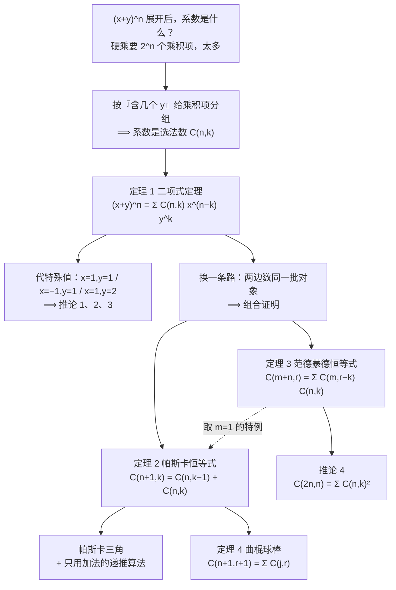

# C6.4 二项式系数与恒等式 Binomial Coefficients and Identities

> [!abstract] 这一讲的任务
> 上一讲把"从 $n$ 个里挑 $k$ 个"写成了一个记号 $\binom{n}{k}$。这一讲回答两个问题：**这个数为什么会在 $(x+y)^n$ 的展开里出现**（二项式定理），以及**它自己满足哪些关系**（帕斯卡恒等式、范德蒙德恒等式）。
> 但比结论更重要的是方法。这一讲第一次系统使用**组合证明**：不靠通分硬算，而靠"**等式两边数的是同一批对象**"。学会这套方法，你拿到一个从没见过的恒等式，也有一条能走的路；第 8 章的一大半计数都在用它。
> 一句话记住这一讲：**"算出来"和"讲出为什么"是两种本事**。三条推论我们都用两种办法各证一遍，就是为了让你亲眼看这两种本事的差别。

> [!info] 怎么读这份讲义
> 顺序建议：§0 开场 → §1–§3 二项式定理（**必须会背会用**）→ §4 三条推论 → §5 组合证明方法论（**这一讲的教学重点**，考试常考"用组合证明"这个要求）→ §6–§8 三条恒等式。
> 前置知识：$\binom{n}{k}$ 的记号与阶乘公式见 [[C6.3 排列与组合 Permutations and Combinations]]；求和记号 $\sum$ 与上下标的读法见 [[C2.4 序列与求和 Sequences and Summations]]；"把集合分成互斥的几类，逐类证明"是 [[C1.6 推理规则 Rules of Inference]] 里的分情况证明；构造两个集合之间的一一对应（双射）见 [[C2.3 函数 Functions]]。
> 本节的每个数值都已用程序复算；发现两处**原印的小问题**（推论 2 证明里 $(-1)$ 的指数位置、定理 4 证明收尾处的一个长度），都在对应位置点出来了，不影响结论。

---

## 0. 开场：一个不想动手乘的系数（p.415）

有人问你：**抛一枚均匀硬币 10 次，恰好出现 3 次正面的概率是多少？**

这个数好写。分母是"10 次抛掷一共有多少种等可能的正反序列"，分子是"10 次里恰好 3 次正面"的序列数：

$$\frac{\binom{10}{3}}{2^{10}}=\frac{120}{1024}\approx 0.1172$$

分母的 $1024=2^{10}$ 很好解释：每次抛掷两种结果，10 次就是 $2^{10}$，乘法原理一步到位。真正的疑问在分子：**120 这个数从哪来？**

想把它算出来，最朴素的办法是把 $(1+x)^{10}$ 硬展开：

$$(1+x)^{10}=\underbrace{(1+x)(1+x)\cdots(1+x)}_{10\ \text{个括号}}$$

每个括号要么贡献一个 $1$、要么贡献一个 $x$，所以乘开之后有 $2^{10}=1024$ 个乘积项——**这正是刚才那个分母**。$x^3$ 这一项，由"恰好 3 个括号贡献 $x$"的那些乘积项合并而来。数一数这样的乘积项有几个，就是 120。

可是怎么数？1024 项一个个挑太慢。而"10 个括号里选哪 3 个出 $x$"，正好是 [[C6.3 排列与组合 Permutations and Combinations]] 里的 3-组合：$\binom{10}{3}=120$。

**所以这里发生了一件很有意思的事**：我们一个乘法都没做，靠"数选法"就拿到了系数。这一讲要做的，就是把这件"用数数代替硬算"的事从 $n=10$ 推广到任意 $n$，再把它变成一套能反复使用的工具——**恒等式**。

> [!question] 停一下，先自己想想
> 同一个展开式 $(1+x)^{10}$ 里，$x^7$ 的系数是多少？$x^{10}$ 呢？$x^0$ 呢？
> 如果换成 $(1+x)^{100}$，$x^3$ 的系数又是多少？
>
> 先别算，用"选哪几个括号出 $x$"这句话想一遍。答案在 §3 末尾。

---

## 1. 二项式系数：这个名字的来历（p.415）

上一讲说过，$n$ 元集合的 $r$-组合数常记作 $\binom{n}{r}$，并且有公式

$$\binom{n}{r}=\frac{n!}{r!\,(n-r)!}=\frac{n(n-1)\cdots(n-r+1)}{r!}$$

但这个名字里藏着一句更要紧的话：**这个数也叫二项式系数 binomial coefficient，因为它恰好是一个二项式表达式的幂展开后的系数。** 所谓**二项式表达式 binomial expression**，就是两项之和，比如 $x+y$、$2x-3y$、$1+x$。此处我们只关心它的形式（两项的和），不关心每一项里有没有系数、有没有变量。

这句话本身就预告了整节的走向：

$$\binom{n}{r} \xrightarrow{\ \text{作为系数}\ } (x+y)^n \xrightarrow{\ \text{两边数同一个东西}\ } \text{一大串恒等式}$$

而且它还解释了**为什么这件事值得单独用一节讲**：一旦 $\binom{n}{r}$ 是某个幂展开的系数，那么"给 $x,y$ 代特殊值"就变成了一台**生产恒等式的机器**。§4 会把它开动三次。

> [!note] 记号约定（本节从头用到尾）
> 1. $\binom{n}{r}$ 只对整数 $n\ge 0$ 和 $0\le r\le n$ 定义。为了写 $\sum$ 里的边界项方便，我们有时会写 $\binom{a}{b}$ 而 $b>a$ 或 $b<0$——**约定它为 0**（"从 3 个东西里挑 5 个"确实一种办法都没有）。
> 2. 两个公认的边界值：$\binom{n}{0}=1$（只挑空集）、$\binom{n}{n}=1$（全都要）。
> 3. 对称性：$\binom{n}{r}=\binom{n}{n-r}$——"挑中的"和"没挑中的"一一对应，见 [[C6.3 排列与组合 Permutations and Combinations]]。

---

## 2. 二项式定理：先把 $(a+b)^3$ 的 8 个乘积项数清楚（p.415–416）

### 2.1 硬乘一遍，看清楚到底在数什么

**例 1（原书 EXAMPLE 1）**：$(a+b)^3$ 的展开，可以不靠硬乘、用组合推理直接得到。要看懂这件事，先看硬乘的过程里到底在数什么。

$$(a+b)^3=(a+b)(a+b)(a+b)$$

展开的规则是：**从每个括号里取一项，乘起来；把所有取法得到的结果加起来。** 三个括号各取一项，所以每一种取法给出一个三字母的乘积，比如 $aab$ 表示"第 1、2 个括号出 $a$，第 3 个出 $b$"。

这里有一个极容易被忽略、但整节都靠它撑着的点：**"第 1 个括号出的 $a$"和"第 2 个括号出的 $a$"是两个不同的东西**。所以 $aab$、$aba$、$baa$ 是三个**不同的乘积项**——它们的数值都等于 $a^2b$，但来源不同。

一共多少个乘积项？每个括号 2 选 1，三个括号分步进行，乘法原理（[[C6.1 计数基础 The Basics of Counting]]）给出 $2^3=8$ 个：

$$aaa,\quad aab,\quad aba,\quad abb,\quad baa,\quad bab,\quad bba,\quad bbb$$

**关键的一步来了：按"含几个 $b$"给这 8 项分组。** 为什么按这个分组？因为合并同类项时，只有 $b$ 的个数相同的项才能合并成同一项：

| 含 $b$ 的个数 $k$ | 有哪些项 | 项数 | 合并后 |
|:-:|---|:-:|---|
| 0 | $aaa$ | 1 | $a^3$ |
| 1 | $aab,\ aba,\ baa$ | 3 | $3a^2b$ |
| 2 | $abb,\ bab,\ bba$ | 3 | $3ab^2$ |
| 3 | $bbb$ | 1 | $b^3$ |

于是

$$(a+b)^3=a^3+3a^2b+3ab^2+b^3$$

再走慢一点，看一个"中途形态"（先把前两个括号乘开，再乘第三个）：

$$(a+b)^3=(aa+ab+ba+bb)(a+b)=aaa+aab+aba+abb+baa+bab+bba+bbb$$

注意括号里的 $aa+ab+ba+bb$——**$ab$ 和 $ba$ 故意没有提前合并**。一旦提前合并成 $2ab$，就看不见"来源不同"这件事，系数 2 就变成了一个凭空的数字。**先保留来源、最后再合并**，是这一节所有推理的心理动作。

![[C6.4-二项式系数从哪来.png]]

### 2.2 系数 $1,3,3,1$ 不是乘出来的，是数出来的

现在盯住上表最右边那列"项数"，问一句：**为什么是 $1,3,3,1$？**

- 含 0 个 $b$：三个括号全出 $a$，只有 1 种取法。$\binom{3}{0}=1$。
- 含 1 个 $b$：等价于"**从 3 个括号位置里选 1 个出 $b$**"。选法有 $\binom{3}{1}=3$ 种，对应 $b$ 在第 3 / 第 2 / 第 1 个括号里，也就是 $aab$、$aba$、$baa$。
- 含 2 个 $b$：从 3 个位置里选 2 个出 $b$，$\binom{3}{2}=3$ 种，对应位置集合 $\{2,3\}$、$\{1,3\}$、$\{1,2\}$，也就是 $abb$、$bab$、$bba$。
- 含 3 个 $b$：三个位置都出 $b$，1 种，$\binom{3}{3}=1$。

上面那张图把这件事画成了一条流水线：左边是"含几个 $b$"的分组，中间是每组的成员（并标出 $b$ 所在的位置集合），下面写着这一组的项数。你会看到 $\{3\},\{2\},\{1\}$ 恰好是 $\{1,2,3\}$ 的全部 1-元子集，$\{2,3\},\{1,3\},\{1,2\}$ 恰好是全部 2-元子集——**"系数"就是"子集的个数"**。

$$\boxed{1,3,3,1=\binom{3}{0},\binom{3}{1},\binom{3}{2},\binom{3}{3}}$$

### 2.3 从 3 推广到任意 $n$：二项式定理

把 3 换成 $n$（字母从 $a,b$ 改成 $x,y$，只是换个名字），上面每一句话都原封不动地成立：

$$(x+y)^n=\underbrace{(x+y)(x+y)\cdots(x+y)}_{n\ \text{个括号}}$$

展开后每个乘积项"从 $n$ 个括号里挑 $j$ 个出 $y$、其余出 $x$"，得到 $x^{n-j}y^j$。含 $j$ 个 $y$ 的乘积项个数 $=$ 从 $n$ 个位置里挑 $j$ 个 $=\binom{n}{j}$。把它们加起来：

> [!important] 定理 1（二项式定理 The Binomial Theorem）
> 设 $x,y$ 是变量，$n$ 是非负整数。则
> $$(x+y)^n=\sum_{j=0}^{n}\binom{n}{j}x^{n-j}y^{j}=\binom{n}{0}x^{n}+\binom{n}{1}x^{n-1}y+\cdots+\binom{n}{n-1}xy^{n-1}+\binom{n}{n}y^{n}$$

**逐符号拆解**：

- $j$ 既是"出 $y$ 的括号个数"，也是 $y$ 的指数。$x$ 的指数是 $n-j$，两者之和恒为 $n$——这是"每个括号只出一个字母"留下的记账痕迹。**"指数之和 $=n$"是这一节最好用的自检。**
- $\binom{n}{j}$ 是"哪 $j$ 个括号出 $y$"的选法数。它只跟 $j$ 有关，跟 $x,y$ 具体是什么无关。所以叫二项式**系数**。
- 求和从 $j=0$ 到 $j=n$：$j$ 取遍所有可能的"出 $y$ 的个数"，共 $n+1$ 类。而展开前有 $2^n$ 个乘积项，一个都没丢。**所以 $\sum_{j=0}^{n}\binom{n}{j}$ 必须等于 $2^n$**——这就是 §4 的推论 1，现在它已经是我们账本上的必然结果，不是巧合。

**证明（组合证明）**：固定 $j\in\{0,1,\dots,n\}$。展开时，形如 $x^{n-j}y^j$ 的项只能来自"恰好 $j$ 个括号出 $y$、其余 $n-j$ 个出 $x$"的乘积项。要造出这样一个乘积项，只需要**指定哪 $j$ 个括号出 $y$**——剩下的位置自动出 $x$，没有别的选择。$n$ 个位置里选 $j$ 个，有 $\binom{n}{j}$ 种选法，所以合并同类项后 $x^{n-j}y^j$ 的系数就是 $\binom{n}{j}$。每个 $j$ 都成立，全部相加即得定理。$\blacksquare$

（换个做法：先指定"哪 $n-j$ 个括号出 $x$"，系数先写成 $\binom{n}{n-j}$，再用对称性 $\binom{n}{n-j}=\binom{n}{j}$ 换成 $\binom{n}{j}$。两条路完全一样——先指定"出 $x$ 的位置"和先指定"出 $y$ 的位置"，是同一件事的两面。）

**先在 $n=1,2$ 上验一遍**（把边界的形状看清楚）：

$$(x+y)^1=\binom{1}{0}x+\binom{1}{1}y=x+y\ \checkmark$$
$$(x+y)^2=\binom{2}{0}x^2+\binom{2}{1}xy+\binom{2}{2}y^2=x^2+2xy+y^2\ \checkmark$$

$n=2$ 时那个 $2$ 是怎么来的？展开前的 4 个乘积项是 $xx,xy,yx,yy$，其中 $xy$ 和 $yx$ 来源不同、合并成 $2xy$。**系数 2 不是"乘出来的 2"，是"两个来源"的 2。**

> [!warning] 四个易错点
> 1. $\binom{n}{j}$ 是**组合数**，不是 $\frac{n}{j}$，也不是整除。写成"$n$ 选 $j$"再算。
> 2. 定理写成 $x^{n-j}y^j$，但**写成 $\binom{n}{j}x^{j}y^{n-j}$ 同样是正确的**（两种顺序都允许）。判断标准只有一条：**$x$ 的指数、$y$ 的指数、组合数的下标，三者必须配套**。最稳的记法：组合数下标 $=$ $y$ 的指数。
> 3. $n=0$ 时定理给出 $(x+y)^0=1=\binom{0}{0}x^0y^0$，也成立。
> 4. 定理默认我们做的是普通整数（或实数、复数）运算，所以"同类项可以合并成 $3a^2b$"。如果你改成模 2 运算（$1+1=0$），$3a^2b$ 会塌成 $a^2b$，整个定理的形状就变了。**这一点在编码与多项式校验里是真的会被用到**（第 8 章之后）。

### 2.4 回头看这一段

我们刚才干了一件很具体的事：把 $(a+b)^3$ 的 **8 个乘积项**写全，按"含几个 $b$"分成 **4 组**，发现组的大小是 $1,3,3,1$，而这三个数是 $\binom{3}{k}$。然后把"3 个括号"换成"$n$ 个括号"，每一步都不需要新想法，就得到了定理 1。

所以定理 1 不是一条需要背的公式，而是一句**可以随时重新推一遍的话**：*$(x+y)^n$ 的系数，就是"挑哪几个括号出 $y$"的选法数。*

---

## 3. 定理 1 的三个用法（p.416–417）

定理 1 到手之后，拿三道题（例 2–例 4）练手，难度递增：第一道把系数摆出来，第二道从展开式里**取**一个系数，第三道在二项式前面加了系数和负号。

> [!example] 例 2（原书 EXAMPLE 2）：求 $(x+y)^4$ 的展开式
> 直接把定理 1 代 $n=4$：
> $$(x+y)^4=\sum_{j=0}^{4}\binom{4}{j}x^{4-j}y^j=\binom{4}{0}x^4+\binom{4}{1}x^3y+\binom{4}{2}x^2y^2+\binom{4}{3}xy^3+\binom{4}{4}y^4$$
> $$=x^4+4x^3y+6x^2y^2+4xy^3+y^4$$
> **两步验算**：
> - 系数 $\binom{4}{0},\dots,\binom{4}{4}=1,4,6,4,1$（已复算）。也可以在帕斯卡三角（§6）第 4 行直接读出来。
> - 系数之和 $1+4+6+4+1=16=2^4$，正好等于展开前的乘积项个数 $2^4$。**"系数的和 $=2^n$"是一个三十秒就能做完的验算，几乎每次都能抓出抄错的系数。**

> [!example] 例 3（原书 EXAMPLE 3）：求 $(x+y)^{25}$ 中 $x^{12}y^{13}$ 的系数
> 先对指数：$y$ 的指数是 13，所以 $j=13$；此时 $x$ 的指数是 $25-13=12$ ✓。两个指数加起来 $=25=n$ ✓，说明这一项确实存在。
> 由定理 1，系数就是
> $$\binom{25}{13}=\frac{25!}{13!\,12!}=5{,}200{,}300$$
> **不用算 $25!$ 的手算路径**：分子分母约掉 $13!$，剩下
> $$\binom{25}{13}=\frac{25\cdot24\cdot23\cdots14}{12!}=\frac{2{,}490{,}952{,}020{,}480{,}000}{479{,}001{,}600}=5{,}200{,}300$$
> （分子从 25 乘到 14 恰好 12 个因子，与分母的 $12!$ 相抵；整个分数是个整数。）
> **复算**：直接算 $\frac{25!}{13!\,12!}$ 与走上面这条约分路径，两条路都给 $5{,}200{,}300$，与印出的数值一致。顺便验证对称性：$\binom{25}{13}=\binom{25}{12}=5{,}200{,}300$。

> [!example] 例 4（原书 EXAMPLE 4）：求 $(2x-3y)^{25}$ 中 $x^{12}y^{13}$ 的系数
> **第一步：把减法变成加法。** 定理 1 要求括号里是"两项之和"，所以先改写
> $$(2x-3y)^{25}=\bigl(2x+(-3y)\bigr)^{25}=\sum_{j=0}^{25}\binom{25}{j}(2x)^{25-j}(-3y)^{j}$$
> **第二步：定 $j$。** 要 $y^{13}$，取 $j=13$；此时 $x$ 的指数是 $25-13=12$ ✓。
> $$\text{系数}=\binom{25}{13}(2x)^{12}(-3y)^{13}\Big/\bigl(x^{12}y^{13}\bigr)=\binom{25}{13}\,2^{12}\,(-3)^{13}=-\binom{25}{13}\,2^{12}\,3^{13}=-\frac{25!}{13!\,12!}\,2^{12}3^{13}$$
> **第三步：算数值。** $2^{12}=4096$、$3^{13}=1{,}594{,}323$，所以
> $$\binom{25}{13}\,2^{12}\,3^{13}=5{,}200{,}300\times4096\times1{,}594{,}323=33{,}959{,}763{,}545{,}702{,}400$$
> 取负号：$-33{,}959{,}763{,}545{,}702{,}400$。（已复算，与印出的表达式 $-\frac{25!}{13!12!}2^{12}3^{13}$ 一致。）
>
> **这道题要讲透的三件事**：
> 1. **系数被拆成了三份相乘**：$\binom{25}{13}$ 负责"挑哪 13 个括号出 $-3y$"，每一个这样的括号贡献一个 $-3$，所以 $-3$ 要乘 13 次；剩下 12 个括号各出一个 $2x$，所以 $2$ 要乘 12 次。**$(2x-3y)^{25}$ 里 $x^{12}y^{13}$ 的系数绝不是 $\binom{25}{13}$**——这是最常见的错法。
> 2. **符号来自"负号乘了几次"**：13 是奇数，所以整体为负。
> 3. **先对指数，再动笔**。如果两个指数加起来不等于 $n$，这项根本不存在，系数是 0，不必算。

> [!note] 顺带回收：为什么这里不能直接查帕斯卡三角
> 帕斯卡三角给的永远是 $(x+y)^n$ 的系数（$x,y$ 前面系数都是 1）。一旦写成 $(2x-3y)^n$，三角只提供了"哪 13 个括号"这一部分，另外两部分的因子 $2^{12}$、$3^{13}$ 得自己补。**三角管"挑几个"，系数管"每个括号里是什么"。**

> [!note] 回收开场那个问题
> - $(1+x)^{10}$ 中：$x^7$ 的系数是 $\binom{10}{7}=120$（和 $x^3$ 一样，因为 $\binom{10}{7}=\binom{10}{3}$）；$x^{10}$ 的系数是 $\binom{10}{10}=1$；$x^0$（常数项）的系数是 $\binom{10}{0}=1$。三项相加之外还有 8 项，全部加起来是 $2^{10}=1024$。
> - $(1+x)^{100}$ 中 $x^3$ 的系数是 $\binom{100}{3}=\frac{100\cdot99\cdot98}{6}=161{,}700$（已复算）。
> - $(1+x)^{25}$ 中 $x^{12}y^{13}$ 那个数 $5{,}200{,}300$，如果把 $x$ 和 $y$ 的指数对调，系数不变——**指数对调对应"挑中的集合"和"没挑中的集合"对调**，这就是对称性 $\binom{n}{r}=\binom{n}{n-r}$。

---

## 4. 三条推论：代值算一遍，再数一遍（p.417–418）

现在把定理 1 当机器用。它的燃料是：**定理 1 是一个对一切 $x,y$ 都成立的恒等式**，所以你可以往里面代任意的特殊值，每代一组就得到一条只含二项式系数的新等式。

这一点值得先用一句话说清楚，因为很多人以为"代特殊值"是取巧：**只有当等式对一切 $x,y$ 成立时，代特殊值才合法**。而我们手里的正是多项式恒等式，所以合法。这也解释了为什么"代入法"只对恒等式有效，对一般的方程无效——解方程时往两边代一个数，你得到的只是"这个数是一个解"，不是一条新恒等式。

### 4.1 推论 1：$\sum_{k=0}^{n}\binom{n}{k}=2^n$

> [!important] 推论 1
> 设 $n$ 是非负整数，则 $\displaystyle\sum_{k=0}^{n}\binom{n}{k}=2^n$。

**证明一（代入赋值）**：在定理 1 里取 $x=1$、$y=1$：

$$2^n=(1+1)^n=\sum_{k=0}^{n}\binom{n}{k}1^{n-k}1^{k}=\sum_{k=0}^{n}\binom{n}{k}$$

因为 $1$ 的任何次幂都是 $1$，右边只剩组合数相加。$\blacksquare$

**证明二（组合计数）**：两边都在数**同一个东西——$n$ 元集合 $S$ 的全部子集**。

- 左边：按子集大小分类。大小为 $k$ 的子集有 $\binom{n}{k}$ 个（$k=0,1,\dots,n$），加起来就是全部子集。
- 右边：换个方式数同一批子集。$S$ 的每个元素都有两种命运——**被选进子集**或**不被选进**。$n$ 个元素分步决定，乘法原理给出 $2^n$ 种。

两种数法数的是同一批子集，所以两个表达式相等。$\blacksquare$

**手算验证**：$n=4$ 时 $1+4+6+4+1=16=2^4$ ✓；$n=6$ 时 $1+6+15+20+15+6+1=64=2^6$ ✓。

**回收开场**：抛 10 次硬币的分母 $2^{10}=1024$ 就是这条推论——10 次抛掷的全体结果，恰好对应 10 元集合的全部子集（第 $i$ 次是正面 $\iff$ 第 $i$ 个元素被选中）。

### 4.2 推论 2：$\sum_{k=0}^{n}(-1)^k\binom{n}{k}=0$，即奇数项和 = 偶数项和

> [!important] 推论 2
> 设 $n$ 是**正整数**，则 $\displaystyle\sum_{k=0}^{n}(-1)^k\binom{n}{k}=0$。
>
> **Remark**：这条推论等价于
> $$\binom{n}{0}+\binom{n}{2}+\binom{n}{4}+\cdots=\binom{n}{1}+\binom{n}{3}+\binom{n}{5}+\cdots$$
> 也就是**偶数大小的子集和奇数大小的子集一样多**。

**为什么要求 $n$ 是正整数**：定理 1 的代值是 $0^n=((-1)+1)^n$。$n\ge1$ 时 $0^n=0$；而 $n=0$ 时 $0^0$ 按约定是 1，等式就不成立了。**边界值不是装饰，它决定条件怎么写。**

**证明一（代入赋值）**：在定理 1 里取 $x=-1$、$y=1$：

$$0=0^n=\bigl((-1)+1\bigr)^n=\sum_{k=0}^{n}\binom{n}{k}(-1)^{n-k}1^{k}=\sum_{k=0}^{n}\binom{n}{k}(-1)^{n-k}$$

把 $(-1)^{n-k}$ 换成 $(-1)^{k}$：两者只差一个整体因子 $(-1)^n$，而右边是 0，乘任何常数还是 0。于是

$$0=\sum_{k=0}^{n}(-1)^{k}\binom{n}{k}.\qquad\blacksquare$$

（**原印这里把 $(-1)$ 的指数写在了 $y$ 那一侧**：它写成 $\sum_k\binom{n}{k}(-1)^k1^{n-k}$。按 $x=-1,y=1$ 的正确展开应该是 $(-1)^{n-k}$。两种写法在 $n\ge1$ 时都等于 0，结论不受影响；但如果照着原印去检查 $n=1$ 的每一项，会得到一个整体差一个负号的中间过程。）

**证明二（组合计数：把奇偶子集配对）**：推论 1 的组合证明是主线，这一条和推论 3 的组合证明按通行讲法补全——正好用来把 §5 的方法多演示两遍。

固定 $S$ 中的一个元素 $a$。定义

$$A\ \longmapsto\ A\triangle\{a\}=\begin{cases}A-\{a\}, & a\in A\\ A\cup\{a\}, & a\notin A\end{cases}$$

也就是"**$a$ 在里面就删掉，不在就加进去**"。

- 这个操作把子集的大小**恰好改变 1**：原来是 $k$ 就变成 $k+1$，原来是 $k+1$ 就变回 $k$。所以它把**偶数大小的子集**和**奇数大小的子集**一一配成对（两两配对，谁也不落单）。
- 既然配成了对，两边数量必然相等。而总数是 $2^n$（推论 1），所以各占一半：

$$\binom{n}{0}+\binom{n}{2}+\binom{n}{4}+\cdots=\binom{n}{1}+\binom{n}{3}+\binom{n}{5}+\cdots=2^{n-1}\quad(n\ge1)$$

两个和相减，就是 $\sum_k(-1)^k\binom{n}{k}=0$。$\blacksquare$

**手算验证**：$n=3$ 时偶数项 $\binom{3}{0}+\binom{3}{2}=1+3=4$，奇数项 $\binom{3}{1}+\binom{3}{3}=3+1=4$，各是 $2^{2}=4$ ✓。$n=7$ 时各是 $2^{6}=64$，交错和为 0 ✓。

**这个配对法的价值**：它完全没有碰阶乘，也没有代任何值。它告诉你的是一个**结构上的事实**——"换成 $n$ 元集合，偶子集和奇子集一样多"，而不是"某个算式的结果是 0"。

### 4.3 推论 3：$\sum_{k=0}^{n}2^k\binom{n}{k}=3^n$

> [!important] 推论 3
> 设 $n$ 是非负整数，则 $\displaystyle\sum_{k=0}^{n}2^{k}\binom{n}{k}=3^{n}$。

**证明一（代入赋值）**：这次要凑出 $2^k$，所以取 $x=1$、$y=2$（$y$ 的指数是 $k$，正好配 $\binom{n}{k}$ 的下标）：

$$(1+2)^n=\sum_{k=0}^{n}\binom{n}{k}1^{n-k}2^{k}=\sum_{k=0}^{n}\binom{n}{k}2^{k}\ \Longrightarrow\ 3^n=\sum_{k=0}^{n}2^{k}\binom{n}{k}.\qquad\blacksquare$$

**证明二（组合计数）**：数**"嵌套对"**——满足 $A\subseteq B\subseteq S$ 的有序对 $(A,B)$，其中 $S$ 有 $n$ 个元素。

- **数法一（按元素决定，一口气数完）**：$S$ 的每个元素都有三种身份：**既不在 $B$ 也不在 $A$**、**在 $B$ 但不在 $A$**、**$A,B$ 都在**。（为什么只有三种？因为 $A\subseteq B$ 排除了"在 $A$ 不在 $B$"。）$n$ 个元素各自独立地三选一，乘法原理给出 $3^n$ 种。
- **数法二（按 $B$ 的大小分类）**：设 $|B|=k$。先从 $S$ 里挑出 $B$，有 $\binom{n}{k}$ 种；再从 $B$ 里挑出 $A$（$A$ 必须是 $B$ 的子集），有 $2^{k}$ 种。分步用乘法原理，这一类贡献 $\binom{n}{k}2^{k}$ 种。$k$ 取遍 $0,\dots,n$ 且各类互斥，总数是 $\sum_{k=0}^{n}\binom{n}{k}2^{k}$。

两边数的是同一批嵌套对，所以相等。$\blacksquare$

**手算验证**：$n=3$ 时 $\binom{3}{0}2^0+\binom{3}{1}2^1+\binom{3}{2}2^2+\binom{3}{3}2^3=1+6+12+8=27=3^3$ ✓。$n=5$ 时和为 $243=3^5$ ✓。

> [!note] 代值法的"配方"是怎么想出来的
> 三条推论用的是同一个动作：**先看左边缺什么因子，再反推 $x,y$ 该取什么**。
>
> | 想得到 | 需要 $\binom{n}{k}$ 配上 | 取 $x,y$ |
> |---|---|---|
> | $2^n$ | 什么都不配 | $x=1,y=1$ |
> | $0$ | $(-1)^k$ | $x=-1,y=1$ |
> | $3^n$ | $2^{k}$ | $x=1,y=2$ |
>
> 因为定理 1 里 $y$ 的指数恰好是 $\binom{n}{j}$ 的下标 $j$，所以**"想让组合数配上一个因子 $c^k$，就取 $y=c$"**。推论 3 里的 $3^n$ 是结果不是输入——$3$ 是 $1+2$ 算出来的。

### 4.4 停一下，我们刚才干了什么

三条推论，每条都给了两种证明。把这两种本事摆在一起看，差别就很清楚了：

| | 代入赋值 | 组合计数 |
|---|---|---|
| **要写多少** | 一到两行 | 要构造对象、要分类、要论证不重不漏 |
| **它告诉你什么** | 这条等式**对** | 这条等式**为什么对** |
| **能不能推广** | 不能。代一次值只验一条已知的等式 | 能。换一批被数的对象，就是一条新的恒等式 |
| **出错的方式** | 代数变形算错（比较容易查出来） | 分类重复或遗漏（很隐蔽，而且不报错） |
| **适合什么时候用** | 考试里快速推导、验算 | 想真正理解、想记住、想自己发现新恒等式 |

**这一讲的立场**：两种都要会。**代值法是你的草稿纸，组合证明是你的理解。** 很多时候先用代值法猜出等式长什么样，再去找它的组合意义——§5 讲的就是"怎么找"。

---

## 5. 组合证明：怎么才能想到"两边数同一个东西"（p.412、p.416）

### 5.1 组合证明到底是什么

这个词上一讲已经出现过，而且被立成了一条定义：

> [!important] 定义 1（组合证明 Combinatorial Proof，见 [[C6.3 排列与组合 Permutations and Combinations]]）
> 一个恒等式的**组合证明**，是指：用计数论证说明**等式两边数的是同一批对象，只是数法不同**；或者说明**两边所数的对象集合之间存在一个双射**。这两类证明分别叫做**双计数证明 double counting proof** 和**双射证明 bijective proof**。

所以组合证明不是"另一种算得更快的算法"，它是**换一个提问方式**：

- 代数证明问的是："这两个式子的值是否相等？" —— 靠变形。
- 组合证明问的是："这两个式子分别在数什么？" —— 靠把两边翻译成同一批对象。

顺便说清两类证明的差别，因为写作业时经常要你点名用哪一种：

| | 双计数 | 双射 |
|---|---|---|
| 被数的对象 | **一批**对象，两种数法 | **两批**不同的对象，构造一一对应 |
| 本节的例子 | 推论 1（$S$ 的子集：按大小分类 / 按元素选不选） | 推论 2（偶子集 ↔ 奇子集，靠"翻转元素 $a$"配对） |
| 结束语 | "两种数法数的是同一批对象" | "两边一一配对，所以数量相等" |

两者常常是同一件事的两种说法。**选一种，说清楚，不要含糊过去。**

### 5.2 四步套路

拿到一个形如"**左边 $=$ 右边**"的恒等式，想用组合证明，按这四步走：

**第 1 步：把两边的符号翻译成中文句子。** 这是全部技术含量所在。$\binom{n}{k}$ 一律读成"从 $n$ 个东西里挑 $k$ 个的方法数"。翻译完你就知道大概该找一个什么样的对象集。

**第 2 步：让两句话数的是同一批对象。** 通常的分工是：
- **左边 = 直接数**：一口气把对象数完。
- **右边 = 分类数**：按某个特征把对象分成互斥的几类，每类内部用乘法原理算，最后相加。

所以看到一个求和号 $\sum_k$，先别急着看求和项，先问：**右边是在按什么特征分类？** 求和变量 $k$ 几乎总是那个特征（"挑了 $k$ 个"、"最后一个 1 在第 $k$ 位"、"从乙堆挑了 $k$ 个"）。

**第 3 步：检查分类"不重不漏"。** 每一类互斥（一个对象只能属于一类）、合起来覆盖全部（没有对象被漏掉）。这一步是 [[C1.6 推理规则 Rules of Inference]] 里的分情况证明；而"一类内部的分步"由乘法原理负责（[[C6.1 计数基础 The Basics of Counting]]）。**组合证明最危险的错误就在这一步**——分类重叠时你会把某些对象数两遍，而且往往察觉不到，因为最后仍然得出一个数。

**第 4 步：收尾永远是同一句。** "两边数的是同一批对象，所以相等。$\blacksquare$" 别看它像套话——**它正是整个证明的落点**。不写这一句，读者无法判断你把两边都翻译对了没有。

### 5.3 速查：形状 → 它在数什么

这张表是上面第 1 步的"词典"，值得抄在笔记第一页。看到右边的形状就往左边的读法上猜：

| 你看到 | 先猜它在数什么 |
|---|---|
| $\binom{n}{k}$ | 从 $n$ 个里挑 $k$ 个 |
| $\binom{n}{k-1}+\binom{n}{k}$ | 把 $k$ 元子集按"**含不含某个指定元素**"分成两类 |
| $\sum_{k}\binom{n}{k}$ | 按子集大小分类，数出**所有**子集 |
| $\sum_{k}(-1)^{k}\binom{n}{k}$ | 子集按大小贴正负号；或把奇偶子集配对 |
| $\binom{n}{k}\binom{m}{r-k}$ | 先从乙堆挑 $k$ 个、再从甲堆挑 $r-k$ 个（**分步，乘法原理**） |
| $\binom{n}{k}^{2}$ | 从**两堆各 $n$ 个**里各挑 $k$ 个 |
| $2^{k}$ | $k$ 个东西，每个两种选择 |
| $3^{n}$ | $n$ 个东西，每个三种选择 |
| $\binom{m+n}{r}$ | 从两堆合起来挑 $r$ 个 |
| $\binom{2n}{n}$ | 从两堆共 $2n$ 个里挑 $n$ 个 |
| $\sum_{j=r}^{n}\binom{j}{r}$ | 按某个"**最后位置**"（或"最大元素"）分类 |

### 5.4 反过来的一句话

如果一个恒等式你**只能靠通分硬算**出来，通常说明你还没看出它在数什么。硬算不算错——推论 2 的代数证明只用了三行——但它**记不住、推不广、也看不出来什么时候能用**。§6 的帕斯卡恒等式我们两种证法都写，你可以自己感受一下差别：代数证法里全是阶乘和分式，组合证法里只有"**含 $a$ 的**和**不含 $a$ 的**"这两句话。

---

## 6. 帕斯卡恒等式与帕斯卡三角（p.418–419）

### 6.1 一条不含 $x,y$ 的恒等式

到目前为止我们造的恒等式都是"给定理 1 代值"的产物。但二项式系数自己还有一类恒等式，**跟 $x,y$ 完全无关**，纯粹是"选法数之间的关系"。第一条也是最重要的一条：

> [!important] 定理 2（帕斯卡恒等式 Pascal's Identity）
> 设 $n,k$ 是正整数且 $n\ge k$，则
> $$\binom{n+1}{k}=\binom{n}{k-1}+\binom{n}{k}$$

> [!question] 停一下，先自己想想
> 先别急着看证明。按 §5.3 的词典读一遍：左边是"从 $n+1$ 个里挑 $k$ 个"；右边的形状 $\binom{n}{k-1}+\binom{n}{k}$ 在那张表里对着一句什么话？
> 想清这一句，证明就只剩把细节写完。

**证明（组合证明）**：设 $T$ 是一个含 $n+1$ 个元素的集合，从里面**指定一个元素 $a$**，并令 $S=T-\{a\}$（于是 $|S|=n$）。

$T$ 的 $k$ 元子集一共有 $\binom{n+1}{k}$ 个。现在按**含不含 $a$** 把它们分成两类：

1. **含 $a$ 的 $k$ 元子集**：既然 $a$ 已经在里面了，剩下 $k-1$ 个元素必须从 $S$ 里挑。有 $\binom{n}{k-1}$ 个。
2. **不含 $a$ 的 $k$ 元子集**：$k$ 个元素全部从 $S$ 里挑。有 $\binom{n}{k}$ 个。

每一个 $k$ 元子集要么含 $a$、要么不含 $a$，没有第三种可能（**不重不漏**），所以

$$\binom{n+1}{k}=\binom{n}{k-1}+\binom{n}{k}.\qquad\blacksquare$$

**手算验证**：取 $n=6,k=5$，左边 $\binom{7}{5}=21$，右边 $\binom{6}{4}+\binom{6}{5}=15+6=21$ ✓。取 $n=6,k=3$，左边 $\binom{7}{3}=35$，右边 $\binom{6}{2}+\binom{6}{3}=15+20=35$ ✓。

**这条证明好在哪**：整个证明里**乘法、除法、阶乘一个都没出现**，只有加法。下面 §6.3 那条 Remark 就是靠这个吃饭的。

### 6.2 另一种证法：通分硬算（对照用）

这条恒等式也可以完全不提"分类"，直接用 $\binom{n}{r}$ 的公式做代数变形。把它写全，是为了让你看清两种证明的差别：

$$\binom{n}{k-1}+\binom{n}{k}=\frac{n!}{(k-1)!\,(n-k+1)!}+\frac{n!}{k!\,(n-k)!}$$

两项通分到公共分母 $k!\,(n-k+1)!$（第一项上下乘 $k$，第二项上下乘 $n-k+1$）：

$$=\frac{n!\cdot k}{k!\,(n-k+1)!}+\frac{n!\cdot(n-k+1)}{k!\,(n-k+1)!}=\frac{n!\,\bigl(k+n-k+1\bigr)}{k!\,(n-k+1)!}=\frac{n!\,(n+1)}{k!\,(n-k+1)!}$$

而 $n!\,(n+1)=(n+1)!$、$k!\,(n-k+1)!=k!\,\bigl((n+1)-k\bigr)!$，所以

$$=\frac{(n+1)!}{k!\,\bigl((n+1)-k\bigr)!}=\binom{n+1}{k}\ \checkmark$$

**结论对，但它没有告诉你"为什么"。** 你跟着算完了，却不知道 $n+1$ 是从哪里冒出来的（答案是"分两类"那个 $a$）。这就是 §5.4 那句话的意思：硬算得到答案，得不到理解。

### 6.3 帕斯卡恒等式可以拿来"定义"二项式系数

> [!important] 递推定义
> 帕斯卡恒等式，加上初值条件 $\binom{n}{0}=\binom{n}{n}=1$（对一切整数 $n$），可以**递归地定义**二项式系数：
> $$\binom{n}{0}=1,\qquad \binom{n}{n}=1,\qquad \binom{n+1}{k}=\binom{n}{k-1}+\binom{n}{k}\quad(1\le k\le n)$$

**为什么这件事重要**：这不是"换一种写法"，而是换了一种**算法**。

- 用阶乘公式算 $\binom{25}{13}$，你得先造出 $25!=15{,}511{,}210{,}043{,}330{,}985{,}984{,}000{,}000$（一个 26 位的整数），再做两次大数除法。
- 用递推定义，从第 0 行往上填，每一步只要**把两个已经算出来的数加起来**。填到第 $n$ 行的第 $k$ 列，总工作量是 $O(nk)$ 次加法。

这就是一张**动态规划表**：行是 $n$、列是 $k$，每个格子由左上和正上两个格子相加得到。

$$\begin{array}{c|cccccc}
n\backslash k & 0&1&2&3&4&5\\\hline
0 & 1\\
1 & 1&1\\
2 & 1&2&1\\
3 & 1&3&3&1\\
4 & 1&4&6&4&1\\
5 & 1&5&10&10&5&1
\end{array}$$

读法：$n=5,k=2$ 那一格 $10$，来自 $n=4$ 行的 $4$（左上）与 $6$（正上）——$4+6=10$ ✓。

> [!note] 一个实际的好处
> 递推只做加法，意味着**不会出现中间结果爆炸**。用阶乘公式时，$n=30$ 就已经出现 33 位的中间量；而递推路径上的每个格子都直接是最终答案。这也是为什么在写程序算组合数（或算二项分布 / 贝叶斯更新里的组合系数）时，普遍用递推或乘法递推 $\binom{n}{k}=\binom{n}{k-1}\cdot\frac{n-k+1}{k}$，而不是硬套阶乘。

### 6.4 帕斯卡三角

把递推摆在平面上，就得到一张全部由加法生成的数表。**第 $n$ 行**（从第 0 行起数）依次是

$$\binom{n}{k},\qquad k=0,1,\dots,n$$

这张表叫**帕斯卡三角 Pascal's triangle**。帕斯卡恒等式在里面的几何含义一句话就能说完：**相邻两个数相加，得到下一行夹在它们中间的那个数。**

![[C6.4-帕斯卡三角形.png]]

图中高亮的三格就是帕斯卡恒等式的一个实例：第 6 行的 $\binom{6}{4}=15$ 与 $\binom{6}{5}=6$ 相加，得到第 7 行的 $\binom{7}{5}=21$。两条箭头画的正是"肩上两数之和"这个动作。每一格下面标着它的名字 $\binom{n}{k}$，方框里是它的值，所以这张图同时是"数表"和"记号表"。

从图上还顺手能读出来几件事：

- **每行左右对称**：$\binom{n}{k}=\binom{n}{n-k}$，这是 [[C6.3 排列与组合 Permutations and Combinations]] 的推论 2 在数表上的样子。
- **每行和为 $2^n$**（推论 1）：第 6 行 $1+6+15+20+15+6+1=64=2^6$，第 7 行和为 $128=2^7$（已复算）。
- **第 3 列（$k=2$）是三角数**：$1,3,6,10,15,21,28,\dots$，即 $\binom{n}{2}=\frac{n(n-1)}{2}=1+2+\cdots+(n-1)$。几何上，$\binom{n}{2}$ 数的是"$n$ 个点两两连线"的条数；把第 $n$ 个点与前 $n-1$ 个点连线，就得到那个"前 $n-1$ 个正整数之和"（序列的知识见 [[C2.4 序列与求和 Sequences and Summations]]）。

> [!note] 名字的来历
> 这个三角并不是帕斯卡最早发现的——中国、波斯、印度的数学家在更早的世纪里都记录过它（中文文献里通常叫**杨辉三角**）。名字的归属是历史问题；帕斯卡真正的贡献是把它与**递推关系**、以及后来的概率论绑在了一起。
> **布莱兹·帕斯卡（Blaise Pascal，1623–1662）**：16 岁就在圆锥曲线上做出重要结果，18 岁设计并出售了一台计算器；后来与费马一起奠定概率论的基础——1654 年两人关于"点数分配问题"的通信是概率论的起点，用的工具正是二项式系数。1654 年之后他转向神学，只偶尔回到数学。

---

## 7. 范德蒙德恒等式与推论 4（p.420）

帕斯卡恒等式管的是"从 $n+1$ 个里挑"。下一条恒等式管的是另一种情形：**物件分成两堆，我们从两堆里合起来挑。**

> [!important] 定理 3（范德蒙德恒等式 Vandermonde's Identity）
> 设 $m,n,r$ 是非负整数，且 $r$ 不超过 $m$ 与 $n$ 中的任何一个（即 $r\le\min(m,n)$），则
> $$\binom{m+n}{r}=\sum_{k=0}^{r}\binom{m}{r-k}\binom{n}{k}$$

> [!question] 停一下，先自己想想
> 左边是"从 $m+n$ 个里挑 $r$ 个"。右边这个求和里，$\binom{n}{k}\binom{m}{r-k}$ 按 §5.3 的词典该读成什么？求和变量 $k$ 又是在按什么特征分类？

**证明（组合证明）**：设**甲堆有 $m$ 个物件、乙堆有 $n$ 个物件**，两堆不重叠（这是一个划分），合起来共 $m+n$ 个。我们要从这 $m+n$ 个里挑出 $r$ 个。

- **数法一（直接数）**：从 $m+n$ 个里挑 $r$ 个，有 $\binom{m+n}{r}$ 种。
- **数法二（按"从乙堆挑了几个"分类）**：设挑中的 $r$ 个里，有 $k$ 个来自乙堆，那么 $k$ 只能是 $0,1,\dots,r$。对于固定的 $k$：选哪 $k$ 个来自乙堆，有 $\binom{n}{k}$ 种；剩下的 $r-k$ 个必须全部来自甲堆，有 $\binom{m}{r-k}$ 种。这一步是**分步**的，乘法原理给出 $\binom{n}{k}\binom{m}{r-k}$ 种。不同的 $k$ 给出的挑法**互斥**（挑中的乙堆元素个数是唯一的），而 $k$ 取遍 $0,\dots,r$ **覆盖全部**（不可能挑出更多或更少）。所以总数是 $\sum_{k=0}^{r}\binom{m}{r-k}\binom{n}{k}$。

两边数的是同一批"从两堆里挑 $r$ 个"的挑法，故相等。$\blacksquare$

**手算验证**（取 $m=4,n=5,r=6$）：左边 $\binom{9}{6}=84$。右边逐项算：

| $k$ | $\binom{m}{r-k}\binom{n}{k}$ | 值 |
|:-:|---|---:|
| 0 | $\binom{4}{6}\binom{5}{0}$ | $0$（约定 $\binom{4}{6}=0$） |
| 1 | $\binom{4}{5}\binom{5}{1}$ | $0$ |
| 2 | $\binom{4}{4}\binom{5}{2}=1\times10$ | $10$ |
| 3 | $\binom{4}{3}\binom{5}{3}=4\times10$ | $40$ |
| 4 | $\binom{4}{2}\binom{5}{4}=6\times5$ | $30$ |
| 5 | $\binom{4}{1}\binom{5}{5}=4\times1$ | $4$ |
| 6 | $\binom{4}{0}\binom{5}{6}$ | $0$ |
| | **合计** | $\mathbf{84}$ |

$10+40+30+4=84$ ✓ 与 $\binom{9}{6}=84$ 相同。**注意 $k=0,1,6$ 三项为 0**——这正是"两堆各有多少"限制住的实际取值范围；"$r$ 不超过 $m$ 和 $n$"这个条件的实际作用，就是让这些边界项不要出现。如果采用 §1 的约定 $\binom{a}{b}=0$（$b>a$），这个限制其实可以去掉，恒等式照样成立。

**写法上的一条岔路**：上面这个和式把乘积写成 $\binom{m}{r-k}\binom{n}{k}$（甲在前、乙在后，$k$ 数的是乙堆）。不少书把它写成

$$\binom{m+n}{r}=\sum_{k=0}^{r}\binom{m}{k}\binom{n}{r-k}$$

**这是同一个和式换了求和的记法**（把 $k$ 换成 $r-k$ 就互通）。看到两种写法不要慌，记住一句话就行：**两个下标的和永远是 $r$，两个上标的和永远是 $m+n$。**

**它和帕斯卡恒等式是同一家的**：取 $m=1$（甲堆只有 1 个物件），范德蒙德立刻退化成帕斯卡恒等式：

$$\binom{1+n}{r}=\binom{1}{0}\binom{n}{r}+\binom{1}{1}\binom{n}{r-1}=\binom{n}{r}+\binom{n}{r-1}$$

（$k$ 只能取 $0$ 或 $1$，因为甲堆只有 1 个东西可供选择。）**换句话说：帕斯卡恒等式是范德蒙德恒等式在"其中一堆只有 1 个元素"时的特例。** 这一句把 §6 和 §7 接上了——定理 2 并不是凭空冒出来的。

**等价的代数看法（为什么它长得像"卷积"）**：把两个二项式乘起来：

$$(1+x)^{m+n}=(1+x)^{m}(1+x)^{n}$$

左边 $x^{r}$ 的系数是 $\binom{m+n}{r}$。右边是两个多项式的乘积，$x^{r}$ 的系数是"从第一个因子里取 $x^{k}$、从第二个因子里取 $x^{r-k}$，把 $k$ 从 $0$ 到 $r$ 全加起来"：

$$\sum_{k=0}^{r}\binom{m}{k}\binom{n}{r-k}$$

两边比较系数，就得到范德蒙德恒等式。**这是一条纯代数证明，但它和组合证明说的是同一件事**：多项式乘法里"配对相乘再相加"的那一步，本来就是在做分类计数。这也解释了它为什么长得像卷积——**二项式系数的 Vandermonde 卷积，就是"两个独立选择的计数拼接在一起"**。（这类"系数相乘再对下标求和"的结构，在第 8 章生成函数里会变成主要工具。）

> [!note] 一个名字
> 这条恒等式由 18 世纪的数学家 **Alexandre-Théophile Vandermonde（1735–1796）** 发现。他一生的数学工作只有 1771–1772 年发表的**四篇论文**，涉及方程根、行列式理论与骑士巡游问题；之后就转去研究和声、制冷实验与炼钢，还投身了法国大革命的政治活动。

### 7.1 推论 4：平方和的来历

> [!important] 推论 4
> 设 $n$ 是非负整数，则
> $$\binom{2n}{n}=\sum_{k=0}^{n}\binom{n}{k}^{2}$$

**证明（在范德蒙德里取 $m=r=n$）**：

$$\binom{2n}{n}=\sum_{k=0}^{n}\binom{n}{n-k}\binom{n}{k}=\sum_{k=0}^{n}\binom{n}{k}\binom{n}{k}=\sum_{k=0}^{n}\binom{n}{k}^{2}$$

最后一步用了对称性 $\binom{n}{n-k}=\binom{n}{k}$。$\blacksquare$

**把这条证明讲成一句话**：左边是"从两堆**各 $n$ 个**里合起来挑 $n$ 个"；右边按"从乙堆挑了几个"分类，第 $k$ 类是"先在乙堆挑 $k$ 个、再在甲堆挑 $k$ 个"——**因为要求各堆挑出的个数之和等于 $n$，而两堆一样大，所以 $r-k$ 被逼成了 $k$**。**那个平方就是这么来的**：不是"同一个组合数乘自己"，而是"两堆各挑 $k$ 个"这件事本身对称。

**手算验证**：$n=4$ 时左边 $\binom{8}{4}=70$，右边 $\binom{4}{0}^2+\binom{4}{1}^2+\binom{4}{2}^2+\binom{4}{3}^2+\binom{4}{4}^2=1+16+36+16+1=70$ ✓。$n=6$ 时左边 $\binom{12}{6}=924$，右边 $1+36+225+400+225+36+1=924$ ✓。两次复算都对得上。

> [!note] 这个数为什么值得单独记
> $\binom{2n}{n}$ 叫**中心二项式系数 central binomial coefficient**，它出现在随机游走"回到原点"的次数、格路计数、以及"选举结果始终保持领先"这类问题里（那里用的是反射原理）。而推论 4 给出的"平方和"形式，正是"两堆各挑一半"这个对称结构的计数表达。

---

## 8. 定理 4：换个对象来数，曲棍球棒（p.421）

### 8.1 换对象：这次数位串，不数子集

前面两条恒等式数的都是**子集**。但有些恒等式的两边形状差得比较远，硬找"一批共同的子集"会很难受。这时候的办法是：**换一个被数的对象**——这里换成**位串 bit string**。

> [!important] 定理 4
> 设 $n,r$ 是非负整数且 $r\le n$，则
> $$\binom{n+1}{r+1}=\sum_{j=r}^{n}\binom{j}{r}$$

> [!question] 停一下，先自己想想
> 右边出现了单独的 $\binom{j}{r}$，看起来就是"从 $j$ 个里挑 $r$ 个"这种已经在数子集的形状。左边 $\binom{n+1}{r+1}$ 当然也能读成"从 $n+1$ 个里挑 $r+1$ 个"。
> 那为什么不直接说"两边都在数 $(n+1)$ 元集合的 $(r+1)$ 元子集"，然后按"最大元素是几"分类？

**你猜对了方向**：下面会看到，"位串的最后一个 1 在第几位"和"子集的最大元素是几"其实是同一件事的两种说法——位串里为 1 的那些位置，本身就是一个子集。用位串来说，只是因为它把那句分类讲得更直白（"最后一个 1"就是"最大元素"）。

**先立一个已知事实**（上一讲例 14，p.413，见 [[C6.3 排列与组合 Permutations and Combinations]]）：**长度 $n$、恰好含 $r$ 个 1 的位串有 $\binom{n}{r}$ 个**，因为"哪 $r$ 位是 1"就是 $\{1,2,\dots,n\}$ 的一个 $r$ 元子集。这条事实是定理 4 两边共同的翻译字典。

**证明（组合证明）**：

- **左边**：长度 $n+1$、恰好含 $r+1$ 个 1 的位串个数，由上面那条事实就是 $\binom{n+1}{r+1}$。
- **右边**：换一种数法数**同一批位串**。分类的标准是：**最后一个 1 落在第几位**。

  一个含 $r+1$ 个 1 的位串，它最后一个 1 的位置 $k$ 最小也得是 $r+1$（在它前面至少要放得下另外 $r$ 个 1），最大是 $n+1$。固定 $k$ 之后：
  - 第 $k$ 位是 1；
  - 第 $k+1$ 位到第 $n+1$ 位**全是 0**（否则最后一个 1 就不是第 $k$ 位了）；
  - 前 $k-1$ 位里必须**恰好有 $r$ 个 1**。

  前两条把第 $k$ 位及其后面完全钉死了（第 $k$ 位是 1、之后全是 0），真正还需要选的只有**前 $k-1$ 位里的 $r$ 个 1**。所以这一类的位串个数 $=$ 前 $k-1$ 位里选 $r$ 个位置放 1 的方法数 $=\binom{k-1}{r}$。

  按 $k$ 从 $r+1$ 到 $n+1$ 分类求和（各类互斥、合起来覆盖全部位串）：

$$\sum_{k=r+1}^{n+1}\binom{k-1}{r}\ \xrightarrow{\ \text{换元 }j=k-1\ }\ \sum_{j=r}^{n}\binom{j}{r}$$

两边数的是同一批位串，所以相等。$\blacksquare$

**具体数一遍**（取 $n=5,r=2$，即"长度 6、恰好含 3 个 1"的位串）：

| 最后一个 1 在第几位 $k$ | 前 $k-1$ 位里放 2 个 1 | 这一类的个数 |
|:-:|---|:-:|
| 3 | 前 2 位里选 2 位放 1 | $\binom{2}{2}=1$ |
| 4 | 前 3 位里选 2 位放 1 | $\binom{3}{2}=3$ |
| 5 | 前 4 位里选 2 位放 1 | $\binom{4}{2}=6$ |
| 6 | 前 5 位里选 2 位放 1 | $\binom{5}{2}=10$ |
| | **合计** | $\mathbf{20}$ |

而左边 $\binom{6}{3}=20$ ✓（已复算）。四个数 $1,3,6,10$ 加起来是 20——**"按最后一个 1 的位置分类"把这个总数切成了四个连续的二项式系数**。

> [!warning] 原印的一处小问题
> 定理 4 的证明在收尾时写的是"**长度为 $n$**、恰好含 $r+1$ 个 1 的位串"。但按上文它数的是**长度为 $n+1$** 的位串：左边是 $\binom{n+1}{r+1}$，$k$ 一路取到 $n+1$，位串的第 $n+1$ 位都参与分类。这里原印把长度写成了 $n$，读的时候按 $n+1$ 理解。（数值与结论都不受影响。）

### 8.2 为什么叫"曲棍球棒"

把 $\binom{r}{r},\binom{r+1}{r},\binom{r+2}{r},\dots,\binom{n}{r}$ 在帕斯卡三角里圈出来，它们是**同一条斜线上连续的若干格**：从右端那串 1 里的 $\binom{r}{r}$ 出发，每往下一行就走里一列。而求和的结果 $\binom{n+1}{r+1}$ 接在末端的旁边，**往外（往右）拐出一格**——从 $\binom{n}{r}$ 到 $\binom{n+1}{r+1}$ 这一步不再顺着斜线走，而是拐弯。斜着的棒身加上末端拐出的一格，形状正是一根曲棍球棒，所以这条恒等式也叫**曲棍球棒恒等式 hockeystick identity**。

它有一个等价的写法（把"横着走"换成"斜着走"）：

$$\sum_{k=0}^{r}\binom{n+k}{k}=\binom{n+r+1}{r}$$

**验算**：取 $n=3,r=4$，左边 $\binom{3}{0}+\binom{4}{1}+\binom{5}{2}+\binom{6}{3}+\binom{7}{4}=1+4+10+20+35=70$，右边 $\binom{8}{4}=70$ ✓（已复算）。

### 8.3 再来一条路：只用帕斯卡恒等式的归纳证明

定理 4 也可以完全不提位串，只靠帕斯卡恒等式归纳地证出来——这条路径回答的是另一个问题：**"它和帕斯卡恒等式到底是什么关系？"**

**对 $n$ 做归纳**（固定 $r$）：

- **基础情形 $n=r$**：左边 $\sum_{j=r}^{r}\binom{j}{r}=\binom{r}{r}=1$，右边 $\binom{r+1}{r+1}=1$ ✓。
- **归纳步**：假设 $\sum_{j=r}^{n}\binom{j}{r}=\binom{n+1}{r+1}$，往两边加上第 $n+1$ 项：

$$\sum_{j=r}^{n+1}\binom{j}{r}=\binom{n+1}{r+1}+\binom{n+1}{r}\ \overset{\text{帕斯卡}}{=}\ \binom{n+2}{r+1}$$

最后一步正是帕斯卡恒等式（把 $\binom{n+1}{r+1}+\binom{n+1}{r}$ 里的 $n+1$ 看成帕斯卡公式里的 $n$，把 $r+1$ 看成 $k$）。归纳完成。$\blacksquare$

**两条路对照着看**：位串证明说清了"**为什么**"——它指明了被数的对象和分类的依据；归纳证明说清了"**它和帕斯卡恒等式的关系**"——曲棍球棒不过是把帕斯卡恒等式用了 $n-r$ 次的效果。**同一座山的两条路，各看到不同的风景**，而考试里两种写法都可能被要求。

> [!note] 一个帮助记忆的类比
> 曲棍球棒恒等式是**离散版的幂函数积分公式**。连续世界里 $\int x^{r}\,dx=\frac{x^{r+1}}{r+1}$："指数加一，再除以新指数"。离散世界里对应的就是
> $$\sum_{j=r}^{n}\binom{j}{r}=\binom{n+1}{r+1}$$
> "$\binom{j}{r}$ 累加一段，**上标加一、下标不动**"。这不是巧合：二者其实是同一件事，因为 $\binom{n+1}{r+1}-\binom{n}{r+1}=\binom{n}{r}$（帕斯卡恒等式），**离散的"差分"作用在 $\binom{n}{r+1}$ 上，恰好得到 $\binom{n}{r}$**，就像求导作用在 $\frac{x^{r+1}}{r+1}$ 上得到 $x^{r}$。

---

## 这一讲的三句话

> [!success] 三句话
> 1. **二项式系数不是"乘出来的数"，是"选法的个数"。** $(x+y)^n$ 展开后 $x^{n-j}y^j$ 的系数 $\binom{n}{j}$，就是"哪 $j$ 个括号出 $y$"的选法数——把 $2^n$ 个乘积项按"含几个 $y$"分组，系数自然浮出来。**指数之和恒为 $n$，系数之和恒为 $2^n$**，这两条随时可以拿去验算。
> 2. **每个恒等式都有两条路：代特殊值（快）和组合计数（懂）。** 推论 1/2/3 分别靠 $x=y=1$、$x=-1,y=1$、$x=1,y=2$ 一步得到；但要讲出"为什么"，得说出两边数的是哪一批对象。**代值法是草稿纸，组合证明是理解。**
> 3. **组合证明的通用套路是"两边数同一个东西"**：先把符号翻译成中文句子，再让左边"一口气数完"、右边"按某个特征分类相加"，分类时必须**不重不漏**（分情况证明），最后用一句"两边数的是同一批对象"收尾。**求和变量 $k$ 几乎总是那个分类特征。**

### 速查表

| 名称 | 恒等式 | 条件 | 一句话来历 |
|---|---|---|---|
| **二项式定理** | $(x+y)^n=\sum_{j=0}^{n}\binom{n}{j}x^{n-j}y^{j}$ | $n\ge0$ | 按"选了几个 $y$"给 $2^n$ 个乘积项分组 |
| **推论 1** | $\sum_{k=0}^{n}\binom{n}{k}=2^n$ | $n\ge0$ | 代 $x=y=1$ / 数全部子集（每个元素选或不选） |
| **推论 2** | $\sum_{k=0}^{n}(-1)^{k}\binom{n}{k}=0$ | $n\ge1$ | 代 $x=-1,y=1$ / 奇偶子集靠"翻转 $a$"配对 |
| 推论 2 的 Remark | $\binom{n}{0}+\binom{n}{2}+\cdots=\binom{n}{1}+\binom{n}{3}+\cdots=2^{n-1}$ | $n\ge1$ | 上一条的直接改写 |
| **推论 3** | $\sum_{k=0}^{n}2^{k}\binom{n}{k}=3^{n}$ | $n\ge0$ | 代 $x=1,y=2$ / 数嵌套对 $A\subseteq B\subseteq S$ |
| **帕斯卡恒等式** | $\binom{n+1}{k}=\binom{n}{k-1}+\binom{n}{k}$ | $n,k>0,\ n\ge k$ | 按"含不含指定元素 $a$"把 $k$ 元子集分成两类 |
| **范德蒙德恒等式** | $\binom{m+n}{r}=\sum_{k=0}^{r}\binom{m}{r-k}\binom{n}{k}$ | $r\le\min(m,n)$ | 从两堆合起来挑 $r$ 个，按"从乙堆挑几个"分类 |
| **推论 4** | $\binom{2n}{n}=\sum_{k=0}^{n}\binom{n}{k}^{2}$ | $n\ge0$ | 范德蒙德取 $m=r=n$，再用对称性 |
| **定理 4（曲棍球棒）** | $\binom{n+1}{r+1}=\sum_{j=r}^{n}\binom{j}{r}$ | $r\le n$ | 按"位串最后一个 1 在第几位"分类 |

**数值速查**（都已复算）：$\binom{25}{13}=5{,}200{,}300$；$\binom{25}{13}2^{12}3^{13}=33{,}959{,}763{,}545{,}702{,}400$；$\binom{100}{3}=161{,}700$；$\binom{12}{6}=\sum_{k}\binom{6}{k}^2=924$；$\binom{9}{6}=84=\sum_{k}\binom{4}{6-k}\binom{5}{k}$；帕斯卡三角第 6 行 $1,6,15,20,15,6,1$（和 $64$），第 7 行 $1,7,21,35,35,21,7,1$（和 $128$）。

---

## 下一讲预告

这一讲的工具都有一个共同的前提：**每个东西最多只能被选一次**——挑 $k$ 个元素，挑过就没了。所以 $\binom{n}{k}$、$\binom{n+1}{k}$、$\binom{m+n}{r}$ 全都在数"子集"。

可现实里的计数题常常不是这样：

- 方程 $x_1+x_2+x_3=11$ 有多少组非负整数解？（同一个变量可以被"加"很多次）
- 12 个一模一样的球放进 5 个不同的盒子，有多少种放法？
- 从 3 种口味的冰淇淋里买 6 个球，有几种买法？（可以重复选同一种）

这些题里，"选中的东西"可以重复，$\binom{n}{k}$ 直接套上去就是错的。下一讲 §6.5 要做的，是发明一个新的表示法把这类问题**化回到二项式系数**——用"星与条 stars and bars"把"分配个数"变成"在一排符号里选几个位置"。一旦化回去了，**这一讲所有的恒等式立刻就能用在这些问题上**。

而且还有一件更实际的事：帕斯卡恒等式给了我们一个**只用加法**的递推算法。§6.6 会把"生成"这件事本身变成算法——系统地列出所有排列和组合，而不是只数它们的个数。

---

**上一节** ← [[C6.3 排列与组合 Permutations and Combinations]]
**下一节** → [[C6.5 广义排列与组合 Generalized Permutations and Combinations]]
**本章索引** → [[C6 计数 Counting MOC]]
