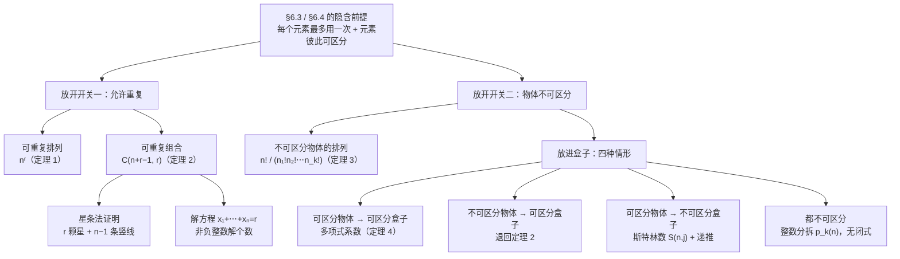
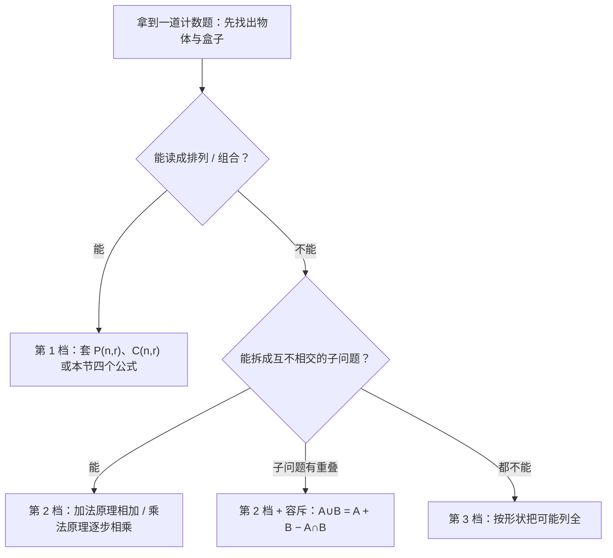

# C6.5 广义排列与组合 Generalized Permutations and Combinations

> [!abstract] 这一讲的任务
> §6.3 和 §6.4 一直在偷偷用一个前提：**每个东西只能用一次**。排 10 个人的队伍、从 52 张牌里抓 5 张——挑走一个就少一个，公式 $P(n,r)$、$\binom{n}{r}$ 都建立在这上面。
> 但现实里的计数问题大多不是这样：奶茶可以点两杯同款、车牌上的字母可以重复、给四个玩家发牌时"哪 5 张给谁"和"这 5 张是什么"是两件事、单词 SUCCESS 里的三个 S 长得一模一样根本分不出谁是谁。
> 这一讲把这两个前提**分别拆掉**：先放开"不能重复"，再放开"彼此可区分"，最后把两个开关摆成一张表，让每一种计数问题都能对号入座。
> 但拆开关只是前提。真正上手做题时，卡住人的往往是"**该不该用公式**"——所以第 6 节里还给了一套"先套排列组合 → 套不上就拆子问题 → 拆不动就列举"的下手流程，那是这一节最该带走的东西。

> [!info] 怎么读这份讲义
> 全节的承重墙只有一句：**一个计数问题要先问两件事——能不能重复？东西彼此分不分得开？** 第 1 节放开"重复"、第 2–4 节把"可重复的组合"做成工具、第 5 节放开"可区分"、第 6 节把两个开关拼成一张四格表。
> **第 3 节的星条法证明是全节最重要的推理**，其余内容基本都是它的应用或变形；如果时间紧，先把它读透。
> 前置：[[C6.3 排列与组合 Permutations and Combinations]]（$P(n,r)$、$\binom{n}{r}$ 的来历）、[[C6.1 计数基础 The Basics of Counting]]（乘法原理与除法原理）、[[C6.4 二项式系数与恒等式 Binomial Coefficients and Identities]]（$\binom{n}{r}=\binom{n}{n-r}$ 这个对称性在这一讲会被反复调用）。
> 第 6 节里"斯特林数 Stirling number of the second kind"的递推是我们自己补的推导（教材只写了结论 $S(4,3)=6$ 等数值），文里已注明。



---

## 0. 开场：奶茶店里的两个"六"

周五下午，你替实验室的六个人点奶茶。菜单上只有三种：珍珠奶茶、果茶、纯茶。你掏出手机，却在三个不同的问题之间卡住了：

1. **"给这六个人各点一杯（谁喝什么都要对上），有多少种点法？"**
2. **"只记'三杯珍珠、两杯果茶、一杯纯茶'这样的配方，有多少种配方？"**
3. **"如果六个人要排队去取，有多少种排队顺序？"**

三个问题里都出现"六"，答案却差了两个数量级：

- 第 1 问：每个人有 3 种选择，六个人彼此独立，$3^6=729$。
- 第 2 问：只有 28 种配方。
- 第 3 问：$6!=720$ 种队伍。

第 3 问是 §6.3 的老朋友（从 6 个人里排 6 个位置，不许重复），不用管。真正的新东西在第 1 问和第 2 问。

**先看第 1 问，那个 $3^6$ 其实不用学新东西**：它只是乘法原理用了六次而已。§6.3 的公式 $P(n,r)=\dfrac{n!}{(n-r)!}$ 之所以长成那样，是因为挑走一个就少一个；现在挑走一个**不影响**下一次的选择，每一步都还是 3 种可能，于是 $3\times3\times3\times3\times3\times3$。**这就是"允许重复的排列"，公式退化成最简单的幂。**

**第 2 问才是这一讲真正的新内容。** 它看起来人畜无害——不就是从 3 种里挑 6 杯吗——但 §6.3 的组合公式 $\binom{n}{r}$ 在这里**根本用不了**：$\binom{3}{6}=0$，因为从 3 个东西里挑 6 个不重复的，一个都挑不出来。可"三杯珍珠两杯果茶一杯纯茶"明明是一种合法配方。

**卡点出现了：$\binom{n}{r}$ 要求 $r\le n$，而可重复的组合允许 $r>n$——甚至允许 $r$ 任意大。** 我们需要一个新公式，而不是旧公式的变形。

再把镜头推远一点。第 2 问里，一旦我们写下"三杯珍珠、两杯果茶、一杯纯茶"，这六杯奶茶之间的先后就完全不重要了——**六杯里那三杯珍珠奶茶彼此根本无法区分**。这正是这一讲的第二个主题：**物体不可区分时怎么数。**

> [!question] 停一下，先自己想想
> 第 2 问的答案 28 是怎么来的？给你两个提示：
> ① $28=\binom{8}{6}$，这个 8 是从哪里冒出来的？
> ② 如果把六杯奶茶排成一排、用一个符号表示一杯，你能不能想出一种画法，让**每一种配方对应唯一一张图**？
>
> 先别急着往下翻。第 3 节会把这张图完整画出来并证明它一一对应；现在你只要相信答案是 28——它就是本节第一个主角。

---

## 1. 允许重复的排列：$n^r$（p.423）

### 1.1 从"车牌"到定理 1

允许重复的排列，定义上一点都不神秘：**从 $n$ 个物体的集合里，按顺序取出 $r$ 个，同一个物体允许被取多次。**

§6.3 里那个"取走一个就少一个"的机制消失了，取而代之的是每一步都面对同一个完整的集合。所以乘法原理的每一层都是 $n$：

> [!important] 定理 1（允许重复的 $r$-排列 Permutations with Repetition）
> 从 $n$ 个物体的集合中允许重复地取 $r$ 个排成一列，方案数是
> $$n^r$$

**证明**：$r$ 个位置逐个填。填第一个位置时有 $n$ 种选择；因为允许重复，**填完第一个位置后集合仍然是完整的 $n$ 个**，所以第二个位置也是 $n$ 种；依此类推，每个位置都独立地有 $n$ 种。由乘法原理，总数是 $\underbrace{n\times n\times\cdots\times n}_{r\text{ 个}}=n^r$。$\blacksquare$

> [!warning] 这个证明里唯一要盯住的一句话
> "因为允许重复，集合永远是完整的 $n$ 个"——**这就是重复与否的全部差别**。
> 对照一下 §6.3：不允许重复时第 $k$ 步只剩 $n-k+1$ 种，所以乘出来是 $\dfrac{n!}{(n-r)!}$。允许重复时每一层都退化成同一个数 $n$，乘出来就是 $n^r$。
> **换句话说，$n^r$ 不是新公式，它是 $P(n,r)$ 在"集合不缩水"这个极端情形下的样子。**

> [!example] EXAMPLE 1（p.423）
> **题**：用英文字母的大写字母能组成多少个长度为 $r$ 的字符串？
>
> **解**：大写字母共 26 个，且每个字母都可以重复使用（"AAA"是合法字符串），所以每个位置都有 26 种选择。允许重复的 $r$-排列，由定理 1：
> $$26^r$$
>
> 取 $r=1,2,3,4$ 感受一下量级：$26,\ 676,\ 17\,576,\ 456\,976$——四位全字母串还不到 46 万，这也顺便解释了为什么纯字母的短密码毫无安全性可言。▲

**顺手把"$n$ 个物体分到 $r$ 个盒子"翻译过来。** 教材第 1 节里举的几个例子，本质都是同一个 $n^r$，只是换了个说法：

| 说法 | $n$ 是什么 | $r$ 是什么 | 方案数 |
|---|---|---|---|
| 长度为 $r$ 的字符串 | 字母表大小 26 | 串长 $r$ | $26^r$ |
| 10 位二进制串 | 每位的取值 2 | 位数 10 | $2^{10}=1024$ |
| 4 位 PIN 码 | 每个数字 10 | 位数 4 | $10^4=10\,000$ |
| DNA 序列（长度 $r$） | 碱基 4 种 | 序列长 $r$ | $4^r$ |
| $n$ 个物体分到 $r$ 个盒子 | 每个物体 | 盒子编号个数 | $n^r$ |

最后一行值得单独说一句，因为它马上要在第 6 节派上大用场：**"把 5 个不同的球放进 7 个不同的盒子，每个球自由选盒子"——每个球对应一个位置、每个盒子对应一个"取值"，逐球决定，共 $7^5$ 种。** 这就是 $r$ 个位置、$n$ 种取值的另一种读法（$n=7$ 个盒子、$r=5$ 个球），**顺序由"球"承担、取值由"盒子"承担**。

> [!note] 停一下，我们刚才干了什么
> 我们只做了一件事：把乘法原理的"每层有多少种"从递减的 $n,n-1,n-2,\dots$ 换成恒定不变的 $n,n,\dots,n$。
> 结果就是把 $P(n,r)=\frac{n!}{(n-r)!}$ 压扁成 $n^r$。**这类"压扁"是本节的主旋律**：后面每一个新公式，都是把某个老公式里被"区分"和"不重复"锁住的东西松开一根。

---

## 2. 允许重复的组合：先撞一次墙（p.424）

**排列管顺序，组合不管顺序。** 允许重复的组合（$r$-combinations with repetition allowed）问的是：

> 从 $n$ 种物体里取 $r$ 个，**只记每种取了几个、不记取的先后**，有多少种结果？

先从一个能穷举的小例子入手，看看"只记个数"到底意味着什么。

> [!example] EXAMPLE 2（p.424）
> **题**：碗里有苹果、橘子、梨（每种至少 4 个，且同类水果彼此不可区分）。不计选取顺序、也不区分具体是哪一只，取 4 只水果有多少种取法？
>
> **解**：这里能直接把所有可能列完。把"每种取几只"写下来，三元组非负、和为 4：
>
> | 形状 | 具体方案 | 个数 |
> |---|---|---|
> | $4+0+0$ | 4 苹果 / 4 橘子 / 4 梨 | 3 |
> | $3+1+0$ | 3 苹果 1 橘子 / 3 苹果 1 梨 / 3 橘子 1 苹果 / 3 橘子 1 梨 / 3 梨 1 苹果 / 3 梨 1 橘子 | 6 |
> | $2+2+0$ | 2 苹果 2 橘子 / 2 苹果 2 梨 / 2 橘子 2 梨 | 3 |
> | $2+1+1$ | 2 苹果 1 橘子 1 梨 / 2 橘子 1 苹果 1 梨 / 2 梨 1 苹果 1 橘子 | 3 |
> | 合计 | | **15** |
>
> 所以答案是 15。用一句话概括：**这是从 $\{\text{苹果},\text{橘子},\text{梨}\}$ 这个三元集合里允许重复地取 4-组合的个数。** ▲

15 种还能硬列。换成"7 种钞票里选 5 张"呢？

> [!example] EXAMPLE 3（p.424–425）：为什么必须换方法
> **题**：钱箱里有 \$1、\$2、\$5、\$10、\$20、\$50、\$100 七种钞票（每种至少 5 张，同面额的钞票彼此不可区分）。不计选取顺序，选 5 张，有多少种选法？
>
> **解（先看它为什么不能硬列）**：这是在数"7 元集合的 5-组合（允许重复）"。如果照 EXAMPLE 2 那样按形状分类，形状数会迅速炸开——4 只水果、3 种类型只有 4 种"形状"，而 5 张钞票、7 种类型远不止。教材明确说 listing all possibilities would be tedious。
>
> **换一个想法**：把钱箱想象成**七个格子**并排（每个格子放一种面额），格子之间由 **6 块隔板**分开。选 5 张钞票这件事，等价于"往这七个格子里放 5 个记号"——某格里有几个记号，就说明这种面额选了几张。
>
> 于是把这张图**画成一行符号**：隔板记作竖线 `|`，记号记作星 `*`。那么
> $$\texttt{2 张 \$10，3 张 \$1}\quad\longleftrightarrow\quad \texttt{|}\,\texttt{|}\,\texttt{|}\,\texttt{**}\,\texttt{|}\,\texttt{|}\,\texttt{|}\,\texttt{***}$$
> （从 \$100 那头数起，第 4 格是 \$10，第 7 格是 \$1。）
>
> 数选法的问题，就变成了**数"6 条竖线 + 5 颗星"这一行符号有多少种排法**：一行共 $11$ 个位置，从中挑出 5 个位置放星，其余 6 个位置自动是竖线。所以
> $$\binom{11}{5}=\frac{11!}{5!\,6!}=462 \text{ 种}$$
> ▲

> [!question] 停一下，先自己想想
> 上面说"挑出 5 个位置放星，其余位置自动是竖线"。**为什么是"自动"？** 这句话凭什么成立？
>
> 想清楚这一点，第 3 节的证明你就自己完成了一大半。答案在下面 3.2 节，先留个位置。

**回头把这道题的三条假设逐条对一遍，它们是这个模型的三根柱子，缺一根这个 462 就不成立**：

- **"不计选取顺序"**——这一句把它从排列钉死成组合。顺序一旦算进来，它立刻变成第 1 节的可重复排列，答案是 $7^5$ 而不是 462。
- **"同面额的钞票彼此不可区分"**——所以"两张 \$1"里不存在"是哪两张"的问题，只有"两张"这个数字。**在星条图上它表现为：同一格里的星不分先后。**
- **"每种至少 5 张"**——这条最容易被当成背景音跳过，其实它才是星条法能站住的那一根。取 5 张时，某一格最多要塞 5 颗星；要是 \$100 只剩 3 张，"5 颗星全落进 \$100 那一格"这种排法就必须被剔除，可"从 11 个位置里随便挑 5 个放星"这个数法**恰恰把它算进去了**。**所以某种面额一不够，星条法不是差一点，而是整张图失效**——凡"每个盒子有上限"的题，都得换一套办法（第 6 节末尾那个"3 苹果 2 橘子 1 香蕉"的例子，就是被上限逼着换办法的）。

**把这张图翻译成一句话。** 钞票是星，钞票的**种类**是格子：

> [!important] 钱箱问题的骨架
> **物体不可区分 + 盒子可区分 ⟹ 数的是"每格几颗星"。**
> 星 = 选中的物体（5 张钞票 = 5 颗星）；格 = 盒子的种类（7 种面额 = 7 格）；竖线 = 格子之间的墙（7 格 = 6 条竖线）。
> 某一格**空着**不是画漏了——它记录的正是"这种面额一张都没选"。**所谓"盒子可以为空"，在星条图上就长这个样子。**

---

## 3. ⭐ 定理 2 与星条法：本节最重要的推理（p.425）

### 3.1 定理

> [!important] 定理 2（允许重复的 $r$-组合 Combinations with Repetition）
> 从 $n$ 个元素的集合中允许重复地取 $r$ 个（不计顺序）的 $r$-组合个数是
> $$\binom{n+r-1}{r}=\binom{n+r-1}{n-1}$$

先做三个立刻能做的检查，确认这个公式"长得合理"：

1. **两个写法为什么相等**：由 [[C6.4 二项式系数与恒等式 Binomial Coefficients and Identities]] 的对称性 $\binom{m}{k}=\binom{m}{m-k}$，取 $m=n+r-1$、$k=r$，立刻得到 $\binom{n+r-1}{r}=\binom{n+r-1}{n-1}$。**两个写法各有用途**：$\binom{n+r-1}{r}$ 是"选星的位置"，$\binom{n+r-1}{n-1}$ 是"选竖线的位置"。
2. **$r=0$ 时**：$\binom{n-1}{0}=1$——不取任何东西只有一种方式。对。
3. **回到 EXAMPLE 2**：$n=3$（三种水果）、$r=4$（取四只），$\binom{3+4-1}{4}=\binom{6}{4}=15$ ✓，与硬列出来的结果一致。

### 3.2 证明：$r$ 颗星和 $n-1$ 条竖线的一一对应

证明要建立的是一个**双向可逆**的翻译。分两步，每一步都要说清"反过来怎么办"。

**第一步：一个组合 → 一行符号。**

把 $r$ 个待取的位置按"取的是第几种元素"排好，写成 $n$ 个格子；格子之间插 $n-1$ 条竖线。第 $i$ 个格子里放几颗星，就表示**第 $i$ 种元素被取了几个**。

教材给的例子最能说明问题：$n=4$（四种元素）、$r=6$（取六个）时，一行符号是 3 条竖线 + 6 颗星：

$$\texttt{**}\,|\,\texttt{*}\,|\;\;|\,\texttt{***}$$

从左往右读：第 1 格 2 颗星 ⟹ 第 1 种元素取 2 个；第 2 格 1 颗星 ⟹ 取 1 个；第 3 格空的 ⟹ 第 3 种元素**一个都不取**；第 4 格 3 颗星 ⟹ 第 4 种元素取 3 个。加起来 $2+1+0+3=6=r$ ✓。

这里顺带解决一个隐藏的疑虑：**"空的格子"会不会破坏信息的完整性？** 不会——连着的两条竖线之间什么都没有，恰恰**记录了"这一种一个都没取"**，而这是组合信息的一部分，必须被记下来。**竖线不是分隔装饰，它是信息的载体。**

**第二步：这一行符号 → 数出有多少种。**

关键观察：**同一行符号里，所有的星彼此不可区分，所有的竖线也彼此不可区分。** 我们并不需要知道"哪颗星是哪一颗"——只需要知道**哪 5 个位置站着星**。

于是，一行 $r$ 颗星 + $n-1$ 条竖线，总长度是 $r+(n-1)$ 个位置。给这一行下定义只需要**指定星占据哪些位置**，剩下 $n-1$ 个位置"自动"全是竖线（因为星和竖线是仅有的两种符号）。

这就回答了刚才那个追问：

> [!important] 为什么"其余位置自动是竖线"
> 因为这一行里**只允许出现两种符号**。一旦星的位置定了，剩下的位置没有第二种可能——只能填竖线。
> 这与 §6.3 的组合定义完全同构：从 $m$ 个位置里挑 $k$ 个放星，方案数是 $\binom{m}{k}$，不需要再乘任何东西。**"自动"两个字背后是"候选符号只剩一种"。**

所以这一行符号的总数是

$$\binom{r+(n-1)}{r}=\binom{n+r-1}{r}$$

而由对称性，它同时等于"选竖线位置"的数目 $\binom{n+r-1}{n-1}$。**定理 2 证毕。**$\blacksquare$

**两种数法的对照**（教材在同一处把两句话都说了，值得对齐看）：

| 数什么 | 从多少个位置里挑 | 结果 |
|---|---|---|
| 挑 $r$ 个位置放**星** | $n-1+r$ 个位置 | $\binom{n+r-1}{r}$ |
| 挑 $n-1$ 个位置放**竖线** | $n-1+r$ 个位置 | $\binom{n+r-1}{n-1}$ |

两者相等，因为"挑出星"和"挑出竖线"是同一件事的两种说法。

> [!warning] 最经典的数错法：以为要除以 $r!$ 或 $(n-1)!$
> 常见错误是把 $\binom{n+r-1}{r}$ 和"排列后再除以重复"混起来，写成 $\dfrac{(n+r-1)!}{r!\,(n-1)!}\cdot\dfrac{1}{r!}$ 之类。
> **这里根本不需要除。** 星与竖线虽然在各自内部不可区分，但我们在用组合公式时已经**没有数它们的顺序**——挑位置这个动作本身就只记"哪些位置"，不记"谁先谁后"。**"不可区分"这件事已经在 $\binom{\cdot}{\cdot}$ 里付过账了，付两次就错了。**
> 第 5 节里"不可区分物体的排列"确实要除（那里除以 $n_1!n_2!\cdots$），但那里的做法是"先按可区分排列，再除回去"——**两条路都对，但不能混着走。**

> [!note] 一个必须澄清的记号陷阱：$n$ 到底是哪一边
> 定理 2 里的 $n$ 是**元素种数**，$r$ 是**取几个**。这个约定和 §6.3 的 $P(n,r)$ 一致，但公式里的位置变了：$P(n,r)$ 里 $n$ 在"上标那一侧"，而 $\binom{n+r-1}{r}$ 里 $n$ 出现在**上指标的左下角**。
> **每次套公式前先默念一遍："$n$ 是种类数、$r$ 是取几个"，再看 $n-1$ 有没有算错。** 下面几个例子都按这个顺序过一遍。

**现在把这张图再看一眼。** 下图把两个具体的星条排列并排画出来（$n=4$ 种钞票、取 $r=5$ 张）：3 条竖线把一行 8 个位置切成 4 格，每格的星数就是该种钞票的张数，而"数方案"就是"数这一行里 5 颗星有几种站法"。

![[C6.5-星条法示意图.png]]

对着图念一遍这个对应关系：上排 $\texttt{**|*|**|}$ 读作"2 张第 1 种、1 张第 2 种、0 张第 3 种、2 张第 4 种"；下排 $\texttt{||***|**}$ 读作"0、0、3、2"。两行都是合法的、不同的选法；而任何一行合法的星条排列都唯一确定一种选法。所以方案数就是 $\binom{8}{5}=56$。

（$\binom{8}{5}=56$ 这个具体数字与教材 425 页的 $\binom{11}{5}=462$ 是**不同题目的答案**：$462$ 解的是"7 种钞票选 5 张"，$56$ 解的是"4 种选 5 张"。**它们用的是同一个公式，只是 $n$ 不同**——这也正是下面那条"$n$ 变了题目就变了"的提醒。）

> [!question] 课堂追问：如果取的东西更多，竖线会更少吗？
> 不会。**竖线的条数只跟种类数 $n$ 有关，跟取多少 $r$ 完全无关**——$n$ 种类型就永远需要 $n-1$ 条竖线。
> 增加 $r$ 只是往格子里多塞星，位置总数 $r+n-1$ 变大。
> **这个"哪些量随什么变"的判断在考试里很值钱**：看到"7 种钞票选 5 张"，立刻写下"6 条竖线、5 颗星、共 11 个位置"，公式不用想就出来了。

---

## 4. 定理 2 的三个用法（p.426）

### 4.1 直接套：饼干店

> [!example] EXAMPLE 4（p.426）
> **题**：一家饼干店有 4 种饼干。只计种类、不计具体哪一块、也不计选取顺序，选 6 块饼干有多少种选法？
>
> **解**：这是 4 元集合的 6-组合（允许重复）。这里 $n=4$、$r=6$：
> $$\binom{4+6-1}{6}=\binom{9}{6}$$
> 用对称性 $\binom{9}{6}=\binom{9}{3}=\dfrac{9\cdot 8\cdot 7}{1\cdot 2\cdot 3}=84$。
> 所以有 **84** 种选法。▲
>
> **回头核对一下"$n$ 和 $r$"**：饼干是 4 **种**（$n=4$），要买 6 **块**（$r=6$）。所以上指标是 $4+6-1=9$，下指标是 6。**不要写成 $\binom{4+6-1}{4}$ 还嘴硬说一样**——虽然 $\binom{9}{6}=\binom{9}{3}$，但"$9-6=3$"和"$n=4$"不是一回事，写错下标是把两种数法记混了。

### 4.2 变形成"方程的非负整数解个数"

这是定理 2 最重要的一种"换皮"，一定要认出来。

**先看对应关系**：方程 $x_1+x_2+\cdots+x_n=r$ 的每一个非负整数解 $(x_1,\dots,x_n)$，读成"第 1 种取 $x_1$ 个、第 2 种取 $x_2$ 个、……、第 $n$ 种取 $x_n$ 个"，**正好就是一个允许重复的 $r$-组合**；反过来也成立。于是：

$$\boxed{x_1+x_2+\cdots+x_n=r \text{ 的非负整数解个数}=\binom{n+r-1}{r}}$$

**用星条读一遍就更直观**：$x_i$ 就是第 $i$ 格的星数，$n$ 个变量需要 $n-1$ 条竖线，$r$ 颗星——**和数钱、数饼干是同一张图**。

> [!example] EXAMPLE 5（p.426，含约束的情况）
> **题**：方程 $x_1+x_2+x_3=11$（$x_1,x_2,x_3$ 为非负整数）有多少个解？
>
> **解（无约束）**：对应 $n=3$、$r=11$ 的可重复组合：
> $$\binom{3+11-1}{11}=\binom{13}{11}=\binom{13}{2}=\frac{13\cdot 12}{1\cdot 2}=78$$
> 有 **78** 个解。
>
> **题（加约束）**：如果要求 $x_1\ge 1$、$x_2\ge 2$、$x_3\ge 3$，有多少个解？
>
> **解**：**先满足"下限"，把剩下的自由分。** 既然 $x_1,x_2,x_3$ 分别至少要 1、2、3，那就先各拨出这么多：
> $$1+2+3=6$$
> 总数 11 减去 6，还剩 $11-6=5$ 个可以任意分配（仍然是非负的）。于是问题变成
> $$\binom{3+5-1}{5}=\binom{7}{5}=\binom{7}{2}=\frac{7\cdot 6}{1\cdot 2}=21$$
> 共有 **21** 个解。▲
>
> **这个"先扣下限"的动作在星条图上的样子**：先在 3 个格子里各自放好 1、2、3 颗星（这是硬性要求），然后手里还剩 5 颗星，自由撒进 3 个格子——**只是把"总星数"从 11 换成了 5**，竖线条数不变，公式不用改。写成一般式：
> $$\#\{(x_1,\dots,x_n):\textstyle\sum x_i=r,\ x_i\ge q_i\}=\binom{n+(r-\sum q_i)-1}{r-\sum q_i}$$

> [!warning] 三个最容易踩的坑
> 1. **"不超过"和"至少"不是同一件事**。"$x_1\le 10$"这种**上界**约束，"先扣下限"完全不管用，要换成"总数减去越界的那些"（容斥思想），这套技术在 §8.6 才展开，本节不处理。
> 2. **变量个数 $n$ 与上限值别混**。$\binom{n+r-1}{r}$ 里的 $n$ 是**变量个数**（方格里），$r$ 是**右边那个数**。$x_1+x_2+x_3=11$ 是 $n=3,r=11$，不是 $n=11$。
> 3. **"恰好"和"至少"的换算**。$x_i\ge 1$ 等价于"至少取 1 个"；如果你把约束写成"$x_i>1$"（严格大于），先扣的就是 **2** 而不是 1。**每次先把 > 翻译成 $\ge$。**

### 4.3 数循环执行的次数

> [!example] EXAMPLE 6（p.427）
> **题**：下面这段伪代码执行完之后，$k$ 的值是多少？
> ```
> k := 0
> for i₁ := 1 to n
>   for i₂ := 1 to i₁
>     ⋮
>     for i_m := 1 to i_{m-1}
>       k := k + 1
> ```
>
> **解**：$k$ 从 0 开始，最内层每执行一次就加 1，所以 $k$ 的终值等于**最内层被执行了多少次**。
>
> 最内层每执行一次，就产生一组整数 $(i_1,i_2,\dots,i_m)$，它们满足
> $$1\le i_m\le i_{m-1}\le\cdots\le i_1\le n$$
> 反过来，任意一组满足这个不等式链的整数都恰好对应一次执行。
>
> **关键一步：这个"非降序列"与"从 $\{1,2,\dots,n\}$ 中允许重复地取 $m$ 个"一一对应。** 因为给定一个允许重复的 $m$-组合，把里面的数按**不降序**排好，就唯一确定了一个满足 $1\le i_m\le\cdots\le i_1\le n$ 的序列（$i_m$ 是最小的那个、$i_1$ 是最大的那个）；反过来也唯一恢复。**"允许重复 + 自动排序"消掉了顺序这一自由度，于是有序的序列变成了无序的组合。**
>
> 于是由定理 2：
> $$k=\binom{n+m-1}{m}$$
> ▲
>
> **代入具体数字感受一下**：取 $n=5$、$m=3$，答案 $=\binom{5+3-1}{3}=\binom{7}{3}=35$。如果换成"三层各循环 $n$ 次"（即三个独立的下标），那就是 $n^3=125$——**"$i_2$ 从 1 到 $i_1$"这种三角形状的循环，把 $n^3$ 砍到了约 $n^3/6$ 量级**，这正是 $\binom{n+m-1}{m}$ 在 $n$ 大时约为 $n^m/m!$ 的来源。

**顺带说一句这类循环为什么常见**：凡是"从 $n$ 件里可重复地挑 $m$ 件、且只关心每种挑了几个"的枚举，写成循环就长这个三角形状。工程上写 `for j in range(i)` 枚举组合，跑的次数就是 $\binom{n+m-1}{m}$ 而不是 $n^m$——**这就是"星条法"在代码里的样子。**

---

## 5. 不可区分物体的排列（p.427–428）

### 5.1 撞墙：为什么不能直接 $7!$

> [!example] EXAMPLE 7（p.427–428）
> **题**：把单词 $\texttt{SUCCESS}$ 的字母重新排列，能得到多少个不同的字符串？
>
> **解（先撞墙）**：$\texttt{SUCCESS}$ 有 7 个字母，如果 7 个字母彼此不同，答案就是 $7!=5040$。
> 但它们不是：$\texttt{SUCCESS}$ 里是 **3 个 S、2 个 C、1 个 U、1 个 E**。
> **$7!=5040$ 把同一个字符串数了多次。** 举一个具体的例子：把三个 S 当成 $S_a,S_b,S_c$ 来排列时，"$S_a U C_b C_c E S_b S_d$"（这里只是示意）和交换 $S_a,S_b,S_c$ 位置得到的那些排列，**在真实字符串里全都长成 $\texttt{SUCCESS}$**。三个 S 的内部排列共 $3!=6$ 种，它们坍缩成同一个字符串；两个 C 的内部排列共 $2!=2$ 种，同样坍缩。
> 所以 $7!$ 这个数把每个真实字符串重复计了 $3!\times 2!=12$ 次。
>
> **解（正确做法：逐类占位相乘）**：不要去"先排列再除掉"，而是**一类一类地占位置**：
> - **第一步**：7 个位置里挑 3 个给 S：$\binom{7}{3}=35$ 种，剩下 4 个空位。
> - **第二步**：剩下的 4 个位置里挑 2 个给 C：$\binom{4}{2}=6$ 种，剩下 2 个空位。
> - **第三步**：剩下的 2 个位置里挑 1 个给 U：$\binom{2}{1}=2$ 种，剩下 1 个空位。
> - **第四步**：最后 1 个位置给 E：$\binom{1}{1}=1$ 种。
>
> 由乘法原理：
> $$\binom{7}{3}\binom{4}{2}\binom{2}{1}\binom{1}{1}=\frac{7!}{3!\,4!}\cdot\frac{4!}{2!\,2!}\cdot\frac{2!}{1!\,1!}\cdot\frac{1!}{1!\,0!}=\frac{7!}{3!\,2!\,1!\,1!}=420$$
> 所以是 **420** 个不同字符串。▲

下面这张图把上面四步按位置画出来：先给 3 个 S 占位，再给 2 个 C 占位，剩下的 U 和 E 自动落位。

![[C6.5-不可区分物体的排列.png]]

看图就能明白"逐类占位相乘"为什么**恰好**等于 $\dfrac{7!}{3!2!1!1!}$：每一步挑位置用的是一个"除以已占位置阶乘"的组合数，四个组合数连乘时，中间那些阶乘**逐个约掉**（$\frac{7!}{3!4!}\cdot\frac{4!}{2!2!}\cdot\frac{2!}{1!1!}\cdot\frac{1!}{1!0!}=\frac{7!}{3!2!1!1!0!}$），最后只剩"总排列数除以各类内部的排列数"。**所以两条路不是两种方法，而是同一条路的两个说法。**

### 5.2 定理 3 及其证明

> [!important] 定理 3（不可区分物体的排列 Permutations with Indistinguishable Objects）
> $n$ 个物体中有 $n_1$ 个属于第 1 类、$n_2$ 个属于第 2 类、……、$n_k$ 个属于第 $k$ 类，**同类物体彼此不可区分**，则这 $n$ 个物体的不同排列数为
> $$\frac{n!}{n_1!\,n_2!\cdots n_k!}\qquad (n_1+n_2+\cdots+n_k=n)$$

**证明（就是 EXAMPLE 7 的做法一般化）**：第 1 类的 $n_1$ 个物体在 $n$ 个位置中占位，有 $\binom{n}{n_1}$ 种，剩 $n-n_1$ 个空位；第 2 类在剩下的位置里占位，有 $\binom{n-n_1}{n_2}$ 种，剩 $n-n_1-n_2$ 个空位；继续到第 $k-1$ 类，最后第 $k$ 类在剩下的 $\binom{n-n_1-\cdots-n_{k-1}}{n_k}$ 种方式里落位。由乘法原理，总数是

$$\binom{n}{n_1}\binom{n-n_1}{n_2}\cdots\binom{n-n_1-\cdots-n_{k-1}}{n_k}$$

把每个组合数展开成阶乘：

$$=\frac{n!}{n_1!\,(n-n_1)!}\cdot\frac{(n-n_1)!}{n_2!\,(n-n_1-n_2)!}\cdots\frac{(n-n_1-\cdots-n_{k-1})!}{n_k!\,0!}=\frac{n!}{n_1!\,n_2!\cdots n_k!}$$

**注意中间那些阶乘全部成对约掉**——分子上的 $(n-n_1)!$ 被下一项的分母约掉，依此类推，最后只剩 $0!=1$。$\blacksquare$

> [!warning] 什么时候"除"、什么时候"不除"：一个反复出现的判断
> 定理 3 是**在一个已经数好了的全排列基础上，把被重复计的部分除掉**。除法原理（见 [[C6.1 计数基础 The Basics of Counting]]）在这里的形态是：**每个真实对象被计了 $n_1!n_2!\cdots n_k!$ 次，所以除以它。**
> 对比定理 2：那里我们**从头就是用组合的方式数的位置**，压根没有"先重复计数"这一步，所以不需要除。
> **统一的判据：如果你能指着某个东西说"这一个被数了 $m$ 次"，那才轮到除法。** 目录里那些"先算 $7!$ 再除以 $3!2!$"的写法之所以对，是因为它**先承认了每个字符串被数了 12 次**。

> [!note] 接回 §9.5：所谓"不可区分"，就是把它们看成一个等价类
> 三个 S 之所以能互换而不改变字符串，是因为在这个计数问题里，我们**约定**了"把 S 标上号"这件事没有任何意义。用关系的语言说：在 7 个带标号字母的全排列上定义 "$S_a,S_b,S_c$ 各自的位置可以任意互换"这个等价关系（[[C9.5 等价关系 Equivalence Relations]]），**每个等价类就是一个真实字符串**，而每个类的大小都恰好是 $3!\cdot 2!=12$。
> 于是"除以 $3!2!$"的真正含义是"**数出等价类的个数**"，而除法原理能用的前提恰恰是"每个类一样大"——**正因为每个字符串都恰好被数了 12 次，除才是合法的。** 这个视角在后面数"环状排列""镜像视为相同"时都要再用一遍。

> [!question] 停下来想一个反例
> 如果用"先排列、再除以重复"的办法处理 **EXAMPLE 4 的饼干问题**——先当作"6 块饼干彼此不同"算 $6!=720$，再除以"3 块同类的内部排列"——会得到正确答案吗？
>
> **不会。** 原因很直接：**饼干根本没有 6 个"位置"可以排。** 那个问题的"结果"只有"每种几块"，没有先后顺序，$6!$ 这个数从一开始就不对——它是把不存在的顺序算进去了。**"先排再除"只适用于"结果本身就是排成一列"的问题（字符串、座位表），不适用于"结果只是个配方"的问题。** 这就是判断用定理 2 还是定理 3 的分水岭：**结果里有没有位置。**

### 5.3 定理 3 的两个立刻可用的推论

**推论 A：两项时的"二项系数形状"。** $n$ 个物体、只有两类（$n_1$ 个一类、$n_2=n-n_1$ 个另一类）：

$$\frac{n!}{n_1!\,n_2!}=\binom{n}{n_1}$$

这正是 [[C6.4 二项式系数与恒等式 Binomial Coefficients and Identities]] 里的二项式系数。**换句话说，定理 3 是二项式系数的推广：$\binom{n}{n_1}$ 数的是"两类物体的排列"，$\frac{n!}{n_1!\cdots n_k!}$ 数的是"$k$ 类物体的排列"**（后者就叫**多项式系数 Multinomial Coefficient**，记作 $C(n;n_1,\dots,n_k)$，它会在 $(x_1+\cdots+x_m)^n$ 的展开里出现，见教材 p.434 的补充习题 63–66）。

**推论 B：$\binom{n}{n_1}\binom{n-n_1}{n_2}\cdots$ 就是"多项式的展开系数"。** 把定理 3 的公式套进 $(x_1+x_2+x_3)^n$，$x_1^{n_1}x_2^{n_2}x_3^{n_3}$ 这一项前面的系数正好是 $\frac{n!}{n_1!n_2!n_3!}$——**原因和字符串计数完全一样**：从 $n$ 个括号里挑 $n_1$ 个贡献 $x_1$、剩下挑 $n_2$ 个贡献 $x_2$，与"给字母占位置"是同一件事。

**最后留一道能立刻验算的**（教材 p.434 补充习题 64 的第一问）：

> 展开 $(x+y+z)^4$ 里 $x^2yz$ 这一项的系数是多少？
> **答**：$\dfrac{4!}{2!\,1!\,1!}=12$。**数法与"SUCCESS"如出一辙**：4 个括号位置，挑 2 个给 $x$、1 个给 $y$、1 个给 $z$。

---

## 6. 把物体放进盒子（p.428–431）

### 6.1 先问两个问题，而不是先套公式

教材在这个主题上花了整整四页，核心其实只有一句话：

> [!important] 建模之前必须先做两个二选一的判断
> **① 物体彼此可区分吗？**（distinguishable / labeled，还是 indistinguishable / unlabeled）
> **② 盒子彼此可区分吗？**（distinguishable / labeled，还是 indistinguishable / unlabeled）
>
> 两个问题各两个答案，**四种情形，四种算法**。而且——这一点最值得记住——**只有一半有闭式公式**。

先别急着看公式，把这两个开关摆成一张 **2×2 的表**：

| | 盒子**可区分**（1 号箱、2 号箱……／座位／玩家） | 盒子**不可区分**（"三个相同的箱子"／几间一样的办公室） |
|---|---|---|
| **物体可区分**（人有名字、牌有花色点数、球有编号） | 定理 4：$\dfrac{n!}{n_1!\,n_2!\cdots n_k!}$（各盒装几个已定；只要求"随便放"时退化成 $k^n$） | 第二类斯特林数：先把物体分成 $j$ 堆（堆与堆不排名），再对各 $j$ 求和 |
| **物体不可区分**（同款奶茶、同面额的钞票、相同的书） | 星条法：$\dbinom{k+n-1}{n}$ —— 本节的主力 | 整数分拆：把 $n$ 拆成至多 $k$ 个加数，也就是"几本、几本"地写下来 |

**读表先记一句话：「不可区分」落到操作上就是「不许再排它的顺序」。** 物体不可区分，就只记"每种几个"；盒子不可区分，就只记"分成几堆、每堆多大"。这句话听着平淡，却是表格右下两格**闭式公式消失**的全部原因——顺序被抹掉之后，没有一个统一的因子可以一次除掉。（为什么除掉的分母不是常数？第 6.3 节末尾会正面回答。）

这三种对象后面每道题都会反复出现，先把它们并排摆一次，读表时心里就有实物：

![[C6-三种计数对象对照.png]]

三格分别对应定理 1、定理 2、定理 3（定理 4 用的是第三格的同一张公式）。最值得盯的是"要不要除"这一栏：左格和中格都没有分母，因为两者从头就是"数位置"——左格每个位置都重新从完整的集合里挑，中格数的是星站在哪几个位置上；只有右格要先承认"同一个结果被数了 $n_1!\cdots n_k!$ 次"，除法才登场。**"除不除"不是风格选择，而是"有没有先重复计数"的直接后果。**

四个格子后面逐格填，**顺序按讲解需要排、不按表格顺序**：先把两个能写成公式的填清楚（定理 4 与星条法），剩下两个为什么只能求和、只能枚举，才看得明白。

为什么"可分/不可分"如此要命？因为它决定**两个不同的摆放算不算同一个**。三个苹果放进两个盒子：如果盒子有标签，"苹果 A 在 1 号盒"和"苹果 A 在 2 号盒"是不同的结果；如果盒子没标签，把整个方案"左右翻转"后的结果**和原来一样**。

**但"认得出是哪一格"和"算得出答案"是两件事。** 真正让人在考场上卡住的，通常不是忘了公式，而是**不知道该不该用公式**。所以进四格表之前，先把下手的顺序写死——这套流程才是这一节真正的方法论。**它不是和上面那句话唱反调**：两问决定"该用哪一类办法"，三档决定"这条办法到底走不走得通"；判断类型永远是第一步，只是判断完之后，常常还得往下退一档。

> [!important] 通用算法：三档降级，从上往下试
> **第 0 步｜先把题目翻译成"物体"和"盒子"。** 这是所有计数题的共同骨架：**一批物体放进一批盒子，有多少种放法**。连"五个学生坐五个座位"也一样——学生是物体，座位是盒子。
> **第 1 档｜能不能读成"排列"或"组合"？** 能，就直接套：$P(n,r)$、$\binom{n}{r}$、以及本节后面那四个公式。
> **第 2 档｜读不成，就把它拆开。** 拆子问题只有两把刀：**加法原理**（把全体分成互不相交的几类，逐类相加）、**乘法原理**（把任务分成几步，逐步相乘）。若子问题**有重叠**，再加第三把刀——**容斥**：$|A\cup B|=|A|+|B|-|A\cap B|$。
> **第 3 档｜拆不动，就列。** 按"形状"系统地枚举（像 EXAMPLE 2 那样按 $4+0+0$、$3+1+0$……分类），列完数一遍。
>
> **纪律：先降档，再动笔。** 别拿着一个公式往题目上硬套——套不上时你得到的不是"答案错了"，而是"根本不知道自己错在哪"。



四件工具的出场条件摆在一起，比背公式实用：

| 工具 | 什么时候用 | 在哪里讲过 |
|---|---|---|
| 乘法原理 / 加法原理 | 分步 / 互斥分类 | [[C6.1 计数基础 The Basics of Counting]] 第 1–2 节 |
| 容斥（减法原理） | 两类子问题有重叠 | [[C6.1 计数基础 The Basics of Counting]] 第 4 节 |
| 排列 / 组合四公式 | 能读成"选"或"排" | [[C6.3 排列与组合 Permutations and Combinations]]、本节 |
| 列举 | 前三档全部失效 | 本节 EXAMPLE 2、EXAMPLE 11 |

> [!example] 五个学生的四种问法：拿一套流程走一遍
> 五个学生 $A,B,C,D,E$ 坐五个座位。四个小问，答案差得很远：
>
> | 问法 | 读成什么 | 答案 |
> |---|---|---|
> | 坐成一排 | 第 1 档：$5$ 个物体的全排列 | $5!=120$ |
> | 坐成一排，且 $A,B$ 必须相邻 | 第 2 档：把 $AB$ 捆成一块（乘法原理） | $2\times4!=48$ |
> | 坐成一排，且 $A,B$ 不相邻 | 第 2 档 + 容斥：全体减去相邻 | $5!-2\times4!=72$ |
> | 围一张圆桌 | 盒子不可区分：按编号座位算完，再除以 $5$ | $5!/5=24$ |
>
> **第一问**最朴素，五个位置逐个填：$5\cdot4\cdot3\cdot2\cdot1$。顺带一句：若题目改成"只问哪 5 个人坐这 5 把椅子、不管谁坐哪"，答案是 $\binom{5}{5}=1$——**顺序一被抹掉，问题立刻塌成一个**。
>
> **第二问**靠"捆绑"：把 $A,B$ 粘成一个整体，和 $C,D,E$ 一共 4 件东西排，$4!$；再把 $AB$ 内部谁左谁右的 2 种补回来，得 $2\times4!$。**凡是"某几个必须相邻"，处理办法都是先把它变成一个物体。**
>
> **第三问**正面数会很烦（相邻的情况还要分"挨在哪一段"讨论），但**反面只有一种**：把相邻的那些减掉，$5!-2\times4!=120-48=72$。这是容斥的两集合版本，也是最常被用到的一次。
>
> **第四问**是新东西。围成圆桌之后，"1 号位坐谁"不再有意义——**每一种真实的坐法，被 $5$ 种编号方式重复数了 5 次**，由除法原理得 $5!/5=4!=24$。（这套推理在 [[C6.1 计数基础 The Basics of Counting]] 的例 20 里立过一次，那里是 4 个人。）
>
> 四个小问正好把三档用全了：**第一档直接套，第二档靠加乘与容斥拆，第四问则提醒我们——有时候还要做一次除法。**

**第四问值得多看一眼，因为它就是"盒子不可区分"的第一次实战。** 一排座位是可区分的（1 号位、2 号位……），围成圆桌之后，"从谁开始数"这件事没有意义，盒子的标签被抹掉了。而抹掉的方式恰好是**除以 5**：之所以能除，是因为每种坐法都恰好被数 5 次——**每个等价类一样大**。这正是后面"盒子不可区分"那一格的机制：**能不能除，取决于分母是不是常数。**

**情形一：可区分物体 → 可区分盒子。** 这就是 $n^r$ 那种"逐球选盒子"吗？不是——那只是**盒子容量不限**的特例。一般情形是**规定每个盒子放几个**。

> [!example] EXAMPLE 8（p.429）
> **题**：从标准的 52 张牌里，给四位玩家各发 5 张，有多少种发法？
>
> **解**：逐个玩家发，用乘法原理：
> - 第 1 位玩家：$\binom{52}{5}$；
> - 第 2 位：只剩 47 张，$\binom{47}{5}$；
> - 第 3 位：只剩 42 张，$\binom{42}{5}$；
> - 第 4 位：只剩 37 张，$\binom{37}{5}$。
>
> 总数
> $$\binom{52}{5}\binom{47}{5}\binom{42}{5}\binom{37}{5}=\frac{52!}{47!\,5!}\cdot\frac{47!}{42!\,5!}\cdot\frac{42!}{37!\,5!}\cdot\frac{37!}{32!\,5!}=\frac{52!}{5!\,5!\,5!\,5!\,32!}$$
> 中间那些阶乘（$47!,42!,37!$）全部成对约掉，只剩 $52!$ 和四个 $5!$、一个 $32!$。▲
>
> **"$32$"是哪里来的**：$52-4\times 5=32$。它对应**第五个盒子**——"没有发出去的牌"。**这一个观察把问题彻底讲通了**：把牌分成 5 组，第 1–4 组给四位玩家，第 5 组留在牌堆里，每组的张数分别是 $5,5,5,5,32$。
>
> **教材的 Remark 正是这个意思**：EXAMPLE 8 的答案也等于"$52$ 个物体的排列数，其中 4 类各有 5 个不可区分物体、第 5 类有 32 个不可区分物体"，也就是
> $$\frac{52!}{5!\,5!\,5!\,5!\,32!}$$
> **这个等式不是巧合，而是一个一一对应**：先将 52 张牌从 1 到 52 编号；给定一个"排列"，把"第 1 类物体出现的位置"上的牌发给第 1 位玩家、第 2 类的位置发给第 2 位、……、第 5 类的位置（也就是没发出去的牌）留在牌堆里。**位置 ↔ 牌号"互换了角色**，每一种发牌方案唯一对应一种排列，反之亦然。

一般化就得到定理 4：

> [!important] 定理 4（可区分物体 → 可区分盒子）
> 把 $n$ 个可区分物体放进 $k$ 个可区分盒子，使第 $i$ 个盒子里恰好有 $n_i$ 个（$i=1,\dots,k$），方案数是
> $$\frac{n!}{n_1!\,n_2!\cdots n_k!}$$

**它和定理 3 长得一模一样，这绝非偶然**：**"给盒子分物体"和"给位置贴标签"是同一件事的两种说法**。定理 3 里"第 $i$ 类的物体占哪些位置"换成了定理 4 里"第 $i$ 个盒子装哪些物体"，一一对应（教材把它留作补充习题 47、48：习题 47 用乘法原理证，习题 48 就靠建立这个对应关系再引用定理 3）。

**情形二：不可区分物体 → 可区分盒子。**

> [!important] 这一情形其实我们已经会了
> 把 $n$ 个**不可区分**物体放进 $k$ 个**可区分**盒子，与"从 $k$ 元集合里允许重复地取 $n$-组合"一一对应：**第 $i$ 个盒子里的球数 = 第 $i$ 种元素被取了几次**。
> 所以答案是
> $$\binom{k+n-1}{n}\quad\left(=\binom{n+r-1}{n-1}\text{ 的换名写法}\right)$$
> **星条图原封不动可用**：$k$ 个盒子 = $k$ 格 = $k-1$ 条竖线，$n$ 个球 = $n$ 颗星。

> [!example] EXAMPLE 9（p.430）
> **题**：把 10 个不可区分的球放进 8 个可区分的箱子，有多少种放法？
>
> **解**：等于 8 元集合的 10-组合（允许重复）。这里 $k=8$（箱子数）、$n=10$（球数）：
> $$\binom{8+10-1}{10}=\binom{17}{10}=\frac{17!}{10!\,7!}=19\,448$$
> 有 **19 448** 种。▲
>
> **顺便记住这条通用说法**：**把 $r$ 个不可区分物体放进 $n$ 个可区分盒子，方案数是 $\binom{n+r-1}{n-1}$**——$n$ 是盒子数（决定竖线条数 $n-1$），$r$ 是球数（决定星数）。**盒子和球谁叫 $n$ 谁叫 $r$ 是本节最容易弄反的地方**，每次先把这两个数标出来再套公式。

**情形三：可区分物体 → 不可区分盒子。** 这里闭式公式**没有了**，得老老实实枚举。

> [!example] EXAMPLE 10（p.430）
> **题**：把四位不同的员工放进三间**相同的**办公室，每间办公室可以坐任意多人，有多少种放法？
>
> **解**：员工记为 $A,B,C,D$。因为办公室相同，**一个方案就是一个"把 $\{A,B,C,D\}$ 分成若干块不相交子集"的方式**（块对应办公室，块的先后无关）。按"分成几块、各块多大"分类枚举：
>
> | 分块形状 | 具体方案 | 个数 |
> |---|---|---|
> | $4$ | $\{\{A,B,C,D\}\}$ | 1 |
> | $3+1$ | $\{\{A,B,C\},\{D\}\}$、$\{\{A,B,D\},\{C\}\}$、$\{\{A,C,D\},\{B\}\}$、$\{\{B,C,D\},\{A\}\}$ | 4 |
> | $2+2$ | $\{\{A,B\},\{C,D\}\}$、$\{\{A,C\},\{B,D\}\}$、$\{\{A,D\},\{B,C\}\}$ | 3 |
> | $2+1+1$ | $\{\{A,B\},\{C\},\{D\}\}$、$\{\{A,C\},\{B\},\{D\}\}$、$\{\{A,D\},\{B\},\{C\}\}$、$\{\{B,C\},\{A\},\{D\}\}$、$\{\{B,D\},\{A\},\{C\}\}$、$\{\{C,D\},\{A\},\{B\}\}$ | 6 |
> | 合计 | | **14** |
>
> 所以有 **14** 种。▲
>
> **换一个角度再数一次**（这个角度直接把斯特林数引出来）：按"**实际用了几间办公室**"分组——
> - 三间都非空：**6** 种（上表 $2+1+1$ 那一行）；
> - 恰好用两间：**7** 种（$3+1$ 的 4 种 + $2+2$ 的 3 种）；
> - 恰好用一间：**1** 种。
>
> 合计 $6+7+1=14$ ✓，两种数法对上了。

### 6.2 第二类斯特林数 Stirling Numbers of the Second Kind

> [!important] 定义（第二类斯特林数）
> 记 $S(n,j)$ = 把 $n$ 个**可区分**物体放进 $j$ 个**不可区分**盒子、且**每个盒子都非空**的方案数。这组数称为**第二类斯特林数**。
>
> 由 EXAMPLE 10：
> $$S(4,3)=6,\qquad S(4,2)=7,\qquad S(4,1)=1$$
>
> 于是"放进 $k$ 个不可区分盒子（允许空盒）"的总数就是**按非空盒子个数分类求和**：
> $$\text{方案数}=\sum_{j=1}^{k}S(n,j)$$
> 例如 EXAMPLE 10 就是 $S(4,1)+S(4,2)+S(4,3)=1+7+6=14$。

**为什么这个定义逼出了一个"恰好"版本**：因为盒子不可区分时，"有几间是空的"这件事本身**不是方案的一部分**——三间办公室和一间的区别，只体现在"用了几个非空块"上。**所以只能按"块数"分层来数，这就必须先把"块数固定"的情形定义清楚。** $S(n,j)$ 里那个 $j$ 就是块数。

教材还给了由容斥原理（§8.6）导出的显示公式：

$$S(n,j)=\frac{1}{j!}\sum_{i=0}^{j-1}(-1)^i\binom{j}{i}(j-i)^n$$

**读得懂它的结构就够了**：括号外那个 $\frac{1}{j!}$ 正是"把 $j$ 个**可区分**盒子里的分配，看成**不可区分**盒子里的分配"——因为 $j$ 个非空盒子的排列有 $j!$ 种，每种被数了 $j!$ 次，除掉。里面那一项 $(j-i)^n$ 是"$n$ 个物体自由放进 $j-i$ 个盒子（允许空盒）"的 $n^r$，容斥把"至少空一个盒子"的情形一点点减掉，最后只剩"一个都不空"。**这个式子在 §8.6 之后回来看会非常顺眼。**

**小表**（已用程序复算，与教材给的 $S(4,\cdot)$ 三个值一致）：

| $n\backslash j$ | 1 | 2 | 3 | 4 | 5 | 6 |
|---|---|---|---|---|---|---|
| 1 | 1 | | | | | |
| 2 | 1 | 1 | | | | |
| 3 | 1 | 3 | 1 | | | |
| 4 | **1** | **7** | **6** | **1** | | |
| 5 | 1 | 15 | 25 | 10 | 1 | |
| 6 | 1 | 31 | 90 | 65 | 15 | 1 |

有几个数值得单独认一下：**对角线全 1**（$S(n,n)=1$：每个盒子正好一个）；**第一列全 1**（$S(n,1)=1$：全塞进同一个块）；$S(n,n-1)=\binom{n}{2}$（只有一对挤在一起，其余各自一格）——第三行 $S(3,2)=3=\binom{3}{2}$、第四行 $S(4,3)=6=\binom{4}{2}$ ✓。

> [!note] 递推关系：$S(n,j)=S(n-1,j-1)+j\,S(n-1,j)$（教材未展开，此处为按标准讲法补的推导）
> 盯住**某一个特定物体**，比如编号 $n$ 的那个（其他 $n-1$ 个先放好）。它的处境只有两种，且**互斥**：
>
> - **它独占一个盒子。** 那么剩下的 $n-1$ 个物体分成 $j-1$ 个非空盒子，方案数 $S(n-1,j-1)$。
> - **它和别的物体共用盒子。** 先把剩下的 $n-1$ 个分成 $j$ 个非空盒子（$S(n-1,j)$ 种），再把物体 $n$ 塞进**其中任意一个**盒子。盒子有 $j$ 个可选——**注意这里只是"选哪一个已有的盒子"，不涉及盒子的排列，所以乘的就是 $j$ 而不是别的**。
>
> 两种情况穷尽了所有可能且不重叠，故
> $$S(n,j)=S(n-1,j-1)+j\,S(n-1,j)$$
> **初始条件**：$S(0,0)=1$（零个物体放进零个盒子，唯一的空方案）、$S(n,0)=0$（$n>0$ 时不可能把东西放进零个盒子）、$S(0,j)=0$（$j>0$ 时盒子非空的要求无法满足）。
>
> **用递推验一遍表里的两个数**：$S(5,3)=S(4,2)+3S(4,3)=7+3\times 6=25$ ✓（表里是 25）；$S(6,3)=S(5,2)+3S(5,3)=15+3\times 25=90$ ✓（表里是 90）。
> **这个递推和帕斯卡恒等式 $\binom{n}{k}=\binom{n-1}{k-1}+\binom{n-1}{k}$ 是同一副骨架**（要么"自己单开一组"、要么"加入已有的一组"），只是"加入已有的一组"多了一个 $j$ 倍——那个 $j$ 就是"盒子不可区分"这件事在递推里留下的唯一痕迹。

**情形四：不可区分物体 → 不可区分盒子。**

> [!example] EXAMPLE 11（p.431）
> **题**：把 6 本**相同的**书装进 4 个**相同的**箱子（箱子可装多达 6 本），有多少种装法？
>
> **解**：按"装得最多的那个箱子里有几本"为主序、把各箱本数**降序**写下来，就能把每一种装法唯一地写成一个序列：
> $$6;\quad 5,1;\quad 4,2;\quad 4,1,1;\quad 3,3;\quad 3,2,1;\quad 3,1,1,1;\quad 2,2,2;\quad 2,2,1,1$$
> 逐条读一下：$4,1,1$ 表示一个箱子 4 本、另两个箱子各 1 本、**第四个箱子是空的**（写出来的序列只列非空的箱子）。
> 一共 **9** 种。▲
>
> **为什么"降序写下来"能保证不重不漏**：箱子相同，所以"哪个箱子装 4 本"没有意义；剩下的唯一信息就是**各箱本数的多重集**。把多重集按降序写，就得到了它的唯一规范形——**两种装法不同 ⟺ 它们的降序序列不同**。

**这就是整数分拆。** 一般地，"把 $n$ 个不可区分物体放进 $k$ 个不可区分盒子"与"**把 $n$ 写成至多 $k$ 个正整数之和，且加数按不增序排列**"完全等价。若
$$a_1+a_2+\cdots+a_j=n,\qquad a_1\ge a_2\ge\cdots\ge a_j>0$$
就说 $a_1,\dots,a_j$ 是 $n$ 的一个**分拆 Partition**（分成 $j$ 个正整数）。记 $p_k(n)$ 为 $n$ 的"最多 $k$ 个加数"的分拆数，则方案数就是 $p_k(n)$。**这个数没有简单闭式公式。**

用 EXAMPLE 11 校验：$n=6$、$k=4$，$\sum$ 里加数个数至多 4 个——上面 9 条序列的加数个数分别是 $1,2,2,3,2,3,4,3,4$，全部 $\le 4$ ✓，$p_4(6)=9$。（如果 $k$ 放大到 6，就会多出 $1,1,1,1,1,1$、$2,1,1,1,1$、$3,1,1,1$、$2,2,1,1$ 之外的那些 5–6 个加数的形状——**盒子越多，能"摊平"的方式就越多**，所以 $p_k(n)$ 随 $k$ 单调不减。）

**再把"容量"这一维也加回来。** 上面两种数法都默认盒子装多少都行，可现实里的箱子常常规定容量：

> [!example] 3 个苹果、2 个橘子、1 根香蕉，放进 3 个**相同的**盒子，每盒**恰好 2 个**
> **题**：水果按种类记（同类彼此不可区分），盒子相同，且每盒刚好装 2 个，有多少种装法？
>
> **解（先安顿最特殊的那个）**：6 个水果、每盒 2 个，所以每个盒子都装满。**香蕉只有 1 根，它必然和某个水果同盒**——按它的"室友"分类，只有两种可能：
> - **和苹果同盒**：$\{A,B\}$ 定死，剩下 $\{A,A,O,O\}$ 分两盒、每盒 2 个，只能是 $\{AA\}\{OO\}$ 或 $\{AO\}\{AO\}$，**2 种**；
> - **和橘子同盒**：$\{O,B\}$ 定死，剩下 $\{A,A,A,O\}$ 分两盒，只能是 $\{AA\}\{AO\}$，**1 种**。
>
> 合计 $2+1=3$ 种。▲
>
> **为什么不能照 EXAMPLE 11 那样"降序写下来"**：那里箱子容量是 6（装多少都行），所以一种装法只由"每箱几本"决定，$5,1$、$4,2$、$3,3$……九种形状都合法。这里每盒**必须** 2 个，于是 $5,1$、$4,2$ 这些形状**一个都不合法**——容量一卡死，按"块多大"的分类就退化成按"谁和谁同盒"的分类。
> **"先安顿约束最紧的那个"是这类题的通用起手**：只有一根香蕉，所以它一旦落位，剩下的自由度立刻塌下来。反过来，先去分"苹果怎么放"会绕远路。

**放进四格表里看：这题落在"物体不可区分 × 盒子不可区分"那一格，本该用整数分拆；但"每盒恰好 2 个"这条容量约束，把它从"分拆"改成了"配对"。** 所以问四格表之前，还要多问半句：**每个盒子能装几个？容量有没有上限？**

### 6.3 四种情形总表

> [!important] 摆放物体到盒子的四格表（$n$ 个物体 → $k$ 个盒子）
> | 物体 | 盒子 | 有没有闭式公式 | 公式 / 算法 |
> |---|---|---|---|
> | **可区分** | **可区分** | ✅ 有 | $\dfrac{n!}{n_1!n_2!\cdots n_k!}$（**定理 4**；规定每盒各装几个）。若只要求"每个物体自由选盒子"（盒子**容量不限**），退化为 $k^n$（定理 1） |
> | **不可区分** | **可区分** | ✅ 有 | $\dbinom{k+n-1}{n}=\dbinom{k+n-1}{k-1}$（**退回定理 2**，星条法） |
> | **可区分** | **不可区分** | ❌ 只有求和式 | $\displaystyle\sum_{j=1}^{k}S(n,j)$（**第二类斯特林数**，无简单闭式；若要求 $j$ 个盒子**都非空**就是 $S(n,j)$） |
> | **不可区分** | **不可区分** | ❌ 只有枚举 | $p_k(n)$（**整数分拆**，等于把 $n$ 写成至多 $k$ 个正整数之和的分拆数） |
>
> **读这张表的两条口诀**：
> 1. **"可区分"是能给东西贴标签的能力。** 物体可区分 → 先给物体编号再一一指派；盒子可区分 → 盒子的先后有意义，不必"除以 $k!$"。**四种情形里，只有"全可区分"和"物体不可区分但盒子可区分"这两种能写成漂亮公式。**
> 2. **"不可区分"两个方向不对称。** 物体不可区分（"球"）在很多问题里反而更简单；**盒子不可区分（"相同的箱子"）才是麻烦制造者**——它逼着你按"分成几块/分拆成几个加数"分层讨论，闭式公式就此消失。

再补一条**容易搞混的边界**：定理 1 的 $k^n$ 其实是表格第一行的**特例**——它对应"每个盒子容量不限、也不规定各装几个"。而定理 4 处理的是"**各装几个已定**"。**两者不是竞争关系**：题目问"5 个球放进 7 个盒子有多少种"时，$7^5$ 是"任意放"的答案；一旦题目加了"每个盒子最多 1 个"或"每盒恰好 2 个"，就必须换公式。

**而且"每盒恰好几个"这个数值，改的不只是公式，还有枚举的走法。** 刚刚那道"3 苹果 2 橘子 1 香蕉、每盒恰好 2 个"的题落在最后一格（整数分拆），本来该按"块多大"降序分拆；容量一卡死，合法的分拆形状只剩 $\{2,2,2\}$ 一种，于是只能改按"谁和谁同盒"去配。**四格表回答"用哪类办法"，容量那半句回答"还能不能按那个办法数"——两个都要问。**

> [!question] 课堂追问：为什么"可区分物体 → 不可区分盒子"没有闭式公式，但它的每种特例都能算？
> 因为"不可区分盒子"要做的事是**把盒子之间的顺序抹掉**。当盒子数 $j$ 固定、且每个盒子都非空时，抹掉的方式恰好是除以 $j!$，于是有了 $S(n,j)$ 的容斥公式。
> 但如果**允许空盒**，空盒的个数就是一个"额外自由度"：$k$ 个盒子里可能有 1 个空、2 个空、……，每种情况要抹掉的东西不一样（非空盒子数不同，$j!$ 也不同），**没法用一个统一的因子一次除掉**。
> 这就是为什么只能老老实实写 $\sum_{j=1}^{k}S(n,j)$，或者干脆枚举。**"分母是不是常数"决定了能不能有闭式公式**——这条经验在后面的概率与组合题里还会反复用。

---

## 这一讲的三句话

> [!success] 三句话
> 1. **允许重复只改了一件事：每一步看到的还是完整的集合。** 排列里它把 $P(n,r)=\frac{n!}{(n-r)!}$ 压成 $n^r$；组合里它把 $\binom{n}{r}$ 换成 $\binom{n+r-1}{r}$——**后者允许 $r>n$，这正是旧公式用不了的根源。**
> 2. **星条法是本节的全部引擎**：$r$ 颗星 + $n-1$ 条竖线，共 $r+n-1$ 个位置，数"星站哪些位置"就得 $\binom{n+r-1}{r}$。它同时解掉了钱箱选钞、饼干选块、$x_1+\cdots+x_n=r$ 的非负整数解、不可区分球进可区分箱——**四个看起来很不一样的问题，是同一张图。**
> 3. **物体不可区分时"先排再除"，盒子不可区分时"分层讨论"。** 前者是 $\frac{n!}{n_1!\cdots n_k!}$（除法原理的用法，前提是"每个对象被数了同样多次"）；后者闭式公式消失，只剩 $S(n,j)=\sum$ 和整数分拆 $p_k(n)$，以及那条 $S(n,j)=S(n-1,j-1)+jS(n-1,j)$。

### 速查表

| 问题 | 公式 | 本节出处 |
|---|---|---|
| $n$ 元集合的 $r$-排列，**允许重复** | $n^r$ | 定理 1 |
| $n$ 元集合的 $r$-组合，**允许重复** | $\dbinom{n+r-1}{r}=\dbinom{n+r-1}{n-1}$ | 定理 2 |
| $x_1+\cdots+x_n=r$ 的非负整数解个数 | $\dbinom{n+r-1}{r}$ | EXAMPLE 5 |
| 同式加约束 $x_i\ge q_i$ | $\dbinom{n+(r-\sum q_i)-1}{r-\sum q_i}$ | EXAMPLE 5 |
| 嵌套三角循环的执行次数 | $\dbinom{n+m-1}{m}$ | EXAMPLE 6 |
| $n$ 个物体、$k$ 类不可区分，$n_i$ 个第 $i$ 类 | $\dfrac{n!}{n_1!\,n_2!\cdots n_k!}$ | 定理 3 |
| 可区分物体 → 可区分盒子，各装 $n_i$ 个 | $\dfrac{n!}{n_1!\,n_2!\cdots n_k!}$ | 定理 4 |
| 不可区分物体 → 可区分盒子（$n$ 球、$k$ 盒） | $\dbinom{k+n-1}{n}$ | EXAMPLE 9 |
| 可区分物体 → 不可区分盒子（**允许空盒**） | $\displaystyle\sum_{j=1}^{k}S(n,j)$ | EXAMPLE 10 |
| 可区分物体 → 不可区分盒子（**都非空**） | $S(n,j)$ | 定义 |
| 第二类斯特林数显示公式 | $\dfrac{1}{j!}\displaystyle\sum_{i=0}^{j-1}(-1)^i\dbinom{j}{i}(j-i)^n$ | p.431 |
| 第二类斯特林数递推 | $S(n,j)=S(n-1,j-1)+jS(n-1,j)$；$S(0,0)=1$，$S(n,0)=S(0,j)=0$ | 补充推导 |
| 不可区分物体 → 不可区分盒子 | $p_k(n)$（$n$ 的至多 $k$ 个加数的分拆数） | EXAMPLE 11 |
| 不可区分物体 → 不可区分盒子，**且每盒恰好固定个数** | 无闭式，按"约束最紧的那个"分类枚举 | 第 6 节末的例子（3 苹果那题） |
| $n$ 个物体的排列中某两个**必须相邻**（捆绑法） | $2\cdot(n-1)!$ | 五个学生那题（$n=5$ 得 $48$） |
| $n$ 个人围圆桌（旋转视为相同） | $\dfrac{n!}{n}=(n-1)!$ | 五个学生那题；[[C6.1 计数基础 The Basics of Counting]] 例 20 |

**常用数值**

| 量 | 值 |
|---|---|
| $\binom{6}{4}$（3 种水果取 4 只） | 15 |
| $\binom{11}{5}$（7 种钞票取 5 张） | 462 |
| $\binom{8}{5}$（4 种钞票取 5 张） | 56 |
| $\binom{9}{6}$（4 种饼干取 6 块） | 84 |
| $\binom{13}{11}$（$x_1+x_2+x_3=11$ 非负解） | 78 |
| $\binom{7}{5}$（同上，约束 $x_1\ge1,x_2\ge2,x_3\ge3$） | 21 |
| $7!/(3!2!)$（SUCCESS） | 420 |
| $\binom{52}{5}\binom{47}{5}\binom{42}{5}\binom{37}{5}$（四人各 5 张） | $1\,478\,262\,843\,475\,644\,020\,034\,240$ |
| $\binom{17}{10}$（10 球进 8 箱） | 19 448 |
| $S(4,\cdot)$ | $1,\ 7,\ 6,\ 1$ |
| $S(5,\cdot)$ | $1,\ 15,\ 25,\ 10,\ 1$ |
| $S(6,\cdot)$ | $1,\ 31,\ 90,\ 65,\ 15,\ 1$ |
| $p_4(6)$（6 本书进 4 个相同箱子） | 9 |
| $5!\,/\,2\cdot4!\,/\,5!-2\cdot4!\,/\,5!/5$（五个学生四问：一排／相邻／不相邻／圆桌） | $120\,/\,48\,/\,72\,/\,24$ |
| 3 苹果 2 橘子 1 香蕉 → 3 个相同盒子、每盒 2 个 | 3 |

**原文数值核对**：本节的印制数值（$462$、$84$、$78$、$21$、$420$、$19\,448$、$S(4,3)=6$、$S(4,2)=7$、$S(4,1)=1$、6 本书的 9 种装法）已逐个用程序复算，**全部一致**，未发现印刷错误。课堂上补的那两组数（五个学生的 $120/48/72/24$、3 苹果那题的 $3$）同样复算过，一致。

---

## 下一讲预告

到这里，我们已经有了一整套"数数"的工具箱：$P(n,r)$、$\binom{n}{r}$、$n^r$、$\binom{n+r-1}{r}$、$\frac{n!}{n_1!\cdots n_k!}$、$S(n,j)$。**可是工具箱只能告诉你"有多少个"。**

想象一个很实际的需求：你的程序要从 52 张牌里枚举所有 5 张的组合，或者把 6 个城市的所有 $6!=720$ 种访问顺序跑一遍找最短路线。这时候你要的不再是那个数字，而是**把每一个都造出来**——而且最好**不用先造出来再判重**。

于是问题变了：**能不能有一种算法，按某种固定次序，把 $n$ 个元素的下一个排列（下一个组合）直接算出来？** 要让 "下一个" 这个概念成立，就必须先给所有排列定一个**字典序**。下一讲里，我们会把这个想法写成可以真的跑起来的算法——**按字典序生成排列与组合**。

---

**上一节** ← [[C6.4 二项式系数与恒等式 Binomial Coefficients and Identities]]
**下一节** → [[C6.6 生成排列与组合 Generating Permutations and Combinations]]
**本章索引** → [[C6 计数 Counting MOC]]
