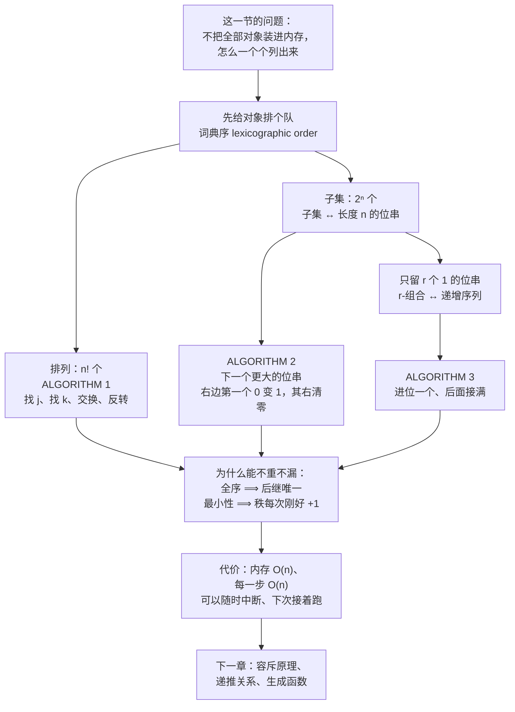

# C6.6 生成排列与组合 Generating Permutations and Combinations

> [!abstract] 这一讲的任务
> 前五讲一直在**数**：一共有多少个排列、多少个组合。这一讲把问题翻过来——**把它们一个一个写出来**。
> 数得清不等于列得出。$n=10$ 时 $10! = 3\,628\,800$，还行；$n=12$ 时 $12! = 479\,001\,600$，一条 64 字节的表示就是 30 GB，内存已经装不下了。
> 于是问题被逼成一个**局部**问题：**给我一个排列，怎么算出“下一个”？** 这一讲给出三把钥匙——下一个排列、下一个更大的位串、下一个 $r$-组合——最后说清它们凭什么能**不重不漏**地把整个集合走一遍。

> [!info] 怎么读这份讲义
> 第 1–3 节讲排列，核心是 ALGORITHM 1 的四个动作；第 4–5 节讲组合，先换成位串、再回到 $r$-组合；第 6 节是这一节的**思想**——只背伪代码、不读第 6 节，题目一变形就不会了。
> 前置知识：阶乘与求和记号见 [[C2.4 序列与求和 Sequences and Summations]]；$r$-排列与 $r$-组合的区别见 [[C6.3 排列与组合 Permutations and Combinations]]；“组合就是子集、子集就是位串”这个视角来自 [[C6.5 广义排列与组合 Generalized Permutations and Combinations]]；第 6 节会把“不重不漏”写成量词，写法见 [[C1.5 嵌套量词 Nested Quantifiers]]。



---

## 0. 开场：跑不完的流水线

你在给一个推理框架做算子调度的穷举验证。手上有 12 个算子，框架允许它们**按任意顺序**串成一条流水线，你要把每一种顺序都跑一遍，看有没有哪种顺序会触发数值溢出。

12 个算子的全排列是

$$12! = 479\,001\,600$$

将近 4.8 亿种。你顺手写了 `itertools.permutations` 想一次性列出来——还没跑完就被系统杀掉了：每个排列按 Python 里最省的表示也要几十字节，4.8 亿条就是 **30 GB 起**，而那台跑测试的机器只有 8 GB 内存。

于是你把脚本改成**分批**跑：

- 每批处理 $8! = 40\,320$ 个排列，总共 $12!/8! = 11\,880$ 批；
- 每批跑完，把**这一批的最后一个排列**写进一个断点文件；
- 机器重启、或者你按 Ctrl-C 之后想继续，就读出断点，问自己一个问题：

> **这个排列的“下一个”是谁？**

不许从头开始，也不许把已经跑过的重新跑一遍——重一个白烧算力，漏一个就是没测到。

你刚才提出的这个问题，就是这一整节的内容。**给定一个对象，算出它的下一个**；把这件事重复做下去，就得到整个集合的一次完整遍历。这一讲要给的，是三个集合（排列、子集、$r$-组合）各自的“下一个”怎么算。

**为什么不能干脆排个序？** 因为我们根本没有那个数组。排序的前提是你先把 $n!$ 个东西拿在手里，而我们要解决的恰恰是“拿不到”。所以“下一个”必须是一个**只依赖当前这一个对象**的局部规则——这也是这一节所有算法共有的形状。

---

## 1. 词典序：先给排列排个队（p.435）

### 1.1 说清“谁在前”

“下一个”要先有“顺序”。$n$ 个正整数 $1,2,\dots,n$ 的排列有 $n!$ 个，我们按英文词典处理单词的办法给它们排队：

> [!important] 定义（词典序 Lexicographic Order，也叫字典序 Dictionary Order）
> 设 $a_1a_2\cdots a_n$ 与 $b_1b_2\cdots b_n$ 是两个排列。若存在 $k$（$1\le k\le n$）使得
> $$a_1=b_1,\quad a_2=b_2,\quad\dots,\quad a_{k-1}=b_{k-1},\quad\text{而}\quad a_k<b_k$$
> 就说 $a_1a_2\cdots a_n$ **按词典序先于** $b_1b_2\cdots b_n$。
>
> 一句话：**从左往右比，第一个不相同的位置上谁小谁在前。**

### 1.2 为什么“词典序”这个名字贴切

> [!question] 停一下，先自己想想
> 英文单词不都是等长的，排列却都是 $n$ 位。既然如此，“字典序”这个比喻到底贴在哪里？

贴的地方在于**比大小的规则完全一样**。查词典时你比较 `apple` 和 `apricot`：先比第 1 个字母（都是 `a`），再比第 2 个（都是 `p`），第 3 个 `p` 对 `r` —— `p` 在前，所以 `apple` 在前。**你从来不需要知道这两个词有多长、后面还剩几个字母**，只要在第一个分歧处停下就行。

排列也是这样：`23415` 和 `23514` 前两位都是 `23`，第三位 `4 < 5`，所以

$$23415 \prec 23514$$

（这里用 $\prec$ 表示“按词典序先于”，避免和数值大小混淆。）同样的道理，`41532` 与 `52143` 第一位就分歧，$4<5$，所以 $41532\prec 52143$。这就是教材的**例 1**。

> [!example] 例 1（p.435）
> 排列 $23415$ 先于 $23514$：两者前两位相同，但第一个排列第 3 位的 $4$ 小于第二个排列第 3 位的 $5$。
> 同理，排列 $41532$ 先于 $52143$（第 1 位 $4<5$）。
> （已用程序核对两个比较都成立。）

### 1.3 两件必须马上确认的事

第一，**不会有两个排列“一样大”**。若两个排列处处相等，它们就是同一个排列；只要不同，就一定存在第一个分歧位置，那里必有大小之分。所以这是一个**全序**（total order）：任意两个不同的排列都能比出先后，没有并列。这件事在第 6 节会变成“不重”的根据。

第二，**最小和最大是谁**。最小值显然是

$$123\cdots n$$

（第一位就已经不能再小了）；最大值是

$$n\;n-1\;n-2\;\cdots\;2\;1$$

（每一位都不能再大了）。这两端一个是我们枚举的**起点**，一个是**终点**——从 $123\cdots n$ 出发，反复求“下一个”，走 $n!-1$ 次就到了最大值，路上一个不漏地经过全部 $n!$ 个排列。

---

## 2. 从一个具体排列出发，把“下一个”逼出来（p.435）

先别急着要一般公式。我们从最右边开始试，看看**要多远才能动**。取一个排列

$$a=2\,3\,4\,1\,5\,6$$

### 2.1 先试最省事的：交换最后两位

如果 $a_{n-1}<a_n$，把最后两位一换，得到的排列就更大（前 $n-2$ 位没动，第 $n-1$ 位变大）。而且**它已经是最接近的了**：任何比 $a$ 大的排列，前 $n-2$ 位若和 $a$ 一样，那第 $n-1$ 位必须 $>a_{n-1}$，而尾部只剩两个数，可选的只有 $a_n$，所以那一位只能是 $a_n$——位置 $n-1$、$n$ 上的内容被完全钉死，中间塞不下别的排列。

对上例：$a_5=5<a_6=6$，交换末两位得

$$234156\;\longrightarrow\;234165$$

这就是 $234156$ 的下一个排列。

反过来，若 $a_{n-1}>a_n$（末两位已经在降序），末两位怎么换都只会变小——**必须往前找**。

### 2.2 再看最后三位

设 $a_{n-2}<a_{n-1}$，而 $a_{n-1}>a_n$（最后三位形如“升、降”）。这时最后三位重排之后能变大：位置 $n-2$ 要放一个比 $a_{n-2}$ 大的数，而候选是 $a_{n-1},a_n$ 里那些比 $a_{n-2}$ 大的；要在候选里挑**最小**的那个放上去，再把原 $a_{n-2}$ 和没被挑中的那个候选按**升序**摆在最后两位——这样才最接近原排列。

对上例：$a=234165$，最后三位 $1,6,5$。$a_4=1<a_5=6$，候选 $\{6,5\}$ 里比 $1$ 大的最小者是 $5$；把 $5$ 放到第 4 位，剩下的 $1,6$ 升序摆在末尾，得

$$234165\;\longrightarrow\;234516$$

### 2.3 为什么“再往前”就等于“从右往左找第一个升序对”

> [!question] 课堂追问
> 如果最后三位也不行（$a_{n-2}>a_{n-1}>a_n$），是不是就要看最后四位、五位……每次都单独推一遍？有没有一刀切的说法？

有。关键观察只有一句：

> [!important] 核心观察
> 取**最后一个**升序对 $a_i<a_{i+1}$，就同时拿到两件事：**位置 $i$ 左边的东西一个都不用动**，而且**位置 $i$ 右边那一段必然是严格降序的**。

**凭什么右边一定是降序？** 因为我们取的是**最后一个**升序对。若 $i$ 右边还存在别的升序对 $a_t<a_{t+1}$（$t>i$），那 $t$ 才是更靠右的升序对，与“最后一个”矛盾。所以 $a_{i+1}>a_{i+2}>\cdots>a_n$，即右边整段严格降序。

**而“严格降序”这四个字正是全部秘密所在**：一段降序的数，是它自己所有重排里**词典序最大**的那一种。所以只要尾巴还是降序，光在尾巴内部怎么折腾都变不大——**必须把位置 $i$ 上的数换掉**。这就解释了为什么“往前找”这件事会在第一个升序对处停下：

- 右边是降序 $\Rightarrow$ 尾巴内部动不了 $\Rightarrow$ 想变大只能动第 $i$ 位；
- 而 $i$ 是最后一个升序对 $\Rightarrow$ 位置 $i$ 右边全是降序，第 $i$ 位确实能变大（换成 $a_{i+1}$ 就更大）。

于是“要不要往前看”这个看似没完没了的追问，被压缩成一句话：**从右往左扫描，遇到第一个 $a_j<a_{j+1}$ 就停**。这就是教材从最右两三位一步步试出来、最后归纳成的一般方法。

---

## 3. ALGORITHM 1：生成下一个词典序排列（p.436）

### 3.1 伪代码

```text
procedure next_permutation(a₁a₂…aₙ:  {1, 2, …, n} 的排列，
                           且不等于 n n−1 … 2 1)
    j := n − 1
    while aⱼ > aⱼ₊₁
        j := j − 1
    {此时 j 是满足 aⱼ < aⱼ₊₁ 的最大下标}
    k := n
    while aⱼ > aₖ
        k := k − 1
    {aₖ 是 aⱼ 右边比 aⱼ 大的最小整数}
    interchange aⱼ and aₖ
    r := n
    s := j + 1
    while r > s
        interchange aᵣ and aₛ
        r := r − 1
        s := s + 1
    {这使第 j 位之后的尾巴按升序排列}
    {a₁a₂…aₙ 现在就是下一个排列}
```

### 3.2 逐行读一遍：四个动作

**动作一：找 $j$。** `while aⱼ > aⱼ₊₁ : j := j−1` 从 $j=n-1$ 开始往左推，一旦 $a_j<a_{j+1}$ 就停。注意判断条件是**严格大于**，所以它一路掠过所有降序对，停在从右数第一处 $a_j<a_{j+1}$ 上。停下来的 $j$ 就是“最后一个升序对”的左端。

> [!warning] 三个容易写错的地方
> 1. **$j$ 的初值是 $n-1$，不是 $n$**。要比较的是相邻两位，下标从 $n-1$ 起刚好。
> 2. **循环条件 $a_j>a_{j+1}$ 只在“元素互异”时才够用。** 本节输入是 $1..n$ 的排列，元素互异，所以 $>$ 与 $\ge$ 在这里完全等价——**但这不代表 $>$ 是通用写法**。通用的写法是 $\ge$：多重集里“相等”的一对相邻元素不能靠交换来变大，必须继续往左找。用 $>$ 会在多重组 $122$ 上原地停下——$a_2=a_3=2$ 使条件不成立、循环立刻退出，接着交换 $a_2,a_3$ 得到它自己，算法失效。（已用程序验证：$\ge$ 版本给出 $122\to212\to221$，$>$ 版本卡死在 $122$。）
> 3. **输入排除了 $n\,n{-}1\cdots21$**。对最大排列，这个循环会一路退到 $j=0$ 再退成 $-1$；算法明确把这个输入排除在外，调用者必须自己判“到底了”。

**动作二：找 $k$。** `while aⱼ > aₖ : k := k−1` 从最右端 $k=n$ 往左扫，停在第一个满足 $a_j<a_k$ 的位置。因为尾巴 $a_{j+1},\dots,a_n$ 是降序的，从右往左走时 $a_k$ 的值**单调递增**；所以**第一个**满足 $a_j<a_k$ 的位置，给出的正是比 $a_j$ 大的最小者。

**这个循环一定会停**：$a_{j+1}>a_j$，所以最晚在 $k=j+1$ 处条件失败、循环退出。也就是说 $a_k$ 必然存在——这是算法正确性最容易被忽略、却必须交代的一步。

**动作三：交换 $a_j$ 与 $a_k$。** 这是唯一一处“把第 $j$ 位变大”的动作，也是唯一一次真正让排列变大。

**动作四：把尾巴反转。** $r$ 从 $n$ 往左、$s$ 从 $j+1$ 往右，两人对撞着交换，效果是把 $a_{j+1},\dots,a_n$ 整段**倒过来**。

**为什么“反转”就够了，不用排序？** 因为交换之后尾巴**仍然是降序**，而把一段降序反转恰好得到它所有重排中词典序最小的那一种。为什么仍然是降序？设 $a_j$ 换到了原来的第 $k$ 位。由 $a_k$ 的取法（尾巴里比 $a_j$ 大的**最小**者）可知：$j+1\le t\le k$ 时 $a_t>a_j$，$t>k$ 时 $a_t<a_j$。于是交换后 $a_{k-1}>a_k>a_j>a_{k+1}$ 成立（$k=j+1$ 或 $k=n$ 时对应的那一侧本就不存在，不用管），也就是说 $a_j$ 正好补进了降序链里它该待的那个空档，尾巴依旧严格降序。**注意这一步不是“排序”**——它只是“降序 → 升序”的一次翻转，一趟 $O(n)$ 的对撞交换就够，不需要任何比较排序。

### 3.3 例 2：把四步完整走一遍（p.436）

> [!example] 例 2（p.436）：$362541$ 之后的下一个词典序排列是什么？
> 拿 $a=3\,6\,2\,5\,4\,1$ 来走四个动作。

**动作一，找 $j$：** 从右往左看相邻对。

| 比较 | 结果 | 判断 |
|---|---|---|
| $a_5=4$ 与 $a_6=1$ | $4>1$ | 降序，继续往左 |
| $a_4=5$ 与 $a_5=4$ | $5>4$ | 降序，继续往左 |
| $a_3=2$ 与 $a_4=5$ | $2<5$ | **升序，停。$j=3$** |

所以 $j=3$，$a_j=2$；尾巴 $a_4a_5a_6=541$ 确实是严格降序。

**动作二，找 $k$：** 从右往左扫 $a_6=1,\;a_5=4,\;a_4=5$，问哪个比 $a_3=2$ 大。

| 检查 | 是否 $>2$ |
|---|---|
| $a_6=1$ | 否，继续 |
| $a_5=4$ | **是，停。$k=5$** |

所以 $k=5$，$a_k=4$。验算：尾巴 $\{5,4,1\}$ 里比 $2$ 大的有 $5$ 和 $4$，最小的是 $4$ ✓，与“第一个遇到的”一致。

**动作三，交换 $a_3$ 与 $a_5$：**

$$3\,6\,\boxed{2}\,5\,\boxed{4}\,1\;\longrightarrow\;3\,6\,\boxed{4}\,5\,\boxed{2}\,1 \;=\;364521$$

**动作四，反转 $a_4a_5a_6=521$：**

$$364\,\boxed{521}\;\longrightarrow\;364\,\boxed{125}\;=\;364125$$

> 所以 $362541$ 之后的下一个排列是 $\boxed{364125}$。
> （已用程序独立复算：$j=3$、$a_j=2$、$k=5$、$a_k=4$、交换得 $364521$、反转得 $364125$，与原文完全一致。）

下面这张图把四个动作排在四个面板里，每一步在“干什么”一目了然：

![[C6.6-字典序下一排列的四个动作.png]]

对照着图把四步再念一遍：**①从右往左找到最后一个升序对（$2<5$，$j=3$）；②在它右边挑出比它大的最小者（$4$）；③交换这一对（$364521$）；④把尾巴反过来（$364125$）。** 四步之后第 1、2 位一个数没动，第 3 位从 $2$ 涨到 $4$——只涨了“最小的一档”，这正是“下一个”的含义。

> [!note] 停一下，我们刚才干了什么
> 我们把一个“找下一个排列”的问题，拆成了**一次扫描、一次挑选、一次交换、一次反转**。四次操作全是 $O(n)$ 级别的，而且**只需要当前这一个排列**——不需要知道自己是第几个、也不需要知道前面是谁。
> 这句话是整节的枢纽：正因为“下一个”是局部的，我们才可以在内存装不下全部排列的机器上，随时中断、随时续跑。

### 3.4 例 3：从 $123$ 走到 $321$（p.436）

同一套规则用在 $n=3$ 上，$3!=6$ 个排列应该被一个不漏地走出来。

> [!example] 例 3（p.436）：按词典序生成 $1,2,3$ 的全部排列。
> **起点**是 $123$（词典序最小）。
>
> | 当前 | 找 $j$ | 找 $k$ | 交换后 | 反转后 = 下一个 |
> |---|---|---|---|---|
> | $123$ | $a_2=2<a_3=3$，$j=2$ | 尾巴只有 $3$，$k=3$ | $132$ | 尾巴只有 1 位，不变 → $\mathbf{132}$ |
> | $132$ | $a_1=1<a_2=3$，$j=1$ | 尾巴 $\{3,2\}$ 中比 $1$ 大的最小者是 $2$，$k=3$ | $231$ | 反转 $3,2\Rightarrow2,3$ → $\mathbf{213}$ |
> | $213$ | $a_2=1<a_3=3$，$j=2$ | 尾巴 $\{3\}$，$k=3$ | $231$ | 1 位不变 → $\mathbf{231}$ |
> | $231$ | $a_1=2<a_2=3$，$j=1$ | 尾巴 $\{3,1\}$ 中比 $2$ 大的最小者是 $3$，$k=2$ | $321$ | 反转 $2,1\Rightarrow1,2$ → $\mathbf{312}$ |
> | $312$ | $a_2=1<a_3=2$，$j=2$ | 尾巴 $\{2\}$，$k=3$ | $321$ | → $\mathbf{321}$ |
>
> 得到的序列是
> $$123,\;132,\;213,\;231,\;312,\;321$$
> 共 $3!=6$ 个，与原文一致。到 $321$ 时已无升序对（$j$ 会退到 $0$），**这就是终点**，不能再调用。
> （已用程序逐项复算，五个后继全部一致。）

原文对第 2 步（$132\to213$）的叙述是这样写的：“把 $3$ 和 $2$ 中较小的那个放到第 1 位，再把 $1$ 和 $3$ 按升序放在第 2、3 位”。这是把“3 个数的小窗口”直接说穿了，结论对；但**它跳过了“为什么是 $2$”**。按第 2 节的一般规则补上这一步：$j=1$、$a_j=1$；尾巴是 $3,2$，其中比 $1$ 大的有 $3$ 和 $2$，取**最小**者 $2$ 放到第 1 位；尾巴 $3,1$ 反转为 $1,3$。合起来 $213$。这里值得停一下的原因不是结论，而是**“取最小候选”这条规则是四步里唯一有选择的动作**——挑选错了，得到的就不是“下一个”而是“某一个更大的”。

### 3.5 走完整个集合

> [!important] 枚举全部 $n!$ 个排列
> 从词典序最小的 $123\cdots n$ 出发，把 `next_permutation` 连续应用 $n!-1$ 次，就按词典序走遍全部 $n!$ 个排列。

$n=4$ 时，从 $1234$ 出发走 $4!-1=23$ 次，得到

$$1234,1243,1324,1342,1423,1432,2134,2143,2314,2341,2413,2431,3124,3142,3214,3241,3412,3421,4123,4132,4213,4231,4312,4321$$

共 $24$ 个（已用程序复算，与按字符串排序的结果完全一致）。**验证枚举对不对，最快的办法就是把它和“直接排序的结果”比一遍**——这也是你在写这类代码时应该做的第一件事。

---

## 4. 组合这边：先换成位串与 ALGORITHM 2（p.437）

### 4.1 把子集编码成 0/1

排列是“有序的选取”，组合是“无序的选取”——组合就是**子集**。而子集最省事的表示法是位串（bit string）：

> [!important] 子集 ↔ 位串
> 设全集是 $\{a_1,a_2,\dots,a_n\}$。子集 $S$ 对应一个长度 $n$ 的位串，其中
> **第 $k$ 位是 $1$ $\iff$ $a_k\in S$**，第 $k$ 位是 $0$ $\iff$ $a_k\notin S$。

这是一个**一一对应**：每个子集给出唯一一个位串，每个位串也唯一确定一个子集。于是“列出全部子集”和“列出全部位串”是同一件事——共有 $2^n$ 个。

顺带一个熟悉的身份：长度 $n$ 的位串就是 $0$ 到 $2^n-1$ 之间某个整数的二进制展开。所以“按整数值从小到大列位串”和“按二进制数大小排队”也是一回事。

### 4.2 ALGORITHM 2：下一个更大的位串

规则用一句话就能说尽：**从右往左找第一个不是 $1$ 的位（也就是第一个 $0$），把它变成 $1$，并把它右边所有的位清零。**

直觉就是**二进制加法里的进位链**。数 $10111$ 加 $1$，从最低位开始：$1+1$ 进位、$1+1$ 进位、$1+1$ 进位，直到遇到那个 $0$，它被顶成 $1$，右边全归零，得 $11000$。

```text
procedure next_bit_string(bₙ₋₁bₙ₋₂…b₁b₀:  不等于 11…11 的位串)
    i := 0
    while bᵢ = 1
        bᵢ := 0
        i := i + 1
    bᵢ := 1
    {bₙ₋₁bₙ₋₂…b₁b₀ 现在就是下一个更大的位串}
```

**逐行读。** 下标是从最低位 $b_0$ 开始数的（和位串的书写方向相反，这是最容易看错的地方）。`while bᵢ = 1` 一边把当前位清零、一边往高位走，直到撞上第一个 $0$；`bᵢ := 1` 把这个 $0$ 顶成 $1$。循环体里“清零”和“前进”这两句的顺序可以互换，但**回到 `while` 判断之前必须先清零、再前进**，否则会死循环。

**输入限制**同样写在了过程头里：不能是 $11\cdots11$（即 $2^n-1$），因为那时循环会一直撞到下标 $n$ 越界。

> [!example] 例 4（p.437）：求 $10\,0010\,0111$ 之后的下一个位串。
> 从右往左标出下标：
>
> | 位置（从右数） | $b_0$ | $b_1$ | $b_2$ | $b_3$ | $b_4$ | $b_5$ | $b_6$ | $b_7$ | $b_8$ | $b_9$ |
> |---|---|---|---|---|---|---|---|---|---|---|
> | 位值 | $1$ | $1$ | $1$ | $0$ | $0$ | $1$ | $0$ | $0$ | $0$ | $1$ |
>
> 从右往左找第一个不是 $1$ 的位：$b_0,b_1,b_2$ 都是 $1$，$b_3=0$ —— **它就是“从右数第 4 位”**。
> 把 $b_3$ 变成 $1$，右边三位 $b_0b_1b_2$ 全清零：
> $$10\,0010\,\underbrace{0}_{\to 1}\,\underbrace{111}_{\to 000}\;\longrightarrow\;10\,0010\,1000$$
> （已用程序复算：$1000100111_2=551$，$1000101000_2=552$，正好差 $1$，与原文一致。）

> [!note] 顺带看一眼代价
> 单次调用最坏要走 $n$ 位（比如 $0111\cdots1\to1000\cdots0$），但**平均只走常数步**：把 $2^n$ 次调用加起来，每一位被翻转的总次数是固定的，总体是 $O(2^n)$。这和“给一个二进制计数器加 $n$ 次 $1$”是同一道摊销分析题。

### 4.3 那 $r$-组合呢？位串够用吗？

> [!question] 停一下，先自己想想
> 既然位串一一对应子集，而 $r$-组合只是“含 $r$ 个元素的子集”，那 $r$-组合的枚举是不是就是“把 ALGORITHM 2 的输出过滤一下，只留下有 $r$ 个 $1$ 的”？还有必要单独设计一个算法吗？

**可以这么干，但很浪费**，而且更糟的是——**ALGORITHM 2 的输出根本不停留在“恰好 $r$ 个 $1$”这一类里**。看一串连续的输出：

$$1\,1010\;(22)\;\longrightarrow\;1\,1011\;(23)\;\longrightarrow\;1\,1100\;(24)$$

从 $22$ 到 $23$，$1$ 的个数从 3 个变成 4 个；从 $23$ 到 $24$，又变回 2 个。要想只拿 3 个 $1$ 的位串，你得把 $2^n$ 个全部走一遍、边过滤边丢掉大半——当 $n=20,r=10$ 时，$2^{20}$ 是 $C(20,10)\approx 1.85\times10^5$ 的五倍多，白跑的量很大。

所以更值钱的做法是：**让“下一个”这一步本身就只在 $r$-组合内部走**。这需要换一种表示——不用位串本身，而用位串里那些 $1$ 所在的位置。

---

## 5. ALGORITHM 3：生成下一个 $r$-组合（p.437–438）

### 5.1 换一个表示：把子集写成递增序列

$r$-组合的本质是“$r$ 个元素的集合”，而集合没有顺序。为了谈“下一个”，我们给它**指定**一种书写方式：把元素**按升序**写成序列

$$a_1a_2\cdots a_r,\qquad a_1<a_2<\cdots<a_r$$

例如 $\{1,3,4\}$ 写成 $1,3,4$。有了这个约定，集合和递增序列就一一对应了，于是可以在**这些序列上**照搬第 1 节的词典序。

在这个序下：

- **最小**的 $r$-组合是 $\{1,2,\dots,r\}$ —— 每一位都已经最小；
- **最大**的 $r$-组合是 $\{n-r+1,\;n-r+2,\;\dots,\;n\}$ —— 每一位都已经不能再大（$a_i$ 最大只能取 $n-r+i$，否则后面就凑不出足够的数）。

> [!important] 注意那个“上限” $n-r+i$
> 第 $i$ 个数 $a_i$ 最大能取到多少？它后面还要放 $r-i$ 个比它大的数，最多用到 $n$，所以
> $$a_i\le n-(r-i)=n-r+i$$
> 这个算式是 ALGORITHM 3 的全部骨架：**“$a_i=n-r+i$”就等于“第 $i$ 位已经顶格了”**。

### 5.2 规则与伪代码

于是“下一个”要做的事和排列那边**结构完全一样**，只是找的东西从“升序对”换成了“没顶格的那一位”：

1. 从右往左找到**最后一个没顶格**的 $a_i$（即 $a_i\ne n-r+i$）；
2. 把它**加一**；
3. 它后面的每一位，紧接着排成连续整数。

第 3 步的作用和排列那边的“反转尾巴”一模一样：**把尾巴重新压到最小**。

```text
procedure next_r_combination({a₁, a₂, …, aᵣ}:  {1, 2, …, n} 的真子集，
                             且不等于 {n−r+1, …, n}，
                             且 a₁ < a₂ < ⋯ < aᵣ)
    i := r
    while aᵢ = n − r + i
        i := i − 1
    aᵢ := aᵢ + 1
    for j := i + 1 to r
        aⱼ := aᵢ + j − i
    {{a₁, a₂, …, aᵣ} 现在就是下一个组合}
```

**逐行读。**

`while aᵢ = n − r + i : i := i − 1` 从最右端往回退，跳过所有顶格的位。注意这里的判断**不像排列那样依赖相邻两位**，而是直接拿 $a_i$ 和它自己的上限 $n-r+i$ 比——这是它和 ALGORITHM 1 最大的结构差别。

`aᵢ := aᵢ + 1` 是唯一的“进位”动作。**只在第 $i$ 位上加一，这正是“最小幅度变大”的体现**：位置 $i$ 左边一位不动，右边全部重排成最小。

`for j := i + 1 to r : aⱼ := aᵢ + j − i` 就是“后面接着排满”，等价于 $a_{i+1}=a_i+1,\;a_{i+2}=a_i+2,\dots$。

> [!warning] 两处边界，考试爱考
> 1. **过程头要求“真子集 proper subset”**。这不是随便写的：若 $r=n$，整个集合只有一个 $r$-组合，而且是最大的那一个，既没有“下一个”，$i$ 也会一路退到 $0$。所以 ALGORITHM 3 **只在 $r<n$ 时有意义**。
> 2. **`for` 循环的下标从 $i+1$ 起**，$a_i$ 自己已经被上一层加过了，不能再被覆盖一遍。写成 `for j := i to r` 会把 $a_i$ 冲掉。

### 5.3 例 5：走一遍（p.437）

> [!example] 例 5（p.437）：求 $\{1,2,3,4,5,6\}$ 在 $\{1,2,5,6\}$ 之后的下一个 $4$-组合。
> 这里 $n=6,\;r=4$，所以 $a_i$ 的上限是 $n-r+i=2+i$。
>
> 先算每个位置的上限，再逐个核对“顶格了没有”：
>
> | $i$ | $a_i$ | 上限 $2+i$ | 顶格？ |
> |---|---|---|---|
> | $1$ | $1$ | $3$ | 没顶格（$1\ne3$） |
> | $2$ | $2$ | $4$ | **没顶格（$2\ne4$）** |
> | $3$ | $5$ | $5$ | 顶格 |
> | $4$ | $6$ | $6$ | 顶格 |
>
> 从右往左找**最后一个**没顶格的：$i=4$ 顶格、$i=3$ 顶格、$i=2$ 没顶格 —— **$i=2$**。
> 进位：$a_2:=2+1=3$。
> 后面接着排：$a_3=3+1=4$，$a_4=3+2=5$。
> 于是下一个 $4$-组合是
> $$\boxed{\{1,3,4,5\}}$$
> （已用程序复算：把 $\{1,\dots,6\}$ 的全部 $C(6,4)=15$ 个 $4$-组合按词典序列出来，$\{1,2,5,6\}$ 排在第 $6$ 位，它的下一个正是 $\{1,3,4,5\}$，与原文一致。）

### 5.4 把 $1,2,3,4,5$ 的 $3$-组合走一遍

同一套规则用在 $n=5,r=3$ 上，$C(5,3)=10$ 个组合应当被一个不漏地走出来。上限是 $n-r+i=2+i$。

| 当前 | 最后一个没顶格的位置 | 进位后 + 后续排满 = 下一个 |
|---|---|---|
| $1,2,3$ | $i=3$（$3\ne5$） | $1,2,4$ |
| $1,2,4$ | $i=3$（$4\ne5$） | $1,2,5$ |
| $1,2,5$ | $i=2$（$5$ 顶格，$2\ne4$） | $1,3,4$ |
| $1,3,4$ | $i=3$（$4\ne5$） | $1,3,5$ |
| $1,3,5$ | $i=2$（$3\ne4$） | $1,4,5$ |
| $1,4,5$ | $i=1$（$1\ne3$） | $2,3,4$ |
| $2,3,4$ | $i=3$（$4\ne5$） | $2,3,5$ |
| $2,3,5$ | $i=2$（$3\ne4$） | $2,4,5$ |
| $2,4,5$ | $i=1$（$2\ne3$） | $3,4,5$ |
| $3,4,5$ | 全部顶格 | **终点，停** |

得到的完整列表是

$$\{1,2,3\},\{1,2,4\},\{1,2,5\},\{1,3,4\},\{1,3,5\},\{1,4,5\},\{2,3,4\},\{2,3,5\},\{2,4,5\},\{3,4,5\}$$

共 $C(5,3)=10$ 个（已用程序复算，与按词典序排序的结果逐项一致）。

下面这张图把这 $10$ 个组合和它们的位串竖排对齐，并按同一顺序标出值的走向：

![[C6.6-生成组合的位串对应.png]]

这张图里有一件**必须点出来、否则极易搞错**的事。

> [!warning] 位串的“下一个”和 $r$-组合的“下一个”，方向是**相反**的
> 看图上的 value 列，从上往下读是 $28,26,25,22,21,19,14,13,11,7$ —— **严格递减**。也就是说：**$r$-组合的词典序，正好等于对应位串按整数值的降序。**
>
> 这不是巧合，可以一句话证完。设两个组合 $C\ne C'$ 在递增序列下 $C\prec C'$，第一个分歧出现在第 $i$ 位，即 $a_i<a'_i$，而前 $i-1$ 位相同。那么两个位串在 $a_1,\dots,a_{i-1}$ 这些位置上都是 $1$；在位置 $a_i$ 上，$C$ 的位串是 $1$，而 $C'$ 的位串是 $0$（因为 $C'$ 比 $a_i$ 小的元素正好只有前 $i-1$ 个）。两个位串在 $a_i$ 之前处处相同，在 $a_i$ 处一个 $1$ 一个 $0$，所以 $C$ 的位串**整数值更大**。$\Rightarrow$ 组合越靠前，位串值越大。（已用程序在 $n=3..8$ 的全部 $r$ 上逐一验证：两个序恰好互为逆序。）
>
> **但千万不要由此以为“走一步 ALGORITHM 3 = 走一步 ALGORITHM 2”。** ALGORITHM 2 走的是**全部** $2^n$ 个位串，它在“恰好 $r$ 个 $1$”这一类里**不进不出才怪**：从 $11010$（4 中取 3 的组合）走一步得 $11011$ —— $1$ 的个数变成 $4$，已经跳出这一类了。正确的说法是：**把 ALGORITHM 2 的全部输出里“恰好 $r$ 个 $1$”的那些**挑出来（保持它们的先后），得到的序列正好是上面这张表的**逆序**。两者枚举的是同一个集合，只是方向相反。
>
> 所以 $r$-组合要有自己的算法（ALGORITHM 3），而不能靠“给位串加 $1$ 再筛”。
>
> 顺带说明图上那一步：$\{1,3,4\}\to\{1,3,5\}$ 对应的位串是 $10110\;(22)\to10101\;(21)$ —— 值降了 $1$，是因为 $21$ 和 $22$ 之间没有别的“$3$ 个 $1$”的位串。而 $\{1,2,3\}\;(28)\to\{1,2,4\}\;(26)$ 值降了 $2$，因为中间的 $27=11011$ 有 $4$ 个 $1$，不在这一类里。**这就是“降序”而不是“逐个减一”的原因。**

---

## 6. 为什么这三个算法合起来能“不重不漏”（p.436–438）

三个算法给了三段代码，但这一节真正的成果是一个**思想**。不过在讲这个思想之前，先把一个必须问清楚的问题摆出来——前面每一节我们都在验算“这一步得到的确实是下一个”，却始终没回答**为什么这样一路走下去就一定是全部**。

> [!question] 课堂追问
> 三个算法各自“给出下一个”都验过了：例 2 对、例 3 六个排列一个不漏、例 5 对、$3$-组合十个一个不漏。可是**逐个例子都对**和**保证永远对**是两回事。
> 换成 $n=12$、换成 $r=7$，凭什么还敢说“走 $N-1$ 次就是全部、一个不重一个不漏”？这里要用的是**证明**，不是更多的例子。

不把这件事讲透，考试换个集合（比如“生成全部 $r$-排列”）就无从下手。下面分三步回答。

### 6.1 “不重不漏”到底在说什么

先用量词把要求写死。设 $S$ 是要枚举对象的集合（$n!$ 个排列、$2^n$ 个位串、$C(n,r)$ 个 $r$-组合），设 $\sigma(x)$ 表示算法给出的“下一个”。要求是：

$$\forall x\in S\setminus\{\max S\}\;\exists!\,\sigma(x)\in S,\qquad \text{且}\ \ x\prec\sigma(x)$$

（“存在唯一”这个 $\exists!$ 的写法见 [[C1.5 嵌套量词 Nested Quantifiers]]。）要求里有两件事，正好对应“不重”和“不漏”：

- **“$\,\exists!\,$”（存在且唯一）**保证**不重**：每个对象只有唯一的后继，不会走到岔路上，也不会两条路撞到一起；
- **“$x\prec\sigma(x)$ 且 $\sigma$ 无跳跃”**保证**不漏**：每一步只往前进“一格”，中间的格子里没有东西被跳过。

所以要证的就是这两条。下面按“先证唯一、再证最小性、最后收尾”三步走。

### 6.2 第一步：后继唯一，来自全序

> [!important] 唯一性几乎是免费的
> 词典序是一个**全序**（第 1.3 节已确认：任意两个不同对象都能比出先后，没有并列）。在一个全序里，“比 $x$ 大的最小者”这种东西**只能有一个**——如果 $y\ne y'$ 都声称自己是最小的，那 $y\prec y'$ 或 $y'\prec y$ 必有一个成立，就有一个不是最小的。
>
> 所以**不重**这件事不需要逐案检查，它是“我们选对了序”的直接后果。

这也解释了一个设计动机：换一个不是全序的关系（比如“包含关系 $\subseteq$”），“下一个”就可能不止一个或多个都没有——那样根本没法用它做遍历。

### 6.3 第二步：证明算法给出的确实是“最小的那个更大的”

唯一性只说“最多有一个”，还得说明算法**确实找到了它**。**这正是教材两处写着“留给读者证明”的地方**，也是这一节最该补上的一段。

> [!important] ALGORITHM 1 的最小性（教材 p.435 留作习题的证明）
> 记算法从 $a=a_1\cdots a_n$ 得到 $a'$。设 $b$ 是任一满足 $a\prec b\prec a'$ 的排列，我们来导出矛盾。
>
> **① $b$ 必须和前 $j-1$ 位相同，且 $b_j>a_j$。**
> 如果 $b$ 在前 $j-1$ 位某个位置就和 $a$ 不同，那它是**更靠左**的分歧——$b$ 要么 $<a$ 要么 $>a'$，都出局。而既然前 $j$ 位中的前 $j-1$ 位都相同，要让 $b\succ a$，只能 $b_j>a_j$（若 $b_j=a_j$，后面那一段是降序的 $a_{j+1}\cdots a_n$，是它自身重排中的最大者，于是 $b\preceq a$，矛盾）。
>
> **② 候选里最小的就是 $a_k$。** 由 ①，$b_j$ 必须取自 $\{a_j,a_{j+1},\dots,a_n\}$ 中比 $a_j$ 大的数。算法挑的 $a_k$ 是其中**最小**的，所以 $b_j\ge a_k=a'_j$。
>
> **③ 两种情形都不可能。**
> - 若 $b_j>a'_j$：那么在第 $j$ 位上 $b$ 就比 $a'$ 大，直接得 $b\succ a'$，矛盾。
> - 若 $b_j=a'_j$：则第 $j$ 位之后，$b$ 与 $a'$ 用的是**同一个集合** $\{a_j\}\cup\bigl(\{a_{j+1},\dots,a_n\}\setminus\{a_k\}\bigr)$，只是排列方式可能不同。而 $a'$ 把这段排成了**升序**——升序是这段所有重排中词典序**最小**的。所以 $b\succeq a'$，矛盾。
>
> 两种情形都排除了 $a\prec b\prec a'$，故 $a'$ 就是 $a$ 的后继。$\blacksquare$
>
> 顺带把第 2 节欠的一个债还了：**动作三之后尾巴仍然降序**，所以动作四的“反转”得到的正是升序，第 ③ 步才用得上这句话。

> [!important] ALGORITHM 3 的最小性（教材 p.437 留作习题的证明）
> 记 $C=\{a_1<\cdots<a_r\}$，$i$ 是**最后一个没顶格**的位置，即 $a_i\ne n-r+i$。因为 $i$ 是最后一个，$t>i$ 时 $a_t=n-r+t$ —— **第 $t$ 位已经取到了它的最大值**（上限 $n-r+t$，见 5.1）。候选记作 $a'$：$a'_i=a_i+1$，$a'_t=a_i+1+(t-i)$（$t>i$）。
>
> **① 候选本身是合法的。** $a_{i-1}<a_i<a_i+1=a'_i$，其后逐项加一，严格递增；又由 $a_i\le n-r+i$ 且 $a_i\ne n-r+i$ 得 $a_i\le n-r+i-1$，于是 $a'_r=a_i+1+(r-i)\le n$，没有越界。
>
> **② 任何 $C'\succ C$，与 $C$ 的*第一个*分歧位置 $p$ 一定满足 $p\le i$。**
> 反设 $p>i$：那么 $C'$ 与 $C$ 在位置 $1,\dots,i$ 上完全相同，于是要 $C'\succ C$ 就得在第 $p$ 位有 $C'_p>a_p$；可是 $p>i$ 时 $a_p=n-r+p$ 已经是第 $p$ 位的**最大值**（后面还要放 $r-p$ 个数、最大只到 $n$，所以任何合法组合都有 $C'_p\le n-r+p$），矛盾。故 $p\le i$。
> （顺带得到：若 $C'$ 与 $C$ 在位置 $1,\dots,i$ 上全同，则 $C'=C$。）
>
> **③ 于是 $C'\succeq a'$。** 分两种情形：
> - **$p<i$：** 候选只从第 $i$ 位起才改动，所以 $a'_p=a_p<C'_p$ —— 在更靠左的位置 $C'$ 就更大，直接得 $C'\succ a'$。
> - **$p=i$：** $C'_i>a_i$，故 $C'_i\ge a_i+1=a'_i$。若 $C'_i>a'_i$，同样 $C'\succ a'$；若 $C'_i=a'_i$，则第 $i$ 位之后 $C'$ 是从 $\{a_i+2,\dots,n\}$ 中取的 $r-i$ 个递增数，而 $a'$ 取的是其中**最小**的那一段连续值 $a_i+2,a_i+3,\dots$，所以 $C'\succeq a'$。
>
> 两种情形都排除了 $C\prec C'\prec a'$，故候选就是 $C$ 的后继。$\blacksquare$
>
> **这里有个容易顺手写错的点**：不能断言“任何 $C'\succ C$ 都有 $C'_i>a_i$”。反例：$n=5,r=2$，$C=\{1,4\}$ 的 $i=2$，而 $C'=\{2,3\}$ 也满足 $C'\succ C$，但 $C'_2=3<a_2=4$。它并没有落在 $C$ 与候选 $a'=\{1,5\}$ 之间——分歧出现在更靠左的 $p=1$（$C'_1=2>a_1=1$），第 ③ 步的第一种情形（$p<i$）当场就把它挡在了候选的**上面**。**所以必须按“第一个分歧位置”分情形，不能盯着第 $i$ 位。**

### 6.4 第三步：收尾——为什么走 $N-1$ 次就一定是全部

有了“后继存在且唯一”，剩下的只是一个计数。

> [!important] 不漏的论证
> 设对象集合有 $N$ 个（$N=n!$、$2^n$ 或 $C(n,r)$）。从**最小元** $x_1$ 出发，反复取后继：
> $$x_1\prec x_2\prec x_3\prec\cdots$$
> 每次严格变大（$\prec$ 是真序），所以这一串里**不会出现重复**（不重）。
> 又因为 $S$ 是有限的、且有最大元 $x_N$，这一串不可能无限下去——它必须在某个时刻停在最大元上，而**能停下来的唯一原因就是“已经取到了最大元”**（其余每个元素都有后继可用）。
> 最后数一下：从最小到最大，按全序一步一步走，中间恰好经过 $N$ 个元素，所以序列长度正好是 $N$。既然它单调不重复、又恰好有 $N$ 项，它就**只能**是 $S$ 的全部元素（不漏）。$\blacksquare$
>
> 这句话落到操作上就是教材那句“连续应用 $n!-1$ 次”，也解释了为什么三个算法的过程头都要写一句“**不等于最大元**”——那是循环的终止条件，不是可有可无的说明。

### 6.5 三把钥匙的共同形状

回头把三个算法摆在一起看，会发现它们是**同一个设计模式**的三次套用：

| | ALGORITHM 1 | ALGORITHM 2 | ALGORITHM 3 |
|---|---|---|---|
| 对象 | 排列 | 长度 $n$ 的位串 | $r$-组合（递增序列） |
| 规模 | $n!$ | $2^n$ | $C(n,r)$ |
| 序 | 词典序 | 整数值升序 | 递增序列的词典序 |
| **① 从右往左找“还能动”的那一位** | 最后一个升序对 $a_j<a_{j+1}$ | 第一个不是 $1$ 的位 | 最后一个没顶格的 $a_i\ne n-r+i$ |
| **② 把它最小幅度变大** | 与右边比它大的最小者交换 | 该位清 $0$ 变 $1$ | $a_i$ 加一 |
| **③ 把右边压到最小** | 反转（降序→升序） | 右边全清零 | 后面接着排满 |
| 单步代价 | $O(n)$ | 摊销 $O(1)$ | $O(n)$ |
| 额外内存 | $O(n)$ | $O(n)$ | $O(n)$ |

**这张表就是这一节的成果。** 换个对象来枚举时，你要回答的只有三个问题：①从哪一端找“还能动”的一位？②怎么“最小幅度”地把它推大？③右边怎么“压到最小”？这三个问题答完，算法就出来了——教材习题里“生成全部 $r$-排列”要的正是这套动作。

> [!note] 这条路子省下了什么
> 全部额外内存只有**当前这一个对象**（$O(n)$），而不是全部 $n!$ 或 $2^n$ 个。这正是开场那个场景能成立的原因：**机器可以随时关机，重启后从断点读出一个排列，问一句“下一个是谁”，接着往下跑**。
> 作为对比：先把所有排列生成出来再排序，需要 $O(N)$ 内存和 $O(N\log N)$ 次比较；而这里只走 $N-1$ 步、每步 $O(n)$（合起来 $O(nN)$ 次基本操作），内存始终只有 $O(n)$——**在 $N$ 大到装不下的时候，省下的不是常数，而是“能不能做”的区别。**

---

## 这一讲的三句话

> [!success] 三句话
> 1. **“下一个”可以只依赖当前对象。** 只要先给对象集合找一个**全序**（排列用词典序、位串用整数值、$r$-组合用递增序列的词典序），“下一个”就是一个 $O(n)$ 的局部动作，枚举全集的额外内存只有 $O(n)$。
> 2. **三个算法的形状是同一条：从右往左找“还能动”的一位 → 把它最小幅度推大 → 把右边压到最小。** 排列是“最后一个升序对 + 交换 + 反转”，位串是“第一个非 1 位 + 置 1 + 清右”，$r$-组合是“最后一个没顶格位 + 加一 + 后面排满”。
> 3. **不重不漏 = 全序带来的后继唯一 + 最小性保证的“每步只进一格”。** 前者是免费的（选对了序就有），后者要靠最小性证明——**教材把这两处证明都留成了习题，它们是本节真正的考点**。

### 速查表

| 要生成 | 起点 | 终点（不可再调用） | 单步规则 | 总量 |
|---|---|---|---|---|
| $1..n$ 的全部排列（词典序） | $12\cdots n$ | $n\,n{-}1\cdots21$ | ①找最后的 $a_j<a_{j+1}$ ②在右边取 $>a_j$ 的最小者 $a_k$ ③交换 $a_j,a_k$ ④反转 $a_{j+1..n}$ | $n!$，走 $n!-1$ 步 |
| 长度 $n$ 的全部位串（值升序） | $00\cdots0$ | $11\cdots1$ | 从右找第一个 $0$，置 $1$，右边全清 $0$ | $2^n$ |
| $\{1..n\}$ 的全部 $r$-组合（词典序） | $\{1,2,\dots,r\}$ | $\{n{-}r{+}1,\dots,n\}$ | ①找最后的 $a_i\ne n-r+i$ ②$a_i{+}{=}1$ ③$a_j:=a_i+j-i$ | $C(n,r)$，需 $r<n$ |
| 子集 ↔ 位串 | — | — | 第 $k$ 位 $=1\iff a_k\in S$ | 一一对应 |
| $a_i$ 的取值上限 | — | — | $a_i\le n-r+i$（后面还要放 $r-i$ 个数） | — |
| 组合序 vs 位串值序 | — | — | $r$-组合的词典序 **=** 对应位串按整数值的**降序**（严格逆序） | — |
| 单步代价 | — | — | 排列 $O(n)$；位串摊销 $O(1)$；$r$-组合 $O(n)$ | 额外内存 $O(n)$ |

**本节全部数值均已用程序独立复算，与教材一致，未发现印刷错误。** 复算范围包括：例 1 的两个序关系；例 2 的 $j=3,k=5$ 与 $362541\to364125$；教材中 $234156\to234165$、$234165\to234516$ 两处小步；例 3 的 $123\to132\to213\to231\to312\to321$；$1234$ 的全部 $24$ 个排列；例 4 的 $10\,0010\,0111\to10\,0010\,1000$（$551\to552$）；例 5 的 $\{1,2,5,6\}\to\{1,3,4,5\}$；$\{1,\dots,5\}$ 的全部 $10$ 个 $3$-组合；以及“组合序 = 位串值逆序”这条命题在 $n=3,\dots,8$ 的全部 $r$ 上逐一验证。

两处**原文表述需要注意**（不是数值错误，但会误导）：

- **例 3 的叙述跳了一步。** 原文处理 $132\to213$ 时直接说“把 $3$ 和 $2$ 中较小的那个放到第 1 位”，结论正确，但没有交代“为什么是 $2$”。按一般规则应当是：$a_j=1$，在尾巴 $\{3,2\}$ 里取比 $1$ 大的**最小**者 $2$。这一句不能省，因为“取最小候选”是四步里唯一带选择的动作。
- **ALGORITHM 3 的过程头写明输入是“真子集 proper subset”。** 这等于隐含要求 $r<n$；$r=n$ 时只有一个组合且已是最大元，$i$ 会退到 $0$ 越界。这个边界原文只体现在过程头的措辞里，容易读漏。
- **本节末尾的 Exercises 是这一章的作业，本讲不抄录。**

---

## 下一讲预告

到这里，第 6 章就结束了。回头看这条线：我们先学会**数**（加法原理、乘法原理、鸽巢原理），再学会**数的公式**（$P(n,r)$、$C(n,r)$、二项式恒等式），然后学会**带着重复和不可区分去数**（星条法、可重排列），最后这一讲学会**把数出来的东西真的列出来**。

这三步其实是一件事的三个层次：**先知道有多少，再知道为什么是这么多，最后知道它们具体长什么样。** 只要能列出全部对象，一切“存在性”问题就都有了底——找反例、验最优解、做压力测试，都是先枚举再判断。

但计数这件事还有一大块没碰：**当“直接数”数不出来的时候怎么办。** 举三个会立刻卡住的例子：

- 要求“至少满足其中一个条件”的个数——把各自的数量加起来会**重复计算交集**，得一层层减回去；
- 数量随规模**递归地**增长，比如斐波那契型或卡特兰型的计数，没有闭式公式，只能自己定义序列再求通项；
- 要数的东西本身是一整族，每族一个数，**与其逐个求值，不如把它们打包成一个幂级数的系数**，用代数运算一次处理整族。

这三件事对应的正是下一章（第 8 章 高级计数 Advanced Counting）的三件工具：**容斥原理**、**递推关系的系统解法**、**生成函数**。而且它们全都踩在你这几讲打的地基上——容斥原理的每一项都是本节这种“从 $n$ 个里取 $r$ 个”的组合数；递推关系要靠这一章的组合意义才能建出方程；生成函数则是把 $C(n,r)$ 这种系数当成序列来做代数。**下一章会把“数”从算术变成代数。**

最后一句话留给你自己判断：**既然“下一个”能算，那“第几个”能不能反着算？** 给定一个排列，能不能直接说出它在词典序里排第几、以及第 $k$ 个排列长什么样？这个“排名与反排名”的问题，是本节算法的直接延伸，也是很多工程场景（分页、随机抽样、稳定哈希）真正需要的东西。

---

**上一节** ← [[C6.5 广义排列与组合 Generalized Permutations and Combinations]]
**下一章** → 第 8 章 高级计数 Advanced Counting（容斥原理、递推关系、生成函数；该章笔记尚未建立，故此处不设双链）
**本章索引** → [[C6 计数 Counting MOC]]
