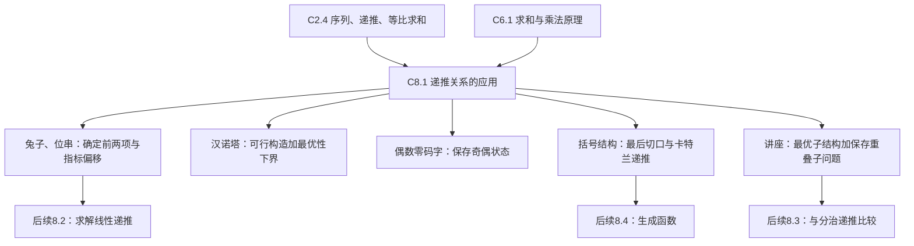

# C8 高级计数技巧 Advanced Counting Techniques MOC

> [!abstract] 这一章从哪里接着往下走
> [[C6 计数 Counting MOC]] 教我们把分类相加、分步相乘。现在相邻限制让分支数依赖先前状态，括号结构又随着规模递归生长。我们先把“当前有多少”写成“此前有多少”的关系，再讨论怎样求解或高效计算。
> 当前已整理 **§8.1一篇**，本页只为已完成内容提供入口；其余节号保留为教材路线，不代表已有笔记。

## 📖 本章笔记索引

| 笔记或分节 | 材料范围 | 核心问题 | 状态 |
|---|---|---|---|
| [[C8.1 递推关系的应用 Applications of Recurrence Relations]] | §8.1，pp.501–510；习题1、30–31、53–55在pp.510–513 | 怎样从对象结构建递推，并用动态规划求最优值和方案 | 已整理；课堂进度待确认 |
| §8.2 Solving Linear Recurrence Relations | 未整理 | 怎样从线性递推得到通项 | 待建设，无空链接 |
| §8.3 Divide-and-Conquer Algorithms and Recurrence Relations | 未整理 | 怎样用递推分析分治算法 | 待建设 |
| §8.4 Generating Functions | 未整理 | 怎样用幂级数处理序列与卡特兰数 | 待建设 |
| §8.5–§8.6 Inclusion–Exclusion及应用 | 未整理 | 多类计数重叠怎样逐层修正 | 待建设 |

## 🗺️ 内容地图与阅读顺序

阅读路线沿用当前课程由第6章转入第8章的衔接，不把尚未整理的第7章当作已建入口。先从 [[C6.6 生成排列与组合 Generating Permutations and Combinations]] 进入8.1；若对序列指标或求和陌生，先补 [[C2.4 序列与求和 Sequences and Summations]]；若不清楚分类为何相加、左右结构为何相乘，补 [[C6.1 计数基础 The Basics of Counting]]。

8.1保持教材的“增长与操作过程 → 位串与码字 → 括号结构 → 动态规划”顺序，未重新拆篇或调整编号。例3承接开场控制码任务；例5的生成函数证明明确留给8.4，当前通过递推及小规模枚举建立可用结论；例6先求前驱，再用习题54的实际权重填表与恢复方案，区分“有时间表”与“已给出优化输入”。

## 📐 主要公式与使用条件

所有计数均为离散个数；兔子按“对”、汉诺塔按“次”、调度按“人次”。下列公式及推导均在 [[C8.1 递推关系的应用 Applications of Recurrence Relations]] 的对应段落。

| 名称与位置 | 公式 | 符号、条件及容易混淆处 |
|---|---|---|
| 细菌，§1 | $a_n=2a_{n-1}=5\cdot2^n$ | $a_0=5$；每小时翻倍；$n$为小时数 |
| 兔子，§2.1 | $f_n=f_{n-1}+f_{n-2}$ | $n\ge3$，$f_1=f_2=1$；无死亡，按题设月龄繁殖 |
| 三柱汉诺塔，§2.2 | $H_n=2H_{n-1}+1=2^n-1$ | $n\ge1$，$H_0=0$；三柱、单盘移动、大盘不可压小盘 |
| 禁止 `00` 的位串，§3 | $a_n=a_{n-1}+a_{n-2}=f_{n+2}$ | $a_0=1,a_1=2$；递推从$n=2$起；$a_n$不是$f_n$ |
| 偶数零码字，§4 | $a_n=8a_{n-1}+10^{n-1}=(10^n+8^n)/2$ | $a_0=1$，$n\ge1$；十进制字符串、允许前导零、0次为偶数 |
| 卡特兰数，§5 | $C_n=\sum_{k=0}^{n-1}C_kC_{n-k-1}$；$C_n=\binom{2n}{n}/(n+1)$ | $C_0=1$；$n+1$个有序因子；递推已证，闭式系统证明留给8.4 |
| 卡特兰增长，§5 | $C_n\sim4^n/(n^{3/2}\sqrt\pi)$ | $n\to\infty$时比值趋于1 |
| 调度前驱，§6.2 | $p(j)=\max\{i<j:e_i\le s_j\}$，空集时0 | 按结束时间排序；$s_j<e_j$；端点相等允许相接 |
| 调度最优值，§6.3–6.5 | $T(j)=\max\{w_j+T(p(j)),T(j-1)\}$ | $T(0)=0$；$w_j$是听众人次，$T(j)$是前$j$场最优值 |
| 动态规划复杂度，§6.5 | 填表$O(n)$；含排序与二分前驱$O(n\log n)$；空间$O(n)$ | 逐一扫描求前驱则预处理最坏$O(n^2)$ |

## 📌 Key Terms 术语表

| 中文 | English |
|---|---|
| 递推关系、初始条件、解 | recurrence relation, initial conditions, solution |
| 斐波那契数、汉诺塔、码字 | Fibonacci numbers, Tower of Hanoi, codeword |
| 完整加括号、卡特兰数 | parenthesization, Catalan numbers |
| 相容、权重、前驱 | compatible, weight, predecessor |
| 最优子结构、重叠子问题 | optimal substructure, overlapping subproblems |
| 动态规划、记忆化、填表 | dynamic programming, memoization, tabulation |
| 分治 | divide-and-conquer |

## 🕒 来源与授课进度

- **教材身份**：Kenneth H. Rosen，*Discrete Mathematics and Its Applications*，第7版，2012，英文，ISBN 978-0-07-338309-5。现有第6章独立PDF的印刷页码与正文与此版相符，继续使用该版，未切换为本机另存的中文第8版。
- **原件**：本机 `Downloads/QQ_Files/Discrete-Mathematics-and-Its-Applications.pdf`。本次把原书物理页522–535节选存入 `pdfs/第八章第一节.pdf`，便于以后在库内核查。其物理页1–10对应印刷页501–510的本节正文；后4页保留完整习题及末页的下一节开头。本讲不是全部57道课后题的题解集。
- **当期讲授**：**第 19 节课（10 月中）用约半节课讲了 §8.1**——递推关系的建立（汉诺塔、括号结构、位串）与"保存重叠子问题"的动态规划思想，配套课件是 `Ch8.1.pdf`（10-15，4 页）。老师的原话是"第 8 章只要掌握递推这部分"，**§8.2–§8.6 本学期没有讲**，所以本页索引表里那些节名仍只是路线图，不代表已有内容。本篇正文按教材把 §8.1 写全，转写稿没讲到的深挖部分（如 Frame–Stewart 四柱最优性、闭式的生成函数证明）已按【拓展】处理。
- **笔迹检查**：正文10页逐页提取文本、检查PDF注释并渲染回看，0处手写、0页含手写，未发现Ink注释；教材图的线条和字体清楚。选用习题所在页另做原图核查。没有PPTX或动画序列，本次没有跳过或合并动画页。
- **教学补足**：补全汉诺塔上下界与归纳证明、位串双向对应与接缝检查、码字奇偶双状态及闭式、卡特兰下标来源、调度替换论证与表格、平局回溯和预处理复杂度。它们是数学核验后的说明，不构成当期授课证据。
- **历史旁注**：四柱汉诺塔“尚未解决”的旧说已更新。依据 [Bousch，La quatrième tour de Hanoï（2014）](https://www.imo.universite-paris-saclay.fr/~thierry.bousch/preprints/revespzl.pdf) 的摘要及引言，四柱Frame–Stewart最优性已证；没有把该结论外推到任意柱数。

## ⚠️ 材料问题与处理落点

| 原位置 | 问题 | 影响及涉及篇目 | 处理与状态 |
|---|---|---|---|
| p.508定义调度输入 | 开始时间先记作$t_j$，定义$p(j)$时改用$s_j$ | C8.1 §6.2；容易以为多了一个时间变量 | 全文统一为$s_j$；原符号变化在此保留，已处理 |
| p.508末段 | 将前驱描述为“ends before”，而正式判据是$e_i\le s_j$ | C8.1 §6.2；若误用严格小于会丢失端点相接的合法安排 | 明确使用$\le$；例6的$p(6)=2,p(7)=4$验证端点相等，已处理 |
| pp.504–505及p.513四柱旁注 | 旧版称Frame–Stewart最优性未解决，并给出过时的算法年份叙述 | C8.1 §2.2四柱说明；历史状态会被误当现状 | 据Bousch 2014原论文更新最优性；不沿用未核验的年份叙事，已处理 |
| p.510算法1 | 排版把$T(0):=0$视觉上缩进到前驱循环内 | C8.1 §6.5；空输入时初始化不清楚，循环职责混淆 | 初始化单独放在填表前；空输入返回0，已处理 |
| p.510方案恢复句 | “第$j$场属于最优解当且仅当…”未区分存在一组与每一组 | C8.1 §6.4–6.5；平局时可能错误宣称所有最优解都必须选$j$ | 写明不等式保证存在可选$j$的最优方案；平局可任选，已处理 |
| p.509例6 | 只有时间，无$w_j$ | C8.1 §6.4；不能从原图独立推出唯一最优人次 | 使用习题54(a)明确给出的权重完成演算；(b)–(d)另列结果，未伪造原题数据 |
| p.507卡特兰闭式 | 本节只给结果，证明依赖8.4生成函数 | C8.1 §5；当前不能把后文证明写成已完成 | 证明递推、逐项算出14和42并用闭式核对；生成函数证明登记为后续待建设 |

数值已从原始输入独立重算，并对计数小规模枚举、汉诺塔小规模最短路、讲座全部子集作交叉验证。未发现本次正文数值计算错误；上述问题属于符号、边界、排版、历史状态或讲解条件。详细输入、结果及逐页覆盖见本次整理记录。

## 🖼️ 本次图像与核验记录

| 文件或图 | 类型与来源 | 使用位置 |
|---|---|---|
| `C8.1-讲座时间轴与相容前驱.png` | 原件裁图：原书物理页530、印刷p.509、FIGURE 5；保留全部时间轴与前驱标签 | C8.1 §6.2；逐场数据已转写入表，图片不独自承担条件 |
| 问题演进图、汉诺塔三阶段图 | Mermaid自绘结构，依据正文已论证的关系 | C8.1篇首、§2.2 |

工作记录与快照在 `课件笔记-staging/离散数学第八章第一节-整理记录/`；包含逐页去向、复算脚本及结果、暂存及入库检查。当前导航只连接实际已有笔记。
