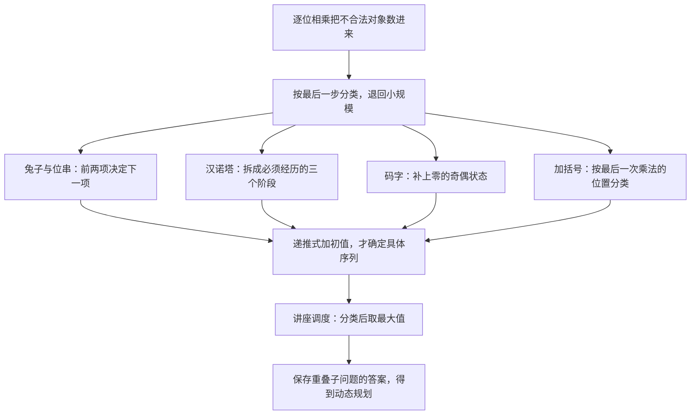

# C8.1 递推关系的应用 Applications of Recurrence Relations

> [!abstract] 这一讲的任务
> 你要数长度为 $n$、不出现连续两个 $0$ 的位串。每一位都写“有两种选择”，会把 `00` 也数进去；逐一筛选 $2^n$ 个候选，又会随 $n$ 指数增长。我们改为问：**一个合格的长串，是怎样由更短的合格串长出来的？**
> 这一问将带出复利、兔子繁殖、汉诺塔、位串与码字、加括号六类递推模型，再把“求方案总数”推进到“选出价值最高的方案”：用动态规划安排讲座。

> [!info] 阅读说明与授课进度
> 依据 Rosen 英文第7版 §8.1 整理，正文 pp.501–510 的引入、例1–6及算法1全部覆盖，顺序沿用原节；习题1、30–31、53–55融在对应概念后，帮助完成证明、手算和方案恢复，并非全套课后习题解答。
> 本节**已在第 19 节课讲过，但只占了半节课**：从“递归为什么会退不出去”切入，讲了递推关系与初始条件的定义、两个代入验证的例子、复利、汉诺塔、兔子繁殖，讲到第 3 节“不含连续两个 0 的位串”为止，并顺手把禁区加严成“不含连续三个 0”。第 4 节码字、第 5 节卡特兰数、第 6 节讲座调度与动态规划课堂没有展开，属同一节要求范围内的教材内容；其中通项闭式的推导、上下界论证与复杂度分析是补足的演算。
> 要求划得很窄：**第 8 章只要求掌握递推这部分**。§8.2–8.6（线性递推的求解、分治算法的递推、生成函数、容斥原理及其应用）课堂不再讲，也不在要求内；正文提到这几节的地方都标注了“课堂未讲”。
> 先修：[[C2.4 序列与求和 Sequences and Summations]] 的序列、递推、等比求和，以及 [[C6.1 计数基础 The Basics of Counting]] 的乘法原理与求和原理。正文会就地重建实际要用的步骤。



## 0. 开场：为什么不能直接写成 $2^n$

假设你负责生成设备使用的二进制控制码，规则是不允许 `00`。先试最熟悉的乘法原理：每个位置两种选择，得到 $2^n$。

$n=2$ 就能检验这个答案。四个串是 `00,01,10,11`，只有后三个合格，所以答案是 $3$，不是 $4$。如果想修成“第一位两种、以后每位一种”，也不行：`1` 后可以接 `0` 或 `1`，`0` 后只能接 `1`。**接下来有几种选择，取决于前面已经形成的状态。** 乘法原理仍成立，但不能把每一步的分支数都硬写成同一个数。

可以把所有分支画成树，不过长串仍会产生大量分支。若把“有多少个合格的长度 $n$ 的串”记成 $a_n$，我们真正需要的是长串集合与短串集合之间的关系。第3节会给出严格分类；在此之前，先从增长模型看懂递推式怎样表达“过去决定现在”。

## 1. 递推关系与初始条件：一个式子还不是一个模型

一个序列把整数指标 $n$ 对应到数 $a_n$。**递推关系 recurrence relation** 是把某项与它之前的项联系起来的等式；满足这个等式的序列叫它的一个**解 solution**。指定最初若干项，就是给出**初始条件 initial conditions**。

这个定义最容易被读成一句废话——“用前面的项表示后面的项”，听上去只是换个说法。它真正的作用是**把一个直接算不动的量，换成一串算得动的量**：$a_n$ 不知道，就先看 $a_{n-1}$；$a_{n-1}$ 也不知道，再退一项。写程序时这条路走得太熟，也最容易走过头：递归只要漏了出口，就会一直退下去，永远退不到底，程序卡在那里。两面镜子相对着摆，看到的是镜子里还有镜子、还有镜子，正是同一件事——**每一步都在向后退，却没有一步说“到这里为止”**。所以递推关系从一开始就必须和初值成对出现，缺一半就不成模型。

先做一个不做任何建模的手算，把“代入”这件事走通。设

$$a_n=a_{n-1}-a_{n-2}\quad(n\ge2),\qquad a_0=3,\ a_1=5,$$

则

$$a_2=a_1-a_0=5-3=2,\qquad a_3=a_2-a_1=2-5=-3.$$

注意两点：算 $a_3$ 用掉的是刚算出的 $a_2$ 和 $a_1$，**每一轮都是把最新的两项往前推一格**；以及 $a_3$ 是负数，递推关系本身完全允许——它没有承诺 $a_n$ 一定是“个数”，只有在建模时才知道它数的是什么。

> [!important] 递推定义的三个组成部分
> 写清 $a_n$ 数的对象和指标起点，给出只依赖已确定较小指标的递推规则，并给出足够的初值。这样才能逐项确定序列。递推式成立的指标范围也是定义的一部分。

例如，一群细菌最初有 $5$ 个，每小时数量翻倍。令 $a_n$ 表示经过 $n$ 小时后的数量，则

$$
a_0=5,\qquad a_n=2a_{n-1}\quad(n\ge1).
$$

这里 $n=0$ 是计时开始，不是“第一小时结束”。从原始条件出发，

$$
a_1=10,\quad a_2=20,\quad a_3=40.
$$

连续代入 $k$ 次得到 $a_n=2^k a_{n-k}$；取 $k=n$，才有

$$a_n=2^n a_0=5\cdot2^n.$$

若只写 $a_n=2a_{n-1}$，$2^n$、$5\cdot2^n$、$7\cdot2^n$ 都满足它，无法知道是哪一群细菌。**递推式说明变化规律，初值选出具体的解。** 对显式规定“下一项由先前各项确定”的规则，唯一性可以逐项说明：两个解若初值相同，第一次能算出的新项相同，下一项也相同，如此一直推进。

> [!question] 停一下，先自己想想
> 递推关系 $a_n=2a_{n-1}-a_{n-2}$ 的解不止一个。下面三个候选，哪些是它的解：$a_n=3n$、$a_n=2^n$、$a_n=5$？

判据只有一条：代进去，两边恒等。逐个试。

$a_n=3n$：右边 $=2\cdot3(n-1)-3(n-2)=6n-6-3n+6=3n$，与左边相同，是解。

$a_n=2^n$：右边 $=2\cdot2^{n-1}-2^{n-2}=2^n-2^{n-2}=3\cdot2^{n-2}$，只在 $n=2$ 时碰巧相等，不是恒等，不是解。

$a_n=5$：右边 $=2\cdot5-5=5$，常数序列相邻两项都是 $5$，仍然是解。

三个候选里两个通过，再次说明“解”从来不唯一：**一个递推关系描述的是一整族序列，取定初值才从族里挑出一个**。常数序列能过关也有它的道理——$2K-K=K$ 对任何常数 $K$ 成立，所以这道题的任意常数序列都是解，$a_n=5$ 只是其中一支。

同一个式子上换初值，后面整条序列就跟着换。取 $a_n=a_{n-1}+a_{n-2}$：若 $a_0=3,a_1=5$，则 $a_2=8,\ a_3=13$；若 $a_0=1,a_1=2$，则 $a_2=3,\ a_3=5$。**式子一个字没改，$a_3$ 从 $13$ 变成了 $5$。** 所以“已知 $a_n=a_{n-1}+a_{n-2}$，求 $a_3$”这种问法本身就不完整，答案只能依赖前两项。关系式管形状，初值管位置，两件事都不能省。

这也说明建模和求解是两件事：先证明对象满足哪条关系，再决定是否需要通项公式。第8.2节本来会系统求解某类线性递推（该节课堂未讲，不在本次要求内）；这一讲先练习怎样建出可信的关系。

## 2. 从时间与操作过程建立递推模型

### 2.1 复利：时间每走一格，乘同一个倍数

银行账户里存进 $P$ 元，年利率 $r$，利息每年结算一次并留在账上。第二年计息的本金不再是 $P$，而是 $P$ 加上第一年的利息——**利息也生利息**，这就是复利 compound interest。设 $S_n$ 为第 $n$ 年末的余额，则

$$S_n=S_{n-1}+rS_{n-1}=(1+r)S_{n-1},\qquad S_0=P.$$

这条递推和第 1 节的细菌模型是同一个形状，只把“每小时乘 $2$”换成“每年乘 $1+r$”；连续代入 $n$ 次得 $S_n=(1+r)^nP$，和细菌那边取 $k=n$ 的做法一模一样。

代一组数看增长有多快。存 $10\,000$ 元，年利率 $11\%$，30 年后

$$S_{30}=1.11^{30}\cdot10\,000\approx22.8923\cdot10\,000=228\,923\ \text{元},$$

约为本金的 $22.9$ 倍。$11\%$ 这种利率在现实里高得不正常（储蓄利率通常比它低一个量级），但正因为它离谱，指数的力量才看得清楚：**利率只差几个百分点，三十年后差出好几倍**。这也是“利滚利”必须单独算的原因——它不是把 30 年的利息加起来，而是乘 30 次。

### 2.2 例1：兔子为何给出斐波那契关系

> [!example] 兔子繁殖模型
> 岛上放入一对幼兔，一公一母。兔对满两个月后才开始繁殖，以后每个月产生一对幼兔，且兔子永不死亡。按第1、2个月末均只有初始那一对的计数约定，求第 $n$ 个月末兔对总数的递推关系。

令 $f_n$ 为第 $n$ 个月末的兔对数。先别急着背“斐波那契”，试一个看似合理的增长办法：每个月每对都再生一对，因此翻倍。如果这样算，第2个月就有 $2$ 对，与“两个月龄后才开始繁殖”的条件冲突。

错误在于把幼兔也算成了当月能繁殖的兔。要保留这个成熟时间，我们把第 $n$ 个月末的兔对分为两类：上个月已经存在的兔对，和本月新出生的兔对。

前一类没有死亡，所以是 $f_{n-1}$。后一类每对都来自一对达到繁殖年龄的亲兔；按题中月龄约定，本月能贡献新生兔的，恰好是两个月前已经存在的那些兔对，因此新生量是 $f_{n-2}$。两类没有重叠，且包括全部兔对，求和得

$$
\boxed{f_n=f_{n-1}+f_{n-2}\quad(n\ge3),\qquad f_1=f_2=1.}
$$

| 月份 $n$ | 上月已有 $f_{n-1}$ | 本月新生 $f_{n-2}$ | 总对数 $f_n$ |
|---|---:|---:|---:|
| 1 | — | 初始放入 | 1 |
| 2 | 1 | 0 | 1 |
| 3 | 1 | 1 | 2 |
| 4 | 2 | 1 | 3 |
| 5 | 3 | 2 | 5 |
| 6 | 5 | 3 | 8 |

按“只”再把前五个月数一遍，单位为什么重要就一目了然：第 1 个月底 $2$ 只；第 2 个月底还是 $2$ 只（未满两个月，不生）；第 3 个月底 $4$ 只（最初那对生了一对幼兔）；第 4 个月底 $6$ 只（最初那对又生一对，第 3 个月出生的那对还不够年龄）；第 5 个月底 $10$ 只——最初那对再生一对，第 3 个月出生的那对也刚好满两个月、开始产仔，**两对亲兔同时生**。折成对数就是 $1,1,2,3,5$，与上表逐行对上。

这里所有数量的单位是“对”，不是“只”。若要算兔子只数，整体乘 $2$；不要把繁殖规则中“一对产生一对”误读成每只兔子都独立产生一对。

从第 $n-1$ 月看“当时有多少”，还不足以知道“谁已经成熟”；回看第 $n-2$ 月，就把成熟条件转成了指标偏移。**递推中出现几个月前的项，来自生物条件，而不是来自我们希望套哪条公式。** 若有死亡、成熟期改变或产仔数改变，就必须重新建模。

### 2.3 例2：汉诺塔为何要有两次 $H_{n-1}$

> [!example] 三柱汉诺塔 Tower of Hanoi
> 三根柱子上有 $n$ 个大小各异的圆盘，起初全部按上小下大叠在柱1。每次只移动一盘，且任何时刻都不能让大盘压在小盘上。把整叠搬到柱2，求最少移动次数 $H_n$。

不能先搬最大的盘，因为上面挡着 $n-1$ 个小盘。也不能把这些小盘先放在目标柱2，因为最大的盘接下来必须落到柱2，而大盘不能落在小盘上。于是自然出现三个阶段：


**把“一步”拆开，是这里唯一的手法。** $n$ 个盘的搬运不可能一步完成；能一步完成的只有 $n=1$。所以“搬 $n$ 个盘”这件事，第一步就是把它整体换成上面那三个阶段。

继续问下去，规模每次减一，迟早落到 $n=1$：一个盘直接挪过去，就是一步，**没有可以再拆的东西**。这一步必须停住，否则会一直拆下去、永远得不到答案——它就是第 1 节说的那个“到这里为止”。拆的时候容易犯一个错：以为某一支还得继续拆，回头一看那一步本来就已经到位——只要拆到底发现“剩下的就是一次搬动”，就该停手。

这里还有一个次序上的错位值得记住：**分析时从 $H_n$ 往 $H_1$ 拆（自顶向下），真正动手搬是从 $H_1$ 往上做（自底向上）**。前者负责“把它拆到能算”，后者负责“把它落成能搬的动作”。这两个名字第 6.5 节会正式出场（记忆化与填表），到时候可以回想这里。

第一、三阶段都是同一种小规模汉诺塔；柱子改名不改变规则，所以各用 $H_{n-1}$ 次。中间只搬最大盘，用 $1$ 次。这个构造给出一个**能做到的上界**：

$$H_n\le2H_{n-1}+1.$$

但“找到一种做法”还不能直接说“这就是最少”。下面补出反方向。

考虑任意合法解中最大盘的第一次移动。在此之前，全部小盘必须叠在既非最大盘起点、也非它移动目标的那根柱上，因此至少已有 $H_{n-1}$ 次小盘移动。再看最大盘最后一次移入最终目标柱2：此刻所有小盘都在第三根柱上，之后还需至少 $H_{n-1}$ 次才能把它们搬到柱2。最大盘至少移动一次；即使最大盘中途绕路，这两个时间段也不重叠，只会多出操作。于是任何解都满足

$$H_n\ge2H_{n-1}+1.$$

上下界相同，才得到

$$\boxed{H_n=2H_{n-1}+1\quad(n\ge2),\qquad H_1=1.}$$

也可补定义空塔 $H_0=0$，把递推范围延伸至 $n\ge1$，两种写法一致。

连续展开时，每次旧项乘 $2$，新添的常数项也在后续展开中不断乘 $2$：

$$
\begin{aligned}
H_n&=2H_{n-1}+1\\
&=2^2H_{n-2}+2+1\\
&=2^3H_{n-3}+2^2+2+1\\
&=2^kH_{n-k}+\sum_{i=0}^{k-1}2^i.
\end{aligned}
$$

令 $k=n-1$，用 $H_1=1$ 与等比求和 $\sum_{i=0}^{n-2}2^i=2^{n-1}-1$，得到

$$H_n=2^{n-1}+(2^{n-1}-1)=\boxed{2^n-1}.$$

因此 $H_1,H_2,H_3,H_4=1,3,7,15$。也可以先把常数消掉：$H_n+1=2(H_{n-1}+1)$，令 $G_n=H_n+1$ 就化成了细菌模型同样的等比递推。

紧接着完成习题1要求的归纳验证：$n=1$ 时 $1=2^1-1$；假设 $H_k=2^k-1$，则

$$H_{k+1}=2H_k+1=2(2^k-1)+1=2^{k+1}-1.$$

初值与递推同时得到验证，故公式对所有正整数成立。这里归纳法验证通项；前面的上下界论证负责证明模型真的是**最少**步数，两者的职责不同。

若有 $64$ 个盘，每秒移动一次，需要

$$2^{64}-1=18\,446\,744\,073\,709\,551\,615\ \text{秒}.$$

按一年 $365.25$ 天换算，约为 $5.8454\times10^{11}$ 年，超过五千亿年。这说明合法递归操作不等于操作次数很少，$2^n-1$ 仍是指数增长。

> [!note] 四柱变式与历史状态
> 增加到四根柱子后，上面的三柱最优性论证不能原样套用，因为小盘有更多暂存位置。把最小的 $m$ 个盘先用四柱搬开，余下 $n-m$ 个盘用三柱搬到目标，再把小盘搬回，可得到 Frame–Stewart 策略：$R_0=0$，$R_n=\min_{0\le m<n}\{2R_m+2^{n-m}-1\}$。策略的可行性与它在全部合法解中的最优性是两项不同结论。旧版原文的“尚未证明最优”属于历史状态；四柱情形的最优性已由 Bousch 于2014年证明，来源登记在本章索引。本节不展开该证明。

## 3. 从最后一位分类：受限位串

> [!example] 例3：没有连续两个 $0$ 的位串
> 求长度为 $n$、不含 `00` 的位串个数 $a_n$ 的递推关系与初值，并求 $a_5$。

回到开头的任务。既然每一位的分支数不恒定，就不要逐位硬乘。**按最后一位把所有合格串分成两类**，各类内部再寻找与短串的一一对应。

若最后一位是 `1`，删去这个 `1`，前面可以是任意合格的 $n-1$ 位串；反过来，在任何合格短串后加 `1` 都不会制造 `00`。删除和追加互为逆操作，因此这一类恰有 $a_{n-1}$ 个。

若最后一位是 `0`，倒数第二位必须为 `1`，所以末尾整体是 `10`。删去 `10`，前面是任意合格的 $n-2$ 位串；反过来追加 `10` 时，新接缝处紧挨的是 `1`，不可能产生 `00`，末尾 `10` 自身也合法。因此第二类恰有 $a_{n-2}$ 个。

两类末位不同，互不相交；二进制末位只有 `0`、`1`，没有遗漏。于是

$$\boxed{a_n=a_{n-1}+a_{n-2}\quad(n\ge3).}$$

为什么不能把第二类也写成 $a_{n-1}$？因为在合格的短串后直接添 `0` 可能失败：`10` 合格，但 `100` 不合格。**追加操作必须保证边界也合法**，只说“前半段合法”还不够。

长度1的合格串为 `0,1`，所以 $a_1=2$；长度2的合格串为 `01,10,11`，所以 $a_2=3$。逐项计算：

$$a_3=3+2=5,\qquad a_4=5+3=8,\qquad \boxed{a_5=8+5=13}.$$

这13个串可直接列出核对：

```text
01010  01011  01101  01110  01111
10101  10110  10111
11010  11011  11101  11110  11111
```

兔子与位串的关系式完全一样，初值却不同。采用第2.2节 $f_1=f_2=1$ 的约定，有 $a_1=f_3$、$a_2=f_4$；两者又遵循相同递推，因此逐项推出

$$\boxed{a_n=f_{n+2}.}$$

这不是说 $a_n=f_n$，也不是说兔子与位串是相同对象，而是两种结构产生了同型的计数规律。若补上空串计数 $a_0=1$，递推还可以从 $n=2$ 开始：$a_2=a_1+a_0=3$。**空对象的“1种做法”经常负责让边界统一。**

### 3.1 把禁区加严一格：不允许三个连续 0

同一台机器，规则改成不许出现 `000`：长度 $n$ 的合格位串有多少个？记作 $b_n$。

按末位分类在这里就不够了。末位是 `0` 时，前一位可能是 `1`，也可能本来就是 `0`——只看末位一位，分不清“这个 0 是新挂上去的第一个”还是“第二个”。**能挂几个 0，取决于末尾已经挂了几个 0**。于是“末尾连续 0 的个数”成了必须记住的**状态**；状态只有 $0,1,2$ 三种，那就按末尾那一整块分类：

- 末尾是 `1`：删掉这个 `1`，前面是任意合格的 $n-1$ 位串，$b_{n-1}$ 个。
- 末尾是 `10`：删掉 `10`，前面是任意合格的 $n-2$ 位串，$b_{n-2}$ 个。
- 末尾是 `100`：删掉 `100`，前面是任意合格的 $n-3$ 位串，$b_{n-3}$ 个。

三类互不相交（末尾挂的 0 的个数分别是 $0,1,2$），也没有遗漏——不许出现三个 0，末尾最多只能挂两个。每一类反过去追加也安全：接缝处紧挨的都是 `1`，`000` 不可能凑出来。于是

$$\boxed{b_n=b_{n-1}+b_{n-2}+b_{n-3}\quad(n\ge4),\qquad b_1=2,\ b_2=4,\ b_3=7.}$$

初值逐个手数：长度 1 有 `0,1`，$2$ 个；长度 2 的四个串全合格，$b_2=4$；长度 3 的八个串里只有一个不合格。**$b_3=7$ 这一处最容易少算一个**，稳妥的算法是反向数不合格的：长度 3 的串只有 `000` 一种不合格，所以合格数必定是 $8-1=7$。

往前推几步：$b_4=7+4+2=13$，$b_5=13+7+4=24$，$b_6=24+13+7=44$。三项相加的数列常被叫作 **Tribonacci 数列**；$b_5=24$ 可以直接对着 $32$ 个长度 5 的串数出来核对。

把“末尾挂到第几个 0”画成机器上的三个状态，每条转移边上写清这一位补的是 1 还是 0，三项递推的来历就一目了然：

![[C8-三连零的状态转移.png]]

最值得盯的是状态 2 上那条红边：再补一个 0 就没有状态可去。**“违规”不是一个状态，而是一条走不通的路**——所以状态表只开三格，递推也就正好三项。

和上一节对比一下：**同一个“按末尾分类”的手法，状态从“一位”变成了“末尾挂了几个 0”**。这不是特例而是通例——第 4 节马上会看到，码字的情形要记住的是“零出现了奇数次还是偶数次”。状态记得对，递推就短；状态记漏了，就会像这里一样把两类混成一类，数重或数漏。

## 4. 状态不仅可以是末位：码字中的零的奇偶性

> [!example] 例4：有效码字 Codeword Enumeration
> 十进制数字串只有在数字 $0$ 出现偶数次时才有效。例如 `1230407869` 有两个 $0$，有效；`120987045608` 有三个 $0$，无效。令 $a_n$ 为长度 $n$ 的有效码字个数，求递推关系。

这里数的是**字符串**，允许前导零；$0$ 次也是偶数。若把对象误读成不允许前导零的 $n$ 位整数，样本总数就不再是 $10^n$，后面的补集计算也会失效。

先试“在有效短串后随便添一个数字”，得到 $10a_{n-1}$。但在 `12` 后添 `0`，就把零的个数从偶数变成奇数，所以新结果未必有效。再退一步，只添非零数字，得到 $9a_{n-1}$，又漏了 `00` 这种由无效短串 `0` 修复得到的有效串。

要补齐全部来源，按新串末位分类：

- 末位非零，不改变零的奇偶性，所以前缀必须有效。有 $a_{n-1}$ 个有效前缀，每个可接9个非零数字，得到 $9a_{n-1}$。
- 末位为零，翻转奇偶性，所以前缀必须无效。全部前缀有 $10^{n-1}$ 个，其中有效的有 $a_{n-1}$ 个，无效的有 $10^{n-1}-a_{n-1}$ 个。每个只接一种数字 `0`。

两类末位不同，直接相加：

$$
\boxed{a_n=9a_{n-1}+(10^{n-1}-a_{n-1})=8a_{n-1}+10^{n-1}\quad(n\ge2).}
$$

长度1时，只有 `1` 至 `9` 有效，所以 $a_1=9$。进而

$$a_2=8\cdot9+10=82,\qquad a_3=8\cdot82+100=756.$$

独立核对长度2：没有零的有 $9^2=81$ 个，另有 `00`，合计 $82$。这也说明“零出现偶数次”和“奇数次”并不各占一半；不能直接写 $a_n=10^n/2$。

为了看清我们保存了什么状态，可以同时记 $E_n$ 为偶数零串数、$O_n$ 为奇数零串数。空串满足 $E_0=1,O_0=0$，且

$$
\begin{aligned}
E_n&=9E_{n-1}+O_{n-1},\\
O_n&=E_{n-1}+9O_{n-1}.
\end{aligned}
$$

两式相加给 $E_n+O_n=10^n$，两式相减给 $E_n-O_n=8(E_{n-1}-O_{n-1})=8^n$。联立可得

$$\boxed{a_n=E_n=\frac{10^n+8^n}{2}.}$$

这是为说明状态而补出的通项推导。它从两种奇偶状态出发，独立解释了为什么“有效比例”趋近一半但并不恰等于一半；$E_n/10^n=\tfrac12[1+(\tfrac45)^n]$。

## 5. 从最后一次运算分类：卡特兰数

> [!example] 例5：给乘积加括号 Parenthesization
> 保持 $x_0x_1\cdots x_n$ 的因子顺序不变，有多少种完整加括号方式能确定二元乘法的先后次序？把这个数量记为 $C_n$。这里有 $n+1$ 个因子、$n$ 次乘法。

不能只数“第一步先乘哪两个”：同一个最终括号结构可能允许不同时间顺序的独立子运算，按第一步追踪会把同一结构重复计数。也不能把括号当作任意字符插入，因为大部分字符串并非合法的二元运算结构。

我们改看**最后一次乘法**。任何完整括号结构都有唯一的最外层分解：

$$(x_0\cdots x_k)\cdot(x_{k+1}\cdots x_n),\qquad 0\le k\le n-1.$$

两边内部还可以有括号，但最后一次运算的切口已经固定。左边有 $k+1$ 个因子，所以有 $C_k$ 种括号方式；右边有 $n-k$ 个因子，对应的是 $C_{n-k-1}$，不是 $C_{n-k}$。左右选择可以自由搭配，乘法原理给出该切口的数量

$$C_kC_{n-k-1}.$$

不同切口对应不同的最后一次乘法，不会重复；每个结构又一定有这样的切口，所以按切口求和：

$$\boxed{C_n=\sum_{k=0}^{n-1}C_kC_{n-k-1}\quad(n\ge1),\qquad C_0=1.}$$

$C_0=1$ 表示一个因子不需要乘法，但保留它的方式仍算一种。若错写 $C_0=0$，$C_1=C_0C_0$ 也会变成零，整个计数被抹掉。$C_1=1$ 可以从递推推出，不必当作额外独立初值。

手算前三步：

$$
\begin{aligned}
C_1&=C_0C_0=1,\\
C_2&=C_0C_1+C_1C_0=2,\\
C_3&=C_0C_2+C_1C_1+C_2C_0=2+1+2=5.
\end{aligned}
$$

原题的四因子对应 $C_3$，五种方式完整写为

$$
\begin{gathered}
((x_0x_1)x_2)x_3,\qquad (x_0(x_1x_2))x_3,\\
(x_0x_1)(x_2x_3),\\
x_0((x_1x_2)x_3),\qquad x_0(x_1(x_2x_3)).
\end{gathered}
$$

它们按切口分成 $2,1,2$ 三类，恰与刚才的和式吻合。这就是**卡特兰数 Catalan numbers**，前几项是 $1,1,2,5,14,42$。

同一串数还数另一类对象，换成图形更容易上手：从 $(0,0)$ 走到 $(3,3)$，每一步向右或向上、共 6 步，要求路上从不越过对角线 $y=x$。四因子的括号结构与这种走法一一对应（两者都对应 3 个内部结点的满二叉树），所以合法的走法数同样是 $C_3$。

![[C8-卡特兰数的合法与非法路径.png]]

最值得盯的是最右那一格的减法：$\binom{6}{3}=20$ 是全部走法，越过对角线的那 15 条按“第一次越界之后翻折”与 $\binom{6}{2}$ 一一对应，剩下 $20-15=5$ 条——和刚才按切口数出来的 $C_3=5$ 对上了。

继续完成习题30–31中的递推计算与通项核对：

$$
\begin{aligned}
C_4&=1\cdot5+1\cdot2+2\cdot1+5\cdot1=14,\\
C_5&=1\cdot14+1\cdot5+2\cdot2+5\cdot1+14\cdot1=42.
\end{aligned}
$$

习题30(a)要求列出五因子的全部14种结构。用 $a,b,c,d,e$ 依次表示 $x_0,\ldots,x_4$，按最后切口列成四行；行内每个逗号分隔一个完整结构：

```text
a(((bc)d)e), a((b(cd))e), a((bc)(de)), a(b((cd)e)), a(b(c(de)))
(ab)((cd)e), (ab)(c(de))
((ab)c)(de), (a(bc))(de)
(((ab)c)d)e, ((a(bc))d)e, ((ab)(cd))e, (a((bc)d))e, (a(b(cd)))e
```

四类分别有 $5,2,2,5$ 种，总数14，既核对了递推，也防止漏列。

本节给出的闭式与增长量级为

$$C_n=\frac1{n+1}\binom{2n}{n},\qquad C_n\sim\frac{4^n}{n^{3/2}\sqrt\pi}.$$

这里 $\sim$ 表示两边之比随 $n\to\infty$ 趋于1。闭式代入 $n=4,5$ 分别得 $70/5=14$、$252/6=42$，与递推相同。闭式的系统推导要用第8.4节的生成函数（该节课堂未讲）；本讲已证明递推与初值，足以计算每一项，尚未把生成函数证明当作已完成内容。

> [!warning] 同一个字母，两个指标约定
> $C_n$ 在此表示卡特兰数；$C(2n,n)$ 或 $\binom{2n}{n}$ 才是组合数。$C_n$ 对应 **$n+1$ 个因子**。若题目改为 $n$ 个因子，答案应是 $C_{n-1}$。

## 6. 把递推式变成算法：动态规划与讲座调度

前面的递推回答“数量是多少”，也可以回答“最佳值是多少”。两种问题都要先分类，只是合并方法从求和变成了取最大值。

### 6.1 为什么最早结束的贪心选择会失效

假设只有一个报告厅，讲座的起止时间固定，同一时刻最多安排一场；前一场结束时可以立即开始后一场。若目标只是安排最多场次，按最早结束时间优先可以给出最优方案。但现在每场有不同的预计听众数 $w_j$，目标变成使选中讲座的**听众人次总和**最大。

用一个教学反例检查旧办法：讲座A是9:00–10:00、10人，B是10:00–11:00、10人，C是9:00–11:00、100人。最早结束优先会选A、B，共20人次；只选C却有100人次。旧办法依赖的“先结束就给后面留下更多空间”，并没有比较占用时间所换来的权重。

因此需要保留两条路线：“选当前讲座”与“不选当前讲座”，再比较各自能达到的最佳总人次。

### 6.2 例6：先把相容关系变成一个指标 $p(j)$

> [!example] 七场讲座的相容前驱
> 讲座1：8:00–10:00；2：9:00–11:00；3：10:30–12:00；4：9:30–13:00；5：8:30–14:00；6：11:00–14:00；7：13:00–14:00。求每场讲座的 $p(j)$。

统一用 $s_j$ 表示开始时间，$e_j$ 表示结束时间，$w_j\ge0$ 表示预计听众数；假设 $s_j<e_j$。先按结束时间非降序排序，再依次编号，使

$$e_1\le e_2\le\cdots\le e_n.$$

结束时间相同时可沿用原编号，不影响递推的正确性。定义

$$
p(j)=\max\{i:1\le i<j,\ e_i\le s_j\},
$$

若集合为空则令 $p(j)=0$。注意 $p(j)$ 是**编号**，不是时间、权重或相容讲座的数量；它标出所有能接在 $j$ 之前的讲座形成的前缀边界。

排序为何重要？如果 $e_{p(j)}\le s_j$，那么所有 $i\le p(j)$ 都满足 $e_i\le e_{p(j)}\le s_j$，均可与 $j$ 前后相接；而在 $p(j)$ 与 $j$ 之间的编号都不满足条件。没有排序就不能把“相容的那些讲座”压成一个前缀。

| 讲座 $j$ | $s_j$ | $e_j$ | $p(j)$ | 检验边界的理由 |
|---|---|---|---:|---|
| 1 | 8:00 | 10:00 | 0 | 没有先前讲座 |
| 2 | 9:00 | 11:00 | 0 | 讲座1到10:00才结束 |
| 3 | 10:30 | 12:00 | 1 | 1已结束，2尚未结束 |
| 4 | 9:30 | 13:00 | 0 | 先前讲座都未在9:30前结束 |
| 5 | 8:30 | 14:00 | 0 | 先前讲座都未在8:30前结束 |
| 6 | 11:00 | 14:00 | 2 | 2在11:00结束，3要到12:00 |
| 7 | 13:00 | 14:00 | 4 | 4在13:00结束，5、6要到14:00 |

原时间轴的横轴从8:00到15:00，横条覆盖每场讲座的开始至结束时间；判断能否相接，要比较条的右端与后一场左端，端点相同允许衔接。由上表独立得到的前驱为 $(0,0,1,0,0,2,4)$。

![[C8.1-讲座时间轴与相容前驱.png]]

### 6.3 最优子结构怎样给出递推

令 $T(j)$ 表示**只允许从前 $j$ 场讲座中选择**时，能达到的最大总人次，空前缀 $T(0)=0$。它不表示“必须选第 $j$ 场”，也不表示“以第 $j$ 场结尾”。

现在考察前 $j$ 场的任意最优方案。它要么选 $j$，要么不选 $j$，没有第三种可能。

若选 $j$，其他讲座必须来自前 $p(j)$ 场；这些讲座的安排还必须在该前缀上最优。理由是：假如存在总人次更高的相容前缀方案，就能用它替换旧前缀，再保留 $j$，得到比所谓“最优”方案更好的结果，矛盾。因此选 $j$ 的最佳值是 $w_j+T(p(j))$。

若不选 $j$，只能在前 $j-1$ 场中选，最佳值是 $T(j-1)$。两类各自的最佳方案都可行，全部可行方案又必在其中一类，所以

$$\boxed{T(j)=\max\{w_j+T(p(j)),\ T(j-1)\},\qquad T(0)=0.}$$

这段替换论证叫**最优子结构 optimal substructure**：整体最优方案中实际采用的子方案也必须对相应子问题最优。它需要证明，不能只看到“最大”两个字就机械套动态规划。

### 6.4 把原题数据真正算完：习题54(a)及55(a)

例6只给起止时间，没有给听众人数，所以不能凭时间轴算一个唯一的最大人次。这里使用习题54(a)提供的权重：

$$(w_1,\ldots,w_7)=(20,10,50,30,15,25,40).$$

按递推式从小到大填写，所有需要的前缀值都已经算好：

| $j$ | $w_j$ | $p(j)$ | 选 $j$：$w_j+T(p(j))$ | 不选 $j$：$T(j-1)$ | $T(j)$ |
|---|---:|---:|---:|---:|---:|
| 0 | — | — | — | — | 0 |
| 1 | 20 | 0 | $20+0=20$ | 0 | 20 |
| 2 | 10 | 0 | $10+0=10$ | 20 | 20 |
| 3 | 50 | 1 | $50+20=70$ | 20 | 70 |
| 4 | 30 | 0 | $30+0=30$ | 70 | 70 |
| 5 | 15 | 0 | $15+0=15$ | 70 | 70 |
| 6 | 25 | 2 | $25+20=45$ | 70 | 70 |
| 7 | 40 | 4 | $40+70=110$ | 70 | 110 |

最大总人次是110。用结果回看第6.1节的失败：我们没有强迫先选最早结束的一场，而是在每个前缀上保留两类最佳值；即使某场单独权重很高，也必须与它能接上的前缀合并后再比较。

求出最佳值还没有给出具体安排。按习题53的要求，从 $j=n$ 反向追踪：若 $w_j+T(p(j))\ge T(j-1)$，就选择 $j$ 并跳到 $p(j)$；否则丢弃 $j$，转到 $j-1$。相等时两条路线都能形成最优方案，任选一条；此处约定取“选”。

本例从7开始：$110>70$，选7并跳到4；$30<70$，不选4，退到3；$70>20$，选3并跳到1；选1，再跳到0结束。倒序恢复为

$$\boxed{\{1,3,7\},\qquad20+50+40=110.}$$

对应8:00–10:00、10:30–12:00、13:00–14:00，确实互不冲突。若同一学生听了三场，会计三个人次；本模型不在求“不重复的听众人数”，后者需要额外描述学生集合。

习题54与55的其余三组条件也可在同一张时间表上核对，不能只改权重而忘掉重新计算最佳前缀：

| 小问 | 权重 $(w_1,\ldots,w_7)$ | $T(0),\ldots,T(7)$ | 一组最优安排 |
|---|---|---|---|
| (b) | $(100,5,10,20,25,40,30)$ | $0,100,100,110,110,110,140,140$ | $\{1,6\}$，140人次；$\{1,3,7\}$同为最优 |
| (c) | $(2,3,8,5,4,7,10)$ | $0,2,3,10,10,10,10,20$ | $\{1,3,7\}$，20人次 |
| (d) | $(10,8,7,25,20,30,5)$ | $0,10,10,17,25,25,40,40$ | $\{1,6\}$，40人次 |

### 6.5 算法1：为什么保存答案会改变效率

直接递归求 $T(j)$，会分别请求 $T(p(j))$ 与 $T(j-1)$，不同分支可能反复请求同一个 $T(i)$。例如本例 $T(7)$ 需要 $T(4)$ 和 $T(6)$，而计算 $T(6)$ 又会经 $T(5)$ 回到 $T(4)$。重复的是同一个前缀问题，不是新的讲座集合。

递归在这里的心跳和汉诺塔完全一样：**先把问题拆小，拆到 $0$（空前缀）停住**。区别在于汉诺塔的每一支拆出来都是新问题（规模变小、内容不同），这里的两支却会拆回同一个前缀。前一种情况拆得再深也只拆一遍，后一种情况会把同一件事算很多遍——这就是“写出了递推关系”与“需要动态规划”的分界。

顺便把第 1 节那个担心接上：递归退不出去有两种原因，**边界没写**（永远退不到 $T(0)$）和**边界写了但同一支被反复展开**（算得完，却慢得离谱）。动态规划治的是后一种。

**动态规划 dynamic programming** 把问题分成更简单但相互重叠的子问题，用递推组合答案，并保存已算出的结果。保存一次以后遇到同一子问题直接读取，就避免了反复展开。

```text
MaximumAttendees(讲座列表):
    按结束时间非降序排序并重新编号
    对每个 j 求 p(j) = 最大的 i < j，使 e[i] <= s[j]
    若不存在这样的 i，则 p(j) = 0
    T[0] = 0
    for j = 1, 2, ..., n:
        T[j] = max(w[j] + T[p(j)], T[j-1])
    return T[n]
```

这是自底向上的**填表 tabulation**。若仍保留递归形式，但先查缓存、只计算未保存的项，则称为自顶向下的**记忆化 memoization**；两者都在复用已解的子问题。原文将保存计算结果的过程称为 memoization，理解时可以进一步区分这两种执行顺序。

若 $p(j)$ 已知，填表每步只做常数次加法、比较与读取，所以时间 $O(n)$，保存全部 $T$ 与 $p$ 需 $O(n)$ 空间。寻找所有 $p(j)$ 若逐一向前扫描，预处理最坏 $O(n^2)$；利用已排序的结束时间做二分查找，则预处理连同排序共 $O(n\log n)$，整个算法也为 $O(n\log n)$。**不能把只针对填表阶段的 $O(n)$ 当成包含排序、前驱计算的总复杂度。**

恢复方案可接在填表后执行：

```text
j = n
selected = 空列表
while j > 0:
    if w[j] + T[p(j)] >= T[j-1]:
        把 j 加入 selected
        j = p(j)
    else:
        j = j-1
反转 selected，得到按时间先后排列的最优安排
```

每步指标都严格下降，恢复过程至多 $n$ 步。只要求一个最优方案时这样处理平局就够了；若要列出全部最优方案，就必须在相等处保留两条分支，输出数量可能很大。

> [!important] 分治与动态规划：看子问题是否重叠
> 本章所讨论的分治算法 divide-and-conquer 把任务拆成互不重叠的子问题，例如归并排序的两个子数组；动态规划在这里处理相互重叠的前缀最优化问题，通过保存答案避免重复计算。两者都可以出现递推关系，但**写出了递推式，并不自动意味着已经获得高效算法**。

## 7. 建模时怎样检查自己没有只背下公式

从一个计数或最优化任务出发，先用一句话准确说明 $a_n$ 或 $T(j)$ 的含义，再找一个每个对象都能唯一确定的分类依据。本讲用过出生时间、最大盘移动、末位及末尾块、零的奇偶状态、最后乘法切口、是否选择最后一场讲座。

分类以后检查三件事：每个对象都能归类吗？会同时落进两类吗？删去最后一步以后，剩下的对象真的满足同一小规模定义吗？位串要检查接缝，码字要检查奇偶，卡特兰数要检查“因子数比下标多1”。前两件事决定能否直接相加，第三件事决定能否引用旧项的数量。

若目标是最优值，还要证明子方案能够替换：更好的子方案换进来后，整体约束是否仍满足？讲座调度之所以成立，是因为前缀中全部被选讲座都在 $s_j$ 前结束，更换成另一个该前缀的合法方案不会破坏与 $j$ 的相容性。

最后从原始小规模对象直接枚举一两个初值，而非只把猜到的公式代回。`00`、空串、单因子和空讲座前缀分别检查了本讲四种容易漏掉的边界。初值算不对，再漂亮的通项也不对应原任务。

## 这一讲的三句话

1. 当对象的选择会依赖此前状态时，按可逆的最后一步或唯一切口分类，把大规模问题转成已定义的小规模问题，并用初值确定具体序列。
2. 递推式中的加法、乘法和最大值分别来自互斥分类、独立搭配和最优方案比较；写出等号之前，必须检查不重不漏、边界合法或最优子结构。
3. 递归表达式可能重复求解同一子问题；动态规划保存答案，既能算最优值，也能沿着取舍恢复一组最优方案。

## 速查表

| 名称 | 公式或判据 |
|---|---|
| 细菌翻倍 | $a_0=5$，$a_n=2a_{n-1}=5\cdot2^n$，$n\ge1$ |
| 复利 | $S_0=P$，$S_n=(1+r)S_{n-1}=(1+r)^nP$；$10\,000$ 元、$11\%$、30 年得 $228\,923$ 元 |
| 斐波那契兔子 | $f_1=f_2=1$，$f_n=f_{n-1}+f_{n-2}$，$n\ge3$ |
| 三柱汉诺塔 | $H_0=0$，$H_n=2H_{n-1}+1=2^n-1$，$n\ge1$ |
| 不含 `00` 的位串 | $a_0=1,a_1=2$，$a_n=a_{n-1}+a_{n-2}=f_{n+2}$，$n\ge2$ |
| 不含 `000` 的位串 | $b_1=2,b_2=4,b_3=7$，$b_n=b_{n-1}+b_{n-2}+b_{n-3}$，$n\ge4$（Tribonacci） |
| 偶数个零的十进制码字 | $a_0=1$，$a_n=8a_{n-1}+10^{n-1}$；$a_n=(10^n+8^n)/2$，$n\ge1$ |
| $n+1$ 因子的括号结构 | $C_0=1$，$C_n=\sum_{k=0}^{n-1}C_kC_{n-k-1}=\binom{2n}{n}/(n+1)$，$n\ge1$ |
| 相容前驱 | $p(j)=\max\{i<j:e_i\le s_j\}$，不存在则为0；结束时间非降序 |
| 讲座最优总人次 | $T(0)=0$，$T(j)=\max\{w_j+T(p(j)),T(j-1)\}$ |
| 动态规划效率 | 已知 $p$：填表 $O(n)$；排序＋二分求 $p$＋填表：$O(n\log n)$；空间 $O(n)$ |

> [!tip] 下一讲预告：同一个递推式，怎样直接得到第 $n$ 项？
> 现在可以逐项算 $f_n$，但若需要非常大的指标，逐项算仍然是一条很长的路。为什么试着把解写成 $r^n$ 会把递推关系变成多项式方程？第8.2节“求解线性递推关系”将从这里开始。该节**课堂未讲**，也不在本次要求内；卡特兰数所需的生成函数则留到第8.4节（同样课堂未讲）。上面这条路线是教材给的下一站，本课程的下一次课直接进入第 10 章的图。

---

**上一讲** ← [[C6.6 生成排列与组合 Generating Permutations and Combinations]]（按当前课程阅读路线衔接） ｜ **下一讲** → [[C10.1 图与图模型 Graphs and Graph Models]]（§8.2 求解线性递推关系课堂未讲，课程直接进入第 10 章） ｜ **返回课程索引** → [[C8 高级计数技巧 Advanced Counting Techniques MOC]]
