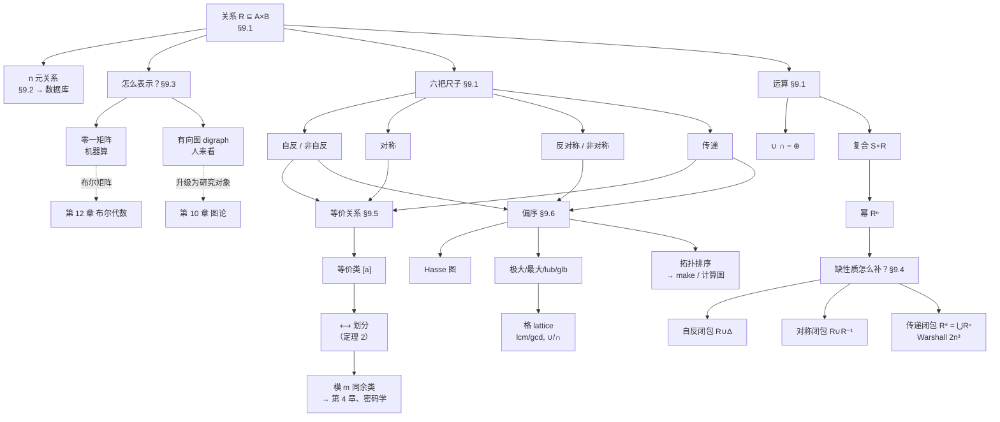

# C9 关系 Relations MOC

> [!abstract] 这一章讲什么
> 第 2 章定义笛卡尔积时顺口说过一句："$A\times B$ 的子集叫**关系**"，然后就搁置了。第 9 章把这个被搁置的概念展开成一整章。
> **一句话概括全章**：从"$A\times B$ 的子集"这样一个平淡的定义出发，只靠**几个性质的不同组合**，走出了三条完全不同的路——
> - 分量从 2 变成 $n$ ⇒ **关系型数据库**（§9.2）
> - 自反 + **对称** + 传递 ⇒ **等价关系** ⇒ 一切"**分类**"（§9.5）
> - 自反 + **反对称** + 传递 ⇒ **偏序** ⇒ 一切"**排序**"（§9.6）
>
> 而 §9.3 的有向图表示，会在**第 10 章图论**里从"一种画法"升级成"研究对象本身"。

> [!info] 这一章的笔记情况
> 本章笔记**依据教材 Rosen §9.1–§9.6（pp.573–639）撰写**，按教材六节拆成六篇，体例与 [[C1 基础：逻辑与证明 MOC]]、[[C2 基本结构：集合、函数、序列、求和与矩阵 MOC]] 一致。
> 全章共 **19 张图**：**17 张用 Python 重绘**（比扫描件清楚），另 **2 张直接用课件里的矢量插图**（`Ch9.1_Part2` 的图判三性质、矩阵判三性质——这两张的"花纹"画法课本没有对应插图）。每张图都用在正文里，图索引在本页末尾。

> [!note] 课件与转写稿情况（2026-10-24 更新）
> 第 9 章的课件按小段陆续发布（每份通常对应一到两节课的一部分）。**目前已经齐了**——10 月 8 日与 10 月 13 日又补了三份：
>
> | 课件文件 | 页数 | 文件日期 | 覆盖内容 | 笔记落点 |
> |---|:-:|:-:|---|---|
> | `Ch9.1_Part1.pdf` | 4 页（15 slides） | 2026-09-23 | 关系的定义（$A\times B$ 的子集）、关系 vs 函数、**有向图表示**、**零一矩阵表示**（含 connection matrix 的 $m_{ij}$ 定义与例子） | [[C9.1 关系及其性质 Relations and Their Properties]] §1–§2 |
> | `Ch9.1_Part2.pdf` | 8 页（32 slides） | 2026-09-29 | $A$ 上的关系、$n$ 元集合上有 $2^{n^2}$ 个关系、**六个性质**（自反/非自反/对称/非对称/反对称/传递）及其图与矩阵判读、**集合运算、逆关系、复合与幂** | [[C9.1 关系及其性质 Relations and Their Properties]] §3–§7 |
> | `Ch9.1_Part2 (1).pdf` | 8 页 | 2026-10-13 | 与上一份同源，**重传版**（老师补发的），内容一致 | 同上 |
> | `Ch9.1_Part3.pdf` | 5 页（16 slides） | 2026-10-01 | **复合与幂的四条性质**（$R\subseteq S\Rightarrow R\circ T\subseteq S\circ T$；路径 ⟺ 幂；传递 ⟺ $R^n\subseteq R$；传递 ⇒ $R^n$ 传递）及其归纳法证明、**幂指数的加法律** | [[C9.1 关系及其性质 Relations and Their Properties]] §6.4 |
> | `Ch9.2.pdf` | 2 页（6 slides） | 2026-10-01 | $n$ 元关系、**域与度**（同余三元组例题）、记录/字段/表、**关系数据库**的两种用法（挑出满足条件的元组 / 连接不同表的记录） | [[C9.2 n 元关系与数据库 n-ary Relations and Their Applications]] §1、§4 |
> | `Ch9.3_Part1.pdf` | 3 页（11 slides） | 2026-10-01 | **闭包介绍**（引入"补成对称的最小关系"这个问题）、闭包定义（"补最少的项刚好满足性质 P"）、**三种闭包的记号与例题**（自反闭包 $r(R)$、对称闭包 $s(R)$、传递闭包 $t(R)=R^{*}$） | [[C9.4 关系的闭包 Closures of Relations]] §1.1、§2 |
> | `Ch9.3_Part2.pdf` | 7 页 | 2026-10-08 | **传递闭包**：连通关系 $R^{*}=\bigcup_n R^n$、路径与长度的定义、$R$ 传递 ⇒ $R^*$ 传递的证明 | [[C9.4 关系的闭包 Closures of Relations]] §3–§4 |
> | `Ch9.5.pdf` | 6 页 | 2026-10-08 | **等价关系**：时钟系统（模 12）引入同余、等价类、划分 | [[C9.5 等价关系 Equivalence Relations]] 全篇 |
> | `Ch9.6.pdf` | 11 页 | 2026-10-13 | **偏序**：可比性、严格/非严格偏序、全序与链、字典序（含位串排序）、Hasse 图、覆盖关系、四组极值、**格与分配格/有界格/补格/对偶原理** | [[C9.6 偏序 Partial Orderings]] 全篇 |
>
> **课件与笔记的编号不是一一对应的**——课件的文件名沿用老师的挂网顺序（`Ch9.1` 分三段、`Ch9.3` 讲的是闭包），而笔记按教材小节编排。对应关系见上表"笔记落点"一列。
>
> **转写稿状态：已经拿到并合并完毕**。第 12–16 节课覆盖 §9.1–§9.6 全部：
> 第 12 节课（期中考试当天）讲完 §2.3 后进入 §9.1；第 13–14 节讲六个性质、关系运算与表示；第 15 节讲闭包与等价关系；第 16 节讲偏序。
> 课堂节奏值得记一笔：**§9.2（$n$ 元关系与数据库）与 §9.3（矩阵表示）各只花了十几分钟**，老师的原话是这两节"考试只出小问"，重点在 §9.1 的六个性质与 §9.6 的偏序。
>
> **手写笔迹检查**：全部九份课件**都没有手写笔迹**（逐页 PDF 体检：无 Ink 注释、无整页空白页；也确认过不是扫描件）。所以本页不需要"墨迹被导出丢弃"的说明。

> [!warning] 课件问题清单（逐条指到具体页）
> 课件整体质量不错（公式、矩阵、有向图都排得很清楚），目前发现三处问题，都按"原课件笔误 / 导出丢失 / 你补全的"三者分开口径：
>
> | 课件 / 页 | 问题 | 类型 | 笔记里的处理 |
> |---|---|---|---|
> | `Ch9.3_Part1.pdf` slide 8（对称闭包一例） | $s(R)$ 的集合**左花括号写成了左圆括号**，印成 `R' = ((1,2),(2,2),…`。集合里的元素本身完全正确 | **原课件笔误**（排版） | [[C9.4 关系的闭包 Closures of Relations]] §2.2 按正确写法给出 |
> | `Ch9.3_Part1.pdf` slide 10（传递闭包一例） | $t(R)$ 的集合同样**左花括号写成了左圆括号** | **原课件笔误**（排版） | 同上 §2.4 |
> | `Ch9.1_Part3.pdf` slide 5 | 把 $R^n$ 的矩阵写成 $(M_R)^n$。**这个记号按字面是普通矩阵的 $n$ 次幂**，而关系的幂对应的是**布尔幂** $M_R^{[n]}$（§9.3 定义） | **记号不严谨**（结论对：$M_{R^n}=M_R^{[n]}$） | [[C9.1 关系及其性质 Relations and Their Properties]] §6.4 的"矩阵版"表里统一用 $M_R^{[n]}$ |
>
> 另有两处**看着可疑、其实没错**，一并记下免得日后误改：
> - `Ch9.1_Part3.pdf` slide 7 与 slide 8 是**同一页的分步动画**，两帧内容略有差别，以 slide 8（末帧）为准；
> - slide 3 的 $\bigl(M_{R_2}\odot M_{R_1}\bigr)_{ij}=\bigvee_k\bigl((M_{R_1})_{ik}\wedge(M_{R_2})_{kj}\bigr)$ 里用的是 $\vee$、$\wedge$，与各笔记的记号一致，不是笔误。

---

## 📖 本章笔记索引

| 笔记 | 教材页码 | 核心内容 | 难度 |
|---|---|---|:-:|
| [[C9.1 关系及其性质 Relations and Their Properties]] | pp.573–582 | 二元关系定义、**六种性质**（自反/非自反/对称/非对称/反对称/传递，含**非对称 = 反对称 + 非自反**）、关系的集合运算、**复合 $S\circ R$ 与幂 $R^n$**、定理 1（传递 ⟺ $R^n\subseteq R$）、**复合与幂的四条性质（含归纳证明与指数律）**、逆关系 | ⭐⭐⭐ |
| [[C9.2 n 元关系与数据库 n-ary Relations and Their Applications]] | pp.583–590 | $n$ 元关系、域与度、**主键/复合键**、外延与内涵、**选择 $s_C$ / 投影 $P$ / 连接 $J_p$**、SQL 对照 | ⭐ |
| [[C9.3 关系的表示 Representing Relations]] | pp.591–596 | **零一矩阵**表示、矩阵判性质、$\vee/\wedge$ 求并交、**布尔积求复合**、**有向图**表示、图上判四个性质 | ⭐⭐ |
| [[C9.4 关系的闭包 Closures of Relations]] | pp.597–606 | 闭包定义、自反闭包 $R\cup\Delta$、对称闭包 $R\cup R^{-1}$、路径、**连通性关系 $R^*$**、定理 2、引理 1（鸽巢）、定理 3、**Warshall 算法** | ⭐⭐⭐⭐ |
| [[C9.5 等价关系 Equivalence Relations]] | pp.607–617 | 等价关系、**等价类 $[a]_R$**、同余类 $[a]_m$、**定理 1**（三句话等价）、划分、**定理 2**（等价关系 ⟷ 划分） | ⭐⭐⭐ |
| [[C9.6 偏序 Partial Orderings]] | pp.618–632 | 偏序集、可比/全序/良序、字典序、**Hasse 图**、极大/最大/上界/lub、**格 lattice**、**拓扑排序** | ⭐⭐⭐⭐ |

**推荐阅读顺序**：按 9.1 → 9.6 顺序读即可。
**若时间紧张**：§9.1 → §9.3 → §9.5 → §9.6 是主干；§9.2 相对独立（是应用插曲，不涉及关系性质），§9.4 的 Warshall 可以最后攻。

> [!info] 本章六篇的合并状态（2026-10-24）
> 六篇**全部**已按第 12–16 节课的课堂转写稿做过增量合并（内容只增不减，标了【拓展】的是课堂上没讲到的延伸）。
> 课堂权重的实测结果是：**§9.1 的六个性质、§9.6 的偏序与格**占了绝大部分时间；
> **§9.2（$n$ 元关系与数据库）与 §9.3（矩阵表示）各只有十几分钟**，课堂原话是这两节"考试只出小问"；
> §9.4 的 Warshall 与 §9.5 的等价类则各花了大半节。

---

## 🗺️ 全章知识地图

---

## 🔑 四张必背表

### 表 1：六个性质的三套判据

| 性质 | 定义（有序对） | 矩阵判据 | 有向图判据 |
|---|---|---|---|
| **自反 reflexive** | $\forall a\,(a,a)\in R$ | 主对角线全 1 | 每个顶点都有自环 |
| **非自反 irreflexive** | $\forall a\,(a,a)\notin R$ | 主对角线全 0 | 一个自环都没有 |
| **对称 symmetric** | $(a,b)\in R\to(b,a)\in R$ | $M=M^t$ | 不同顶点间的边成双 |
| **非对称 asymmetric** | $(a,b)\in R\to(b,a)\notin R$ | $i\ne j$ 时 $m_{ij},m_{ji}$ 不同时为 1 **且对角线全 0** | 无双向边**且无自环** |
| **反对称 antisymmetric** | $(a,b),(b,a)\in R\to a=b$ | $i\ne j$ 时 $m_{ij},m_{ji}$ 不同时为 1 | 不同顶点间无双向边 |
| **传递 transitive** | $(a,b),(b,c)\in R\to(a,c)\in R$ | $M^{[2]}$ 的 1 处 $M$ 也是 1 | 两步能到的地方一步也能到 |

> [!warning] ⭐ 全章第一大坑：**对称与反对称不是反义词**
> 可以**都有**（如 $\{(1,1),(2,2)\}$）、可以**都没有**（如 $\{(1,2),(2,1),(1,3)\}$）。
> 唯一被禁止的：含有某对 $a\ne b$ 的 $(a,b)$ 时不可能同时对称且反对称。
> **自环对这两条判断毫无影响。**

### 表 2：关系运算 ⟷ 矩阵运算

| 关系上的操作 | 矩阵上的操作 | 备注 |
|---|---|---|
| $R_1\cup R_2$ | $M_1\vee M_2$ | 逐位或 |
| $R_1\cap R_2$ | $M_1\wedge M_2$ | 逐位与 |
| $S\circ R$ | $\boxed{M_R\odot M_S}$ | ⭐ **顺序相反**，布尔积 |
| $R^n$ | $M_R^{[n]}$ | 布尔幂 |
| $R^{-1}$ | $(M_R)^t$ | 转置 |
| $R^*$（传递闭包） | $M\vee M^{[2]}\vee\cdots\vee M^{[n]}$ | 或用 Warshall |

### 表 3：三种闭包

| 闭包 | 记号 | 公式 | 矩阵 | 一句话 | 代价 |
|---|---|---|---|---|---|
| 自反闭包 | $r(R)$ | $R\cup\Delta$，$\Delta=\{(a,a)\}$ | $M\vee I$ | 对角线填 1 | $O(n)$ |
| 对称闭包 | $s(R)$ | $R\cup R^{-1}$ | $M\vee M^t$ | 补反向边 | $O(n^2)$ |
| 传递闭包 | $t(R)=R^{*}=R^{+}$ | $\bigcup_{n\ge1}R^n$ | 定理 3 / Warshall | 走任意多步能到 | $O(n^4)$ / $\boxed{2n^3}$ |

### 表 4：三个经典偏序集的同一套概念

| | $(\mathbf Z^+,\mid)$ | $(P(S),\subseteq)$ | $(\mathbf Z,\le)$ |
|---|---|---|---|
| $a\preccurlyeq b$ 是 | $a$ 整除 $b$ | $A\subseteq B$ | $a\le b$ |
| **lub**（最小上界） | $\operatorname{lcm}(a,b)$ | $A\cup B$ | $\max$ |
| **glb**（最大下界） | $\gcd(a,b)$ | $A\cap B$ | $\min$ |
| 最小元 | $1$ | $\varnothing$ | 不存在 |
| 最大元 | 不存在 | $S$ | 不存在 |
| 是全序吗 | ❌（5 与 7 不可比） | ❌（$\{1,2\}$ 与 $\{1,3\}$ 不可比） | ✅ |
| 是格吗 | ✅ | ✅ | ✅ |

---

## 🧮 计数结论速查

| 问题 | 答案 | 出处 |
|---|---|---|
| $n$ 元集上的关系总数 | $2^{n^2}$ | §9.1 例 6 |
| 传递关系（$R$ 传递）的幂 | $R^n=R^2$（$n\ge2$）；$R$ **自反**且传递时才 $R^n=R$ | §9.1 §6.4 |
| 其中**自反**的个数 | $2^{n(n-1)}$ | §9.1 例 16 |
| 其中**传递**的个数 | **无通项公式**（只算到 $n\le17$；$T(4)=3994$、$T(5)=154303$、$T(6)=9415189$） | §9.1 |
| 模 $m$ 同余的等价类个数 | $m$ 个：$[0]_m,\dots,[m-1]_m$ | §9.5 |
| 划分块大小 $n_1,\dots,n_k$ ⇒ 对应等价关系的有序对个数 | $\sum_i n_i^2$ | §9.5 例 13 |
| 位串集合上 $R_n$ 的等价类个数 | $2^{n+1}-1$ | §9.5 例 15（$n=3$ 时为 15） |
| 算法 1 求传递闭包的位运算次数 | $2n^3(n-1)=O(n^4)$ | §9.4 |
| Warshall 的位运算次数 | $2n^3=O(n^3)$ | §9.4 |

---

## 📌 Key Terms 术语表（教材原词，中英对照）

### §9.1 关系与性质

| 英文 | 中文 | 一句话定义 |
|---|---|---|
| binary relation from $A$ to $B$ | 从 $A$ 到 $B$ 的二元关系 | $A\times B$ 的子集 |
| relation on $A$ | $A$ 上的关系 | $A\times A$ 的子集 |
| $S\circ R$ | $R$ 与 $S$ 的复合 | 先 $R$ 后 $S$；存在中间元素接力 |
| $R^{-1}$ | $R$ 的逆关系 | 有序对掉头；$R$ 对称 $\iff R=R^{-1}$ |
| $R^n$ | $R$ 的 $n$ 次幂 | $R^{n+1}=R^n\circ R$；$R^{m}\circ R^{n}=R^{m+n}$ |
| reflexive | 自反 | $\forall a\,(a,a)\in R$ |
| irreflexive | 非自反（反自反） | $\forall a\,(a,a)\notin R$ |
| symmetric | 对称 | $(a,b)\in R\Rightarrow(b,a)\in R$ |
| asymmetric | 非对称 | $(a,b)\in R\Rightarrow(b,a)\notin R$；$=$ 反对称 $+$ 非自反 |
| antisymmetric | 反对称 | $(a,b),(b,a)\in R\Rightarrow a=b$ |
| transitive | 传递 | $(a,b),(b,c)\in R\Rightarrow(a,c)\in R$；$\iff$ 一切 $R^n\subseteq R$ |
| path | 路径 | 首尾相接的边序列；长度 $n$ 的路径 $\iff(a,b)\in R^n$ |

### §9.2 $n$ 元关系与数据库

| 英文 | 中文 | 一句话定义 |
|---|---|---|
| $n$-ary relation | $n$ 元关系 | $A_1\times\cdots\times A_n$ 的子集 |
| domain / degree | 域 / 度 | 每个 $A_i$ / 分量个数 $n$ |
| relational data model | 关系数据模型 | 用 $n$ 元关系表示数据库 |
| primary key | 主键 | 单个域即可唯一确定元组 |
| composite key | 复合键 | 几个域的笛卡尔积才能唯一确定 |
| extension / intension | 外延 / 内涵 | 当前元组集合 / 名称与属性 |
| selection operator $s_C$ | 选择运算符 | 挑出满足条件的行（SQL `WHERE`） |
| projection $P_{i_1\dots i_m}$ | 投影 | 删掉某些列（SQL `SELECT`，**可能减少行数**） |
| join $J_p$ | 连接 | 按 $p$ 个公共列拼表（SQL 多表 `FROM`），度 $=m+n-p$ |

### §9.3 关系的表示

| 英文 | 中文 | 一句话定义 |
|---|---|---|
| zero–one matrix | 零一矩阵 | $m_{ij}=1\iff(a_i,b_j)\in R$ |
| directed graph / digraph | 有向图 | 顶点集 + 有序对（边）集 |
| vertex / edge | 顶点 / 边 | 元素 / 有序对 |
| initial / terminal vertex | 起点 / 终点 | 边 $(a,b)$ 的 $a$ / $b$ |
| loop | 自环 | 形如 $(a,a)$ 的边 |

### §9.4 闭包

| 英文 | 中文 | 一句话定义 |
|---|---|---|
| closure w.r.t. property P | 关于性质 P 的闭包 | 含 $R$、有 P、且被一切这样的关系包含 |
| path in a digraph | 有向图中的路径 | 首尾相接的边序列，长度 = 边数 |
| circuit / cycle | 回路 / 圈 | 起点终点相同、长度 $\ge1$ 的路径 |
| connectivity relation $R^*$ | 连通性关系 | 存在长度 $\ge1$ 的路径的那些 $(a,b)$ |
| interior vertices | 内部顶点 | 路径中除首尾外的顶点（Warshall 的核心概念） |

### §9.5 等价关系

| 英文 | 中文 | 一句话定义 |
|---|---|---|
| equivalence relation | 等价关系 | 自反 + 对称 + 传递 |
| equivalent | 等价 | $aRb$，记作 $a\sim b$ |
| $[a]_R$ equivalence class | 等价类 | 与 $a$ 等价的全部元素 |
| representative | 代表元 | 类中任一元素都可当代表 |
| $[a]_m$ congruence class | 同余类 | 模 $m$ 同余的等价类，共 $m$ 个 |
| partition | 划分 | 非空、两两不交、并为全集 |

### §9.6 偏序

| 英文 | 中文 | 一句话定义 |
|---|---|---|
| partial ordering | 偏序 | 自反 + **反**对称 + 传递 |
| poset $(S,R)$ | 偏序集 | 集合配一个偏序 |
| comparable / incomparable | 可比 / 不可比 | $a\preccurlyeq b$ 或 $b\preccurlyeq a$ / 都不成立 |
| total (linear) ordering | 全序（线序） | 任意两元素可比；全序集也叫**链 chain** |
| well-ordered set | 良序集 | 全序 + 每个非空子集有最小元 |
| lexicographic order | 字典序 | 先比第一分量，相同再比下一个 |
| Hasse diagram | Hasse 图 | 删自环、删传递边、边朝上去箭头 |
| covering relation | 覆盖关系 | Hasse 图的边；偏序是它的自反传递闭包 |
| maximal / minimal element | 极大元 / 极小元 | 头上没人 / 脚下没人，**可以有多个** |
| greatest / least element | 最大元 / 最小元 | 比一切都大 / 小，**有则唯一** |
| upper / lower bound | 上界 / 下界 | 针对**某个子集** |
| lub / glb | 最小上界 / 最大下界 | 有则唯一 |
| lattice | 格 | 任意两元素都有 lub 和 glb |
| compatible total ordering | 相容全序 | 包含给定偏序的全序 |
| topological sort | 拓扑排序 | 构造相容全序（反复摘极小元） |

---

## 📐 主要结论一览（RESULTS）

> [!important] 教材列出的核心结果
> 1. **自反闭包** $=R\cup\Delta$，其中 $\Delta=\{(a,a)\mid a\in A\}$。
> 2. **对称闭包** $=R\cup R^{-1}$，其中 $R^{-1}=\{(b,a)\mid(a,b)\in R\}$。
> 3. **传递闭包 = 连通性关系** $R^*$（§9.4 定理 2）。
> 4. **Warshall 算法**求传递闭包，$2n^3$ 次位运算。
> 5. 设 $R$ 是等价关系，则三句话等价：**$aRb$ ⟺ $[a]_R\cap[b]_R\ne\varnothing$ ⟺ $[a]_R=[b]_R$**（§9.5 定理 1）。
> 6. **等价类构成划分；反之每个划分也确定一个等价关系**（§9.5 定理 2）。
> 7. **良序归纳原理**（§9.6 定理 1）——注意它**不需要基础步**。
> 8. **拓扑排序算法**（§9.6 算法 1）。
>
> 另加 §9.1 的四条性质：**① $R\subseteq S\Rightarrow R\circ T\subseteq S\circ T$；② 路径 ⟺ 幂；③ $R$ 传递 $\iff R^n\subseteq R$ 对一切 $n$；④ $R$ 传递 ⇒ $R^n$ 传递**。其中 ③ 是 §9.4 的理论出发点，① 是 §9.4 "传递闭包最小"那条证明里的桥。

---

## ❓ 章末复习题速答 Review Questions

> [!question] 1. 什么是集合上的关系？$n$ 元集合上有多少个关系？
> > [!success]- 答案
> > $A$ 上的关系是 $A\times A$ 的子集。共有 $2^{n^2}$ 个（$|A\times A|=n^2$，子集数 $2^{n^2}$）。

> [!question] 2. 自反、对称、反对称、传递各是什么？
> > [!success]- 答案
> > - **自反**：$\forall a\in A,\ (a,a)\in R$。
> > - **对称**：$(a,b)\in R \Rightarrow (b,a)\in R$。
> > - **反对称**：$(a,b)\in R$ 且 $(b,a)\in R \Rightarrow a=b$。
> > - **传递**：$(a,b)\in R$ 且 $(b,c)\in R \Rightarrow (a,c)\in R$。

> [!question] 3. 在 $\{1,2,3,4\}$ 上各举一例：(a) 自反、对称、**不**传递；(b) **不**自反、对称、传递；(c) 自反、反对称、**不**传递；(d) 自反、对称、传递；(e) 自反、反对称、传递。
> > [!success]- 答案
> > 补上四个自环 $\Delta=\{(1,1),(2,2),(3,3),(4,4)\}$ 后再拼，最省事：
> > - **(a)** $\Delta\cup\{(1,2),(2,1),(2,3),(3,2)\}$——$(1,2)+(2,3)$ 但缺 $(1,3)$ ⇒ 不传递。
> > - **(b)** $\{(1,1),(1,2),(2,1),(2,2)\}$——缺 $(3,3),(4,4)$ ⇒ 不自反；对称、传递可直接验。
> > - **(c)** $\Delta\cup\{(1,2),(2,3)\}$——单向边 ⇒ 反对称；缺 $(1,3)$ ⇒ 不传递。
> > - **(d)** $\Delta$ 本身（或全体 $\{1,2,3,4\}^2$）——**任何等价关系都行**。
> > - **(e)** $\{(a,b)\mid a\le b\}$——就是通常的 $\le$，自反 + 反对称 + 传递。

> [!question] 4. $n$ 元集合上有多少个 (a) 自反关系 (b) 对称关系 (c) 反对称关系？
> > [!success]- 答案
> > - **(a)** 对角线 $n$ 个位置被强制为 1，其余 $n(n-1)$ 个自由 ⇒ $\boxed{2^{n(n-1)}}$。
> > - **(b)** 对角线 $n$ 个自由；非对角线 $\binom n2$ 对位置，每对要么都 1 要么都 0 ⇒ $\boxed{2^{n}\cdot2^{n(n-1)/2}=2^{n(n+1)/2}}$。
> > - **(c)** 对角线 $n$ 个自由；每对 $\{(i,j),(j,i)\}$ 有 3 种合法取法（00、10、01）⇒ $\boxed{2^n\cdot3^{n(n-1)/2}}$。

> [!question] 5. (a) $n$ 元关系怎样表示大学里的学生信息？(b) 由 5 元关系（姓名、地址、电话、专业、绩点）如何得到 3 元关系（姓名、专业、绩点）？(c) 两个 4 元关系（姓名、地址、电话、专业）与（姓名、学号、专业、学分）如何合成一个关系？
> > [!success]- 答案
> > - **(a)** 每条学籍记录写成一个 $n$ 元组，全体记录构成一个 $n$ 元关系（= 一张表）。
> > - **(b)** 用**投影** $P_{1,4,5}$，删掉地址和电话两列。
> > - **(c)** 用**连接**：把两张表按公共字段（姓名、专业）对齐做 $J_p$。注意要先把公共列调整到 $R$ 的末尾、$S$ 的开头。

> [!question] 6. (a) 怎样用零一矩阵表示有限集上的关系？(b) 怎样用它判断自反、对称、反对称？
> > [!success]- 答案
> > - **(a)** $m_{ij}=1$ 当且仅当 $(a_i,a_j)\in R$；**行列必须用同一个元素排列顺序**。
> > - **(b)** **自反** ⟺ 主对角线全 1；**对称** ⟺ $M=M^t$；**反对称** ⟺ $i\ne j$ 时 $m_{ij}$ 与 $m_{ji}$ 不同时为 1。

> [!question] 7. (a) 怎样用有向图表示关系？(b) 怎样用它判断自反、对称、反对称？
> > [!success]- 答案
> > - **(a)** 集合元素作顶点，$R$ 的每个有序对 $(a,b)$ 作一条从 $a$ 指向 $b$ 的边；$(a,a)$ 画成自环。
> > - **(b)** **自反** ⟺ 每个顶点都有自环；**对称** ⟺ 不同顶点间的边都成对出现；**反对称** ⟺ 不同顶点间从不出现双向边。

> [!question] 8. (a) 定义自反闭包与对称闭包。(b)(c) 怎样构造？(d) 求 $\{(1,2),(2,3),(2,4),(3,1)\}$ 在 $\{1,2,3,4\}$ 上的自反闭包和对称闭包。
> > [!success]- 答案
> > - **(a)** 含 $R$、具有该性质、且被任何这样的关系包含的最小关系。
> > - **(b)** 自反闭包 $=R\cup\Delta$（补全所有 $(a,a)$）。
> > - **(c)** 对称闭包 $=R\cup R^{-1}$（补全所有反向边）。
> > - **(d)** **自反闭包**：$\{(1,2),(2,3),(2,4),(3,1)\}\cup\{(1,1),(2,2),(3,3),(4,4)\}$，共 8 个。
> >   **对称闭包**：原 4 个加上 $(2,1),(3,2),(4,2),(1,3)$，共 8 个。

> [!question] 9. (a) 定义传递闭包。(b) 把所有"$(a,b),(b,c)$ 在里面而 $(a,c)$ 不在"的 $(a,c)$ 补一轮，够吗？(c) 说出两个求传递闭包的算法。(d) 求 $\{(1,1),(1,3),(2,1),(2,3),(2,4),(3,2),(3,4),(4,1)\}$ 的传递闭包。
> > [!success]- 答案
> > - **(a)** 含 $R$ 的最小传递关系，等于连通性关系 $R^*=\bigcup_{n\ge1}R^n$。
> > - **(b)** **不够**。补进来的新边会与老边接出新的两步。课本反例：$R=\{(1,3),(1,4),(2,1),(3,2)\}$ 补一轮后含 $(3,1),(1,4)$ 却缺 $(3,4)$。
> > - **(c)** ① 定理 3 的逐幂求并 $M\vee M^{[2]}\vee\cdots\vee M^{[n]}$（$O(n^4)$）；② **Warshall 算法**（$2n^3$）。
> > - **(d)** 从 4 个顶点互相追踪路径可知**每个顶点都能到达其余任意顶点**，故传递闭包 $=\{1,2,3,4\}\times\{1,2,3,4\}$，共 **16** 个有序对（可用 Warshall 逐轮验证）。

> [!question] 10. (a) 定义等价关系。(b) $\{a,b,c,d\}$ 上含 $(a,b)$ 和 $(b,d)$ 的等价关系有哪些？
> > [!success]- 答案
> > - **(a)** 自反 + 对称 + 传递。
> > - **(b)** 含 $(a,b)$ 和 $(b,d)$ ⇒ 由传递性 $a,b,d$ **必须同在一类**。于是只剩 $c$ 的去向两种：
> >   ① 划分 $\{a,b,d\},\{c\}$；② 划分 $\{a,b,c,d\}$。
> >   所以**恰好两个**这样的等价关系（分别含 $3^2+1^2=10$ 个和 $4^2=16$ 个有序对）。

> [!question] 11. (a) 证明模 $m$ 同余是等价关系。(b) 证明 $\{(a,b)\mid a\equiv\pm b\ (\mathrm{mod}\ 7)\}$ 是整数上的等价关系。
> > [!success]- 答案
> > - **(a)** **自反**：$a-a=0=0\cdot m$；**对称**：$a-b=km\Rightarrow b-a=(-k)m$；**传递**：$a-b=km$、$b-c=lm$ 相加得 $a-c=(k+l)m$。∎
> > - **(b)** **自反**：$a\equiv a$；**对称**：$a\equiv\pm b\Rightarrow b\equiv\pm a$；**传递**：$a\equiv\varepsilon_1 b$、$b\equiv\varepsilon_2 c$（$\varepsilon_i=\pm1$）⇒ $a\equiv\varepsilon_1\varepsilon_2 c$，而 $\varepsilon_1\varepsilon_2=\pm1$。∎

> [!question] 12. (a) 什么是等价类？(b) 模 5 同余的等价类是什么？(c) 第 11(b) 题那个关系的等价类是什么？
> > [!success]- 答案
> > - **(a)** $[a]_R=\{s\mid (a,s)\in R\}$——与 $a$ 等价的全部元素。
> > - **(b)** 五个同余类 $[0]_5,[1]_5,[2]_5,[3]_5,[4]_5$，按除以 5 的余数分。
> > - **(c)** $[a]=\{b\mid b\equiv a \text{ 或 } b\equiv -a \pmod 7\}$，即把 $[k]_7$ 与 $[-k]_7$ 合并。共 **4 类**：$\{[0]\}$、$\{[1],[6]\}$、$\{[2],[5]\}$、$\{[3],[4]\}$。

> [!question] 13. 说明集合上的等价关系与该集合的划分之间的关系。
> > [!success]- 答案
> > **一一对应**（§9.5 定理 2）：等价关系的全部等价类构成一个划分；反之，任给一个划分，规定"同块即相关"就得到一个等价关系，它的等价类恰是那些块。

> [!question] 14. (a) 定义偏序。(b) 证明正整数上的整除关系是偏序。
> > [!success]- 答案
> > - **(a)** 自反 + **反对称** + 传递的关系。
> > - **(b)** **自反**：$a\mid a$；**反对称**：$a\mid b$ 且 $b\mid a$ ⇒ 对正整数有 $a=b$；**传递**：$b=ak$、$c=bl$ ⇒ $c=a(kl)$。∎

> [!question] 15. 说明如何由 $A_1$、$A_2$ 上的偏序定义 $A_1\times A_2$ 上的偏序。
> > [!success]- 答案
> > 用**字典序**：$(a_1,a_2)\prec(b_1,b_2)$ 当 $a_1\prec_1 b_1$，或 $a_1=b_1$ 且 $a_2\prec_2 b_2$；再把相等情形并进来。

> [!question] 16. (a) 怎样构造有限集上偏序的 Hasse 图？(b) 画出 $\{2,3,5,9,12,15,18\}$ 上整除关系的 Hasse 图。
> > [!success]- 答案
> > - **(a)** ① 画有向图后删掉所有自环；② 删掉一切由传递性强制的边；③ 把每条边摆成起点在下、终点在上，删掉箭头。
> > - **(b)** 先找覆盖关系：$3\to 9$、$3\to12$、$3\to15$、$3\to18$、$2\to12$、$2\to18$、$5\to15$、$9\to18$。
> >   注意 $3\to18$ **不是**覆盖（$3\mid9\mid18$，$9$ 插在中间），要删掉。
> >   最终边为：$2\to12$、$2\to18$、$3\to9$、$3\to12$、$3\to15$、$5\to15$、$9\to18$。
> >   **极小元**：$2,3,5$；**极大元**：$12,15,18$。

> [!question] 17. (a) 定义极大元与最大元。(b) 举一个有三个极大元的偏序集。(c) 举一个有最大元的偏序集。
> > [!success]- 答案
> > - **(a)** **极大元**：不存在 $b$ 使 $a\prec b$。**最大元**：对一切 $b$ 都有 $b\preccurlyeq a$。最大元存在时唯一（由反对称性）。
> > - **(b)** $(\{2,4,5,10,12,20,25\},\mid)$——极大元为 $12,20,25$（§9.6 例 14）。
> > - **(c)** $(P(S),\subseteq)$——最大元是 $S$；或任何有限链，最大元是顶端那个。

> [!question] 18. (a) 定义格。(b) 举一个五元素的格和一个五元素但不是格的偏序集。
> > [!success]- 答案
> > - **(a)** 任意两个元素都既有最小上界又有最大下界的偏序集。
> > - **(b)** **是格**：五元链 $a\prec b\prec c\prec d\prec e$（链一定是格）。
> >   **不是格**：$\{a,b,c,d,e\}$，$a\prec b$、$a\prec c$、$b\prec d$、$b\prec e$、$c\prec d$、$c\prec e$——**$b$ 与 $c$ 的上界是 $d$ 和 $e$，二者不可比 ⇒ 无 lub。**

> [!question] 19. (a) 证明格的每个有限子集都有 glb 和 lub。(b) 证明有限格必有最小元和最大元。
> > [!success]- 答案
> > - **(a)** 对子集大小做**数学归纳**：$|A|=2$ 时由格的定义成立；设 $|A|=k$ 时成立，对 $|A|=k+1$，取 $A=A'\cup\{x\}$，则 $\operatorname{lub}(A)=\operatorname{lub}(\operatorname{lub}(A'),x)$（后者由格的定义存在）。glb 同理。∎
> > - **(b)** 有限格本身是自己的一个有限子集，由 (a) 有 lub 和 glb；**这个 lub 就是最大元，glb 就是最小元**。∎

> [!question] 20. (a) 定义良序集。(b) 描述由偏序集构造相容全序的算法。(c) 该算法如何用于任务排期？
> > [!success]- 答案
> > - **(a)** 偏序集，$\preccurlyeq$ 是**全序**，且**每个非空子集都有最小元**。
> > - **(b)** **拓扑排序**：反复"取出当前集合的一个极小元并删掉它"，取出的顺序即为相容全序（极小元的存在性由引理 1 保证，需集合有限非空）。
> > - **(c)** 把任务作元素、"$x$ 必须在 $y$ 之前完成"作偏序，拓扑排序的输出就是一个可执行的任务顺序。

---

## 📝 补充习题精选 Supplementary Exercises

> [!example] 补充习题 1｜判断三个字符串关系的性质
> 设 $S$ 是全体英文字母串的集合。判断下列关系是否自反、反自反 (irreflexive)、对称、反对称、传递。
> - a) $R_1=\{(a,b)\mid a \text{ 与 } b \text{ 没有公共字母}\}$
> - b) $R_2=\{(a,b)\mid a \text{ 与 } b \text{ 长度不同}\}$
> - c) $R_3=\{(a,b)\mid a \text{ 比 } b \text{ 长}\}$
>
> （**反自反 irreflexive** 指对一切 $a$ 都有 $(a,a)\notin R$。）
>
> > [!success]- 参考答案
> > | | 自反 | 反自反 | 对称 | 反对称 | 传递 |
> > |---|:-:|:-:|:-:|:-:|:-:|
> > | $R_1$ | ❌ | ❌ | ✅ | ❌ | ❌ |
> > | $R_2$ | ❌ | ✅ | ✅ | ❌ | ❌ |
> > | $R_3$ | ❌ | ✅ | ❌ | ✅ | ✅ |
> >
> > **逐条理由**：
> > - **$R_1$**：非空串 $a$ 与自己有公共字母 ⇒ $(a,a)\notin R_1$；但**空串 $\lambda$ 与自己没有公共字母** ⇒ $(\lambda,\lambda)\in R_1$，所以**既不自反也不反自反**。对称显然。$(ab,cd),(cd,ab)\in R_1$ 而 $ab\ne cd$ ⇒ 不反对称。$(ab,cd)+(cd,ab)$ 但 $(ab,ab)\notin R_1$ ⇒ 不传递。
> > - **$R_2$**：$a$ 与自己长度相同 ⇒ **反自反**。长度不同是对称的 ⇒ 对称；同理不反对称。$(a,b),(b,c)$ 长度依次不同，但 $a,c$ 可能同长 ⇒ 不传递。
> > - **$R_3$**：$a$ 不比自己长 ⇒ **反自反**。$a$ 比 $b$ 长 ⇒ $b$ 不比 $a$ 长 ⇒ 不对称、**反对称**（前件永假，空真）。长度的 $>$ 可传递 ⇒ **传递**。

> [!example] 补充习题 2｜按要求构造关系（在 $\{a,b,c,d\}$ 上）
> 构造满足下列条件的关系：
> - a) 自反、对称，但**不**传递
> - b) 反自反、对称、传递
> - c) 反自反、反对称、**不**传递
> - d) 自反、**既不**对称**也不**反对称、传递
>
> > [!success]- 参考答案
> > 记 $\Delta=\{(a,a),(b,b),(c,c),(d,d)\}$。
> > - **a)** $\Delta\cup\{(a,b),(b,a),(b,c),(c,b)\}$——缺 $(a,c)$ ⇒ 不传递。
> > - **b)** $\varnothing$（空关系）——三条全部空真成立。**这是最省事的答案。**
> > - **c)** $\{(a,b),(b,c)\}$——无自环 ⇒ 反自反；单向边 ⇒ 反对称；缺 $(a,c)$ ⇒ 不传递。
> > - **d)** $\Delta\cup\{(a,b),(b,a),(a,c),(b,c)\}$——有双向对 $(a,b),(b,a)$ ⇒ 不反对称；有单向边 $(a,c)$ ⇒ 不对称；逐个验证两步都能补上 ⇒ 传递。

> [!example] 补充习题 3｜$\mathbf Z\times\mathbf Z$ 上的一个等价关系
> 证明 $\mathbf Z\times\mathbf Z$ 上由 $(a,b)\,R\,(c,d) \iff a+d=b+c$ 定义的关系 $R$ 是等价关系。
>
> > [!success]- 参考答案
> > **关键观察**：$a+d=b+c \iff a-b=c-d$。所以 $R$ 其实是"**两个有序对的差相同**"，属于 §9.5 讲的**由函数诱导的等价关系**模板（取 $f(a,b)=a-b$）。
> >
> > - **自反**：$a+b=b+a$ ✓
> > - **对称**：$a+d=b+c \Rightarrow c+b=d+a$ ✓
> > - **传递**：设 $a-b=c-d$、$c-d=e-f$，则 $a-b=e-f$，即 $a+f=b+e$ ✓ ∎
> >
> > **等价类**：$[(a,b)]=\{(x,y)\mid x-y=a-b\}$——在平面上是一条**斜率为 1 的直线**上的整点。
> > **这个构造是整数从自然数"造出来"的标准方法**（用自然数对的等价类定义整数）。

> [!example] 补充习题 5、6、7｜自反关系的几个小结论
> - **5.** 设 $R$ 是 $A$ 上的自反关系，证明 $R\subseteq R^2$。
> - **6.** 设 $R_1,R_2$ 都是 $A$ 上的自反关系，证明 $R_1\oplus R_2$ 是**反自反**的。
> - **7.** 设 $R_1,R_2$ 都自反，$R_1\cap R_2$ 自反吗？$R_1\cup R_2$ 呢？
>
> > [!success]- 参考答案
> > **5.** 任取 $(a,b)\in R$。由自反性 $(b,b)\in R$。于是由 $(a,b)\in R$ 和 $(b,b)\in R$ 得 $(a,b)\in R\circ R=R^2$。故 $R\subseteq R^2$。∎
> > （也可以用 $(a,a)\in R$ 和 $(a,b)\in R$ 走另一条路，同样成立。）
> >
> > **6.** 对任意 $a\in A$，由两者都自反知 $(a,a)\in R_1$ **且** $(a,a)\in R_2$。对称差要求**恰好属于一个** ⇒ $(a,a)\notin R_1\oplus R_2$。对一切 $a$ 成立 ⇒ 反自反。∎
> >
> > **7.** **两个都自反。** 任取 $a$：$(a,a)$ 同时在 $R_1$ 和 $R_2$ 里 ⇒ 既在交里也在并里。∎

> [!example] 补充习题 9｜对称关系的交与并
> 设 $R_1,R_2$ 都是对称关系。$R_1\cap R_2$ 对称吗？$R_1\cup R_2$ 呢？
>
> > [!success]- 参考答案
> > **两个都对称。**
> > - **交**：设 $(a,b)\in R_1\cap R_2$ ⇒ $(a,b)$ 在两者中 ⇒ 由各自对称得 $(b,a)$ 也在两者中 ⇒ $(b,a)\in R_1\cap R_2$ ✓
> > - **并**：设 $(a,b)\in R_1\cup R_2$ ⇒ 至少在其一中，不妨设在 $R_1$ ⇒ $(b,a)\in R_1\subseteq R_1\cup R_2$ ✓ ∎
> >
> > **对照**：传递性对并**不封闭**（$\{(1,2)\}$ 与 $\{(2,3)\}$ 各自传递，并起来缺 $(1,3)$）。**这正是传递闭包比另外两个闭包难算的根源。**

> [!example] 补充习题 10｜"循环"关系（★ 一道漂亮的等价刻画）
> 关系 $R$ 称为**循环的 (circular)**，如果 $aRb$ 且 $bRc$ 蕴涵 $cRa$。
> 证明：**$R$ 自反且循环 $\iff$ $R$ 是等价关系。**
>
> > [!success]- 参考答案
> > **(⇐)** 设 $R$ 是等价关系。自反已有。设 $aRb$、$bRc$，由传递性得 $aRc$，再由对称性得 $cRa$ ⇒ 循环 ✓
> >
> > **(⇒)** 设 $R$ 自反且循环。要证对称与传递。
> > - **对称**：设 $aRb$。由自反性 $bRb$。对 $aRb$ 与 $bRb$ 用循环性（取 $c=b$）得 $bRa$ ✓
> > - **传递**：设 $aRb$、$bRc$。由循环性得 $cRa$。再由刚证的**对称性**得 $aRc$ ✓ ∎
> >
> > **这题的价值**：它说明"自反 + 循环"是等价关系的**另一组等价公理**——同一个概念可以有不同的刻画方式。答题时注意**对称性必须先证出来，传递性才能用**，顺序不能反。

> [!example] 补充习题 13｜闭包的交换性
> 证明：**先求对称闭包再求自反闭包**，与**先求自反闭包再求对称闭包**，结果相同。
>
> > [!success]- 参考答案
> > 记自反闭包为 $r(R)=R\cup\Delta$、对称闭包为 $s(R)=R\cup R^{-1}$。
> > $$r(s(R))=(R\cup R^{-1})\cup\Delta$$
> > $$s(r(R))=(R\cup\Delta)\cup(R\cup\Delta)^{-1}=R\cup\Delta\cup R^{-1}\cup\Delta^{-1}$$
> > 而 $\Delta^{-1}=\Delta$（对角关系本身对称），所以两式都等于 $R\cup R^{-1}\cup\Delta$。∎
> >
> > **要点**：靠的是 $(\,X\cup Y)^{-1}=X^{-1}\cup Y^{-1}$ 和 $\Delta^{-1}=\Delta$ 两条。

> [!example] 补充习题 15a｜⭐ 闭包**不**交换的那一组
> 举例说明：**传递闭包的对称闭包** 与 **对称闭包的传递闭包** **不一定相同**。
>
> > [!success]- 参考答案
> > 取 $A=\{1,2,3\}$，$R=\{(1,2),(3,2)\}$。
> >
> > **先对称、后传递**：$s(R)=\{(1,2),(2,1),(3,2),(2,3)\}$，再求传递闭包——从 1 能走到 1、2、3，从 2、3 也都能走到任意顶点：
> > $$t(s(R))=\{1,2,3\}\times\{1,2,3\}\quad(\textbf{9 个有序对})$$
> >
> > **先传递、后对称**：$R$ 本身已经传递（没有可接的两步），故 $t(R)=R$；再求对称闭包：
> > $$s(t(R))=\{(1,2),(2,1),(3,2),(2,3)\}\quad(\textbf{4 个有序对})$$
> >
> > **两者不等** ✓（已用程序验证）
> >
> > **直觉解释**：先对称化会**造出新的双向通道**，传递闭包顺着这些通道把 1 和 3 连了起来；而先求传递闭包时这些通道还不存在。
> > **习题 15b 进一步说明**：总有 $s(t(R))\subseteq t(s(R))$——**先对称后传递得到的更大**。

> [!example] 补充习题 21｜五元集上恰有三个等价类的等价关系有几个（★）
> 五元素集合上，**恰好有三个等价类**的等价关系共有多少个？
>
> > [!success]- 参考答案
> > 由 §9.5 定理 2，等价关系 ⟷ 划分。所以问题变成：**把 5 个元素分成恰好 3 个非空块，有多少种分法？**
> > 这正是**第二类 Stirling 数** $S(5,3)$。
> >
> > **手算**：块大小只可能是 $3+1+1$ 或 $2+2+1$。
> > - **$3+1+1$**：选 3 个元素成一块，$\binom53=10$ 种，剩下两个各自成块；
> > - **$2+2+1$**：先选单独的那个元素（5 种），剩 4 个分成两对——$\frac{1}{2}\binom42=3$ 种（除以 2 因为两块无序），共 $5\times3=15$ 种。
> >
> > $$10+15=\boxed{25}$$
> > （已用递推 $S(n,k)=k\,S(n-1,k)+S(n-1,k-1)$ 验证：$S(5,3)=25$ ✓）
> >
> > **顺带**：五元集上**全部**等价关系的个数是 Bell 数 $B_5=\sum_k S(5,k)=1+15+25+10+1=\boxed{52}$ 个。

> [!example] 补充习题 22｜实数上的一个等价关系
> 证明 $\{(x,y)\mid x-y\in\mathbf Q\}$ 是实数集上的等价关系（$\mathbf Q$ 为有理数集），并求 $[1]$、$[\tfrac12]$、$[\pi]$。
>
> > [!success]- 参考答案
> > **是等价关系**（"差属于某个子群"型，与 §9.5 例 2 同构）：
> > - **自反**：$x-x=0\in\mathbf Q$ ✓
> > - **对称**：$x-y\in\mathbf Q \Rightarrow y-x=-(x-y)\in\mathbf Q$ ✓
> > - **传递**：$x-y,\;y-z\in\mathbf Q \Rightarrow x-z=(x-y)+(y-z)\in\mathbf Q$ ✓（有理数对加法封闭）∎
> >
> > **等价类**：
> > $$[1]=[\tfrac12]=\mathbf Q \qquad (\text{因为 }1-\tfrac12=\tfrac12\in\mathbf Q,\ \text{两者同类；而 }1-q\in\mathbf Q\iff q\in\mathbf Q)$$
> > $$[\pi]=\{\pi+q\mid q\in\mathbf Q\}=\pi+\mathbf Q$$
> >
> > **注意 $[1]=[\tfrac12]$**——这是 §9.5 定理 1 的直接应用：$1\,R\,\tfrac12$ ⇒ 两个等价类相同。
> > **一般形状**：每个等价类都是 $r+\mathbf Q$ 的形式（$\mathbf Q$ 在实数加法群里的一个陪集）。

> [!example] 补充习题 25、26｜两个"关系的关系"（偏序的漂亮例子）
> - **25.** 设 $\mathcal R(S)$ 是 $S$ 上全体关系的集合。定义 $R_1\preccurlyeq R_2 \iff R_1\subseteq R_2$。证明 $(\mathcal R(S),\preccurlyeq)$ 是偏序集。
> - **26.** 设 $\mathcal P(S)$ 是 $S$ 的全体划分的集合，定义 $P_1\preccurlyeq P_2 \iff P_1$ 是 $P_2$ 的**加细 (refinement)**（即 $P_1$ 的每一块都含于 $P_2$ 的某一块）。证明 $(\mathcal P(S),\preccurlyeq)$ 是偏序集。
>
> > [!success]- 参考答案
> > **25.** 关系本身是集合，$\subseteq$ 在任何集合族上都是偏序（§9.6 例 3）：自反 $R\subseteq R$；反对称 $R_1\subseteq R_2\wedge R_2\subseteq R_1\Rightarrow R_1=R_2$；传递显然。∎
> > 实际上 $\mathcal R(S)=P(S\times S)$，所以这就是幂集上的包含偏序。
> >
> > **26.** - **自反**：每块含于自身所在的块 ✓
> > - **反对称**：设 $P_1$ 加细 $P_2$ 且 $P_2$ 加细 $P_1$。任取 $A\in P_1$，则存在 $B\in P_2$ 含 $A$，又存在 $A'\in P_1$ 含 $B$。于是 $A\subseteq B\subseteq A'$，而 $P_1$ 的块两两不交且非空 ⇒ $A=A'$ ⇒ $A=B$。故 $P_1=P_2$ ✓
> > - **传递**：块的包含关系可传递 ✓ ∎
> >
> > **有意思的地方**：由 §9.5 定理 2，划分 ⟷ 等价关系，所以这个偏序等价于"等价关系按包含排序"——**最细的划分（每个元素一块）对应最小的等价关系 $\Delta$，最粗的划分（全集一块）对应最大的等价关系 $S\times S$。**

---

## 🖼️ 本章图索引

| 图 | 用在哪一篇 | 说明 |
|---|---|---|
| `C9-关系就是笛卡尔积的子集.png` | §9.1 §1 | 箭头图与 $A\times B$ 方格图对照 |
| `C9-图判三性质-自反非自反传递.png` | §9.1 §4.4 | **课件 Ch9.1 Part2 slide 8**：自环全有/全无、每条相邻边补三角形 |
| `C9-矩阵判三性质.png` | §9.1 §4.5 | **课件 Ch9.1 Part2 slide 11**：对角线全 1/全 0、镜像相同、1 的对面是 0（传递打问号） |
| `C9-四个性质的有向图判读.png` | §9.1 §4.4、§9.3 §6 | 自反/对称/反对称/传递的四格判读 |
| `C9-关系幂与矩阵幂-三步链.png` | §9.1 §6.4 | 链 $1\to2\to3\to4$ 的 $M_R,M_R^{[2]},M_R^{[3]},M_R^{[4]}$：直观展示 $R^n$ = 走 $n$ 步，$R^2\nsubseteq R$ ⇒ 不传递 |
| `C9-零一矩阵的三种性质模式.png` | §9.3 §2 | 对角线 / 转置 / 单侧三种图案 |
| `C9-有向图示例.png` | §9.3 §5 | 教材例 8、例 9、例 10 的三个有向图 |
| `C9-路径缩短-鸽巢原理.png` | §9.4 §5.1 | 引理 1 的证明图 |
| `C9-Warshall例题有向图.png` | §9.4 §6.2 | 例 8 的有向图 |
| `C9-Warshall两种情形.png` | §9.4 §6.3 | 引理 2 的两种路径情形 |
| `C9-集合的划分示意.png` | §9.5 §5.1 | 九块的划分示意 |
| `C9-Hasse图的三步构造.png` | §9.6 §4.1 | 删自环 → 删传递边 → 去箭头 |
| `C9-Hasse图三例.png` | §9.6 §4.2、§5.1 | 整除 / 幂集 / 极大极小 |
| `C9-最大元与最小元四例.png` | §9.6 §5.2 | 教材图 6 的四个偏序集 |
| `C9-上下界例题的Hasse图.png` | §9.6 §5.3 | 教材图 7 |
| `C9-是不是格的三个例子.png` | §9.6 §6 | 教材图 8 |
| `C9-字典序小于34的有序对.png` | §9.6 §3 | 小于 $(3,4)$ 的有序对（红底） |
| `C9-拓扑排序过程.png` | §9.6 §7.3 | 例 26 的六轮摘极小元 |
| `C9-七个任务的拓扑排序.png` | §9.6 §7.4 | 例 27 的项目排期 |

---

## 🎯 复习建议

> [!important] 按考法分三类准备
> **第一类：定义与判断（必拿分）**
> - 给关系（有序对 / 矩阵 / 有向图），判六个性质（自反/非自反/对称/非对称/反对称/传递）⇒ 表 1 的三种判据任选一种
> - 判是不是等价关系 / 偏序 / 格
> - **易错点**：对称与反对称不是反义词；极大 ≠ 最大
>
> **第二类：计算（占大头）**
> - 求复合 $S\circ R$、幂 $R^n$（用 §9.1 的列表法或 §9.3 的布尔积），并会用**四条性质**（单调性 / 路径 ⟺ 幂 / 传递 ⟺ $R^n\subseteq R$ / 传递 ⇒ $R^n$ 传递）做证明题
> - 求三种闭包，**Warshall 逐轮写 $W_0\to W_n$**
> - 求等价类、由划分反推关系（$\sum n_i^2$ 个有序对）
> - 画 Hasse 图、求极大/极小/最大/最小/上界/lub/glb
> - **拓扑排序手算**
>
> **第三类：证明**
> - 证某关系是等价关系（三条分别验，用 §9.5 的"函数诱导"模板可以速写）
> - 证某关系是偏序（三条分别验）
> - 证闭包类的结论（三步：含 $R$、有性质、被任何候选者包含）
> - **定理 1（§9.5 三句话等价）的循环蕴涵证明**——课本原证要能复述

> [!note] 与其他章节的连接点（复习时顺带回看）
> | 本章内容 | 用到的旧知识 | 通向的新知识 |
> |---|---|---|
> | 关系的定义 | [[C2.1 集合 Sets]] 笛卡尔积、子集 | — |
> | 函数是关系的特例 | [[C2.3 函数 Functions]] | — |
> | 四个性质的量词写法 | [[C1.4 谓词与量词 Predicates and Quantifiers]] | — |
> | 反对称的"空真"证法 | [[C1.1 命题逻辑 Propositional Logic]] 空真 | — |
> | 定理 1 的归纳证明 | 第 5 章数学归纳法 | — |
> | 布尔积 $\odot$、join/meet | [[C2.6 矩阵 Matrices]] | 第 12 章布尔代数 |
> | 引理 1（路径缩短） | 第 6 章鸽巢原理 | — |
> | 同余类 | 第 4 章数论 | 密码学 |
> | 有向图 | — | **第 10 章图论** |
> | 格 | — | 第 12 章布尔代数 |
> | 拓扑排序 | — | 算法课、编译原理、计算图 |

---

**上一章** ← [[C2 基本结构：集合、函数、序列、求和与矩阵 MOC]]
**本章各节** → [[C9.1 关系及其性质 Relations and Their Properties]] ｜ [[C9.2 n 元关系与数据库 n-ary Relations and Their Applications]] ｜ [[C9.3 关系的表示 Representing Relations]] ｜ [[C9.4 关系的闭包 Closures of Relations]] ｜ [[C9.5 等价关系 Equivalence Relations]] ｜ [[C9.6 偏序 Partial Orderings]]

> [!tip] 继续阅读第10章（2026-10-21）
> 第9章的有向图表示与关系矩阵，接到 [[C10 图 Graphs MOC]] 的图模型、路径与连通性。按顺序从 [[C10.1 图与图模型 Graphs and Graph Models]] 开始；8 节讲义已按讲义体重写（85 个编号例题全覆盖、59 张配图），实际授课进度待确认。
