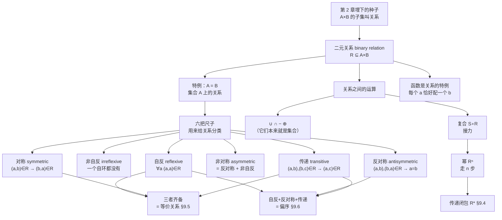

# C9.1 关系及其性质 Relations and Their Properties

> [!abstract] 这一讲的任务
> 第 2 章我们造出了**笛卡尔积** $A\times B$，还顺手说了一句"$A\times B$ 的子集叫**关系**"，然后就把它放下了，转头去讲函数。整整七章之后，我们要回来认真对待这个被搁置的概念。
> 为什么值得用一整章？因为**函数太窄了**。函数要求"每个输入恰好配一个输出"，可现实世界里绝大多数联系不是这样：一个学生选多门课、一座城市在一个州但一个州有很多城市、一个网页链到很多网页。这些都写不成函数，但都能写成关系。
> 这一讲要做三件事：① 把"关系"这个词从直觉变成一个能计算的对象；② 给关系装上**尺子**——课本重点讲四把（自反、对称、反对称、传递），但完整的性质有**六种**，还有非自反与非对称，一并列全；③ 学会把两个关系**接起来**（复合、幂），并把它们的四条性质证清楚，为 §9.4 的传递闭包做准备。

> [!info] 怎么读这份讲义
> 按顺序读即可。**第 4 节的六个性质是整章的地基**（其中四个是核心），务必读到能不看书说出每一条的定义和一个反例；第 6 节的复合与幂是 §9.3、§9.4 的直接前置。
> 需要第 1、2 章的地方我都写了双链，忘了随时点回去。



---

## 0. 开场：你的选课系统装不下这份数据

上学期你给社团写了个小工具，用来记"谁选了哪门课"。你第一反应是开一个字典：

```python
enrolled = {
    "Jason Goodfriend": "CS518",
    "Deborah Sherman": "CS518",
}
```

跑了两天就出事了：Jason 又选了 CS510。你想加一行 `enrolled["Jason Goodfriend"] = "CS510"`，结果把 CS518 覆盖掉了。

你意识到问题出在哪：**字典（也就是函数）强制"一个键只能配一个值"**，而选课这件事天生是"一个人配多门课、一门课配多个人"。

于是你改了数据结构——不再存"键 → 值"，而是存**一堆二元组**：

```python
enrolled = {
    ("Jason Goodfriend", "CS518"),
    ("Jason Goodfriend", "CS510"),
    ("Deborah Sherman", "CS518"),
}
```

现在什么都能表达了：Jason 选两门就写两条，Deborah 没选 CS510 就不写那条，一门课没人选就一条都不出现。

**你刚才做的，就是把一个函数升级成了一个关系。** 这一讲从头讲清楚这个升级到底得到了什么、又要付出什么代价。

---

## 1. 关系是什么：一句话定义，但要看懂它在说什么

先把定义摆出来，然后逐字拆。

> [!important] 定义 1（二元关系 Binary Relation）
> 设 $A$、$B$ 是集合。**从 $A$ 到 $B$ 的二元关系 (binary relation from $A$ to $B$)** 是 $A\times B$ 的一个**子集**。

就这么一句。但里面藏着三层信息：

**第一层：关系是一个集合。** 不是一条规则，不是一个公式，就是一个由有序对组成的集合。所以**关系能做一切集合能做的事**——取并、取交、求补、比较大小、数元素个数。这一点在第 5 节会直接兑现。

**第二层：它是 $A\times B$ 的子集，所以有序对的顺序不能乱。** 第一个分量必须来自 $A$，第二个必须来自 $B$。$(Jason, CS518)$ 和 $(CS518, Jason)$ 是两个完全不同的东西。

**第三层："子集"意味着你在做一次挑选。** $A\times B$ 把所有可能的配对都摆在那里，关系就是你从中圈出来的一部分。

> [!warning] 圆括号和花括号别混
> $R$ 的元素是**有序对** $(a,b)$，不是集合 $\{a,b\}$。花括号表示"一堆无序的东西"（程序里的 `set`），圆括号表示"有先后的二元组"（`tuple`）。$(a,b)\ne(b,a)$，而 $\{a,b\}=\{b,a\}$——写成花括号，方向信息当场丢光。
> 另外，同一个有序对在 $R$ 里只算一次：$R$ 是集合，把 $(1,1)$ 写两遍仍然只有一个 $(1,1)$。但"同一个 $a$ 配两个不同的 $b$"不算重复，那是两个不同的有序对——这正是关系能表达一对多的原因。

![[C9-关系就是笛卡尔积的子集.png]]

> [!note] 记号约定（后面一直用）
> - $(a,b)\in R$ 记作 $\boxed{a\,R\,b}$，读作"$a$ 与 $b$ 有关系 $R$"；
> - $(a,b)\notin R$ 记作 $a\,\not R\,b$。
> - 只讨论两个集合时，"二元"两个字常常省掉，直接说"关系"。

### 例 1–3（课本例 1、2、3）

**例 1（选课）**：$A$ = 全校学生，$B$ = 全部课程，$R$ = 所有 $(a,b)$ 使得学生 $a$ 选了课程 $b$。
- Jason 选了 CS518 和 CS510 ⇒ $(\text{Jason},\text{CS518})$、$(\text{Jason},\text{CS510})$ 都在 $R$ 里；
- Deborah 没选 CS510 ⇒ $(\text{Deborah},\text{CS510})\notin R$。

**两个边界情形要想清楚**：如果某个学生这学期一门课都没选，那么 $R$ 里**没有任何**以他为第一分量的有序对；如果某门课这学期没开，$R$ 里**没有任何**以它为第二分量的有序对。关系允许"有元素完全不参与"——这正是它比函数宽松的地方。

**这一点看图时最容易被漏掉**：等第 4.4 节把关系画成有向图，一个谁都没选的学生仍然是图上的一个顶点，只是没有任何箭头从它出发——不能因为"他不在任何有序对里"就把他从顶点集里删掉。$A$ 的每个元素都得画上，哪怕它一个箭头也没有。

**例 2（城市与州）**：$A$ = 美国城市，$B$ = 50 个州，$(a,b)\in R$ 当且仅当名叫 $a$ 的城市位于州 $b$。
课本举的例子里有 $(\text{Middletown},\text{New Jersey})$ **和** $(\text{Middletown},\text{New York})$——**同一个城市名出现了两次**。记住这一点，第 2 节马上要用它。

**例 3（小例子，要会画）**：$A=\{0,1,2\}$，$B=\{a,b\}$，
$$R=\{(0,a),(0,b),(1,a),(2,b)\}$$
就是上面那张图画的东西。

---

## 2. 停一下：关系和函数到底差在哪

> [!question] 停一下，先自己想想
> 你已经学过函数（[[C2.3 函数 Functions]]）。函数的**图像 graph** 是 $\{(a,f(a))\mid a\in A\}$，它显然是 $A\times B$ 的子集，所以**每个函数都是一个关系**。
> 那么反过来：**什么样的关系才是函数的图像？** 先别往下看，用"有序对"的语言把条件写出来。

想好了吗？答案只有一句话：

> [!important] 关系 $R$ 是某个函数的图像 $\iff$ **$A$ 的每个元素恰好是 $R$ 中一个有序对的第一分量**
> - "**至少**一个" ⇒ 保证 $f(a)$ 有定义（定义域是整个 $A$）；
> - "**至多**一个" ⇒ 保证 $f(a)$ 唯一（不会一个输入两个输出）。
>
> 两个条件缺一不可，缺任何一个都只是关系、不是函数。

回头看例 2：Middletown 作为第一分量出现了**两次**，违反了"至多一个" ⇒ **例 2 的关系不是函数的图像**。这正好解释了开场那个 bug——你的字典想装的东西本来就不是函数。

> [!note] 一句话记住三者的关系
> $$\text{函数} \;\subsetneq\; \text{关系}$$
> 关系能表达**一对多 (one-to-many)**，函数只能表达**多对一或一对一**。所以第 9 章是在**放宽**第 2 章的限制，不是在讲一个新东西。
>
> **AI 方向的类比**：Python 的 `dict` 是函数（键唯一），而数据库里的一张两列表、或 PyTorch 里的 `edge_index`（图神经网络的边列表，形状 $2\times|E|$）就是关系。**图神经网络的输入本质上就是一个关系。**

> [!warning] "先学函数、再学关系"不等于关系要求更严
> 顺着讲课顺序很容易得出一个反了的结论：以为关系是函数的"加强版"。**正好相反**——函数的条件（每个 $a$ 恰好配一个 $b$）比关系多，所以**函数是关系的特例**，关系是放宽之后的东西。
> 检验方法还是那两条：把"至少一个"或"至多一个"去掉任意一条，函数就退化成关系。**放宽限制换来的，是表达一对多的能力。**
> 但"更自由"不等于"没约束"：关系不再保证任何结构，所以每一条性质都得单独查——这正是第 4 节那六把尺子的来历。

---

## 3. 集合上的关系：把 $B$ 换成 $A$

真正有趣的情形是两个集合相同。

> [!important] 定义 2（集合 $A$ 上的关系）
> 集合 $A$ 上的关系 (a relation **on** a set $A$) 是从 $A$ 到 $A$ 的关系，也就是 $A\times A$ 的子集。

为什么这个特例值得单列？因为**只有在 $A=B$ 时，才谈得上"$a$ 和 $b$ 对调会怎样""$a\to b\to c$ 能不能接起来"**——第 4 节那六把尺子全部需要两个分量来自同一个集合。

### 例 4（整除关系，全章最常用的例子）

$A=\{1,2,3,4\}$，$R=\{(a,b)\mid a \text{ 整除 } b\}$。把它列全：

$$R=\{(1,1),(1,2),(1,3),(1,4),(2,2),(2,4),(3,3),(4,4)\}$$

**手算方法**：对每个 $a$ 从 1 到 4，找出 $\{1,2,3,4\}$ 里所有 $a$ 的倍数。$a=1$ 配四个，$a=2$ 配 2 和 4，$a=3$ 只配 3，$a=4$ 只配 4。共 8 个。

> [!warning] 整除记号别写反
> $a\mid b$ 读作"**$a$ 整除 $b$**"，意思是 $b$ 是 $a$ 的倍数。很多人第一次学会把它读成"$a$ 除以 $b$"，方向正好反了。
> 竖线左边是**小的那个**（因子），右边是**大的那个**（倍数）。

### 例 5（整数上的六个关系，后面反复引用）

论域是**全体整数** $\mathbf Z$（无限集）：

$$
\begin{aligned}
R_1&=\{(a,b)\mid a\le b\} & R_2&=\{(a,b)\mid a> b\} & R_3&=\{(a,b)\mid a=b \text{ 或 } a=-b\}\\
R_4&=\{(a,b)\mid a=b\} & R_5&=\{(a,b)\mid a=b+1\} & R_6&=\{(a,b)\mid a+b\le 3\}
\end{aligned}
$$

课本问：$(1,1)$、$(1,2)$、$(2,1)$、$(1,-1)$、$(2,2)$ 各属于哪些？逐个验算：

| 有序对 | 属于 | 逐条检验 |
|---|---|---|
| $(1,1)$ | $R_1,R_3,R_4,R_6$ | $1\le1$ ✓；$1>1$ ✗；$1=1$ ✓；$1=1$ ✓；$1=1+1$ ✗；$1+1=2\le3$ ✓ |
| $(1,2)$ | $R_1,R_6$ | $1\le2$ ✓；$1>2$ ✗；$1\ne\pm2$ ✗；$1\ne2$ ✗；$1\ne3$ ✗；$3\le3$ ✓ |
| $(2,1)$ | $R_2,R_5,R_6$ | $2\le1$ ✗；$2>1$ ✓；$2\ne\pm1$ ✗；✗；$2=1+1$ ✓；$3\le3$ ✓ |
| $(1,-1)$ | $R_2,R_3,R_6$ | $1\le-1$ ✗；$1>-1$ ✓；$1=-(-1)$ ✓；✗；$1\ne0$ ✗；$0\le3$ ✓ |
| $(2,2)$ | $R_1,R_3,R_4$ | $2\le2$ ✓；✗；$2=2$ ✓；$2=2$ ✓；✗；$4\le3$ ✗ |

> [!note] 这张表建议自己重做一遍
> 后面讲这些性质时，课本会反复问"例 5 里哪些是自反的 / 对称的 / 传递的"。**手上有这张验算表，后面全部不用重算。**

### 例 6：一个 $n$ 元集合上有多少个关系？

> [!question] 停一下，先自己想想
> $|A|=n$。$A$ 上的关系有多少个？（提示：只需要把两件事串起来——关系是什么、子集有多少个。）

**解**：关系 = $A\times A$ 的子集。$|A\times A|=n\cdot n=n^2$（[[C2.1 集合 Sets]] 的乘法原理）。一个 $m$ 元集合有 $2^m$ 个子集（[[C2.1 集合 Sets]] 的幂集定理）。所以

$$\boxed{A \text{ 上的关系共有 } 2^{n^2} \text{ 个}}$$

$n=3$ 时是 $2^9=512$ 个。$n=4$ 时已经是 $2^{16}=65\,536$ 个。

> [!note] 停一下，我们刚才干了什么
> 这道题看着是计数题，实际上是在**验收第 1 节的第一层信息**："关系是一个集合"。一旦接受了这件事，计数就自动退化成"数子集"，不需要任何新工具。
> **这个套路后面还要用两次**：数自反关系（例 16）、数对称关系（习题 47）。

---

## 4. 六把尺子：自反、非自反、对称、非对称、反对称、传递

现在进入整章最重要的一节。这几个词会在后面每一节出现，**§9.5 的等价关系 = 自反+对称+传递，§9.6 的偏序 = 自反+反对称+传递**，所以定义必须刻进脑子。

> [!important] **六个性质的完整清单**（比课本正文多两个）
> 教材正文重点讲四个（自反、对称、反对称、传递），但**这类性质一共六个**，先把它们一次列全，并记住它们之间的换算关系：
>
> | 性质 | 量词形式 | 一句话 |
> |---|---|---|
> | **自反 Reflexive** | $\forall a\,((a,a)\in R)$ | 每个元素都有自环 |
> | **非自反 Irreflexive** | $\forall a\,(a\in A\to (a,a)\notin R)$ | **一个自环都没有** |
> | **对称 Symmetric** | $\forall a\forall b\,((a,b)\in R\to(b,a)\in R)$ | 边成双 |
> | **非对称 Asymmetric** | $\forall a\forall b\,((a,b)\in R\to(b,a)\notin R)$ | 没有双向边，**也没有自环** |
> | **反对称 Antisymmetric** | $\forall a\forall b\,(((a,b)\in R\wedge(b,a)\in R)\to a=b)$ | 没有 $a\ne b$ 的双向边（**允许自环**） |
> | **传递 Transitive** | $\forall a\forall b\forall c\,(((a,b)\in R\wedge(b,c)\in R)\to(a,c)\in R)$ | 能接力 |
>
> **它们之间的换算公式（一定要记住）**：
> $$\boxed{\text{Asymmetry} = \text{Antisymmetry} + \text{Irreflexivity}}$$
> 也就是说，**"非对称"比"反对称"严格得多**：反对称允许自环，非对称连自环都不允许。**考试给一个关系让你判断时，先看自环，再看向量方向**——这也是下面例 7 的重点。
>
> ⚠️ **术语提醒**：中文里 "irreflexive" 常译成"**非自反**"或"**反自反**"，"asymmetric" 常译"**非对称**"；但 **"非对称"不是"对称"的否定**（就像"反对称"不是"对称"的反义），这正是下面 4.2 反复强调的坑。

> [!tip] 判性质的三步，顺序别换
> 1. **先数自环**：全都有 ⇒ 自反；一个都没有 ⇒ 非自反；**有的有、有的没有 ⇒ 两条都不成立**（最常见，别硬凑）。
> 2. **再看 $a\ne b$ 的双向边**：有成双的 ⇒ 对称成立，同时**非对称、反对称一起划掉**；一对都不成双 ⇒ 对称否。
> 3. **最后找"首尾相接的两步"**：接得上却缺 $(a,c)$，就是不传递。
> 为什么顺序不能换：第 2 步一旦判出"对称且存在 $a\ne b$ 的边"，六条里已经有三条有了结论，只剩传递要查。**先做能一票否决的检查，能省一半时间**——这正是考场上最值钱的手感。

### 4.1 自反 Reflexive：每个元素都跟自己有关系

先看一个生活例子：设 $R$ 是"$x$ 与 $y$ 同父同母"这个关系。**每个人都跟自己同父同母**，所以 $x\,R\,x$ 对所有人成立。

> [!important] 定义 3（自反 Reflexive）
> 集合 $A$ 上的关系 $R$ 称为**自反的 (reflexive)**，如果对**每一个** $a\in A$ 都有 $(a,a)\in R$。
> 用量词写（[[C1.4 谓词与量词 Predicates and Quantifiers]]）：
> $$\forall a\,\bigl((a,a)\in R\bigr),\qquad \text{论域 } = A$$

**关键在"每一个"**：漏掉一个元素就不自反。

**例 7**（$\{1,2,3,4\}$ 上的六个关系，后面反复用，先抄下来）：

$$
\begin{aligned}
R_1&=\{(1,1),(1,2),(2,1),(2,2),(3,4),(4,1),(4,4)\}\\
R_2&=\{(1,1),(1,2),(2,1)\}\\
R_3&=\{(1,1),(1,2),(1,4),(2,1),(2,2),(3,3),(4,1),(4,4)\}\\
R_4&=\{(2,1),(3,1),(3,2),(4,1),(4,2),(4,3)\}\\
R_5&=\{(1,1),(1,2),(1,3),(1,4),(2,2),(2,3),(2,4),(3,3),(3,4),(4,4)\}\\
R_6&=\{(3,4)\}
\end{aligned}
$$

哪些自反？**判法：把 $(1,1),(2,2),(3,3),(4,4)$ 这四个都找一遍。**
- $R_3$：$(1,1)$ ✓ $(2,2)$ ✓ $(3,3)$ ✓ $(4,4)$ ✓ ⇒ **自反**
- $R_5$：四个全在 ⇒ **自反**
- $R_1,R_2,R_4,R_6$：**都缺 $(3,3)$** ⇒ 全不自反

**例 8**（例 5 里哪些自反）：$R_1$（$a\le a$ 恒真）、$R_3$（$a=a$ 恒真）、$R_4$（$a=a$ 恒真）自反。其余各举一个反例即可：$R_2$ 缺 $(0,0)$（$0>0$ 假）、$R_5$ 缺 $(0,0)$（$0\ne 1$）、$R_6$ 缺 $(2,2)$（$4>3$）。

**例 9**（整除关系自反吗）：在**正整数**上，$a\mid a$ 恒成立 ⇒ **自反**。

> [!warning] 课本专门加的一句提醒：换成全体整数就不自反了
> 因为按定义 **0 不整除 0**（$a\mid b$ 要求存在整数 $k$ 使 $b=ak$，当 $a=0$ 时只能得到 $b=0$……但标准定义中约定除数不为 0）。所以 $(0,0)\notin R$。
> **论域一变，性质就变**——这与 [[C1.4 谓词与量词 Predicates and Quantifiers]] 里"换论域就换真值"是同一件事。

### 4.2 对称与反对称：这两个词不是反义词

> [!important] 定义 4（对称 Symmetric / 反对称 Antisymmetric）
> - $R$ 是**对称的 (symmetric)**：对所有 $a,b\in A$，只要 $(a,b)\in R$ 就有 $(b,a)\in R$。
>   $$\forall a\forall b\bigl((a,b)\in R\to (b,a)\in R\bigr)$$
> - $R$ 是**反对称的 (antisymmetric)**：对所有 $a,b\in A$，只要 $(a,b)\in R$ **且** $(b,a)\in R$，就必有 $a=b$。
>   $$\forall a\forall b\bigl(((a,b)\in R\wedge (b,a)\in R)\to a=b\bigr)$$

用大白话翻译：

- **对称** = "只要 $a$ 指向 $b$，$b$ 就一定指回 $a$"，箭头**成双成对**。
- **反对称** = "**不存在两个不同的元素互相指**"。注意它**不禁止** $(a,a)$——自己指自己是允许的。

**怎么记住"非对称"这么苛刻：拿父子关系当标尺。** 若 $a$ 是 $b$ 的父亲，则 $b$ 绝不可能是 $a$ 的父亲——这是**绝对单向**，一步都不能回头，这就是非对称。它顺带解释了为什么非对称**不允许自反**：没有人是自己的父亲——别人可能是，你自己不是，这条没有例外。所以
$$\text{非对称}=\text{反对称（不许 }a\ne b\text{ 的双向边）}+\text{非自反（连自己指自己也不许）}$$
反过来，**师生关系就够不上非对称**：今年你是老师、我是学生，几年后我也可能站上讲台，方向是可以反过来的。

**反对称的标尺则是"允许相等"的比较**：$\le$ 满足反对称（$a\le b$ 且 $b\le a$ 只能 $a=b$），而它**明确允许** $a\le a$，所以反对称和自反可以同时成立。两者的分界就在那条自环上。

> [!warning] ⭐ 全章最容易搞混的一点：对称和反对称**不是**互为否定
> 课本原话：*The terms symmetric and antisymmetric are not opposites.*
> 一个关系可以：
> 
> | 情形 | 例子（在 $\{1,2\}$ 上） |
> |---|---|
> | **既对称又反对称** | $\{(1,1),(2,2)\}$——每个箭头都是自环，对称条件平凡满足，反对称也满足 |
> | **对称但不反对称** | $\{(1,2),(2,1)\}$ |
> | **反对称但不对称** | $\{(1,2)\}$ |
> | **两者都不是** | $\{(1,2),(2,1),(1,3)\}$（在 $\{1,2,3\}$ 上） |
>
> **唯一被禁止的组合**：含有某对 $a\ne b$ 的 $(a,b)$ 时，不可能同时对称又反对称。
> **速判窍门：先看有没有"$a\ne b$ 的双向箭头"。有 ⇒ 不反对称；有单向箭头没回头箭头 ⇒ 不对称。自环对这两个判断毫无影响。**

**例 10**（例 7 的六个关系）：
- **对称的**：$R_2$（只需验 $(1,2)$ 与 $(2,1)$ 成对 ✓）、$R_3$（$(1,2)\leftrightarrow(2,1)$ ✓，$(1,4)\leftrightarrow(4,1)$ ✓，其余是自环）。
- **反对称的**：$R_4,R_5,R_6$。$R_4$ 全是"大编号指小编号"，不可能双向；$R_5$ 只要验一下没有 $a\ne b$ 的双向对；$R_6$ 只有一个元素 $(3,4)$，而 $(4,3)\notin R_6$ ✓。
- $R_1$：有 $(3,4)$ 但没有 $(4,3)$ ⇒ 不对称；有 $(1,2)$ **和** $(2,1)$ 且 $1\ne2$ ⇒ 不反对称。**两头不沾。**

> [!tip] 判"非对称"的第一道闸门：先数自环
> 非对称 = 反对称 + 非自反，所以**只要 $R$ 里出现任何一个 $(a,a)$，非对称立刻判否**，不必再去看有没有双向边。
> 但反向不成立：一个自环都没有，也不等于非对称——还得确认没有 $a\ne b$ 的双向边。$R=\{(1,1),(1,2)\}$ 就是现成的例子：反对称成立（没有 $a\ne b$ 的双向边），非对称不成立（那个 $(1,1)$ 卡住了）——**差别只在一条自环**。
> 选择题里这条闸门最省时间：看到带自环的关系，非对称第一个划掉。

**例 11**（例 5 的六个关系）：
- **对称**：$R_3$（$a=\pm b\Rightarrow b=\pm a$）、$R_4$（$a=b\Rightarrow b=a$）、$R_6$（$a+b\le3\Rightarrow b+a\le3$，加法可交换）。
- **反对称**：$R_1$（$a\le b$ 且 $b\le a$ ⇒ $a=b$，这正是实数序的**反对称性**）、$R_2$（$a>b$ 与 $b>a$ 不可能同时成立，前件永假 ⇒ **空真**，见 [[C1.1 命题逻辑 Propositional Logic]]）、$R_4$、$R_5$（$a=b+1$ 与 $b=a+1$ 同时成立会推出 $a=a+2$，矛盾）。

> [!note] ⭐ 反对称的"空真"技巧——考试常用
> 证明反对称时，**最省力的路线常常是证明"前件不可能为真"**：如果压根不存在 $a\ne b$ 使 $(a,b)$ 与 $(b,a)$ 同时在 $R$ 里，那么蕴涵式空真成立，反对称自动为真。
> $R_2$（严格大于）和 $R_5$（差 1）都是靠这一招。**这是 [[C1.1 命题逻辑 Propositional Logic]] 里"前件为假则整个条件语句为真"的直接应用**——学逻辑时觉得没用的空真，在这里第一次派上用场。

**例 12**（整除关系）：不对称（$1\mid 2$ 但 $2\nmid 1$）；**反对称**（若 $a\mid b$ 且 $b\mid a$，则 $a=b$，对正整数成立）。

> [!warning] "$<$ 是非对称，所以它不是反对称"——这一步推错了
> 非对称的定义里**已经包含**反对称，所以严格小于**同时**是非对称和反对称。验一下：若 $a<b$ 且 $b<a$，这个前件本身不可能成立，反对称的条件**空真**成立。
> 真正容易说反的是另一头：$\le$ **是反对称但不是非对称**（因为它有 $a\le a$）。**"严格"和"带等号"的差别，永远落在自环上。**

### 4.3 传递 Transitive：能接力

生活例子：$R$ = "$x$ 比 $y$ 修的学分多"。$x$ 比 $y$ 多、$y$ 比 $z$ 多 ⇒ $x$ 一定比 $z$ 多。

> [!important] 定义 5（传递 Transitive）
> $R$ 是**传递的 (transitive)**：对所有 $a,b,c\in A$，只要 $(a,b)\in R$ 且 $(b,c)\in R$，就有 $(a,c)\in R$。
> $$\forall a\forall b\forall c\bigl(((a,b)\in R\wedge (b,c)\in R)\to (a,c)\in R\bigr)$$

**判传递的操作方法**：把所有"首尾相接的两步" $(a,b),(b,c)$ 找出来，逐个检查 $(a,c)$ 在不在。**不传递只要举出一个反例。**

**例 13**（例 7）：
- **传递的**：$R_4,R_5,R_6$。以 $R_4$ 为例，能接上的两步只有 $(3,2)\!+\!(2,1)$、$(4,2)\!+\!(2,1)$、$(4,3)\!+\!(3,1)$、$(4,3)\!+\!(3,2)$，对应要求 $(3,1),(4,1),(4,1),(4,2)$，四个全在 $R_4$ 里 ✓。
  $R_6=\{(3,4)\}$ 只有一条边，接不出两步 ⇒ **空真传递**。
- **不传递的**：$R_1$（$(3,4)+(4,1)$ 但 $(3,1)\notin R_1$）、$R_2$（$(2,1)+(1,2)$ 但 $(2,2)\notin R_2$）、$R_3$（$(4,1)+(1,2)$ 但 $(4,2)\notin R_3$）。

**例 14**（例 5）：$R_1,R_2,R_3,R_4$ 传递。$R_5$ 不传递（$(2,1)+(1,0)$ 但 $(2,0)\notin R_5$，因为 $2\ne 0+1$）。$R_6$ 不传递（$(2,1)+(1,2)$ 但 $(2,2)$：$2+2=4>3$ ✗）。

**例 15**（整除关系传递吗）：设 $a\mid b$、$b\mid c$，则存在正整数 $k,l$ 使 $b=ak$、$c=bl$。于是
$$c=bl=(ak)l=a(kl)$$
$kl$ 是正整数 ⇒ $a\mid c$。∎ **传递。**

> [!note] 停一下，我们刚才干了什么
> 整除关系在正整数上同时是**自反、反对称、传递**的——这三个词凑在一起就是 §9.6 的**偏序**。所以 $(\mathbf Z^+,\mid)$ 会成为第 6 节的头号例子。**现在先把这三条验证记住，到那一节就是白送的。**

### 4.4 四个核心性质的图形判读（本节最实用的一张图）

第 4 节列了六个性质，其中**四个核心性质**（自反、对称、反对称、传递）在**有向图**（§9.3 会正式定义）上各有一个一眼可辨的特征。读图只有一条规矩：**$(a,b)\in R$ 就画一支从 $a$ 出发、箭头落在 $b$ 上的边**；$(a,a)$ 是绕回自己的一支自环。

![[C9-四个性质的有向图判读.png]]

| 性质 | 图上长什么样 | 一句话判据 |
|---|---|---|
| **自反** | **每个**顶点都有自环 | 少一个自环就不自反 |
| **对称** | 不同顶点间的边**成双出现** | 看到单向箭头就不对称 |
| **反对称** | 不同顶点间**从不双向** | 看到双向箭头就不反对称（自环无关） |
| **传递** | 两步能到的地方，一步也能到 | 看到"三角形缺一条边"就不传递 |

![[C9-图判三性质-自反非自反传递.png]]

**看图**：**上**——每个顶点都套了一个自环，所以自反；**中**——**一个自环都没有**（箭头全在顶点之间），所以非自反；**下**——把"两步接一步"的位置标了出来，**每两条相邻的边都补出一个三角形**。但这里要记住一句大实话：**"Every two adjacent forms a triangle (Not easy to observe in Graph)"**——**传递性在图上其实不好看，矩阵上更难，最稳的判法是按定义去数**。

**不过别因此放弃画图。** 判性质的第一反应仍然应该是画出有向图——它比矩阵直观：自环有没有、箭头成不成双，一眼就看得出。只有"传递"这一列，图和矩阵都不给力，得回到定义去数。元素一多，图也会看不过来，那时才轮到矩阵和逐项检查上场。

### 4.5 矩阵上怎么看这些性质

把 $A$ 上的关系写成**零一矩阵**（§9.3 会正式定义），六个性质里有五个立刻变成矩阵上的"花纹"（只有传递性不行）：

![[C9-矩阵判三性质.png]]

| 性质 | 矩阵上的花纹 |
|---|---|
| **自反** | **对角线全是 1**（All 1's on diagonal） |
| **非自反** | **对角线全是 0**（All 0's on diagonal） |
| **对称** | **关于主对角线镜像对称**（All identical across diagonal） |
| **非对称** | 1 的镜像位置全是 0；**且对角线全 0**（All 1's are across from 0's (Antisymmetric) + All 0's on diagonal (Irreflexive)） |
| **反对称** | 1 的镜像位置全是 0（**对角线随便**）——All 1's are across from 0's |
| **传递** | ——**Not easy to observe in Matrix** |

> [!bug] 原稿一处笔误
> 矩阵判读那一页把**对称**的条件印成了 $(a,b)\in R\to(b,a)\notin R$——那是**非对称**的条件，右边一栏"关于主对角线镜像对称"也印证正确的是 $\in R$。
> 照印出来的式子读，会把"对称关系"判成"它的反面"。定义以 §4.2 为准。

> [!warning] ⭐ 矩阵判读那一页专门给传递性打了个问号
> 那个 **"?"** 就落在**传递性**的位置：**传递性在矩阵上和图上都"not easy to observe"**。
> **所以考试遇到判传递，别试图"看图看出来"，老老实实按定义找"两步能接上的组合"**（同 4.3 的操作方法）。这是本节最值得记的一条应试经验。

> [!note] 矩阵不光好看，还费内存
> 元素一多、边一少，零一矩阵里绝大多数格子都是 0。这些 0 也要占存储、也要进运算，稀疏矩阵在内存和速度上都很吃亏；所以工程实现更常见的是**只存 1** 的边表、邻接表，而矩阵胜在规则简单：判性质看花纹、求并交按位取与取或、求复合做布尔积。
> 一句话：**人读用图，机算用矩阵，存起来用边表。** §9.3 会把三者的取舍讲完。

### 4.6 一个把六种性质一次练完的例子

在 $\{1,2,3,4\}$ 上考虑四个关系，**逐个判断它有哪些性质**：

$$
\begin{aligned}
R_1&=\{(1,1),(1,2),(2,1),(2,2),(3,4),(4,1),(4,4)\}
\qquad R_2=\{(1,1),(1,2),(2,1)\}
\\
R_3&=\{(1,1),(1,2),(1,4),(2,1),(2,2),(3,3),(4,1),(4,4)\}
\qquad R_4=\{(3,4)\}
\end{aligned}
$$

> [!example] 判读过程（按"自环 → 双向边 → 接力"三步走）
> **第一步：看自环（定自反/非自反）**
> - $R_1$：有 $(1,1),(2,2),(4,4)$，**缺 $(3,3)$** ⇒ 既不自反、也不非自反；
> - $R_2$：只有 $(1,1)$ ⇒ 同样两头都不是；
> - $R_3$：$(1,1),(2,2),(3,3),(4,4)$ **四个全有** ⇒ **自反**；
> - $R_4$：**一个自环都没有** ⇒ **非自反**。
>
> **第二步：看双向边（定对称/非对称/反对称）**
> - $R_1$：有 $(1,2)$ 与 $(2,1)$（$1\ne2$）⇒ 有双向边 ⇒ **不对称**；也 **不反对称**；而 $(3,4)$ 没有 $(4,3)$ ⇒ 全是双向也不行 ⇒ **非对称也否**。**三个全不是。**
> - $R_2$：$(1,2)\leftrightarrow(2,1)$ 成双；没有其他非自环边 ⇒ **对称**成立；有 $1\ne2$ 的双向边 ⇒ **不反对称**；有自环 $(1,1)$ ⇒ **非对称也否**。
> - $R_3$：$(1,2)\leftrightarrow(2,1)$、$(1,4)\leftrightarrow(4,1)$ 都成对，其余是自环 ⇒ **对称**；正因为存在 $1\ne2$ 的双向边 ⇒ **不反对称、不非对称**。
> - $R_4$：**没有任何双向边，也没有自环** ⇒ 非对称的蕴涵式前件永假 ⇒ **非对称**成立；非对称蕴含反对称 ⇒ **反对称也成立**。
>
> **第三步：看接力（定传递）**
> - $R_1$：$(3,4)+(4,1)$ 但 $(3,1)\notin R_1$ ⇒ **不传递**；
> - $R_2$：$(2,1)+(1,2)$ 但 $(2,2)\notin R_2$ ⇒ **不传递**；
> - $R_3$：接得上的组合有 $(4,1)+(1,2)\Rightarrow(4,2)\notin R_3$ ⇒ **不传递**；
> - $R_4$：只有一条边，接不出两步 ⇒ **空真传递**。
>
> **答案汇总**：
>
> | 关系 | 自反 | 非自反 | 传递 | 对称 | 非对称 | 反对称 |
> |:-:|:-:|:-:|:-:|:-:|:-:|:-:|
> | $R_1$ | ✗ | ✗ | ✗ | ✗ | ✗ | ✗ |
> | $R_2$ | ✗ | ✗ | ✗ | **✓** | ✗ | ✗ |
> | $R_3$ | **✓** | ✗ | ✗ | **✓** | ✗ | ✗ |
> | $R_4$ | ✗ | **✓** | **✓** | ✗ | **✓** | **✓** |
>
> **注意最后一行**：$R_4=\{(3,4)\}$ 同时是**非自反、传递、非对称、反对称**——**一个只有一个元素的关系，几乎把所有"空真"性质都占了**。这类题（"举一个同时满足……的关系"）就是靠这种极端例子构造的。
>
> ⚠️ **$R_3$ 最容易看错**：它自反、对称，四个自环一个不缺，看着"最完整"；可 $(4,1)$ 与 $(1,2)$ 明明接得上，就是缺 $(4,2)$，所以它**不传递**。**自反 + 对称一点也不保证传递**——"箭头看着都连上了"不是判据，接力边才是。
>
> ⚠️ **上面的每一条都按定义逐项核对过，与矩阵判读那一页上划掉/保留的红线完全对得上**（$R_1$ 六个全划、$R_2$ 只留 Symmetric、$R_3$ 只留 Reflexive 与 Symmetric、$R_4$ 只划 Reflexive 与 Symmetric）。

### 4.7 数一数：自反关系有多少个（例 16）

> [!question] 课堂追问
> 例 6 算出 $A$ 上一共有 $2^{n^2}$ 个关系。那么其中**自反**的有多少个？

**解**：一个关系由"$n^2$ 个有序对每个在不在里面"这 $n^2$ 个二选一决定。自反性**强制**了对角线上那 $n$ 个 $(a,a)$ 必须在里面——这 $n$ 个位置**没有选择权**。剩下 $n^2-n=n(n-1)$ 个位置自由取舍。由乘法原理：

$$\boxed{\text{自反关系的个数} = 2^{n(n-1)}}$$

> [!note] 课本在这里留的两个信息
> - 对称关系、反对称关系的个数也能用类似推理算出（习题 47）。
> - **但是传递关系的个数至今没有通项公式！** 目前只算到 $n\le 17$。课本给的数据：$T(4)=3\,994$，$T(5)=154\,303$，$T(6)=9\,415\,189$。
>
> 对照一下：$n=4$ 时全部关系有 $2^{16}=65\,536$ 个，传递的只有 3994 个，占 **6%**。**传递是一个相当"稀有"的性质**——这也解释了为什么 §9.4 要专门花一节讲"怎么把一个关系补成传递的"。

### 4.8 六把尺子的三种搭配：等价、偏序、严格序

六条性质单看只是"尺子"，真正有用的是它们**成套出现**时的三种组合——后面两节就是从这三行分岔出去的：

| 组合 | 要满足的三条 | 典型例子 | 另外三条 |
|---|---|---|---|
| **等价关系** §9.5 | 自反 + 对称 + 传递 | $=$、同余、同父同母 | 非自反 ✗、非对称 ✗、反对称通常 ✗（$=$ 是特例） |
| **偏序** §9.6 | 自反 + 反对称 + 传递 | $\le$、整除 | 非自反 ✗、非对称 ✗、对称通常 ✗（只有 $=$ 满足） |
| **严格偏序** | 非自反 + 非对称 + 传递 | $<$、真包含 $\subsetneq$ | 自反 ✗、对称 ✗、反对称 ✓（非对称已经蕴含它） |

**为什么 $\le$ 只留这三条**，逐条对一遍就明白：

- **非对称出局**：它要求一个自环都没有，而 $a\le a$ 恒成立；
- **非自反出局**：同上，$a\le a$ 就是反例；
- **对称出局**：$1\le2$ 成立、$2\le1$ 不成立（只有 $a=b$ 那一对才"对称得起来"）；
- **反对称留下**：$a\le b$ 与 $b\le a$ 同时成立时只能 $a=b$，正好；
- **自反留下**：每个元素至少和自己可比；
- **传递留下**：$a\le b$ 且 $b\le c$ ⇒ $a\le c$——这就是"排序"能成立的原因。

把"允许相等"再掐掉，$\le$ 就变成 $<$：自反没了、非自反回来了，对称没了、反对称升级成非对称——**这就是上表第三行**。所以严格序和偏序是同一个东西的两副面孔：
$$a<b\iff a\le b\ \wedge\ a\ne b$$

> [!warning] "偏序"的"偏"不是"性质只满足一部分"
> partial 说的是"**不是任意两个元素都能比大小**"（整除关系里 $2$ 与 $3$ 互不整除，没法比），不是"六条里只挑三条满足"。它该满足的三条一条都不能少。

---

## 5. 关系的组合（一）：把它们当集合用

第 1 节说过"关系就是集合"。现在兑现这句话：两个从 $A$ 到 $B$ 的关系都是 $A\times B$ 的子集，所以集合的**一切**运算都能直接搬过来（[[C2.2 集合运算 Set Operations]]）。

**例 17**：$A=\{1,2,3\}$，$B=\{1,2,3,4\}$，
$$R_1=\{(1,1),(2,2),(3,3)\},\qquad R_2=\{(1,1),(1,2),(1,3),(1,4)\}$$

$$
\begin{aligned}
R_1\cup R_2&=\{(1,1),(1,2),(1,3),(1,4),(2,2),(3,3)\}\\
R_1\cap R_2&=\{(1,1)\}\\
R_1-R_2&=\{(2,2),(3,3)\}\\
R_2-R_1&=\{(1,2),(1,3),(1,4)\}
\end{aligned}
$$

**例 18（把运算翻译回人话，考试常考这种）**：$R_1$ = "学生 $a$ 修过课 $b$"，$R_2$ = "学生 $a$ 毕业需要课 $b$"。

| 运算 | 含义 |
|---|---|
| $R_1\cup R_2$ | $a$ **修过**课 $b$ **或** 毕业**需要**课 $b$ |
| $R_1\cap R_2$ | $a$ 修过 $b$ **且** 毕业需要 $b$（有效学分） |
| $R_1\oplus R_2$ | 修过但不需要，**或者**需要但没修（**恰好一边**） |
| $R_1-R_2$ | 修过但不需要 ⇒ **选修课** |
| $R_2-R_1$ | 需要但没修 ⇒ **还欠的课** |

> [!note] 这张表就是数据库的差集查询
> "还欠哪些课"在 SQL 里就是一个 `EXCEPT`（或 `NOT IN` 子查询）。§9.2 会把这层对应讲透。

**例 19（无限关系上的运算）**：$R_1=\{(x,y)\mid x<y\}$，$R_2=\{(x,y)\mid x>y\}$，论域为实数。

- $R_1\cup R_2$：$(x,y)$ 满足 $x<y$ **或** $x>y$，合起来就是 $x\ne y$ ⇒ $\boxed{R_1\cup R_2=\{(x,y)\mid x\ne y\}}$。
  **"小于"并"大于"等于"不等于"**——这句话值得单独记一下。
- $R_1\cap R_2=\varnothing$（不可能既小于又大于）。
- $R_1-R_2=R_1$，$R_2-R_1=R_2$（两者本来就不相交）。
- $R_1\oplus R_2=(R_1\cup R_2)-(R_1\cap R_2)=\{(x,y)\mid x\ne y\}$。

### 5.1 两个"好"关系并起来，可能就"坏"了

集合运算能把关系拼起来，但**拼完还保不保原来的性质，是另一回事**。三条最容易踩的：

**反例一（对称的 ∪ 反对称的，不传递）**：在 $\{1,2,3\}$ 上取 $R_1=\{(1,2),(2,1)\}$（对称）、$R_2=\{(1,2),(1,3)\}$（反对称）。并起来
$$R_1\cup R_2=\{(1,2),(2,1),(1,3)\}$$
$(2,1)$ 与 $(1,3)$ 接得上，要求 $(2,3)$ 在，但它不在 ⇒ **不传递**。

**反例二（两个传递的并，不传递）**：在 $\{1,2\}$ 上取 $R_1=\{(1,2)\}$、$R_2=\{(2,1)\}$。各自只有一条边，**空真传递**；并起来却是 $\{(1,2),(2,1)\}$，$(1,2)$ 与 $(2,1)$ 接得上却缺 $(1,1)$ ⇒ 不传递。

**反例三（两个反对称的并，不反对称）**：还是 $\{(1,2)\}$ 与 $\{(2,1)\}$，各自反对称，并起来出现了 $1\ne2$ 的双向边。

**交就好得多**：$R_1\cap R_2$ 要求"两边同时成立"，条件只会更难满足，所以自反、非自反、对称、反对称、传递五条**全部保持**。**并的毛病出在"任一个成立就行"**：凡是需要看第二对（反对称）、第三对（传递）的性质，都会被硬塞进来的边破坏。

**差和补更没保证**：$R_1-R_2$ 可能正好把 $(1,1)$ 挖掉；$\overline R$ 干脆把"有关系的"全翻成"没关系"。例：$\{1,2,3\}$ 上 $R=\{(1,2)\}$ 是传递的，它的补关系里 $(1,3)$ 与 $(3,2)$ 接得上，却缺 $(1,2)$——**补关系不传递**。

> [!note] 结论一句话，也是 §9.4 的动机
> 集合运算不负责保住性质。要把一个关系"补"成满足某性质的**最小**关系，得用**闭包**（§9.4）：传递闭包、自反闭包、对称闭包各管一条。
> 矩阵上这两件事很轻：$M_{R_1\cup R_2}=M_{R_1}\vee M_{R_2}$（逐位取或）、$M_{R_1\cap R_2}=M_{R_1}\wedge M_{R_2}$（逐位取与），和命题逻辑里的析取、合取是同一张表（[[C9.3 关系的表示 Representing Relations]] 第 3 节）。

---

## 6. 关系的组合（二）：复合与幂——本节通向 §9.4 的桥

前面那些运算都是"静态"的，没有用到关系的**方向性**。现在引入真正属于关系的运算。

### 6.1 复合 Composite：接力

> [!question] 停一下，先自己想想
> $R$ 记录"$a$ 是 $b$ 的家长"。你想得到"$a$ 是 $c$ 的**祖父母**"这个关系。怎么从 $R$ 造出它？

思路应该很自然：**找中间人**。$a$ 是某个 $b$ 的家长，而 $b$ 又是 $c$ 的家长，那 $a$ 就是 $c$ 的祖父母。把这个想法形式化：

> [!important] 定义 6（复合 Composite）
> 设 $R$ 是从 $A$ 到 $B$ 的关系，$S$ 是从 $B$ 到 $C$ 的关系。$R$ 与 $S$ 的**复合 (composite)** 是这样一个从 $A$ 到 $C$ 的关系：
> $$S\circ R=\{(a,c)\mid \exists b\in B\ \bigl((a,b)\in R \wedge (b,c)\in S\bigr)\}$$

> [!note] 中间人可以有多个
> 与函数复合 $(f\circ g)(a)=f(g(a))$ 只有一个 $g(a)$ 不同，关系复合里**同一个 $a$ 可能经由不同的 $b$ 到达不同的 $c$**：只要存在**某一个** $b$ 能接上，$(a,c)$ 就收进来——而这样的 $b$ 可以不止一个。所以同一条 $(a,b)\in R$ 在复合里可能产出好几条 $(a,c)$。

> [!warning] ⭐ 记号顺序是本节第一大坑
> 写作 $S\circ R$，但**先走 $R$，再走 $S$**——和函数复合 $ (g\circ f)(x)=g(f(x))$ 的约定完全一致（[[C2.3 函数 Functions]]）。
> **读法：$S\circ R$ 念成"先 $R$ 后 $S$"。** 考试时把箭头画出来最保险：
> $$A \xrightarrow{\;R\;} B \xrightarrow{\;S\;} C$$

**例 20（必须会手算）**：$R$ 从 $\{1,2,3\}$ 到 $\{1,2,3,4\}$，$S$ 从 $\{1,2,3,4\}$ 到 $\{0,1,2\}$：
$$R=\{(1,1),(1,4),(2,3),(3,1),(3,4)\},\qquad S=\{(1,0),(2,0),(3,1),(3,2),(4,1)\}$$

**手算流程（推荐这样列表，不容易漏）**：对 $R$ 的每个 $(a,b)$，去 $S$ 里找所有以 $b$ 开头的 $(b,c)$：

| $R$ 的元素 | $S$ 中匹配的 $(b,c)$ | 产出 |
|---|---|---|
| $(1,1)$ | $(1,0)$ | $(1,0)$ |
| $(1,4)$ | $(4,1)$ | $(1,1)$ |
| $(2,3)$ | $(3,1),(3,2)$ | $(2,1),(2,2)$ |
| $(3,1)$ | $(1,0)$ | $(3,0)$ |
| $(3,4)$ | $(4,1)$ | $(3,1)$ |

$$\boxed{S\circ R=\{(1,0),(1,1),(2,1),(2,2),(3,0),(3,1)\}}$$

（已用程序独立复算，与课本一致。）

> [!example] 同一个 $R$，换一个 $S$ 再算一遍
> 把 $S$ 换成 $\{(1,0),(1,2),(2,0),(3,1),(3,2),(4,1)\}$，$R$ 不变。差别只在 $S$ 多了一条 $(1,2)$：于是 $R$ 里的 $(1,1)$ 和 $(3,1)$ 各自都能接出两条（到 $0$ 和到 $2$），结果比上一题多出 $(1,2)$ 与 $(3,2)$：
> $$S\circ R=\{(1,0),(1,1),(1,2),(2,1),(2,2),(3,0),(3,1),(3,2)\}$$
> 数一数就看得出"中间人多"的威力：$R$ 有 5 条边、$S$ 有 6 条边，复合出来是 8 条。

**例 21（家长 → 祖父母）**：$R$ = "$a$ 是 $b$ 的家长"。则
$$(a,c)\in R\circ R \iff \exists b\,\bigl(a \text{ 是 } b \text{ 的家长} \wedge b \text{ 是 } c \text{ 的家长}\bigr) \iff a \text{ 是 } c \text{ 的祖父母}$$

**这个例子把复合的意义一次讲清楚了：复合 = 在关系图上多走一步。**

### 6.2 幂 $R^n$：走 $n$ 步

既然复合是"多走一步"，那反复复合就是"走多步"。

> [!important] 定义 7（关系的幂 Powers）
> 设 $R$ 是集合 $A$ 上的关系。$R^n$（$n=1,2,3,\dots$）**递归地**定义为
> $$R^1=R,\qquad R^{n+1}=R^n\circ R$$

展开看：$R^2=R\circ R$，$R^3=R^2\circ R=(R\circ R)\circ R$，依此类推。

> [!note] 为什么要用递归定义
> 因为 $n$ 是任意正整数，没法一次写完。**递归定义 = 给出起点 + 给出"从 $n$ 到 $n+1$ 怎么走"**，这与 [[C2.4 序列与求和 Sequences and Summations]] 里递推关系的写法是同一个套路。
> 配套的证明工具就是**数学归纳法**（第 5 章）——本节的定理 1 马上就要用。

**例 22（必须会手算，且要看出规律）**：$R=\{(1,1),(2,1),(3,2),(4,3)\}$。

- $R^2=R\circ R$：对 $R$ 的每个 $(a,b)$ 找 $R$ 中以 $b$ 开头的对。
  $(1,1)\!+\!(1,1)\Rightarrow(1,1)$；$(2,1)\!+\!(1,1)\Rightarrow(2,1)$；$(3,2)\!+\!(2,1)\Rightarrow(3,1)$；$(4,3)\!+\!(3,2)\Rightarrow(4,2)$。
  $$R^2=\{(1,1),(2,1),(3,1),(4,2)\}$$
- $R^3=R^2\circ R$：$(1,1),(2,1),(3,1),(4,1)$ ⇒ $R^3=\{(1,1),(2,1),(3,1),(4,1)\}$
- $R^4=R^3$，且此后 $R^n=R^3$ 对一切 $n\ge3$ 成立。

（已用程序逐幂复算到 $R^5$，与课本一致。）

> [!question] 课堂追问：为什么会"稳定下来"？
> 把 $R$ 看成一条链：$4\to3\to2\to1\to1\to1\cdots$。从任何一点出发，走满 3 步以后都掉进 1 这个"黑洞"（自环）里出不来了。所以再走多少步，结果都一样。
> **一般结论**：在**有限**集合上，$R^n$ 只能取有限多种值，所以必然出现循环或稳定。§9.4 的引理 1 会把这个直觉变成严格的界：**$n$ 元集合上，走路不必超过 $n$ 步。**

### 6.3 定理 1：传递性的"幂刻画"

> [!important] 定理 1
> 集合 $A$ 上的关系 $R$ 是传递的 $\iff$ 对一切 $n=1,2,3,\dots$ 都有 $R^n\subseteq R$。

**为什么这个定理重要**：它把"传递"这个**逻辑条件**翻译成了"幂不超出自己"这个**集合条件**，而后者可以用矩阵算（§9.3）、可以用算法跑（§9.4）。**这就是 §9.4 整节的理论出发点。**

**证明**（课本原证，两个方向）：

**（⇐ 充分性）** 假设对一切 $n$ 有 $R^n\subseteq R$，特别地 $R^2\subseteq R$。
任取 $(a,b)\in R$ 且 $(b,c)\in R$。按复合的定义，$(a,c)\in R\circ R=R^2$。又 $R^2\subseteq R$，故 $(a,c)\in R$。
这正是传递的定义。∎

**（⇒ 必要性，用数学归纳法）** 设 $R$ 传递。
- **基础步**：$n=1$ 时 $R^1=R\subseteq R$，平凡成立。
- **归纳假设**：设 $R^n\subseteq R$。
- **归纳步**：要证 $R^{n+1}\subseteq R$。任取 $(a,b)\in R^{n+1}=R^n\circ R$，则存在 $x\in A$ 使 $(a,x)\in R$ 且 $(x,b)\in R^n$。
  由归纳假设 $R^n\subseteq R$，得 $(x,b)\in R$。
  现在 $(a,x)\in R$、$(x,b)\in R$，由 $R$ **传递**得 $(a,b)\in R$。
  故 $R^{n+1}\subseteq R$。∎

> [!warning] 这个证明里最容易看漏的一步
> 归纳步中，**先用归纳假设把 $R^n$ 降级成 $R$，再用传递性收口**——两件工具缺一不可。
> 很多人写这个证明时直接说"由传递性得证"，漏掉了"$(x,b)\in R^n$ 要先变成 $(x,b)\in R$"这一环，会被扣分。

> [!note] 停一下，我们刚才干了什么
> 本节从"关系是集合"出发，先用集合运算把两个关系拼起来（静态），再用复合把关系**接**起来（动态），最后用定理 1 把"传递"翻译成幂的语言。
> **这条链条的终点是 §9.4**：既然传递等价于 $R^n\subseteq R$，那么"把一个关系补成传递的"就等价于"把所有 $R^n$ 都并进来"——这就是传递闭包 $R^*=\bigcup_{n\ge1}R^n$ 的由来。

### 6.4 ⭐ 复合与幂的四条性质（证明题的标准题库）

复合和幂本身只是定义，考试真正考的是**它们的性质**。下面四条是这一节的核心结果，全部用前面的定义加归纳法就能拿下，而且每一条后面都会被回头引用。

#### 性质 1：复合保持包含关系

> [!important] 性质 1
> 若 $R\subseteq S$，则 $R\circ T\subseteq S\circ T$，且 $T\circ R\subseteq T\circ S$。

一句话：**把一个关系换大，复合的结果只会变大，不会变小**（单调性）。

**证明**：设 $R\subseteq S$，任取 $(a,c)\in R\circ T$。按复合的定义，存在 $b$ 使 $(a,b)\in R$ 且 $(b,c)\in T$。由 $R\subseteq S$ 得 $(a,b)\in S$，于是同一个 $b$ 满足 $(a,b)\in S$ 且 $(b,c)\in T$，故 $(a,c)\in S\circ T$。另一半对称同理。∎

**链式推论**：把这条性质用两次就得到

$$\boxed{\text{若 } R\subseteq S \ \text{且}\ T\subseteq U,\ \text{则}\ R\circ T\subseteq S\circ U}$$

**它有什么用**：这是所有"关系不等式"证明的**第一步**，而且在 §9.4 证"传递闭包是最小的"时会作为现成工具直接用——那里第 ③ 步的骨架就是"$R\subseteq S$ ⇒ 对一切 $n$ 有 $R^n\subseteq S^n$ ⇒ $R^*\subseteq S^*$"，正是这条性质反复作用的结果。

#### 性质 2：幂 = 路径

> [!important] 性质 2
> 集合 $A$ 上的关系 $R$ 中，**从 $a$ 到 $b$ 存在一条长度为 $n$ 的路径 $\iff (a,b)\in R^n$**。

这条性质是"代数（幂）"和"图形（路径）"之间的桥：**$R^n$ 就是把有向图上所有"$n$ 步能走到"的配对收进一个集合。** 课本的证明用归纳法，与 §9.4 定理 1 完全同型；我们到 §9.4 讲路径时再写完整证明，这里先用一个例子把直觉坐实。

> [!note] 这条性质为什么值得关心
> "存在长度为 $n$ 的路径"翻成工程语言就是**可达性**：从 $a$ 出发能不能走到 $b$。做路由、做最短路之前，第一步永远是判可达——**连能不能到达都没确定，谈最短路径是空的**。
> $R^n$ 给的正是判定方法：逐个 $n$ 往下查，哪个 $R^n$ 里出现了 $(a,b)$，就说明走得到。§9.4 会回答"要查到第几步为止"——$n$ 个顶点的图，不用超过 $n$ 步。

**例 23**：$\{1,2,3,4\}$ 上的 $R=\{(1,2),(2,3),(3,4)\}$——就是一条链 $1\to2\to3\to4$。

- $R^1=R$：一步能到的是 $(1,2),(2,3),(3,4)$；
- $R^2=\{(1,3),(2,4)\}$：两步能到的只有这两对（$1\to2\to3$、$2\to3\to4$）；
- $R^3=\{(1,4)\}$：三步能到的只剩 $1\to2\to3\to4$；
- $R^4=\varnothing$：**再走就没边了**——链条到头了。

![[C9-关系幂与矩阵幂-三步链.png]]

**从矩阵读同一件事**：$M_R$ 里那个 1 组成的阶梯，每做一次布尔积就往上挪一格（$M_R^{[n]}$ 第 $i$ 行的 1 表示"从 $i$ 出发、走 $n$ 步"）。数一数 $M_R^{[n]}$ 里 1 的个数：$3,2,1,0$——**四点的链，走 $k$ 步的配对数就是 $4-k$**，$k=4$ 时归零。

> [!warning] $R^n$ 不一定随着 $n$ 变大而变大
> 很多人凭直觉以为"走的步数越多，能到的点越多"。**错。** 上例里 $R^2$ 就比 $R$ 小。
> $R^n$ 是"**恰好** $n$ 步能到"，所以步数一变，能到的集合可以完全不同——变大、变小、甚至清空。
> **单调递增的是"最多 $n$ 步能到"**，那是 $R\cup R^2\cup\cdots\cup R^n$，也正是 §9.4 要并起来的东西。这个区别是理解闭包的关键。

#### 性质 3：传递性 = 幂不越界

> [!important] 性质 3（重述定理 1）
> $R$ 是传递的 $\iff$ 对一切 $n\ge1$ 都有 $R^n\subseteq R$。

这就是 6.3 的定理 1，换个说法放在这里，因为**它是"传不传递"最实用的判别法**。

> [!tip] 判别法：算一次 $M_R^{[2]}$ 就够
> 由 $R$ 传递 $\Rightarrow R^2\subseteq R$（定理 1 取 $n=2$），实际判传递只需要**把 $R$ 和 $R^2$ 摆在一起看**：$M_R^{[2]}$ 里凡是 1 的位置，$M_R$ 对应位置也必须是 1。
> 上一个例子里 $M_R^{[2]}$ 在 $(1,3)$ 处是 1，而 $M_R$ 在 $(1,3)$ 处是 0 ⇒ **$R$ 不传递**（确实：$1\to2\to3$ 却没有 $1\to3$）。这比逐个检查三步路径快得多。

#### 性质 4：传递关系的一切幂都传递

> [!important] 性质 4
> 若 $R$ 是传递的，则对一切 $n\ge1$，$R^n$ 也是传递的。

**先看直觉**：$R$ 传递意味着"图里不存在断掉的两步路"。那 $R^n$ 呢？$R^n$ 的边是"走 $n$ 步能到"的配对；把两条这样的边接起来，就是走 $2n$ 步能到。要说明 $R^n$ 传递，就得说明"走 $2n$ 步能到"的那些配对，走 $n$ 步也能到。**这句话凭什么成立？**

答案藏在一个很朴素的动作里：**传递关系中的路径可以随时"抄近路"。** 只要路上出现连续的两条边 $u\to v\to w$，传递性就直接给你一条 $u\to w$，于是两条边并成一条，路缩短一格。反复抄近路，任意长度的路径都能缩到你要的长度。

> [!important] 引理（捷径引理）
> 设 $R$ 传递。若 $R$ 中存在从 $a$ 到 $b$ 的长度为 $m\ge2$ 的路径，则存在从 $a$ 到 $b$ 的长度为 $m-1$ 的路径。

**证明**：把那条路径写成 $x_0,x_1,x_2,\dots,x_m$（$x_0=a$、$x_m=b$）。看最前面两条边：$(x_0,x_1)\in R$ 且 $(x_1,x_2)\in R$。由 $R$ 传递得 $(x_0,x_2)\in R$。于是
$$x_0,\;x_2,\;x_3,\;\dots,\;x_m$$
是一条从 $a$ 到 $b$ 的路径，边数 $m-1$。∎

**推论（想停在哪一步就停在哪一步）**：设 $R$ 传递，从 $a$ 到 $b$ 存在长度 $m$ 的路径。则对**任何** $k\ge1$，只要存在长度 $m$ 的路径，就存在长度为 $\min(m,k)$ 的路径——因为一路抄近路，格数可以一格一格地减。

> [!important] 性质 4 的证明
> 对 $n$ 归纳。
> **基础步 $n=1$**：$R^1=R$ 传递，这正是假设。✓
> **归纳假设**：设 $R^n$ 传递。
> **归纳步**：要证 $R^{n+1}$ 传递。任取 $(a,b)\in R^{n+1}$ 与 $(b,c)\in R^{n+1}$。
> 1. 由性质 2，存在从 $a$ 到 $b$ 的长度 $n+1$ 的路径，和从 $b$ 到 $c$ 的长度 $n+1$ 的路径；
> 2. 把两条路径首尾接起来，得到从 $a$ 到 $c$ 的长度 $2n+2$ 的路径；
> 3. 由捷径引理的推论，从 $a$ 到 $c$ 存在长度为 $n+1$ 的路径（把 $2n+2$ 一路抄近路缩到 $n+1$）；
> 4. 再用一次性质 2，得 $(a,c)\in R^{n+1}$。
>
> 这正是 $R^{n+1}$ 传递的定义。∎

> [!warning] ⭐ 别顺手写出这两句错话
> **(1) $R\subseteq R^n$ 是假的。** 一个很顺的错误推理是："$R$ 传递 ⇒ 走 $n$ 步能到的走 1 步也能到 ⇒ $R^n=R$ ⇒ $R^n$ 传递"。前半句对（$R^n\subseteq R$，性质 3），**反方向不对**。反例：$\{1,2,3\}$ 上 $R=\{(1,2),(1,3),(2,3)\}$ 传递，而
> $$R^2=\{(1,3)\}\subsetneq R,\qquad R^3=\varnothing$$
> 传递关系"越乘越小"是常态：$R^2$ 只保留接力能到的配对，接不上的边（这里 $(1,2)$、$(2,3)$）会丢。所以 ❌ $R\subseteq R^n$、❌ $R^n=R^{n+1}$（$R\to R^2$ 会缩一次）。
> 差别就在"$R$ 自不自反"：**若 $R$ 既传递又自反**，自环让每条边都能原地拖长，$R\subseteq R^n$ 才成立，从而 $R^n=R$ 对一切 $n$ 成立（§9.5 等价关系里用的正是这一版）。
>
> **(2) 抄近路只能用在"连续两条边"上。** 上例里 $R^2=\{(1,3)\}$、$R^3=\varnothing$ 说明**"缩"和"拖长"不是一回事**：传递性保证能抄近路缩短，但**绝不保证能把路加长**。所以 $R^{2n}\supseteq R^n$ 这类直觉是错的。（上例里恰好 $R^4=R^5=\cdots=\varnothing$，那是这条链"走不动了"，不是一般规律。）

> [!note] 这道题的真正收获：**先问"步数从第几步开始不再重要"**
> 一上来就对 $n$ 做归纳、直接套复合的定义，很容易陷进"$(a,d)\in R^n$、$(d,b)\in R$、$(b,f)\in R^n$、$(f,c)\in R$，四个中间元素互相咬"的泥潭——这几个元素之间**没有任何一条边可以单独砍掉**。
> 换成路径的语言（性质 2）问一句：**传递关系里，长路径能不能总被压短？** 答案能，而且每压一次只少一格，于是**任何长于目标的路径都能压到目标长度**。抓住这一点，证明就只剩四行。
> **证关系题的一般套路：把"代数"翻译成"走路"，再问哪一步之后路的长短不再重要。**

> [!note] 这四条各自在说什么、后面在哪用
> | 性质 | 一句话 | 后面在哪用 |
> |---|---|---|
> | 1 | 关系变大，复合只会变大 | §9.4 证"传递闭包最小"的第 ③ 步 |
> | 2 | $R^n$ = 走 $n$ 步能到 | §9.4 引理 1、定理 1、Warshall 全程 |
> | 3 | 传递 $\iff$ 一切 $R^n\subseteq R$ | §9.4 传递闭包的全部理论基础 |
> | 4 | 传递的幂仍然传递 | §9.4 定理 2 证明里的"$S$ 传递 ⇒ $S^n\subseteq S$" |
>
> **四条里有三条是给 §9.4 铺路的**——这就是为什么 §9.1 要在复合与幂上停下来。

#### 补充：幂指数的加法律

> [!important] 指数律
> $R^{m}\circ R^{n}=R^{m+n}$，且 $(R^m)^n=R^{mn}$，对一切正整数 $m,n$ 成立。

**证明**：对 $n$ 归纳。$n=1$ 时 $R^m\circ R=R^{m+1}$ 就是幂的递归定义。设 $R^m\circ R^n=R^{m+n}$，则
$$R^m\circ R^{n+1}=R^m\circ(R^n\circ R)=(R^m\circ R^n)\circ R=R^{m+n}\circ R=R^{m+n+1}$$
（中间一步用了复合的结合律）。∎

> [!warning] 唯一**不能**照搬的指数律：$(R\circ S)^n\ne R^n\circ S^n$
> 加法版和乘法版之所以成立，是因为复合**可结合**、而且是**同一个 $R$ 自乘**。
> 一旦换成一左一右两个不同的关系就出问题：$(R\circ S)^2=R\circ S\circ R\circ S$，而 $R^2\circ S^2=R\circ R\circ S\circ S$。
> **中间那个 $S\circ R$ 换不成 $R\circ S$**——复合不满足交换律。这是本节最容易想当然出错的地方，考试常拿它设陷阱。

> [!note] 矩阵版长什么样
> 把这四条性质翻译成矩阵（零一矩阵与布尔积见 [[C2.6 矩阵 Matrices]]，关系的矩阵表示见 [[C9.3 关系的表示 Representing Relations]]）：
>
> | 关系语言 | 矩阵语言 |
> |---|---|
> | $S\circ R$ | $M_{S\circ R}=M_R\odot M_S$（**顺序相反**） |
> | $R^n$ | $M_{R^n}=M_R^{[n]}$ |
> | $R^{m}\circ R^{n}=R^{m+n}$ | $M^{[m]}\odot M^{[n]}=M^{[m+n]}$ |
> | $R$ 传递 $\iff R^2\subseteq R$ | $M^{[2]}$ 里为 1 的位置，$M$ 里也是 1 |
>
> 前面那张图里 $M_R\to M_R^{[2]}\to M_R^{[3]}\to M_R^{[4]}$ 的阶梯移动，就是在看 $M^{[m]}\odot M^{[n]}=M^{[m+n]}$ 一格一格地兑现。
> **怎么乘**：$M_R$ 是 $m\times n$、$M_S$ 是 $n\times p$ 时才能乘（中间那个 $n$ 必须对上），结果是 $m\times p$；$t_{ij}=\bigvee_k(r_{ik}\wedge s_{kj})$。一句话：**普通矩阵乘法里的"乘"换成 and、"加"换成 or**，取数顺序（左边取行、右边取列）一点不变。
> **最容易翻车的是顺序**：写 $S\circ R$ 时 $M_{S\circ R}=M_R\odot M_S$，**右边放先走的那个**。§9.3 第 4 节有完整的布尔积算法。

---

## 7. 逆关系 $R^{-1}$（§9.1 习题 26 引入，§9.4 要用）

课本把这个定义放在习题里，但 §9.4 求对称闭包时直接引用，所以在这里补上。同一批习题里还藏着**补关系**，它和逆关系是两个不同的操作，一起在这里理清：

> [!important] 定义（逆关系 Inverse Relation）
> 设 $R$ 是从 $A$ 到 $B$ 的关系。$R$ 的**逆关系**是从 $B$ 到 $A$ 的关系
> $$R^{-1}=\{(b,a)\mid (a,b)\in R\}$$
> 也就是**把每个有序对掉个头**。

两条立刻可得的事实：

- $R$ **对称** $\iff R=R^{-1}$（这是对称性的另一种刻画，比逐对检查省事）；
- 在矩阵语言里（§9.3），$M_{R^{-1}}=(M_R)^t$（**转置**）。

### 7.1 补关系 $\overline R$：把"没关系"也收进来

> [!important] 定义（补关系 Complementary Relation）
> 设 $R$ 是从 $A$ 到 $B$ 的关系。$R$ 的**补关系**是
> $$\overline R=\{(a,b)\mid (a,b)\notin R\}=A\times B-R$$
> 注意"补"是**相对 $A\times B$** 说的：$A$ 的元素与 $B$ 的元素的**全部**配对里，被 $R$ 挑剩下的那些。

**例**：$X=\{a,b,c\}$，$Y=\{1,2\}$，$R=\{(a,1),(b,2),(c,1)\}$。$X\times Y$ 共 $3\times2=6$ 个配对，于是
$$
R^{-1}=\{(1,a),(2,b),(1,c)\},\qquad \overline R=\{(a,2),(b,1),(c,2)\}=X\times Y-R
$$

> [!warning] $\overline R$ 与 $R^{-1}$ 不是一回事
> $R^{-1}$ 改的是**方向**（有序对掉头），$\overline R$ 改的是**真假**（在不在关系里）。两个操作互不干扰，先后无所谓：
> $$\overline{(R^{-1})}=(\overline R)^{-1}$$
> 但 $R^{-1}\ne\overline R$——前者的元素来自 $B\times A$，后者来自 $A\times B$，$A\ne B$ 时连元素类型都不同。

### 7.2 取逆的运算律：一条 $\iff$ 链证完

> [!important] 逆关系与集合运算
> 设 $R_1,R_2$ 都是从 $A$ 到 $B$ 的关系，则
> $$(R^{-1})^{-1}=R,\qquad (R_1\cup R_2)^{-1}=R_1^{-1}\cup R_2^{-1},\qquad (R_1\cap R_2)^{-1}=R_1^{-1}\cap R_2^{-1}$$
> $$(R_1-R_2)^{-1}=R_1^{-1}-R_2^{-1},\qquad \varnothing^{-1}=\varnothing,\qquad (A\times B)^{-1}=B\times A$$
> $$R_1\subseteq R_2\Rightarrow R_1^{-1}\subseteq R_2^{-1},\qquad \overline{(R^{-1})}=(\overline R)^{-1}$$

**证明的骨架完全一样**，以并为例：任取一个有序对，一路 $\iff$ 到底。

$$
\begin{aligned}
(x,y)\in(R_1\cup R_2)^{-1}
&\iff (y,x)\in R_1\cup R_2\\
&\iff (y,x)\in R_1\ \text{或}\ (y,x)\in R_2\\
&\iff (x,y)\in R_1^{-1}\ \text{或}\ (x,y)\in R_2^{-1}\\
&\iff (x,y)\in R_1^{-1}\cup R_2^{-1}
\end{aligned}
$$

每一步只用两件事：**取逆就是把有序对掉头**、**并集的定义**。其余几条照抄这个骨架。

> [!tip] "两个关系相等"的标准写法
> 不要写"显然"。**任取 $(x,y)$ 属于左边，用定义一步步等价变形，最后落在右边**；每一步注明用的是哪条定义。这一招在 §9.4 证闭包性质时会反复用，现在练熟。

### 7.3 复合的逆：顺序要倒过来

> [!important] 复合的逆
> $$(R_1\circ R_2)^{-1}=R_2^{-1}\circ R_1^{-1}$$

**证明**：

$$
\begin{aligned}
(x,y)\in(R_1\circ R_2)^{-1}
&\iff (y,x)\in R_1\circ R_2\\
&\iff \exists z\,\bigl((y,z)\in R_2\wedge (z,x)\in R_1\bigr)\\
&\iff \exists z\,\bigl((z,y)\in R_2^{-1}\wedge (x,z)\in R_1^{-1}\bigr)\\
&\iff (x,y)\in R_2^{-1}\circ R_1^{-1}
\end{aligned}
$$

最后一步用的就是复合的定义：$(x,y)\in R_2^{-1}\circ R_1^{-1}$ 要求存在 $z$ 使 $(x,z)\in R_1^{-1}$ 且 $(z,y)\in R_2^{-1}$。

> [!warning] 顺序反了是错的
> $(R_1\circ R_2)^{-1}\ne R_1^{-1}\circ R_2^{-1}$，除非 $R_1,R_2$ 恰好可交换。
> 这和矩阵的 $(AB)^t=B^tA^t$、以及"先穿袜子再穿鞋，脱的时候先脱鞋"是同一个道理：**逆操作要把顺序倒过来做**。

> [!note] 与函数反函数的区别
> 函数的反函数 $f^{-1}$ **只有双射才有**（[[C2.3 函数 Functions]]）。而**关系的逆关系永远存在**——因为关系不要求"每个输入恰好一个输出"，掉头之后仍然是合法的关系。
> **这是放宽限制换来的好处之一。**

---

## 这一讲的三句话

> [!success] 三句话
> 1. **关系就是 $A\times B$ 的一个子集**——所以集合的一切运算立刻可用，函数只是其中"每个 $a$ 恰好配一个 $b$"的特例。
> 2. **六把尺子决定一切**：自反、非自反、对称、非对称、反对称、传递，其中**自反 + 对称 + 传递 = 等价关系**（§9.5），**自反 + 反对称 + 传递 = 偏序**（§9.6）。记住两条换算：**非对称 = 反对称 + 非自反**、**对称与反对称不是反义词**。
> 3. **复合 $S\circ R$ 是"先 $R$ 后 $S$"，幂 $R^n$ 是"走 $n$ 步"**；定理 1 告诉我们「传递 $\iff$ 所有 $R^n\subseteq R$」，这是 §9.4 传递闭包的全部理论基础。

### 速查表

| 概念 | 符号 | 定义 | 图上特征 |
|---|---|---|---|
| 关系 | $R\subseteq A\times B$ | 有序对的集合 | 箭头图 |
| 自反 | — | $\forall a\,(a,a)\in R$ | 每点有自环 |
| 非自反 | — | $\forall a\,(a,a)\notin R$ | 一个自环都没有 |
| 非对称 | — | $(a,b)\in R\to(b,a)\notin R$ | 单向，且无自环 |
| 对称 | $R=R^{-1}$ | $(a,b)\in R\to(b,a)\in R$ | 边成双 |
| 反对称 | — | $(a,b),(b,a)\in R\to a=b$ | 无双向边 |
| 传递 | $R^n\subseteq R$（一切 $n$） | $(a,b),(b,c)\in R\to(a,c)\in R$ | 三角形不缺边 |
| 复合 | $S\circ R$ | 存在中间元素接力 | 走两步 |
| 幂 | $R^n$ | $R^{n+1}=R^n\circ R$ | 走 $n$ 步 |
| 逆 | $R^{-1}$ | 有序对掉头 | 箭头全反向 |
| 补 | $\overline R$ | $A\times B-R$ | 没画箭头的那些配对 |

| 计数结论 | 公式 | $n=3$ |
|---|---|---|
| $n$ 元集上的关系总数 | $2^{n^2}$ | 512 |
| 其中自反的 | $2^{n(n-1)}$ | 64 |
| 其中传递的 | **无通项公式**（只算到 $n\le17$） | — |

---

## 下一讲预告

到目前为止我们只处理**两个**分量的关系。但真实世界的一条记录往往有一大串字段：航班 = (航空公司, 航班号, 起点, 终点, 起飞时间)，学生 = (姓名, 学号, 专业, 绩点)。

**把二元推广到 $n$ 元，会得到什么？** 答案有点出人意料：会得到**关系型数据库**——你每天用的 MySQL、PostgreSQL，理论地基就是下一讲的三个运算符。SQL 里的 `SELECT`、`WHERE`、`FROM` 分别对应哪个数学运算，下一讲揭晓。

---

**上一章** ← [[C2 基本结构：集合、函数、序列、求和与矩阵 MOC]]
**下一节** → [[C9.2 n 元关系与数据库 n-ary Relations and Their Applications]]
**本章索引** → [[C9 关系 Relations MOC]]
