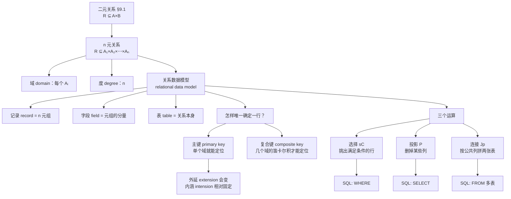

# C9.2 n 元关系与数据库 n-ary Relations and Their Applications

> [!abstract] 这一讲的任务
> 上一讲的关系只有**两**个分量。但你随手打开任何一个系统，记录都不止两列：一条航班记录是 (航空公司, 航班号, 起点, 终点, 起飞时间)，一条学籍记录是 (姓名, 学号, 专业, 绩点)。
> 这一讲把二元推广到 $n$ 元，然后会发现一件事：**推广的结果就是关系型数据库**。你用的 MySQL、PostgreSQL、SQLite，理论地基正是这一节的三个运算符。
> 具体要做三件事：① 定义 $n$ 元关系，把"表"这个日常概念数学化；② 搞清楚**主键**到底在数学上要求什么；③ 学会三个运算——**选择 $s_C$、投影 $P_{i_1\dots i_m}$、连接 $J_p$**，并把它们与 SQL 的 `WHERE`、`SELECT`、`FROM` 对应起来。

> [!info] 怎么读这份讲义
> 这一节是全章里**最"应用"**的一节，数学难度最低，但概念名词最多。
> 建议按顺序读，重点放在第 4 节的三个运算符——**它们是本节唯一会考计算题的地方**。第 5 节的 SQL 对照是理解性的内容，不必背语法。



---

## 0. 开场：一张表，三个问题

你在教务处实习，拿到这么一张学生表：

| Student_name | ID_number | Major | GPA |
|---|---|---|---|
| Ackermann | 231455 | Computer Science | 3.88 |
| Adams | 888323 | Physics | 3.45 |
| Chou | 102147 | Computer Science | 3.49 |
| Goodfriend | 453876 | Mathematics | 3.45 |
| Rao | 678543 | Mathematics | 3.90 |
| Stevens | 786576 | Psychology | 2.99 |

带教老师丢给你三个需求：

1. **"把计算机专业的学生调出来。"**
2. **"我只要姓名和绩点两列，别的不要。"**
3. **"再给我一张表，把这张表和课表按专业拼起来。"**

你大概能想到怎么用 Excel 或 Python 做。但这一讲要问的是：**这三个动作在数学上分别是什么？** 答案是三个运算符，而它们合起来足以支撑整个关系型数据库。

在此之前，还有一个更基础的问题：**这张表本身是什么？**

---

## 1. $n$ 元关系：把"表"数学化

> [!important] 定义 1（$n$ 元关系 $n$-ary Relation）
> 设 $A_1,A_2,\dots,A_n$ 是集合。这些集合上的一个 **$n$ 元关系 ($n$-ary relation)** 是笛卡尔积 $A_1\times A_2\times\cdots\times A_n$ 的一个**子集**。
> - 集合 $A_1,\dots,A_n$ 称为这个关系的**域 (domains)**；
> - $n$ 称为它的**度 (degree)**。

和 §9.1 的定义**一模一样**，只是把 2 换成了 $n$。$n=2$ 时就退回二元关系。

形式只动了一个字符，实质动的却是"一个元组能装多大一件事"：二元关系装的是"两样东西之间有联系"，$n$ 元关系装的是**一整条记录**。所以先记住一句话，比记定义更管用：**数据库里的表，就是关系。** 你在 MySQL 里 `CREATE TABLE` 出来的那张表，数学身份就是 $A_1\times\cdots\times A_n$ 的一个子集——每列是一个域，每行是一个 $n$ 元组，列数就是度。反过来也一样：任何一张能写成"若干列、若干行"的表，都已经是一个 $n$ 元关系，不需要为它另立一套理论。

> [!note] 三个词的日常对照（这张表要记住）
> | 数学术语 | 数据库术语 | 上面那张表里 |
> |---|---|---|
> | $n$ 元关系 | **表 table** | 整张学生表 |
> | $n$ 元组 | **记录 record / 行 row** | (Ackermann, 231455, Computer Science, 3.88) |
> | 元组的第 $i$ 个分量 | **字段 field** | 3.88 |
> | 第 $i$ 个域 $A_i$ | **属性 attribute / 列 column** | GPA 这一列 |
> | 度 $n$ | 列数 | 4 |
>
> 课本原话：*Relations used to represent databases are also called **tables***。所以当你听到"一张表"时，脑子里可以直接换成"一个 $n$ 元关系"。

把定义落到一条真实记录上，域和度才摸得着。假设学籍系统里划了四个域——学号 `ID_number`、姓名 `Name`、专业 `Major`、成绩 `Grade`。这四样东西来自四个来源完全不同、彼此没有天然联系的集合，唯一的共同点就是能被"同一条记录"串起来。于是

$$(888323,\ \text{Adams},\ \text{data structure},\ 85)$$

就是一个 **4 元组**，它落在 $A_{\text{学号}}\times A_{\text{姓名}}\times A_{\text{专业}}\times A_{\text{成绩}}$ 里；而**全部**这类记录合起来（也就是整张表）才是那个 4 元关系，度 $=4$。删掉一列，度就跟着降一：去掉姓名列，剩下 $(888323,\ \text{data structure},\ 85)$，是一个 3 元组。**列数就是度，这一点从一条记录上就能直接数出来。**

两个细节顺手记下：

- 这里的成绩是**百分制**（$85$），和开场那张表的绩点（$3.88$）不是同一个量纲。换一套记分方式，只是换了域 $A_{\text{成绩}}$ 这个集合，关系的定义一字不动——**域管的是"这一列允许放什么"，不是"这一列现在放的是什么"**。
- 一张表是一个关系，**一个数据库是一堆关系**（一堆表）加上它们之间的连接方式。所以"学数据库"在数学上就是学会三件事：怎么切域、怎么选键、怎么把表连起来——本节后面的主键和三个运算符，全都落在这三件事上。

### 例 1–4（四个例子，度各不相同）

**例 1**：$R\subseteq \mathbf N\times\mathbf N\times\mathbf N$，由满足 $a<b<c$ 的三元组 $(a,b,c)$ 组成。
$(1,2,3)\in R$ ✓；$(2,4,3)\notin R$（因为 $4<3$ 假）。**度 = 3**，三个域都是自然数集。

**例 2（等差数列）**：$R\subseteq\mathbf Z^3$，$(a,b,c)\in R$ 当且仅当 $a,b,c$ 成等差，即存在整数 $k$ 使 $b=a+k$、$c=a+2k$，等价地 $b-a=c-b$。
- $(1,3,5)$：$3-1=2$，$5-3=2$ ✓ ⇒ 在 $R$ 里；
- $(2,5,9)$：$5-2=3$，$9-5=4$ ✗ ⇒ 不在。

**例 3（同余）**：$R\subseteq\mathbf Z\times\mathbf Z\times\mathbf Z^+$，$(a,b,m)\in R$ 当且仅当 $m\ge1$ 且 $a\equiv b\pmod m$。
- $(8,2,3)$：$8-2=6$，$3\mid6$ ✓；$(-1,9,5)$：$-1-9=-10$，$5\mid{-10}$ ✓；$(14,0,7)$：$7\mid14$ ✓。
- $(7,2,3)$：$7-2=5$，$3\nmid5$ ✗；$(-2,-8,5)$：差为 $6$，$5\nmid6$ ✗；$(11,0,6)$：$6\nmid11$ ✗。
**注意这个关系的三个域不全相同**：前两个是 $\mathbf Z$，第三个是 $\mathbf Z^+$。

> [!tip] 把同余读成"余数相等"，判断就变成算术
> $a\equiv b\pmod m$ 说白了就是：**$a$ 除以 $m$ 的余数，等于 $b$ 除以 $m$ 的余数**。所以 $(8,2,3)$ 要看的只是"$8\div3$ 余几"——余 $2$，恰好等于第二个分量，成立；$(7,2,3)$ 里 $7\div3$ 余 $1$，不等于 $2$，不成立。
>
> 这和"$m\mid(a-b)$"完全等价：$8\div3$ 余 $2$ ⇔ $3\mid(8-2)$；$7\div3$ 余 $1$ ⇔ $3\nmid(7-2)$。两种读法都要会用——**手算时先想余数更快，事后复核用整除更稳**。

> [!warning] 这里有个真实踩过的坑：$\mathbf Z$ 是整数集
> 判断例 3 之前先认准四个记号：$\mathbf Z$ 是**整数**集，$\mathbf R$ 才是实数集，$\mathbf Z^+$ 是正整数集，$\mathbf R^+$ 是正实数集。$\mathbf Z$ 和 $\mathbf R$ 写起来太像，把前者念成"实数集"是极常见的口误——这一节里就当场绊了一次，随即改口。
> 后果不是小事：认错了会以为第三个域能放 $0$ 和负数，于是把 $(6,2,-3)$ 判成"还得再验条件"，其实它在第 2 步就该被否掉。**后面 §9.5 的等价类、§9.6 的偏序还在用 $\mathbf Z$ 和 $\mathbf R$，一次认准省很多事。**

**例 4（航班）**：5 元组 $(A,N,S,D,T)$ = (航空公司, 航班号, 起点, 终点, 起飞时间)。
例如 (Nadir, 963, Newark, Bangor, 15:00)。**度 = 5**，五个域分别是：航空公司集合、航班号集合、城市集合、城市集合（**同一个集合出现两次**）、时刻集合。

> [!warning] 例 4 里有个容易被忽略的细节
> **起点和终点的域是同一个集合，但它们是两个不同的域。**
> 这说明 $n$ 元关系的域**允许重复**——重要的是**位置**，不是集合本身。同一个集合在不同位置扮演不同角色。
> 数据库里这对应"同一张城市表被引用两次"，SQL 里要用别名（`FROM city AS origin, city AS dest`）区分。

> [!tip] 判断"某个元组属不属于 $R$"的固定三步
> 例 1–3 全都在做同一件事，把它程式化：
> 1. **先读度**：数一下定义里元组有几个分量，$n$ 就是几（例 3 是 $3$）。也可以反着数一遍：$A_1,\dots,A_n$ 有几个集合，度就是几（例 3 的三个域是 $\mathbf Z,\mathbf Z,\mathbf Z^+$，正好三个）。两个方向数出来必须是同一个数，不一致就说明定义没读对；
> 2. **再逐个对域**：第 $i$ 个分量必须落在第 $i$ 个域里。例 3 的第三个分量 $m$ 必须落在 $\mathbf Z^+$ 里，所以 $m\le0$ 的元组（如 $(6,2,-3)$）在第 2 步就被否掉，根本轮不到验条件；
> 3. **最后验条件**：把数值代进定义里的条件，算出来是真就属于、是假就不属于。这里要把 $a-b$ 算出来，再看 $m$ 是否整除它。
>
> 例 3 里 $(8,2,3)$ 属于、$(7,2,3)$ 不属于，差别就在第 3 步：$3\mid 6$ 真、$3\nmid 5$ 假。**别只看"长得像"就下结论**——$7$ 和 $8$ 只差 1，结论却相反。

---

## 2. 主键：什么叫"能唯一定位一行"

回到开场那张学生表。你想写一条"把 Ackermann 的绩点改成 3.90"的语句，得先能**指名道姓地找到那一行**。用哪一列来找？

> [!question] 停一下，先自己想想
> 上面那张表里，用 `Student_name` 找行可以吗？用 `Major` 呢？用 `GPA` 呢？各自的问题在哪？

**逐列检查**：

| 用哪一列定位 | 能不能唯一定位 | 原因 |
|---|:-:|---|
| `Student_name` | ✅ | 表中 6 个姓名互不相同 |
| `ID_number` | ✅ | 6 个学号互不相同 |
| `Major` | ❌ | Computer Science 出现两次（Ackermann、Chou） |
| `GPA` | ❌ | 3.45 出现两次（Adams、Goodfriend） |

这就是主键的定义：

> [!important] 定义（主键 Primary Key）
> $n$ 元关系的一个**域**称为**主键 (primary key)**，如果**没有两个 $n$ 元组在这个域上取相同的值**——即这个域的值一旦给定，整个 $n$ 元组就被唯一确定。

**例 5**：上表中，`Student_name` 和 `ID_number` 都是主键；`Major` 和 `GPA` 都不是。

### 2.1 为什么课本要强调"主键是时间相关的"

课本专门用一整段讲了这件事，而且它是本节**最容易被当成废话跳过、实际上最重要**的一段：

> [!warning] ⭐ 主键是一个会随时间失效的性质
> 记录会被不断增删。**今天是主键，明天加进一条新记录就可能不是了。**
> 上表里 `Student_name` 现在是主键，但只要转来一个也叫 Chou 的学生，它立刻就不是了。
>
> 课本给的两个配套术语：
> - **外延 extension**：关系当前实际包含的那批 $n$ 元组（**会变**）；
> - **内涵 intension**：数据库比较固定的那部分——名字、属性、每个属性的取值规则（**相对不变**）。
>
> **选主键的正确姿势**：不是看当前外延碰巧满不满足，而是**分析内涵**，挑一个对**所有可能的外延**都成立的域。

**这条原则在工程上的直接后果**：

> [!note] 为什么学号能当主键，姓名不能
> 课本原话大意：用学号当主键是合理的——**只要保证任何两个学生不共用学号**（这是学号这个东西的设计规则，属于内涵）。
> 而**大学绝不该用姓名当主键**，因为两个学生完全可能重名（比如 John Smith）。
>
> 这就是为什么你见过的所有系统都有一个"看起来多余"的 ID 字段。**它不是多余，它是唯一一个内涵上保证唯一的东西。**

### 2.2 复合键：一列不够就用几列

有时单独一列都定位不了，但几列合起来可以。

> [!important] 定义（复合键 Composite Key）
> 当**一组域**的取值合起来能唯一确定一个 $n$ 元组时，这组域的**笛卡尔积**称为**复合键 (composite key)**。

**例 6**：`Major` 和 `GPA` 单独都不是主键，那 (`Major`, `GPA`) 合起来呢？
逐对检查：(CS, 3.88)、(Physics, 3.45)、(CS, 3.49)、(Math, 3.45)、(Math, 3.90)、(Psych, 2.99)——**六对互不相同** ⇒ 是复合键。

> [!warning] 同样的时间陷阱
> 复合键也是外延相关的。再转来一个绩点 3.45 的数学系学生，(`Major`, `GPA`) 立刻失效。
> **所以课本的结论是：每次插入新记录，都必须检查键仍然唯一。** 这在数据库里就是 `UNIQUE` 约束——插入违反约束的行会直接报错，而不是悄悄产生两行相同的键。

---

## 3. 停一下：我们刚才干了什么

从 §9.1 到这里，其实只做了一次极简单的推广（2 → $n$），却直接落到了一个千亿美元级的产业上。值得停下来看看**为什么这个推广这么有用**：

- 二元关系只能表达"两样东西之间的联系"；
- $n$ 元关系能表达"**一条记录**"——而现实世界的信息天然是成条的。

**接下来的问题是：有了表，怎么问问题？** 下一节的三个运算符就是答案，而且它们的设计动机非常朴素：**行怎么挑、列怎么删、两张表怎么拼。**

---

## 4. 三个运算符（本节唯一的计算考点）

把一张表当成 $n$ 元关系以后，**"用这张表能问出什么问题"**其实只有两大类：

1. **挑出满足某些条件的元组**——"把计算机专业的学生调出来""绩点大于 3.5 的留下"；
2. **把两张表的记录按公共字段拼起来**——"哪个教授、几点、在哪个教室上课"。

第一类只动**行**，答案就是**选择运算符 $s_C$**；第二类要动**表与表之间的关系**，答案是**连接 $J_p$**。至于"我只要姓名和绩点两列"，那是在精简**列**，对应**投影 $P$**。

**两个大类、三个运算符**——本节剩下的内容就是它们各自的形式化定义和手算练习。

换个说法把这两大类钉住：$n$ 元关系**能由某个条件筛出其中一批元组**（这就是选择），也**能把不同表里的记录接在一起**（这就是连接）；而**筛完、拼完的结果仍然是一个 $n$ 元关系**，可以接着参与下一次运算。正因如此才能一层层往上搭，搭出一整个数据库——**"关系能像数一样做加减乘除"，说的就是这件事。**

### 4.1 选择 Selection：挑行

> [!important] 定义 2（选择运算符 Selection Operator）
> 设 $R$ 是 $n$ 元关系，$C$ 是 $R$ 中元素可能满足的一个条件。**选择运算符 $s_C$** 把 $R$ 映成"$R$ 中全部满足条件 $C$ 的 $n$ 元组"构成的 $n$ 元关系。

一句话：**按条件筛行，列一个不少。**

**例 7**（在开场那张表上）：

| 条件 | 运算 | 结果 |
|---|---|---|
| $C_1$: Major = "Computer Science" | $s_{C_1}(R)$ | (Ackermann, 231455, CS, 3.88)、(Chou, 102147, CS, 3.49) |
| $C_2$: GPA > 3.5 | $s_{C_2}(R)$ | (Ackermann, 231455, CS, 3.88)、(Rao, 678543, Math, 3.90) |
| $C_3$: Major = "CS" $\wedge$ GPA > 3.5 | $s_{C_3}(R)$ | 只剩 (Ackermann, 231455, CS, 3.88) |

> [!note] 条件 $C$ 本身就是第 1 章的复合命题
> $C_3$ 是 $C_1\wedge C_2$——**选择运算符的条件用的就是 [[C1.1 命题逻辑 Propositional Logic]] 的联结词**。
> 所以"多条件筛选"在数学上不需要新东西：$s_{C_1\wedge C_2}(R)=s_{C_1}(R)\cap s_{C_2}(R)$，$s_{C_1\vee C_2}(R)=s_{C_1}(R)\cup s_{C_2}(R)$。
> **SQL 的 `WHERE A AND B` 与集合的交，是同一件事的两种写法。**

### 4.2 投影 Projection：删列

> [!important] 定义 3（投影 Projection）
> 投影 $P_{i_1,i_2,\dots,i_m}$（其中 $i_1<i_2<\cdots<i_m$）把 $n$ 元组 $(a_1,a_2,\dots,a_n)$ 映成 $m$ 元组
> $$(a_{i_1},a_{i_2},\dots,a_{i_m}),\qquad m\le n$$
> 也就是**只留下第 $i_1,i_2,\dots,i_m$ 个分量，删掉其余 $n-m$ 个**。

**例 8**：$P_{1,3}$ 作用在三个 4 元组上：

| 原元组 | $P_{1,3}$ 的结果 |
|---|---|
| $(2,3,0,4)$ | $(2,0)$ |
| (Jane Doe, 234111001, Geography, 3.14) | (Jane Doe, Geography) |
| $(a_1,a_2,a_3,a_4)$ | $(a_1,a_3)$ |

**例 9**：把 $P_{1,4}$ 作用在开场那张表上（保留第 1 列姓名和第 4 列绩点，删掉学号和专业）：

| Student_name | GPA |
|---|---|
| Ackermann | 3.88 |
| Adams | 3.45 |
| Chou | 3.49 |
| Goodfriend | 3.45 |
| Rao | 3.90 |
| Stevens | 2.99 |

六行还是六行。但下面这个例子会出意外。

### 4.3 ⭐ 投影的陷阱：行数可能变少

> [!question] 停一下，先自己想想
> 投影只是删列，行数应该不变吧？下面这张选课表（课本表 3），如果只保留前两列（学生、专业），会得到几行？
>
> | Student | Major | Course |
> |---|---|---|
> | Glauser | Biology | BI 290 |
> | Glauser | Biology | MS 475 |
> | Glauser | Biology | PY 410 |
> | Marcus | Mathematics | MS 511 |
> | Marcus | Mathematics | MS 603 |
> | Marcus | Mathematics | CS 322 |
> | Miller | Computer Science | MS 575 |
> | Miller | Computer Science | CS 455 |

**答**：只剩 **3 行**。

| Student | Major |
|---|---|
| Glauser | Biology |
| Marcus | Mathematics |
| Miller | Computer Science |

**为什么**：原来 8 行里，Glauser 那三行**只在被删掉的 Course 列上不同**。删掉这一列后，三行变得完全一样——而**关系是集合，集合里没有重复元素**，所以自动合并成一行。

> [!warning] ⭐ 这是本节最重要的一个认知
> **投影之后行数可能减少**，减少的原因是被删掉的列正好是区分那几行的唯一依据。
> 课本原话：*Fewer rows may result when a projection is applied to the table for a relation.*
>
> **这件事的根子在 §9.1 的第一句话：关系是一个集合。** 集合天然去重——这个性质在 §9.1 看着无关紧要，到了这里就变成了一个必须记住的行为。
>
> **SQL 关联**：这正是 SQL 里 `SELECT DISTINCT` 和 `SELECT` 的区别所在。**数学上的投影总是 DISTINCT 的**；SQL 默认不去重（保留重复行），因为工程上去重要排序、代价高。所以**严格来说 SQL 的表是"多重集"，不是数学意义上的关系**——这是理论与实现之间一个真实的缝隙，值得知道。

三个动作摆到同一张图上，各自动哪一维就一目了然。左图那张四行四列的表把两个方向标了出来：**选择沿着行的方向删，投影沿着列的方向删**；右图就是刚才那个陷阱——8 行的选课表删掉「课程」后只剩 3 行，三束连线正好对应三组"只在这一列上不同"的行。

![[C9-选择与投影的表结构.png]]

**最值得盯的是右图里的连线**：Glauser 的三行并成一行，靠的不是"去重"这个额外操作，而是**关系是集合**这一条定义——集合里相同的元素只算一个。反过来看左图也有一句要紧话：投影之后列数一定减少，行数却只是"可能"减少；只有当被删掉的列恰好是区分某几行的唯一依据时，行才跟着并。

### 4.4 连接 Join：拼表

> [!question] 停一下，先自己想想
> 现在有两张表：
> - 表 5 `Teaching_assignments`：(教授, 系, 课程号)
> - 表 6 `Class_schedule`：(系, 课程号, 教室, 时间)
>
> 你想得到"哪位教授、几点、在哪个教室上课"。怎么拼？

直觉很清楚：**两张表共有 (系, 课程号) 这两列，按它们对齐，然后把剩下的列并起来。** 形式化就是：

> [!important] 定义 4（连接 Join）
> 设 $R$ 是度为 $m$ 的关系，$S$ 是度为 $n$ 的关系，$p\le m$ 且 $p\le n$。**连接 $J_p(R,S)$** 是一个度为 $\boxed{m+n-p}$ 的关系，由所有形如
> $$(a_1,\dots,a_{m-p},\;c_1,\dots,c_p,\;b_1,\dots,b_{n-p})$$
> 的元组组成，其中 $(a_1,\dots,a_{m-p},c_1,\dots,c_p)\in R$ 且 $(c_1,\dots,c_p,b_1,\dots,b_{n-p})\in S$。

用人话拆开：

- **$p$ 是"公共列的个数"**；
- 要求 $R$ 的**最后 $p$ 列**与 $S$ 的**前 $p$ 列**取值相同；
- 结果的度是 $m+n-p$：两张表的列加起来，**公共的那 $p$ 列只算一次**。

> [!warning] 度的公式别背错
> $$\deg\bigl(J_p(R,S)\bigr)=m+n-p$$
> 记法：**总列数减去重复计算的那 $p$ 列**。这与 [[C2.2 集合运算 Set Operations]] 的容斥原理 $|A\cup B|=|A|+|B|-|A\cap B|$ 是同一个"减掉重复部分"的思想。

先别急着算，把"拼"这个动作看清楚。下面两张小表各 4 行，公共属性只有「系」和「课程号」两列：一行一行地对过去，配上的才拼成一行新记录。

![[C9-连接是怎么拼表的.png]]

**最值得盯的是两处"配不上"**：Dan 的 CH 300 在中间那张表里没有排课，MA 220 也没有谁教——这两行都不进结果。所以结果 3 行等于**配上的对数 3**，它既不是两张表行数的乘积 $4\times4$，也不是取较小的那个 4。另外留意中间那张表的两列蓝底：公共属性在结果里**只留一份**，度才按 $m+n-p$ 算成 $3+4-2=5$。

**例 11（手算，务必跟一遍）**：$J_2$ 作用在表 5 与表 6 上。$m=3$、$n=4$、$p=2$ ⇒ 结果度 $=3+4-2=5$。

表 5（$R$，最后 2 列是 系、课程号）：

| Professor | Department | Course_number |
|---|---|---|
| Cruz | Zoology | 335 |
| Cruz | Zoology | 412 |
| Farber | Psychology | 501 |
| Farber | Psychology | 617 |
| Grammer | Physics | 544 |
| Grammer | Physics | 551 |
| Rosen | Computer Science | 518 |
| Rosen | Mathematics | 575 |

表 6（$S$，前 2 列是 系、课程号）：

| Department | Course_number | Room | Time |
|---|---|---|---|
| Computer Science | 518 | N521 | 2:00 p.m. |
| Mathematics | 575 | N502 | 3:00 p.m. |
| Mathematics | 611 | N521 | 4:00 p.m. |
| Physics | 544 | B505 | 4:00 p.m. |
| Psychology | 501 | A100 | 3:00 p.m. |
| Psychology | 617 | A110 | 11:00 a.m. |
| Zoology | 335 | A100 | 9:00 a.m. |
| Zoology | 412 | A100 | 8:00 a.m. |

**逐行配对**（表 5 的每一行去表 6 里找 (系, 课程号) 相同的行）：

| Professor | Department | Course_number | Room | Time |
|---|---|---|---|---|
| Cruz | Zoology | 335 | A100 | 9:00 a.m. |
| Cruz | Zoology | 412 | A100 | 8:00 a.m. |
| Farber | Psychology | 501 | A100 | 3:00 p.m. |
| Farber | Psychology | 617 | A110 | 11:00 a.m. |
| Grammer | Physics | 544 | B505 | 4:00 p.m. |
| Rosen | Computer Science | 518 | N521 | 2:00 p.m. |
| Rosen | Mathematics | 575 | N502 | 3:00 p.m. |

> [!warning] ⭐ 这里有两行"消失"了，要看懂原因
> - 表 5 的 (Grammer, Physics, 551)：表 6 里**没有** Physics 551 这门课的排课 ⇒ 配不上，**被丢掉**；
> - 表 6 的 (Mathematics, 611, N521, 4:00)：表 5 里**没有**谁教 Math 611 ⇒ 也被丢掉。
>
> **连接只保留两边都能配上的行。** 数据库里这叫 **INNER JOIN（内连接）**；如果想保留配不上的行（另一侧填空值），那是 `LEFT JOIN` / `RIGHT JOIN` / `FULL JOIN`——**它们不属于本节定义的 $J_p$**，是工程上的扩展。
>
> 结果 7 行 = 表 5 的 8 行减去配不上的 1 行。**不是 8×8 全配，也不是简单取较小值。**

> [!note] 课本在这里留的一句话
> *There are other operators besides projections and joins that produce new relations from existing relations.*
> 也就是说，关系代数远不止这三个（还有并、差、笛卡尔积、除法等），完整内容在数据库理论课里。**本节只要求掌握这三个。**

### 4.5 先拆出去，再连接回来

投影平常看着只是"删掉不要的列"，但实际建模时用法常常是反过来的：**把某一列拆到另一张表去，要用的时候再靠连接拼回来。** 绕这一圈是为了不让同一件事被重复存很多遍。

还拿第 1 节里那条记录说：(888323, Adams, data structure, 85)。把它拆成两张表存——

- **成绩表**，度 $3$，列序是 (专业, 成绩, 学号)，里面只有 (data structure, 85, 888323)；
- **学生表**，度 $2$，列序是 (学号, 姓名)，里面只有 (888323, Adams)。

成绩表里**故意不再存姓名**。现在要问"这张成绩单上的人叫什么"，有两条路走回去：

1. **先投影再连接**：$P_3$ 从成绩表里只取第 $3$ 列，把学号单独拎成一堆 $1$ 元组；再和学生表按学号连接，公共列 $p=1$，结果的度 $=1+2-1=2$，得到 **(学号, 姓名)** 这两列的新表。
2. **直接整表连接**：$J_1\bigl(\text{成绩表},\ \text{学生表}\bigr)$，$p=1$，结果的度 $=3+2-1=4$，得到 (data structure, 85, 888323, Adams)——带着姓名的完整成绩单。

**两条路都对，差别只在"你要的是名单，还是要带人名的成绩单"**：先投影就只留下想留的列，直接连接就全都要。度按 $m+n-p$ 一算，结果形状立刻清楚了。

这也顺带说明了第 2 节里那个"看起来多余的学号"为什么非有不可：**没有唯一的学号，这两张表就接不上**；姓名一旦重复，连接立刻变成一堆错误配对——这不是效率问题，是正确性问题。

> [!warning] 列序不是随便排的
> $J_p$ 的定义要求公共列出现在 $R$ 的**最后 $p$ 列**、在 $S$ 的**前 $p$ 列**。所以成绩表把学号放在最后一列、学生表把学号放在第一列——不是巧合，是为了能直接套定义。
> 拿现成的两张表来连接时，第一步永远是对齐列序：**公共列不在这个位置，先投影重排**。

> [!warning] 拆表不是免费的午餐
> 好处是：姓名只存一份，改一次名只改一处，不会出现两行自相矛盾。
> 代价是：每个跨表问题都要多做一次连接，而连接是三个运算里最贵的——行数一多代价就爆炸，§5 末尾那个"先选择后连接"的优化说的正是它。
> **拆到第几层是设计问题，不是数学问题**；数学只保证一件事：拆开之后还能原样拼回来。

---

## 5. SQL：把三个运算符翻译成一门语言

> [!important] SQL = Structured Query Language（结构化查询语言）
> 它是关系数据库的标准查询语言。本节只需要看懂它和三个运算符的对应。

**例 12（单表查询）**：在航班表（表 8）上：

| Airline | Flight_number | Gate | Destination | Departure_time |
|---|---|---|---|---|
| Nadir | 122 | 34 | Detroit | 08:10 |
| Acme | 221 | 22 | Denver | 08:17 |
| Acme | 122 | 33 | Anchorage | 08:22 |
| Acme | 323 | 34 | Honolulu | 08:30 |
| Nadir | 199 | 13 | Detroit | 08:47 |
| Acme | 222 | 22 | Denver | 09:10 |
| Nadir | 322 | 34 | Detroit | 09:44 |

```sql
SELECT Departure_time
FROM   Flights
WHERE  Destination = 'Detroit'
```

**这条语句在数学上是什么？** 它是

$$P_5\Bigl(s_{\;\text{Destination}=\text{Detroit}}(\text{Flights})\Bigr)$$

即：**先用选择挑出目的地是 Detroit 的三行，再用投影 $P_5$ 只留下第 5 列（起飞时间）**。输出是 **08:10、08:47、09:44**。

> [!warning] ⭐ SQL 的一个历史遗留坑：`SELECT` 不是"选择"
> 课本专门加了一句警告（原文 *Beware*）：
> **SQL 的 `SELECT` 对应的是数学上的投影 (projection)，而不是选择 (selection)；数学上的选择对应的是 `WHERE`。**
>
> | SQL 子句 | 数学运算 | 干什么 |
> |---|---|---|
> | `FROM` | 指定关系（多个表时是**连接 $J_p$**） | 从哪张表查 |
> | `WHERE` | **选择 $s_C$** | 挑**行** |
> | `SELECT` | **投影 $P_{i_1\dots i_m}$** | 挑**列** |
>
> 这是术语冲突，不是你理解错了。**记住这张表，考试问到"SELECT 对应哪个运算"不要答错。**

**例 13（多表查询）**：

```sql
SELECT Professor, Time
FROM   Teaching_assignments, Class_schedule
WHERE  Department = 'Mathematics'
```

拆成数学运算是三步：

1. `FROM` 两张表 ⇒ 先做 $J_2$（就是例 11 那张 5 列的表 7）；
2. `WHERE Department='Mathematics'` ⇒ 选择 $s_C$，只剩 (Rosen, Mathematics, 575, N502, 3:00 p.m.) 一行；
3. `SELECT Professor, Time` ⇒ 投影 $P_{1,5}$，得到 **(Rosen, 3:00 p.m.)**。

> [!note] 停一下，我们刚才干了什么
> 我们用**三个数学运算**完整刻画了一条 SQL 查询。这不是巧合：**关系代数（relational algebra）**正是 SQL 的语义基础，数据库引擎内部真的会把 SQL 编译成这样的运算树，再做优化（比如"先选择后连接"通常比"先连接后选择"快得多，因为连接的代价随行数爆炸）。
>
> **AI 方向的关联**：你以后做数据清洗、特征工程时写的 `pandas` 代码，`df[df.major=='CS']` 是选择、`df.loc[:, ['name','gpa']]` 是投影、`pd.merge(a, b, on='dept')` 是连接。**三个运算符，换了层皮而已。**

> [!note] 为什么学 AI 的人也该操心"表怎么建"
> SQL 只是最典型的一种数据库，别的语言生态里各有一套；表面语法差别很大，底下那张表的结构还是这一套——域、元组、键、三个运算。
> 更现实的一层是**数据从哪来**。做作业时数据集是发下来的，你只管挑模型、调参数；真实场景里没有现成的表，数据库得自己搭：哪条信息该占一列、哪些该拆到另一张表、拿什么当键。这些决定会在很后面才显形——**表建歪了，模型只是在歪数据上拟合得很努力**。这一节内容是全章最轻的，真干起活来它是最沉的地基。

---

## 6. 本节与其他章节的联系

> [!note] 这一节在全章里的位置
> §9.2 在第 9 章里有点"特殊"：它是**唯一一节不讨论关系性质（自反/对称/传递）的**，因为那些性质需要 $A=B$，而 $n$ 元关系的各个域通常互不相同。
>
> 课本从 §9.3 开始就宣布：*In this section, and in the remainder of this chapter, all relations we study will be binary relations.*
> **也就是说，§9.2 是一段独立的应用插曲，后面四节全部回到二元关系。**
>
> 但它留下了一个重要观念：**关系是一种通用的数据建模工具**，不只是用来研究序和等价的抽象对象。
>
> 这也解释了读到这里的一种感觉：它和前后"不咬合"。它不用 §9.3 的矩阵表示，也不被 §9.4–§9.6 的闭包、等价、偏序用到，插在第 9 章的哪个位置都读得通。**内容量也就十几分钟的量**：定义、主键、三个运算，骨架走完就结束了；骨架底下那门叫"数据库"的学科，是另一门课的事。

---

## 这一讲的三句话

> [!success] 三句话
> 1. **$n$ 元关系 = 一张表**：$A_1\times\cdots\times A_n$ 的子集，域 = 列，元组 = 行，度 = 列数。定义和二元关系完全一样，只是分量变多。
> 2. **主键是一个会过期的性质**：判断主键要看**内涵**（这个字段的设计规则）而不是当前**外延**（现在碰巧不重复）。学号能当主键，姓名不能。
> 3. **三个运算符对应 SQL 三个子句**：选择 $s_C$ ↔ `WHERE`（挑行）、投影 $P$ ↔ `SELECT`（挑列，**可能减少行数**）、连接 $J_p$ ↔ 多表 `FROM`（度 $=m+n-p$，只保留配得上的行）。$n$ 元关系的用法归结为两类——**挑出满足条件的元组**和**连接不同表的记录**，前者靠选择、后者靠连接。

### 速查表

| 运算 | 记号 | 输入 → 输出 | SQL | 要点 |
|---|---|---|---|---|
| 选择 | $s_C(R)$ | $n$ 元 → $n$ 元 | `WHERE` | 行变少，列不变 |
| 投影 | $P_{i_1\dots i_m}(R)$ | $n$ 元 → $m$ 元 | `SELECT` | 列变少，**行可能也变少**（去重） |
| 连接 | $J_p(R,S)$ | $m$ 元 + $n$ 元 → $(m+n-p)$ 元 | 多表 `FROM` | 只留配得上的行 |

| 概念 | 一句话 |
|---|---|
| 度 degree | 分量个数 $n$ |
| 域 domain | 第 $i$ 个分量的取值集合（**允许重复出现**） |
| 主键 primary key | 单个域即可唯一定位一行 |
| 复合键 composite key | 几个域的笛卡尔积才能唯一定位 |
| 外延 extension | 当前实际的那批元组（**会变**） |
| 内涵 intension | 名字、属性、取值规则（**相对固定**） |

---

## 下一讲预告

从下一节开始，我们回到**二元关系**，而且要换一副眼镜看它。

到目前为止，我们一直把关系写成一串有序对。但 $\{1,2,3,4\}$ 上的关系最多可以有 16 个有序对，$\{1,\dots,10\}$ 上最多 100 个——**列清单这种表示法很快就不能看了**。

下一讲给出两种新表示：一种**适合计算机**（零一矩阵，直接对应 §2.6 的布尔运算），一种**适合人眼**（有向图，几个性质一眼可辨）。学完之后，判断一个关系是不是传递的，就从"逐三元组检查"变成"看一眼图"或者"算一次布尔积"。

---

**上一节** ← [[C9.1 关系及其性质 Relations and Their Properties]]
**下一节** → [[C9.3 关系的表示 Representing Relations]]
**本章索引** → [[C9 关系 Relations MOC]]
