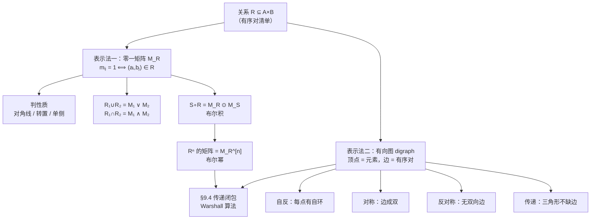

# C9.3 关系的表示 Representing Relations

> [!abstract] 这一讲的任务
> §9.1 我们把关系写成一串有序对。这在 $\{1,2,3\}$ 上还行，到 $\{1,\dots,10\}$ 上最多就有 100 个有序对——**列清单这种写法很快就废了**，而且判断“传不传递”要逐三元组检查，眼睛根本跟不上。
> 这一讲换两副眼镜：**零一矩阵**（机器看的）和**有向图**（人看的）。换完之后你会发现三件本来很麻烦的事突然变简单了：判性质变成“看一眼”、求交并变成“按位与或”、求复合变成“做一次布尔积”。
> 这一讲还是 §9.4 的**直接前置**：Warshall 算法全程在矩阵上跑，传递闭包的定义全程在图上讲。

> [!info] 怎么读这份讲义
> 本节从这里开始，**“关系”一律指二元关系**（课本原话：*all relations we study will be binary relations*），$n$ 元关系的插曲到 §9.2 为止。
> 第 2 节（矩阵判性质）和第 4 节（布尔积求复合）是计算考点；第 5–6 节（有向图）是理解 §9.4 的基础。需要 §2.6 矩阵知识的地方我都写了双链。



---

## 0. 开场：一份看不下去的清单

你在做一个推荐系统的数据预处理，手上是一份“用户 A 关注了用户 B”的清单：

```
(u1,u1) (u1,u3) (u2,u1) (u2,u3) (u2,u4) (u3,u1) (u3,u2) (u4,u1)
```

老板问你三个问题：

1. **“这个关注关系是对称的吗？”**（即互关是不是普遍现象）
2. **“谁关注了谁的关注对象？”**（二度关系）
3. **“有没有人自己关注自己？”**

只有 8 个有序对，你还能硬看。但真实数据是 800 万条。

**你需要的不是更快的眼睛，而是另一种表示法。** 更准确地说，你需要一种表示法，让上面三个问题分别变成：**看对角线、做一次矩阵乘法、看对角线**。

---

## 1. 表示法一：零一矩阵

### 1.1 怎么造出来

> [!important] 定义（关系的零一矩阵 Zero–One Matrix）
> 设 $R$ 是从 $A=\{a_1,a_2,\dots,a_m\}$ 到 $B=\{b_1,b_2,\dots,b_n\}$ 的关系。$R$ 可以用 $m\times n$ 的零一矩阵 $M_R=[m_{ij}]$ 表示，其中
> $$m_{ij}=\begin{cases}1 & \text{若 }(a_i,b_j)\in R\\[2pt] 0 & \text{若 }(a_i,b_j)\notin R\end{cases}$$

一句话：**第 $i$ 行第 $j$ 列填 1，就表示“$a_i$ 与 $b_j$ 有关系”。**

> [!warning] ⭐ 矩阵依赖于你给元素排的顺序
> 课本专门加了括号提醒：*Such a representation depends on the orderings used for $A$ and $B$.*
> 换一个元素排列顺序，矩阵就变了（行列会被置换），但**它表示的仍然是同一个关系**。
> **约定**：当 $A=B$ 时，行和列**必须用同一个排列顺序**——否则第 2 节“看对角线判自反”就完全失效了。

> [!note] 顺带把两个符号的读法钉一下
> $M_R$ 念 **“M sub R”**——$R$ 是下标（subscript），所以 $M_{R_1}$ 就是 “M sub R one”。上标叫 superscript；$n^2$ 平时直接念 “n square”，只有怕听混了才补一句 “n sup 2”。
> 正文里 $m_{ij}$、$r_{ik}$ 这种**带两个下标的小写字母**，指的是“矩阵里那个位置上的数”；**位置本身**用 $i,j$ 表示。这个区分后面算布尔积时天天用得到：$r_{ik}$ 是数，$k$ 是位置。

**例 1**：$A=\{1,2,3\}$，$B=\{1,2\}$，$R=\{(a,b)\mid a>b\}$。
先把 $R$ 列出来：$2>1$ ✓、$3>1$ ✓、$3>2$ ✓，其余都不成立，所以 $R=\{(2,1),(3,1),(3,2)\}$。
取 $a_1=1,a_2=2,a_3=3$；$b_1=1,b_2=2$：

$$M_R=\begin{bmatrix}0&0\\1&0\\1&1\end{bmatrix}$$

逐格核对：第 1 行（$a=1$）两个 0，因为 $1>1$、$1>2$ 都假；第 3 行两个 1，因为 $3>1$、$3>2$ 都真。✓

**例 2（反过来读）**：$A=\{a_1,a_2,a_3\}$，$B=\{b_1,\dots,b_5\}$，

$$M_R=\begin{bmatrix}0&1&0&0&0\\1&0&1&1&0\\1&0&1&0&1\end{bmatrix}$$

**读法：扫描每个 1 的位置 $(i,j)$，写出 $(a_i,b_j)$。**

$$R=\{(a_1,b_2),\;(a_2,b_1),(a_2,b_3),(a_2,b_4),\;(a_3,b_1),(a_3,b_3),(a_3,b_5)\}$$

---

## 2. 用矩阵判三个性质（计算考点）

当 $A=B$ 时矩阵是**方阵**，三个性质各自对应一个一眼可辨的图案。

不过先说一句可能扫兴的话：**这三条判据都只是“好看”**。它们各自只用到**两个下标**——一个格子、或者一对镜像格子，扫一眼就完。而真正麻烦的传递性要用到**三个下标**（$i,j,k$），所以它在这张表上**根本没有固定的花纹可看**；为什么躲不开，本节末尾那个追问会给出交代。六种性质在矩阵上的花纹，[[C9.1 关系及其性质 Relations and Their Properties#4.5 矩阵上怎么看这些性质|§9.1 的 4.5 节]]已经排过一遍，这里只把三条判据展开、再接上“求并交”和“求复合”。

![[C9-零一矩阵的三种性质模式.png]]

### 2.1 自反 ⟺ 主对角线全 1

$R$ 自反 $\iff$ 对每个 $i$ 都有 $(a_i,a_i)\in R$ $\iff$ $m_{ii}=1$（$i=1,\dots,n$）。

$$\boxed{R \text{ 自反} \iff \text{主对角线元素全为 }1}$$

**对角线以外的元素可以随便是 0 或 1，不影响自反性。**

### 2.2 对称 ⟺ 矩阵是对称矩阵

$R$ 对称 $\iff$ 只要 $(a_i,a_j)\in R$ 就有 $(a_j,a_i)\in R$ $\iff$ $m_{ij}=1$ 时必有 $m_{ji}=1$。
反过来 $m_{ij}=0$ 时也必有 $m_{ji}=0$。两句话合起来就是 $m_{ij}=m_{ji}$ 对一切 $i,j$ 成立，即

$$\boxed{R \text{ 对称} \iff M_R=(M_R)^t}$$

（转置的定义见 [[C2.6 矩阵 Matrices]]。）

> [!note] 这一条把“逐对检查”换成了“看一眼是否沿对角线镜像”
> 检查对称性原本要遍历所有有序对，现在只需要把矩阵沿主对角线对折，看能不能重合。

> [!bug] 原稿在这一页印错了一处
> 把**对称性**的条件印成了 $(a,b)\in R\to(b,a)\notin R$——那是**非对称 (asymmetric)** 的条件。同一条件在讲图上判读时印的是 $(a,b)\in R\to(b,a)\in R$，两处对照一下就能确认，按后者为准。

### 2.3 反对称 ⟺ 对称位置不能同时是 1

$R$ 反对称 $\iff$ 不存在 $i\ne j$ 使 $m_{ij}=m_{ji}=1$，即

$$\boxed{i\ne j \text{ 时，} m_{ij} \text{ 与 } m_{ji} \text{ 至少有一个是 }0}$$

**注意主对角线不受限制**——$m_{ii}$ 是 0 是 1 都不影响反对称（这再次印证 §9.1 的结论：自环与反对称无关）。

**例 3**：

$$M_R=\begin{bmatrix}1&1&0\\1&1&1\\0&1&1\end{bmatrix}$$

- **自反**？主对角线 $1,1,1$ ✓ ⇒ **是**。
- **对称**？$m_{12}=m_{21}=1$ ✓、$m_{13}=m_{31}=0$ ✓、$m_{23}=m_{32}=1$ ✓ ⇒ $M_R=(M_R)^t$ ⇒ **是**。
- **反对称**？$m_{12}=m_{21}=1$ 且 $1\ne2$ ⇒ **不是**。

> [!question] 课堂追问
> 传递性为什么没有出现在这张表里？
>
> **答**：因为传递性**没有简单的图案特征**——它涉及三个下标 $i,j,k$，不是靠看对角线或看对折能判出来的。
> 判传递需要真的算一次：由定理 1（§9.1）知 $R$ 传递 $\iff R^2\subseteq R$，翻译成矩阵就是：**$M_R^{[2]}$ 中为 1 的位置，$M_R$ 中也必须是 1**。第 4 节给出算 $M_R^{[2]}$ 的方法。
> **这也是为什么 §9.4 要单独用一整节处理传递闭包，而自反闭包、对称闭包两行就讲完了。**

---

## 3. 用矩阵做并与交

> [!important] 并与交 = 按位或 / 按位与
> 设 $R_1,R_2$ 是同一集合上的关系。则
> $$M_{R_1\cup R_2}=M_{R_1}\vee M_{R_2},\qquad M_{R_1\cap R_2}=M_{R_1}\wedge M_{R_2}$$
> 这里 $\vee$ 是**并 join**（逐位取或）、$\wedge$ 是**交 meet**（逐位取与），定义见 [[C2.6 矩阵 Matrices]]。
> 口诀两句：**并看“有没有 1”，交看“是不是都 1”**。手算时不必想“矩阵运算”这回事，把两个矩阵**上下摞齐**、一个格子一个格子地过就行。

**为什么成立**：$(a_i,a_j)\in R_1\cup R_2$ $\iff$ 它属于 $R_1$ **或** $R_2$ $\iff$ 两个矩阵在 $(i,j)$ 位置**至少有一个是 1** $\iff$ 逐位或的结果是 1。交同理。

**例 4**：

$$M_{R_1}=\begin{bmatrix}1&0&1\\1&0&0\\0&1&0\end{bmatrix},\qquad M_{R_2}=\begin{bmatrix}1&0&1\\0&1&1\\1&0&0\end{bmatrix}$$

逐位或：

$$M_{R_1\cup R_2}=\begin{bmatrix}1&0&1\\1&1&1\\1&1&0\end{bmatrix}$$

逐位与：

$$M_{R_1\cap R_2}=\begin{bmatrix}1&0&1\\0&0&0\\0&0&0\end{bmatrix}$$

（第 2 行：$(1,0,0)\wedge(0,1,1)=(0,0,0)$；第 3 行：$(0,1,0)\wedge(1,0,0)=(0,0,0)$。）

> [!note] 顺带回收一个伏笔
> [[C2.6 矩阵 Matrices]] 里学 $\vee$、$\wedge$、$\odot$ 这三个布尔运算时，很可能觉得“定义得莫名其妙，算了半天不知道干嘛用”。
> **这一节就是它们的用武之地**：$\vee$ 是关系的并、$\wedge$ 是交、$\odot$ 是复合（下一节）。当时埋的种子，现在开花。
>
> 顺便数一数你已经给 $\vee$ 起了几个名字：命题逻辑里叫**析取**（“或”）、集合里叫**并**、矩阵里叫 **join**。$\wedge$ 那边对应的是**合取**（“与”）、**交**、**meet**。三个名字一件事——有一个 1 就是 1、两个都是 1 才是 1。场合换了词跟着换，动作一直是那一个，所以这里不用重新学一遍，只要认出“还是那对老朋友”。

---

## 4. ⭐ 用布尔积做复合（本节最重要的计算）

把关系写成矩阵之后，真正费手的是复合这一步。它没有捷径：**照矩阵乘法的规矩一格一格算，只是格子里的“乘”和“加”要换掉**。这一节相当一部分时间就花在这件事上——不是因为难，而是因为**顺序容易反、中间那一维容易看错**，这两件事各配了一条提醒，下面依次碰到。

### 4.1 为什么是布尔积

> [!question] 停一下，先自己想想
> $R$ 是从 $A$ 到 $B$ 的关系，$S$ 是从 $B$ 到 $C$ 的关系。复合 $S\circ R$ 的矩阵该怎么从 $M_R$、$M_S$ 算出来？
> 提示：回忆 §9.1 的定义——$(a_i,c_j)\in S\circ R$ 的条件是什么？

**推理过程**（这段推理本身就是考点）：

设 $|A|=m$、$|B|=n$、$|C|=p$，记 $M_{S\circ R}=[t_{ij}]$、$M_R=[r_{ij}]$、$M_S=[s_{ij}]$。

按复合的定义：
$$(a_i,c_j)\in S\circ R \iff \exists\, b_k \in B \ \bigl((a_i,b_k)\in R \wedge (b_k,c_j)\in S\bigr)$$

翻译成矩阵元素：
$$t_{ij}=1 \iff \exists\, k \ \bigl(r_{ik}=1 \wedge s_{kj}=1\bigr)$$

把“存在 $k$”写成对所有 $k$ 取**或**，把“且”写成**与**：
$$t_{ij}=\bigvee_{k=1}^{n}\bigl(r_{ik}\wedge s_{kj}\bigr)$$

而这**正是布尔积的定义**（[[C2.6 矩阵 Matrices]]）。所以：

$$\boxed{M_{S\circ R}=M_R\odot M_S}$$

> [!important] 先看尺寸：中间那一维必须对上
> $M_R$ 是 $|A|\times|B|$、$M_S$ 是 $|B|\times|C|$——**中间那个 $|B|$ 由两边共享**。所以能乘的条件是
> $$M_R \text{ 的列数}\;=\;|B|\;=\;M_S \text{ 的行数}$$
> 乘出来的尺寸是 $|A|\times|C|$。这跟普通矩阵乘法“左矩阵的列数 = 右矩阵的行数”是同一条要求，理由也一样：$B$ 既是 $R$ 的终点集、又是 $S$ 的起点集，**中间这个集合对不上，$S\circ R$ 本身就还没定义**，更谈不上算它的矩阵。所以动笔前先扫一眼两头：$3\times4$ 配 $4\times3$ 才乘得起来，$3\times4$ 配 $3\times4$ 直接免谈。

> [!note] 手算时 $k$ 是谁：$M_R$ 的列号 $=$ $M_S$ 的行号
> 第 $k$ 个加项 $r_{ik}\wedge s_{kj}$ 里，$r_{ik}$ 是 $M_R$ **第 $k$ 列**上的数，$s_{kj}$ 是 $M_S$ **第 $k$ 行**上的数。它们共用同一个 $k$，因为这个 $k$ 指的是**中间集合 $B$ 的第 $k$ 个元素** $b_k$：$r_{ik}=1$ 说“$a_i$ 走得到 $b_k$”，$s_{kj}=1$ 说“$b_k$ 走得到 $c_j$”，两头一接，$(a_i,c_j)$ 就成立。
> 画面感：**$M_R$ 横着扫一行、$M_S$ 竖着扫一列，两条线在 $B$ 的同一个元素上撞头**——撞上了，这一格才可能是 1。

> [!warning] ⭐ 顺序！$M_R$ 在前，$M_S$ 在后
> 复合写作 $S\circ R$（先 $R$ 后 $S$），但矩阵写作 $M_R\odot M_S$（$M_R$ 在左）。**两边的顺序看起来是反的。**
> **原因**：矩阵乘法是“左边的行 × 右边的列”，而我们要的是“先走 $R$ 的一步、再走 $S$ 的一步”，所以 $R$ 必须在左边提供行。
> **记法：跟着“走路的顺序”写矩阵，跟着“函数复合的习惯”写 $\circ$。** 考试时先在草稿上画 $A\xrightarrow{R}B\xrightarrow{S}C$，就不会错。
>
> 补一句实话：**这一条讲的时候就说反过一次**——说到“第一个矩阵的行配第二个矩阵的哪一列”时顺口拐到了另一头，底下一位同学举手才纠回来。别把这当成“不专心”：$S\circ R$ 的写法本身就反着，谁在开口那一瞬间都可能滑过去。**所以不靠记，靠画箭头**——箭头画出来，矩阵顺序跟着箭头走，就错不了。

> [!note] 布尔积和普通矩阵乘法差在哪
> 普通乘法：$c_{ij}=\sum_k a_{ik}b_{kj}$（加法、乘法）。
> 布尔积：$t_{ij}=\bigvee_k (r_{ik}\wedge s_{kj})$（或、与）。
> **结构完全一样，只是把 $+$ 换成 $\vee$、$\times$ 换成 $\wedge$。**
> 六个字把它钉住：**乘变 and，加变 or**。顺序一点不动，只换掉这两个运算——所以“第一个矩阵第 $i$ 行 × 第二个矩阵第 $j$ 列”这套动作，和线性代数里是同一个动作。
> 直观差别：普通乘法会数出“有几条路”，布尔积只关心“有没有路”（有多条也还是 1）。

**例 5（手算，务必跟一遍）**：

$$M_R=\begin{bmatrix}1&0&1\\1&1&0\\0&0&0\end{bmatrix},\qquad M_S=\begin{bmatrix}0&1&0\\0&0&1\\1&0&1\end{bmatrix}$$

**算 $t_{11}$**：$M_R$ 第 1 行 $(1,0,1)$ 与 $M_S$ 第 1 列 $(0,0,1)^t$ 配对：
$$(1\wedge0)\vee(0\wedge0)\vee(1\wedge1)=0\vee0\vee1=1$$

**算 $t_{12}$**：$(1,0,1)$ 与 $(1,0,0)^t$：$(1\wedge1)\vee(0\wedge0)\vee(1\wedge0)=1$。
**算 $t_{13}$**：$(1,0,1)$ 与 $(0,1,1)^t$：$(1\wedge0)\vee(0\wedge1)\vee(1\wedge1)=1$。
**第 2 行**：$(1,1,0)$ 与三列分别得 $0$、$1$、$1$。
**第 3 行**：$(0,0,0)$ 与任何列都得 0。

$$\boxed{M_{S\circ R}=M_R\odot M_S=\begin{bmatrix}1&1&1\\0&1&1\\0&0&0\end{bmatrix}}$$

（已用程序独立复算，与课本一致。）

> [!note] 速算窍门
> 因为只关心“有没有”，实际手算时**不必真的逐位算**：
> **看 $M_R$ 第 $i$ 行哪些位置是 1，把 $M_S$ 中这些**行**取出来，逐位取或。**
> 例如第 1 行 $(1,0,1)$ ⇒ 取 $M_S$ 的第 1、3 行：$(0,1,0)\vee(1,0,1)=(1,1,1)$ ✓ 一步到位。
> **这个技巧在矩阵稍大时能省一半时间。**

**例 6（换个尺寸手算一遍：$3\times4$ 乘 $4\times3$）**：$R$ 从 $\{1,2,3\}$ 到 $\{1,2,3,4\}$，$S$ 从 $\{1,2,3,4\}$ 到 $\{0,1,2\}$：

$$R=\{(1,1),(1,4),(2,3),(3,1),(3,4)\},\qquad S=\{(1,0),(1,2),(2,0),(3,1),(3,2),(4,1)\}$$

**写成矩阵**。$M_R$ 的行按 $1,2,3$ 排、列按 $1,2,3,4$ 排；$M_S$ 的行按 $1,2,3,4$ 排、列按 $0,1,2$ 排（也就是 $c_1=0,\ c_2=1,\ c_3=2$）：

$$M_R=\begin{bmatrix}1&0&0&1\\0&0&1&0\\1&0&0&1\end{bmatrix}\ (3\times4),\qquad M_S=\begin{bmatrix}1&0&1\\1&0&0\\0&1&1\\0&1&0\end{bmatrix}\ (4\times3)$$

**第一步，先看尺寸**：$3\times4$ 配 $4\times3$，中间那个 $4$ 对上了，所以乘得起来；结果是 $3\times3$——行数跟着前一个走，列数跟着后一个走。

**第二步，逐格算**。$t_{11}$：$M_R$ 第 1 行 $(1,0,0,1)$ 配 $M_S$ 第 1 列 $(1,1,0,0)^{\mathsf t}$：

$$(1\wedge1)\vee(0\wedge1)\vee(0\wedge0)\vee(1\wedge0)=1\vee0\vee0\vee0=1$$

这一格说的是 $(1,0)$ 这一对：中间点 $b_1$ 上两头都是 1，即 $1\xrightarrow{R}1\xrightarrow{S}0$。

$t_{12}$：第 1 行配第 2 列 $(0,0,1,1)^{\mathsf t}$：

$$(1\wedge0)\vee(0\wedge0)\vee(0\wedge1)\vee(1\wedge1)=0\vee0\vee0\vee1=1$$

**唯一的 1 来自 $k=4$**：$1\xrightarrow{R}4\xrightarrow{S}1$。$R$ 里没有 $(1,1)$、$S$ 里也没有从 $1$ 到 $1$ 的边，只看单步会以为这格该是 0；走两跳就通了。**复合最容易漏的就是这种“绕一圈回来”的走法。**

$t_{13}$：第 1 行配第 3 列 $(1,0,1,0)^{\mathsf t}$：$(1\wedge1)\vee(0\wedge0)\vee(0\wedge1)\vee(1\wedge0)=1$，来历是 $1\xrightarrow{R}1\xrightarrow{S}2$。

第 2 行 $(0,0,1,0)$ 只有第 3 位是 1，三个格子分别是：

$$t_{21}=(0\wedge1)\vee(0\wedge1)\vee(1\wedge0)\vee(0\wedge0)=0,\qquad t_{22}=1,\qquad t_{23}=1$$

其中 $t_{22}$ 靠 $2\xrightarrow{R}3\xrightarrow{S}1$、$t_{23}$ 靠 $2\xrightarrow{R}3\xrightarrow{S}2$——同一个中间人 $b_3=3$ 接出两个不同的终点。而 $t_{21}=0$ 值得看一眼：$2$ 在 $R$ 里只连到 $3$，$3$ 在 $S$ 里只连到 $1,2$，**根本没有通到 $0$ 的路**。

第 3 行 $(1,0,0,1)$ 与第 1 行一模一样，所以结果也是 $(1,1,1)$。

$$\boxed{M_{S\circ R}=M_R\odot M_S=\begin{bmatrix}1&1&1\\0&1&1\\1&1&1\end{bmatrix}}$$

**第三步，用速算窍门反查**：第 1 行的 1 落在第 1、4 位 ⇒ 取 $M_S$ 的第 1、4 行逐位取或，$(1,0,1)\vee(0,1,0)=(1,1,1)$ ✓；第 2 行的 1 落在第 3 位 ⇒ 直接抄 $M_S$ 第 3 行 $(0,1,1)$ ✓。和第二步的结果对得上。

**第四步，翻回关系对一下**：$3\times3$ 的乘积里有 $8$ 个 1，按“$(i,j)$ 是 1 就收 $(a_i,c_j)$”读出来

$$S\circ R=\{(1,0),(1,1),(1,2),(2,1),(2,2),(3,0),(3,1),(3,2)\}$$

正好 $8$ 对——与 [[C9.1 关系及其性质 Relations and Their Properties#6.1 复合 Composite：接力|§9.1 里用有序对数出来的那份清单]]一字不差。**两条路，一条数“中间人”、一条做布尔积，必须给出同一张表。** 矩阵这边多做的事是把它摊成一张表：每一格由哪个中间人顶出来、哪些中间人全接不上，都留在纸上——像 $t_{21}$ 为什么是 $0$，这样算过才说得清。

（已用程序独立复算：$3\times4$ 乘 $4\times3$ 得 $3\times3$、含 8 个 1，与有序对算法的结果完全一致。）

上面那四步是一格一格算出来的，但"第 2 行配第 1 列"这个动作本身长什么样，还值得单独看一眼。下面把 $M_R$ 的第 2 行横着摊开、$M_S$ 的第 1 列竖着排好：两边各四个数，位置对位置逐位取 and，再把四个结果整体取 or。

![[C9-布尔积的行乘列.png]]

**最值得盯的是最后一格为什么是 0**：第 2 行唯一的 1 落在第 3 位，第 1 列的两个 1 落在第 1、2 位，四个位置一个都没撞上，逐位 and 全得 0，or 出来还是 0——这正是例 6 里 $t_{21}=0$ 的来历。换一列就通了：同一行配第 2 列，两边都在第 3 位上是 1，$0\vee0\vee1\vee0=1$。

### 4.2 布尔幂 = 关系的幂

既然复合对应布尔积，那么**幂对应布尔幂**：

$$\boxed{M_{R^n}=M_R^{[n]}}$$

（$M^{[n]}$ 表示 $M$ 与自己做 $n-1$ 次布尔积，定义见 [[C2.6 矩阵 Matrices]]；证明留作课本习题 35，用数学归纳法，与 §9.1 定理 1 的归纳完全同型。）

**例 7**：

$$M_R=\begin{bmatrix}0&1&0\\0&1&1\\1&0&0\end{bmatrix}\;\Longrightarrow\;M_{R^2}=M_R^{[2]}=\begin{bmatrix}0&1&1\\1&1&1\\0&1&0\end{bmatrix}$$

**验算第 1 行**：$M_R$ 第 1 行是 $(0,1,0)$，只有第 2 位是 1 ⇒ 取 $M_R$ 的第 2 行 $(0,1,1)$ ⇒ 第 1 行结果就是 $(0,1,1)$ ✓
**验算第 2 行**：$(0,1,1)$ ⇒ 取第 2、3 行：$(0,1,1)\vee(1,0,0)=(1,1,1)$ ✓
**验算第 3 行**：$(1,0,0)$ ⇒ 取第 1 行 $(0,1,0)$ ⇒ $(0,1,0)$ ✓

（已用程序复算，与课本一致。）

> [!note] 停一下，我们刚才干了什么
> 到这里，§9.1 里所有**关系的运算**都有了矩阵版本：
> 
> | 关系运算 | 矩阵运算 |
> |---|---|
> | $R_1\cup R_2$ | $M_1\vee M_2$ |
> | $R_1\cap R_2$ | $M_1\wedge M_2$ |
> | $S\circ R$ | $M_R\odot M_S$ |
> | $R^n$ | $M_R^{[n]}$ |
> | $R^{-1}$ | $(M_R)^t$ |
>
> **这张表是 §9.4 的全部工具箱。** Warshall 算法从头到尾就是在这些运算上做文章。

---

## 5. 表示法二：有向图

矩阵适合机器，但人看不出结构。课本原话：*people often find the representation of relations using directed graphs useful for understanding the properties of these relations.*

> [!important] 定义 1（有向图 Directed Graph / Digraph）
> 一个**有向图 (directed graph, digraph)** 由一个**顶点 (vertices / nodes)** 集合 $V$ 和一个由 $V$ 中元素的有序对组成的**边 (edges / arcs)** 集合 $E$ 构成。
> 对边 $(a,b)$：$a$ 称为**起点 (initial vertex)**，$b$ 称为**终点 (terminal vertex)**。
> 形如 $(a,a)$ 的边画成从 $a$ 回到 $a$ 的弧，称为**自环 (loop)**。

**关系与有向图的对应**：集合 $A$ 上的关系 $R$，画成以 $A$ 的元素为顶点、以 $R$ 中的有序对为边的有向图。

> [!important] ⭐ 这是一个**一一对应**
> 课本强调：*This assignment sets up a one-to-one correspondence between the relations on a set $A$ and the directed graphs with $A$ as their set of vertices.*
> 也就是说，**关系和有向图是同一个东西的两种画法**，不丢任何信息。因此：
> $$\text{关于关系的每一句话} \longleftrightarrow \text{关于有向图的一句话}$$
> 这句话的分量在第 10 章（图论）会完全显现——**第 9 章学的关系，第 10 章直接变成图。**

**例 8**：顶点 $a,b,c,d$，边 $(a,b),(a,d),(b,b),(b,d),(c,a),(c,b),(d,b)$。注意 $(b,b)$ 是一个自环。

**例 9 与例 10**（画图 ↔ 读图，两个方向都要会）：

![[C9-有向图示例.png]]

- **例 9（从关系画图）**：$R=\{(1,1),(1,3),(2,1),(2,3),(2,4),(3,1),(3,2),(4,1)\}$ 在 $\{1,2,3,4\}$ 上。
- **例 10（从图读关系）**：读出 $R=\{(1,3),(1,4),(2,1),(2,2),(2,3),(3,1),(3,3),(4,1),(4,3)\}$，其中 $(2,2)$ 和 $(3,3)$ 对应两个自环。

> [!warning] 画图时的两个约定
> 1. **关系从 $A$ 到 $B$（$A\ne B$）也能画图**，但那是 §9.1 例 3 那种“左边一列、右边一列”的箭头图；
>    **只有 $A=B$ 时才用这里的有向图**，因为这时每个元素只画一个顶点，结构才看得出来。
>    课本原话：*when $A=B$, such representation provides much less insight than the digraph representations described here*。
> 2. 自环必须画出来，它不是装饰——自反性全靠它。

---

## 6. 用有向图判四个性质（本节最实用的一节）

![[C9-四个性质的有向图判读.png]]

> [!important] 四条判据（务必背下来）
> | 性质 | 图上的判据 |
> |---|---|
> | **自反 reflexive** | **每一个**顶点都有自环 |
> | **对称 symmetric** | 不同顶点之间的边**每一条都有反向的孪生边** |
> | **反对称 antisymmetric** | 不同顶点之间**从来没有两条方向相反的边** |
> | **传递 transitive** | 只要有 $x\to y$ 和 $y\to z$，就一定有 $x\to z$（**每个"两步"都要有直达边补上三角形**） |

**例 11（两个图的完整判读，本节的标准例题）**：

第三幅图（图 6a）的关系 $R$：顶点 $a,b,c$，每点都有自环，另有 $a\to b$、$b\leftrightarrow c$。

| 性质 | 判断 | 理由 |
|---|:-:|---|
| 自反 | ✅ | 每个顶点都有自环 |
| 对称 | ❌ | 有 $a\to b$ 但**没有** $b\to a$ |
| 反对称 | ❌ | $b$ 与 $c$ 之间**有双向边**，而 $b\ne c$ |
| 传递 | ❌ | 有 $a\to b$、$b\to c$，但**没有** $a\to c$ |

**这个例子的价值**：它同时演示了**“既不对称也不反对称”是可能的**（§9.1 反复强调的那一点），而且演示得非常干净——一条单向边破坏对称，一对双向边破坏反对称。

图 6b 的关系 $S$：

| 性质 | 判断 | 理由 |
|---|:-:|---|
| 自反 | ❌ | 不是每个顶点都有自环 |
| 对称 | ✅ | 不同顶点间的边全部成对出现 |
| 反对称 | ❌ | 存在成对的双向边 |
| 传递 | ❌ | $(c,a)\in S$、$(a,b)\in S$，但 $(c,b)\notin S$ |

> [!note] 课本的一条补充：对称关系可以画成无向图
> *a symmetric relation can be represented by an undirected graph.*
> 既然对称关系的边总是成双成对，把每对双向边合并成一条**无方向的边**就行了——这正是第 10 章**无向图**的来历。
> **所以“对称关系”和“无向图”在第 10 章里会被当成同一个东西。**

> [!question] 课堂追问：为什么判传递在图上还是最累的？
> 因为前三个性质都是**局部**的——看一个顶点、看一条边就能否定。而传递是**全局**的：你必须把所有“两步路径”找出来，每一条都验一遍直达边。
> $n$ 个顶点最多有 $n^2$ 条边、$n^3$ 个“两步组合”，所以判传递天然是 $O(n^3)$ 级别的工作量。
> **这个复杂度会在 §9.4 原封不动地出现在 Warshall 算法里（$2n^3$ 次位运算）——不是巧合。**

---

## 7. 两种表示法怎么选

> [!important] 一句话总结
> | | 零一矩阵 | 有向图 |
> |---|---|---|
> | **适合** | 计算机、批量计算 | 人眼、理解结构 |
> | **判自反/对称/反对称** | 看对角线 / 看转置 / 看单侧 | 看自环 / 看边成不成对 |
> | **判传递** | 算 $M^{[2]}$ 再比较 | 逐个三角形检查 |
> | **求并/交** | 按位 $\vee$ / $\wedge$ ⭐ 极快 | 把边合起来 / 取公共边 |
> | **求复合/幂** | 布尔积 ⭐ 机械可靠 | 数路径，容易漏 |
> | **求传递闭包（§9.4）** | ⭐ Warshall 算法 | 看“能不能走到” |
>
> **实战建议**：题目给的是图就先转成矩阵算，算完再翻译回图去解释。**矩阵负责算对，图负责讲清楚。**

> [!note] 计算机里怎么存
> - **零一矩阵** ⇒ 二维 bit 数组，$n^2$ 个 bit。稠密关系用它最省。一条 64 位 AND 指令能同时处理 64 个格子（[[C1.1 命题逻辑 Propositional Logic]] §7 的位并行）。
> - **有向图** ⇒ 邻接表（每个顶点挂一个后继列表），稀疏关系用它更省，只存 $|E|$ 条边。
> - **PyTorch Geometric 的 `edge_index`** 就是边列表，也就是**有序对清单**本身——三种表示在工程里都还活着，按稠密程度选。

---

## 这一讲的三句话

> [!success] 三句话
> 1. **同一个关系有三张脸**：有序对清单、零一矩阵、有向图。三者一一对应，不丢信息；**矩阵给机器算，图给人看。**
> 2. **矩阵把关系运算变成布尔运算**：并 = $\vee$、交 = $\wedge$、复合 = $\odot$（注意 $M_{S\circ R}=M_R\odot M_S$，**顺序相反**）、幂 = 布尔幂、逆 = 转置。
> 3. **图把性质变成一眼可辨的图案**：自反看自环齐不齐、对称看边成不成双、反对称看有没有双向边、传递看三角形缺不缺边。**前三个是局部判据，传递是全局判据**——这就是 §9.4 要单独处理传递闭包的原因。

### 速查表

| 关系上的东西 | 矩阵上的东西 | 图上的东西 |
|---|---|---|
| $(a_i,a_j)\in R$ | $m_{ij}=1$ | 有边 $a_i\to a_j$ |
| 自反 | 主对角线全 1 | 每点有自环 |
| 对称 | $M=M^t$ | 边成双 |
| 反对称 | $i\ne j$ 时 $m_{ij},m_{ji}$ 不同时为 1 | 无双向边 |
| 传递 | $M^{[2]}$ 的 1 处 $M$ 也是 1 | 三角形不缺边 |
| $R_1\cup R_2$ | $M_1\vee M_2$ | 并边 |
| $R_1\cap R_2$ | $M_1\wedge M_2$ | 取公共边 |
| $S\circ R$ | $M_R\odot M_S$ | 走两步 |
| $R^n$ | $M_R^{[n]}$ | 走 $n$ 步 |
| $R^{-1}$ | $(M_R)^t$ | 全部边反向 |

---

## 下一讲预告

现在回到开场那份关注清单，但换个问题：**“从我出发，顺着关注链最终能触达哪些人？”**

这不是“$R$ 里有没有这条边”，而是“**走几步能不能到**”。换成关系的语言：我们要的不是 $R$，而是**包含 $R$ 的最小传递关系**。

§9.1 的定理 1 已经暗示了答案的形状（传递 $\iff$ 所有 $R^n\subseteq R$），§9.3 已经备好了工具（布尔幂）。下一讲要做的是：把这个想法变成定义（**闭包**）、变成定理（$R^*=\bigcup R^n$）、最后变成一个只要 $2n^3$ 次位运算的算法（**Warshall**）。

顺便还会回答一个你可能想过的问题：**“六度分隔”理论在数学上到底是什么？**

---

**上一节** ← [[C9.2 n 元关系与数据库 n-ary Relations and Their Applications]]
**下一节** → [[C9.4 关系的闭包 Closures of Relations]]
**本章索引** → [[C9 关系 Relations MOC]]
