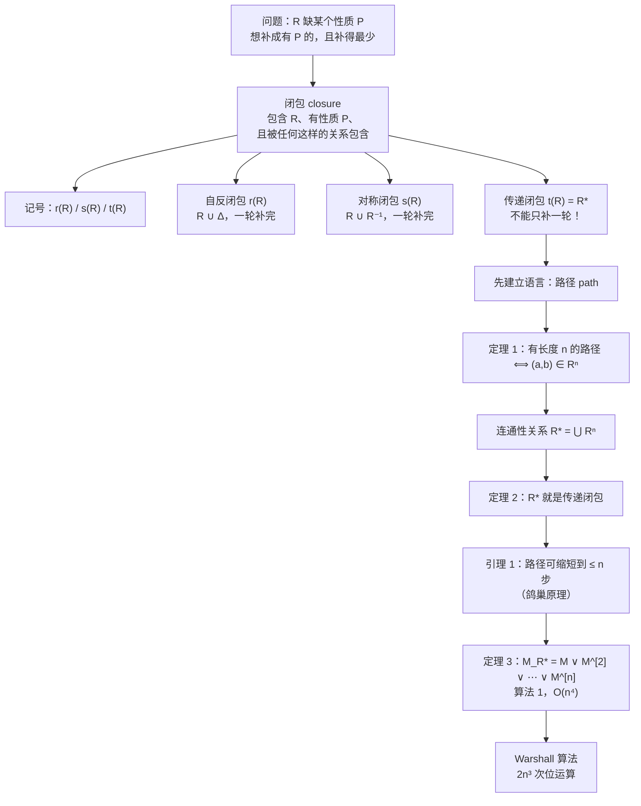

# C9.4 关系的闭包 Closures of Relations

> [!abstract] 这一讲的任务
> 手上有一个关系，但它缺了某个性质——不自反、不对称、不传递。**能不能"补"成有这个性质的？补的时候又不想多补，只想补最少的那些。** 这就是**闭包 closure**。
> 三种闭包各有缩写 $r(R)$、$s(R)$、$t(R)$（课件用的就是这一套）。自反闭包和对称闭包**各只要两行就讲完**——它们能"一轮补完"；**传递闭包是本节真正的主角**，因为补边会造出新的待补，它必须反复补，它会把我们带到三样东西：一个新概念（**连通性关系 $R^*$**）、一个漂亮的定理（$R^*$ 就是传递闭包）、以及一个 60 年来一直在被使用的算法（**Warshall 算法**）。
> 这一讲还回答一个你大概想过的问题：**"六度分隔"在数学上是什么？**——答案就是 $R^*$。

> [!info] 怎么读这份讲义
> 第 1–2 节（闭包定义、记号、自反与对称闭包）很轻，第 2.3 节起进入正题。**第 5 节的定理 3 是"笨办法"，第 6 节的 Warshall 是"好办法"，两者都要会手算**。
> 第 4 节的引理 1（路径可以缩短）是全节唯一一处需要用鸽巢原理的地方，它保证了"算到 $n$ 次方就够了"，是后面一切算法能终止的根据。



---

## 0. 开场：六个数据中心，一个查不出来的问题

一家公司在 Boston、Chicago、Denver、Detroit、New York、San Diego 设了六个数据中心。中心之间有**单向**专线：

$$\text{Boston}\to\text{Chicago},\quad \text{Boston}\to\text{Detroit},\quad \text{Chicago}\to\text{Detroit},\quad \text{Detroit}\to\text{Denver},\quad \text{New York}\to\text{San Diego}$$

设 $R$ 为"$a$ 到 $b$ 有直连专线"这个关系。运维问你一个问题：

> **"Boston 的数据能送到 Denver 吗？"**

你查 $R$：$(\text{Boston},\text{Denver})\notin R$。于是你回答"不能"。

**这个回答是错的。** Boston → Detroit → Denver，走两跳就到了。

问题出在哪？**$R$ 记录的是"直连"，而运维问的是"可达"。** 用 §9.1 的语言说：**$R$ 不是传递的**，所以它装不下所有"能连上"的配对。

你需要的是这样一个关系 $S$：

1. $S$ **包含** $R$（直连当然算可达）；
2. $S$ 是**传递的**（能接力就必须补上直达）；
3. $S$ 是**最小的**那个——**不多补一条**（否则我可以直接返回"全体配对"，那没有任何信息量）。

**这三条就是闭包的定义。** 这一讲从头把它建起来。

---

## 1. 闭包是什么：一个通用的定义

> [!important] 定义（关于性质 P 的闭包 Closure with respect to P）
> 设 $R$ 是集合 $A$ 上的关系，P 是某个性质（自反、对称、传递……）。
> 如果存在一个关系 $S$，满足
> 1. **$S$ 有性质 P**；
> 2. **$S\supseteq R$**；
> 3. **对任何有性质 P 且包含 $R$ 的关系 $T$，都有 $S\subseteq T$**；
>
> 则称 $S$ 为 $R$ **关于 P 的闭包 (closure of $R$ with respect to P)**。

第 3 条是"**最小**"的严格写法：**$S$ 被所有候选者包含，所以它是最小的那个。**

> [!warning] 闭包不一定存在
> 课本专门加了一句：*the closure of a relation with respect to a property may not exist*（见习题 15、35）。
> **存在性依赖于性质 P 本身的结构**——自反、对称、传递恰好都有一个好性质："有性质 P 的关系的交仍然有性质 P"，所以最小的那个存在（就是所有候选者的交）。
> 而像"**反对称**"就没有闭包：$R=\{(1,2),(2,1)\}$ 已经不反对称了，往里加东西只会更糟，**永远补不成反对称的**——闭包只能加不能减，这是它的根本限制。

### 1.1 记号约定

三种闭包各有自己的缩写，**它们会贯穿本节和后面两章**：

| 性质 P | 记号 | 读法 |
|---|---|---|
| 自反 reflexive | $\boxed{r(R)}$ | $R$ 的**自反闭包** |
| 对称 symmetric | $\boxed{s(R)}$ | $R$ 的**对称闭包** |
| 传递 transitive | $\boxed{t(R)}$ | $R$ 的**传递闭包** |

> [!warning] 传递闭包有**三个**流行的记号，别以为是三样东西
> $$t(R)\;=\;R^{*}\;=\;R^{+}$$
> - $t(R)$：课本和课件都用的"闭包"记号（$t$ = transitive）；
> - $R^{*}$：本节后面一直用的**连通性关系**记号，因为它的含义是"走任意多步能到"；
> - $R^{+}$：数据库与编译器教材里常见（传递闭包，不含长度 0）。
>
> **三者指同一个关系。** 另外注意别和下面的东西混：
> - $R^{-1}$ 是**逆关系**（边掉头），跟闭包无关；
> - $R^{[n]}$ 是**布尔幂**（矩阵语言，$M_{R^n}=M_R^{[n]}$），而 $R^n$ 是关系本身做 $n$ 次复合；
> - $R^{*}$ 是**无限并** $\bigcup_{i\ge1}R^i$，注意它**不含长度 0** 的"原地不动"路径（所以 $R^*$ 不自动自反）。

> [!note] 为什么"最小"这三个字一句话就说清了
> 课件把闭包的定义压缩成一句非常好记的话：**$S$ 就是"在 $R$ 上加了最少的项、刚好满足性质 P"的那个关系**。
> 三个条件（含 $R$、有 P、最小）听起来抽象，但第 3 条才是**唯一有技术含量的那条**——它排除了"随便补一大堆"的偷懒答案。每一次求闭包，我们都要能指着某个元素说："**你必须把它加进来，否则性质 P 就不成立**。"
> 自反、对称闭包这句话很好说（缺的那些是不可回避的）；**传递闭包就难在这里——补边会造出新的待补，所以"最少"到底是多少需要定理来回答**（见 2.3）。

---

## 2. 自反闭包与对称闭包（两行就讲完）

这一节的两个闭包是**唯一"补一轮就完事"的两个**——因为缺什么、必须补什么，一眼就能指出来（这正是 1.1 里说的"你必须把它加进来"那句话最容易兑现的地方）。把它们和 2.3 的传递闭包对比着看，才能体会传递闭包难在哪。

**怎么"补"？课件给了两条并行的路线：**

- **图形视角 (graphical view)**：在**有向图**上动手。自反闭包 = **给每个顶点加一个自环**；对称闭包 = **给每条边补上反向边**。
- **数学视角 (mathematical view)**：用关系运算写出来。自反闭包 = $R\cup\Delta$；对称闭包 = $R\cup R^{-1}$。

**两种视角给出同一个结果**，图上的动作让你看明白"补了什么"，公式让你能算。下面的两个小节就是这两条路线各走一遍。

### 2.1 自反闭包

课件从这张 4 个顶点的图开始：$R$ 是一个**有向环** $1\to2\to3\to4\to1$。它显然不自反——**四个顶点一个自环都没有**。

要让它自反，**唯一的办法就是每个顶点各加一个自环**（缺一个都不行，因为自反要求"每一个"）。加完就是 $R\cup\{(1,1),(2,2),(3,3),(4,4)\}$，立刻自反，而且少加任何一个都会破坏自反 ⇒ 这就是最小的那个。

具体数值的例子：$A=\{1,2,3\}$ 上的 $R=\{(1,1),(1,2),(2,1),(3,2)\}$ 不自反——缺 $(2,2)$ 和 $(3,3)$。补上这两个就行：
- 补完之后**自反** ✓；
- **包含** $R$ ✓；
- 而且**任何**包含 $R$ 的自反关系都必须含 $(2,2)$、$(3,3)$ ⇒ 它是最小的 ✓。

一般地：

> [!important] 自反闭包 $r(R)$
> $$\boxed{r(R)=R\cup\Delta,\qquad \Delta=\{(a,a)\mid a\in A\}}$$
> $\Delta$ 称为 $A$ 上的**对角关系 (diagonal relation / equality relation)**——注意它的第二个名字"**相等关系**"：$(a,b)\in\Delta$ 当且仅当 $a=b$。
>
> 一句话：**把主对角线全部填 1。**（矩阵视角：$M_{r(R)}=M_R\vee I$，其中 $I$ 是单位矩阵。）

**例 1**：$R=\{(a,b)\mid a<b\}$ 在整数上的自反闭包是
$$R\cup\Delta=\{(a,b)\mid a<b\}\cup\{(a,a)\}=\{(a,b)\mid a\le b\}$$
**"小于"的自反闭包是"小于等于"。** 这个例子值得记住——它解释了为什么数学里 $\le$ 比 $<$ 更常用作偏序（§9.6 要求自反）。

### 2.2 对称闭包

课件的例子：$\{1,2,3\}$ 上
$$R=\{(1,2),(2,2),(2,3),(3,1),(3,2)\}$$
它不对称——有 $(1,2)$ 却没有 $(2,1)$，有 $(3,1)$ 却没有 $(1,3)$。**把这两条补上**即可：
$$s(R)=\{(1,2),(1,3),(2,1),(2,2),(2,3),(3,1),(3,2)\}$$
任何包含 $R$ 的对称关系都必须含 $(2,1)$ 与 $(1,3)$（因为对称的定义就是"有 $(x,y)$ 就必须有 $(y,x)$"），所以这确实是最小的。

图形上这一步更好记：**原来每条边都补一条反向的孪生边**；原来已经成对的边（这里是 $(2,2)$ 这个自环、以及 $(2,3)/(3,2)$ 这一对）**不用重复补**。

> [!important] 对称闭包 $s(R)$
> $$\boxed{s(R)=R\cup R^{-1},\qquad R^{-1}=\{(b,a)\mid (a,b)\in R\}}$$
> 一句话：**把每条边的反向边都补上。**（矩阵视角：$M_{s(R)}=M_R\vee (M_R)^t$。）

> [!important] 定理：$R$ 对称 $\iff R=R^{-1}$
> **证明**：若 $R$ 对称，则 $(a,b)\in R\Rightarrow(b,a)\in R\Rightarrow(a,b)\in R^{-1}$，故 $R\subseteq R^{-1}$；把 $R$ 与 $R^{-1}$ 互换同理得 $R^{-1}\subseteq R$，于是 $R=R^{-1}$。
> 反过来若 $R=R^{-1}$，任取 $(a,b)\in R$，则 $(a,b)\in R^{-1}$，按逆关系的定义 $(b,a)\in R$ ⇒ 对称。∎
>
> **这条定理给"是不是对称的"提供了一个极快的判法**：不用逐对检查，只看"掉头之后是否还是自己"。它也是"$s(R)$ 是最小的对称关系"的直接依据——若 $S$ 对称且 $S\supseteq R$，则 $S=S^{-1}\supseteq R^{-1}$，故 $S\supseteq R\cup R^{-1}=s(R)$。

**例 2**：$R=\{(a,b)\mid a>b\}$ 在正整数上的对称闭包是
$$R\cup R^{-1}=\{(a,b)\mid a>b\}\cup\{(a,b)\mid a<b\}=\{(a,b)\mid a\ne b\}$$
**"大于"的对称闭包是"不等于"**（与 §9.1 例 19 的 $R_1\cup R_2$ 是同一个结论）。

### 2.3 ⭐ 传递闭包为什么不能照搬

> [!question] 停一下，先自己想想
> 前两个闭包都是"**缺什么补什么，一轮搞定**"。传递闭包能不能也这样：把所有"$(a,b)$ 和 $(b,c)$ 在里面但 $(a,c)$ 不在"的 $(a,c)$ 一次性补上？
> 先自己找个反例试试。

**课本给的反例（务必自己走一遍）**：$A=\{1,2,3,4\}$，
$$R=\{(1,3),(1,4),(2,1),(3,2)\}$$

**第一轮补**：找出所有能接上的两步——
- $(2,1)+(1,3)\Rightarrow(2,3)$
- $(2,1)+(1,4)\Rightarrow(2,4)$
- $(3,2)+(2,1)\Rightarrow(3,1)$
- $(1,3)+(3,2)\Rightarrow(1,2)$

补上 $(1,2),(2,3),(2,4),(3,1)$，得到
$$R'=\{(1,2),(1,3),(1,4),(2,1),(2,3),(2,4),(3,1),(3,2)\}$$

**$R'$ 传递了吗？** 检查：$R'$ 含 $(3,1)$ 和 $(1,4)$，但 **$(3,4)\notin R'$** ✗

**没传递！** 因为我们新补进来的边 $(3,1)$ 又和老边 $(1,4)$ 接上了，产生了新的两步。

> [!warning] ⭐ 这就是传递闭包的本质困难
> **补边这个动作本身会制造新的"待补"**。所以必须**反复补，直到不再产生新的为止**。
> 课本的说法：*the transitive closure of a relation can be found by adding new ordered pairs that must be present and then repeating this process until no new ordered pairs are needed.*
>
> 这也解释了本节剩下的全部篇幅：**为了知道"到底要补几轮才够"，我们需要一套关于路径的理论。**

### 2.4 传递闭包的定义：$t(R)=R^*$

传递闭包的"图形视角"也有一句口诀，但它比前两个别扭得多：

> [!important] 传递闭包 $t(R)$
> **图形视角**：如果 $R$ 中存在从 $a$ 到 $b$ 的路径（**任意长度**），就把 $(a,b)$ 加进来。**注意"任意长度"这四个字——这正是它和前两个闭包的区别。**
> **数学视角**：把所有 $R^n$ 并起来：
> $$\boxed{t(R)=R^{*}=\bigcup_{n=1}^{\infty}R^{n}}$$

**为什么图形视角这句口诀是对的？** 因为它就是"传递"的定义反过来念：$R$ 传递要求"两步能到、一步也要能到"；反复应用这条要求，就等于要求"**任意多步能到、一步也要能到**"。所以最小的传递关系必须包含"所有能走到的配对"，而包含它们之后**不会再缺任何东西**（任意两条路径接起来还是一条路径）。这一段严谨化就是第 4 节的定理 2。

**举个数**：课件的例子 $\{1,2,3,4\}$ 上 $R=\{(1,2),(1,3),(2,3),(3,4)\}$ 不传递——有 $(2,3)$ 与 $(3,4)$ 却没有 $(2,4)$。把它补成 $t(R)$：
$$t(R)=\{(1,2),(1,3),(1,4),(2,3),(2,4),(3,4)\}$$
**注意补进去的两条新边长度不同**：$(2,4)$ 走的是 $2\to3\to4$（2 步），$(1,4)$ 走的是 $1\to2\to3\to4$（3 步）。**只补"能接上的两步"那一轮，只补得出 $(2,4)$，补不出 $(1,4)$**（后者要等 $(2,4)$ 补进来之后才能接力）——必须反复补下去，或者直接按"任意长度的路径"一次性收全。这就是 2.3 那个反例要说明的事。

> [!note] 记号提醒：为什么本节后面主要写 $R^*$ 而不写 $t(R)$
> 因为接下来的所有定理都是关于"路径"的，而 $R^*=\bigcup_{n\ge1}R^n$ 这个写法**一眼就能看出它是"所有长度的路径"**，$t(R)$ 看不出。两个记号指同一个东西（见 1.1），考试时**看到 $R^*$ 就翻译成"传递闭包"**。

---

## 3. 新语言：有向图中的路径

要谈"走几步能到"，先得把"走"说清楚。

> [!important] 定义 1（路径 Path）
> 有向图 $G$ 中从 $a$ 到 $b$ 的一条**路径 (path)**，是一串边
> $$(x_0,x_1),(x_1,x_2),\dots,(x_{n-1},x_n)$$
> 其中 $n$ 是非负整数，$x_0=a$、$x_n=b$——即**每条边的终点恰好是下一条边的起点**。
> 这条路径记作 $x_0,x_1,\dots,x_n$，**长度 (length) 为 $n$**（= 边数，不是顶点数）。
> - 空边集视为从 $a$ 到 $a$ 的**长度 0** 的路径；
> - 长度 $n\ge1$ 且**起点终点相同**的路径称为**回路 (circuit)** 或**圈 (cycle)**。

> [!warning] 两个不要想当然的地方
> 课本明确说了：
> 1. **路径可以重复经过同一个顶点**；
> 2. **同一条边可以在路径里出现多次**。
>
> 也就是说，路径**不要求"不走回头路"**。（第 10 章会引入"简单路径 simple path"来表示不重复顶点的路径，那是另一个概念。）

**例 3（必须会判）**：在下面这个图里（顶点 $a,b,c,d,e$，边 $(a,b),(a,c),(a,a),(b,a),(b,e),(c,b),(c,d),(d,c),(e,d),(e,b)$ 等），课本问哪些是路径：

| 候选 | 是不是路径 | 长度 | 是回路吗 |
|---|:-:|:-:|:-:|
| $a,b,e,d$ | ✅ $(a,b),(b,e),(e,d)$ 都是边 | 3 | ❌ |
| $a,e,c,d,b$ | ❌ $(c,d)$ 是边但 $(a,e)$ 不是 | — | — |
| $b,a,c,b,a,a,b$ | ✅ 六条边全在 | 6 | ✅（$b$ 开头 $b$ 结尾） |
| $d,c$ | ✅ | 1 | ❌ |
| $c,b,a$ | ✅ | 2 | ❌ |
| $e,b,a,b,a,b,e$ | ✅ | 6 | ✅ |

**注意第 3 行和第 6 行**：顶点和边都反复出现，**仍然是合法路径**。这正是上面那条"不要想当然"的兑现。

### 3.1 定理 1：路径 = 幂

**路径这个概念搬到关系上**：$R$ 中从 $a$ 到 $b$ 有一条路径，指存在 $a,x_1,\dots,x_{n-1},b$ 使 $(a,x_1),(x_1,x_2),\dots,(x_{n-1},b)$ 全在 $R$ 里。

> [!important] 定理 1
> 设 $R$ 是集合 $A$ 上的关系。**存在从 $a$ 到 $b$ 的长度为 $n$ 的路径 $\iff$ $(a,b)\in R^n$**（$n$ 为正整数）。

**证明（数学归纳法）**：

- **基础步** $n=1$：长度 1 的路径就是一条边，即 $(a,b)\in R=R^1$ ✓
- **归纳假设**：设结论对 $n$ 成立。
- **归纳步**：
  存在从 $a$ 到 $b$ 长度 $n+1$ 的路径
  $\iff$ 存在 $c\in A$，使得从 $a$ 到 $c$ 有长度 1 的路径（即 $(a,c)\in R$）**且**从 $c$ 到 $b$ 有长度 $n$ 的路径
  $\iff$（用归纳假设）存在 $c$ 使 $(a,c)\in R$ 且 $(c,b)\in R^n$
  $\iff$（复合的定义）$(a,b)\in R^n\circ R=R^{n+1}$ ✓ ∎

> [!note] 停一下，我们刚才干了什么
> 定理 1 把**图的语言**（路径）和**代数的语言**（幂）焊在了一起：
> $$\text{走 } n \text{ 步能到} \iff (a,b)\in R^n \iff M_R^{[n]} \text{ 的 } (a,b) \text{ 位是 }1$$
> **这条三向等价是本节剩下所有内容的通用货币**：想讲直觉就用左边，想证定理就用中间，想算数就用右边。

---

## 4. 连通性关系 $R^*$ 与传递闭包

### 4.1 定义

> [!important] 定义 2（连通性关系 Connectivity Relation）
> 设 $R$ 是 $A$ 上的关系。**连通性关系 $R^*$** 由所有这样的 $(a,b)$ 组成：$R$ 中存在一条**长度至少为 1** 的从 $a$ 到 $b$ 的路径。

由定理 1，长度 $n$ 的路径对应 $R^n$，所以

$$\boxed{R^*=\bigcup_{n=1}^{\infty}R^n}$$

**一句话：$R^*$ 就是"走任意多步能到"。** 开场那个运维问题要的正是它。

### 4.2 三个例子（把 $R^*$ 的含义坐实）

**例 4（六度分隔）**：$R$ = "世界上所有人中，$a$ 见过 $b$"。
- $R^2$：存在 $c$ 使 $a$ 见过 $c$ 且 $c$ 见过 $b$——**"朋友的朋友"**；
- $R^n$：存在一串人 $x_1,\dots,x_{n-1}$ 把 $a$ 和 $b$ 串起来；
- $R^*$：**存在任意长的一串人把 $a$ 和 $b$ 连起来**。

课本在这里问了一句很有意思的话：*Do you think that this connectivity relation includes the pair with you as the first element and the president of Mongolia as the second element?*

> [!note] 这就是「六度分隔 (six degrees of separation)」的数学形式
> 六度分隔猜想说的是：对几乎所有人对 $(a,b)$，**不但 $(a,b)\in R^*$，而且 $(a,b)\in R^6$**——也就是说不仅能连上，**六步之内就能连上**。
> $R^*$ 回答"**能不能**连上"，$R^n$ 回答"**几步**连上"。**这两个问题的区别，就是本节和图论最短路问题的区别。**
> 第 10 章会用图来重新建模这个应用。

**例 5（纽约地铁）**：$R$ = "从 $a$ 站不换乘能到 $b$ 站"。
- $R^n$：**最多换乘 $n-1$ 次**能从 $a$ 到 $b$（走 $n$ 段 ⇒ 换 $n-1$ 次车）；
- $R^*$：**换多少次都行，能不能到**。

> [!warning] 这里的"$n-1$"是个易错点
> 走 $n$ 段路只需要换 $n-1$ 次车（第一段不算换乘）。考试如果问"$R^3$ 表示什么"，答"最多换乘 2 次"，不是 3 次。

**例 6（美国各州相邻）**：$R$ = "州 $a$ 与州 $b$ 接壤"。
- $R^n$：从 $a$ 到 $b$ **恰好跨越 $n$ 条州界**；
- $R^*$：跨多少条都行。
**唯一不在 $R^*$ 里的配对**，是含 Alaska 或 Hawaii 的那些——它们不与本土相连。

### 4.3 定理 2：$R^*$ 就是传递闭包

> [!important] 定理 2
> **关系 $R$ 的传递闭包 $t(R)$ 等于连通性关系 $R^*$。**

**证明**（三件事都要验：包含 $R$、传递、最小）：

**(1) $R^*\supseteq R$**：由定义，长度 1 的路径就是 $R$ 的边 ✓

**(2) $R^*$ 传递**：设 $(a,b)\in R^*$、$(b,c)\in R^*$。则 $R$ 中有从 $a$ 到 $b$ 的路径和从 $b$ 到 $c$ 的路径。**把两条路径首尾接起来**，就得到从 $a$ 到 $c$ 的一条路径 ⇒ $(a,c)\in R^*$ ✓

**(3) $R^*$ 最小**：设 $S$ 是任何包含 $R$ 的传递关系，要证 $R^*\subseteq S$。
- $S$ 传递 ⇒ $S^n$ 也传递，且由 §9.1 定理 1 得 $S^n\subseteq S$；
- 于是 $S^*=\bigcup_{k\ge1}S^k\subseteq S$；
- 又 $R\subseteq S$ ⇒ $R$ 中的每条路径也是 $S$ 中的路径 ⇒ $R^*\subseteq S^*$；
- 串起来：$R^*\subseteq S^*\subseteq S$ ✓ ∎

> [!note] 这个证明的结构值得记
> 证"$X$ 是关于 P 的闭包"永远是**三步**：①含 $R$；②有性质 P；③被任何候选者包含。
> **第 ③ 步的标准套路**：任取一个候选 $S$，想办法说明 $X$ 的每个元素都被迫在 $S$ 里。这里用的桥是「$S$ 传递 ⇒ $S^*\subseteq S$」。

---

## 5. 算到第几次方才够？（引理 1 与定理 3）

$R^*=\bigcup_{n=1}^{\infty}R^n$ 是个**无限并**——计算机没法算无限多项。但直觉告诉我们不用算那么多：在 $n$ 个点的图里绕来绕去，迟早会重复。

### 5.1 引理 1：路径可以缩短

> [!important] 引理 1
> 设 $A$ 有 $n$ 个元素，$R$ 是 $A$ 上的关系。
> 若 $R$ 中存在从 $a$ 到 $b$ 的长度至少为 1 的路径，则**存在一条长度不超过 $n$ 的这样的路径**。
> 而且当 $a\ne b$ 时，**存在长度不超过 $n-1$ 的路径**。

**证明（鸽巢原理）**：

![[C9-路径缩短-鸽巢原理.png]]

设从 $a$ 到 $b$ 有路径，取**最短**的一条，长度为 $m$，写作 $x_0,x_1,\dots,x_m$（$x_0=a$、$x_m=b$）。

假设 $a=b$ 且 $m>n$，即 $m\ge n+1$。
考虑前 $m$ 个顶点 $x_0,x_1,\dots,x_{m-1}$——共 $m\ge n+1$ 个位置，但 $A$ 里只有 $n$ 个不同元素。由**鸽巢原理**，**至少有两个位置上的顶点相同**。

设 $x_i=x_j$，其中 $0\le i<j\le m-1$。那么这条路径中从 $x_i$ 走到 $x_j$ 的那一段是一个**回路**。把这段回路整个删掉，剩下

$$x_0,x_1,\dots,x_i,x_{j+1},\dots,x_m$$

仍然是一条从 $a$ 到 $b$ 的路径，而且**更短**——与"$m$ 是最短长度"矛盾。
所以最短路径的长度必然 $\le n$。∎（$a\ne b$ 的情形留作课本习题。）

> [!note] 这是鸽巢原理在本章的唯一一次出场
> 鸽巢原理（第 6 章）：$m$ 只鸽子进 $n$ 个笼子，$m>n$ 时必有一个笼子装了两只。
> 这里"鸽子"是路径上的位置，"笼子"是顶点。**一旦有两只鸽子同笼（同一个顶点被访问两次），中间那段就是白走的。**

### 5.2 定理 3：把无限并砍成有限并

由引理 1，**长度超过 $n$ 的路径都可以缩短**，所以

$$\boxed{R^*=R\cup R^2\cup R^3\cup\cdots\cup R^n}$$

翻译成矩阵（§9.3：并 = $\vee$，幂 = 布尔幂）：

> [!important] 定理 3
> 设 $M_R$ 是 $n$ 元集合上关系 $R$ 的零一矩阵。则传递闭包 $R^*$ 的零一矩阵是
> $$M_{R^*}=M_R\vee M_R^{[2]}\vee M_R^{[3]}\vee\cdots\vee M_R^{[n]}$$

**例 7（手算，务必跟一遍）**：

$$M_R=\begin{bmatrix}1&0&1\\0&1&0\\1&1&0\end{bmatrix}$$

$n=3$，所以要算到 $M_R^{[3]}$。

**算 $M_R^{[2]}=M_R\odot M_R$**（用 §9.3 的速算法：第 $i$ 行哪些位是 1，就把 $M_R$ 的对应行取出来逐位或）：
- 第 1 行 $(1,0,1)$ ⇒ 取第 1、3 行：$(1,0,1)\vee(1,1,0)=(1,1,1)$
- 第 2 行 $(0,1,0)$ ⇒ 取第 2 行：$(0,1,0)$
- 第 3 行 $(1,1,0)$ ⇒ 取第 1、2 行：$(1,0,1)\vee(0,1,0)=(1,1,1)$

$$M_R^{[2]}=\begin{bmatrix}1&1&1\\0&1&0\\1&1&1\end{bmatrix}$$

**算 $M_R^{[3]}=M_R^{[2]}\odot M_R$**：
- 第 1 行 $(1,1,1)$ ⇒ 取三行全部或：$(1,0,1)\vee(0,1,0)\vee(1,1,0)=(1,1,1)$
- 第 2 行 $(0,1,0)$ ⇒ 取第 2 行：$(0,1,0)$
- 第 3 行 $(1,1,1)$ ⇒ 同第 1 行：$(1,1,1)$

$$M_R^{[3]}=\begin{bmatrix}1&1&1\\0&1&0\\1&1&1\end{bmatrix}$$

**求并**：

$$M_{R^*}=\begin{bmatrix}1&0&1\\0&1&0\\1&1&0\end{bmatrix}\vee\begin{bmatrix}1&1&1\\0&1&0\\1&1&1\end{bmatrix}\vee\begin{bmatrix}1&1&1\\0&1&0\\1&1&1\end{bmatrix}=\boxed{\begin{bmatrix}1&1&1\\0&1&0\\1&1&1\end{bmatrix}}$$

（已用程序独立复算，与课本一致。）

**怎么读这个结果**：第 2 行只有中间是 1，说明**从元素 2 出发只能到 2 自己**——它是个"死胡同"。其余两个元素互相可达，也都能到 2。

### 5.3 算法 1 及其代价

> [!important] 算法 1：计算传递闭包（课本原伪代码）
> ```
> procedure transitive closure (M_R : zero-one n×n matrix)
> A := M_R
> B := A
> for i := 2 to n
>     A := A ⊙ M_R
>     B := B ∨ A
> return B   {B 就是 M_R* }
> ```
> 思路直白：**一边往上乘幂，一边把结果并进来。**

**复杂度分析**（课本算得很细，值得跟一遍）：

| 步骤 | 次数 | 每次代价 | 小计 |
|---|---|---|---|
| 求布尔幂 $M^{[2]},\dots,M^{[n]}$ | $n-1$ 次布尔积 | 每次 $n^2(2n-1)$ 次位运算 | $n^2(2n-1)(n-1)$ |
| 求并 | $n-1$ 次 | 每次 $n^2$ | $(n-1)n^2$ |

总计
$$n^2(2n-1)(n-1)+(n-1)n^2=2n^3(n-1)=O(n^4)$$

> [!question] 停一下：$n^2(2n-1)$ 这个数是怎么来的？
> 一次布尔积要算 $n^2$ 个格子；每个格子 $t_{ij}=\bigvee_{k=1}^n(r_{ik}\wedge s_{kj})$ 需要 $n$ 次 $\wedge$ 加 $n-1$ 次 $\vee$，共 $2n-1$ 次位运算。乘起来就是 $n^2(2n-1)$。
> **这类"数位运算次数"的分析在算法课里会反复出现，这里是第一次正式演练。**

$O(n^4)$ 对 $n=1000$ 的图来说是 $10^{12}$——**太慢了**。下一节的 Warshall 把它降到 $2n^3$。

---

## 6. ⭐ Warshall 算法（本节的高潮）

### 6.1 算法背后的想法

> [!question] 停一下，先自己想想
> 算法 1 慢在哪？它算 $M^{[2]},M^{[3]},\dots$ 每一步都在**从头重算所有路径**。有没有办法让每一步都**利用上一步的结果**？
> 提示：换一个维度来"逐步放宽"——不按**路径长度**分层，而按**允许经过哪些中转站**分层。

这就是 Warshall 的核心想法，也是它和算法 1 的唯一区别。

> [!important] 关键概念：内部顶点 Interior Vertices
> 路径 $a,x_1,x_2,\dots,x_{m-1},b$ 的**内部顶点 (interior vertices)** 是 $x_1,\dots,x_{m-1}$——**除首尾之外的全部顶点**。
>
> 课本给的两个例子（要看懂括号里的说明）：
> - 路径 $a,c,d,f,g,h,b,j$ 的内部顶点是 $c,d,f,g,h,b$。**注意 $b$ 算内部顶点**，因为它不是这条路径的首或尾（尾是 $j$）。
> - 路径 $a,c,d,a,f,b$ 的内部顶点是 $c,d,a,f$。**注意 $a$ 算内部顶点**，因为它在中间又被访问了一次。
>
> **规则**：首顶点只有在中途被再次访问时才算内部顶点；末顶点同理。

**Warshall 的构造**：设顶点为 $v_1,v_2,\dots,v_n$（任取一个排列）。定义一列矩阵 $W_0,W_1,\dots,W_n$：

$$W_k=[w_{ij}^{(k)}],\qquad w_{ij}^{(k)}=\begin{cases}1 & \text{存在从 } v_i \text{ 到 } v_j \text{ 的路径，其\textbf{内部顶点}都在 }\{v_1,\dots,v_k\}\text{ 中}\\ 0 & \text{否则}\end{cases}$$

- $W_0=M_R$：**不允许任何中转站** ⇒ 只有直连边；
- $W_n=M_{R^*}$：**所有顶点都能当中转站** ⇒ 就是全部可达关系。

> [!warning] 定义里有一句容易漏的话
> *The first and last vertices in the path may be outside the set of the first $k$ vertices in the list.*
> **首尾顶点不受 $\{v_1,\dots,v_k\}$ 的限制**——限制的只是"中途能在哪儿落脚"。

### 6.2 例 8：手算 $W_0$ 到 $W_4$

![[C9-Warshall例题有向图.png]]

$R$ 的有向图如上，取 $v_1=a,v_2=b,v_3=c,v_4=d$。

$$W_0=M_R=\begin{bmatrix}0&0&0&1\\1&0&1&0\\1&0&0&1\\0&0&1&0\end{bmatrix}$$

（读法：第 1 行只有第 4 列是 1 ⇒ 只有 $a\to d$；第 2 行 ⇒ $b\to a$、$b\to c$；第 3 行 ⇒ $c\to a$、$c\to d$；第 4 行 ⇒ $d\to c$。）

**$W_1$：允许经过 $a$。**
新增了什么？现在 $b\to a\to d$ 可以走了 ⇒ 新增 $(b,d)$。

$$W_1=\begin{bmatrix}0&0&0&1\\1&0&1&\boxed{1}\\1&0&0&1\\0&0&1&0\end{bmatrix}$$

**$W_2$：允许经过 $a$ 和/或 $b$。**
**没有任何边以 $b$ 为终点**（矩阵第 2 列全是 0）⇒ 谁也走不到 $b$，自然没法拿 $b$ 当中转站 ⇒ $W_2=W_1$。

> [!note] 这一步是个很好的检验点
> **看矩阵的第 $k$ 列**：如果全是 0，说明没人能到 $v_k$，那么加入 $v_k$ 作为中转站**不会产生任何新路径**，$W_k=W_{k-1}$。
> 同理，**第 $k$ 行全 0**（$v_k$ 出不去）也会导致 $W_k=W_{k-1}$。**手算时先扫一眼这两处，能省掉一整轮。**

**$W_3$：允许经过 $a,b,c$。**
现在 $d\to c\to a$ 可以走 ⇒ 新增 $(d,a)$；$d\to c\to d$ 可以走 ⇒ 新增 $(d,d)$。

$$W_3=\begin{bmatrix}0&0&0&1\\1&0&1&1\\1&0&0&1\\\boxed{1}&0&1&\boxed{1}\end{bmatrix}$$

**$W_4$：允许经过全部顶点。**
现在 $a\to d\to c$ 可以走 ⇒ 新增 $(a,c)$；$a\to d\to c\to a$ ⇒ 新增 $(a,a)$；$c\to d\to c$ ⇒ 新增 $(c,c)$。

$$W_4=\begin{bmatrix}1&0&1&1\\1&0&1&1\\1&0&1&1\\1&0&1&1\end{bmatrix}=M_{R^*}$$

（已用程序逐轮复算 $W_0\to W_4$，与课本完全一致。）

**结果解读**：第 2 列全 0 ⇒ **谁都到不了 $b$**；其余三个顶点两两可达，且 $b$ 能到它们。

### 6.3 引理 2：递推公式

Warshall 之所以快，是因为 $W_k$ 能**直接从 $W_{k-1}$ 算出来**，不用重算。

![[C9-Warshall两种情形.png]]

**推理**：从 $v_i$ 到 $v_j$、内部顶点只在 $\{v_1,\dots,v_k\}$ 中的路径，只可能是两种：

- **情形 1**：这条路径根本没用到 $v_k$ ⇒ 内部顶点都在 $\{v_1,\dots,v_{k-1}\}$ 中 ⇒ 在 $W_{k-1}$ 里已经记下了，即 $w_{ij}^{(k-1)}=1$；
- **情形 2**：这条路径经过了 $v_k$ ⇒ 可以拆成「$v_i\to v_k$」+「$v_k\to v_j$」两段，**每段的内部顶点都在 $\{v_1,\dots,v_{k-1}\}$ 中** ⇒ $w_{ik}^{(k-1)}=1$ **且** $w_{kj}^{(k-1)}=1$。

> [!important] 引理 2（Warshall 的递推式）
> $$\boxed{w_{ij}^{(k)}=w_{ij}^{(k-1)}\;\vee\;\bigl(w_{ik}^{(k-1)}\wedge w_{kj}^{(k-1)}\bigr)}$$
> 对一切不超过 $n$ 的正整数 $i,j,k$ 成立。

**读法：「本来就能到」或者「能到 $v_k$ 且 $v_k$ 能到那里」。**

> [!question] 课堂追问：情形 2 里为什么可以假定 $v_k$ 只被经过一次？
> 如果路径多次经过 $v_k$，把两次访问之间的那段回路删掉即可（引理 1 的同一个技巧），得到只经过 $v_k$ 一次的路径，可达性不变。
> **所以"拆成两段"总是可行的。** 这个细节课本没展开，但证明的严谨性依赖它。

### 6.4 算法 2 与复杂度

> [!important] 算法 2：Warshall 算法（课本原伪代码）
> ```
> procedure Warshall (M_R : n×n zero-one matrix)
> W := M_R
> for k := 1 to n
>     for i := 1 to n
>         for j := 1 to n
>             w_ij := w_ij ∨ (w_ik ∧ w_kj)
> return W   {W = [w_ij] 就是 M_R* }
> ```

**复杂度**：算一个 $w_{ij}^{(k)}$ 要 2 次位运算（一次 $\wedge$、一次 $\vee$）；一轮 $k$ 要算 $n^2$ 个格子 ⇒ $2n^2$；共 $n$ 轮 ⇒

$$\boxed{n\cdot 2n^2=2n^3 \text{ 次位运算}}$$

**对比**：

| 算法 | 位运算次数 | 量级 | $n=100$ 时 |
|---|---|---|---|
| 算法 1（逐幂求并） | $2n^3(n-1)$ | $O(n^4)$ | $\approx 2\times10^8$ |
| **Warshall** | $2n^3$ | $O(n^3)$ | $2\times 10^6$ |

**快了 $n-1$ 倍。**

> [!warning] ⭐ 三重循环的顺序绝对不能换
> **$k$ 必须是最外层。** 因为 $W_k$ 的每个格子都依赖完整的 $W_{k-1}$——必须把一轮 $k$ 全部算完，才能进入下一轮。
> 如果把 $k$ 写到里层，算出来的东西没有任何意义。**这是写 Warshall / Floyd 代码时最经典的 bug。**
>
> 另外注意算法 2 **就地更新** $W$（没有开两份矩阵）。这居然是对的——因为 $w_{ik}$ 和 $w_{kj}$ 在第 $k$ 轮中不会被改坏（$w_{ik}^{(k)}=w_{ik}^{(k-1)}$，$w_{kj}^{(k)}=w_{kj}^{(k-1)}$，这两条可以自己验证）。**这是一个很漂亮的实现细节。**

> [!note] Warshall 算法在你后面的课里叫别的名字
> 把 $\vee$ 换成 $\min$、把 $\wedge$ 换成 $+$，同一个三重循环就变成了**Floyd–Warshall 最短路算法**——求所有点对之间的最短距离：
> ```
> for k: for i: for j:
>     d[i][j] = min(d[i][j], d[i][k] + d[k][j])
> ```
> **一模一样的结构。** 原因在于两者都是在同一个代数结构（半环）上做同一件事：可达性用 $(\vee,\wedge)$，最短路用 $(\min,+)$。
> 这条线索在算法课、图论课里还会再遇到。

### 6.5 一点历史

> [!note] 课本的人物小传（属于要求"不得省略任何知识点"的部分）
> **Stephen Warshall（1935–2006）** 生于纽约，1956 年在哈佛拿到数学学位，**从未读过研究生**——因为当时还没有他感兴趣方向的研究生项目。
> 他在 ORO（为美国陆军做研发的机构）、Technical Operations 工作，1961 年创办 Massachusetts Computer Associates，后并入 ADR，1982 年退休。
> 关于这个算法有个著名轶事：**他和同事用一瓶朗姆酒打赌**，看谁先能判定这个传递闭包算法是否总是正确。**Warshall 一夜之间就给出了证明，赢下那瓶酒，并和输家分着喝了。**
> 他不喜欢坐办公桌，很多创造性工作是在印度洋的帆船上或希腊的柠檬园里完成的。
>
> **另一个名字**：这个算法有时也叫 **Roy–Warshall 算法**，因为 Bernard Roy 在 1959 年（比 Warshall 早一年）也描述过它。

---

## 这一讲的三句话

> [!success] 三句话
> 1. **闭包 = 最小的"补全"**：自反闭包 $=R\cup\Delta$（填对角线）、对称闭包 $=R\cup R^{-1}$（补反向边），两者一轮搞定；**传递闭包不行，因为补边会制造新的待补边**。
> 2. **传递闭包 = 连通性关系 $R^*=\bigcup_{n\ge1}R^n$ =「走任意多步能到」**。由引理 1（鸽巢原理）知走 $n$ 步就够，所以 $M_{R^*}=M\vee M^{[2]}\vee\cdots\vee M^{[n]}$。
> 3. **Warshall 把 $O(n^4)$ 降到 $2n^3$**：不按路径长度分层，改按**允许的中转站**分层，递推式是 $w_{ij}^{(k)}=w_{ij}^{(k-1)}\vee(w_{ik}^{(k-1)}\wedge w_{kj}^{(k-1)})$，**$k$ 必须在最外层循环**。

### 速查表

| 闭包 | 公式 | 矩阵写法 | 一句话 |
|---|---|---|---|
| 自反闭包 | $R\cup\Delta$ | $M\vee I$ | 对角线填 1 |
| 对称闭包 | $R\cup R^{-1}$ | $M\vee M^t$ | 补反向边 |
| 传递闭包 | $R^*=\bigcup_{n\ge1}R^n$ | $M\vee M^{[2]}\vee\cdots\vee M^{[n]}$ | 走任意多步能到 |

| 结论 | 内容 |
|---|---|
| 定理 1 | 长度 $n$ 的路径 $\iff (a,b)\in R^n$ |
| 引理 1 | 有路径 ⇒ 有长度 $\le n$ 的路径（$a\ne b$ 时 $\le n-1$） |
| 定理 2 | 传递闭包 $=R^*$ |
| 定理 3 | $M_{R^*}=M\vee M^{[2]}\vee\cdots\vee M^{[n]}$ |
| 引理 2 | $w_{ij}^{(k)}=w_{ij}^{(k-1)}\vee(w_{ik}^{(k-1)}\wedge w_{kj}^{(k-1)})$ |

| 算法 | 位运算次数 | 量级 |
|---|---|---|
| 算法 1 | $2n^3(n-1)$ | $O(n^4)$ |
| Warshall | $2n^3$ | $O(n^3)$ |

---

## 下一讲预告

到这里，我们已经会**给关系补性质**了。下一讲换个方向：**当一个关系同时具备自反、对称、传递这三条时，会发生什么特别的事？**

答案是一件相当漂亮的事：**这样的关系会把整个集合切成互不相交的若干块**，而且反过来——**任何一种切法都对应唯一一个这样的关系**。这个双向对应（定理 2）是整章最优雅的结论。

顺带还会回答一个你写代码时一定遇到过的问题：**为什么老版本的 C 编译器会把两个不同名字的变量当成同一个？**

---

**上一节** ← [[C9.3 关系的表示 Representing Relations]]
**下一节** → [[C9.5 等价关系 Equivalence Relations]]
**本章索引** → [[C9 关系 Relations MOC]]
