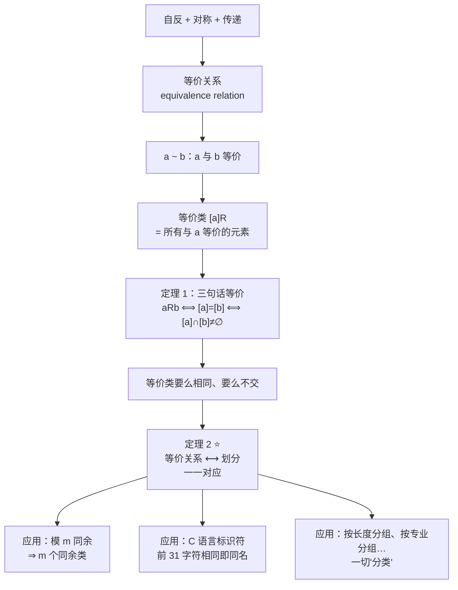

# C9.5 等价关系 Equivalence Relations

> [!abstract] 这一讲的任务
> §9.1 我们量出了六把尺子。这一讲把其中三把——**自反、对称、传递**——凑在一起，看看会得到什么。
> 答案漂亮得有点出人意料：**这样的关系会自动把整个集合切成互不重叠的若干块**，而且反过来，**任何一种切法都恰好对应一个这样的关系**。这个双向对应（定理 2）是整章最优雅的结论，也是"分类"这件事的数学本质。
> 这一讲要做三件事：① 认出等价关系（三条一起验）；② 算出**等价类**；③ 建立「等价关系 ⟷ 划分」这个一一对应，并用它理解模 $m$ 同余。

> [!info] 怎么读这份讲义
> 第 3 节的**等价类**和第 5 节的**定理 1、定理 2** 是本节全部重量所在，其余都是例子。
> 本节会大量用到 §9.1 的性质判据和第 4 章的同余，需要时我都写了双链。



---

## 0. 开场：编译器眼里的两个变量是同一个

你在读一份老 C 代码，看到这两行：

```c
int Number_of_named_tropical_storms;
int Number_of_named_tropical_storms_in_the_Atlantic_in_2005;
```

编译报错：**重复定义**。

你盯着看了半天——这明明是两个不同的名字啊？

查了资料才知道：**标准 C 编译器在比较两个标识符是否相同时，只看前 31 个字符**。数一下：

```
Number_of_named_tropical_storms
123456789...                 31
```

正好 31 个字符。而第二个标识符的前 31 个字符和它**完全一样**。所以在编译器眼里，**这俩就是同一个变量**。

现在问题来了：编译器实际上做了什么？

它并不是在判断“两个字符串是否相等”，而是在判断**“两个字符串是否属于同一类”**——它把所有标识符按“前 31 个字符相同”这条规则**分了组**，同组的一律视为同一个东西。

> [!important] 这个动作有一个数学名字
> 编译器用的这条规则 $R$：$sRt$ 当且仅当 $s=t$，或者 $s$ 和 $t$ 都至少 31 个字符且前 31 个字符相同。
> **这是一个等价关系，而它对标识符集合的分组就是一个划分。**
> 这一讲要讲的全部内容，就藏在这个日常 bug 里。

---

## 1. 等价关系：三条一起验

> [!important] 定义 1（等价关系 Equivalence Relation）
> 集合 $A$ 上的关系称为**等价关系 (equivalence relation)**，如果它同时是**自反的、对称的、传递的**。

> [!important] 定义 2（等价 Equivalent）
> 被等价关系联系起来的两个元素 $a,b$ 称为**等价的 (equivalent)**，常记作
> $$a\sim b$$

> [!question] 停一下：为什么偏偏是这三条？
> 课本给了一段很值得读的解释，核心是：**这三条正好让“等价”这个词说得通。**
> - 要说 $a$ 和 $a$ 自己是同一类的 ⇒ 需要**自反**；
> - 要能说“$a$ 和 $b$ **互相**等价”（而不是单向的“$a$ 关于 $b$ 等价”）⇒ 需要**对称**；
> - 要能说“$a$ 和 $b$ 同类、$b$ 和 $c$ 同类 ⇒ $a$ 和 $c$ 同类”⇒ 需要**传递**。
>
> **三条缺一，"同一类"这个说法就会自相矛盾。** 所以等价关系不是随便挑三条凑出来的，它是“**把不同对象当成同一个东西**”这件事所需要的**最小要求**。

### 1.1 五个正面例子

**例 1**：整数上的 $aRb \iff a=b$ 或 $a=-b$。
§9.1 例 8、11、14 已经分别验过它自反、对称、传递 ⇒ **是等价关系**。

**例 2**：实数上的 $aRb\iff a-b$ 是整数。三条逐一验：
- **自反**：$a-a=0$ 是整数 ✓
- **对称**：$a-b$ 是整数 ⇒ $b-a=-(a-b)$ 也是整数 ✓
- **传递**：$a-b$、$b-c$ 是整数 ⇒ $a-c=(a-b)+(b-c)$ 是整数 ✓
⇒ **是等价关系**。

**例 3（模 $m$ 同余，本节最重要的例子）**：设 $m>1$ 是整数，
$$R=\{(a,b)\mid a\equiv b \pmod m\}$$
回忆第 4 章：$a\equiv b\pmod m$ 意思是 **$m$ 整除 $a-b$**。

- **自反**：$a-a=0=0\cdot m$，$m\mid 0$ ⇒ $a\equiv a$ ✓
- **对称**：$a\equiv b$ ⇒ $a-b=km$ ⇒ $b-a=(-k)m$ ⇒ $b\equiv a$ ✓
- **传递**：$a-b=km$、$b-c=lm$，两式相加：
  $$a-c=(a-b)+(b-c)=km+lm=(k+l)m$$
  ⇒ $a\equiv c$ ✓

⇒ **模 $m$ 同余是等价关系**。∎

> [!note] 这个证明的三步套路值得背
> **自反用 $0$、对称用取负、传递用相加**。以后遇到任何“差被某物整除/某量相等”型的关系，三步都一样。

**例 4（按长度分组）**：英文字母串上的 $aRb\iff l(a)=l(b)$（$l(x)$ 表示串长）。
自反（$l(a)=l(a)$）、对称（等号可反）、传递（等号可传）⇒ **是等价关系**。

> [!note] 一个通用模板：由函数诱导的等价关系
> 例 4 的结构是：**取一个函数 $f$，规定 $a\sim b\iff f(a)=f(b)$**。
> **这样定义出来的一定是等价关系**——因为“$=$”本身自反、对称、传递，这三条被原样继承下来。
> 例 2（$f(a)=a$ 的小数部分）、例 3（$f(a)=a\bmod m$）、例 4（$f=$ 长度）**全都是这个模板**。
> **考试时看到“……相同”的关系，可以直接用这个模板一句话说明是等价关系。**

**例 5（前 $n$ 个字符相同，就是开场那个）**：设 $n$ 是正整数，$S$ 是一个串集合。$R_n$ 定义为：$sR_nt$ 当且仅当 $s=t$，**或者** $s$ 和 $t$ 都至少 $n$ 个字符且前 $n$ 个字符相同。

例如 $n=3$、$S$ = 全体位串：$01R_301$ ✓（相等）；$00111R_300101$ ✓（都 $\ge3$ 位且前三位都是 001）；但 $01\not R_3 010$（$01$ 不足 3 位，只能与自己相关）；$01011\not R_3 01110$（前三位 010 ≠ 011）。

- **自反**：$s=s$ ⇒ $sR_ns$ ✓
- **对称**：条件本身左右对称 ✓
- **传递**：设 $sR_nt$ 且 $tR_nu$。分情况：若有一处是"相等"，结论平凡；若两处都是"长度 $\ge n$ 且前 $n$ 字符相同"，则 $s,t,u$ 都至少 $n$ 个字符，且 $s$ 与 $u$ 的前 $n$ 个字符都等于 $t$ 的前 $n$ 个字符 ⇒ 彼此相同 ✓

⇒ **$R_n$ 是等价关系**。

### 1.2 两个反面例子（考试爱考"说明它不是"）

**例 6（整除关系）**：正整数上的 $\mid$。
自反 ✓（§9.1 例 9）、传递 ✓（§9.1 例 15），**但不对称**——$2\mid4$ 而 $4\nmid2$（§9.1 例 12）。
⇒ **不是等价关系。**

> [!note] 整除关系"差一点就是"，但差的那一点很关键
> 它是自反 + **反**对称 + 传递 ⇒ 这恰好是 §9.6 的**偏序**。
> **同样三条里换掉一条，得到的是完全不同的世界**：对称给你“分类”，反对称给你“排序”。这句话是第 9 章后两节的总纲。

**例 7（差小于 1）**：实数上的 $xRy\iff |x-y|<1$。
- **自反** ✓（$|x-x|=0<1$）
- **对称** ✓（$|y-x|=|x-y|$）
- **传递 ✗**——这就是问题所在。

**反例**（课本给的，自己验一遍）：取 $x=2.8$、$y=1.9$、$z=1.1$：
$$|2.8-1.9|=0.9<1 \;✓,\qquad |1.9-1.1|=0.8<1 \;✓,\qquad |2.8-1.1|=1.7>1 \;✗$$
⇒ **不是等价关系。**

> [!warning] ⭐ 例 7 值得记住，它是“相似≠等价”的经典反例
> 生活里很多“差不多”的关系都是**自反 + 对称但不传递**：身高差不多、颜色差不多、两张脸长得像。
> **"差不多"会累积**：$a$ 和 $b$ 差一点、$b$ 和 $c$ 差一点，$a$ 和 $c$ 就差很多了。
>
> **AI 方向的直接关联**：这正是**聚类 (clustering)** 的根本困难。“特征向量距离小于阈值”这个关系不传递，所以不能简单地"把相近的归为一类"——必须引入层次聚类、DBSCAN 的密度可达等更复杂的机制。
> **换句话说：等价关系给你的是“完美分类”，而现实世界的相似度往往给不了这么好的东西。**

---

## 2. 停一下：我们要的其实是"分类"

回头看例 1–5，它们在干同一件事：

| 关系 | 实际上在按什么分类 |
|---|---|
| 例 1：$a=\pm b$ | 按**绝对值**分类 |
| 例 3：模 4 同余 | 按**除以 4 的余数**分类 |
| 例 4：长度相同 | 按**串长**分类 |
| 例 5：前 31 字符相同 | 按**前 31 个字符**分类 |

**等价关系的全部意义就是：宣布"在我眼里，这些东西算同一个"。** 课本原话：

> *Equivalence relations arise whenever we care only whether an element of a set is in a certain class of elements, instead of caring about its particular identity.*

（等价关系出现在这样的场合：我们只关心一个元素属于哪一类，而不关心它具体是谁。）

**那么"类"这个东西，能不能形式化？** 能——这就是下一节。

---

## 3. 等价类：把"同一类"变成一个集合

> [!important] 定义 3（等价类 Equivalence Class）
> 设 $R$ 是集合 $A$ 上的等价关系。与元素 $a$ 相关的所有元素构成的集合，称为 **$a$ 的等价类 (equivalence class of $a$)**，记作
> $$[a]_R=\{s\mid (a,s)\in R\}$$
> 只讨论一个关系时可以省略下标写 $[a]$。
> 若 $b\in[a]_R$，则称 $b$ 是这个等价类的一个**代表元 (representative)**。

> [!warning] ⭐ 代表元是任意的——这一点常被忽略
> 课本明确说：*Any element of a class can be used as a representative of this class. That is, there is nothing special about the particular element chosen.*
> 也就是说 $[0]_4=[4]_4=[-8]_4$——**同一个集合，三种写法**。
> **考试时写 $[a]$ 和 $[b]$ 不代表它们是两个不同的类**，必须验证之后才能下结论（定理 1 正是为此而来）。

**例 8**：例 1 的等价关系（$a=\pm b$）下，整数 $a$ 的等价类是
$$[a]=\{-a,a\}$$
除了 $a=0$ 时只有一个元素，其余都是两个元素。例如 $[7]=\{-7,7\}$、$[-5]=\{-5,5\}$、$[0]=\{0\}$。

**例 9（模 4 同余的等价类）**：
- $[0]$ = 所有满足 $a\equiv0\pmod4$ 的整数 = 被 4 整除的数
  $$[0]=\{\dots,-8,-4,0,4,8,\dots\}$$
- $[1]$ = 所有除以 4 余 1 的整数
  $$[1]=\{\dots,-7,-3,1,5,9,\dots\}$$

> [!important] 同余类 Congruence Class
> 模 $m$ 同余的等价类称为**模 $m$ 的同余类 (congruence classes modulo $m$)**，记作 $[a]_m$：
> $$[a]_m=\{\dots,a-2m,\,a-m,\,a,\,a+m,\,a+2m,\dots\}$$
> **一句话：从 $a$ 出发，左右各跨 $m$ 步，跨到底。**

**例 10（位串）**：在例 5 的 $R_3$（全体位串，前 3 位相同即等价）下，串 $0111$ 的等价类是什么？

与 $0111$ 等价的串 = **至少 3 位且以 011 开头**的全部位串：
$$[011]_{R_3}=\{011,\,0110,\,0111,\,01100,\,01101,\,01110,\,01111,\,\dots\}$$

**注意**：这个类可以写成 $[0111]_{R_3}$，也可以写成 $[011]_{R_3}$——**代表元任意**，通常挑最短的那个当代表。

**例 11（开场那个 bug 的正式解答）**：标准 C 的标识符，$R_{31}$。求三个标识符的等价类：

| 标识符 | 长度 | 等价类 |
|---|:-:|---|
| `Number_of_tropical_storms` | **25**（< 31） | **只含它自己**——不足 31 字符的标识符只与自身等价 |
| `Number_of_named_tropical_storms` | **恰好 31** | 所有以这 31 个字符开头、且长度 $\ge31$ 的标识符 |
| `Number_of_named_tropical_storms_in_the_Atlantic_in_2005` | > 31 | 前 31 个字符正是上一行 ⇒ **与上一行属于同一个等价类** |

**所以后两个标识符的等价类完全相同**——这就是开场那个编译错误的数学解释。

> [!note] 这个例子的工程含义
> **命名时前 31 个字符必须能区分。** 这条规则在现代编译器里放宽了很多（C99 要求至少 63 个外部标识符字符），但在嵌入式、老代码库里仍会遇到。
> **等价关系在这里不是"抽象数学"，而是一条你必须遵守的编码规范。**

---

## 4. ⭐ 定理 1：等价类要么相同，要么不交

这是本节第一个核心结论。

> [!important] 定理 1
> 设 $R$ 是集合 $A$ 上的等价关系。对 $A$ 中元素 $a,b$，**下面三句话等价**：
> $$\text{(i) } aRb \qquad \text{(ii) } [a]=[b] \qquad \text{(iii) } [a]\cap[b]\ne\varnothing$$

> [!question] 停一下，先想想这个定理在说什么
> 它说的是：两个等价类之间**只有两种可能**——**完全相同**，或者**完全不相交**。
> **绝不可能"部分重叠"。** 而判定是哪种情况，只需要看两个代表元有没有关系。
> 这一条正是下一节“划分”的全部根据。

**证明**（课本用的是循环蕴涵：(i)⇒(ii)⇒(iii)⇒(i)，这是 §1.7 讲过的"证 $n$ 个命题等价最省力的方法"）：

**(i) ⇒ (ii)**：设 $aRb$，要证 $[a]=[b]$，即证两个方向的包含。
- 证 $[a]\subseteq[b]$：任取 $c\in[a]$，即 $aRc$。
  由 $aRb$ 和**对称性**得 $bRa$；
  再由 $bRa$、$aRc$ 和**传递性**得 $bRc$，即 $c\in[b]$ ✓
- 证 $[b]\subseteq[a]$：同理（课本留作练习）。
⇒ $[a]=[b]$ ✓

**(ii) ⇒ (iii)**：设 $[a]=[b]$。由**自反性** $aRa$ ⇒ $a\in[a]$，所以 $[a]$ **非空**。
于是 $[a]\cap[b]=[a]\cap[a]=[a]\ne\varnothing$ ✓

**(iii) ⇒ (i)**：设 $[a]\cap[b]\ne\varnothing$，取 $c\in[a]\cap[b]$，即 $aRc$ 且 $bRc$。
由 $bRc$ 和**对称性**得 $cRb$；
再由 $aRc$、$cRb$ 和**传递性**得 $aRb$ ✓ ∎

> [!warning] 这个证明把三条性质全用上了，而且各司其职
> | 用到的性质 | 用在哪一步 | 起什么作用 |
> |---|---|---|
> | **自反** | (ii)⇒(iii) | 保证等价类**非空**（$a\in[a]$） |
> | **对称** | (i)⇒(ii)、(iii)⇒(i) | 把关系**掉头** |
> | **传递** | (i)⇒(ii)、(iii)⇒(i) | 把两段**接起来** |
>
> **少任何一条，定理 1 就不成立。** 这是"为什么偏偏是这三条"最有力的回答。

---

## 5. ⭐⭐ 定理 2：等价关系 ⟷ 划分

### 5.1 先定义划分

![[C9-集合的划分示意.png]]

> [!important] 定义（划分 Partition）
> 集合 $S$ 的一个**划分 (partition)** 是 $S$ 的一族**互不相交的非空子集**，它们的并是 $S$。
> 形式化：子集族 $\{A_i\mid i\in I\}$（$I$ 是**指标集 index set**）是 $S$ 的划分，当且仅当
> $$A_i\ne\varnothing \quad (i\in I)$$
> $$A_i\cap A_j=\varnothing \quad (i\ne j)$$
> $$\bigcup_{i\in I}A_i=S$$

**三条缺一不可**，记法：**非空、不交、盖满**。

**例 12**：$S=\{1,2,3,4,5,6\}$，$A_1=\{1,2,3\}$、$A_2=\{4,5\}$、$A_3=\{6\}$。
非空 ✓、两两不交 ✓、并起来是 $S$ ✓ ⇒ **是一个划分**。

### 5.2 一个方向：等价关系给出划分

设 $R$ 是 $S$ 上的等价关系。

- 由**自反性**，每个 $a$ 都在自己的类里 ⇒ 所有等价类的并是整个 $S$：
  $$\bigcup_{a\in S}[a]_R=S$$
- 由**定理 1**，两个等价类要么相同要么不交 ⇒ 不同的等价类互不相交：
  $$[a]_R\cap[b]_R=\varnothing \quad\text{当 } [a]_R\ne[b]_R$$
- 每个类都非空（含自己的代表元）。

**三条全中** ⇒ **等价类族构成一个划分**。

### 5.3 另一个方向：划分给出等价关系

设 $\{A_i\mid i\in I\}$ 是 $S$ 的划分。定义关系 $R$：
$$(x,y)\in R \iff x \text{ 和 } y \text{ 在同一个 } A_i \text{ 里}$$

验证三条：
- **自反**：$a$ 和 $a$ 当然在同一块里 ✓
- **对称**：$a,b$ 同块 ⇒ $b,a$ 同块 ✓
- **传递**：设 $a,b$ 同在块 $X$，$b,c$ 同在块 $Y$。因为**划分的块两两不交**而 $b$ 同时属于 $X$ 和 $Y$ ⇒ **必有 $X=Y$** ⇒ $a,c$ 同块 ✓

⇒ **$R$ 是等价关系**，而且它的等价类恰好就是划分的那些块。

> [!warning] 传递性那一步是整个证明的关键
> 它用的不是“$b$ 在两块里”，而是**“块两两不交”这条划分条件**——不交 ⇒ 一个元素不可能同属两块 ⇒ 那两块其实是同一块。
> **如果允许块之间重叠（比如"标签"系统，一篇文章可以同时属于多个标签），传递性立刻失效。**
> 这正是**分类 (classification)** 与**打标签 (tagging)** 的根本区别：分类对应划分（互斥），打标签不对应任何等价关系。

### 5.4 定理 2

> [!important] 定理 2（本节的中心结论）
> 设 $R$ 是集合 $S$ 上的等价关系。则 **$R$ 的等价类构成 $S$ 的一个划分**。
> 反之，给定 $S$ 的一个划分 $\{A_i\mid i\in I\}$，**存在一个等价关系 $R$，它的等价类恰好是这些 $A_i$**。

$$\boxed{\{S \text{ 上的等价关系}\} \;\longleftrightarrow\; \{S \text{ 的划分}\}\quad\text{一一对应}}$$

> [!note] 停一下，我们刚才干了什么
> 我们证明了**两个看起来毫不相干的东西其实是一回事**：
> - 一个是**关系**（有序对的集合，动词性的：“$a$ 和 $b$ 有关”）；
> - 一个是**划分**（子集族，名词性的：“这是一堆组”）。
>
> **数学里这种"两个世界的字典"是最有价值的结论**，因为它让你可以在两边自由切换：想算的时候用关系（有矩阵、有算法），想理解的时候用划分（看得见摸得着）。
> §9.6 会再出现一次这样的对应（偏序 ⟷ Hasse 图），第 10 章还会出现（对称关系 ⟷ 无向图）。

### 5.5 从划分反推关系（例 13，考试常考的计算）

**例 13**：列出由划分 $A_1=\{1,2,3\}$、$A_2=\{4,5\}$、$A_3=\{6\}$（$S=\{1,\dots,6\}$）诱导的等价关系 $R$ 的全部有序对。

**方法：每一块 $A_i$ 贡献 $A_i\times A_i$ 的全部有序对。**

- $A_1=\{1,2,3\}$ ⇒ $3^2=9$ 个：$(1,1),(1,2),(1,3),(2,1),(2,2),(2,3),(3,1),(3,2),(3,3)$
- $A_2=\{4,5\}$ ⇒ $2^2=4$ 个：$(4,4),(4,5),(5,4),(5,5)$
- $A_3=\{6\}$ ⇒ $1^2=1$ 个：$(6,6)$

共 $9+4+1=\boxed{14}$ 个有序对，此外没有别的。

> [!note] ⭐ 速算公式
> 划分的块大小为 $n_1,n_2,\dots,n_k$ 时，对应等价关系的有序对个数是
> $$\sum_{i=1}^{k}n_i^2$$
> 本题：$3^2+2^2+1^2=9+4+1=14$ ✓
>
> **矩阵视角**：把同一块的元素排在一起，$M_R$ 就是一个**分块对角矩阵**，每个对角块是全 1 方阵，块外全 0。**等价关系的矩阵一眼就能认出来。**

---

## 6. 两个完整的应用

### 6.1 模 $m$ 同余给出的划分（例 14）

模 $m$ 同余有**恰好 $m$ 个**等价类，对应除以 $m$ 的 $m$ 种余数：$[0]_m,[1]_m,\dots,[m-1]_m$。

**例 14（$m=4$）**：

$$
\begin{aligned}
[0]_4&=\{\dots,-8,-4,0,4,8,\dots\}\\
[1]_4&=\{\dots,-7,-3,1,5,9,\dots\}\\
[2]_4&=\{\dots,-6,-2,2,6,10,\dots\}\\
[3]_4&=\{\dots,-5,-1,3,7,11,\dots\}
\end{aligned}
$$

这四个类**两两不交**，且**每个整数恰好在其中一个里**——正如定理 2 所保证的，它们构成 $\mathbf Z$ 的一个划分。

> [!note] 为什么这个例子这么重要
> **模 $m$ 同余类就是计算机里的“整数类型”。**
> - `uint8` 的取值范围 $0\sim255$，本质上是 $\mathbf Z$ 模 $256$ 的 256 个同余类；
> - 溢出（$255+1=0$）不是 bug，而是**在同余类上做运算**的正常结果；
> - 哈希表的 `hash(key) % table_size` 就是在把键映到同余类上；
> - 密码学（RSA、Diffie–Hellman）全部建立在模 $m$ 算术之上。
>
> **“只关心余数、不关心具体是哪个数”——这正是等价关系的定义。**

### 6.2 位串按前三位划分（例 15）

$R_3$ 作用在**全体位串**上，得到的划分是什么？

**分两类讨论**：

**长度 < 3 的串**：只与自己等价，各自成一类。共 7 个：
$$[\lambda]=\{\lambda\},\;[0]=\{0\},\;[1]=\{1\},\;[00]=\{00\},\;[01]=\{01\},\;[10]=\{10\},\;[11]=\{11\}$$
（$\lambda$ 是**空串**。）

**长度 $\ge3$ 的串**：按前三位分成 $2^3=8$ 类：
$$
\begin{aligned}
[000]&=\{000,0000,0001,00000,00001,00010,00011,\dots\}\\
[001]&=\{001,0010,0011,00100,00101,00110,00111,\dots\}\\
[010]&=\{010,0100,0101,01000,01001,01010,01011,\dots\}\\
[011]&=\{011,0110,0111,01100,01101,01110,01111,\dots\}\\
[100]&=\{100,1000,1001,10000,10001,10010,10011,\dots\}\\
[101]&=\{101,1010,1011,10100,10101,10110,10111,\dots\}\\
[110]&=\{110,1100,1101,11000,11001,11010,11011,\dots\}\\
[111]&=\{111,1110,1111,11100,11101,11110,11111,\dots\}
\end{aligned}
$$

**总共 $7+8=15$ 个等价类**，它们两两不交，每个位串恰好在其中一个里。

> [!question] 课堂追问
> 为什么长度 $<3$ 的串要单独算一类一个？
> **答**：因为 $R_n$ 的定义里，不足 $n$ 个字符的串**只通过"$s=t$"这一支与别的串相关**——它连自己都够不着前 3 位的门槛，所以只能自成一类。
> **一般地，$R_n$ 在位串集合上的等价类个数是**
> $$\underbrace{(2^0+2^1+\cdots+2^{n-1})}_{\text{长度}<n\text{ 的串，各自一类}}+\underbrace{2^n}_{\text{按前 }n\text{ 位分}}=(2^n-1)+2^n=2^{n+1}-1$$
> $n=3$ 时：$2^4-1=15$ ✓（用了 [[C2.4 序列与求和 Sequences and Summations]] 的等比求和）

---

## 这一讲的三句话

> [!success] 三句话
> 1. **等价关系 = 自反 + 对称 + 传递**，它的全部意义是**宣布"这些东西在我眼里算同一个"**。三条缺一不可——少了哪条，定理 1 就塌了。
> 2. **等价类 $[a]_R$ 要么相同、要么不交**（定理 1），代表元可以任选。判定两个类是否相同，只需验两个代表元有没有关系。
> 3. **等价关系 ⟷ 划分是一一对应**（定理 2）：等价关系的类构成划分，划分也能反推出唯一的等价关系。**"分类"这件事的数学本体就是这个对应。**

### 速查表

| 概念 | 定义 | 例子 |
|---|---|---|
| 等价关系 | 自反 + 对称 + 传递 | 模 $m$ 同余、长度相同、前 $n$ 字符相同 |
| 等价类 $[a]_R$ | $\{s\mid (a,s)\in R\}$ | $[1]_4=\{\dots,-3,1,5,\dots\}$ |
| 同余类 $[a]_m$ | 模 $m$ 同余的等价类 | 共 $m$ 个：$[0]_m,\dots,[m-1]_m$ |
| 划分 | 非空、两两不交、并为全集 | $\{1,2,3\},\{4,5\},\{6\}$ |

| 结论 | 内容 |
|---|---|
| 定理 1 | $aRb \iff [a]=[b] \iff [a]\cap[b]\ne\varnothing$ |
| 定理 2 | 等价关系 ⟷ 划分，一一对应 |
| 计数 | 块大小 $n_1,\dots,n_k$ ⇒ 关系含 $\sum n_i^2$ 个有序对 |
| 矩阵形态 | 重排元素后是**分块对角**，每块全 1 |

| 判是不是等价关系的快速套路 | |
|---|---|
| **形如“$f(a)=f(b)$”** | **一定是**（等号的三条性质原样继承） |
| **形如“差被 $m$ 整除”** | **一定是**（自反用 0、对称取负、传递相加） |
| **形如“差小于某阈值”** | **一定不是**（不传递，见例 7） |
| **形如“$a$ 整除 $b$”** | **不是**（不对称，但它是偏序 §9.6） |

---

## 下一讲预告

这一讲把三把尺子里的**对称**换上，得到了"分类"。下一讲做一个**只改一个字**的实验：**把对称换成反对称**。

$$\text{自反} + \underline{\text{对称}} + \text{传递} = \text{等价关系（分类）}$$
$$\text{自反} + \underline{\text{反对称}} + \text{传递} = \boxed{?}$$

答案是**偏序 (partial order)**——而它给你的不是"分类"，是"**排序**"。

只改一个字，得到的世界却完全不同：会出现**可比与不可比**、**极大元与最大元**、**上界与下界**、**格 (lattice)**，以及一个每天都在用但你可能没意识到的算法——**拓扑排序**（`make` 决定编译顺序、课程安排先修课、Excel 决定单元格重算顺序，用的都是它）。

---

**上一节** ← [[C9.4 关系的闭包 Closures of Relations]]
**下一节** → [[C9.6 偏序 Partial Orderings]]
**本章索引** → [[C9 关系 Relations MOC]]
