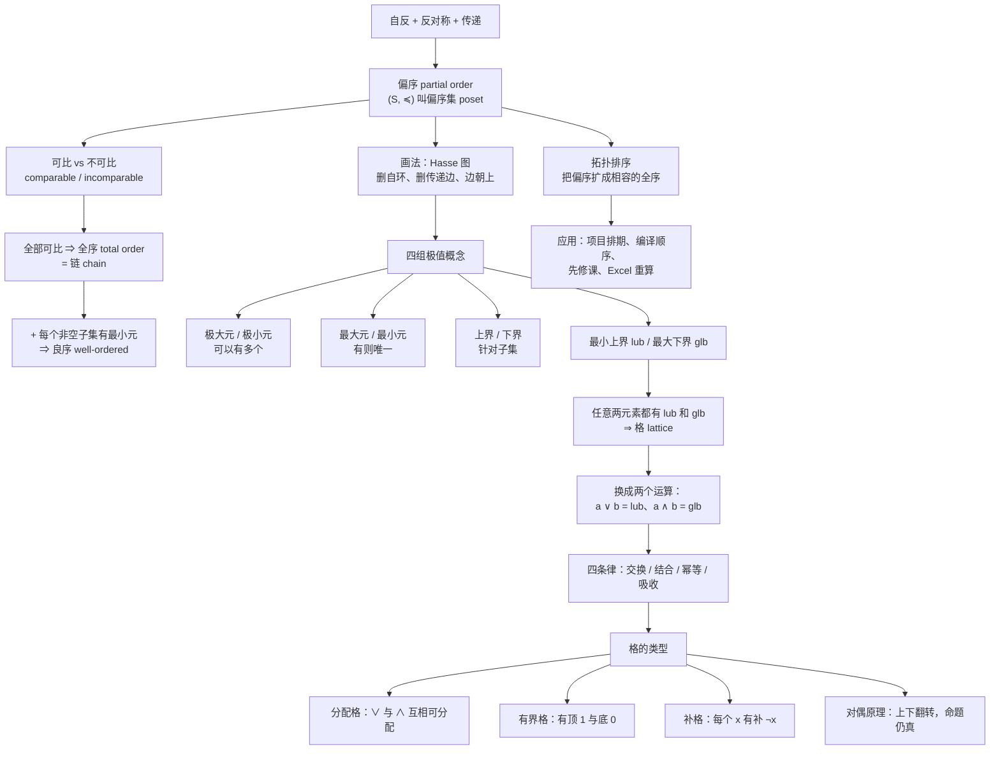

# C9.6 偏序 Partial Orderings

> [!abstract] 这一讲的任务
> 上一讲我们发现：自反 + **对称** + 传递 = 等价关系 = **分类**。这一讲只改一个字——把对称换成**反对称**——得到的是**偏序**，而它给的不是分类，是**排序**。
> “偏”字是关键：现实中的顺序往往**不是所有东西都能比**。3 和 9 能比（3 整除 9），5 和 7 就比不了。这一讲要把这种“部分可比”的顺序讲透。
> 具体做五件事：① 定义偏序与偏序集；② 学会画 **Hasse 图**（把冗余的边全删掉）；③ 分清四组容易混的极值概念（**极大/最大、上界/最小上界**）；④ 认识**格 (lattice)**，以及格的几个层次——**分配格、有界格、补格**与**对偶原理**；⑤ 掌握**拓扑排序**——你每天都在用它，只是不知道名字。

> [!info] 怎么读这份讲义
> 第 4 节（Hasse 图）是后面一切的作图工具，**必须会画**。第 5 节的四组概念是本节最大的易错点，我专门做了对照表。第 8 节拓扑排序是唯一的算法，手算要练熟。
> 字典序（第 3 节）与后面关系不大，可以最后看。第 6 节把格看成"两个运算"，第 7 节按"越加越强"的顺序给格分层次（分配 → 有界 → 补 → 对偶），顺着读不会卡。
> 标有 **（拓展）** / **【拓展】** 的内容，是课堂上没有展开、由教材与通行讲法延伸的部分——本篇只有三处：**第 2.3 节（良序）**、**第 8 节（拓扑排序）**，以及 **7.1 节末尾那条"菱形 / 五边形"判据**。课堂在第 9 章讲到"格的类型"就收尾、接着转第 6 章了，前两块来自教材 §9.6 的展开；其余各节（含格的类型三小节）都是课堂上讲过的。



---

## 0. 开场：一份排不出来的课表

你在帮社团排暑期集训的课程顺序，手上是一张先修关系表：

- 学《数据结构》之前要先学《程序设计》
- 学《算法分析》之前要先学《数据结构》
- 学《数据库》之前要先学《数据结构》
- 学《机器学习》之前要先学《线性代数》和《概率论》

你想排出一个“从第 1 天到第 7 天，每天学一门”的**线性**顺序。

**第一个问题**：《数据库》和《算法分析》谁先谁后？
**它们之间没有任何先修关系**——谁先都行。

**第二个问题**：《线性代数》和《程序设计》谁先？
**也没关系**——两条线完全独立。

于是你发现：**这张表给的不是一个"顺序"，而是一堆"局部的先后要求"**。有些东西能比，有些东西压根比不了。

**这种"部分可比"的顺序就是偏序。** 而"把它排成一个能执行的线性顺序"，就是本讲最后要讲的**拓扑排序**——`make` 决定先编译哪个文件、Excel 决定先算哪个单元格、包管理器决定先装哪个依赖，用的都是同一个算法。

---

## 1. 偏序：只改一个字

**先把"序"这个字讲清楚。** 中午去食堂，你得排在队尾等前面的人打完饭；成绩单上是一串名次；字母表里 $A$ 排在 $C$ 前面。三件事看着不相干，共同点只有一个：**任给两个东西，能分出谁在前。**

上一讲的等价关系也在"比较"两个元素，但问的是另一个问题——**它们是不是同一类**（$aRb$ 就说明 $a$、$b$ 可以互换身份）。这一讲问的是——**谁大谁小**。同样是比，**一个比"同类"，一个比"大小"**，这是全篇的分水岭。

> [!question] 停一下：`≤` 应该满足六条性质里的哪几条？
> 前面几讲一共见过六条性质：**自反 reflexive、反自反 irreflexive、对称 symmetric、反对称 antisymmetric、非对称 asymmetric、传递 transitive**。等价关系用掉了"自反 + 对称 + 传递"。
> 现在把关系换成 $a\le b$，请拿这六条逐条去问"它配不配"。先自己想，再看下面。

**逐条筛一遍**（这一步就是当年定义等价关系时做过的同一件事，只是筛子换了）：

| 性质 | $a\le b$ 要不要 | 为什么 |
|---|:-:|---|
| **非对称 asymmetric** | **✗ 必须删** | 非对称是**绝对单向**：$aRb$ 一成立，就绝不允许 $bRa$。用"**父与子**"看最清楚——**如果 $A$ 是 $B$ 的父亲，那 $B$ 一定不是 $A$ 的父亲**。可 $3\le3$ 是成立的，"来回都行"这一种情形恰好是 $\le$ 允许的，所以非对称**永远不可能满足**。 |
| **对称 symmetric** | **✗ 删** | 对称要求"过得去就回得来"，那 $3\le5$ 就该推出 $5\le3$。**正是那个"等于"的部分**让对称失效：相等可以来回，小于不行。 |
| 反自反 irreflexive | ✗ 删 | 反自反要求 $aRa$ 永不成立，可 $a\le a$ 必须成立。 |
| **自反 reflexive** | **✓ 留** | $a\le a$ 恒成立。 |
| **传递 transitive** | **✓ 留** | $a\le b$ 且 $b\le c$ ⇒ $a\le c$，顺序能一路传下去。 |
| **反对称 antisymmetric** | **✓ 留** | 反对称是**放宽版的非对称**：把"$a=b$ 那一对"放回来。$a\le b$ 且 $b\le a$ ⇒ $a=b$，正好。 |

筛完只剩三条：**自反、反对称、传递**。这三条就是定义，一个字都不多。

> [!important] 定义 1（偏序 Partial Ordering / 偏序集 Poset）
> 集合 $S$ 上的关系 $R$ 称为**偏序 (partial ordering / partial order)**，如果它是**自反的、反对称的、传递的**。
> 集合 $S$ 连同一个偏序 $R$ 称为**偏序集 (partially ordered set, poset)**，记作 $(S,R)$。$S$ 中的元素称为该偏序集的**元素**。

**和等价关系对照**：

$$
\begin{aligned}
\text{自反} + \textbf{对称} + \text{传递} &= \text{等价关系} \;\Rightarrow\; \textbf{分类}\\
\text{自反} + \textbf{反对称} + \text{传递} &= \text{偏序} \;\Rightarrow\; \textbf{排序}
\end{aligned}
$$

> [!question] 停一下：为什么"反对称"就意味着"排序"？
> **对称说的是"来回都行"**——$a$ 和 $b$ 互通，所以它们是同一类的。
> **反对称说的是"不同的东西绝不互通"**——如果 $a\preccurlyeq b$ 且 $b\preccurlyeq a$，那只可能因为 $a=b$。
> 换句话说：**反对称保证了"不会出现两个不同元素谁也不比谁大"的循环**，这正是"顺序"这个词的最低要求。
> 而**传递**保证顺序能一路传下去，**自反**只是个技术性约定（让 $\le$ 而不是 $<$ 成为主角）。

### 1.1 三个标准例子（后面反复用）

**例 1（$\ge$ 是整数上的偏序）**：
- **自反**：$a\ge a$ ✓
- **反对称**：$a\ge b$ 且 $b\ge a$ ⇒ $a=b$ ✓
- **传递**：$a\ge b$ 且 $b\ge c$ ⇒ $a\ge c$ ✓
⇒ $(\mathbf Z,\ge)$ 是偏序集。（$\le$ 同理。）

**例 2（整除是正整数上的偏序）**：§9.1 已经逐条验过——自反（例 9）、反对称（例 12）、传递（例 15）。
⇒ $(\mathbf Z^+,\mid)$ 是偏序集。

> [!note] 这里回收了 §9.1 埋的伏笔
> §9.1 讲整除关系时，我说过"这三条验证现在先记住，到 §9.6 就是白送的"。**现在兑现了。**

**例 3（包含是幂集上的偏序）**：
- **自反**：$A\subseteq A$ ✓
- **反对称**：$A\subseteq B$ 且 $B\subseteq A$ ⇒ $A=B$ ✓（这正是 [[C2.1 集合 Sets]] 证集合相等的标准方法！）
- **传递**：$A\subseteq B\subseteq C$ ⇒ $A\subseteq C$ ✓
⇒ $(P(S),\subseteq)$ 是偏序集。

**顺着例 3 再追问一句**：把 $\subseteq$ 换成真包含 $\subset$，还成立吗？

> [!warning] 严格关系坏掉的永远是"自反"，不是"反对称"
> 真包含**不是**偏序，失败的那一条是**自反**（$A\subset A$ 永远不成立）。
> 这里有一个极高频的答错点：**在严格关系上，反对称恒为真**——它的前件"$a\prec b$ **且** $b\prec a$"永远凑不出来，命题**空真**（[[C1.1 命题逻辑 Propositional Logic]]）。
> 所以判 $<$、$\subset$、真年长这类关系时，**第一反应应该是"自反没了"，而不是"反对称坏了"。**

**例 4（一个反例）**：人的集合上，$xRy \iff x$ 比 $y$ **年长**。
- **反对称** ✓（$x$ 比 $y$ 老 ⇒ $y$ 不比 $x$ 老，前件永假，空真）
- **传递** ✓
- **自反 ✗**——**没有人比自己年长**。
⇒ **不是偏序。**

> [!warning] 例 4 的教训：严格序不是偏序
> "严格大于"“真包含”“严格年长”这类**严格 (strict)** 关系都不自反，因此**不是**本节定义的偏序。
> **要把严格序变成偏序，取自反闭包即可**（§9.4 例 1：$<$ 的自反闭包是 $\le$）。
> **这就是为什么数学里偏序默认用 $\le$ 而不是 $<$。**（严格序也有自己的名字和一整套性质，见 1.3。）

**题目给的是关系图时，三条性质这样看**（考卷上最常见的题型，图上一眼就能验）：

| 性质 | 合规的图长什么样 | 违规的图长什么样 |
|---|---|---|
| 自反 | **每个顶点都有自己到自己的环** | 有顶点缺自环 ⇒ 不自反 |
| 反对称 | 同一对顶点之间**不可能有两条方向相反的箭** | $a\to b$ 与 $b\to a$ 同时存在而 $a\ne b$ ⇒ 不是偏序 |
| 传递 | 有 $a\to b$、$b\to c$ 就**必须**有 $a\to c$ | 有 $a\to b\to c$ 却缺 $a\to c$ ⇒ 不传递 |

三张图摆在一起时，**按"自反 → 反对称 → 传递"的顺序查最快**：哪一条先坏就当场判"不是偏序"，后面两条不用再查。反过来，三条全过的图就是偏序图，可以进入第 4 节画 Hasse 图。

### 1.2 通用记号 $\preccurlyeq$

不同偏序集用的符号五花八门（$\le$、$\subseteq$、$\mid$），讨论一般情形时需要一个统一记号：

> [!important] 记号约定
> 在任意偏序集 $(S,R)$ 中，用 $\boxed{a\preccurlyeq b}$ 表示 $(a,b)\in R$。
> 用 $\boxed{a\prec b}$ 表示 $a\preccurlyeq b$ **且** $a\ne b$，读作“$a$ 小于 $b$”或“$b$ 大于 $a$”。

> [!warning] ⭐ $\preccurlyeq$ 不一定是"小于等于"
> 课本专门提醒：*the symbol $\preccurlyeq$ is used to denote the relation in **any** poset, not just the "less than or equals" relation.*
> 在 $(\mathbf Z^+,\mid)$ 里，$a\preccurlyeq b$ 的意思是 **$a$ 整除 $b$**；在 $(P(S),\subseteq)$ 里是 **$A$ 是 $B$ 的子集**。
> **看到 $\preccurlyeq$ 要先问：这个偏序集用的是哪个具体关系？**

**"poset"这个名字怎么来的**：它是 **partially ordered set** 掐出来的缩写——**p** + **o** + set，读作 /ˈpoʊsɛt/，中文就叫"偏序集"。以后作业和考卷上看到 $(A,\preccurlyeq)$ 是 poset，就是在说"$A$ 配上这个偏序构成一个偏序集"，不是一个新对象。

**念法也要对**：$a\preccurlyeq b$ 念作 "$a$ is less than or equal to $b$ **under the partial order**"——"在偏序下"这半句不能省，因为 $\preccurlyeq$ 未必真是"小于等于"。

### 1.3 严格与非严格：同一个偏序的两副面孔

上一条约定里，$\prec$ 只是 $\preccurlyeq$ 去掉"等于"后的简写。但把 $\prec$ 单独拎出来当一个关系研究，它自己也有一套性质，还有个正式名字：**严格偏序 (strict partial order)**。

> [!important] 两种偏序，两套性质
> | | 符号 | 三条性质 | 例子 |
> |---|:-:|---|---|
> | **非严格偏序** non-strict (reflexive) | $a\preccurlyeq b$ | 自反 + 反对称 + 传递 | $\le$、$\mid$、$\subseteq$ |
> | **严格偏序** strict (irreflexive) | $a\prec b$ | **反自反** + **非对称** + 传递 | $<$、真包含、真年长 |
>
> 两者只差一件事：**等号在不在里面**。因为 $a\prec b$ 的定义就是"$a\preccurlyeq b$ **且** $a\ne b$"。

**一个顺手的结论**：**非对称 = 反自反 + 反对称**。所以严格偏序的三条也能写成"非对称 + 传递"。这也回收了 1.1 的例 4——严格关系不是"没有结构"，它只是**换了一套性质**，不在定义 1 的框里。

> [!warning] 看到符号先看有没有等号
> 平时说"偏序""偏序集"，**默认都是非严格那只**（$\preccurlyeq$）。只有明确说"严格偏序"时才指 $\prec$。
> 考试里题目若写 $<$ 或"真包含"，别下意识往上套"自反 + 反对称 + 传递"——那三条一条都对不上。

---

## 2. 可比、全序、良序

### 2.1 可比与不可比

> [!important] 定义 2（可比 Comparable / 不可比 Incomparable）
> 偏序集 $(S,\preccurlyeq)$ 中的元素 $a,b$ 称为**可比的 (comparable)**，如果 $a\preccurlyeq b$ 或 $b\preccurlyeq a$ 成立。
> 如果**两者都不成立**，则称 $a$ 与 $b$ **不可比 (incomparable)**。

**例 5**：在 $(\mathbf Z^+,\mid)$ 中：
- 3 和 9 **可比**，因为 $3\mid 9$；
- 5 和 7 **不可比**，因为 $5\nmid7$ 且 $7\nmid5$。

**另一个例子**：在 $(P(\mathbf Z),\subseteq)$ 中，$\{1,2\}$ 与 $\{1,3\}$ **不可比**——谁也不包含谁。

**换成我们自己人，更好记**：把偏序取成"学校里身份的高低"——
- **老师和学生可比**：这套层级里老师排在学生之上；
- **同校但不同专业的两名学生不可比**：一个是 AI 专业、一个是大数据专业，谁也不在谁之上。

同一对人，**换个偏序集，可比性就变了**：两个同班同学按"学号"排可比，按"身高"排也可能可比，按"是否修过同一门课"排就未必。**可比不可比不是两个人固有的属性，是"你拿哪个偏序集去问"的结果。** 这也是定义里必须先写清"在哪个偏序集上"的原因。

> [!note] "偏"字的来历
> 课本原话：*The adjective "partial" is used to describe partial orderings because pairs of elements may be incomparable.*
> **"偏"就是"不是所有对都能比"的意思**，不是"不完整"或"有缺陷"。
> 开场那份课表里，《数据库》与《算法分析》就是一对不可比元素。

### 2.2 全序 = 链

> [!important] 定义 3（全序 Total Order / 链 Chain）
> 若 $(S,\preccurlyeq)$ 是偏序集且 **$S$ 中任意两个元素都可比**，则称 $S$ 是**全序集 (totally ordered set)** 或**线序集 (linearly ordered set)**，$\preccurlyeq$ 称为**全序 (total order)** 或**线序 (linear order)**。
> 全序集也叫**链 (chain)**。

**例 6**：$(\mathbf Z,\le)$ 是全序——任意两个整数都能比大小。
**例 7**：$(\mathbf Z^+,\mid)$ **不是**全序——5 与 7 不可比。

**同一条路再走一遍**：$(P(S),\subseteq)$ 呢？取两个不同的单元素集 $\{a\}$、$\{b\}$——谁也不包含谁，**不可比**。所以 $(P(S),\subseteq)$ 一般**不是**全序（只有 $|S|\le1$ 时才退化成一条链）。

> [!note] “链”这个名字很形象
> 全序集在 Hasse 图上就是**一条垂直的链子**，每个元素串在唯一的位置上。
> 偏序集则是一张**有分叉的网**——分叉处就是不可比的元素。

### 2.3 良序（为第 5 章的归纳法做注脚）（**拓展**）

> [!important] 定义 4（良序集 Well-Ordered Set）
> $(S,\preccurlyeq)$ 是**良序集 (well-ordered set)**，如果它是偏序集、$\preccurlyeq$ 是**全序**、并且 **$S$ 的每个非空子集都有最小元**。

**例 8（两个对照）**：
- $\mathbf Z^+\times\mathbf Z^+$ 配**字典序**（下一节讲）：$(a_1,a_2)\preccurlyeq(b_1,b_2)$ 当 $a_1<b_1$，或 $a_1=b_1$ 且 $a_2\le b_2$ ⇒ **是良序集**。
- $(\mathbf Z,\le)$ **不是**良序集——因为子集"全体负整数"**没有最小元**（可以一直往下）。

> [!important] 定理 1（良序归纳原理 Principle of Well-Ordered Induction）
> 设 $S$ 是良序集。若
> **归纳步**：对每个 $y\in S$，只要 $P(x)$ 对所有满足 $x\prec y$ 的 $x\in S$ 都成立，就能推出 $P(y)$ 成立；
> 那么 $P(x)$ 对一切 $x\in S$ 成立。

**证明**（反证法，[[C1.7 证明导论 Introduction to Proofs]]）：
假设结论不成立，则存在 $y\in S$ 使 $P(y)$ 为假 ⇒ 集合 $A=\{x\in S\mid P(x) \text{ 为假}\}$ **非空**。
因为 $S$ 良序，$A$ **有最小元** $a$。
由 $a$ 是 $A$ 的最小元，对一切 $x\prec a$ 都有 $x\notin A$，即 $P(x)$ 为真。
于是由归纳步，$P(a)$ 为真——与 $a\in A$ 矛盾。∎

> [!warning] ⭐ 这个归纳法**不需要基础步**
> 课本专门加了一段说明，值得读懂：
> 设 $x_0$ 是良序集的最小元。**不存在任何 $x\prec x_0$**，所以"对所有 $x\prec x_0$ 都有 $P(x)$ 成立"这句话是**空真**的（[[C1.1 命题逻辑 Propositional Logic]]）。
> 归纳步于是直接给出 $P(x_0)$ 为真——**基础步是被归纳步白送的**。
>
> **这是"空真"这个概念在全书中最漂亮的一次应用。**

---

## 3. 字典序：字典是怎么排的

> [!important] 两个偏序集的笛卡尔积上的字典序
> 设 $(A_1,\preccurlyeq_1)$、$(A_2,\preccurlyeq_2)$ 是偏序集。$A_1\times A_2$ 上的**字典序 (lexicographic ordering)** 定义为
> $$(a_1,a_2)\prec(b_1,b_2) \iff a_1\prec_1 b_1,\quad\text{或者}\quad a_1=b_1 \text{ 且 } a_2\prec_2 b_2$$
> 再把相等的情形加进来（即 $\preccurlyeq$ 包含 $=$），就得到一个偏序。

**一句话：先比第一个分量，第一个分量相同再比第二个。**

**例 9**：在 $(\mathbf Z\times\mathbf Z,\preccurlyeq)$（由通常的 $\le$ 构造）中：
- $(3,5)\prec(4,8)$ ✓（因为 $3<4$，第二分量根本不用看）
- $(3,8)\prec(4,5)$ ✓（同样因为 $3<4$——**注意 $8>5$ 完全不起作用**）
- $(4,9)\prec(4,11)$ ✓（第一分量相同，比第二分量：$9<11$）

![[C9-字典序小于34的有序对.png]]

> [!warning] 字典序里第一分量有绝对优先权
> $(3,8)\prec(4,5)$ 常常让人愣一下——第二分量 $8>5$ 却不影响结论。
> **记法：第一分量一旦分出胜负，后面的分量就完全不看了。** 这正是字典排序的行为：`apple` 排在 `banana` 前面，不管后面的字母是什么。

**推广到 $n$ 元组**：
$$(a_1,\dots,a_n)\prec(b_1,\dots,b_n)$$
当 $a_1\prec_1 b_1$，或者存在 $i>0$ 使 $a_1=b_1,\dots,a_i=b_i$ 且 $a_{i+1}\prec_{i+1}b_{i+1}$。
**一句话：在第一个不相同的位置上比。**

**例 10**：$(1,2,3,5)\prec(1,2,4,3)$——前两位相同，第三位 $3<4$，定胜负。

**再逐位走一遍，看清"相等"的地位**：在 $(\mathbf Z^+,\prec)$（整除序的严格版）上比较 $(2,3,4,5)$ 与 $(2,3,8,2)$：
- 第 1 位 $2$ 与 $2$ **相等**——相等**不产生任何结论**，必须往下走；
- 第 2 位 $3$ 与 $3$ 相等——还是不算；
- 第 3 位 $4\prec8$（$4\mid8$）——**这一位才分出胜负，到此为止**，第 4 位根本不用看。

再比 $(2,3,4,5)$ 与 $(3,6,8,10)$：第 1 位 $2\prec3$，**当场定输赢**，后面三位不管多大都不影响结论。

> [!warning] ⭐ 为什么"$3$ 能被 $3$ 整除"却不算分出胜负
> 这是这一节最让人卡住的地方：整除关系下 $3\mid3$ 明明成立，凭什么第 2 位不算赢？
> 因为字典序的定义用的是**严格** $\prec_1$（$a_1\prec_1b_1$），**"相等"这一支被单独剥出来交给"再看下一位"**。$3\mid3$ 给出的是 $3=3$，不是 $3\prec3$。
> **记法：字典序里"打平"从来不等于"赢"，只等于"绕过这一位，继续比"。** 一路打平到最后一位还分不出来，那两个元组就是相等的。

### 3.1 字符串的字典序（长度不同怎么办）

**先问一个更基础的问题：单个字母谁在前？** 26 个字母自己带一个顺序——$A\prec B\prec\cdots\prec Z$，这就是**字母表序 (alphabetical order)**。字符串的字典序是**把这个顺序一层层套到词上**：

- **alphabetical order 比的是字母**；
- **lexicographic order 比的是词里的字母**（也叫 lexical order、dictionary order、字典积 lexicographic product）。

这也是"字典序"这个名字的来路：查字典时你**先看第一个字母**，第一个相同才往后翻——这个动作就是下式里的 $a_1\prec_1b_1$ 与"再看下一位"。

考虑偏序集 $S$ 上的两个串 $a_1a_2\cdots a_m$ 与 $b_1b_2\cdots b_n$（设它们不相等），令 $t=\min(m,n)$。规定 $a_1\cdots a_m \prec b_1\cdots b_n$ 当且仅当

$$(a_1,\dots,a_t)\prec(b_1,\dots,b_t)\quad\text{或者}\quad (a_1,\dots,a_t)=(b_1,\dots,b_t)\text{ 且 } m<n$$

**人话：先把长的截到短的那么长，比 $t$ 元组；如果前 $t$ 位完全一样，那么短的排前面。**

**例 11（三个对照，都要看懂）**：
- `discreet` $\prec$ `discrete`——**第 7 位**首次不同，`e` $\prec$ `t` ✓
- `discreet` $\prec$ `discreetness`——前 8 位完全相同，**短的在前** ✓
- `discrete` $\prec$ `discretion`——截到 8 位比：`discrete` vs `discreti`，第 8 位 `e` $\prec$ `i` ✓

**数位数的窍门**：把两个串**上下对齐**写出来，从左往右数到第一个不一样的字符。位置**永远从左边数起**——从右边数会因为两串长度不同而数歪。

**位串的字典序（这一例最干净）**：把 $\{0,1\}$ 上的串按 $0\prec1$ 排序，元素是
$$0,\ 01,\ 11,\ 001,\ 010,\ 011,\ 0001,\ 0101$$
还是两条动作：**能一眼看出前缀关系的，短的在前；看不出的，找第一个不同的位**。
- $0$ 是所有以 $0$ 开头的串的前缀 ⇒ 排最前（唯一的例外是 $11$：它第 1 位就是 $1$，排最后）；
- $0001$ 与 $001$：前两位同为 $00$，第 3 位 $0\prec1$ ⇒ $0001\prec001$；
- $001$ 与 $01$：第 1 位同为 $0$，第 2 位 $0\prec1$ ⇒ $001\prec01$；
- $01$ 是 $010$ 的前缀 ⇒ $01\prec010$；$010$ 是 $0101$ 的前缀 ⇒ 在前；$0101$ 与 $011$ 比到第 3 位 $0\prec1$ ⇒ 在前；$11$ 首位就是 $1$，最大。

$$\boxed{0\prec0001\prec001\prec01\prec010\prec0101\prec011\prec11}$$

> [!note] 原稿的一处笔误（当场改过）
> 同一组对照里还有一条要演示"**前面完全相同**时才轮到后面的位"。原稿把第二个串的首字母印成了 `f`，当场改成了 `d`——若不改，第 1 位 $d\prec f$ 就已经分出胜负，就演示不到"逐位往后看"这件事了。

> [!note] 这就是你用过的所有排序
> Python 的 `sorted(["apple","app","banana"])` 给出 `['app','apple','banana']`——`app` 在 `apple` 前，正是"前缀更短的在前"这条规则。
> 字典、电话簿、文件名排序、数据库的 `ORDER BY` 字符串列，用的都是字典序。

---

## 4. ⭐ Hasse 图：把废话全删掉

### 4.1 为什么要画 Hasse 图

**先说一个更实在的理由。** 关系图里的顶点是用**有向箭头**连起来的，箭头本身就意味着"**谁先到、谁后到**"，所以一张关系图就是一整套先后约束。可真实的路网是密密麻麻的——快递员要知道先送哪家、再送哪家，编译器要知道先编哪个文件，**光看满屏的箭头，根本数不出这两个点谁在前**。Hasse 图就是把这张图**简化到只剩必要的几根线**，顺序关系一根不丢。

换句话说，偏序在这里**不是为了比大小，是为了把"谁先谁后"理成一条能算的路径**——第 10 章那些"最短路径"的算法，追到底也是同一个念头。

偏序关系的有向图里有大量"不画也知道"的边：

- **自反** ⇒ 每个顶点都有自环 ⇒ **必然存在，不用画**；
- **传递** ⇒ 只要有 $a\to b\to c$ 就必有 $a\to c$ ⇒ **必然存在，不用画**；
- 如果约定**所有边都朝上**，那么**箭头也不用画**。

全部删掉之后剩下的东西，就是 **Hasse 图**。

![[C9-Hasse图的三步构造.png]]

> [!important] 画 Hasse 图的三步（务必背下来）
> 1. **画出偏序的有向图**，然后**删掉所有自环**；
> 2. **删掉所有由传递性强制存在的边**——即所有满足"存在 $z$ 使 $x\prec z\prec y$"的边 $(x,y)$；
> 3. **把每条边摆成起点在下、终点在上**，然后**删掉所有箭头**。

**三个让手算更快的小习惯**：
- **开画之前先确认它是偏序集**——三条性质有一条不成立，Hasse 图根本画不出来（第 1 节那张判图表就是为这一步准备的）；
- **画有向图时就把弧摆成朝上**，最后"去箭头"那一步就不用重新排位置；
- **删传递边从顶端往下删**：一条边要不要删，取决于它中间能不能插进元素——先处理上层的边，判断时下层的边还没被删乱，不容易漏。

反过来，从 Hasse 图**恢复**偏序：**顺着边往上能走到的，就是 $\preccurlyeq$ 关系**（再补上自反的部分）。

> [!important] 覆盖关系 Covering Relation
> 在偏序集 $(S,\preccurlyeq)$ 中，若 $x\prec y$ 且**不存在** $z\in S$ 使 $x\prec z\prec y$，则称 **$y$ 覆盖 (covers) $x$**。
> 全体这样的 $(x,y)$ 构成的集合称为**覆盖关系 (covering relation)**。
>
> **Hasse 图的边就是覆盖关系。** 而且课本指出：**偏序是它的覆盖关系的自反传递闭包**（习题 31）——所以 Hasse 图**一点信息都没丢**，是最经济的画法。

**一句话记住它：覆盖就是"父与子"，中间没有"代差"。** 一个元素紧紧压在另一个上面、中间插不进任何东西，就是覆盖；中间还隔着一代，就不算（$2$ 覆盖 $1$，但 $4$ 不覆盖 $1$——中间有 $2$）。

**秩序也得记住**：覆盖关系是**有序对**，小的在前。$(x,y)$ 里 $x$ 是"儿子"、$y$ 是"父亲"。

**四个有序对，立刻判**（在 $(P(\{a,b,c\}),\subseteq)$ 上）：

| 有序对 | 是覆盖吗 | 为什么 |
|---|:-:|---|
| $(\{a\},\{a,b\})$ | ✅ | $\{a\}\subset\{a,b\}$，中间插不进集合 |
| $(\{a,b\},\{a\})$ | ❌ | **方向反了**：$x$ 必须小、$y$ 必须大 |
| $(\{a\},\{a\})$ | ❌ | 覆盖要求**严格** $x\prec y$，两个相等的集合不行 |
| $(\varnothing,\{a,b\})$ | ❌ | 中间能插：$\varnothing\prec\{a\}\prec\{a,b\}$，这就是"有代差" |

**这张表就是覆盖关系的全部考点**：一看方向、二看是否严格、三看中间有没有人。

> [!note] 这里又一次出现了 §9.4 的闭包
> "从 Hasse 图恢复偏序" = "对覆盖关系求自反闭包 + 传递闭包"。
> **§9.4 的工具在这里直接派上用场。** 三讲之间的联系比看起来紧密得多。

### 4.2 两个必须会画的 Hasse 图

![[C9-Hasse图三例.png]]

**例 12**：$\{1,2,3,4,6,8,12\}$ 上的整除关系。

**过程**：先画有向图（含所有自环和传递边），删自环，再删传递边——课本列出了被删的边：$(1,4),(1,6),(1,8),(1,12),(2,8),(2,12),(3,12)$。最后摆正方向、去箭头。

**结果**（上图左）：$1$ 在最底下，往上是 $2$ 和 $3$，$2$ 上面是 $4$ 和 $6$，$3$ 上面是 $6$，$4$ 上面是 $8$ 和 $12$，$6$ 上面是 $12$。

**注意 $2$ 和 $3$ 摆在同一高度**——它们**不可比**（$2\nmid3$、$3\nmid2$），所以谁在左谁在右**没有任何意义**。你画的图和你同学画的完全可能长得不一样，只要上下关系（覆盖关系）对，就是同一张 Hasse 图。
**反过来用这条也很好使**：拿不准两个元素可不可比，就看图里是不是同一层——同一水平线上的一定不可比。

**验算窍门**：Hasse 图的边 = 覆盖关系 = **"倍数关系中间插不进东西"**。$2\to4$ 是边（中间没有别的），$2\to8$ 不是边（因为 $2\mid4\mid8$，$4$ 插在中间）。

**例 13**：$P(\{a,b,c\})$ 上的包含关系。

**动手之前先把元素列齐**：$\varnothing$；三个单元素集 $\{a\},\{b\},\{c\}$；三个双元素集 $\{a,b\},\{a,c\},\{b,c\}$；最后是 $\{a,b,c\}$——$2^3=8$ 个，**一个都不能漏**，漏一个图里就会少一条该有的边。

**过程**：先按"包含"把所有 $A\subseteq B$ 连起来（含自环），删掉自环，再从顶端往下删冗余边——$\varnothing\to\{a,b\}$ 这类跨两层的边全被删掉，剩下的正好是"只加一个元素"的覆盖关系。

**结果**（上图中）：$\varnothing$ 在底，三个单元素集在第一层，三个双元素集在第二层，$\{a,b,c\}$ 在顶。**形状正好是一个正方体的骨架**。

> [!note] 为什么是正方体
> $P(S)$ 的元素可以用长度 3 的位串编码（第 $i$ 位为 1 表示含第 $i$ 个元素），而 $A\subseteq B$ 对应"$A$ 的位串每一位都不超过 $B$ 的"。
> **$n$ 元集的幂集 Hasse 图就是 $n$ 维超立方体 (hypercube)。** $n=3$ 时就是正方体。
> 这个观察在第 10 章（图论）和第 12 章（布尔代数）都会再出现。

---

## 5. ⭐⭐ 四组极值概念（本节最大的易错点）

这一节有八个名词，两两成对，极易混淆。**先看对照表，再看例子。**

> [!warning] ⭐ 四组概念的核心区别（考前必看）
> | 概念 | 定义 | 针对谁 | 能有几个 |
> |---|---|---|:-:|
> | **极大元 maximal** | 不存在 $b$ 使 $a\prec b$ | 整个偏序集 | **可以有多个** |
> | **最大元 greatest** | 对**一切** $b$ 都有 $b\preccurlyeq a$ | 整个偏序集 | **有则唯一** |
> | **极小元 minimal** | 不存在 $b$ 使 $b\prec a$ | 整个偏序集 | **可以有多个** |
> | **最小元 least** | 对**一切** $b$ 都有 $a\preccurlyeq b$ | 整个偏序集 | **有则唯一** |
> | **上界 upper bound** | $a\preccurlyeq u$ 对子集 $A$ 中一切 $a$ 成立 | **某个子集 $A$** | 可以有多个 |
> | **最小上界 lub** | 比其他所有上界都小的上界 | **某个子集 $A$** | **有则唯一** |
> | **下界 lower bound** | $l\preccurlyeq a$ 对 $A$ 中一切 $a$ 成立 | **某个子集 $A$** | 可以有多个 |
> | **最大下界 glb** | 比其他所有下界都大的下界 | **某个子集 $A$** | **有则唯一** |
>
> **两条主线**：
> 1. **极大 vs 最大**：极大是"**头上没人**"，最大是"**踩着所有人**"。不可比的元素可以各自极大，但谁也当不了最大。
> 2. **整体 vs 子集**：极大/最大/极小/最小针对**整个偏序集**；上界/下界/lub/glb 针对**指定的子集**。

> [!warning] 中文译名先对齐，否则白丢分
> 英文教材把 minimal / maximal 和 least / greatest 分得很清楚，中文这边却容易被译混——有的书、有的人随口把两套都叫"极值"。
> **本课固定这么用**：**minimal / maximal = 极小元 / 极大元**（可以并列，允许多个）；**least / greatest = 最小元 / 最大元**（存在则唯一）。
> 答题时按这两个对子写，别把"极大"和"最大"换着用——阅卷看的正是这个区别。

### 5.1 极大元与极小元

**定义**：$a$ 是**极大元**，若不存在 $b\in S$ 使 $a\prec b$（Hasse 图上：**顶上没有边往上**）。
$a$ 是**极小元**，若不存在 $b\in S$ 使 $b\prec a$（Hasse 图上：**底下没有边往下**）。

**例 14**：$(\{2,4,5,10,12,20,25\},\mid)$ 的极大元与极小元？

看上面那张图的右侧：
- **极大元**：$12$、$20$、$25$（它们上面都没有边）
- **极小元**：$2$、$5$（它们下面都没有边）

> [!warning] 这个例子专门用来说明"极大元可以有多个"
> 课本原话：*a poset can have more than one maximal element and more than one minimal element.*
> $12$、$20$、$25$ **两两不可比**（$12\nmid20$、$20\nmid12$、$25$ 与谁都不整除），所以它们**各自是极大元，但没有一个是最大元**。

### 5.2 最大元与最小元

**定义**：$a$ 是**最大元 (greatest element)**，若对一切 $b\in S$ 都有 $b\preccurlyeq a$。
$a$ 是**最小元 (least element)**，若对一切 $b\in S$ 都有 $a\preccurlyeq b$。

**唯一性**：最大元、最小元**存在时必唯一**（课本习题 40）。

> [!warning] ⭐ 不唯一 = 不存在（最容易答错的一题）
> 极大元可以并列：Hasse 图**最顶层**上有几个点，就有几个极大元（**最底层**同理，有几个点就有几个极小元）——它们"共享"这个名号。
> **最小元 / 最大元不能共享**。如果两个元素并列在最底层，那"最小元"**根本不存在**，而不是"有两个最小元"。
> 最常见的错答案就是把并列的那两个元素都写成"最小元"；正确写法是"**不存在最小元**"。

> [!question] 停一下：为什么最大元唯一，极大元却可以有多个？
> **证唯一性**：设 $a$、$a'$ 都是最大元。由 $a'$ 最大得 $a\preccurlyeq a'$；由 $a$ 最大得 $a'\preccurlyeq a$。由**反对称性**得 $a=a'$ ✓
> **关键在反对称**——而极大元的定义里根本没有"和所有元素比较"这一步，所以两个互不可比的元素可以各自极大。
> **这是反对称性在本节的第二次关键应用**（第一次是"偏序 = 排序"）。

**例 15（四个 Hasse 图，逐个判读）**：

![[C9-最大元与最小元四例.png]]

| 图 | 最小元 | 最大元 | 说明 |
|:-:|---|---|---|
| (a) | $a$ | **无** | $b,c,d$ 三个都是极大元，互不可比 |
| (b) | **无** | **无** | 两条独立的链，上下都没有共同的头尾 |
| (c) | **无** | $d$ | $a,b$ 都是极小元 |
| (d) | $a$ | $d$ | 完整的"菱形"，上下都有唯一端点 |

**例 16**：$(P(S),\subseteq)$ 中，**最小元是 $\varnothing$**（空集是任何集合的子集），**最大元是 $S$**。

**例 17**：$(\mathbf Z^+,\mid)$ 中，**最小元是 $1$**（1 整除任何正整数），**最大元不存在**（没有哪个正整数能被所有正整数整除）。

### 5.3 上界、下界、lub、glb

**注意这组概念是针对一个"子集 $A$"的**，不是针对整个偏序集。

**定义**：
- $u\in S$ 是子集 $A$ 的**上界 (upper bound)**：对一切 $a\in A$ 都有 $a\preccurlyeq u$；
- $l\in S$ 是 $A$ 的**下界 (lower bound)**：对一切 $a\in A$ 都有 $l\preccurlyeq a$；
- $x$ 是 $A$ 的**最小上界 (least upper bound, lub)**：$x$ 是上界，且对任何上界 $z$ 都有 $x\preccurlyeq z$；
- $y$ 是 $A$ 的**最大下界 (greatest lower bound, glb)**：$y$ 是下界，且对任何下界 $z$ 都有 $z\preccurlyeq y$。

lub 和 glb **存在时唯一**（课本习题 42），记作 $\operatorname{lub}(A)$、$\operatorname{glb}(A)$。

**换个说法就通了**：上界是"**管得住**子集 $A$ 的那批元素"，可能有好几个；既然有好几个，就可以在**这批人内部**再比一次大小——最靠下的那个就是 lub。下界同理，最靠上的那个是 glb。
**"唯一"不是定义硬塞的要求，是比较出来的结果**：上界集合里若有最小的，那个一定唯一。

**一个容易忘的点**：上界/下界**不必属于 $A$**（定义里写的是 $u\in S$）——它只要在偏序集里、并且压得住 $A$ 里的每一个元素就行。

**例 18、19（同一张图，两道题）**：

![[C9-上下界例题的Hasse图.png]]

**例 18**：求 $\{a,b,c\}$、$\{j,h\}$、$\{a,c,d,f\}$ 的上界和下界。

| 子集 | 上界 | 下界 |
|---|---|---|
| $\{a,b,c\}$ | $e,f,j,h$ | **只有 $a$** |
| $\{j,h\}$ | **没有** | $a,b,c,d,e,f$ |
| $\{a,c,d,f\}$ | $f,h,j$ | **只有 $a$** |

**例 19**：求 $\{b,d,g\}$ 的 glb 和 lub。
- **上界**是 $g$ 和 $h$。因为 $g\prec h$，所以 $\operatorname{lub}=g$。
- **下界**是 $a$ 和 $b$。因为 $a\prec b$，所以 $\operatorname{glb}=b$。

**例 20（在 $(\mathbf Z^+,\mid)$ 里，这题非常重要）**：求 $\{3,9,12\}$ 与 $\{1,2,4,5,10\}$ 的 glb 和 lub。

**$\{3,9,12\}$**：
- **下界** = 同时整除 3、9、12 的正整数 = $1,3$。因为 $1\mid3$，**$\operatorname{glb}=3$**。
- **上界** = 同时被 3、9、12 整除的正整数 = $36$ 的倍数。**$\operatorname{lub}=36$**。

**$\{1,2,4,5,10\}$**：
- **下界**只有 $1$ ⇒ $\operatorname{glb}=1$。
- **上界** = 被 1、2、4、5、10 全整除的数 = $20$ 的倍数 ⇒ $\operatorname{lub}=20$。

> [!important] ⭐⭐ 在 $(\mathbf Z^+,\mid)$ 里，lub 和 glb 有名字
> $$\boxed{\operatorname{lub}(a,b)=\operatorname{lcm}(a,b)\ \text{（最小公倍数）},\qquad \operatorname{glb}(a,b)=\gcd(a,b)\ \text{（最大公约数）}}$$
> **你从小学就在算 lub 和 glb，只是当时不叫这个名字。**
>
> **验算**：$\operatorname{lcm}(3,9,12)=36$ ✓、$\gcd(3,9,12)=3$ ✓、$\operatorname{lcm}(1,2,4,5,10)=20$ ✓、$\gcd=1$ ✓
>
> 同理在 $(P(S),\subseteq)$ 里：$\operatorname{lub}(A,B)=A\cup B$、$\operatorname{glb}(A,B)=A\cap B$（例 24）。
> **三个偏序集，同一套概念，三种具体形态**——这就是抽象的价值。

---

## 6. 格 Lattice：处处都有 lub 和 glb

**格是偏序集的一个"进阶状态"**：不是每个偏序集都配叫格——得先过"任意两点都有 lub 和 glb"这一关，过了才算升级。

> [!important] 定义（格 Lattice）
> 一个偏序集，如果**任意两个元素都既有最小上界又有最大下界**，就称为**格 (lattice)**。

**例 21（三个 Hasse 图，判是不是格）**：

![[C9-是不是格的三个例子.png]]

- **(a) 是格**——任意两点都能找到唯一的"汇合点"和"分叉点"。
- **(b) 不是格**——**$b$ 与 $c$ 没有最小上界**：$d$、$e$、$f$ 都是它们的上界，但这三个**互不可比**，没有哪一个比另外两个都小。
- **(c) 是格**。

> [!warning] ⭐ 判"不是格"的标准话术
> 课本原话：*the elements $b$ and $c$ have no least upper bound. To see this, note that each of the elements $d$, $e$, and $f$ is an upper bound, but none of these three elements precedes the other two.*
> **答题模板**：找出一对元素 → 列出它们的全部上界（或下界）→ 指出这些上界**两两不可比** ⇒ 没有最小者 ⇒ 不是格。
> **注意"没有上界"和"上界不唯一最小"是两种不同的失败方式，都要会说。**

**例 22**：$(\mathbf Z^+,\mid)$ **是格**——任意两个正整数都有 $\operatorname{lcm}$（lub）和 $\gcd$（glb）。

**例 23（两个对照）**：
- $(\{1,2,3,4,5\},\mid)$ **不是格**——$2$ 和 $3$ 在这个集合里**根本没有上界**（$6$ 不在集合里）。
- $(\{1,2,4,8,16\},\mid)$ **是格**——这是一条**链**，任意两元素的 lub 是较大者、glb 是较小者。

> [!note] 一条链一定是格
> 全序集里任意两元素可比 ⇒ lub 是较大者、glb 是较小者 ⇒ **一定是格**。
> 所以要找"不是格"的反例，**必须有不可比的元素**。

**例 24**：$(P(S),\subseteq)$ **是格**，$\operatorname{lub}(A,B)=A\cup B$、$\operatorname{glb}(A,B)=A\cap B$。

### 6.1 应用：信息流的格模型（例 25）

课本用了一整个例子讲这个应用，属于"不得省略"的知识点：

> [!important] 多级安全策略 Multilevel Security Policy
> 每份信息被指派一个**安全类 (security class)**，写作 $(A,C)$：
> - $A$ 是**权限级别 (authority level)**，美国政府常用四级：
>   **unclassified (0) < confidential (1) < secret (2) < top secret (3)**
>   （confidential 及以上统称 classified 密级。）
> - $C$ 是**类别 (category)**，是全体"隔离区 compartment"集合的一个**子集**。
>   例如隔离区集合是 $\{\text{spies},\text{moles},\text{double agents}\}$，则共有 $2^3=8$ 个类别。
>
> **序关系**：
> $$(A_1,C_1)\preccurlyeq(A_2,C_2) \iff A_1\le A_2 \ \textbf{且}\ C_1\subseteq C_2$$
> **信息允许从 $(A_1,C_1)$ 流向 $(A_2,C_2)$ 当且仅当 $(A_1,C_1)\preccurlyeq(A_2,C_2)$。**

**课本给的三个判例**（自己验一遍）：

| 从 | 到 | 允许吗 | 理由 |
|---|---|:-:|---|
| (secret, {spies, moles}) | (top secret, {spies, moles, double agents}) | ✅ | $2\le3$ ✓ 且 $\{s,m\}\subseteq\{s,m,d\}$ ✓ |
| (top secret, {spies, moles}) | (secret, {spies, moles, double agents}) | ❌ | $3\le2$ **✗**（级别降了） |
| (top secret, {spies, moles}) | (top secret, {spies}) | ❌ | $\{s,m\}\subseteq\{s\}$ **✗**（类别缩了） |

**这个偏序集是一个格**（课本习题 48）。

> [!note] 这个模型为什么用格
> **格保证了任意两个安全类都有唯一的"最小公共上界"**——也就是说，当你要把两份不同密级的信息**合并**时，合并结果的密级是唯一确定的：$\operatorname{lub}$ = (两个级别的较大者, 两个类别的并)。
> **没有格结构，"合并后该定什么密级"就会有歧义。** 这就是 Bell–LaPadula 模型的数学基础，至今仍是操作系统强制访问控制 (MAC) 的理论依据。

### 6.2 格的另一副面孔：两个运算 $\vee$ 和 $\wedge$

到目前为止，格是**用图看的**：任意两点往上能找到汇合点、往下能找到分叉点。但既然每两个元素都有唯一的 lub 和 glb，就可以把它们**当成两种二元运算**来用：

> [!important] 记号：$\vee$ 与 $\wedge$
> $$\boxed{a\vee b=\operatorname{lub}\{a,b\}\ (\text{并，join}),\qquad a\wedge b=\operatorname{glb}\{a,b\}\ (\text{交，meet})}$$
> 读作"$a$ 并 $b$"、"$a$ 交 $b$"。

为什么要费劲换成运算？因为**一旦有了运算，格就能像整数一样"算"了**——而且它满足的四条律，和加减乘除像得出奇：

> [!important] 定理（格的四条律）
> 设 $L$ 是格，$a,b,c\in L$，则
> 1. **交换律** $a\vee b=b\vee a$，$a\wedge b=b\wedge a$
> 2. **结合律** $a\vee(b\vee c)=(a\vee b)\vee c$，$a\wedge(b\wedge c)=(a\wedge b)\wedge c$
> 3. **幂等律** $a\vee a=a$，$a\wedge a=a$
> 4. **吸收律** $a\vee(a\wedge b)=a$，$a\wedge(a\vee b)=a$

**为什么这四条一定成立**：回到图上，$\vee$ 是"两人往上找的最小汇合点"，$\wedge$ 是"往下找的最小分叉点"——
- 汇合这件事**和先问谁无关**（交换律），**和怎么分组无关**（结合律）；
- 跟自己求汇合点，当然还是自己（幂等律）；
- 吸收律说的是"**先往下再往上，爬不回原位之上**"：$a\wedge b$ 在 $a$ 下面，它和 $a$ 的汇合点只能是 $a$。

> [!warning] ⭐ $\vee$、$\wedge$ 不一定就是逻辑或、逻辑与
> 记号长得像 OR / AND，**那只是记号**。$\vee$ 和 $\wedge$ 可以是**任何**满足上面四条律的二元运算。
> 反过来更值得记住：一个集合配上两个运算，只要这四条成立，它就能叫格——**根本不需要先有一个偏序**。这就是格的"代数定义"，和用偏序下的定义是同一件事的两种说法。

**在 $P(\{x,y\})$ 上摆弄一下**（同一个集合，换个序就换一套运算）：

| 取哪个偏序 | $\vee$ 是什么 | $\wedge$ 是什么 |
|---|:-:|:-:|
| $(P(\{x,y\}),\subseteq)$ | $\cup$ | $\cap$ |
| $(P(\{x,y\}),\supseteq)$（把序**翻过来**） | $\cap$ | $\cup$ |

第二行值得盯一会儿：**同一个集合、同样两个运算，只把"谁在上面"翻转，$\vee$ 和 $\wedge$ 就整体互换了。** 这不是巧合，它是第 7.4 节"对偶原理"的种子。

**在 $P(\{a,b,c\})$ 里直接算**（$\vee=\cup$、$\wedge=\cap$）：
- $\operatorname{lub}(\{a\},\{a,b\})=\{a\}\cup\{a,b\}=\{a,b\}$——$(\{a\},\{a,b\})$ 是覆盖关系，lub 自然就是大的那个；
- $\operatorname{lub}(\{a\},\{b,c\})=\{a\}\cup\{b,c\}=\{a,b,c\}$；
- $\operatorname{lub}(\{a,b\},\{b,c\})=\{a,b\}\cup\{b,c\}=\{a,b,c\}$——原稿这一行印作 $\{a\}\cup\{b,c\}=\{c\}$，实际是 $\{a,b\}\cup\{b,c\}=\{a,b,c\}$。

**算 lub/glb 永远是"取并 / 取交"**：先按集合算出来，再回图上对一眼，两边一致就对了。

---

## 7. 格的类型：分配、有界、补，以及一条对偶原理

**格与格之间还不一样。** 往上加一条性质，格就更"硬"一点，能做的事也多一件。这一节按"越加越强"走：**格 → 分配格 → 有界格 → 补格**，最后收在一条能省掉一半证明的**对偶原理**上。

### 7.1 分配格 Distributive Lattice

$\vee$ 和 $\wedge$ 既然是两套运算，那它们之间能不能**互相"提出来"**？

> [!important] 定义（分配格 Distributive Lattice）
> 格 $(L,\vee,\wedge)$ 称为**分配格 (distributive lattice)**，如果对一切 $a,b,c\in L$ 都有
> $$a\vee(b\wedge c)=(a\vee b)\wedge(a\vee c),\qquad a\wedge(b\vee c)=(a\wedge b)\vee(a\wedge c)$$

**人话：从一个"并"里拆出"交"，等于先各自并、再取交**——和算术里 $a\times(b+c)=a\times b+a\times c$ 是同一个动作（乘法对加法分配）。

**两个立刻能验的分配格**：
- $(P(S),\subseteq)$：$\cup$ 对 $\cap$ 分配，$A\cup(B\cap C)=(A\cup B)\cap(A\cup C)$ ✓——这就是集合的分配律；
- $(\mathbf Z^+,\mid)$：$\operatorname{lcm}$ 对 $\gcd$ 分配，$\gcd(a,\operatorname{lcm}(b,c))=\operatorname{lcm}(\gcd(a,b),\gcd(a,c))$ ✓。取 $a=2,b=4,c=3$ 验：左边 $\gcd(2,12)=2$，右边 $\operatorname{lcm}(2,1)=2$。

> [!example] 有的格就是分配不起来
> 拿一张"菱形"来试：最上面 $1$、最下面 $0$，中间三个元素 $a,b,c$ **两两不可比**。取 $a$ 与 $b\wedge c$：
> $$a\vee(b\wedge c)=a\vee 0=a,\qquad (a\vee b)\wedge(a\vee c)=1\wedge1=1$$
> **$a\ne1$，分配律垮了。**
> 垮在哪：分配律把"往上汇合"和"往下分叉"的**次序**调换了。菱形里往上一步就撞顶 $1$、往下一步就落底 $0$，**中间那点差别被上下两端吃掉了**。

> [!note] 怎么一眼看出"不分配"（拓展）
> 图里只要出现一个**菱形**（上下各一个点、中间夹三个互不可比的点），或一个**五边形**（一条 $0\prec a\prec b\prec1$ 的链，再挂一个 $c$ 使 $a\prec c\prec1$ 且 $c$ 与 $b$ 不可比），分配律就一定失效。**格是分配格 ⟺ 图里既没有菱形也没有五边形。**

把分配格和不分配格并排放，差别一眼就能看出来：

![[C9-分配格与菱形反例.png]]

左边那张是 $B_3$：8 个点正好是 $\{a,b,c\}$ 的全部子集，并取 $\cup$、交取 $\cap$，随便挑三个元素代进去，两边都相等。右边那张是菱形 $M_3$，图里已经把这条分配律的两边各算了一遍：$b\vee c$ 直接汇合到顶 $1$，所以等号左边一路化简成 $a\wedge1=a$；而 $a\wedge b$、$a\wedge c$ 都只落到底 $0$，所以等号右边是 $0\vee0=0$。**最值得盯的是这两行算式的结果：$a$ 和 $0$ 是两个不同的点，分配律却要求它们相等。** 菱形一出现，"往上汇合"和"往下分叉"的先后就被上下两端抹平了。上面那个例子验的是 $a\vee(b\wedge c)$ 那条，图里换成它的对偶 $a\wedge(b\vee c)$——两条分配律垮的是同一个地方。

### 7.2 有界格 Bounded Lattice

格的最低要求是"任意两点有并、有交"。再加一句"**两头都有人兜底**"，就是有界格。

> [!important] 定义（有界格 Bounded Lattice）
> 格 $(L,\preccurlyeq)$ 称为**有界格 (bounded lattice)**，如果 $L$ 中存在两个元素 $\alpha,\beta$，使对每个 $x\in L$ 都有
> $$\beta\preccurlyeq x\preccurlyeq\alpha$$
> 其中 $\alpha$ 是**最大元**、$\beta$ 是**最小元**。按惯例记
> $$\boxed{1=\alpha\ (L\ \text{的 lub，天花板}),\qquad 0=\beta\ (L\ \text{的 glb，地板})}$$

**人话：格里的东西都关在自己家里，上面有天花板、下面有地板。** 由 5.2 的唯一性，$0$、$1$ 若存在就各只有一个；而且 $1$ 就是整个格的 lub、$0$ 就是整个格的 glb。

| 格 | 有界吗 | $0$ / $1$ |
|---|:-:|---|
| $(P(S),\subseteq)$ | ✅ | $\varnothing$ / $S$ |
| $(\mathbf Z^+,\mid)$ | ❌ | 底下有最小元（数字 $1$，整除一切），**却找不到最大元** ⇒ 不是有界格 |
| 有限链 $a_0\prec\cdots\prec a_n$ | ✅ | $a_0$ / $a_n$ |
| $(\mathbf Z,\le)$ | ❌ | 两头都没有 |

> [!warning] 有最小元 ≠ 有界格
> 有界格要求**上下都有**。$(\mathbf Z^+,\mid)$ 有底却没顶，所以它**不是**有界格——这一条最容易被跳过。

### 7.3 补格 Complemented Lattice

有了 $0$ 和 $1$，就能问一个很像"取反"的问题：**给一个元素，能不能找个"完全相反"的搭档——合起来顶到天花板，交集落到地板？**

> [!important] 定义（补 Complement / 补格 Complemented Lattice）
> 有界格 $(L,\preccurlyeq)$ 称为**补格 (complemented lattice)**，如果对每个 $x\in L$ 都存在 $y\in L$ 使
> $$x\vee y=1,\qquad x\wedge y=0$$
> 这样的 $y$ 称为 $x$ 的**补 (complement)**，记作 $\neg x$。

**人话：$x\vee y=1$ 是"你俩合起来能顶上天花板"，$x\wedge y=0$ 是"你俩没有任何公共部分"。** 在集合里这两条就是 $A\cup B=S$ 与 $A\cap B=\varnothing$——所以 $P(S)$ 里的补就是**取补集**。

| 有界格 | 是补格吗 | 说明 |
|---|:-:|---|
| $(P(S),\subseteq)$ | ✅ | $\neg A=S\setminus A$，每个元素**恰好一个**补 |
| 三元素链 $0\prec a\prec1$ | ❌ | 中间的 $a$ 找不到搭档：取 $1$ 则 $a\wedge1=a\ne0$，取 $0$ 则 $a\vee0=a\ne1$ |
| 菱形（$0,1$ 夹三个互不可比的 $a,b,c$） | ✅ | $b$ 是 $a$ 的补（$a\vee b=1$、$a\wedge b=0$）——可是 $c$ 也是 |

> [!warning] ⭐ 补一般不止一个
> 定义只要求"**存在** $y$"，没要求唯一。**所以一般情况下，一个元素可以有多个补。**
> 只有在**分配格**里补才唯一——这正是 $P(S)$ 里能放心写 $\neg A$ 的原因；在别的格里写 $\neg x$，只是"随便挑一个补"的意思。

「有界」和「人人有补」是两件事，把这两张图并排看最清楚：

![[C9-补格与没有补元的链.png]]

左图是 4 点链 $0<a<b<1$：顶 $1$、底 $0$ 都在，所以它**有界**；可拿中间的 $a$ 去找补元，四个候选一个都不行——$y$ 取 $0$ 或 $a$ 时 $a\vee y=a$，取 $b$ 时 $a\vee y=b$，三个都够不着 $1$；只剩 $y=1$，这时 $a\wedge y=a\ne0$。**最值得盯的是这两条要求会互相拆台：链把元素排成了一条线，"顶到天"和"落到地"没法由同一个点兼顾。** 右图 $B_2$ 就不同，四个点两两配对（$\varnothing$ 与 $\{x,y\}$、$\{x\}$ 与 $\{y\}$），每个元素恰好一个补；它是分配格，所以补唯一——这正是表里 $(P(S),\subseteq)$ 那一行的小号版本。

### 7.4 对偶原理 Principle of Duality

先看三个事实：
- 7.1 的两条分配律，**第二条正是把第一条里的 $\vee$、$\wedge$ 对调**得来的；
- 6.2 的四条律，每一条都**成对**出现，也是 $\vee$、$\wedge$ 对调；
- 6.2 那张 $P(\{x,y\})$ 的表：把序从 $\subseteq$ 翻成 $\supseteq$，$\vee$ 和 $\wedge$ 整体互换。

这不是巧合，是一条能省掉一半证明的定理：

> [!important] 对偶原理 Principle of Duality
> 任何对格成立的命题，把其中的 $\preccurlyeq$ **全部换成** $\succcurlyeq$、$\vee$ 与 $\wedge$ **全部互换**，得到的新命题**仍然成立**。这两条命题互称**对偶 (dual)**。

**人话：把整张图上下翻过来，它还是一张格。** 因为"格"的定义本身**上下对称**——"任意两点有最小上界"翻过来就是"有最大下界"，定义形状一点没变。

> [!warning] ⭐ 格翻过来还是格，一般偏序集翻过来就不一定了
> 这是这一条最值得记的地方：把 $(S,\succcurlyeq)$ 看成"翻过来的那个偏序集"——**格翻过来仍是格**，所以有对偶原理可谈；**一般的偏序集翻过来可能连格都不是**，那它就无偶可对。
> 换句话说，**对偶原理是"格"这个级别的特权**，不是所有偏序集的通性。

**拿 $P(\{a,b,c\})$ 看一次就懂**：原来的图里 $\{a,b,c\}$ 在顶、$\varnothing$ 在底，$\vee=\cup$、$\wedge=\cap$；把 $\subseteq$ 全换成 $\supseteq$，$\varnothing$ 跑到顶、$\{a,b,c\}$ 落到底，$\vee$ 与 $\wedge$ 也跟着互换——**整个图上下颠倒，它依然是一个格**。

> [!warning] 翻转要彻底
> 换的时候不能只动 $\vee$、$\wedge$，**序关系、$0$ 与 $1$ 也得跟着换**（$0\leftrightarrow1$）。漏了序，翻出来的命题往往是错的。

**实际收益是省证明**：证了 $a\vee(b\wedge c)=(a\vee b)\wedge(a\vee c)$，另一条分配律不用再证；证了 glb 的某条性质，lub 的对应性质白送。

| 原命题 | 对偶命题 |
|---|---|
| $a\preccurlyeq a\vee b$ | $a\wedge b\preccurlyeq a$ |
| $P(S)$ 里 $\vee=\cup$、$\wedge=\cap$ | 对偶格里 $\vee=\cap$、$\wedge=\cup$ |

**回头看这一节**：我们把"上下"抽象成了两种运算，又给格分了几个层次。这套语言现在看着像绕路，但第 12 章（布尔代数）会告诉你——**一个布尔代数就是"有界 + 分配 + 补"的格**，逻辑门、卡诺图、布尔函数化简全建立在这套语言上。眼下先把主线收尾：把偏序拉成一条线。

---

## 8. ⭐ 拓扑排序：把偏序拉成一条线（拓展：课堂未讲解）

### 8.1 问题与定义

回到开场那份课表。我们有一个偏序（先修关系），但执行时**必须一门一门来**——需要一个**全序**。

> [!important] 定义（相容 Compatible / 拓扑排序 Topological Sorting）
> 全序 $\preccurlyeq$ 称为与偏序 $R$ **相容 (compatible)**，如果只要 $aRb$ 就有 $a\preccurlyeq b$。
> 由偏序构造一个相容的全序，这个过程叫**拓扑排序 (topological sorting)**。

**人话：拓扑排序 = 在不违反任何"先后要求"的前提下，把所有元素排成一队。**

> [!note] 名字的由来（课本脚注，值得一读）
> "拓扑排序"是**计算机科学家**的叫法；**数学家**管它叫"**偏序的线性化 (linearization of a partial ordering)**"。
> 课本解释了两个学科里 topology 的不同含义：数学里拓扑是研究连续双射下不变性质的几何分支；计算机里 topology 指"用边连起来的对象的任何一种排布"（比如网络拓扑）。
> **所以这个名字其实来自"网络拓扑"那个意义，与数学拓扑学没有直接关系。**

### 8.2 引理 1：一定找得到起点

> [!important] 引理 1
> **每个有限非空偏序集 $(S,\preccurlyeq)$ 至少有一个极小元。**

**证明**：任取 $a_0\in S$。
- 若 $a_0$ 不是极小元，则存在 $a_1\prec a_0$；
- 若 $a_1$ 不是极小元，则存在 $a_2\prec a_1$；
- 一直这样走下去……

因为 $S$ **有限**，这个过程不可能无限进行（每一步都严格变小，由**反对称性**保证不会绕回来），所以必然停在某个极小元 $a_n$ 上。∎

> [!warning] "有限"这个条件不能去掉
> $(\mathbf Z,\le)$ 是无限偏序集，**没有极小元**——可以一直往下走。
> **所以拓扑排序只对有限偏序集成立。**

### 8.3 算法与手算

> [!important] 算法 1：拓扑排序（课本原伪代码）
> ```
> procedure topological sort ((S, ≼): finite poset)
> k := 1
> while S ≠ ∅
>     a_k := S 的一个极小元        {由引理 1 保证存在}
>     S := S − {a_k}
>     k := k + 1
> return a_1, a_2, …, a_n
> ```
> **一句话：反复"摘掉一个极小元"，摘出来的顺序就是答案。**

**为什么摘出来的顺序与原偏序相容**：若原来 $b\prec c$，那么 $c$ 被选中时 $b$ **一定已经被摘走了**——否则 $b$ 还在集合里且 $b\prec c$，$c$ 就不是极小元。∎

**例 26（手算，务必跟一遍）**：求 $(\{1,2,4,5,12,20\},\mid)$ 的一个相容全序。

![[C9-拓扑排序过程.png]]

| 轮次 | 当前集合 | 极小元有哪些 | 选谁 |
|:-:|---|---|:-:|
| 1 | $\{1,2,4,5,12,20\}$ | 只有 $1$ | **1** |
| 2 | $\{2,4,5,12,20\}$ | $2$、$5$（两个！） | **5**（任选） |
| 3 | $\{2,4,12,20\}$ | 只有 $2$ | **2** |
| 4 | $\{4,12,20\}$ | 只有 $4$ | **4** |
| 5 | $\{12,20\}$ | $12$、$20$ | **20**（任选） |
| 6 | $\{12\}$ | $12$ | **12** |

$$\boxed{1\prec 5\prec 2\prec 4\prec 20\prec 12}$$

> [!warning] ⭐ 答案不唯一！
> 第 2 轮和第 5 轮都有两个极小元可选，换一个选法就得到另一个相容全序（比如 $1\prec2\prec4\prec5\prec12\prec20$ 也对）。
> **考试如果问"求一个相容全序"，任何正确答案都给分；如果问"有多少个"，那要数所有选法的组合。**
> **反过来说：拓扑排序的结果不唯一，恰恰说明原来的偏序里确实有不可比的元素。**

### 8.4 应用：项目排期（例 27）

**例 27**：某开发项目有 7 个任务 A–G，任务之间的先后关系由下面的 Hasse 图给出。求一个可执行的顺序。

![[C9-七个任务的拓扑排序.png]]

按算法反复摘极小元，得到

$$A\prec C\prec B\prec E\prec F\prec D\prec G$$

**这就是一个可行的排期。**

> [!note] ⭐ 你每天都在用拓扑排序
> | 场景 | 偏序是什么 | 拓扑排序给出什么 |
> |---|---|---|
> | **`make` / 构建系统** | "文件 $x$ 依赖文件 $y$" | 编译顺序 |
> | **包管理器**（pip / npm / apt） | "包 $x$ 依赖包 $y$" | 安装顺序 |
> | **Excel / 电子表格** | "单元格 $x$ 引用单元格 $y$" | 重算顺序 |
> | **培养方案** | "课程 $x$ 是 $y$ 的先修课" | 选课顺序 |
> | **深度学习框架** | "算子 $x$ 的输出是 $y$ 的输入" | **计算图的执行顺序** |
> | **Git rebase / 任务调度** | 提交或任务的依赖 | 执行序列 |
>
> **⭐ 对 AI 方向最直接的一条**：PyTorch / TensorFlow 的计算图是一个**有向无环图 (DAG)**，前向传播的执行顺序和反向传播的梯度计算顺序，都是拓扑排序的结果。
> **"循环依赖导致报错"这件事，数学上就是"这个关系不是偏序（反对称失效），拓扑排序无解"。**

---

## 这一讲的三句话

> [!success] 三句话
> 1. **偏序 = 自反 + 反对称 + 传递**，"偏"字的意思是**允许存在不可比的元素**；全部可比就升级成**全序（链）**，再加"每个非空子集有最小元"就是**良序**。
> 2. **Hasse 图 = 删自环 + 删传递边 + 边朝上去箭头**，剩下的边正是**覆盖关系**，信息一点不丢（偏序 = 覆盖关系的自反传递闭包）。
> 3. **四组极值概念别混**：极大/极小针对全集、**可以多个**；最大/最小针对全集、**有则唯一**（不唯一就等于不存在）；上界/下界与 lub/glb 针对**指定子集**。**任意两元素都有 lub 和 glb 的偏序集叫格**——$(\mathbf Z^+,\mid)$ 的 lub/glb 就是 $\operatorname{lcm}/\gcd$，$(P(S),\subseteq)$ 的就是 $\cup/\cap$；把 lub/glb 记成 $\vee/\wedge$ 之后有四条运算律，再往上加性质依次得到**分配格、有界格、补格**，"上下翻转、命题照旧"就是**对偶原理**。

### 速查表

| 概念 | 一句话 | 典型例子 |
|---|---|---|
| 偏序 | 自反 + 反对称 + 传递 | $\le$、$\mid$、$\subseteq$ |
| 可比 | $a\preccurlyeq b$ 或 $b\preccurlyeq a$ | $3,9$ 在 $\mid$ 下可比；$5,7$ 不可比 |
| 全序 / 链 | 任意两元素可比 | $(\mathbf Z,\le)$ |
| 良序 | 全序 + 每个非空子集有最小元 | $(\mathbf Z^+,\le)$、字典序的 $\mathbf Z^+\times\mathbf Z^+$ |
| Hasse 图 | 删自环、删传递边、边朝上 | — |
| 覆盖 | $x\prec y$ 且中间插不进东西 | Hasse 图的边 |
| 极大元 | 头上没人 | 可以有多个 |
| 最大元 | 踩着所有人 | 有则唯一 |
| 上界 / lub | 针对某个**子集** | $(\mathbf Z^+,\mid)$ 中 lub = lcm |
| 下界 / glb | 针对某个**子集** | $(\mathbf Z^+,\mid)$ 中 glb = gcd |
| 格 | 任意两元素都有 lub 和 glb | $(\mathbf Z^+,\mid)$、$(P(S),\subseteq)$、任何链 |
| $\vee$ / $\wedge$ | $a\vee b=\operatorname{lub}\{a,b\}$、$a\wedge b=\operatorname{glb}\{a,b\}$ | 交换、结合、幂等、吸收四条律 |
| 分配格 | $\vee$ 与 $\wedge$ 互相可"提出去" | $(P(S),\subseteq)$、$(\mathbf Z^+,\mid)$；菱形不是 |
| 有界格 | 有最小元 $0$ 和最大元 $1$ | $(P(S),\subseteq)$、有限链；$(\mathbf Z^+,\mid)$ 不是 |
| 补格 | 每个 $x$ 有 $y$：$x\vee y=1$、$x\wedge y=0$ | $P(S)$ 里 $\neg A=S\setminus A$（补可多个） |
| 对偶原理 | $\preccurlyeq\leftrightarrow\succcurlyeq$、$\vee\leftrightarrow\wedge$、$0\leftrightarrow1$ | 两条分配律互为对偶 |
| 拓扑排序 | 反复摘极小元 | 编译顺序、先修课、计算图 |

| 三个偏序集的"同一套概念，三张脸" | $(\mathbf Z^+,\mid)$ | $(P(S),\subseteq)$ | $(\mathbf Z,\le)$ |
|---|---|---|---|
| $a\preccurlyeq b$ | $a$ 整除 $b$ | $A\subseteq B$ | $a\le b$ |
| lub | $\operatorname{lcm}$ | $\cup$ | $\max$ |
| glb | $\gcd$ | $\cap$ | $\min$ |
| 最小元 | $1$ | $\varnothing$ | 无 |
| 最大元 | 无 | $S$ | 无 |
| 是格吗 | ✅ | ✅ | ✅（链） |

---

## 这一章到此结束

第 9 章从"$A\times B$ 的子集"这样一句平淡的定义出发，走出了三条完全不同的路：

- **§9.2**：分量从 2 变成 $n$ ⇒ **关系型数据库**；
- **§9.5**：自反 + **对称** + 传递 ⇒ **等价关系** ⇒ 一切"分类"；
- **§9.6**：自反 + **反对称** + 传递 ⇒ **偏序** ⇒ 一切"排序"。

而 §9.3 的有向图表示，会在**第 10 章图论**里从"一种画法"升级成"研究对象本身"——本章证明过的每一条关于关系的结论，到那里都会变成一条关于图的结论。

**下一站**：[[C9 关系 Relations MOC]] 里有全章的知识地图、公式速查和复习建议。

---

**上一节** ← [[C9.5 等价关系 Equivalence Relations]]
**下一讲** → [[C10.1 图与图模型 Graphs and Graph Models]]
**本章索引** → [[C9 关系 Relations MOC]]
**下一章索引** → [[C10 图 Graphs MOC]]
