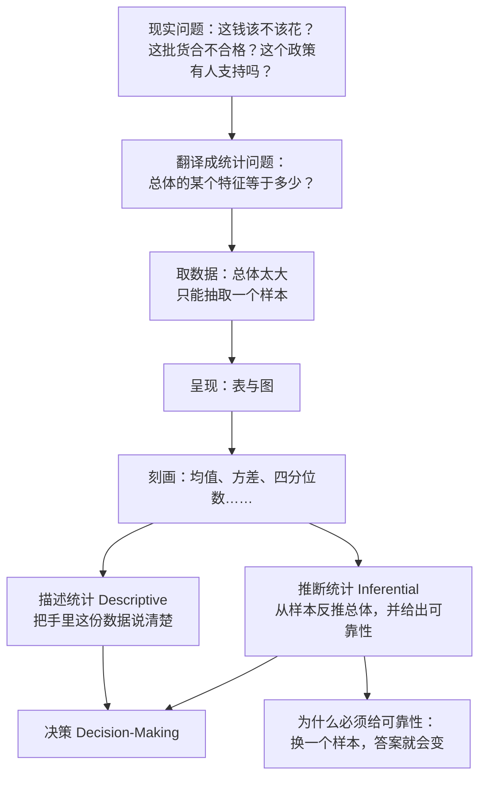

# C1.1 统计学是什么：从数据到决策

> [!abstract] 这一讲的任务
> 第一讲不动公式，只解决三件事：**统计学到底在干什么**，它凭什么有用；**它研究的对象叫什么**——总体、个体、变量、样本、参数、统计量，这六个词后面每一章都要用；**数据分几类**——定量还是定性，这决定了你后面能用什么图、什么方法。
> 学完这一讲，你应该能一眼分清一句话里的数字"是从总体算出来的"还是"从样本推出来的"。这两者的区别，就是统计学被正确使用与被滥用的分界线。

> [!info] 怎么读这份讲义
> 第 0 节是全课的开场：从一个很具体的场景——两块钱的彩票——把"用统计的眼光看问题"演一遍，那时你还没见到任何定义。
> 第 1 节才给定义；第 2 节是四个真实场景，它们构成后面所有方法要解决的问题清单；第 3–6 节是本讲骨架：两个分支的分工、六个基本概念、过程与黑箱、数据的类型；第 7 节讲怎么学这门课。
> 标有 **（拓展）** 或 **【拓展】** 的内容，是课堂上没有展开、由教材与通行讲法延伸补充的部分。复习时先掌握未标注的主干，考点集中在主干上。
> 教师与联系方式、成绩构成、考核提醒都记在 [[统计学课程 MOC]] 的"课程信息"一节，本篇不重复。

---

## 0. 开场：两块钱的彩票

先别管统计学是什么。假设你现在站在彩票店门口，兜里有两块钱。

中国合法的彩票只有两种：**福利彩票**和**体育彩票**。两块钱一注，一等奖几百万甚至上亿。你买不买？买多少？花两块、二十块、两百块，还是两千块？

课堂上的回答很一致：两块、二十块的人举手，两百块以上没人。理由也很一致——**用少一点的钱搏一搏**。这个想法听起来很合理：就算全赔了，也不过二十块。

那我们把这张彩票拆开看。

某期彩票印了 $5{,}000{,}000$ 张，总销售额 $10{,}000{,}000$ 元（$500$ 万张、$1000$ 万元，即两元一张）。奖池是这样设的：头奖 $1$ 张，$314{,}000$ 元；一等奖 $9$ 张，每张 $10{,}000$ 元；二等奖 $19$ 张，每张 $1{,}000$ 元；三等奖 $9{,}900$ 张，每张 $100$ 元；末奖 $2{,}490{,}000$ 张，每张 $1$ 元。中奖的总张数是 $2{,}500{,}000$ 张，奖金总额 $4{,}000{,}000$ 元。

于是有两个数：

$$
\text{中奖率}=\frac{2{,}500{,}000}{5{,}000{,}000}=50\%,\qquad
\text{返还率}=\frac{4{,}000{,}000}{10{,}000{,}000}=40\%.
$$

**中奖率 50%，返还率 40%。** 这两个数只差一个"奖"字，含义却完全不同。中奖率说的是"有多少张票能中点什么"；返还率说的是"你花出去的钱，有多少会以奖金的形式回到彩民手里"。剩下那 60%，是发行成本与公益金——它离开了彩民这个群体。

现在算单个彩民的账。花 $2$ 元买一张，按平均水平能收回

$$
2\times 40\%=0.8\ \text{元}.
$$

这就是**期望回报**：$0.8$ 元。注意一个细节——$0.8$ 元的奖在现实中不存在，末奖是 $1$ 元。而末奖的概率是 $2{,}490{,}000/5{,}000{,}000=49.8\%$。也就是说，你**最可能**的结果是拿回 $1$ 元，而不是 $0.8$ 元。

> [!question] 停一下，先自己想想
> 既然返还率只有 40%，为什么很多人觉得"买彩票好像没亏那么多"？

因为绝大多数人的体验是"中了 1 块钱"。$49.8\%$ 的概率拿回 $1$ 元，这个体验太常见了，常见到它盖住了另外两件事：头奖 $1/5{,}000{,}000$ 的概率（约两百万分之一），以及整体上 60% 的钱已经不在彩民群体里了。

把这个账继续算下去，答案就很难看了。花 $2000$ 元买 $1000$ 注，按期望：

$$
2000 \to 800 \to 320 \to 128 \to 51.2 \to 20.5 \to 8.2\ \text{元}.
$$

每玩一轮，钱乘 $0.4$。**六轮之后只剩 8.2 元。**

现实里很少有人"玩六轮"，更多是这样：先投两千，收回八百，觉得不甘心——"我都亏了一千二了，总得扳回来吧"——于是把这八百再投进去，回收三百二。这正是绝大多数人真实的心理路径，也正是概率论的形状。

![[C1.1-返还率与资金衰减.png]]

### 0.1 私彩：当返还率从 40% 变成 80%

$2004$ 年，广东潮汕地区出现了一种私人发行的"彩票"，返还率给到 **80%**。和官方的 40% 比，翻了一倍，于是短短几个月席卷全国。

当时《南方都市报》整版报道了这个现象，采访了一位庄家。他说了一句很张狂的话：**我有能力在一个星期之内搞干一个镇的金融系统。**

凭什么？他需要出老千吗？不需要。做庄的人根本不用出千，**他只需要让人来玩**。

假设一个村的积蓄是 $2000$ 万元。返还率 $80\%$，意味着每一轮全村人集体玩一次，庄家稳定抽走 $20\%$：

| 轮次 | 村里还剩 | 庄家这一轮抽走 |
|---|---|---|
| 0 | $2000$ 万 | — |
| 1 | $1600$ 万 | $400$ 万 |
| 2 | $1280$ 万 | $320$ 万 |
| 3 | $1024$ 万 | $256$ 万 |

十四轮之后，$2000\times0.8^{14}\approx88$ 万元——全村的积蓄只剩不到 $4.4\%$。而且这个过程是**逐个村子、逐个镇**发生的，一个人都不用骗，只要开个门让人来玩就够了。

那为什么村民会一轮一轮地来？因为返还率 80% 意味着**总有人赢**。两个人一起玩，差不多就有一个人的钱翻了倍；赢的人下一轮还想赢，输的人想"邻居都赚了，我总不会一直这么背"。这个激励机制不需要设计，它是返还率本身长出来的。

> [!important] 赌场与庄家的商业模型
> 任何赌博项目都有**庄家收益率**。庄家不需要作弊，只要"流水"足够大，收益率就会把每一笔赌注一点点吃掉。所以赌场最在意的是**让更多人、更频繁地来玩**，而不是某一局赢你多少。
> 这也是判断一个"投资机会"的第一步：**先看资金流向谁**。钱在每一次交易里固定漏掉一部分，交易越频繁，漏得越快。

同样的事发生在个人身上。有位学生，毕业后进了证券公司做创业投资，投中一家公司上市，拿到一百万元奖金。年轻人，手里突然多了一百万，他去了澳门，住在葡京酒店的顶层。结果不用猜——**全部没了**。这不是运气问题，是同一个机制：只要反复玩，"平均意义上"钱必然会流向收益率更高的一方。

### 0.2 从这张彩票里，我们学到了三件事

**第一件：单次的结果是随机的，群体的结果是确定的。**
你不知道这一张票中不中，但你知道五百万张票里有二百五十万张会中、四百万会返还。统计学研究的从来不是"这一张"，而是"这一批"。

**第二件：期望值是总体层面的，它不承诺个体的结果。**
返还率 40% 说的是"所有彩民合起来，收回 40%"。对某一个人来说，中了就是中了，没中就是没中——个体身上只有 0 或 1，没有 0.4。后面学**期望**与**抽样分布**时，这个区分会反复出现。

**第三件：小概率事件，在一次抽样里当作不发生。**
头奖的概率是两百万分之一。统计上有一条约定：概率极小的随机事件，**在一次抽样中被认为不会发生**（常用门槛是 $5\%$）。这条约定是后面**假设检验**的全部逻辑起点，第 7 章会正式用它。

所以，买彩票这件事的正确结论不是"能不能中"，而是：**它是一个返还率 40% 的消费，不是投资。** 也正因为如此，彩票的宣传口径是被管着的——不能宣传"中大奖"，只能宣传"为中国的福利事业、体育事业做贡献"。买多少都行，但那笔钱的性质是**捐款**，不是本金。

---

## 1. 统计学是什么：一条从数据到决策的流水线

现在可以给定义了。

### 1.1 三步走：收集、呈现、刻画（p.7–8）

一个真实的决策问题，通常长这样：有人要判断一件事，但手上只有一堆杂乱的数据。统计学在这中间做三件事：

1. **收集数据 Collecting Data**——发问卷、做实验、抓日志；
2. **呈现数据 Presenting Data**——做成表和图；
3. **刻画数据 Characterizing Data**——算出一个或几个数（比如平均值）来代表这批数据。

做完这三步，才有 **数据分析 Data Analysis**，才谈得上 **决策 Decision-Making**。

这三步的顺序不能颠倒。没有数据就没有分析，没呈现就看不出形状，没刻画就没法比较。后面整门课的结构就是按这三步展开的：第 1 章讲怎么**收集**，第 2 章讲怎么**呈现与刻画**，第 5 章之后讲怎么**从这批数据推断更大的总体**。

教材给的定义是：

> [!important] 统计学的定义
> **Statistics is the science of data.** 统计学是**关于数据的科学**：它涉及对数值型与分类型信息的**收集、分类、汇总、组织、分析与解释**（collecting, classifying, summarizing, organizing, analyzing, interpreting）。
> 一句话概括：**统计学是寻找大量数据背后规律性的方法论科学。**

"方法论科学"这个说法值得停一下。"方法"意味着它不生产数据，也不下结论，它提供的是**从数据到结论的那条路**。所以同一份数据，用错方法会得到相反的结论——第 2 节的四个例子全是这件事。

### 1.2 "statistics"这个词为什么有两个意思

英文里 `statistics` 既可数也不可数：

- 作**单数**时，它是**统计学**这门学科；
- 作**复数**时，它是**统计数据、统计资料**（statistical data / material）。

词源上讲，拉丁语 *status*、意大利语 *statista*、希腊语里的同源词，共同的义项是**国家与国家状态**（country and status）。统计学作为一门学科其实只有三百多年历史，是近代从西方引进的；但**统计行为**要古老得多——"结绳记事"就是最原始的统计：大事打大结，小事打小结，用绳结的多少记录事物的数量。

这件事说明一个道理：**先有统计活动，后有统计学。** 人类早就在数数、记账、报户口，统计学做的是把这些活动中反复有效的做法提炼成方法。

### 1.3 数据不等于信息

我们每天睁开眼睛，数据是涌进来的：一分钟内，社交平台产生两万条帖子，应用商店产生四万七千次下载，电商成交一万六千笔，搜索引擎处理九十万次查询，社交网络产生六百万次页面浏览。

但**数据多，不等于信息多**。

> [!important] 大数据战略的要害
> 大数据的重要性**不在于占有多少数据，而在于能从数据里提炼出多少有意义的信息**（the strategic importance of big data lies not in the possession of a huge amount of data, but in the information drawn from it）。

这句话有现实版本。各国把大数据上升为国家战略，一个直接触发点是**棱镜门**——当一个国家能利用数据优势去影响别国的政治行为，甚至选举，所有国家都意识到：数据是战略资源。而把数据变成信息的那个环节，就是统计学。

举个具体的：财经新闻每天都刷屏，但真正有用的是一条**利率**消息。美国的利率加到 $5.5\%$ 并长期维持，而国内两年期大额存款利率只有 $1.25\%$。两个数字摆在一起（这一步是**收集**），你会立刻看到一件事：两边存在巨大的利差（这一步是**刻画**）。对一个能同时接触到两边资金成本的人来说，这就是一个可执行的信息——低成本借进来、高利率存出去。

同一条新闻，对多数人只是"又加息了"，对看懂这两个数字关系的人是机会。**差距不在数据，在把数据翻译成信息的那一步。**

### 1.4 数据 + 方法 + 概率：统计学与人工智能的关系

课堂上有过一个很凝练的概括，值得写下来：

$$
\text{数据}+\text{方法}+\text{概率}\;\Longrightarrow\;\text{让机器模拟人的思维逻辑}.
$$

- **数据**：新数据与老数据。人踩过一次坑，下次会绕开；机器要"踩过坑"，靠的就是历史数据。
- **方法**：可以是老方法，也可以是新方法（贝叶斯、回归、神经网络）。
- **概率**：方法的作用是让**误差越来越小、置信度越来越高、预测越来越准**。

这句话解释了为什么统计学是人工智能的地基。有位诺贝尔奖得主在科技创新论坛上说过一句被广泛引用的话：**人工智能本质上就是统计学，只是用了一个更华丽的说法**（artificial intelligence is nothing but statistics, in a very gorgeous phrase）。十大机器学习算法里，一半以上直接建立在统计方法上。

以**贝叶斯方法**为例，它为什么能实现"学习"？把公式的三块拆开看：

- **先验概率 prior**：在看到新数据之前，你对这件事的初始认知；
- **似然 likelihood**：新来的数据（数据 + 方法）；
- **后验概率 posterior**：看完新数据之后，更新过的认知。

更新完怎么办？**把后验当成下一轮的先验**，再来一次。

这就是机器学习最朴素的样子：今天上课之前，你对这位老师有一个初始印象（先验）；这一堂课是**新数据**，加上你自己十几年的思考方式（方法），课后你对他有了一个新印象（后验）；下次上课，这个新印象就变成先验，再更新一次。**一次一次地更新，认知就收敛了。**

> [!note] 【拓展】为什么"只学应用"走不远
> 课堂上有段话很直白：我们做人工智能，很多时候把它当**黑箱**——输入进去、结果出来，中间为什么对、误差从哪来，不清楚。应用层面能做得很漂亮，但**根本性的创新做不出来**，因为不知道原理在哪。
> 这不是道德劝告，是工程事实：调参调不动的时候，唯一能救你的是知道这个损失函数为什么长这样、这个分布假设为什么不成立。统计学提供的正是这一层。

---

## 2. 四个真实场景：统计学在防什么、赚什么

定义讲完了，但它还是抽象的。这一节用四个真实发生过的事，把"统计学到底解决什么问题"摆出来。前两个是**用真实的数据说假话**，后两个是**把数据变成钱**。

### 2.1 毒胶囊事件：一句"请相信国内药企"错在哪（2012）

$2012$ 年，央视《每周质量报告》曝光：河北一些企业用**工业明胶**生产药用胶囊。工业明胶的重金属含量严重超标，而重金属进入人体后很难排出。

报道一出，全国哗然。第二天，有官员出来呼吁：市民还是要相信中国的制药企业。

> [!question] 停一下，先自己想想
> 这句话你为什么本能地不信？是因为"官员不可信"这种印象，还是因为这句话本身有问题？

如果你认真读了当时的报纸，会发现一个被忽略的细节：**那篇报道里的调查，用的其实是科学的抽样方法**。样本怎么抽、抽了多少、检出比例多少，都写在报道里。

于是结论就反过来了：问题不是"个别企业偶尔出事"，而是**在一套正规抽样下检出的比例**。这时官员那句"请相信"就不是态度问题，而是**与数据冲突**。学过统计学会知道，用这批数据去做假设检验，根本无法支持"可以放心"这个结论。真正该做的不是让市民相信，而是**加强监管、加大惩罚力度**——用制度让下一次不发生。

这件事的教训是：**一句呼吁顶不过一个抽样**。判断一句话可不可信，先看它背后有没有数据，再看那份数据是怎么抽的。

### 2.2 转基因调查：样本不具代表性，钱就白花了（2013–2014）

$2013$ 年 $9$ 月，主持人崔永元与方舟子在电视上就"转基因食品能不能吃"辩论。之后他自费去日本、美国做田野调查，$2014$ 年 $3$ 月公布纪录片，引发巨大争议。

争议的核心不是立场，而是**方法**。批评集中在两点：

- **样本量太小**（sample size is not large enough）；
- **样本不具代表性**（sample is not representative）——他的调查主要在美国的 **Whole Foods** 这类超市里做，那是卖有机食品的高端超市，去的本来就是在意这件事的人群。

> [!warning] 为什么"去了美国调查"仍然不算数
> 抽样调查的第一要求不是"去了现场"，而是**样本要能代表总体**。在只卖有机食品的超市里问"你在意转基因吗"，等于在一个只卖素食的餐厅里问"你吃肉吗"——答案在开口之前就定了。
> 要问美国人，就该去**沃尔玛**这种人流混杂的地方。**样本框选错了，后面算得再精细都是在放大概率的空炮。**

顺带一个反例，说明"在意"这件事在不同人群里差别很大：在 MIT 附近那所公立学校里，一位波士顿大学的终身教授和一位哈佛物理系的研究员，家里的态度是——牛奶买有机的，其他无所谓；而麻省总医院的一位医生买鸡蛋不看"有机"，看 **free-range（散养）**，理由是散养鸡产的蛋氨基酸构成更好。**同一个问题，不同人群给出完全不同的答案**——这正是"代表性"三个字的分量。

### 2.3 电视民调：用真实的数据，说一句假话

某电视台做过一个民调：你支持总统的经济改革吗？观众打电话投票，结果显示**不支持的人明显更多**。

数据是真的，每一票都是真投的。结论却是假的。

> [!important] 自愿样本 voluntary response sample
> 让观众自己决定要不要参与，得到的样本叫**自愿样本**。它的偏差是系统性的：
> - **强烈反对的人最愿意打这个电话**——政策动了他的利益，他一定要说一句；
> - **一般支持的人懒得打**——反正已经在做了；
> - **无所谓的人根本不打**——他为什么要参与一个他不在意的调查？
>
> 所以这类调查的结果几乎可以提前写出来：**支持的少、反对的多、不置可否的没有。**

换成一个**科学的随机抽样**，同一时期同一问题，结果是**绝大多数人支持**。两个数据都真，结论完全相反，差别只在**怎么抽**。

这件事的通用名字叫"**用真实的数据做假**"。它比编数据更难防，因为每一个数字都经得起核对，错的只是抽样方式。第 1.6 节（见 [[C1.2 收集数据：抽样方法与代表性]]）会把这类偏差一条条拆开讲。

### 2.4 啤酒与尿布：相关性能变成货架

沃尔玛的分析师在 POS 流水里发现：**啤酒的销量与尿布的销量相关性很高**。他们蹲点观察，原因很朴素——年轻爸爸出来买尿布，顺手拎几瓶啤酒回家。

于是沃尔玛把啤酒和尿布摆到一起，销量显著上升。

这个案例里没有高深方法，只有一件被做对的事：**先把数据连起来看，再去找机理**。相关性本身不解释因果，但它告诉你"该去哪儿看"。相关与回归在第 11 章正式讲。

同样的路子还有两个更"贵"的例子：

- **顶刊上的三颗星**。经济金融类的顶级期刊（如 *Journal of Finance*）里，回归表里常标 `***`、`**`、`*`。这三颗星是什么？是**显著性水平 significance level**，说白了就是"这个结果有多不像巧合"。有位台湾学者半开玩笑地说：他们那边博士生写论文就是"找星星"，找到了就能毕业，找不到就得推倒重来。这颗星怎么算、怎么读，是第 5–7 章的核心任务。
- **纸牌屋与反向定制**。一家影视公司不知道下一部剧拍什么，于是委托大数据公司去查：现有观众对哪本小说最感兴趣？答案是英国小说《纸牌屋》。再查：谁来演最受欢迎？凯文·史派西。谁来导？大卫·芬奇。三个答案都从数据里来，剧集一上线即成热门。这是**先有数据、再有产品**的反向定制。
- **人体第二套基因组**。一位生物学院的本科生，大二起去不同的生物科技公司实习，大四进了华大基因，参与华大与欧盟合作的**人体微生物基因组测序**项目。他从大四开始收集、整理、分析数据，毕业后留在华大，第一年合作发表了一篇 *Nature* 封面文章，第三年第二篇，$2020$ 年用十年积累的微生物基因数据创业。整件事的内核，仍然是那六个字：**收集、整理、分析、解释数据**——只不过他收集的是基因序列。

---

## 3. 描述统计与推断统计：统计学的一刀两半（p.9–14）

前面四个案例其实分成两类：一类是"把手里的数据说清楚"（啤酒尿布、毒胶囊的检出比例），一类是"从手里这点数据推更大的总体"（电视民调想知道的其实是全体选民、顶刊的星号想知道的是总体参数是否为零）。

教材把统计方法分成两支：

$$
\text{统计方法}
\begin{cases}
\text{描述统计 Descriptive Statistics}\\
\text{推断统计 Inferential Statistics}
\end{cases}
$$

### 3.1 描述统计：把这份数据说清楚（p.13）

**描述统计**做三件事：**收集数据、呈现数据、刻画数据**。目的是——描述数据本身。

例如一份季度销售数据，做成柱状图，再算出均值 $\bar X=30.5$、方差 $S^2=113$。图表告诉你四季度里第三季度最高，两个数告诉你整体水平和波动幅度。到此为止，**它没有说任何关于"明年"的话**。

描述统计是整个统计工作的地基：数据没描述清楚，后面推断全是空中楼阁。它也是这门课里最容易学的一段（第 2 章）。

### 3.2 推断统计：以少见多，以现在见将来（p.14）

**推断统计**做两件事：**估计 Estimation** 与**假设检验 Hypothesis Testing**。目的是——对**总体的特征**作出判断。

它要解决的问题是：总体太大、甚至根本拿不到，只能抽一个样本，那怎么从样本说总体？

> [!important] 推断统计的两个必要零件
> 1. **统计推断 Statistical Inference**：基于样本中的信息，对总体作出估计、预测或一般化结论。
> 2. **可靠性度量 Measure of Reliability**：对这个推断的**不确定性程度**作出说明。
>
> 只有第 1 条不叫推断，叫猜。**任何一句"根据样本，总体是……"的话，后面都必须跟着"这个判断有多可靠"。**

这也是推断统计比描述统计难的原因：它要额外回答"你凭什么"和"有多准"。第 3 节的基本要素、第 5 章的抽样分布、第 6 章的置信区间、第 7 章的假设检验，全是在补这两个零件。

### 3.3 回到开场那张彩票

现在可以回答开场留下的问题了：为什么"返还率 40%"不能保证"我这次亏 60%"？

因为 40% 是**总体层面**的数——所有彩民合起来的回收比例；而你的某一次购买是**个体层面**的事件，只有 0 或 1。**总体规律不等于个体结果**，这句话是整门课的元规则：后面每一次从样本推总体，都是在"总体层面下结论、个体层面留出误差"。

---

## 4. 六个基本概念：总体、个体、变量、样本、参数、统计量（p.15–19）

这一节是全课的语言。六个词必须先立住，后面每一章都在用。

### 4.1 总体与个体

**总体 Population**：**所有我们感兴趣的研究对象的集合**。判断标准只有一条——"你感不感兴趣"。

**个体 / 实验单元 Experimental Unit**：**我们从中收集数据的那个对象**。

用一个具体的课题把它们钉死。假设要研究：**中国私募股权基金的绩效**。

- **总体** = 中国所有的私募股权基金；
- **个体** = **每一只基金**；
- **样本** = 我们实际抽到、拿到数据的那部分基金。

> [!question] 停一下，先自己想想
> 既然研究的是"绩效"，为什么个体是"基金"，不是"绩效"？

因为**绩效不能解释绩效**。要研究绩效，就要找**什么因素影响了绩效**：基金的规模、成立年限、管理人的背景、投资标的的行业、进入的时间段……这些变量都**挂在基金身上**。如果个体选成"绩效"，你就只有一个数，没有任何可以解释它的东西。

所以统计上有一条实用的判据：**个体通常是一个"实体"（人、公司、交易、事件），而不是实体的某个属性。** 属性是变量。

![[C1.1-总体样本参数统计量.png]]

### 4.2 变量与数据

**变量 Variable**：**个体的某个特征**（characteristic of an individual experimental unit）。例：基金的规模、成立年限、投资行业；一个班学生的性别、专业、身高。

**变量值 / 数据 Data**：变量取到的具体结果。

一个容易混的例子：**性别是变量，男/女是数据**。变量是"要问的那个问题"，数据是"问出来的答案"。

### 4.3 参数与统计量：一对必须分清的孪生兄弟

这两个词是本讲最重要的区分。

> [!important] 参数与统计量
> **参数 Parameter**：描述**总体**特征的汇总度量。用**希腊字母**表示。
> $$\mu=\text{总体均值},\quad \sigma=\text{总体标准差},\quad \pi=\text{总体比例}$$
> **统计量 Statistic**：描述**样本**特征的汇总度量。用**小写英文字母**表示。
> $$\bar x=\text{样本均值},\quad s=\text{样本标准差},\quad \hat p=\text{样本比例}$$

记法上有个巧劲：**P** 既在 **P**opulation 里，也在 **P**arameter 里；**S** 既在 **S**ample 里，也在 **Statistic** 里。Population–Parameter 一对，Sample–Statistic 一对。

还有一个必考的区别：**`statistics`（带 s）是统计学，`statistic`（不带 s）是统计量**。一个字母之差，一个是学科，一个是数。

### 4.4 例题：这一个百分数是参数还是统计量（p.19、p.42–43）

> [!example] 例 1.1
> **(a)** 林肯第一次当选总统时，赢得了 **$39.82\%$** 的选票。
> **(b)** 在一项 $877$ 人的调查中，发现 **$45\%$** 的受访者不会聘用简历中有拼写错误的求职者。
> 问：这两个百分数分别是参数还是统计量？

**(a)** 是全部选票的统计结果，描述的是**总体**（全体投票人）的比例，所以是**参数** $\pi$。
**(b)** 来自 $877$ 人的**样本**，描述的是样本比例，所以是**统计量** $\hat p$。

判据只有一个，机械但可靠：**看这个数是从全体算出来的，还是从抽出来的那部分算出来的。** 从全体算 → 参数；从样本算 → 统计量。

### 4.5 一个统计问题由什么构成（p.18–19）

教材把两类问题的要素列成清单，很值得背下来，因为考试里的题干就是照着这个结构写的。

**描述统计问题的四要素**：① 感兴趣的总体或样本；② 一个或多个变量；③ 表、图或数值汇总工具；④ 数据中规律的识别。

**推断统计问题的五要素**：① 感兴趣的总体；② 一个或多个变量；③ 从总体中抽出的样本；④ 基于样本对总体作出的推断；⑤ 这个推断的**可靠性度量**。

对比一下：推断比描述多出的正好是第 ③ 和第 ⑤ 项——**样本**与**可靠性**。再一次印证第 3 节的结论。

---

## 5. 过程与黑箱（p.20–22）

**过程 Process**：把输入变成输出的一系列动作或操作，并且**随时间持续产生输出**。

- 一条生产线把原料变成零件；
- 一个客服系统把来电变成解决方案；
- 一个推荐系统把用户行为变成排序结果。

**黑箱 Black box**：**操作或动作未知、未加说明**的过程。你只知道进去什么、出来什么，中间发生了什么不知道。

这里有一个很关键的连接：**一个过程产生的一批输出（一批对象或一批数），就构成一个样本。**

所以"抽样"不只是从人群里抽人。**从一条生产线上按时间抽产品，是从过程中抽样**；这个视角在第 13 章（统计质量控制）会变成控制图的整个逻辑：把过程输出的波动分成"正常波动"和"异常波动"，异常就停机查原因。

> [!note] 这个视角对写代码的人意味着什么
> 你把模型当成一个过程：输入数据进去，预测出来。它是一个**黑箱**——直到你知道它的假设。而"输出的这一批预测"就是样本：它的均值、方差、异常值，全都可以用第 2 章的工具描述，进而用第 5 章之后的工具推断。
> "监控线上模型的输出分布有没有漂移"，本质就是"对一个过程做统计控制"。

---

## 6. 数据的类型：定量与定性（p.23–27）

同样叫"数据"，处理方式完全不同。第一刀切在**能不能用数轴表示**。

> [!important] 定量数据与定性数据
> **定量数据 Quantitative data**：记录在**自然数值刻度**上的测量。例：一批产品中的次品数、石油公司 CEO 的薪水、公司员工的年龄。
> **定性数据 Qualitative data**：**不能在自然数值刻度上测量**，只能归入若干类别之一的测量。例：每个学生的专业、员工的性别、付款方式（现金／支票／信用卡）。

注意"定量"的关键词是**自然数值刻度**。有些数看着是数字，其实不是定量数据——学号、身份证号、电话号码，它们只是"用数字写成的标签"，不能加减、不能求平均。判断标准：**这个数做加减乘除有意义吗？**

### 6.1 定性数据再切一刀：定类与定序

定性数据还能再分两类，这个细分决定了你能算什么样的"平均"。

- **定类数据 Nominal（分类数据）**：类别之间**没有顺序**。例：专业、性别、付款方式。"金融专业"和"计算机专业"谁大谁小？没有意义。
- **定序数据 Ordinal（顺序数据）**：类别之间**有顺序，但顺序之间的距离不可比**。例：满意度（很不满意／不满意／一般／满意／很满意）、服务质量等级（优／良／合格／不合格）。"很满意"比"满意"高，但高多少？说不出来。

> [!warning] 为什么这个细分不是文字游戏
> - 定类数据只能**计数**，能算众数和比例，**不能算均值**。"平均专业"是没有意义的。
> - 定序数据能**排序**，能算中位数，**通常也不该算均值**。"满意度 3.7"听着很精确，但它隐含了"很不满意到很满意是等距的"这个假设，而这个假设往往不成立。
> - 定量数据才可以放心地算均值、方差。
>
> 换句话说：**数据类型决定了合法的运算**。选错运算，后面所有结论都作废。这也决定了图：定性数据用条形图、饼图，定量数据用点图、直方图（下一讲开始讲）。

### 6.2 一张表记住这一讲的全部名词

| 名词 | 描述谁 | 记号 | 例子（私募基金研究） |
|---|---|---|---|
| 总体 Population | 全部研究对象 | — | 中国所有私募股权基金 |
| 个体 Experimental unit | 被收集数据的那个对象 | — | 每一只基金 |
| 变量 Variable | 个体的某个特征 | — | 基金规模、成立年限、投资行业 |
| 数据 Data | 变量的取值 | — | 规模 $50$ 亿、年限 $5$ 年、行业「医疗」 |
| 参数 Parameter | 总体的汇总度量 | $\mu,\ \sigma,\ \pi$ | 全部基金的平均收益率 |
| 统计量 Statistic | 样本的汇总度量 | $\bar x,\ s,\ \hat p$ | 抽到的 $100$ 只基金的平均收益率 |

---

## 7. 怎么学这门课

课堂上有五条建议，是按重要性排的。

**第一，理解统计思维（statistical thinking）。** 每一个方法都要问两个问题：**为什么要用这个方法？如果是我，我会怎么用？** 这是最重要的一条，对人工智能与大数据方向尤其如此——你们要的不是会算，而是知道"之所以然"。

**第二，掌握统计术语。** `average` 和 `mean` 有什么区别？`population` 指什么？$\sigma$ 和 $\sigma^2$ 各是什么？术语不清楚，题目读错，方法用对也没用。

**第三，熟悉统计符号。** 样本均值写 $\bar x$，总体均值写 $\mu$——**符号本身就是信息**，看到 $\mu$ 就该知道说的是总体，看到 $\bar x$ 就该知道是样本。很多错误源于把两者混用。

**第四，记住基本公式，但不必背所有公式。** 统计学里有些公式很复杂，不需要都记住；需要的是：**基础公式记住、复杂公式知道去哪儿找**。

**第五，会用统计软件。** 再复杂的方法，在软件里也只是点几下。Excel 里有八十多个统计函数、十三个统计分析工具，本课大部分方法用 Excel 就能做；更深一些的要用 Stata、R、Python、Minitab、SPSS。课堂上主要用 **Excel 和 Stata**。开源工具（R、Python）发展得很快，因为有很多人给它们写统计包。

> [!important] 一句话总结这门课的学习方式
> **本门课即刷题，不要刷题，理解万岁。**
> 如果不理解，随便改一个已知条件就不会做了——这一点是可以打保票的。
> 而**推断统计**这一段（第 5 章之后）是大多数人觉得抽象的地方，来上课、跟着推一遍，效率会高得多；描述统计难度不大，但理解了同样有好处。

---

## 这一讲的三句话

> [!important] 记住这三句
> 1. **统计学是关于数据的科学**：收集、分类、汇总、组织、分析、解释，目的是找出大量数据背后的规律性；它的价值不在占有数据，而在把数据变成信息。
> 2. **统计方法分两支**：描述统计把手里这份数据说清楚；推断统计从样本推总体，并且**必须附上可靠性**——没有可靠性的推断只是猜。
> 3. **六个词定住这门课的语言**：总体／个体／变量／样本／参数（$\mu,\sigma,\pi$）／统计量（$\bar x,s,\hat p$）；数据分定量与定性，定性再分定类与定序——**数据类型决定合法的运算**。

**下一讲预告**：这一讲反复说"样本要能代表总体"，但没说怎么做到。下一讲回答：简单随机抽样、分层抽样、整群抽样、系统抽样各适合什么场面；以及为什么"自愿样本"和"便利样本"注定出错——电视民调就是死在这里的。

## 相关笔记 Related Notes

- 本篇是开篇，没有上一讲。
- 下一讲：[[C1.2 收集数据：抽样方法与代表性]]
- 后续会反复回指本篇的地方：[[C5.1 抽样分布：统计量也是随机变量]]（统计量自己也有分布）、[[C6.1 参数估计与置信区间]]（可靠性长什么样）、[[C7.1 假设检验的要素与假设的建立]]（小概率事件怎么用）
- 返回：[[统计学课程 MOC]]
