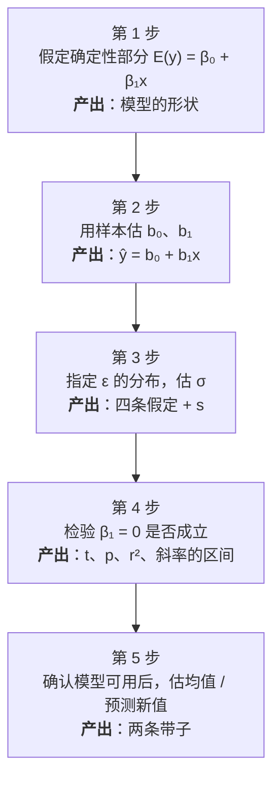

# C11 简单线性回归 Simple Linear Regression

> [!abstract] 这一讲的任务
> 前十讲里，响应变量一直被当成**组**来处理：一个人群、两组人、$k$ 个处理、几个格子。x 从头到尾只是个"标签"，我们比较的是各组**均值**。可最常问的问题不是"哪组高"，而是"**它随另一个量怎么变**"——广告费每多投一万，销量涨多少？消防站远一英里，损失多几万？这里的 $x$ 是**连续**的，取值有无穷多个，没有"组"可以分。
> 这一讲给的工具是一条直线：$E(y)=\beta_0+\beta_1x$。它要回答三件事：这条线**怎么定**（最小二乘）、**有没有用**（斜率的 $t$ 检验）、**怎么用**（估均值与预测新值，两套区间差一个 $s$）。
> 顺带把两件容易混淆的事分开：$r$ 只说"两列数一起动得多紧凑"，$r^2$ 只说"$y$ 的波动被解释掉多少"。它们都不说因果，也不说"预测一定准"。

> [!info] 授课进度说明
> 现有授课转写稿覆盖到**第 6 章**，内容截止于区间估计。
> **第 11 章暂无对应转写稿**，本篇按**教材与该章配套讲义整理**，暂不逐条区分"课堂讲过"与"拓展补充"。
> 等转写稿补进来，会按与前面各章相同的规则（标题后缀 **（拓展）**、段首 **【拓展】**）标注出课堂未讲的部分。

---

## 从「比均值」换成「跟着 $x$ 变」（p.7–15）

先把上一讲的收尾接上。方差分析问的是"$k$ 个处理均值是否相等"，它把 $x$ 当成**分组标签**：灌装机 A/B/C、四种培训法。标签之间没有大小、没有距离，所以一切比较都落在**均值**上。

现在换成另一种问法：$x$ 是一个**可以连续取值**的量。广告费可以是 100、250、333 元；消防站距离可以是 0.7、3.5、6.1 英里。这时"组均值"这条路断了——每多一个 $x$ 值，就多一个"组"，而每个"组"只有一两个观测，均值全是噪声。

于是问题本身变了：不是"哪个 $x$ 的 $y$ 更高"，而是"**$y$ 的均值怎么随 $x$ 走**"。答案写成函数：

$$E(y)=\beta_0+\beta_1x$$

这就是**简单线性回归 simple linear regression** 的全部内容。名字里每个词都在限定它的野心：**simple**——只有一个 $x$（两个以上是第 12 章）；**linear**——在参数 $\beta_0,\beta_1$ 里是线性的（不是要求数据长得像直线，这条区别第 12 章会反复用）；**regression**——从一个量去"回归"另一个量。

### 确定性模型与概率模型

模型是对现象的**数学表述**。它分两类，差别只有一句话：**要不要给误差留位置**。

**确定性模型 deterministic model** 假设关系是精确的。$F=m\cdot a$ 就是标准例子：给定质量和加速度，力**一定**是那个值，不差一分。只有当预测误差可以忽略时，这类模型才好用。

**概率模型 probabilistic model** 假设 $y$ 由**两块**组成：

$$y=\text{确定性部分}+\text{随机误差}$$

例子是"销售额是广告支出的 10 倍，再加上随机误差"：

$$y=10x+\varepsilon$$

为什么非要留下 $\varepsilon$？三条理由，缺一条这个模型就不成立：

1. **影响 $y$ 的因素远不止 $x$**。买玩具的还有收入、季节、隔壁竞品的促销、货架位置——它们全都塞进 $\varepsilon$ 里。
2. **测量本身有误差**。销量报的是整数件，广告费按四舍五入记到百元。
3. **模型的形式永远不可能完全正确**。真实关系可能略弯，直线只是近似。

于是关键的一步：我们**假定**误差的平均值是 0，

$$E(\varepsilon)=0$$

这不是从数据里算出来的结论，而是一个**建模约定**——它规定"直线穿过哪里"。有了它，两边取期望：

$$E(y)=\beta_0+\beta_1x$$

> [!important] 这一句是全章的根
> **直线的位置被定义成"给定 $x$ 时 $y$ 的平均值"，而不是"穿过哪几个点"。**
> 所以后面所有的"$\hat y$"讲的都是均值的位置，不是某个具体观测。这个区别在第 7 节会变成一个必须回答的问题：你要估的是**均值**，还是**下一次那一个观测**？答案不同，区间的宽度差将近一倍。

### 一阶（直线）概率模型：逐符号拆开

$$y=\beta_0+\beta_1x+\varepsilon$$

| 符号 | 名称 | 一句话 |
|---|---|---|
| $y$ | 因变量 / 响应变量 dependent or response variable | **被解释**的那个量，是要建模的对象 |
| $x$ | 自变量 / 预测变量 independent or predictor variable | 用来**预测** $y$ 的量 |
| $E(y)=\beta_0+\beta_1x$ | 确定性部分 deterministic component | 给定 $x$ 时 $y$ 的均值，也就是"**均值线** line of means" |
| $\varepsilon$ | 随机误差 random error | 实际值偏离均值线的那一截 |
| $\beta_0$ | **截距** $y$-intercept | 直线与 $y$ 轴交点的位置，即 $x=0$ 时 $E(y)$ |
| $\beta_1$ | **斜率** slope | $x$ 每增加 1 个单位，$E(y)$ **改变**多少 |

两种读斜率的说法必须分清：

- $\beta_1>0$：$x$ 每增加 1 个单位，$E(y)$ **增加** $\beta_1$；
- $\beta_1<0$：$x$ 每增加 1 个单位，$E(y)$ **减少** $\beta_1$。

后一种情况不要说"减少 $-\beta_1$"——$\beta_1$ 本身带符号，减号重复一次就反了。

> [!warning] $\beta$ 是总体的，$b$ 是样本的
> $\beta_0,\beta_1$ 是**参数 parameter**，客观存在但永远不知道；$\hat\beta_0,\hat\beta_1$（也写作 $b_0,b_1$）是**估计量 estimator**，由样本算出来的数。
> 这个区分在上一讲的 $\mu$ 与 $\bar x$、$\sigma$ 与 $s$ 里已经练过，但这里更容易混——因为两个符号长得几乎一样，只差一个帽子。写结论时必须分清：**"$\beta_1$ 的估计值是 0.7"，不是"$\beta_1$ 是 0.7"**。

关于"**一阶 first-order**"这个名字：它指的是 $x$ 的**幂次是一次**。$E(y)=\beta_0+\beta_1x^2$ 就是二阶（抛物线），那已经超出本讲——但要记住"一阶"限定的是**形式**，不是数据。数据可以弯得很厉害，我们照样可以硬套一条一阶模型，代价是残差会出现规律（第 4 节会看到长什么样）。

### 做一次回归的五个步骤

这五步就是本篇的目录。后面每一节，回头都能对到某一步上。



两个容易跳过的细节：

- **第 1 步是先验的，不是算出来的**。是你看着散点图决定"用直线"，软件不能替你做这个判断。
- **第 4 步不做完，第 5 步不许用**。斜率不显著还敢拿去预测，等于拿一根噪声当尺子。

---

## 一条线怎么才算「最贴合」：最小二乘（p.16–22）

第一步先画**散点图 scatterplot**：把所有 $(x_i,y_i)$ 点出来。它的作用只有一个——**先看看模型大概能贴多好**。点上有没有一条像样的直线？有没有明显的弯？有没有一个点孤零零地跑开？

> [!question] 停一下，先自己想想
> 给你这么一堆点，你会怎么画线？画完之后又怎么判断"哪条最好"？
> 这两个问题的答案不能凭感觉。第一问的答案取决于第二问——必须先有一个**判据**，才谈得上"最好"。所以下面先造判据，再求线。

### 先否定两个看起来更自然的判据

**判据一是"残差和最小"。** 先把**残差 residual** 定义清楚：它是每个点离直线的**竖直距离**，

$$\hat\varepsilon_i=y_i-\hat y_i=y_i-(\hat\beta_0+\hat\beta_1x_i)$$

它带着符号：点在线上方为正，下方为负。直觉上想让它"总体最小"，那就是让 $\sum\hat\varepsilon_i$ 尽量小。**这条路走不通**，而且理由很硬：

$$\sum_{i=1}^{n}\hat\varepsilon_i=\sum y_i-n\hat\beta_0-\hat\beta_1\sum x_i=n\left[\bar y-\hat\beta_0-\hat\beta_1\bar x\right]$$

括号里那一项，正是"算出来的直线在 $x=\bar x$ 处有多高"减去 $\bar y$。只要这条线**经过点 $(\bar x,\bar y)$**，残差和就**恒等于 0**——不管斜率取多少。

也就是说：无穷多条线都能让残差和为 0，判据失去了区分能力。更糟的是，一条斜得离谱的线，正负残差照样互相抵消。

**判据二是"残差绝对值和最小"**（最小绝对偏差）：$\min\sum|\hat\varepsilon_i|$。这一条在数学上**站得住**，确实能定出唯一的线，思路也符合直觉。但它有两个现实问题：绝对值函数在 0 点不可导，不能像普通极值那样"求导令其为 0"，得用线性规划一类的算法；而且它对大误差的惩罚是**线性**的——一个偏 10 的点，和十个各偏 1 的点，代价一样。

### 平方和：既好算，也正好对应「误差方差最小」

于是取平方：

$$\mathrm{SSE}=\sum_{i=1}^{n}\hat\varepsilon_i^2=\sum_{i=1}^{n}\left(y_i-\hat y_i\right)^2$$

**最小二乘 least squares** 就是"让这个平方和最小的那条线"——说白了，**每个点往上或往下量一段竖直线段，把这些线段的平方加起来，找让总和最小的那条线**。这个名字就这么直白：least（最小）+ squares（平方）。

两个好处，正好对应那两个否定：

1. **有闭式解**。平方和是 $\hat\beta_1$ 的二次函数，求导是一次方程，解出来一个唯一的最优点（下文有公式）。
2. **惩罚大误差**。偏 10 的点贡献 100，十个偏 1 的点只贡献 10——这正是我们想要的：少数离谱的点不该被一大堆"勉强还行"的点淹没。

顺带说清它和**方差**的关系：$\mathrm{SSE}$ 除以自由度就是误差方差，最小化 $\mathrm{SSE}$ 等价于让估计的误差方差最小。这也是为什么最小二乘解在四条假定下是**最优线性无偏估计**。

### 最小二乘线的两条性质

$$\hat y=\hat\beta_0+\hat\beta_1x$$

满足：

1. **残差之和为 0**（平均误差 = 0）：$\sum\hat\varepsilon_i=0$；
2. **$\mathrm{SSE}$ 比任何其他直线都小**（误差方差最小）。

![[C11-最小二乘-残差平方和是一条碗.png]]

左图是那五次观测（$x$ 是广告费、$y$ 是销量）。红色的竖线段就是残差，四条分别是 $0.4,-0.3,0,-0.7,0.6$，加起来正好 0；平方和 $\mathrm{SSE}=1.10$。灰实线（斜率 0.4）和灰点线（斜率 1.2）是两条"别的线"，它们的 $\mathrm{SSE}$ 分别是 2.00 和 3.60——都比 1.10 大。

右图是这张图真正的要点：**把截距固定成让直线过 $(\bar x,\bar y)$ 之后，$\mathrm{SSE}$ 只是斜率 $m$ 的一个二次函数**，形状是一只碗。碗底在 $m=0.7$，也就是 $1.10$ 那个最低点。碗底唯一，所以解唯一；碗口朝上，所以只要左右挪一点 $\mathrm{SSE}$ 就升——这就是"最小"二字的全部含义。

### 估计量的公式

$$\hat\beta_1=\frac{\mathrm{SS}_{xy}}{\mathrm{SS}_{xx}}\qquad\qquad \hat\beta_0=\bar y-\hat\beta_1\bar x$$

其中

$$\mathrm{SS}_{xy}=\sum (x_i-\bar x)(y_i-\bar y),\qquad \mathrm{SS}_{xx}=\sum (x_i-\bar x)^2$$

三个 $SS$ 是这一讲用到底的三个零件，先认清楚各自管什么：

| 量 | 公式 | 它量的是什么 |
|---|---|---|
| $\mathrm{SS}_{xx}$ | $\sum (x_i-\bar x)^2$ | **$x$ 自己摊得有多开**（与 $y$ 无关），分母 |
| $\mathrm{SS}_{yy}$ | $\sum (y_i-\bar y)^2$ | **$y$ 自己的总波动**，后面 $r^2$ 的分母 |
| $\mathrm{SS}_{xy}$ | $\sum (x_i-\bar x)(y_i-\bar y)$ | $x$ **和** $y$ 一起偏了多少（同向偏为正，反向偏为负），分子 |

斜率的形状因此可以读出来：**$x$ 和 $y$ 一起偏得越多（分子大）、$x$ 自己越不集中（分母大）**，斜率怎么变？分子大说明"一起动"，$\hat\beta_1$ 会更大；分母大说明"$x$ 摊得开"，同样的 $y$ 变化摊在更长的 $x$ 上，$\hat\beta_1$ 会更小。这一条在第 5 节会变成一个非常有用的直觉：**$x$ 摊得越开，斜率估得越准**。

截距的公式不必背。它只是"**直线必须穿过 $(\bar x,\bar y)$**"这句话的代换：把 $x=\bar x$ 代进去，$\hat y=\hat\beta_0+\hat\beta_1\bar x=\bar y$。换句话说，一旦斜率定了，截距就被钉死了——**拟合时真正自由的参数只有一个**。这一点在第 4 节解释自由度时会直接用到。

> [!note] 手算捷径：$\mathrm{SS}$ 的展开式
> 按定义要先把每个 $x_i-\bar x$ 算出来，五个数据没事，二十个就烦了。三个 $SS$ 都有等价的展开式，只用到和：
> $$\mathrm{SS}_{xx}=\sum x_i^2-\frac{(\sum x_i)^2}{n},\qquad \mathrm{SS}_{xy}=\sum x_i y_i-\frac{(\sum x_i)(\sum y_i)}{n},\qquad \mathrm{SS}_{yy}=\sum y_i^2-\frac{(\sum y_i)^2}{n}$$
> 算斜率的标准误时，$\mathrm{SS}_{xx}$ 会被写成分母里的 $55-\frac{15^2}{5}$ 这种样子——这不是新公式，就是这一条的代入。

> [!warning] 两个必踩的坑
> 1. **分子分母不能反**。$\hat\beta_1=\mathrm{SS}_{xy}/\mathrm{SS}_{xx}$：分母永远是"仅仅 $x$ 的那个平方和"。写成 $\mathrm{SS}_{xy}/\mathrm{SS}_{yy}$，你就把"用 $x$ 解释 $y$"算成了"用 $y$ 解释 $x$"——这两条线斜率不同（除非 $r=\pm1$），而且含义完全不同。
> 2. **$\hat\beta_1$ 有量纲，$r$ 没有**。$x$ 的单位从"百元"换成"元"，$\hat\beta_1$ 会缩小 100 倍，同一条线还是同一条线；但 $r$ 一个数字都不变。这一点在第 6 节会再提一次。

---

## 手算一遍：广告费与销量的五次观测（p.23–28）

例题的设定：你是 Hasbro Toys 的市场分析员，手上有五个月的记录，广告支出（单位：百美元）与销量（单位：件）：

| 月份 | 1 | 2 | 3 | 4 | 5 |
|---|---|---|---|---|---|
| 广告支出 $x$（百美元） | 1 | 2 | 3 | 4 | 5 |
| 销量 $y$（件） | 1 | 1 | 2 | 2 | 4 |

先把两个均值算出来：$\bar x=\dfrac{15}{5}=3$，$\bar y=\dfrac{10}{5}=2$。然后逐点做四列：

| $x_i$ | $y_i$ | $x_i-\bar x$ | $y_i-\bar y$ | 乘积 | $(x_i-\bar x)^2$ | $(y_i-\bar y)^2$ |
|---|---|---|---|---|---|---|
| 1 | 1 | $-2$ | $-1$ | $2$ | 4 | 1 |
| 2 | 1 | $-1$ | $-1$ | $1$ | 1 | 1 |
| 3 | 2 | $0$ | $0$ | $0$ | 0 | 0 |
| 4 | 2 | $1$ | $0$ | $0$ | 1 | 0 |
| 5 | 4 | $2$ | $2$ | $4$ | 4 | 4 |
| **和** | | | | $\mathbf{7}$ | $\mathbf{10}$ | $\mathbf{6}$ |

于是三个零件是 $\mathrm{SS}_{xy}=7$、$\mathrm{SS}_{xx}=10$、$\mathrm{SS}_{yy}=6$，斜率

$$\hat\beta_1=\frac{7}{10}=0.7$$

截距

$$\hat\beta_0=\bar y-\hat\beta_1\bar x=2-(0.70)(3)=-0.10$$

**最小二乘方程**：

$$\hat y=-0.1+0.7x$$

用展开式验一遍，免得以为只有拆离差这一条路：$\sum x^2=55$，$\mathrm{SS}_{xx}=55-\frac{15^2}{5}=55-45=10$；$\sum xy=37$，$\mathrm{SS}_{xy}=37-\frac{15\cdot10}{5}=7$；$\sum y^2=26$，$\mathrm{SS}_{yy}=26-\frac{10^2}{5}=6$。三个数一模一样。

### 两个系数的实际解释

**斜率**：$\hat\beta_1=0.7$ 的意思是，在样本覆盖的广告支出范围（100–500 美元）内，**广告费每多 100 美元，销量平均多 0.7 件**。

**截距**：$\hat\beta_0=-0.1$ 的意思是，$x=0$ 时预测销量是 $-0.1$ 件。这个数字**没有实际意义**，两个理由同时成立：$x=0$ 落在样本范围（1 到 5）**外面**，而且"一件不卖、还要负销量"本身荒谬。所以正式报告里应写成"截距无实际解释"，而不是"不投广告会亏 0.1 件"。

> [!warning] 单位必须跟着系数走
> 这组数据里 $y$ 是**件**，$x$ 是**百美元**，所以斜率 0.7 的单位是"件 / 百美元"，说的是"每多 100 美元、多 0.7 件"。原稿把它写成"销量增加 700 美元"，是把 $y$ 当成了金额——按数据表，$y$ 的单位是 Units，不是美元。这类单位串行在报告里是硬伤：老板会问你多出来的 700 美元是从哪件商品里长出来的。
> 换单位只会缩放系数：把 $x$ 改成"美元"，斜率就变成 0.007 件/美元，同一个结论。

### 从软件输出里把六个数挑出来

软件（这里是 SAS 风格的输出）报的是这样一张表：

```
 Parameter Estimates
           Parameter Standard  T for H0:
Variable DF Estimate    Error   Param=0 Prob>|T|
INTERCEP  1  -0.1000   0.6350    -0.157   0.8849
ADVERT    1   0.7000   0.1914     3.656   0.0354
```

四个列名要对上本讲的符号：

| 输出列 | 本讲的符号 | 这个数在说什么 |
|---|---|---|
| `Estimate`（INTERCEP 行） | $\hat\beta_0$ | 截距估计值 $-0.1000$ |
| `Estimate`（ADVERT 行） | $\hat\beta_1$ | 斜率估计值 $0.7000$ |
| `Standard Error` | $s_{\hat\beta_1}$ | 斜率的标准误，输出印 $0.1914$（精确值 $0.1915$，差异见第 5 节） |
| `T for H0: Param=0` | $t$ | 检验 $\beta_1=0$ 的统计量 $3.656$ |
| `Prob>&#124;T&#124;` | $p$ | 双尾 $p$ 值 $0.0354$ |

`INTERCEP` 那一行的 $t=-0.157$、$p=0.8849$ 是在检验**截距**是否为 0。这里不必认真：$x=0$ 本来就在样本范围外，检验"截距为 0"没有业务含义。软件每行都报，是因为它不知道你的 $x=0$ 有没有意义。

**已经有结论了**：$p=0.0354<0.05$，斜率的 $t$ 检验在 $\alpha=.05$ 下拒绝 $H_0$，广告与销量之间存在线性关系。这句话在第 5 节会系统重做一遍，现在先记住它是怎么从这张表里直接读出来的。

---

## 四个假定：这条线凭什么能做推断（p.29–36）

到此为止干的全是**描述**：拿一组点，画一条使平方和最小的线。这一步不需要任何分布假定——线就是线的。

但一旦开始问"**这条线的斜率是不是真的不为 0**"、"**明天会卖多少**"，就必须知道 $\hat\beta_1$ 和 $\hat y$ 的**抽样分布**。而分布从假定里来。四条，全部落在误差 $\varepsilon$ 上：

| 假定 | 内容 | 违背了会怎样 |
|---|---|---|
| **1. 均值为 0** | 在每一个 $x$ 取值上，$E(\varepsilon)=0$；等价于 $E(y)=\beta_0+\beta_1x$ | 直线整体偏高或偏低；截距失去意义，但斜率仍可估 |
| **2. 方差相同** | $\mathrm{Var}(\varepsilon)=\sigma^2$，与 $x$ 无关（**同方差**） | 各段信息的可信度不同，最小二乘会给高波动段同等的权重；标准误算错，$t$ 检验失效 |
| **3. 正态** | 每一个 $x$ 上，$\varepsilon$ 服从正态分布 | 小样本下 $t$ 检验与区间不再精确（大样本靠中心极限定理可救） |
| **4. 独立** | 不同观测的 $\varepsilon$ 互不影响 | 标准误被严重低估，$p$ 值虚小——这是四条里后果最坏的一条 |

![[C11-直线穿过一族分布的中心.png]]

这张图是第 1–3 条假定的合体。**每一个 $x$ 值上都挂着一个 $y$ 的分布**（三条钟形曲线），它们各自的中心落在红线上，各自的宽度（$\sigma$）**一样**。黑色点是某个具体观测，它和均值的差就是这一次的 $\varepsilon$。所以：

- $E(y)=\beta_0+\beta_1x$ 不是"穿过数据的那条线"，是"**所有钟形曲线中心的连线**"；
- 实际点会散在线的两边，散多远由 $\sigma$ 决定，**不随 $x$ 变**（第 2 条）；
- 钟形（第 3 条）决定了后面用 $t$ 分布而不只是大样本近似。

> [!note] 为什么全篇都在讲 $\varepsilon$ 的假定，却只说 $y$ 的分布
> 因为 $y=\beta_0+\beta_1x+\varepsilon$：**$x$ 是给定值，$\beta_0+\beta_1x$ 是常数**，所以 $y$ 的随机性**全部来自** $\varepsilon$。$\varepsilon$ 正态 $\Rightarrow$ $y$ 正态（给定 $x$）；$\varepsilon$ 同方差 $\Rightarrow$ $y$ 同方差。这两句话是同一件事的两种说法。

### 估计误差的标准差：$s$ 是从哪来的

要知道一条线估得准不准，得估 $\sigma$——误差分布的标准差。它用**残差平方和**来估：

$$s^2=\frac{\mathrm{SSE}}{\text{误差的自由度}}=\frac{\mathrm{SSE}}{n-2},\qquad s=\sqrt{s^2}$$

而 $\mathrm{SSE}$ 有两种算法，结果相同：

$$\mathrm{SSE}=\sum (y_i-\hat y_i)^2=\mathrm{SS}_{yy}-\hat\beta_1\,\mathrm{SS}_{xy}$$

第二种是**计算式**，省掉逐点算 $\hat y_i$ 的麻烦，而且顺带说明一件事：$\mathrm{SSE}$ 一定 $\le\mathrm{SS}_{yy}$，因为 $\mathrm{SS}_{xy}$ 与 $\hat\beta_1$ **同号**，乘积一定非负。这就是为什么 $r^2$ 永远落在 0 到 1 之间（第 6 节）。

**自由度为什么是 $n-2$？** 与"样本方差除以 $n-1$"是同一套逻辑：**每估掉一个参数，就少一个自由度**。这里估了两个——$\hat\beta_0$ 和 $\hat\beta_1$。也可以从上一节那条性质看：直线被强制穿过 $(\bar x,\bar y)$，相当于先用掉一个自由度（$\bar y$ 的位置），再用一个自由度去定斜率，剩下 $n-2$ 个用来量散布。

$s$ 有一个名字叫**回归模型的估计标准误** estimated standard error of the regression model。它的读法和第 2 章的经验法则一样：

> [!important] $s$ 的实务读法
> **大约 95% 的观测 $y$ 会落在各自预测值 $\hat y$ 的 $\pm2s$ 之内。**
> 注意是"各自的预测值"——不是"$\bar y$ 的 $\pm2s$"。直线在动，误差的尺子跟着动。

把 Hasbro 的账算实：$\mathrm{SSE}=\mathrm{SS}_{yy}-\hat\beta_1\mathrm{SS}_{xy}=6-(0.7)(7)=1.1$，于是

$$s^2=\frac{1.1}{5-2}=0.36667,\qquad s=\sqrt{0.36667}=0.6055$$

$2s=1.21$ 件。销量本身只有 1 到 4 件，**这个精度很粗**——虽然模型显著，但用它预测某一个月，误差可以有 1 件左右。这个"显著但不够准"的组合在第 6 节和第 8 节还会出现，是最容易误读的一处。

### 四个假定怎么检查（补充）

上面四条读起来抽象，实际检查靠**残差图**：横轴放 $x$（或 $\hat y$），纵轴放残差 $\hat\varepsilon$，看它有没有形状。理想情况是**一片没有形状的云**。

![[C11-残差图-四种病.png]]

四种典型形状，对应四个问题：

| 形状 | 说明什么 | 怎么办 |
|---|---|---|
| 无规律的横带 | 假定基本成立 | 可以往下做推断 |
| 中间凹、两头翘（U 形） | **模型形式错了**，真实关系是弯的 | 加 $x^2$（第 12 章）或换模型 |
| 左边窄、右边宽（喇叭形） | **方差不齐**，第 2 条假定破了 | 变换 $y$（如取对数），或用加权最小二乘 |
| 有一个点远远跑开 | **离群 / 强影响点** | 先查数据是否录错；确认无误再讨论要不要剔除 |

两点实务提醒：

- **先看图，再看 $r^2$**。$r^2$ 高完全不代表假定成立：一条弯得厉害的曲线，配一条直线也能有 $r^2=0.9$，残差图上却是标准的 U 形。
- **独立性问题图上看不出来**。如果数据是按时间收集的（月度销量、逐日温度），要按时间顺序画残差，看有没有连成段的同号——这叫**自相关**，是第 14 章的正题。

---

## 斜率到底是不是 0（p.37–48）

现在进入第 4 步。要检验的对象只有一个：

$$H_0:\ \beta_1=0\qquad H_a:\ \beta_1\neq0$$

**为什么盯住 $\beta_1=0$？** 因为 $\beta_1=0$ 意味着 $E(y)=\beta_0+\beta_1x=\beta_0$——**$y$ 的均值不随 $x$ 变**。这时 $x$ 提供不了任何信息，整个模型白搭。所以"检验模型有没有用"和"检验斜率为 0"是同一件事。这个检验有个名字叫**模型效用检验 test of model utility**。

### $\hat\beta_1$ 也是一个随机变量

这一点必须先立住：换一批样本，$\hat\beta_1$ 会变。它自己的分布（在四条假定下）是：

$$\hat\beta_1\sim N\!\left(\beta_1,\ \frac{\sigma^2}{\mathrm{SS}_{xx}}\right)$$

- **中心是真正的 $\beta_1$**，所以 $\hat\beta_1$ 是无偏的；
- **标准差是 $\sigma/\sqrt{\mathrm{SS}_{xx}}$**。

第二个式子值得停一下，它藏着一个非常有用的直觉：**分母是 $\sqrt{\mathrm{SS}_{xx}}$，也就是"$x$ 摊得有多开"**。

> [!important] $x$ 摊得越开，斜率估得越准
> 想象你要量一根长杆有多斜。只在杆的中间一小段上量两次，两个点靠得太近，一点测量误差就让角度估偏很多；在杆的两头各量一次，同样的测量误差摊在很长的距离上，角度就估得准。
> 数学上就是：$\mathrm{SS}_{xx}$ 大 $\Rightarrow$ 标准误小。**所以实验设计里，把 $x$ 的取值范围拉满是提高斜率精度的最直接手段**——这比多测几个挤在中间的 $x$ 有用得多。

$\sigma$ 未知，用 $s$ 替换，得到**斜率的标准误**：

$$s_{\hat\beta_1}=\frac{s}{\sqrt{\mathrm{SS}_{xx}}}$$

于是

$$t=\frac{\hat\beta_1-\beta_{1,0}}{s_{\hat\beta_1}},\qquad df=n-2$$

**为什么是 $t$ 而不是 $z$？** 与第 6、7 章一模一样：分子是正态的，分母里的 $s$ 是"卡方除以自由度开根号"，两者之比就是 $t$。$\sigma$ 已知才用 $z$——而 $\sigma$ 几乎永远不知道。

### 把例题算完

$$\mathrm{SS}_{xx}=55-\frac{15^2}{5}=10,\qquad s_{\hat\beta_1}=\frac{0.6055}{\sqrt{10}}=0.1915$$

$$t=\frac{0.7000}{0.1915}=3.656$$

自由度 $df=n-2=5-2=3$，$\alpha=.05$ 双尾的临界值 $t_{.025}(3)=\pm3.182$。

**决策**：$3.656>3.182$，落在拒绝域里。

**结论**：在 $\alpha=.05$ 下拒绝 $H_0$，有证据表明广告支出与销量之间存在线性关系。

> [!note] 两个小数点的差异
> 原稿在这一步印的是 $s_{\hat\beta_1}=0.1914$、$t=3.657$。按 $s/\sqrt{\mathrm{SS}_{xx}}=0.6055/3.1623$ 精确算是 $0.19148$，四舍五入到四位是 $0.1915$；用它除得 $3.656$，与软件输出的 $3.656$ 一致。
> 原稿是把 $0.19148$ 截成 $0.1914$ 再去除，才得到 $3.657$。**差 0.001，结论不变**——但如果是自己手算，算到 $3.656$ 不要以为算错了。

### 单尾检验：把双尾 $p$ 值换算过来

软件报的 $p$ 值永远是**双尾**的（$H_a:\beta_1\neq0$）。但业务问题常常是单尾的："广告费越多销量越高吗？"——这问的是 $H_a:\beta_1>0$。

不能直接把 $p$ 拿来跟 $\alpha$ 比，要换算。换算规则取决于 $t$ 的**符号**：

| 想要的检验 | $t$ 的符号 | $p$ 值 |
|---|---|---|
| 上尾 $H_a:\beta_1>0$ | $t>0$ | $p/2$ |
| 上尾 $H_a:\beta_1>0$ | $t<0$ | $1-p/2$ |
| 下尾 $H_a:\beta_1<0$ | $t<0$ | $p/2$ |
| 下尾 $H_a:\beta_1<0$ | $t>0$ | $1-p/2$ |

读法：**单尾只截走一半的面积，但截哪一半要看你想要的方向和 $t$ 落在哪边**。如果 $t$ 落在与备择假设**相反**的那一侧，单尾 $p$ 值就是"剩下的那一大半"（$1-p/2$），一定大于 0.5，永远不显著。

以这个例题为例：$t=3.656$，双尾 $p=0.0354$。若检验 $H_a:\beta_1>0$，单尾 $p=0.0354/2=0.0177$；若检验 $H_a:\beta_1<0$，单尾 $p=1-0.0177=0.9823$。

> [!warning] 三个必错点
> 1. **自由度写成 $n-1$**。回归里是 $n-2$：截距和斜率各用掉一个。
> 2. **单尾忘记换算**，直接把 $0.0354$ 拿去和 $0.05$ 比；或者反过来，双尾问题按单尾算，把不显著的算成显著。
> 3. **"拒绝 $\beta_1=0$"说成"$x$ 导致 $y$"**。回归只能说明**线性关联**。$x$ 是随机分配的吗？不是。所以因果一步都不能迈。

### 斜率的置信区间

检验和区间是同一枚硬币的两面，公式只差一个位置：

$$\hat\beta_1\pm t_{\alpha/2}\,s_{\hat\beta_1},\qquad df=n-2$$

把例题的数代进去，95% 区间是：

$$0.7000\pm 3.182(0.1915)=0.7000\pm0.6094\;\Rightarrow\;(0.091,\ 1.309)$$

读法：**每多 100 美元广告费，销量平均增加 0.09 到 1.31 件**。区间宽是因为 $n$ 只有 5——这也解释了一件事：$H_0:\beta_1=0$ 被拒绝（区间不含 0），但这不等于"能精确知道斜率是 0.7"。

第 8 节的火灾例子会给出一个更典型的样子：$n=15$，区间 $(4.070,\ 5.768)$，紧得多。

### 一张表把两种检验串起来

一元回归里，斜率的 $t$ 检验和整张 ANOVA 表的 $F$ 检验**是同一件事**，因为

$$F=t^2$$

Hasbro：$3.656^2=13.36$；火灾例子：$12.525^2=156.89$，与输出里的 $F=156.886$ 一致。$\beta_1=0$ 的 $p$ 值也一模一样（火灾例子里两者都是 $1.2\times10^{-8}$）。

这条关系不是巧合，而是平方和的分解（下一小节）：模型的"解释力"被拆成 $\mathrm{SSR}$ 与 $\mathrm{SSE}$ 两块，$F$ 比的是这两块的平均大小；而 $t$ 比的是斜率自己——两者只差一个平方。

### 平方和的三分解：与上一讲的方差分析接上

把 $\mathrm{SS}_{yy}$（$y$ 的总波动）拆成两块：

$$\underbrace{\mathrm{SS}_{yy}}_{\text{总变异}}=\underbrace{\mathrm{SSR}}_{\text{被回归解释}}+\underbrace{\mathrm{SSE}}_{\text{残差}}$$

其中 $\mathrm{SSR}=\hat\beta_1\mathrm{SS}_{xy}$（回归平方和）。火灾例子的软件输出把这张表印得清清楚楚：

| 来源 | $df$ | $SS$ | $MS$ | $F$ |
|---|---|---|---|---|
| 回归 Regression | 1 | $841.766$ | $841.766$ | $156.886$ |
| 残差 Residual | 13 | $69.751$ | $5.365$ | |
| 总 Total | 14 | $911.517$ | | |

结构与第 9 章的完全随机设计**一模一样**：一个总平方和拆成"处理 + 误差"，只不过这里"处理"退化成了"一条直线"，所以它的自由度是 $1$（一条直线只有一个斜率可动）。第 12 章加上第二个 $x$ 时，就是 $df=2$，以此类推。

---

## $r$ 与 $r^2$：强度和解释力（p.49–64）

回到一个更早的问题，从第 2 章散点图起就一直在问：这两列数**一起动得有多紧**？

**相关系数 coefficient of correlation** $r$ 就是给这个问题打分的数：

$$r=\frac{\mathrm{SS}_{xy}}{\sqrt{\mathrm{SS}_{xx}\,\mathrm{SS}_{yy}}}$$

一句话说清它是什么：**把"一起偏"（分子）除以两列数各自摊开程度的乘积（分母），得到的是一个不带单位的紧凑度**。它的取值范围被柯西不等式锁死在 $-1$ 到 $+1$ 之间。

四个要点：

1. **$r$ 的符号 = 方向**，$|r|$ = 紧凑程度；
2. **$r$ 不带单位**，把 $y$ 从"件"换成"箱"，$r$ 一个数字都不变（而 $\hat\beta_1$ 会变）；
3. **$r$ 只测线性**。这一点下面那张图会说明；
4. **$r$ 不指示因果**。这是它被误用最多的地方。

![[C11-r的读法-符号看方向绝对值看紧凑.png]]

六格图按上排到下排的顺序读：$r=+1$ 是完美正相关（点全在一条上升直线上）；$r\approx+0.8$ 仍然明显向上，但已经散开了；$r\approx-0.8$ 只是把方向翻过来；$r=-1$ 是完美负相关。真正的陷阱是后两格：**中间那格 $r\approx0$ 是一片乱云，最后一格 $r\approx0$ 却是一条清清楚楚的抛物线**。

> [!warning] $r\approx0$ 只排除"线性"，不排除任何别的关系
> 最后那一格是标准的考题：明明有严格的一一对应关系（$y$ 完全由 $x$ 决定），$r$ 却是 0。所以"$r$ 不显著"的正确说法是"**没有证据表明存在线性关系**"，绝不能说"两者没有关系"。
> 这与上一讲的教训是同一个形状：**一个数字压不住全局**。想发现非线性，永远先看散点图。

### 把例题的 $r$ 算出来

$$\mathrm{SS}_{xy}=7,\quad \mathrm{SS}_{xx}=10,\quad \mathrm{SS}_{yy}=6$$

$$r=\frac{7}{\sqrt{10\cdot 6}}=\frac{7}{7.746}=0.904$$

一道配套的练习（施肥量与产量）：$\mathrm{SS}_{xy}=26$、$\mathrm{SS}_{xx}=40$、$\mathrm{SS}_{yy}=18.5$，于是

$$r=\frac{26}{\sqrt{40\cdot 18.5}}=\frac{26}{27.203}=0.956$$

两个都是"强正相关"。

### $r$ 的显著性检验：和斜率检验同一个 $t$

相关系数也有检验：

$$H_0:\ \rho=0\qquad H_a:\ \rho\neq0$$

$$t=\frac{r\sqrt{n-2}}{\sqrt{1-r^{2}}},\qquad df=n-2$$

代进例题：$t=\dfrac{0.904\sqrt{3}}{\sqrt{1-0.817}}=\dfrac{0.904(1.732)}{0.428}=3.656$——**与斜率的 $t$ 完全一样**。

这不是巧合，是代数恒等式：

$$\frac{r\sqrt{n-2}}{\sqrt{1-r^{2}}}\equiv\frac{\hat\beta_1}{s_{\hat\beta_1}}$$

也就是说，在一元回归里**"斜率是否为 0"和"相关系数是否为 0"是同一个假设**。所以实务上只需要做一次。这个检验的前提是：$(x,y)$ 的样本是从一个**二元正态总体**（$x$ 与 $y$ 的联合分布是二维钟形）里随机抽的。

### $r^2$：$y$ 的波动被解释掉多少

**决定系数 coefficient of determination** $r^2$ 是相关系数的平方，但它回答的是另一个问题：

$$r^2=\frac{\text{解释掉的变异}}{\text{总变异}}=\frac{\mathrm{SS}_{yy}-\mathrm{SSE}}{\mathrm{SS}_{yy}}=1-\frac{\mathrm{SSE}}{\mathrm{SS}_{yy}},\qquad 0\le r^2\le1$$

一句话：**把 $y$ 的总波动铺成一整块，$r^2$ 就是被这条直线盖住的那一块占几分之几**。

例题：$r^2=(0.904)^2=0.817$，也可以直接从平方和算：

$$r^2=1-\frac{1.1}{6}=0.817$$

**解释**：销量（$y$）的样本变异里，约有 **81.7%** 可以由广告支出（$x$）通过这个线性模型解释掉；剩下 18.3% 是模型没抓到的部分。

> [!important] $r^2$ 的三个"不是"
> - **不是"预测准确率"**。$r^2=0.82$ 不等于"每次预测错 18%"；预测误差要另看 $s$。
> - **不是"因果关系强度"**。$r^2$ 高只说明这条直线抓得紧。
> - **不是"模型对不对"**。形式错（该弯却用直线）、方差不齐、有离群点，$r^2$ 都可能很高。

### 调整 $r^2$：为什么软件还多印一个

软件输出里 `R-square` 下面还有一行 `Adj R-sq`。原因是 $r^2$ 有一个讨厌的性质：**加变量它只升不降**，哪怕加的是个随机数——因为多一个参数，总能多解释一点点。所以拿 $r^2$ 比较"变量个数不同的模型"是不公平的。调整后的版本按自由度罚一次：

$$r^2_{\text{adj}}=1-\frac{\mathrm{SSE}/(n-2)}{\mathrm{SS}_{yy}/(n-1)}=1-(1-r^2)\frac{n-1}{n-2}$$

例题：$r^2_{\text{adj}}=1-(1-0.817)\dfrac{4}{3}=0.756$，与输出里的 $0.7556$ 一致。

一元回归里只有一个 $x$，这个调整**不改变结论**，只是数值略低。它的真正用处在第 12 章：多个模型比来比去时，$r^2$ 会骗人，$r^2_{\text{adj}}$ 不会。

### 输出里另外三个数

```
Root MSE    0.60553    R-square    0.8167
Dep Mean    2.00000    Adj R-sq    0.7556
C.V.       30.27650
```

| 输出 | 是什么 | 怎么读 |
|---|---|---|
| `Root MSE` | $s=\sqrt{\mathrm{SSE}/(n-2)}$ | 误差的标准差，$0.6055$ 件 |
| `Dep Mean` | $\bar y$ | $2.0$ 件 |
| `R-square` | $r^2$ | $0.8167$ |
| `Adj R-sq` | $r^2_{\text{adj}}$ | $0.7556$ |
| `C.V.` | 变异系数 $=100\,s/\bar y$ | $100\times0.6055/2=30.28\%$ |

`C.V.` 是**相对**误差：$s$ 大不大要看 $\bar y$ 多大。同样 $s=0.6$，如果 $\bar y=20$ 就几乎可以忽略，如果 $\bar y=2$ 就是 30% 的波动。它和 $r^2$ 的信息不重复：$r^2$ 说"解释了多少比例的变异"，`C.V.` 说"残差相对均值有多大"。**解释力强不等于绝对精度够**——这句话在下一节会用一个例子坐实。

---

## 估均值还是预测下一次：两条带子（p.65–79）

到这里模型已经确认可用，进入第 5 步：用它说话。可是"用它"有两个完全不同的意思，措辞必须分清：

> [!important] 两个问题只差几个字，答案差一整个 $s$
> **问题 A（估均值）**：在所有投放 400 美元的月份里，**平均**销量是多少？——这是问 $E(y)$，一个**参数**。
> **问题 B（预测新值）**：如果下个月投 400 美元，**那一个月**的销量会落在哪？——这是问一个新的**随机变量** $y$。
> 两者的点估计相同（都是 $\hat y=2.7$），但**区间宽度不同**。A 的区间只承担"均值线估得准不准"这一份不确定性；B 还要额外承担"这一次观测自己会偏离均值多远"这一份。

### 均值估计的标准误

$\hat y$ 本身也是随机变量（换一批样本，$\hat\beta_0,\hat\beta_1$ 变，$\hat y$ 就变）。它的标准差是

$$\sigma_{\hat y}=\sigma\sqrt{\frac{1}{n}+\frac{(x_p-\bar x)^2}{\mathrm{SS}_{xx}}}$$

里面有两块：

- $1/n$：样本量越大越准，与前面所有标准误一样；
- $\dfrac{(x_p-\bar x)^2}{\mathrm{SS}_{xx}}$：**离 $\bar x$ 越远越不准**。这就是为什么回归的置信带是**两头张开**的喇叭形，在 $\bar x$ 处最窄。

**为什么远离 $\bar x$ 会更不准？** 想象一根跷跷板，支点在 $(\bar x,\bar y)$。斜率哪怕只错一点点，到远端就会被放大成一段明显的偏差——杠杆越长，放大越多。这也解释了"预测不能外推"：推到数据范围之外，杠杆只会更长。

这一小块方差说的是"**线本身**估得准不准"。图景是这样的：真正的均值线 $E(y)=\beta_0+\beta_1x$ 我们永远看不到；能看到的只有最小二乘线 $\hat y$。两条线的**竖直距离**就是这一次的"估计误差"——它在 $x=\bar x$ 处**恰好为 0**（因为直线被强制穿过 $\left(\bar x,\bar y\right)$），往两端越拉越大。这就是置信带中间窄、两头张的全部原因。

用 $s$ 替 $\sigma$，$\hat y\pm t_{\alpha/2}s_{\hat y}$ 就是 $E(y)$ 的置信区间：

$$\hat y\pm t_{\alpha/2}\,s\sqrt{\frac{1}{n}+\frac{(x_p-\bar x)^2}{\mathrm{SS}_{xx}}},\qquad df=n-2$$

### 预测一个新值：多出来的那个 1

预测误差里有两块**互相独立**的波动：①均值线本身估得准不准；②这一次观测自己会偏离均值多少（大小是 $\varepsilon$）。方差**相加**：

$$\sigma^2_{(y-\hat y)}=\underbrace{\sigma^2}_{\text{这一次的 }\varepsilon}+\underbrace{\sigma^2\left[\frac{1}{n}+\frac{(x_p-\bar x)^2}{\mathrm{SS}_{xx}}\right]}_{\hat y\text{ 自己的误差}}=\sigma^2\left[1+\frac{1}{n}+\frac{(x_p-\bar x)^2}{\mathrm{SS}_{xx}}\right]$$

于是**预测区间 prediction interval** 是

$$\hat y\pm t_{\alpha/2}\,s\sqrt{1+\frac{1}{n}+\frac{(x_p-\bar x)^2}{\mathrm{SS}_{xx}}},\qquad df=n-2$$

根号里只多了**一个 1**，但它对应一整份 $\sigma$——所以哪怕 $n$ 无穷大，预测区间也不会缩到 0：你永远无法消除"这一次自己会偏多少"。

### 把两条带子画出来

![[C11-两条带子-均值区间与预测区间.png]]

图里那条红线是 $\hat y=-0.1+0.7x$；深红带子是 $E(y)$ 的 95% 置信区间，浅蓝带子是新值 $y$ 的 95% 预测区间。三件事一眼可见：

1. **预测带永远更宽**，而且宽得多，不是"窄一点点"；
2. **两条带子都在 $x=\bar x=3$ 处最窄**，向两端张开；
3. 在 $x=4$ 处，$\hat y=2.7$，置信区间宽 $2.11$、预测区间宽 $4.39$——差了一倍还多。

### 手算两组区间

$s=0.6055$、$\mathrm{SS}_{xx}=10$、$\bar x=3$、$n=5$、$t_{.025}(3)=3.182$，取 $x_p=4$：

$$\hat y=-0.1+(0.7)(4)=2.7$$

**均值区间**：

$$2.7\pm(3.182)(0.6055)\sqrt{\frac{1}{5}+\frac{(4-3)^2}{10}}=2.7\pm1.055\;\Rightarrow\;(1.645,\ 3.755)$$

**预测区间**：

$$2.7\pm(3.182)(0.6055)\sqrt{1+\frac{1}{5}+\frac{(4-3)^2}{10}}=2.7\pm2.197\;\Rightarrow\;(0.503,\ 4.897)$$

读法：**"投放 400 美元的月份，平均销量在 1.65 到 3.76 件之间"**（95% 置信度）；**"如果要预测某一个投放 400 美元的月份，销量落在 0.50 到 4.90 件之间"**（95% 置信度）。

预测区间下界 0.5 已经接近 0，说明这个模型对**单月**预测相当无力——与上一节 `C.V.=30%` 的结论一致：$r^2=0.82$ 让人以为很准，$s$ 一放大就露了底。

### 软件输出里的两列区间

```
  Dep Var  Pred Std Err Low95% Upp95%  Low95%  Upp95%
Obs SALES Value Predict   Mean   Mean Predict Predict
 4  2.000 2.700   0.332  1.644  3.755   0.502   4.897
```

同一行里有**两组**上下限，别拿错：

| 列 | 含义 |
|---|---|
| `Pred Value` | $\hat y$ |
| `Std Err Predict` | $s_{\hat y}$（只算均值的误差，不含新值那一份） |
| `Low95% Mean` / `Upp95% Mean` | $E(y)$ 的置信区间 |
| `Low95% Predict` / `Upp95% Predict` | 新值的预测区间 |

> [!warning] 三个常见混淆
> 1. **把预测区间当置信区间报**。"销量在 0.5 到 4.9 之间"和"平均销量在 1.6 到 3.8 之间"是两个不同的承诺，报告写错等于给错决策依据。
> 2. **在 $x$ 范围外给区间**。杠杆让两端迅速变宽，且模型本身在范围外能不能用完全未知——软件照算不误，责任在你。
> 3. **以为 $n$ 大就能让预测区间收拢到点**。根号里那个 1 消不掉：预测单个个体永远比估均值难。

---

## 完整一例：火灾损失与消防站距离（p.80–94）

最后用一个完整的案子把五步走一遍。背景：一家火灾保险公司想弄清**住宅火灾的损失**与**失火房屋到最近消防站的距离**之间的关系。在一座大城市郊区抽了 **15** 起近期火灾，记录损失 $y$（千美元）与距离 $x$（英里）。

| $x$ 距离 | 3.4 | 1.8 | 4.6 | 2.3 | 3.1 | 5.5 | 0.7 | 3.0 | 2.6 | 4.3 | 2.1 | 1.1 | 6.1 | 4.8 | 3.8 |
|---|---|---|---|---|---|---|---|---|---|---|---|---|---|---|---|
| $y$ 损失 | 26.2 | 17.8 | 31.3 | 23.1 | 27.5 | 36.0 | 14.1 | 22.3 | 19.6 | 31.3 | 24.0 | 17.3 | 43.2 | 36.4 | 26.1 |

### 第 1 步：假设模型

从散点图看，点大致沿着一条上升的直线排布，没有明显弯曲。所以假设一阶模型：

$$y=\beta_0+\beta_1x+\varepsilon$$

### 第 2 步：估计参数

软件给出

$$\hat\beta_1=4.919331,\qquad \hat\beta_0=10.277929$$

于是最小二乘方程是

$$\hat y=10.278+4.919x$$

把这条线画回散点上：15 个点分布在线的两侧，没有系统性的弯曲，也没有哪一个点把线拽得明显偏离其余——第 1 步"用直线"这个判断到这里算是通过了目视复核。

**解释**：

- **斜率 $4.919$**：从消防站的距离每多 1 英里，估计的平均损失增加 **4,919 美元**。这句话只在样本的 $x$ 范围（0.7 到 6.1 英里）内成立。
- **截距 $10.278$**：距离 0 英里（就在消防站旁边）时，估计的平均损失是 **10,278 美元**。这个数在实务上说得通（房子就在站边，损失也不是 0），所以这一次截距**有**解释——注意这跟上一节 Hasbro 那个 $-0.1$ 完全不同，差别不在公式而在"$x=0$ 有没有意义"。

### 第 3 步：指定误差分布，估 $\sigma$

$$s=2.31635$$

也就是 $2s\approx4.64$（千美元）。读法：用这条线预测某一起火灾的损失时，**多数观测会落在各自预测值的 ±4,640 美元以内**。相对样本均值 $\bar y=26.41$ 千美元，约 17.6%——这个精度比 Hasbro 那个例子好得多。

### 第 4 步：检验模型，给区间

检验 $H_0:\beta_1=0$ 对 $H_a:\beta_1>0$（备择假设带方向：距离越远损失越大）。软件给的双尾 $p$ 值约为 0，单尾 $p$ 是它的一半，**远小于 .05，拒绝 $H_0$**。

三个配套数：

| 量 | 值 | 读法 |
|---|---|---|
| $t$（斜率） | $12.525$ | 远大于 $t_{.025}(13)=2.160$ |
| $F$ | $156.886$ | $=t^2$，同一件事 |
| $\beta_1$ 的 95% 置信区间 | $(4.070,\ 5.768)$ | 每多 1 英里，平均多 4,070 到 5,768 美元 |
| $r^2$ | $0.9235$ | 损失的样本变异里 **92%** 由距离解释 |
| $r$ | $0.961$ | 强正相关（输出里的 `Multiple R`） |

> [!note] 只有 $r^2$ 的时候，怎么把 $r$ 退回来
> 有些软件（例如 Minitab 的默认回归输出）只印 $r^2$，不印 $r$。这时取平方根，**符号必须按斜率的符号定**：$\hat\beta_1>0$，所以 $r=+\sqrt{0.9235}=+0.961$。如果斜率是负的却报 $r=+0.961$，方向就反了——$r^2$ 丢掉的正是方向这一个信息。
> 顺带记一笔：这一节的输出其实是 Excel 的，而 Excel 是**会**印 `Multiple R` 的（$0.960977715$）。所以"输出里没有 $r$、必须自己算"这句话只对 Minitab 成立。

### 第 5 步：用来预测

公司想问：一起距离消防站 **3.5 英里**的住宅火灾，损失大概多少？

$$\hat y=10.278+4.919(3.5)=27.496$$

3.5 落在样本范围 0.7–6.1 之内，可以预测。两个区间：

| 问的是 | 区间 | 读法 |
|---|---|---|
| 所有 3.5 英里的火灾，**平均**损失 | $(26.190,\ 28.801)$ | 平均损失在 26,190 到 28,801 美元之间 |
| **某一处**3.5 英里的火灾 | $(22.324,\ 32.667)$ | 这栋房子损失在 22,324 到 32,667 美元之间 |

两个区间都套在点估计 27.496 附近，但宽窄差得多：均值区间宽 $2.6$，预测区间宽 $10.3$，**接近 4 倍**。这个倍数不是固定的，它等于

$$\frac{\text{预测区间宽}}{\text{均值区间宽}}=\sqrt{\frac{1+k}{k}},\qquad k=\frac{1}{n}+\frac{(x_p-\bar x)^2}{\mathrm{SS}_{xx}}$$

**$k$ 越小，倍数越大**。3.5 英里离样本均值 3.28 英里很近，所以 $k$ 只有 $0.068$ 左右，倍数接近 4；越往数据边缘走 $k$ 越大，两条带子就趋于一样宽——Hasbro 在 $x=4$ 处（$k=0.3$）的倍数是 $2.08$。

### 一张表把输出和符号对上

| 输出项 | 符号 | 火灾例子 | Hasbro 例子 |
|---|---|---|---|
| `Estimate`（截距行） | $\hat\beta_0$ | $10.278$ | $-0.100$ |
| `Estimate`（斜率行） | $\hat\beta_1$ | $4.919$ | $0.700$ |
| `Standard Error`（斜率行） | $s_{\hat\beta_1}$ | $0.393$ | $0.1915$ |
| `t Stat` / `T for H0` | $t$ | $12.525$ | $3.656$ |
| `P-value` / `Prob>&#124;T&#124;` | $p$（双尾） | $\approx1.2\times10^{-8}$ | $0.0354$ |
| `Multiple R` | $r$ | $0.961$ | 输出里没有，自算得 $0.904$ |
| `R Square` | $r^2$ | $0.9235$ | $0.8167$ |
| `Adjusted R Square` | $r^2_{\text{adj}}$ | $0.9176$ | $0.7556$ |
| `Standard Error`（回归统计） | $s$ | $2.316$ | $0.6055$ |
| 斜率行的 `Lower 95%` / `Upper 95%` | $\beta_1$ 的区间 | $(4.070,\ 5.768)$ | $(0.091,\ 1.309)$（自算） |

> [!tip] 一份完整的回归报告应该报什么
> 五件事，少一件都能被追问：**① 方程**；**② 斜率的解释 + 它的置信区间**（不是 $p$ 值本身）；**③ $r^2$**（解释力）；**④ $s$**（绝对精度）；**⑤ 预测值与预测区间**（如果用途是预测）。只说"$p<.05$，模型显著"是不及格的——显著性只说明"斜率不是 0"，离"能用来做决策"还有很远。

---

## 五条最容易记混的结论（p.95–99）

收束成五条。每条都是判据，而不是描述。

**一、最小二乘的两条性质是它的定义，不是它的优点。** 平均误差为 0，平方和最小。任何一条不满足，那都不是最小二乘线。

**二、截距的解释永远要先问一句"$x=0$ 有没有意义"。** 有（消防站距离）就照实说；没有（广告费、身高、温度）就写"无实际解释"，不要硬翻成业务语言。斜率则相反：只要在样本范围内，随时可以解释。

**三、一阶模型说的是 $E(y)$，不是某个 $y$。** $E(y)=\beta_0+\beta_1x$ 是"均值线"。同一个 $x$ 上，实际观测还会在线的上下散开，散多远由 $\sigma$ 管。

**四、$r$ 和 $r^2$ 的范围与含义不要串。** $r\in[-1,1]$ 量的是**线性关联的紧凑度**（带方向）；$r^2\in[0,1]$ 量的是**被解释的变异比例**（不带方向）。$r^2$ 就是 $r$ 的平方，反过来 $r=\pm\sqrt{r^2}$，符号取与斜率同号。

**五、$s$ 的读法 + 两条带子的宽窄关系。** 95% 的 $y$ 落在各自 $\hat y$ 的 $\pm2s$ 内；而**$E(y)$ 的置信区间永远比 $y$ 的预测区间窄**——这一点没有例外，因为它少了一整份 $\sigma$。

最后把这五个量放在一张表里，它们是这份输出里最容易互相顶替的：

| 量 | 管什么 | 单位 | 例子里的值 |
|---|---|---|---|
| $\hat\beta_1$ | 每单位 $x$ 让 $y$ **变多少** | $y$ 的单位 / $x$ 的单位 | $0.7$ 件/百美元 |
| $s_{\hat\beta_1}$ | $\hat\beta_1$ 自己**估得准不准** | 同上 | $0.1915$ |
| $s$ | **单个观测**离直线的典型距离 | $y$ 的单位 | $0.6055$ 件 |
| $r^2$ | $y$ 的波动被**解释掉的比例** | 无 | $0.817$ |
| $r$ | 两列数一起动的**紧凑度** | 无 | $0.904$ |

---

## 课堂实录

（待补：本章暂无课堂转写稿。）

---

## 勘误

| 位置 | 原稿写的 | 实际应为 |
|---|---|---|
| 斜率的解释（Hasbro） | "Sales Volume ($y$) is expected to increase by \$700 for each \$100 increase in advertising" | $y$ 的单位是 Units，斜率为 $0.7$ 时每多 100 美元广告费只多 **0.7 件**。700 这个数来自把 $y$ 当成金额——单位串了 |
| 斜率标准误 | $s_{\hat\beta_1}=0.1914$，$t=3.657$ | $s/\sqrt{\mathrm{SS}_{xx}}=0.6055/\sqrt{10}=0.19148\Rightarrow$ 四位取 $0.1915$，$t=0.70/0.1915=3.656$（与软件输出的 $3.656$ 一致）。原稿先截成 $0.1914$ 再除，才得 $3.657$；差值不影响结论 |
| 斜率公式里的符号 | 一处印成大写的 $\hat B_1$ | 统一为 $\hat\beta_1$ |
| 小节标题（p.21） | "Simple **Liner** Regression" | "Simple **Linear** Regression" |
| 版面（p.21、p.34） | 斜率的符号压进正文、$s=\sqrt{s^2}$ 与"estimated standard error"一行叠印 | 导出时的图层重叠，数值无误，按文本层读 |
| 版面（p.87） | $\hat\beta_0=10.278$ 与正文两行文字压在一起 | 同上，数值无误 |
| 图注（p.93） | "**Figure 10.27** Minitab confidence and prediction interval…" | 沿用了前一章的图号；本页属第 11 章 |
| $r$ 的来源（p.91） | "The coefficient of correlation… is **not shown on the Excel printout** and must be calculated" | 前面的 Excel 输出里 `Multiple R` 印的就是 $0.960977715$。这句话对 Minitab 的默认输出成立，对 Excel 不成立 |

两处补充说明：

- **95% 置信区间 $(1.645, 3.755)$** 与 **预测区间 $(0.503, 4.897)$** 与软件输出逐位吻合，可放心照抄。
- 火灾例子的 $\hat\beta_1$ 区间 $(4.070, 5.768)$ 与软件一致；用 $t_{.025}(13)=2.160$、$s_{\hat\beta_1}=0.3927$ 复算也得同一区间。

---

## 速查

> [!tip] 本篇公式与判据
> | 场景 | 公式 |
> |---|---|
> | 一阶模型 | $y=\beta_0+\beta_1x+\varepsilon$，$E(y)=\beta_0+\beta_1x$ |
> | 三个零件 | $\mathrm{SS}_{xx}=\sum(x_i-\bar x)^2$；$\mathrm{SS}_{yy}=\sum(y_i-\bar y)^2$；$\mathrm{SS}_{xy}=\sum(x_i-\bar x)(y_i-\bar y)$ |
> | 捷径 | $\mathrm{SS}_{xx}=\sum x_i^2-\dfrac{(\sum x_i)^2}{n}$（$\mathrm{SS}_{xy}$、$\mathrm{SS}_{yy}$ 同理） |
> | 斜率 | $\hat\beta_1=\dfrac{\mathrm{SS}_{xy}}{\mathrm{SS}_{xx}}$ |
> | 截距 | $\hat\beta_0=\bar y-\hat\beta_1\bar x$（直线过 $(\bar x,\bar y)$） |
> | 残差 | $\hat\varepsilon_i=y_i-\hat y_i$，$\sum\hat\varepsilon_i=0$ |
> | 残差平方和 | $\mathrm{SSE}=\sum\hat\varepsilon_i^2=\mathrm{SS}_{yy}-\hat\beta_1\mathrm{SS}_{xy}$ |
> | 三分解 | $\mathrm{SS}_{yy}=\mathrm{SSR}+\mathrm{SSE}$，$\mathrm{SSR}=\hat\beta_1\mathrm{SS}_{xy}$，$df:\ 1+(n-2)=n-1$ |
> | 误差方差与标准误 | $s^2=\dfrac{\mathrm{SSE}}{n-2}$，$s=\sqrt{s^2}$ |
> | 斜率的抽样分布 | $\hat\beta_1\sim N\!\left(\beta_1,\dfrac{\sigma^2}{\mathrm{SS}_{xx}}\right)$ |
> | 斜率标准误 | $s_{\hat\beta_1}=\dfrac{s}{\sqrt{\mathrm{SS}_{xx}}}$ |
> | 斜率检验 | $t=\dfrac{\hat\beta_1}{s_{\hat\beta_1}}$，$df=n-2$；等价于 $F=t^2$ |
> | 斜率区间 | $\hat\beta_1\pm t_{\alpha/2}s_{\hat\beta_1}$ |
> | 单尾 $p$ 值 | $t$ 与 $H_a$ 同向：$p/2$；反向：$1-p/2$ |
> | 相关系数 | $r=\dfrac{\mathrm{SS}_{xy}}{\sqrt{\mathrm{SS}_{xx}\mathrm{SS}_{yy}}}$，$-1\le r\le1$ |
> | 相关检验 | $t=\dfrac{r\sqrt{n-2}}{\sqrt{1-r^2}}$（与斜率检验同一个 $t$） |
> | 决定系数 | $r^2=1-\dfrac{\mathrm{SSE}}{\mathrm{SS}_{yy}}$，$0\le r^2\le1$ |
> | 调整 $r^2$ | $r^2_{\text{adj}}=1-(1-r^2)\dfrac{n-1}{n-2}$ |
> | 均值区间 | $\hat y\pm t_{\alpha/2}s\sqrt{\dfrac{1}{n}+\dfrac{(x_p-\bar x)^2}{\mathrm{SS}_{xx}}}$ |
> | 预测区间 | $\hat y\pm t_{\alpha/2}s\sqrt{1+\dfrac{1}{n}+\dfrac{(x_p-\bar x)^2}{\mathrm{SS}_{xx}}}$ |
>
> | 常用 $t$ 临界值（双尾 .05） | 值 |
> |---|---|
> | $df=3$ | 3.182 |
> | $df=5$ | 2.571 |
> | $df=8$ | 2.306 |
> | $df=10$ | 2.228 |
> | $df=13$ | 2.160 |
> | $df=20$ | 2.086 |
>
> | 两道例题的关键数字 | Hasbro 五次观测 | 火灾 15 起 |
> |---|---|---|
> | $\mathrm{SS}_{xx}$／$\mathrm{SS}_{xy}$／$\mathrm{SS}_{yy}$ | $10$／$7$／$6$ | $34.784$／$171.114$／$911.517$ |
> | $\hat\beta_1$／$\hat\beta_0$ | $0.7$／$-0.1$ | $4.919$／$10.278$ |
> | $s$ | $0.6055$ | $2.316$ |
> | $t$（$df$） | $3.656$（3） | $12.525$（13） |
> | $r$／$r^2$ | $0.904$／$0.817$ | $0.961$／$0.9235$ |
> | $E(y)$ 区间 | $(1.645,\ 3.755)$ | $(26.190,\ 28.801)$ |
> | 预测区间 | $(0.503,\ 4.897)$ | $(22.324,\ 32.667)$ |
>
> **一句话记法**：**斜率等于"一起偏"除以"$x$ 摊得开"，检验用 $t$（$df=n-2$），$F=t^2$；$r$ 看紧凑、$r^2$ 看比例、$s$ 看个体；估均值窄、预测个体宽，就差根号里那个 1。**

> [!tip] 下一讲预告
> 这一讲只有一个 $x$，所以"解释力"只能来自一个方向。可现实里的问题几乎都是多因的：房价取决于面积、房龄、学区、地铁距离；销量取决于广告、价格、季节、促销。第 12 章把 $x$ 从一个变成 $k$ 个，$E(y)=\beta_0+\beta_1x_1+\cdots+\beta_kx_k$。
> 会多出三样这里见不到的东西：**系数之间的相互抵消**（加了新变量，旧系数可能翻号）、**共线性**（两个 $x$ 讲同一件事时，两个都不显著）、以及**模型选择**（哪些 $x$ 该留下）。而 $r^2$、$s$、$t$ 这些工具一个都不用换——它们只是从"一条线"搬到"一张平面"上。

---

## 这一讲的三句话

1. **最小二乘是"让竖直距离的平方和最小"**：$\mathrm{SSE}=\sum(y_i-\hat y_i)^2$，由此得 $\hat\beta_1=\mathrm{SS}_{xy}/\mathrm{SS}_{xx}$、$\hat\beta_0=\bar y-\hat\beta_1\bar x$。不用残差和，是因为过 $(\bar x,\bar y)$ 的任何直线残差和都等于 0；不用绝对值和，是因为绝对值不可导、也没有"误差方差最小"这层含义。
2. **判断模型有没有用，只需要一个假设：$\beta_1=0$**。$\hat\beta_1$ 的标准误是 $s/\sqrt{\mathrm{SS}_{xx}}$——$x$ 摊得越开，斜率估得越准；检验用 $t$（$df=n-2$），等价于 $F=t^2$，也等价于"$\rho=0$"的检验。$r^2$ 说解释了多少比例的变异，$s$ 说单个观测偏离多远，两者不能互相替代。
3. **"平均"和"下一次"是两个区间**。$E(y)$ 的置信区间是 $\hat y\pm ts\sqrt{1/n+(\cdot)}$，新值的预测区间是 $\hat y\pm ts\sqrt{1+1/n+(\cdot)}$——根号里那个 $1$ 是一整份 $\sigma$，永远消不掉。所以预测区间永远更宽，而且再大的样本量也不会让它收拢到点。

---

## 相关笔记 Related Notes

- 相关：[[C2.8 散点图、时间序列图与误导性图表]]（散点图是回归的入口；那一篇里"用真数据说假话"的手法，在这里变成"用一个 $r$ 说完整故事"）、[[C2.5 标准差怎么用：切比雪夫定理与经验法则]]（$s$ 的读法就是经验法则搬到残差上：约 95% 落在 $\pm2s$）、[[C5.1 抽样分布：统计量也是随机变量]]（$\hat\beta_1$ 是又一个"换一批样本就变"的统计量）、[[C6.2 小样本 t 区间与比例的置信区间]]（为什么用 $t$ 不用 $z$、自由度从哪来）、[[C7.2 p 值与显著性水平]]（双尾 $p$ 值的定义，以及为什么单尾要除以 2）、[[C8.1 两个总体均值之差]]（"方差相加不是相减"——预测区间那个多加的 1 是同一句话）、[[C9 实验设计与方差分析]]（$\mathrm{SS}_{yy}=\mathrm{SSR}+\mathrm{SSE}$ 与那里的 $\mathrm{SS(Total)}=\mathrm{SST}+\mathrm{SSE}$ 是同一个分解；$F$ 表读法也相同）、[[C10 分类数据分析]]（上一讲：平方相对差与这里的平方和是同一套路子；也都提醒"一个统计量压不住全局"）
- 上一讲：[[C10 分类数据分析]]
- 下一讲：C12 多元回归与模型构建（尚未整理）
- 返回：[[统计学课程 MOC]]
