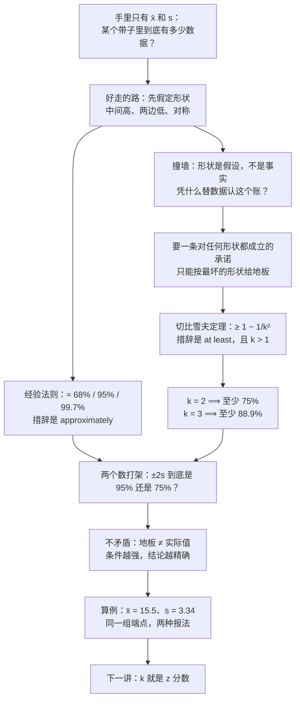

# C2.5 标准差怎么用：切比雪夫定理与经验法则 Chebyshev's Theorem & Empirical Rule

> [!abstract] 这一讲的任务
> 上一讲把"数据散得多开"压缩成了一个数：标准差 $s$。可 $s$ 单独放在那里是读不出来的——$3.34$ 美元到底算集中还是算乱跳？
> 这一讲给 $s$ 配一把尺子：把区间取成"离均值 $k$ 个标准差"，**这条带子里装着多少数据**？
> 答案有两个版本，区别只有一个词。不知道分布长什么样，只能说"**至少** $1-1/k^2$"；确认了中间高、两边低、左右对称，才能说"**大约** $68\%$、$95\%$、$99.7\%$"。这两句话怎么分工，是本讲最容易被考倒的地方，也是后面 $z$ 分数、置信区间、控制图的共同前提。

> [!info] 怎么读这份讲义
> 第 0 节是一个只能拿到两个数字的场景；第 1 节把"代表性"翻译成一个可以数出来的比例；第 2 节走好走的那条路（经验法则），第 3 节立刻撞墙（形状未知）；第 4–5 节是重心——切比雪夫定理从哪来、为什么只能写"至少"、它和 $95\%$ 为什么不矛盾；第 6–7 节是两道算例；第 8 节把两套口径并排，给记忆法与易错点；第 9 节通向下一讲的 $z$ 分数。
> 标注约定：标有 **（拓展）** 或 **【拓展】** 的内容，是不在主干里、由教材与通行讲法延伸补充的部分。复习时先掌握未标注的主干，考点集中在主干上。
> 一句话勘误：正态曲线下三档面积的精确值是 $68.27\%$、$95.45\%$、$99.73\%$，通行写法取整为 $68\%$、$95\%$、$99.7\%$；另有一处把均值 $15.5$ 念成了 $16.5$，端点会整体平移 $1$ 美元（见第 6 节）。

---

## 0. 开场：只有两个数字的一张表（p.61）

你在券商实习。分析师把一张摘要卡推到你面前，上面只有两行：

- **新发行股票**（new stock issues）收盘价的均值：$\bar x = 15.5$ 美元；
- 同一批收盘价的标准差：$s = 3.34$ 美元。

这两个数，就是上一讲从那八个数里算出来的结果。八个原始数字被压成了这两行——摘要本来就该干这件事。可分析师下午就要见客户，客户的问题很具体：

> "16 到 19 美元这个区间，靠不靠谱？"

换成统计的说法，他要的是**"这个区间里大概占多少"**——一个比例。而你手上只有中心和散度。

问题就在这儿：**"有几个落在某段区间里"，恰恰是压缩成两个数时被丢掉的那部分信息。** 八个数字时你还能一个个数，客户要问的却是"这只新股的同类以后会怎么走"这种成千上万个观测的问题——那时候，你手上真的只剩两行摘要了。

所以这一讲要回答的是：**被丢掉了形状之后，还剩多少话能说。**

先别急着答。

> [!question] 停一下，先自己想想
> 只给均值和标准差，能不能说出"某段区间里占多少比例"？如果能，靠的是什么？如果不能，缺的是什么？

你会本能地想：$16$ 到 $19$ 美元不就是"均值往上一点点"吗？那大概是"大多数"吧。

问题正好卡在这个"大概"上。**比例不是由这两个数决定的，是由数据的形状决定的。** 同样一个中心、同样一个散度，数据可以全挤在中间，也可以摊在两头；这两种情况下，同一个区间里的比例可以差出二十几个百分点。这一讲要做的，就是把"我对形状知道多少"和"我敢说多大的比例"这两件事对上号。

---

## 1. 上一讲留下的半句话：离散程度是"代表性的强弱"（p.61）

先把上一讲收个尾。

集中趋势（mean、median、mode）回答的是：**这堆数据往哪个位置集中**。离散程度（range、variance、standard deviation）回答的是另一个问题：**那个中心位置，到底有多可信**。

这句话在实际使用时经常被说成"离散程度测度集中趋势代表性的强弱"——方向没错，但它还是个形容词，做不了任何计算。要让它变成能算的东西，只需要问一句：**"代表性"到底是关于什么的强弱？**

答案是"关于**一段区间**的强弱"。均值本身不携带任何关于比例的信息；只有当你说"$\bar x \pm$ 多少之内"的时候，比例这个词才有意义。于是"代表性"被翻译成一个可以数的量（下面那个 $k$ 只是一个倍数——"取几倍标准差"，它的作用第 4 节才彻底交代）：

$$
\text{把区间取成 } \bar x \pm ks\ (k>1)，\quad \text{问：里面占多少比例？}
$$

这一步翻译很关键，它把一句评语变成了三个具体问题：

| 问题 | 谁回答 |
|---|---|
| 带子取多宽？ | 你定：$k$ 取几倍标准差 |
| 里面占多少比例？ | 这一讲要给的答案 |
| 凭什么这么说？ | 这一讲真正的难点 |

> [!note] 前置：这里的 $\bar x$ 和 $s$ 是谁
> $\bar x$ 是**样本均值**（sample mean），$s$ 是**样本标准差**（sample standard deviation，分母是 $n-1$）。它们是从手里这份数据算出来的统计量，不是总体的 $\mu$ 和 $\sigma$。读法上不用区分得太细：这一讲的所有结论，把 $s$ 当成"这批数据的散度"就够了。
> $s$ 的量纲和原始数据一样（美元），所以"$s=3.34$ 美元"本身没有大小之分；只有把它和 $\bar x$ 放在一起，写成"离中心几个 $s$"，它才变得可读。这也解释了为什么后面所有的区间都长成 $\bar x \pm ks$ 这个样子。

**回头看我们干了什么**：我们把"离散程度说明集中趋势靠不靠谱"这句评语，改写成了"$\bar x \pm ks$ 里占多少比例"这个问题。接下来的全部工作，就是回答这个比例。

---

## 2. 好走的那条路：经验法则（p.66–67）

先走一条最省力的路：如果数据长得像一口钟，比例是现成的。

> [!important] 经验法则 Empirical Rule
> 若数据**中间高、两边低、左右对称**（mound-shaped and symmetric），则
> - 约 $68\%$ 的观测落在 $\bar x - s$ 到 $\bar x + s$；
> - 约 $95\%$ 的观测落在 $\bar x - 2s$ 到 $\bar x + 2s$；
> - 约 $99.7\%$ 的观测落在 $\bar x - 3s$ 到 $\bar x + 3s$。

先把这个名字拆开，它自己就交代了出身。

**经验**（empirical）说的是：这三组数字**不是从某条公式推出来的**，是从大量实际数据里反复看到、然后被记住的规律。**法则**（rule）说的是：它短到可以背，不需要每次重算。合起来，它的动作是——**先看一眼数据像不像钟，像就照表报比例，不像就别用**。所以它有两件事必须一起记：三个数字，和一个前提。

**前提**用的是两个形容词：mound-shaped（像土堆，中间鼓、两边塌）和 symmetric（左右对称）。两个条件缺一不可。为什么必须对称？因为这组数字说的是"$\bar x$ 左边 $s$ 和右边 $s$ 加起来"的面积；一旦左右尾巴不一样长（偏态），左边那一截和右边那一截就不是同一回事，$68\%$ 立刻对不上。

**为什么"面积"就是"比例"**，这是全讲最值得先消化的一句。把数据画成直方图，所有柱子的面积加起来是 $1$（也就是 $100\%$）。那么"落在 $\bar x \pm s$ 里的数据占多少比例"，就是"这一段区间上柱子的面积占全部面积多少"。**面积 = 数据出现的可能性**。换成面积来说，很多后面才讲的东西（$z$ 分数、$p$ 值、置信水平）现在就有了统一的说法；这一讲的三个百分比，本质上都是曲线下的三块面积。

三组数字有一个特点，考试里常拿来设陷阱：**它们不是相加关系，而是累计关系**。$68\%$ 已经在 $\pm 1s$ 里头了，$95\%$ 是"再往外一圈之后的总量"，$99.7\%$ 是更外一圈的总量。三档带子是嵌套的，外层包住内层。

还有一句话必须现在说清楚：$68\%$、$95\%$、$99.7\%$ 后面跟的动词是**大约**（approximately）。它们来自钟形曲线下算出来的精确面积，落在真实数据上只能当近似。这一讲后面的精确值是 $68.27\%$、$95.45\%$、$99.73\%$，三档都是"约"。

> [!warning] 这一组数要当场记住
> $68$、$95$、$99.7$ 三档是没有商量余地的，不要留到考前再背。理由不在于它难，而在于**它是后面几乎所有快速判断的地基**：$z$ 分数怎么读、置信区间为什么取 $1.96$、控制图为什么把界线放在 $3\sigma$，全是这三块面积在支撑。

**回头看我们干了什么**：只要数据是钟形、且左右对称，$\bar x$ 和 $s$ 就能报出比例，报法是三档现成的百分比。这条路的代价写在小字里——**你得先知道它长得像钟**。

---

## 3. 撞墙：这张门票我们买不起（p.61）

现在回到那张只有两行的表。

新发行股票的收盘价，中间高两边低吗？**不知道。** 新股里既有上市首日翻倍的，也有直接破发的；右尾（暴涨那一段）通常比左尾长，这本身就违反了"对称"。

于是出现一个很尴尬的局面：手上唯一能用的工具（经验法则），它的前提恰好是我们不知道的那件事。

> [!question] 停一下，先自己想想
> 如果对形状一无所知，只知道 $\bar x$ 和 $s$，能不能给出一个**在任何情况下都不会被打脸**的说法？

先试试两个朴素办法，看它们死在哪里。

**朴素尝试一：赌它是正态，直接报 $95\%$。** 这个做法在实务里非常常见，也常常能用。死穴是：它没有把"赌"这件事说出来。一旦这批数据是双峰的、或者右尾拖着一条长尾，$\pm 2s$ 里的比例就可能明显低于 $95\%$。而客户是拿这个数字去做决策的——错的那部分不会退回给他。

**朴素尝试二：退一步，报个很小的数，比如"$\pm 1s$ 里至少有 $50\%$"。** 听起来很安全。可它一样没有依据：取一堆数据，让它有 $49\%$ 落在两侧远处、只剩 $2\%$ 在中心附近，算出来的 $\pm 1s$ 里就只剩约 $2\%$。$50\%$ 这个说法同样会被打脸。

两个尝试死在同一处：**它们在替数据做形状的假设，却不肯承认自己在做假设。**

那就换一个问法：不假设形状，只问"**最坏情况下，我至少能保证多少**"。这是完全不同的一个请求——前一个是"我猜它是多少"，后一个是"我敢担保不低于多少"。前者要形状，后者不要形状，代价是答案更难看。

> [!important] 这一讲的分水岭
> 一旦把问题从"大约多少"改成"至少多少"，工具就从经验法则切换成**切比雪夫定理**。反过来说，只有在你**确实知道**数据近似正态（或被明确告知可以这样假定）时，才轮得到经验法则。
> **不知道分布用切比雪夫，知道近似正态才用经验法则。** 这一条是考点。

---

## 4. 不知道形状也能开口：切比雪夫定理（p.62–63）

> [!important] 切比雪夫定理 Chebyshev's Theorem
> 对**任何形状**的数据集，当 $k>1$ 时，落在区间 $\bar x - ks$ 到 $\bar x + ks$ 里的数据**至少**占
> $$\boxed{\ 1-\frac{1}{k^2}\ }$$
> 具体到三档：
> - $\bar x \pm s$（$k=1$）：**没有有用信息**（no useful information）；
> - $\bar x \pm 2s$（$k=2$）：至少 $\dfrac34=75\%$；
> - $\bar x \pm 3s$（$k=3$）：至少 $\dfrac89\approx 88.9\%$。

它的动作只有三步：**先定 $k$**（你打算把带子取成几倍标准差）→ **再算地板 $1-1/k^2$** → **然后报"至少这么多"**。三步里没有一个地方需要知道数据长什么形状。

名字也要拆一下。**切比雪夫**（Chebyshev，俄文 Чебышёв）是 19 世纪的俄国数学家，这条结论是他证明的，所以冠他的名。**定理**（theorem）指"对一整类对象普遍成立的陈述"——这里那"一整类"就是**所有形状的分布**，这也正是它值钱的地方。教材上叫定理，口头上常叫**切比雪夫不等式**（Chebyshev's Inequality）；两个名字指的是同一件事，因为定理的内容本身就是一条不等式。看到"不等式"三个字不用紧张，它只是在提醒你：给的是**界限**，不是等号。

### 4.1 为什么 $k=1$ 那一档是空的

$k=1$ 时通式给出 $1-1/1=0$，也就是"至少 $0\%$"——一句废话。这不是公式的缺陷，而是**真的没有信息**。

道理在于带子的宽度。$\pm 1s$ 太窄，窄到形状的影响完全盖过它：均匀分布（每一段都长得一样密）里这段带子装得下约 $57.7\%$，钟形装 $68.3\%$，而前面那个"两侧各一堆、中心空着"的构造可以只剩 $2\%$。同一个 $k$，比例能从 $2\%$ 跑到将近 $100\%$，那就什么都不能承诺。

到了 $k=2$，形状之间的差异才开始被压住——这时候底线才浮现出来。这就是通式里写 $k>1$ 的原因：**不是数学上的技术性限制，而是"从两倍标准差起，才谈得上规律"**。$k$ 也不限于整数：客户要"至少 $90\%$"，解 $1-1/k^2=0.9$ 得 $k=\sqrt{10}\approx 3.162$，带子就是 $15.5\pm 3.162\times 3.34$，照样成立（第 6 节会真的算出来）。

### 4.2 $1-1/k^2$ 是怎么来的（拓展：只用到"方差是偏离平方的平均"）

这条式子看起来很神秘，其实三行就完。设数据有均值 $\mu$、标准差 $\sigma$（样本里换成 $\bar x$、$s$，道理一样）。设**落在 $\mu\pm k\sigma$ 之外**的数据比例为 $p$。

方差是所有数据"偏离平方"的平均，所以它至少要被外面那一小部分贡献出来：

$$
\sigma^2\ \ge\ p\cdot (k\sigma)^2
$$

外面那些点，每个离中心至少 $k\sigma$，平方至少 $k^2\sigma^2$，权重是 $p$——这就是不等号右边。两边约掉 $\sigma^2$：

$$
1\ \ge\ p\,k^2\qquad\Longrightarrow\qquad p\ \le\ \frac{1}{k^2}
$$

也就是"外面最多占 $1/k^2$"，所以"里面至少占 $1-1/k^2$"。

整个过程只用了一条性质，而且这条性质对**任何形状**都成立，因为方差是这么定义的。这正是它能对任意分布生效的原因：**它不挑形状，因为它只碰了均值和方差这两个对形状不敏感的量。**（这条推导不在主干里，考试不会要求你写，但它解释了公式的出身——记住它比记住式子更省力。）

**回头看我们干了什么**：我们现在有一条不依赖形状的下界。代价是它很保守：$k=2$ 时真实比例可能是 $95\%$，它只敢担保 $75\%$。这个"保守"不是估算失误，是**故意留的余量**，因为承诺的对象包括最刁钻的形状。

---

## 5. 75% 和 95% 打起来了（p.62）

现在把两节的东西并排放。同一件事，两个数字：

| 出处 | $k=2$ 时说的比例 | 措辞 |
|---|---|---|
| 经验法则 | 约 $95\%$（精确 $95.45\%$） | approximately |
| 切比雪夫定理 | 至少 $75\%$ | at least |

差了二十个百分点。这是本讲最值得停下来问一句的地方。

> [!question] 课堂追问：为什么会差这么多？
> 上一节刚说"$\pm 2s$ 里大约 $95\%$"，这一节又说"至少 $75\%$"。凡是真的东西就不该互相矛盾，那两个数到底哪个对？

先列候选解释，别急着选：

1. 有一个算错了；
2. 两个数说的不是同一个对象；
3. "大约"和"至少"本来就不是一回事。

答案是 **2 和 3 同时成立，而且它们是同一件事的两面**。

**先看 2。** 切比雪夫适用于**任何**形状，钟形当然也在其中——所以 $75\%$ 不是"钟形下的比例"，而是"对任意分布都成立的地板"。而 $95.45\%$ 是**加了条件之后**（中间高、两边低、左右对称）的精确值。条件越强，结论越精确；条件越弱，只能给越保守的下界。这不是两个互相竞争的数字，是同一条信息在不同前提下的两个版本。

**再看 3。** "至少 $75\%$" 和 "$95.45\%$" 可以同时为真：后者在前者之上。"至少 $75\%$"这句话并没有说"就是 $75\%$"，它说的是"不会低于 $75\%$"。地板压得低，地板上的东西照样可以站得很高。

**一个类比**：你担保"这支球队这场至少进 $0$ 个球"，最后它进了 $3$ 个。担保没有错，只是它什么也没排除。切比雪夫就是这种担保，只不过它的数字是从方差推出来的、不是随口说的。

### 5.1 为什么"至少"这个词省不掉：三种形状排在一起看

同一个中心、同一个散度，落在同一个 $\pm 2s$ 里的比例能差多少？直接算三遍。三种形状都取 $\bar x=15.5$、$s=3.34$（于是带子的左右端永远是 $8.82$ 和 $22.18$）：

- **钟形**：$\pm 2s$ 里 $95.4\%$，就是经验法则那一档；
- **两端翘起的双峰（U 形）**：$97.1\%$，比钟形还多；
- **三垛式（中心一大堆、两侧各一小堆）**：$75.0\%$——正好踩在切比雪夫的地板上。

![[C2.5-同均值同标准差三种形状的覆盖比例.png]]
三幅图画的就是这三遍计算，横轴都是收盘价。前两幅是密度曲线（纵轴是概率密度，曲线下的面积加起来等于 $1$）；第三幅把三处的概率直接画成竖条（条的高度就是该点占的比例，三段加起来也等于 $1$）。看的时候盯住那两条红色虚线——三条带子的位置一模一样，装进去的东西却从 $75\%$ 跨到 $97\%$。你手上只有 $\bar x$ 和 $s$ 时，无法判断自己面对的是哪一种，这就是为什么这里只能写"至少"。

> [!note] 一处要澄清的说法（拓展）
> 讲"任意形状"时，一个流传很广的说法是把**两端翘起的 U 形**举成"最极端的情况"。方向是对的——它提醒我们形状可以是任意样子，$95\%$ 不能承诺——但严格算下来，**U 形其实装得比钟形还多**（上图中 $97.1\%$）。原因是：数据散在两端，$s$ 被撑大了；$\pm 2s$ 于是把两边一起罩住。
> 真正能把比例压到 $75\%$ 的，是上图第三种**三垛式**：中心 $75\%$，两侧各 $12.5\%$，两小垛正好压在 $\bar x\pm 2s$ 上。它的方差是多少？两侧那 $25\%$ 每个点离中心 $2s$，所以
> $$\sigma^2=0.25\times(2s)^2=s^2,$$
> 标准差恰好还是 $s$——也就是说，**这个形状与钟形用的是同一把尺子**，可带子里只剩 $75\%$。
> 通用地说，中心放 $1-1/k^2$、两侧各放 $1/(2k^2)$、位置压在 $\pm ks$ 上，就得到"带内恰好 $1-1/k^2$"的形状。切比雪夫的下界因此**不能再改进了**：任何更高的承诺都会被这个形状打穿。（这一条不在主干里，但它回答了"为什么偏偏是 $1-1/k^2$ 而不是别的"。）

### 5.2 把"知道多少"和"敢说多少"列成一张表

到这里，逻辑其实是一句话：**你关于形状的知识每多一点，结论就精确一点。**

| 你掌握的关于形状的信息 | 你能说的话 | 措辞 |
|---|---|---|
| 什么都不知道 | 至少 $1-1/k^2$，且只对 $k>1$ | at least（地板） |
| 知道中间高、两边低、左右对称 | 约 $68\%$、$95\%$、$99.7\%$ | approximately |
| 知道它具体是哪条曲线（第 4 章的正态表） | 精确到小数点后两位 | 查表 |

**回头看我们干了什么**：我们把"$75\%$ 和 $95\%$ 打架"化解成了"两个前提下的两个结论"，并且用三种形状的图证明了：不带形状信息时，地板是唯一诚实的说法。

---

## 6. 算例一：用切比雪夫给一个"至少 75%"的区间（p.64–65）

> [!example] 题目
> 上一讲那批收盘价已算出均值 $\bar x=15.5$、标准差 $s=3.34$。请给出一个区间，使**至少 $75\%$** 的收盘价落在其中。

> [!question] 先自己想
> "至少 $75\%$"对应的是 $k$ 等于多少？要不要先知道这批数据的形状？

不用知道形状——这正是用切比雪夫的理由。要做的只有一件事：把 $75\%$ 代回通式，解出 $k$。

$$
1-\frac{1}{k^2}=0.75
\;\Longrightarrow\;
\frac{1}{k^2}=\frac14
\;\Longrightarrow\;
k^2=4
\;\Longrightarrow\;
k=2 .
$$

$k=2$ 就是"两倍标准差"。于是区间是

$$
(\bar x-2s,\ \bar x+2s)=(15.5-2\times 3.34,\ 15.5+2\times 3.34)=(8.82,\ 22.18).
$$

**回答的方式也要一起学**：能说的是"**至少** $75\%$（也就是四分之三）的新股收盘价落在 $8.82$ 到 $22.18$ 美元之间"。不能说的是"$95\%$ 的价格落在这里"——形状未知，那个数字没有依据。

最后用定义回代一遍，把端点错位这类低级错误挡住：

$$
15.5-2(3.34)=15.5-6.68=8.82,\qquad 15.5+6.68=22.18 .
$$

> [!warning] 这道题里有一处口误
> 题干印的均值是 $15.5$，念题时却读成了 $16.5$，于是"算出"的区间是 $(9.82,\ 23.18)$——两端各偏 $1$ 美元。后面再提到这笔数据时又回到了 $15.5$。
> 这类错不是理解问题，是誊写问题，而它的后果和"用错分布"一样严重：报给客户的是一条整体平移过的带子。防它的办法是固定的：**端点算完一定用 $\bar x\pm ks$ 回代一遍**，两端的间隔要正好是 $2ks$（这里 $6.68$）。

> [!example] 追问：客户要"至少 90%"怎么办
> $k$ 不必是整数。解 $1-1/k^2=0.9$，得 $k=\sqrt{10}\approx 3.162$，于是
> $$(15.5-3.162\times3.34,\ 15.5+3.162\times3.34)\approx(4.94,\ 26.06).$$
> 也就是说"至少 $90\%$ 的新股收盘价在 $4.94$ 到 $26.06$ 美元之间"。注意这条带子一下子宽了很多——**要求越高，带子越宽**，这是后面"置信水平越高、区间越宽"的同一个道理。
> 顺便记住几个地板值：$k=1.5$ 时 $1-1/2.25\approx 55.6\%$；$k=2$ 时 $75\%$；$k=3$ 时 $88.9\%$；$k=4$ 时 $93.75\%$；$k=10$ 时 $99\%$。

---

## 7. 算例二：同一组数据，换成经验法则口径（p.68–69）

> [!example] 题目
> 同样 $\bar x=15.5$、$s=3.34$。如果**可以假定**这批数据左右对称、中间高（mound-shaped），求落在 $\bar x\pm s$、$\bar x\pm 2s$、$\bar x\pm 3s$ 里的数据各占多少比例。

这道题的重点完全不在算术。比例是现成的三档，唯一要做的是把三个区间算出来：

| 带子 | 比例（经验法则） | 端点 $=15.5\pm k\times 3.34$ | 复算 |
|---|---|---|---|
| $\bar x\pm s$ | 约 $68\%$ | $(12.16,\ 18.84)$ | $15.5-3.34=12.16$；$15.5+3.34=18.84$ |
| $\bar x\pm 2s$ | 约 $95\%$（精确 $95.45\%$） | $(8.82,\ 22.18)$ | $15.5-6.68=8.82$；$15.5+6.68=22.18$ |
| $\bar x\pm 3s$ | 约 $99.7\%$（精确 $99.73\%$） | $(5.48,\ 25.52)$ | $15.5-10.02=5.48$；$15.5+10.02=25.52$ |

![[C2.5-经验法则三条带子.png]]
三条带子一层套一层，面积从内到外依次是 $68.3\%$、$95.4\%$、$99.7\%$。最外那一档之外还剩 $0.27\%$——**不是 $0$**。这一点在做判断时很要紧：$3\sigma$ 之外仍然"会有人"，只不过极稀少。

> [!example] 顺手回代：上一讲那八个数，实际落进去几个
> 把 $17,16,21,18,13,16,12,11$ 代进三条带子数一数：
> - $\pm s=(12.16,\ 18.84)$：进来 $5$ 个，占 $62.5\%$（$21$ 太高，$12$ 和 $11$ 差一点没够着）；
> - $\pm 2s=(8.82,\ 22.18)$：进来 $8$ 个，占 $100\%$；
> - $\pm 3s=(5.48,\ 25.52)$：进来 $8$ 个，占 $100\%$。
> 和 $68\%$、$95\%$、$99.7\%$ 对得上吗？方向上对得上，但 $62.5\%$ 与 $68\%$ 的差就是"半个人"——八个观测里，比例只能以 $1/8=12.5\%$ 为台阶跳动，谈"精确到 $0.1\%$"没有意义。经验法则描述的是**大量观测**时的近似比例，样本这么小时它只会给个大致轮廓。
> 另外注意 $\pm 2s$ 装下了全部八个：$s$ 本来就是从这八个数算出来的，带子自然罩得住它们——这不是巧合，而是"统计量由样本自己算出"的必然结果。

**现在把两道算例并起来看，这是整讲的收口处。** 同一个区间 $(8.82,\ 22.18)$：

- 按切比雪夫报："**至少** $75\%$"；
- 按经验法则报："**大约** $95.45\%$"。

端点一个都没变，变的是**你敢不敢替数据认下"近似正态"这个前提**。所以两件事要分清：

$$
\text{区间端点} = \bar x \pm ks \quad(\text{纯算术})\ ;\qquad
\text{百分比} = \text{你对形状的把握} \quad(\text{判断题}) .
$$

**回到开场那个问题。** 客户问的 $16$ 到 $19$ 美元，是一段**不以均值为中心**的区间（$15.5$ 在它的左边）。这里有一处边界要说清：切比雪夫定理只会给"以 $\bar x$ 为中心、左右对称"的带子——$\bar x\pm ks$。像 $16$ 到 $19$ 这种偏在一边的区间，它一句话也给不出。原因不难理解：定理的全部力量来自"对称地往外退"，一旦区间歪在一边，就没法用"外面最多占 $1/k^2$"这种两头平摊的算法了。

所以那一天的答案只能是：**在不知道形状的情况下，这一段区间的比例无从保证。** 要给客户一个具体数字，先去确认这批数据近似正态（第 4 章会教怎么判断）；确认之后，$16$ 到 $19$ 这段的比例才可以用正态曲线下的面积算出来。

> [!warning] $99.7$ 与 $99.73$，以及为什么不能直接用 $100\%$
> 正态曲线下 $|Z|\le k$ 的精确面积是：$k=1$ 为 $68.27\%$，$k=2$ 为 $95.45\%$，$k=3$ 为 $99.73\%$。通行的 $68/95/99.7$ 是圆整后的记法，$99.73$ 常常直接写成 $99.7$。
> 考试里写圆整值没问题，但**不要拿 $99.7\%$ 当成"全部"**：$3\sigma$ 之外还有约 $0.27\%$，在 $10{,}000$ 个观测里大约是 $27$ 个。做异常值判断、做质量控制时，这点尾巴正是关键（$+3\sigma$ 之外的那些点就是"要么错、要么真罕见"）。
> 还有一处小数差：端点 $(5.48,\ 25.52)$ 是用取整后的 $s=3.34$ 算的；若用未取整的 $s=\sqrt{78/7}=3.3381$，则是 $(5.49,\ 25.51)$。两者差一分钱，考试按题目给的 $s$ 算，别自己中途换精度。

---

## 8. 两套口径并排：怎么选、怎么记（p.62、p.66）

### 8.1 选择判据

一句话就够，考场上直接用：

> [!important] 用哪个？
> **不知道分布形状 → 切比雪夫定理，写"至少"；确认（或被明确告知）近似正态 → 经验法则，写"大约"。**
> 如果题目给了形状（"假定对称""假定来自正态总体"），才有资格用经验法则；题目什么形状都没说，用了就是错。

| 对比项 | 切比雪夫定理 | 经验法则 |
|---|---|---|
| 适用形状 | **任意**形状 | 中间高、两边低、左右对称 |
| 措辞 | at least（下界） | approximately（近似值） |
| $k=1$ | 无有用信息（$0\%$） | 约 $68\%$ |
| $k=2$ | 至少 $75\%$ | 约 $95\%$（$95.45\%$） |
| $k=3$ | 至少 $88.9\%$ | 约 $99.7\%$（$99.73\%$） |
| $k$ 的取值范围 | 只对 $k>1$ 成立 | 常用 $k=1,2,3$ |
| 用途 | 兜底、任何数据、报最低保证 | 快速估比例、读 $z$ 分数 |
| 保守程度 | 很保守，但不会被反例打穿 | 精确，但前提被打破就失效 |

两者**不是替代关系**：切比雪夫对正态也成立（只是给得保守），经验法则对非正态不成立。所以正确的理解是——**经验法则是切比雪夫在"多知道了形状"之后的加固版**。

### 8.2 三套百分比怎么记

看起来是三组数要背，其实是**一个骨架 + 两列填充**。

1. **骨架只有一个**：$k=1,2,3$。三档，都是"几倍标准差"。
2. **经验法则那一列**是钟形曲线下的面积：$68\rightarrow 95\rightarrow 99.7$。往外的**增量**是 $27.2$、$4.3$、$0.3$ 个百分点——每往外挪一格，新增的越来越少，因为尾巴越来越薄。记住"增量递减"这个形状，顺序就不会记反（$68$ 在最里、$95$ 在中间、$99.7$ 在最外），也顺手记住了 $3\sigma$ 之外还剩 $0.27\%$。
3. **切比雪夫那一列**是 $1-1/k^2$：$k=2\Rightarrow 1-\frac14=\frac34$；$k=3\Rightarrow 1-\frac19=\frac89$；$k=1\Rightarrow 0$。**分母带平方不是硬凑的**——方差里本来就是平方，所以"$\pm 2s$"外面最多允许占 $1/4$。记住这个来源，$\frac34$ 和 $\frac89$ 就不用背。
4. **真正必须背的只有三个**：$68$、$95$、$99.7$。切比雪夫记住通式 $1-1/k^2$（外加 $\frac34$、$\frac89$ 两个例子）即可，其余现算。

![[C2.5-切比雪夫下界与正态实际比例.png]]
这张图把两套口径的关系画在一张坐标里。横轴是 $k$，纵轴是"落在 $\pm ks$ 里的比例"：红线是钟形下的真实比例，蓝线是切比雪夫的承诺。读法三条：

- **蓝线永远在红线下面**——切比雪夫从不吹牛，代价是它常常低估；
- 两线之间那块黄色区域，就是"它没敢承诺、但实际拿得到"的部分。$k=2$ 时缺口最大：只保证 $75\%$，实际 $95.45\%$，浪费了二十个百分点；
- $k$ 越大，两线越贴近（$1-1/k^2$ 是"渐近正确"的），但**永远贴不上**。另外注意左端：$k=1$ 时蓝线正好落在 $0$，这就是"$\pm 1s$ 没有有用信息"在图上的样子。

> [!warning] 六个易错点
> 1. **把 $75\%$ 当成"正态下的比例"**。它在任何分布下都成立，正因为如此它才低。
> 2. **把"至少"改写成"大约"**。切比雪夫给的是下界，写成"大约"就变成了另一个主张。
> 3. **以为 $k$ 必须取整数**。$k>1$ 的任意实数都行，$k=\sqrt{10}$ 是合法答案。
> 4. **用经验法则却不检查形状**。这是最高频的错误：题目没说正态、也没说对称，就写上 $68/95/99.7$。
> 5. **把 $k$ 和 $s$ 混在一起**。$k$ 是倍数（无单位），$s$ 是标准差（有单位）；区间是 $\bar x \pm k\,s$，不是 $\bar x\pm k$。
> 6. **端点算错后不自查**。两端的间隔必须等于 $2ks$，回代一遍就能发现。
>
> **【拓展】** 严格成立的版本用的是总体标准差 $\sigma$。用样本 $s$ 代入是通行做法，$n$ 较大时差别可以忽略；样本很小时，切比雪夫的保证会打折扣，这一点学到后面的 $t$ 分布会看得更清楚。

> [!note] 接一句专业上的用场（拓展）
> 工程与算法里这套东西最常见的用法是**$3\sigma$ 判异常**：把落在 $\bar x\pm 3s$ 之外的观测标成异常。这条规则在"近似正态"时依据的是 $99.73\%$（还剩 $0.27\%$ 的尾巴）；如果分布形状没把握，就退回切比雪夫，说"至少 $88.9\%$ 的正常值在这条带子里，外面的至少是可疑的"。两种说法的强度差得很远，但都成立——这正是这一讲的主题。
> 反过来也要记住一句告诫：**很多真实数据的分布并不是钟形**（收入、点击量、股价收益都是重尾），拿 $68/95/99.7$ 去套它们，得到的不是近似，而是错觉。

---

## 9. 往前一步：$k$ 其实就是 $z$ 分数（p.70 起）

这一讲里，$k$ 一直被当成一个"你随手定的倍数"。但它有一个正式身份，而且下一讲整节都在讲它。

> [!important] 两句话的接口
> $k$ 是"**离均值几个标准差**"，把它写成一个数据点的形式，就是**$z$ 分数**（$z$-score，标准分数）：
> $$z=\frac{x-\bar x}{s}.$$
> 于是经验法则也可以改个说法：约 $68\%$ 的观测，其 $z$ 落在 $-1$ 到 $1$ 之间；约 $95\%$ 落在 $-2$ 到 $2$；约 $99.7\%$ 落在 $-3$ 到 $3$。

这个改写看着只是换符号，实际解决了一个大问题：**$k$ 是无单位的**，所以它能跨总体比较。同一门课的两张卷子、两个省的分数线、两家公司的股价波动，都可以各自标准化成 $z$，然后放在同一把尺子上。

下一讲会顺着这条路走下去：$z$ 不只告诉你"离中心几个标准差"，还能告诉你"比你高的人占多少、比你低的人占多少"。比如带子上端那个价格 $22.18$，$z=(22.18-15.5)/3.34=2$；在钟形假定下，比它低的约占 $97.7\%$（$P(Z<2)=0.9772$），比它高的约占 $2.3\%$。高考的标准分用的正是这套换算——原始分减均值、再除以标准差，就能跨科目比较。

---

## 这一讲的三句话

1. **区间永远是 $\bar x\pm ks$，$k$ 是"几个标准差"；百分比由你对形状的把握决定。** 算端点是算术，报百分比是判断题，两件事不要混。
2. **不知道形状，只能说"至少 $1-1/k^2$"（$k>1$）**：$k=2$ 至少 $75\%$，$k=3$ 至少 $88.9\%$，$\pm 1s$ 这一档什么都没有。
3. **确认中间高、两边低、对称，才能说"大约 $68/95/99.7$"。** 这两组数字不矛盾——一个是地板，一个是加了条件之后的实际值；条件越强，结论越精确。

> [!tip] 速查表
> | 名称 | 式子 / 数值 | 适用条件 |
> |---|---|---|
> | 切比雪夫定理 | 至少 $1-1/k^2$，$k>1$ | 任意形状 |
> | 切比雪夫三档 | $k=1$：无信息；$k=2$：$\ge 75\%$；$k=3$：$\ge 88.9\%$ | 任意形状 |
> | 经验法则三档 | 约 $68\%$ / $95\%$ / $99.7\%$ | 中间高、两边低、对称 |
> | 三档精确值 | $68.27\%$ / $95.45\%$ / $99.73\%$ | 正态 |
> | 区间通式 | $(\bar x-ks,\ \bar x+ks)$ | 都要 $k$ 与 $s$ 同量纲 |
> | 反解 $k$ | $k=1/\sqrt{1-p}$，$p$ 为目标比例 | $p\in(0,1)$ |
> | 新股算例 | $\bar x=15.5,\ s=3.34$ | $k=1,2,3$ 的端点：$12.16/8.82/5.48$ 与 $18.84/22.18/25.52$ |

> [!tip] 下一讲预告
> 这一讲的 $k$ 是"我随手定的倍数"，下一讲把它变成一个**每个数据点都有的数**：$z$ 分数。
> 一旦有了 $z$，"离中心几个标准差"就能翻译成"我排在什么位置"——百分位数怎么算、$z$ 分数怎么读、跨总体怎么比（两门课的成绩谁更好），都从这里接上。顺便还会看到一个反直觉的结论：$z$ 分数把数据平移、拉伸，**位置和形状都不变**，变的只是那把尺子的刻度。

---

## 相关笔记 Related Notes

- 相关：[[C2.4 离散程度：极差、方差与标准差]]（$\bar x$ 与 $s$ 的来源、为什么除以 $n-1$）、[[C2.2 定量数据的图形：点图、茎叶图与直方图]]（判断"中间高两边低"要靠直方图）
- 上一讲：[[C2.4 离散程度：极差、方差与标准差]]
- 下一讲：[[C2.6 百分位数与 z 分数]]
- 返回：[[统计学课程 MOC]]
