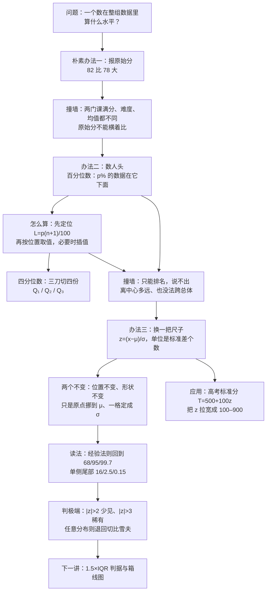
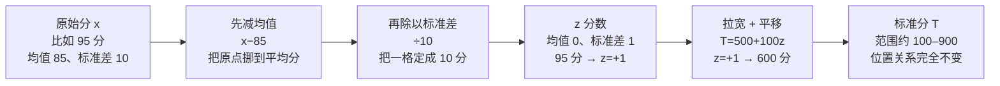

# 2.6 百分位数与 z 分数 Percentiles and z-Scores

> [!abstract] 这一讲的任务
> 前面三讲都在给**整组数据**做体检：中心在哪（均值、中位数、众数）、散得多开（极差、方差、标准差）、某个区间里能装多少数据（切比雪夫、经验法则）。
> 这一讲换一个问法：**单独拿一个数出来，它在整组数据里到底算什么水平？** 82 分是个好分数吗？这取决于别人考了多少。
> 回答这个问题只需要两把尺子：一把**数人头**的（百分位数），一把**数标准差**的（$z$ 分数）。第二把尺子是本讲的主角，也是后面整门推断统计课的地基——它把任何一组数据都换算到同一把尺子上，从此不同总体之间可以比。

> [!info] 怎么读这份讲义
> 第 0 节先用一个"两门课、三个办法互相打架"的例子把问题立起来；第 1–2 节造第一把尺子（百分位数）并给出**怎么算**；第 3 节是它的标准例题；第 4–5 节造第二把尺子（$z$ 分数）并回答"一个 $z$ 到底算不算极端"；第 6 节是这条线最完整的应用——高考标准分为什么是 100 到 900；第 7 节把两把尺子摆在一起对照。
> 标注约定：标有 **（拓展）** 或 **【拓展】** 的内容，是课上没有展开、由教材与通行讲法延伸补充的部分。复习时先掌握未标注的主干——考点集中在主干上。
> 一句话勘误：第 5 节那几处"比你好的有多少人"的百分数是现场口算的，$z=+3$ 处报过 0.14%、又改口 0.17%，$z=+2$ 处报过 2.73%、又改口 2.27%，$z=-1$ 处一度想把 $1-68\%=32\%$ 直接当成一侧的尾巴。第 5 节已按公式逐个复算，并以复算值为准。

---

## 0. 开场：82 分和 78 分，哪个更好（p.70）

你这一学期考了两门数学类的课：**统计学 82 分**，**高等数学 78 分**。哪一门考得更好？

**第一反应**：82 > 78，统计学。

**第二反应**：可是两门课的给分尺度不一样啊。那看看两门课的班级情况：

| 课程 | 你的分数 | 班级平均 $\mu$ | 班级标准差 $\sigma$ |
|---|---|---|---|
| 统计学 | 82 | 72 | 8 |
| 高等数学 | 78 | 65 | 12 |

于是你想：**比平均分高出多少**？统计学高出 $82-72=10$ 分，高数高出 $78-65=13$ 分。13 > 10，所以**高数**考得好。

**第三反应**：等一下——统计学全班的标准差只有 8 分，你高出 10 分，已经超过了一个标准差还多；高数全班标准差 12 分，高出 13 分也就一个标准差出头。**同样是"高出一截"，在标准差小的那门课里更难得。**

三个办法，三个结论。这就是这一节要解决的事：我们需要一个**能折算的尺子**，把"82 分"这种带量纲、带课程个性的数字，换成一个**只描述位置**的纯数字。

> [!important] 相对位置的度量 Numerical Measures of Relative Standing
> 它不回答"这个数有多大"，只回答"**这个数在整组数据里站哪儿**"：在中心的上边还是下边、离中心几倍"典型的散开程度"、下面压着百分之几的数据。
> 数字本身没变，变的只是我们看它的坐标。

为什么要专门造这个东西？因为**比较**是统计学的日常：这个班比那个班、今年比去年、这家分店比那家分店、这个考生的化学比他的物理。只要两组的刻度不一样，原始值就没法直接比，而"位置"永远可以比。

---

## 1. 百分位数：把数据排好队，切 99 刀（p.71）

### 1.1 先试一个最土的办法

> [!question] 停一下，先自己想想
> 不许用平均分、标准差，只给你一组数和你自己的那个数，你怎么用一句话说清"我在这组数里算老几"？

最土的办法是**报名次**："我排第 37 名。"

这句话能听懂，但**没法比**。50 个人的第 37 名，和 1000 个人的第 370 名，哪个更好？名次本身带人数信息，不除掉人数就没意义。除掉人数：$37/50=74\%$，$370/1000=37\%$——这才可比。

也就是把"我排第几"换成"**我下面压着百分之几的人**"。这个"压着百分之几"就是百分位数。

> [!important] 定义：第 $p$ 百分位数 The $p$th Percentile（p.71）
> 第 $p$ 百分位数是一个数，使得
> $$p\%\ \text{的数据落在它下面},\qquad (100-p)\%\ \text{的数据落在它上面}$$
> 记法常写作 $P_p$。

名字逐字拆：**percent**（每百）+ **-ile**（表示"分位"的后缀）→ 百分位数；中文"百分位 + 数"，就是"**处在百分之几那个位置上的那个数**"。它天生是给"排队"用的——**先用大小把数据排成一列，再数人头**。没有排序就没有"下面"，所以第一步永远是排序（这一点和第 2.3 节中位数一模一样）。

依赖的前置工具只有两样：**排序**，和**比例**（除法）。就这么简单。

### 1.2 为什么是 99 个，不是 100 个

"分成一百份"这句话里藏着一个数数的问题。

> [!question] 课堂上的追问
> 要把一组数据分成**四**等份，需要切几刀？

三刀。分两份切一刀，分三份切两刀，分四份切三刀——**刀数 = 份数 − 1**。照这个规律，分成一百份要切 **99 刀**，于是有 **99 个百分位数**（$P_1,P_2,\dots,P_{99}$）。$P_0$ 和 $P_{100}$ 不是百分位数，它们就是最小值与最大值本身。

这也顺手解释了**分位数的命名规则**：分成几份就叫几分位数。分四份叫**四分位数 quartile**，分十份叫**十分位数 decile**，分一百份叫**百分位数 percentile**——同一种"切法"，只是刀数不同。

切四份那三刀有个专门的记号，这一段先认脸，下一讲要用：

> [!important] 四分位数的记号（p.81 的记号体系）
> $$Q_L=Q_1=P_{25},\qquad m=Q_2=P_{50}=\text{中位数},\qquad Q_U=Q_3=P_{75}$$
> - **下四分位数 lower quartile** $Q_L$：第 25 百分位数，25% 的数据在它下面；
> - **中四分位数**（就是中位数）：第 50 百分位数，一半在下面；
> - **上四分位数 upper quartile** $Q_U$：第 75 百分位数，75% 在下面、只有 25% 在上面；
> - 上下两刀之间的距离叫**四分位差 interquartile range**，$\mathrm{IQR}=Q_U-Q_L$，装的是**中间那 50% 的数据**。它怎么用、为什么它不受极端值影响，留到 [[C2.7 异常值、四分位数与箱线图]]。

还有一条现成的结论，是从 2.3 节直接继承过来的：

> [!important] 中位数就是第 50 百分位数（p.71）
> $$\text{Median}=P_{50}$$
> 所以"中位数"并不是一个新东西，它只是百分位数在 $p=50$ 处的特例。看懂这一点，后面所有"分位数"的公式都不会再吓人。

### 1.3 定义里那个含糊的地方

$p\%$ 在下面、$(100-p)\%$ 在上面——这句话在**理想连续**的数据上没毛病，但真实数据是离散的、还常常有**并列值**。如果 9 个数据里正好有 3 个都等于 63，那"63 下面是百分之几"就说不清了：等于 63 的人算下面还是不算？

所以实际动手时不能死读定义，要用一个**约定好的定位办法**把"第 $p$ 百分位数"钉死到某个具体位置。这就是下一节。

---

## 2. 算一个百分位数：先定位，再取值（p.71）

### 2.1 直接用比例数人头，会卡住

假设一组数据已经排好序，一共 $n=9$ 个：

$$42,\ 51,\ 55,\ 60,\ 63,\ 68,\ 71,\ 76,\ 94$$

要算第 25 百分位数。最自然的想法：25% 的人 → $9\times25\%=2.25$ 个人。

**撞墙**：2.25 个人是谁？第 2.25 个数据不存在。数据是"一颗一颗"的，比例算出来的位置却是连续的。这个矛盾在所有分位数上都会出现（第 50 百分位数遇到偶数个数据时也一样）。

出路是两步：**先把位置算出来（可以是小数），再按位置去取值（落在两个数之间就插值）**。这叫"先定位，再取值"。

### 2.2 定位公式，以及那个 $n+1$ 是哪来的

> [!important] 百分位数的位置 Location of the $p$th Percentile
> 把数据从小到大排好，第 $p$ 百分位数所在的**位置**是
> $$\boxed{\ L_p=\frac{p}{100}\,(n+1)\ }$$
> 位置算出整数，就取第 $L_p$ 个数据；算出小数，就在第 $\lfloor L_p\rfloor$ 个与第 $\lfloor L_p\rfloor+1$ 个之间按比例**插值**（线性内插，也叫差值法）。

为什么是 $n+1$ 而不是 $n$？这不是笔误，有两个互相印证的说法，记住任意一个就够用：

1. **它必须能退化成中位数。** 第 2.3 节已经证明过，中位数的位置是 $\dfrac{n+1}{2}$。把 $p=50$ 代进 $\dfrac{p}{100}(n+1)$，得到 $\dfrac{n+1}{2}$ ——**分毫不差**。一个公式如果在 $p=50$ 处和已知的正确答案对不上，它一定是错的；对上了，才敢往其他地方用。
2. **它数的是"段"，不是"点"。** $n$ 个数据把整条数轴切成 $n+1$ 段：第一个数左边、每两个相邻数之间、最后一个数右边。说"下面压着 $p\%$ 的数据"，量的正是"下面有几段"。$n=9$ 时有 10 段，$p=25$ 就是下面压着 $10\times25\%=2.5$ 段——这就是位置 2.5 的来历。

同理，四分位数的位置是 $\dfrac{i(n+1)}{4}$（$i=1,2,3$），十分位数是 $\dfrac{i(n+1)}{10}$，百分位数是 $\dfrac{i(n+1)}{100}$。**同一个公式，只换分母。**

### 2.3 手算：9 个数据的四个分位数

把上面那组数排好队（已经是升序），$n=9$，$n+1=10$：

| 要算 | 位置 $L_p=\frac{p}{100}\times10$ | 位置是什么形态 | 取值 |
|---|---|---|---|
| $P_{25}=Q_1$ | $2.5$ | 落在第 2 个（51）与第 3 个（55）之间 | $51+0.5\times(55-51)=53$ |
| $P_{50}=Q_2$ | $5$ | 正好是第 5 个 | $63$ |
| $P_{75}=Q_3$ | $7.5$ | 落在第 7 个（71）与第 8 个（76）之间 | $71+0.5\times(76-71)=73.5$ |
| $P_{90}$ | $9$ | 正好是第 9 个（最后一个） | $94$ |

![[C2.6-百分位数的定位-先找位置再取值.png]]
图里那三条虚线就是"刀"落下的地方：位置 2.5 那把刀只好插在第 2、3 个数中间，取值时就把两边的数各取一半。**"位置"是连续的，"数据"是离散的，插值就是在两者之间搭桥。**

三个读数放在一起看：$Q_1=53$、$Q_2=63$、$Q_3=73.5$，于是 $\mathrm{IQR}=73.5-53=20.5$——中间 50% 的同学，分数挤在 20.5 分的范围里。

> [!warning] 三个边界情况
> 1. **$L_p$ 落在最后一个之后**：比如再算 $P_{99}$，$L=99\times10/100=9.9>9$，公式给出的是"第 9 个再往右 0.9 格"，那里没有数据。此时取**最大值**（$94$）。同理 $L_p<1$ 时取最小值。
> 2. **一个数据都没有**（$n=0$）：分位数不存在。分位数是"数人头"的尺子，没有人头就没法数。
> 3. **粒度由 $n$ 决定**：9 个数据里，"$94$ 是第 90 百分位数"这句话的实际含义只是"上面还有 1 个人（11.1%）"。$n$ 越小，分位数越粗，相邻两个百分位数可能指向同一个数。

> [!warning] 两种约定会给出不同答案——考试按题目要求
> 四分位数还有另一种算法：**先切中位数，再对下半部分、上半部分各自取中位数**（下一讲 p.82–84 用的就是这个）。当 $n$ 是**奇数**时两种办法结果完全一样（$n=9$ 时都是 $Q_1=53$、$Q_3=73.5$）；当 $n$ 是**偶数**时就会差一点：以 p.82 那 6 个数 $4.9,6.3,7.7,8.9,10.3,11.7$ 为例，"下半部分取中位数"给出 $Q_1=6.3$，而定位公式给出 $L_{25}=25\times7/100=1.75$，插值得到 $4.9+0.75\times(6.3-4.9)=5.95$。两个数都对，只是约定不同。**看到答案对不上，先问"用的是哪套约定"，不要急着改公式。**

> [!note] 更准的分位数在分布曲线上（拓展）
> 上面算出来的分位数，本质是"经验分布"上的分位点，随 $n$ 抖动。真正的分位数应该由**概率分布曲线下的面积**定义：$P_p$ 是使左侧面积等于 $p\%$ 的那个横坐标。这一层课上也点到过：用面积来算更精确，百分位数、四分位数、十分位数都一样。这件事要到 C4.3 连续概率密度与正态分布才做得起来（查标准正态表反解 $z$），但它解释了为什么同一个数据集换一种约定会差一点：经验分位数只是真实分位数的一次抽样估计。

---

## 3. 标准例题：560 分能说明什么（p.72–73）

> [!example] Percentile Example（p.72–73）
> 你在 GMAT 考试中得了 **560 分**，这个分数落在**第 58 百分位数**。
> (a) 有多少比例的考生比你低？(b) 有多少比例的考生比你高？

这题不需要任何公式，只需要把定义读对：**"我是第 58 百分位数"的意思就是我下面压着 58% 的人。**

- (a) $58\%$ 的考生低于 560 分。
- (b) $(100-58)\%=42\%$ 的考生高于 560 分。

就这两行。**关键是别把"58"读成"58 分"**——百分位数是个位置，不是一个分数。

课上用三个熟悉的点把这条规则固定下来，这三个数最好直接记成条件反射：

| 你的位置 | 比你低的 | 比你高的 |
|---|---|---|
| 中位数 $P_{50}$ | 50% | 50% |
| 第一四分位数 $P_{25}$ | 25% | 75% |
| 第三四分位数 $P_{75}$ | 75% | 25% |
| 第 $p$ 百分位数 | $p\%$ | $(100-p)\%$ |

> [!warning] 百分位数只说位置，不说差距
> "第 58 百分位数"和"第 60 百分位数"之间可能只差 1 分，也可能差 40 分——**百分位数把分数的间距信息扔掉了**。两个都靠前的同学，百分位数差不多，实际水平可能差很远；反过来，中间那一段往往挤得最厉害，名次一变就要好几十分。这也是它和 $z$ 分数最重要的分工：**百分位数只保顺序，$z$ 分数还保留"离中心多远"的距离信息。**

---

## 4. $z$ 分数：用标准差当尺子量一量（p.74–76）

### 4.1 把开场那道题做完

回到 82 与 78。第三个办法是"超平均分的幅度除以标准差"：

$$\frac{82-72}{8}=1.25,\qquad \frac{78-65}{12}\approx1.083$$

1.25 > 1.083，所以**统计学考得更好**——和"超平均分"的结论正好相反。

这个算法的每一步都有话说：

- **先减均值**：把所有分数整体平移，让"平均"变成 $0$。这样"高于平均"就是正数、"低于平均"就是负数，正负号立刻告诉你方向。平移**不改变任何两个数的相对距离**，所以顺序、间距全保留。
- **再除以标准差**：把"一格"的长度定成**一个标准差**。这样算出来的数就不再是"分"，而是"**几个标准差**"——量纲被除掉了。

第一把尺子（百分位数）数的是人头，第二把尺子（$z$ 分数）数的是标准差。两把尺子都在回答"你在哪儿"，但一个用排名、一个用距离。

### 4.2 定义

> [!important] 定义：$z$ 分数 $z$-Score（p.74）
> 一个数据值离均值有**多少个标准差**，就叫它的 $z$ 分数：
> $$z=\frac{x-\bar x}{s}\quad(\text{样本})\qquad\qquad z=\frac{x-\mu}{\sigma}\quad(\text{总体})$$
> 其中 $\bar x,s$ 是样本均值与样本标准差，$\mu,\sigma$ 是总体均值与总体标准差。

三个名字指的是一件事，看到别慌：$z$ 分数 = **标准分数 standard score** = 标准化后的值。中国高考语境里说的"**标准分**"，就是它。

名字逐字拆：$z$ 只是一个**记号**（标准化后的变量习惯记作 $z$，就像原始变量习惯记作 $x$），真正有意义的是 **standard score**——"按标准差折算过的分数"。所以它的单位不是分、不是元、不是公斤，而是"**标准差个数**"，一个纯数字（无量纲）。

> [!tip] 三句人话，把 $z$ 读出来
> 1. **符号管方向**：$z>0$ 在均值之上，$z<0$ 在均值之下，$z=0$ 正好等于均值。
> 2. **大小管远近**：$z=2$ 就是"离均值两个标准差"，$z=-1.5$ 就是"低于均值一个半标准差"。
> 3. **它没有量纲**：所以公斤和厘米可以比，语文和数学可以比，两门课、两个班、两个省都可以比。

如果把 $z$ 换一种说法：$z$ 是"**这个值离均值的距离，是所有数据平均差异程度的多少倍**"。分母 $s$ 正是这组数据的"平均差异程度"（2.4 节的定义），所以 $z$ 就是在问"**我离中心，够得上几个'典型偏差'**"。这句话是这一讲最该带走的一句。

### 4.3 两个不变：位置不变、形状不变

> [!question] 停一下，先自己想想
> 把一组数据**每一个**都换成它的 $z$ 分数，然后重新排队：原来的最大值还是最大值吗？原来的分布形状（对称、右偏、双峰……）还是那个形状吗？

答案：**都不变。**

- **位置不变**：$z=\dfrac{x-\bar x}{s}$ 里 $s>0$（标准差开根号，永远是正的），所以这是 $x$ 的一个**严格递增**的线性函数。大的还大、小的还小，排名一个不动。
- **形状不变**：先平移（不减不增），再除以一个正数（把图形横向**压扁或拉胖**，但峰的个数、偏的方向都不动）。原来是右偏，标准化后还是右偏；原来是均匀分布，标准化后还是均匀分布；原来是正态，标准化后还是正态（只是均值为 0、标准差为 1）。

**换句话说：$z$ 变换不制造任何新信息，它只是换了一套刻度。**它把原点搬到 $\mu$、把一格定成 $\sigma$——这正是"标准化"三个字的全部内容。

顺带得到一个漂亮的推论：如果整组数据都换成 $z$ 分数，那么**这组 $z$ 的均值一定是 0、标准差一定是 1**。为什么均值是 0？因为 $\sum(x_i-\bar x)=0$；为什么标准差是 1？因为分子分母是同一个 $s$，除完就剩 1。

![[C2.6-同一把尺子-两门课的z分数对比.png]]
上图上半部分是两门课的原始刻度：均值线位置不同、带宽不同，同样"高出一截"看起来完全不同。下半部分换成同一把 $z$ 尺子后，两个分数才真正可比：$1.25$ 与 $1.08$，统计学那个更靠外。

> [!note] 标准化在机器学习里天天出现（拓展）
> 这就是 `StandardScaler`、批归一化（BatchNorm）在做的事：把不同量纲的特征各自减去均值、除以标准差，让梯度不被"数值大的特征"绑架。但请记住 4.3 的结论——**标准化只改刻度和原点，不改分布形状**。所以"先把数据标准化，它就变正态了"是错的；正态化（对数、Box-Cox 之类）是另一件事。同理，$|z|$ 的大小只有配上"分布近似正态"才能翻译成概率，见下一节。

### 4.4 手算例题（p.75–76）

> [!example] $z$-Score Example（p.75–76）
> 组装一个产品的平均时间是 **22.5 分钟**，标准差 **2.5 分钟**。
> (a) 一件产品用了 **20 分钟**，它的 $z$ 分数是多少？
> (b) 一件产品用了 **27.5 分钟**，它的 $z$ 分数是多少？

这道题留给自己动笔，理由很实在：这一类会算了，考试碰到就不会卡。算完再一起对答案。

**(a)** $x=20$，$\mu=22.5$，$\sigma=2.5$：

$$z=\frac{x-\mu}{\sigma}=\frac{20-22.5}{2.5}=\frac{-2.5}{2.5}=-1.0$$

**(b)** $x=27.5$：

$$z=\frac{27.5-22.5}{2.5}=\frac{5}{2.5}=+2.0$$

两句翻译：第一件产品比平均**快一个标准差**（$z=-1$）；第二件比平均**慢两个标准差**（$z=+2$）。注意这里是"时间"，所以 $z$ 为负反而是好事——**$z$ 的正负只表示"在均值的哪一边"，好坏要结合指标的方向自己判断**。

> [!warning] 别把 $z$ 当分数用
> $z=-1$ 不是"负一分"，也不代表"很差"。它精确的意思是"低于均值恰好一个标准差"。同一个人如果换成"考试分数"这种越高越好的指标，$z=-1$ 才是偏差；换成"组装时间""响应延迟""油耗"，$z=-1$ 反而是优秀。**符号是方位，不是评价。**

---

## 5. 一个 $z$ 到底算不算极端（p.77–78）

### 5.1 先把问题问清楚

现在你会算 $z$ 了。但 $z=+2$ 意味着"很厉害"吗？比多少人好？

这个问题**光靠 $z$ 本身答不了**：$z$ 只说"离均值两个标准差"，没说"两个标准差之外还剩多少人"。要知道人数比例，必须知道**分布的形状**。

而在不知道形状的时候，我们手里已经有一条能用的结论——上一讲的**经验法则**。

> [!important] 钟形对称分布下 $z$ 的读法（p.77–78）
> 如果数据近似**钟形、对称**（mound-shaped & symmetric），那么
> 1. 约 **68%** 的观测，$z$ 落在 $-1$ 与 $+1$ 之间；
> 2. 约 **95%** 的观测，$z$ 落在 $-2$ 与 $+2$ 之间；
> 3. 约 **99.7%** 的观测，$z$ 落在 $-3$ 与 $+3$ 之间。

这三条和上一讲"$\mu\pm k\sigma$ 里有多少数据"是**同一句话的两种坐标**：$z$ 只是把 $\mu+k\sigma$ 换算成了整数 $k$。上一讲用分数说，这一讲用 $z$ 说，仅此而已。

![[C2.6-z分数的读法-68-95-99.7与尾部比例.png]]
### 5.2 最容易错的一步：32% 是谁的 32%

> [!question] 课堂追问
> 某个工人的 $z=-1$，也就是说他比平均慢一个标准差。比他快的人占多少？比他慢的人占多少？

**朴素尝试**：落在 $\pm1$ 之间的是 68%，所以落在外面的就是 $1-68\%=32\%$。于是"比他快的人 = 32%"。

**撞墙**：这 32% 是**两侧合计**——左边一尾（比 $-1$ 还小）和右边一尾（比 $+1$ 还大）都在里面。而我们要问的只是他**这一侧**。

正确做法：两侧是对称的，各占一半，

$$\frac{100\%-68\%}{2}=16\%$$

所以：比他**慢**的（$z<-1$）约 $16\%$；比他**快**的（$z>-1$）约 $100\%-16\%=84\%$。**"比他好"要把中间那 68% 也算进去**，这是第二个容易漏的点。

同一个套路，三个 $z$ 一起算完：

| 两个界 $z=\pm k$ | 两界之间 | 外侧合计 | 单侧尾巴（经验法则） | 单侧尾巴（正态精确值） |
|---|---|---|---|---|
| $\pm1$ | 68% | 32% | 16% | 15.87% |
| $\pm2$ | 95% | 5% | 2.5% | 2.275% |
| $\pm3$ | 99.7% | 0.3% | 0.15% | 0.135% |

把这张表横着读，就是"一个 $z$ 值多少分"的换算表：

- $z=+1$：比约 **84%** 的人好（$100\%-16\%$）；
- $z=+2$：比约 **97.5%** 的人好，只有约 **2.5%** 的人比他好；
- $z=+3$：比约 **99.85%** 的人好，比他好的只有约 **0.15%**。

> [!warning] 现场口算的三处出入（复算为准）
> 这几句"比你好的有多少"是当堂口算报出来的，报的过程中有过犹豫和改口，按公式复算如下：
> 1. **$z=+3$ 的尾巴**：先报"百分之零点一四"，又改口"零点一七"。按经验法则 $(100-99.7)/2=0.15\%$；按正态精确值 $1-\Phi(3)=0.135\%$。**0.17% 是错的**，0.14% 只是 0.135% 的近似。
> 2. **$z=+2$ 的尾巴**：报过"2.5%"，也报过"2.73%""2.27%"。按经验法则（95%）是 $2.5\%$；按正态精确值（95.45% 在中间）是 $(100-95.45)/2=2.275\%$。**2.73% 是把 2.275 说反了**；相应的"比你差 97.27%"也应为 $97.725\%$。
> 3. **$z=-1$ 的 32%**：一度想把 $1-68\%=32\%$ 直接当成"比他好/比他差"的一侧，随后自己纠正为"比他差 16%、比他好 84%"。**16%/84% 是对的**，中间那个 32% 必须再除以 2。
>
> 这三个数的正确值都只差零点几个百分点，但**方法错一步就会差一倍**——考场上丢分的从来不是小数，是"尾巴要不要除以 2"。

### 5.3 所以，什么时候说"极端"

有了这张表，"极端"就有了可操作的标准：

- $|z|>2$：落在两端各 2.5% 的区域里，**不常见**（每一侧约 40 个人里 1 个，两侧合计约 20 个里 1 个）；
- $|z|>3$：落在两端各 0.15% 的区域里，**很稀有**（每一侧约 700 个里 1 个）；
- $|z|\le1$：约三分之二的人都在这儿，**普通**。

> [!warning] 这个标准只在"近似钟形对称"时成立
> 经验法则的前提是 mound-shaped & symmetric。**偏态、双峰、厚尾的数据，同样的 $z$ 对应的比例完全不同**：在极端厚尾的分布里，$z=4$ 可能一点都不稀奇。
> 如果对形状一无所知，只能退回上一讲的**切比雪夫定理**：任意分布下，$|z|\ge k$ 的数据至多占 $\dfrac{1}{k^2}$。代进去：$k=2$ 时至多 25%，$k=3$ 时至多 11.1%，$k=4$ 时至多 6.25%。这个界很松（$k=3$ 时是 11.1%，而正态下只有 0.3%，差了三十多倍），但它**不要求任何分布假设**——这就是它的价值。

这条线直接通到下一讲：既然 $|z|$ 大到一定程度就罕见，那"罕见"就可以当"异常"的判据。[[C2.7 异常值、四分位数与箱线图]] 里的 $|z|>3$ 判据和 $1.5\times\mathrm{IQR}$ 判据，都是这一节的自然延续——只不过一个用标准差当尺子（假设近正态），一个用四分位差当尺子（不假设分布）。

---

## 6. 一个把 $z$ 用到底的例子：高考标准分（课堂延伸）

### 6.1 为什么要绕这么大一个圈

前面都在算一个人的 $z$。这一节看一个**整群人一起换算**的例子，因为只有这样才能看清 $z$ 的真正用途：**把不可比的分数变成可比的**。

高考是**选拔性**考试，它要回答的不是"你掌握了多少知识"，而是"**你在所有人里排第几**"。

这个区别很要命。达标性考试（比如这门统计学期末考）看的是**绝对掌握**：每道题对应一个知识点，你都掌握了就该及格，全班都考 90 分也不违反任何原则——所以这门课的成绩应该用**原始分**，不需要把一半人按下去。

选拔性考试恰好相反：录取名额是固定的，学校要的是**区分度**和**位置**。这时候"我考了 82 分"几乎不含信息，含信息的是"我在 30 万人里排第几"。而位置，正是 $z$ 分数管的事。

### 6.2 换算流程

假设广东省（一个省内自己比，所以是全省一个大总体）共有几十万考生，原始分近似正态，均值 $\mu=85$、标准差 $\sigma=10$（课堂上的示意值）。

一步一步都对得上数：

- 原始分 $x=95$：$z=\dfrac{95-85}{10}=+1$ —— 高于平均一个标准差；
- 换成标准分：$T=500+100\times1=600$。

### 6.3 为什么是 500 和 100

$z$ 已经把位置说清楚了，为什么还要再换一次？

因为 $z$ 的刻度**太小、还带负号**。高考成绩的 $z$ 大致落在 $-4$ 到 $+4$ 之间，于是"你考了多少分"的答案会变成"我考了 $0.4568$ 分"或者"我考了 $-1.72$ 分"——十几年书读下来考个负数，既难听又难解释。

所以做一次纯粹的**线性拉伸**：

$$\boxed{\ T=500+100\,z\ }$$

- **加 500**：把均值挪到 500 分，从此没人有负分；
- **乘 100**：把一格从 $1$ 拉成 $100$，分数区间被拉宽到大约 $100$ 到 $900$。

验算边界：$z=+4\Rightarrow T=900$（全省最高附近），$z=-4\Rightarrow T=100$（全省最低附近），$z=0\Rightarrow T=500$（正好平均）。这也解释了当年标准分的"最高 900、最低 100"是怎么来的——**它不是一个评分标准，只是一次刻度换算**。

> [!important] 这一步是"换单位"，不是"改成绩"
> $T=500+100z$ 和 $z=\dfrac{x-\mu}{\sigma}$ 合起来是 $T=500+100\dfrac{x-\mu}{\sigma}$，仍然是**严格递增的线性变换**。所以：排名一个不变、谁上谁下一个不变、分布形状也一个不变。变的只有两件事——**原点**（挪到 500）和**刻度**（一格 100 分）。
> 换句话说，标准分里没有一个"新信息"是原始分里没有的。它的全部作用是把"位置"这件事**说得更清楚、也更好听**。

顺带说一句：$\pm4$ 这个范围也印证了 5.3 的结论——正态下 $|z|>4$ 的概率约 $0.006\%$（单侧 $0.003\%$），几十万人里也就个位数，所以拿 $\pm4$ 当"考卷的两端"是安全的。课上翻标准正态表时看到的最后一行 $z=3.99$、面积 $0.4999$，说的就是这件事：$z$ 到 4 附近，半个尾巴基本被填满了。

### 6.4 为什么它后来又全被取消了

这段历史值得写进来，因为它讲的是**统计方法之外**的失败模式。

标准分先是在个别省份（广东、海南）使用，后来推广到全国，再后来又一个个省退回原始分。一个在统计上更合理的做法，为什么会被弃用？

原因不在方法，在**解释**。当年高考放榜后有热线电话，家长问的典型问题是："我们家孩子平时都考八十多分，怎么一换算就变成六百来分了？这到底是怎么转的？"——而回答这个问题的"专家"把换算过程讲**错**了。

一旦讲错，家长看到的就不是"位置度量"，而是"黑箱"：没人能验证自己"该"得多少分，也没人说得清那个三位数是怎么从排名变出来的。**一个不能被解释的变换，在公众眼里和操纵没有区别。** 于是为了平息争议，最省事的办法就是退回人人看得懂的原始分。

这件事的教训很直接：**统计量只要参与公共决策，就必须能被讲清楚。** 而"讲清楚"的前提，恰恰是听懂 $z$ 是什么——所以这一段不是闲话，它是这一节的存在理由。

还有一个反面教材，说明**不可比**会造成什么后果。有一年江西用原始分录取，偏偏那年题目特别难，而填报志愿又是在**估分**之后进行的：所有人都把分数估低了，于是没人敢报顶尖学校，结果那一年最顶尖学校的投档线，只比一所次一档的学校高出**六分**。**分数不可比 → 大家只能猜 → 猜错就踩踏。** 如果当年的分数是"位置"（标准分或全省排名），这种集体误判就无从发生。

> [!note] 这不是中国独有的做法（拓展）
> 美国的 SAT 也是标准分：两个部分各 800、总分 1600，均值与刻度都是**人为设定**的，和高考的 500/100 是同一个套路。凡是要在几十万人里排位置、又不想让人看见负数的考试，几乎都会做这一步拉伸。看到"SAT 满分 1600"和"高考标准分满分 900"时，应该意识到：**这些数字本身没有单位，它们只是把 $z$ 乘了一个数、加了一个数。**

> [!warning] 标准化不会把非正态变成正态
> 4.3 的结论在这里同样成立：$T=500+100z$ 只是平移 + 缩放。高考分数看起来近似正态，是因为**考生人数极多、影响因素叠加**（中心极限定理的味道，第 5 章会正式讲），不是因为做了标准化。如果原始分本身是双峰的（比如两个水平差异很大的群体混在一起），换算出来的标准分**照样是双峰**。

---

## 7. 回头总结：两把尺子怎么分工（p.70–78）

停一下，把这一讲做过的事理一遍。

我们一开始只会说"82 分比 78 分大"，然后发现这句话在跨课程、跨群体时毫无意义。于是造了两把尺子：

| | 百分位数 percentile | $z$ 分数 $z$-score |
|---|---|---|
| 回答的问题 | 我下面压着百分之几的人 | 我离均值几个标准差 |
| 动作 | **先排序，再数人头** | **先减均值，再除以标准差** |
| 单位 | 百分位（$0\sim100$） | 标准差个数（无量纲） |
| 保住的信息 | **只有顺序** | 顺序 + 离中心的距离 |
| 好处 | 不需要知道均值、标准差，甚至不需要平均值存在 | 能跨总体比较、能直接接概率计算 |
| 盲点 | 抹掉了间距：58 与 60 可能只差 1 分 | 依赖 $\mu,\sigma$，会被极端值拖走（$s$ 不稳健） |
| 何时用 | 数据少、只要排名、分布不明 | 要比较、要接正态表、要做检验 |

**两把尺子的关系**：都保序（$z$ 大的一定百分位数大），但"位置—百分位"的对应要看分布。在正态分布下这条对应关系可以精确算出来：

> [!note] 两把尺子互换（拓展）
> 若数据近似正态，$z$ 与百分位数一一对应：
> - 第 58 百分位数 $\Leftrightarrow z\approx+0.20$（GMAT 那个 560 分，若按正态折算，只比平均高 0.2 个标准差——**58 百分位离中间很近**，这正是"中间一段挤得最厉害"的定量版本）；
> - $P_{25}\Leftrightarrow z\approx-0.67$，$P_{75}\Leftrightarrow z\approx+0.67$，$P_{90}\Leftrightarrow z\approx+1.28$，$P_{95}\Leftrightarrow z\approx+1.64$，$P_{99}\Leftrightarrow z\approx+2.33$。
>
> 这些数到第 4 章会以"标准正态表反查"的形式正式出现；现在只需要记住它们的量级：**$z=1$ 大约是 84 百分位，$z=2$ 大约是 97.7 百分位，$z=3$ 大约是 99.87 百分位。**

> [!tip] 速查表
> | 名称 | 公式 / 数值 |
> |---|---|
> | 第 $p$ 百分位数 | $p\%$ 的数据在下面，$(100-p)\%$ 在上面 |
> | 中位数 | $P_{50}$ |
> | 四分位数 | $Q_1=P_{25}$，$m=Q_2=P_{50}$，$Q_3=P_{75}$；$\mathrm{IQR}=Q_3-Q_1$ |
> | 位置公式 | $L_p=\dfrac{p}{100}(n+1)$（整数取该位，小数插值） |
> | $z$ 分数 | $z=\dfrac{x-\bar x}{s}$（样本），$z=\dfrac{x-\mu}{\sigma}$（总体） |
> | $z$ 的两个不变 | 位置不变、形状不变；$z$ 的均值 $=0$、标准差 $=1$ |
> | 钟形分布里 | $\pm1$：68%，$\pm2$：95%，$\pm3$：99.7% |
> | 单侧尾巴 | $z=1$：16%，$z=2$：2.5%，$z=3$：0.15% |
> | 标准化（高考） | $T=500+100z$，$z=\pm4\Rightarrow T=900/100$ |
> | 任意分布的兜底 | 切比雪夫：$\vert z\vert\ge k$ 至多 $\dfrac{1}{k^2}$ |

**这一讲在全课里的位置**：$z$ 是后面几乎所有推断的名字来源——第 5 章的**标准误**是"样本统计量的标准差"，第 6 章的置信区间是 $\bar x\pm z\cdot\dfrac{s}{\sqrt n}$，第 7 章的 $z$ 检验直接把 $\dfrac{\bar x-\mu_0}{s/\sqrt n}$ 和临界值比（[[C7.3 均值与比例的假设检验]]）。**它们都在做同一件事：把"离中心多远"折算成"几个标准差"。** 这一讲把这把尺子造出来，后面只是换分子。

---

## 这一讲的三句话

1. **百分位数数人头，$z$ 分数数标准差。** 前者只用顺序，后者连距离一起保留；两把尺子都在回答"我在哪儿"。
2. **$z=\dfrac{x-\mu}{\sigma}$ 是"离均值几个标准差"，无量纲，所以能跨总体比较。** 它只平移原点、放大刻度，不改变位置也不改变形状——标准化不制造新信息。
3. **一个 $z$ 算不算极端，要配上分布形状才能回答。** 钟形对称时：68/95/99.7，单侧尾巴 16/2.5/0.15；形状不明时退回切比雪夫，界很松但不需要假设。

---

## 相关笔记 Related Notes

- 相关：[[C2.3 集中趋势：均值、中位数、众数]]（中位数位置 $(n+1)/2$ 是定位公式的特例）、[[C2.4 离散程度：极差、方差与标准差]]（$s$ 就是 $z$ 里的那把尺子）、C4.3 连续概率密度与正态分布（把 $z$ 翻译成概率的工具）、[[C7.3 均值与比例的假设检验]]（$z$ 检验）
- 上一讲：[[C2.5 标准差怎么用：切比雪夫定理与经验法则]]
- 下一讲：[[C2.7 异常值、四分位数与箱线图]]
- 返回：[[统计学课程 MOC]]
