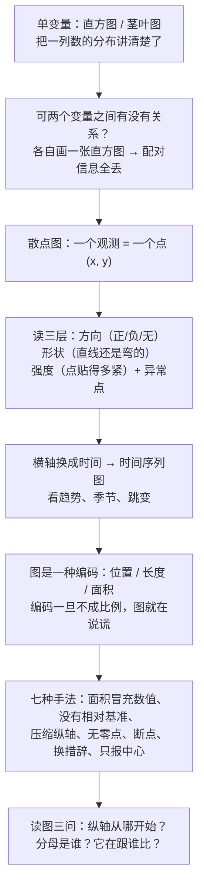

# C2.8 散点图、时间序列图与误导性图表 Scattergrams, Time Series Plots, and Distorting the Truth

> [!abstract] 这一讲的任务
> 上一讲把**一个**变量的分布讲透了：中心在哪、散得多开、有没有异常值。可现实里的问题几乎都是**两个变量一起**出现的——广告费与销量、日期与油价、年级与成绩。两列数放在手边，怎么一眼看出它们有没有关系？
> 这一讲先给出两个动作：把每个观测落成一个点，得到**散点图**；把横轴换成时间并把点连起来，得到**时间序列图**。然后翻过来讲同一件事的另一面：数据全是真的、图也全是真的，结论却可以是假的——七种"用真数据说假话"的手法，以及每一种的防线。

> [!info] 授课进度说明
> 目前拿到的授课转写稿覆盖到**第六节课**，内容截止于**第 5 章抽样分布与第 6 章的区间估计**，第 2 章讲到**箱线图**（2.7）为止。
> **2.8–2.10 尚未在课堂上讲授**，因此本篇内容全部来自**教材与通行讲法整理**，暂不逐条区分"课堂讲过"与"拓展补充"。
> 等后续转写稿补充进来后，会按同样的规则（标题后加 **（拓展）**、段落前加 **【拓展】**）标出课堂未讲的内容。

> [!info] 怎么读这份讲义
> 第 1–2 节把散点图**逼**出来（为什么非画它不可）；第 3 节是一个只有 5 个点的小例题，重点不在算，在"这 5 个点能说明什么、不能说明什么"；第 4 节把横轴换成时间；第 5 节是七种骗术，每一种都配一句"怎么防"；第 6 节把整章收口。
> 一句话勘误：p.113 把 "class relative frequency" 印成了 "class **relative relative** frequency"，多写了一个 relative；p.118 切比雪夫那一格的 "At least 0%" 不是印错，$k=1$ 时 $1-1/k^2=0$，本来就是 0。

---

## 0. 开场：同一份数据，两份汇报

一家公司开季度会，两个部门经理都拿同一份产量数据上台。

第一位把图往投影上一放，标题是 **"Production declines again"**——产量又在下滑。第二位用的是**同一张图**、同一组数字，标题换成 **"2012: 2nd best year for production"**——2012 年是产量第二好的一年。

台下的总经理听得一头雾水：到底是在下滑，还是在变好？

答案是：**两句话都是真的。** 2012 年的产量确实比 2011 年低了 30%，也确实高于 2008–2010 那三年的任何一年。数字没撒谎，图也没撒谎，撒谎的是"**跟谁比**"这个没被说出口的参照系。

这就是这一讲后半段的主题：描述统计最危险的时刻，不是算错，而是**每一个数字都对，读者却得到了错的结论**。而在讲这件事之前，得先把"两列数怎么放在一张图里"这件事做对——那是前半段的主题。

---

## 1. 两个变量一起看：散点图是怎么被逼出来的（p.95–96）

### 1.1 我们已有的工具，缺了一块

到目前为止，看数据的动作都是**一次一个变量**：把成绩这一列数排成一排，画点图、茎叶图、直方图，看它偏不偏、散不散。这些图（[[C2.2 定量数据的图形：点图、茎叶图与直方图]]）回答的是"**这一列数长什么样**"。

可是老板问的往往不是这个。老板问："**广告费花得多的月份，销量是不是也高？**"——这是两列数之间的事。

> [!question] 停一下，先自己想想
> 手上就是两列数：广告费 $x_1,\dots,x_n$ 和销量 $y_1,\dots,y_n$。如果只允许各画一张直方图，你能看出这两列数有没有关系吗？

### 1.2 朴素尝试：各画一张直方图

先把 $x$ 那一列画成直方图，再把 $y$ 那一列画成另一张直方图。看起来信息都在，其实**最关键的一条信息被扔掉了**：哪个 $x$ 跟哪个 $y$ 是同一行的。

![[C2.8–2.10-同一组两列数的两种配对.png]]
左上角与右上角那两排灰柱，是 $x$ 的边缘分布（把 $x$ 单独拿出来看时看到的分布），两张图里**一模一样**；右侧那排灰柱是 $y$ 的分布，也一模一样。可是散点的走向完全不同：

- 配对方式一：$(1,1),(2,1),(3,2),(4,2),(5,4)$，往右上走，$r=+0.90$；
- 配对方式二：$(1,4),(2,2),(3,2),(4,1),(5,1)$，往右下走，$r=-0.90$。

同一个 $x$ 集合、同一个 $y$ 集合，**只把配对关系打乱，关系就从正相关翻成了负相关**。而两张直方图一个字都没变。

这就是"撞墙"的地方：**边缘分布不含配对信息。** 你把两列数各自揉成一团再摊开，行与行的对应关系已经找不回来了。所以问题不是"图画得不够好"，而是**这个图根本没打算编码配对关系**。

> [!note] $r$ 是什么，为什么这里就能用
> $r$ 是**相关系数**，一行话：把整团点的走向压成 $-1$ 到 $+1$ 之间的一个数，正号表示往右上走、负号表示往右下走、$0$ 表示看不出走向。它的正式定义、算法和陷阱在第 11.3 讲（C11.3 相关分析、估计预测与完整案例）。这里只把它当"温度计"用：上面那组数算得 $r=+0.9037$ 与 $r=-0.9037$，正好互为相反数，因为配对刚好整个倒过来。

### 1.3 换个编码：一个观测画一个点

要保住配对关系，就得让**同一行的两个数待在一起**。办法朴素得不能再朴素：

> [!important] 定义：散点图 Scattergram / Scatterplot
> 先建一个直角坐标系，横轴放一个变量、纵轴放另一个变量；再**每一行数据落一个点**，横坐标取这一行的 $x$、纵坐标取这一行的 $y$。画完，$n$ 行数据就是平面上的 $n$ 个点。
> 名字拆开看：**scatter** 是"撒、散落"，**-gram** 是"图"，合起来就是"**把点撒在平面上的一张图**"。教材里 scattergram 与 scatterplot 是同一个东西的两种叫法（p.96）。

这一步之所以成立，是因为"一行"这个单位被保住：点 $(3,2)$ 一望即知"广告费 3 美元的那期，卖了 2 件"。**直方图丢掉的那条信息，散点图用"点的位置"存了起来。**

两个轴的变量各有个名字，名字本身说明了用法：

| 轴 | 变量名 | 别称 | 怎么选 |
|---|---|---|---|
| 横轴 $x$ | **自变量** explanatory variable | independent variable | 你认为是"原因"或"用来分组解释"的那个 |
| 纵轴 $y$ | **因变量** response variable | dependent variable | 你认为是"结果"、想被解释的那个 |

> [!warning] 自变量与因变量不是数学规定的，是业务判断
> 数学上 $(x,y)$ 与 $(y,x)$ 只是镜像，画哪边都画得出来。但**解释**完全依赖你的假设：广告费是因、销量是果，所以广告费放横轴。若把两个角色画反，图上的形状一模一样，可你说的话就变了。
> 还有一种常见情形：两个变量谁也不解释谁（身高与体重），这时"自变量/因变量"只是习惯叫法，横轴放谁都行——但一旦你要做回归，谁是 $y$ 就决定了你算出来的是"预测体重"还是"预测身高"。

> [!warning] 散点图只管两个**定量**变量
> 横纵坐标都是数轴，所以两个变量都得是定量的。若有一个是定性的（性别、年级、地区），这个点根本落不下去——那要用两向汇总表或列联表，见 [[C2.1 定性数据的呈现]] 与 C10.2 列联表与独立性检验。硬把类别编号 1、2、3 当坐标用，画出来的"关系"是编号规则造出来的，不是数据里的。

---

## 2. 读散点图的三层：方向、形状、强度（p.96）

点撒上去了，接下来是"读"。散点图的读法有固定顺序，别一上来就盯着某个点看。

![[C2.8–2.10-散点图的三种形态.png]]
> [!important] 第一层：方向 Direction
> - **正相关 positive relationship**：$x$ 增大时 $y$ **倾向于**增大，点云往右上走；
> - **负相关 negative relationship**：$x$ 增大时 $y$ **倾向于**减小，点云往右下走；
> - **无关系 no relationship**：$x$ 给不出 $y$ 的任何信息，点撒成一片，横着看、竖着看都一样。
>
> 注意"倾向于"三个字：这是**统计关系**，不是函数关系。同一个 $x$ 可以对应好几个不同的 $y$。

第二层看**形状**：点云是沿着一条直线走的，还是弯的？弯的话是往上弯（增速加快）还是往下弯（增速放缓，饱和）？这一层决定了后面该拟哪种模型——直线拟一条弯曲的点云，残差图会立刻报警（第 11 章）。

第三层看**强度**：点贴得多紧。贴着一条线走是"强"，云雾一团是"弱"。**方向与强度是两件事**：可以方向很明确但很弱（一堆散点，整体趋势朝上），也可以方向明显且很强（几乎排成一条线）。

最后扫一眼有没有**异常点**：孤零零挂在远处、或者明显偏离大部队的点。它可能是录入错误，也可能是真正值得追查的个案——判据仍然是 [[C2.7 异常值、四分位数与箱线图]] 里那套（$1.5\times IQR$ 栅栏、$|z|>2,3$），只是散点图上的异常是"二维"的：$x$ 正常、$y$ 正常，可这个**组合**很不正常。

> [!example] 在 p.98 那张散点图上把三层走一遍
> 五个点是 $(1,1),(2,1),(3,2),(4,2),(5,4)$。
> **方向**：往右上，正相关。**形状**：整体的走向接近直线，但末尾翘得比直线陡。**强度**：五个点全在上升趋势上，没有一个反例——看起来"很强"，可这只是一共 5 个点，任何一个点挪一下，强度就会大变。
> 还有一处必须看见的细节：$x=1$ 与 $x=2$ 上各有一个 $y=1$，$x=3$ 与 $x=4$ 上各有一个 $y=2$。**同一个 $x$ 上站着不止一个 $y$**——这正说明它是一条统计关系，而不是"$y=f(x)$"那样的函数曲线。

> [!warning] 三个最容易被读错的结论
> 1. **"相关"不等于"因果"。** 广告费与销量同涨，可能是"旺季"这个第三变量同时推高了两个（花更多广告费备货、同时卖得更多）。散点图只告诉你"一起动"，不告诉你"谁推动谁"。
> 2. **"没关系"不等于"独立"。** 点撒成一片只说明**看不到直线趋势**。它们完全可能有一个很强的非线性关系（比如一条 U 形），只是被"横着看"的眼睛漏掉了——所以第二层"形状"必须单独看一遍。
> 3. **别用眼睛量斜率。** 两个轴的单位不同（美元、件），图上 45° 的线不代表"1 换 1"。斜率要算，不能看。

> [!question] 停一下，想一想
> 一张散点图里点很多、很密，怎么判断"这团点到底有没有关系"？只靠眼睛看"往不往右上走"，够不够？

不够。人眼对"整体走向"的判断，在点少时可靠、点多时反而容易受少数异常点和密度影响。所以第 11.3 讲要把这张图**压成一个数**（相关系数 $r$）来排序比较。而在此之前，散点图的作用是**先看形状**：$r$ 只对"直线型"的关系有意义，一条漂亮的 U 形点云，$r$ 可能接近 0——它会把"关系很强"读成"没有关系"。**先看图，再算数**，这个顺序不能反。

---

## 3. 例题：Hasbro Toys 的广告费与销量（p.97–98）

> [!example] 例题（p.97–98）
> 你是 Hasbro Toys 的市场分析师，拿到五个市场的广告费（美元）与销量（件）：
> | 广告费 $x$ | 1 | 2 | 3 | 4 | 5 |
> |---|---|---|---|---|---|
> | 销量 $y$ | 1 | 1 | 2 | 2 | 4 |
> 要求：画出散点图。

**第一步，定轴。** 广告费是"花钱去买销量"的因，放横轴；销量是被解释的果，放纵轴。

**第二步，逐行落点。** 五个点：$(1,1)$、$(2,1)$、$(3,2)$、$(4,2)$、$(5,4)$。注意 $x=3$ 与 $x=4$ 的 $y$ 都是 2，$x=1$ 与 $x=2$ 的 $y$ 都是 1——这两个"水平对"会让图上有两小段是平的。

**第三步，读图。** 方向为正，形状接近直线但末段上翘，五个点无一例外地朝上。

**第四步，把数算出来（这才是散点图之后该做的事）：**

$$\bar x=\frac{1+2+3+4+5}{5}=3,\qquad \bar y=\frac{1+1+2+2+4}{5}=2$$

$$S_{xy}=\sum_{i=1}^{5}(x_i-\bar x)(y_i-\bar y)=(-2)(-1)+(-1)(-1)+0+0+(2)(2)=7$$
$$S_{xx}=\sum (x_i-\bar x)^2=4+1+0+1+4=10,\qquad S_{yy}=\sum (y_i-\bar y)^2=1+1+0+0+4=6$$

接着把这条趋势压成一条直线。用的办法是**最小二乘**：先假设一条直线 $\hat y=b_0+b_1x$，再让所有点到这条线的**竖直距离的平方和**尽量小；使这个平方和最小的那一对 $(b_0,b_1)$，就是下面这两个数（第 11.2 讲会正式推出它们）：

$$b_1=\frac{S_{xy}}{S_{xx}}=\frac{7}{10}=0.7,\qquad b_0=\bar y-b_1\bar x=2-0.7\times3=-0.1$$

相关系数：

$$r=\frac{S_{xy}}{\sqrt{S_{xx}S_{yy}}}=\frac{7}{\sqrt{10\times 6}}=\frac{7}{7.746}=0.9037$$

**第五步，回头解释这三个数。** 斜率 $0.7$ 的意思是"广告费每多 1 美元，销量平均多 0.7 件"；截距 $-0.1$ 在业务上没有意义（广告费不可能为 0 还在卖），它只是让直线穿过 $(\bar x,\bar y)=(3,2)$ 的那个位置；$r=0.90$ 说明这五个点贴得相当紧。

> [!warning] 这张图不能支持的三句话
> **第一句："广告费翻倍，销量就翻倍。"** 看数据：$x$ 从 1 到 2 翻了一倍，$y$ 纹丝不动（1 还是 1）。关系不是等比例的。
> **第二句："投到 6 美元能卖 5.7 件。"** 这是把直线往外推了一步。五个点全在 $x\in[1,5]$ 之内，$x=6$ 处没有任何数据支持；直线在那个位置是模型说的，不是数据说的。**外推（extrapolation）是回归最容易翻车的地方**，第 11 章会专门讲。
> **第三句："广告一定有用。"** 样本只有 5 个观测，还是五个市场同一时期的横截面。万一是"这五个市场本身大小不同"呢？那是第 2.10 节"没有相对基准"的变种，只不过这里换成了"没有控制其他变量"。
>
> 一句话：**散点图回答"有没有关系、长什么样"，不回答"关系有多可靠"。** 后者要靠第 11 章的 $R^2$（模型解释了数据中多大比例的波动）、残差（点离直线有多远）与显著性检验（这点关系会不会只是抽样碰巧）。

---

## 4. 时间序列图：把横轴换成时间（p.99–102）

### 4.1 新问题的形状

现在换一个场景。手上有纽约市 2006 年 10 月到 12 月、连续 8 周的普通汽油均价（p.101）：

| 日期 | 10/16 | 10/23 | 10/30 | 11/6 | 11/13 | 11/20 | 11/27 | 12/4 |
|---|---|---|---|---|---|---|---|---|
| 均价（美元/加仑） | 2.219 | 2.173 | 2.177 | 2.158 | 2.185 | 2.208 | 2.236 | 2.298 |

要回答的问题是"**这段时间油价是涨了还是跌了、中间怎么走的**"。这时横轴放什么？只能放时间。

但注意，一旦横轴是时间，图的性质就变了：**时间是有顺序、有间隔的**，10/16 与 10/23 之间隔着 7 天，这个"间隔"本身有意义。于是可以而且应该做一件散点图不该做的事——**把相邻的点用直线连起来**，让"这一段是在涨还是在跌"变成一个能看见的形状。

> [!important] 定义：时间序列图 Time Series Plot
> 先按时间的先后来给观测排序（这一步是前提，顺序错了整张图就废了）；再把测量值画在纵轴、时间画在横轴；最后**按时间顺序把相邻的点用直线段连起来**。
> 名字拆开：**time series** 是"按时间排好的一串数"，**plot** 是"图"。所以它不是一个新工具，而是**把散点图的一个轴钉死在时间上**。
> 它显示的只有一件事：**数据随时间怎么变**——是往上、往下、绕着某个水平上下摆，还是每到某个季节就冒一个尖。

它和散点图的三处差别，值得并排记住：

| | 散点图 Scattergram | 时间序列图 Time Series Plot |
|---|---|---|
| 横轴 | 另一个定量变量 | **必须是时间**（且间隔要按真实时间等距） |
| 点与点之间 | 不连（连了就是暗示"顺序"） | **要连**（连线承载"这段在涨/跌"） |
| 一个横坐标上有几个观测 | 可以有很多个 | 通常只有一个 |
| 回答的问题 | 两个变量有没有关系 | 一个变量随时间怎么变 |

> [!warning] 横轴的间距必须等距，不能"有空就挤一挤"
> 如果 11 月漏了一周的数据，横轴上那一格要么留空、要么标断点，**不能把 11/27 直接贴在 11/13 后面**。一旦压缩了时间间隔，两段的**斜率就没法比较**了——图上看着一样陡的两段，实际可能一段是两周、一段是一个月。斜率的可比性完全依赖横轴的等距。

### 4.2 例题：8 周汽油价（p.101–102）

把上面那张表画出来：

![[C2.8–2.10-时间序列图的趋势与季节.png]]
左图就是这 8 周。读图三件事，一件一件来：

**① 趋势（trend）**——整段时期的大方向。这里先是**连跌四周**（2.219 → 2.173 → 2.177 → 2.158），然后**连涨四周**（2.185 → 2.208 → 2.236 → 2.298）。

**② 季节 / 周期性（seasonal）**——每隔固定长度重复出现的形状。8 周太短，看不出季节；右图那条月度序列才是标准样子：三年里每年 12 月都冒出同一个尖峰，这就是季节成分。识别季节靠的是"**同一个月份反复出现同样的偏离**"，一次性的尖峰不算季节，叫**跳变（spike）**。第 14.2 讲（C14.2 指数平滑与时间序列的成分）会把趋势、季节、循环、随机四个成分正式拆开。

**③ 幅度——这里必须动手算，不能靠眼睛。** 这段时期的最大值、最小值与总变化：

$$\text{最低}=2.158\ (11/6),\qquad \text{最高}=2.298\ (12/4),\qquad \frac{2.298-2.219}{2.219}=+3.56\%$$

$$\text{全程极差占最低价的比例}=\frac{2.298-2.158}{2.158}=6.49\%$$

**全期只涨了 3.56%，最高与最低之间也只差 6.5%。** 可是图上那条线一上一下，几乎占满了半张图——为什么？

因为**纵轴是从 2.05 起的**，不是从 0 起。而且注意图左下角：纵轴在 2.05 处画了一个**锯齿断点符号**，意思是"2.05 以下被省略了"。

这就是下一节全部内容的引子。**同一张图，只改纵轴的起点，就能把 3.6% 的波动画成一场过山车。** 而这张图还算是"老实"的——它至少把断点符号画出来了。

> [!tip] 时间序列图在统计学课程里的位置
> 它是"**一个变量 + 时间**"的标准画法，第 13 章的控制图（C13.2 控制图的逻辑与均值图）本质上是给它加了三条线：中心线、上控制限、下控制限，然后用"点在不在界限内、有没有连续上升"来判断过程是否失控；第 14 章则要在这张图的基础上把趋势和季节拆开、再外推预测。所以第 2 章这个"最朴素的折线图"，是后面两大块的地基。

---

## 5. 七种"用真数据说假话"（p.103–111）

前面两节教的是"**把数据画对**"。这一节反过来：**数据全是真的、坐标也画得规规矩矩，怎么还能骗人？**

先看清共同的机理。一张统计图是一种**编码**：位置、长度、面积、颜色，各自代表数值。读者读图时做的是一次**解码**——看到柱子的高度，就在脑子里换成数字。**只要编码与数值之间不是成比例的，解码就会给出错的数**；而这一切都在"数据是真的"这个前提下完成，所以查数据查不出来。

> [!important] 七种手法总览（p.104）
> | # | 手法 | 改的是哪里 | 一句话识别 |
> |---|---|---|---|
> | 1 | 用面积冒充数值 | 图形的维度 | 边长翻倍，面积翻了四倍 |
> | 2 | 没有相对基准 | 分母 | 只报人数/件数，不报比率 |
> | 3 | 压缩纵轴 | 纵轴上限 | 柱子全挤在底部，差异看不见 |
> | 4 | 纵轴不设零点 | 纵轴下限 | 柱子在半空开始长 |
> | 5 | 纵轴开断点 | 纵轴中间 | 一根锯齿把中间那段藏了 |
> | 6 | 换一个措辞 | 标题与参照系 | 换个比较对象，语气全变 |
> | 7 | 只报集中趋势 | 报几个数 | 只说平均，不说多散 |
>
> 这七条有个共同点：**没有一条是伪造数据**。它们改的都是"读者与数字之间的那一层"。

### 5.1 ① 用面积冒充数值（p.105）

> [!example] 最低工资的四张钞票（p.105）
> 1960 年最低工资 \$1.00，1970 年 \$1.60，1980 年 \$3.10，1990 年 \$3.80。左边那版"坏图"用的是**四张钞票**，每张钞票的高度（和宽度）按工资数值放大；右边"好图"用的是一条折线，纵轴从 0 起。

先算清楚"四张钞票"到底说了什么。**若边长按数值放大，面积就按数值的平方放大**：

| 年份 | 工资 | 数值倍数 | 若边长 ∝ 数值，则面积倍数 |
|---|---|---|---|
| 1960 | \$1.00 | 1.00 | 1.00 |
| 1970 | \$1.60 | 1.60 | 2.56 |
| 1980 | \$3.10 | 3.10 | 9.61 |
| 1990 | \$3.80 | 3.80 | **14.44** |

**3.8 倍的工资，被画成了 14.4 倍的面积。** 多出来的那个 3.8 倍不是凭空来的——它就是被平方掉的那一次。

![[C2.8–2.10-面积与纵轴的四种手法.png]]
图最上面那一格就是把这件事摊开：左边让边长 ∝ 数值，1990 的方块面积是 1960 的 14.4 倍；右边让边长 ∝ $\sqrt{\text{数值}}$，面积才回到 1 : 3.8 这个真实比例。两种画法的"数据"完全相同。

> [!important] 面积编码的唯一正确做法
> 只要用**二维图形**（方块、圆圈、人像、钞票、地图上的圆）表示数值，就必须让**面积**与数值成正比，也就是让**边长**与**数值的平方根**成正比：
> $$\text{边长}\propto\sqrt{\text{数值}}\quad\Longleftrightarrow\quad \text{面积}\propto\text{数值}$$
> 换算出四种工资的边长比：$1:1.265:1.761:1.949$——看着"没那么夸张"，因为真实的倍数本来就没那么夸张。
> 更省事的办法是**别用面积**：一条柱、一段线，一维编码，读者不会算错。

为什么这条特别危险？因为它出现在最不该出错的地方：新闻里的疫情人数、商业计划书里的市场规模、年报里的用户头像墙。**图形越大 = 数量越多**这个直觉太强，强到没人会去量。

### 5.2 ② 没有相对基准（p.106）

> [!example] 四个年级的 A（p.106）
> 某课程各年级得 A 的人数：大一 250、大二 150、大三 180、大四 200。坏图画的是这四个**人数**，好图画的是各年级的**得 A 比例**——四根柱子一样高，都是 25%。

先按坏图读：大一的柱子最高，是大二的 $250/150=1.67$ 倍。结论好像是"大一教得最好"。

这个结论错在一个没被写出来的数：**分母**。各年级的**总人数**不一样。好图那四根一样高的 25% 已经把答案说出来了，我们还可以把它反推回去：

$$250/0.25=1000,\quad 150/0.25=600,\quad 180/0.25=720,\quad 200/0.25=800$$

$$1000+600+720+800=3120,\qquad \frac{780}{3120}=25\%$$

四个年级的规模分别是 1000、600、720、800 人，**每个年级都有四分之一的学生得 A**。大一的 A 最多，只因为大一人最多（1000 人，是大二的 1.67 倍）——和教学质量没有关系。

> [!important] 比较之前先问"分母是谁"
> 比较两个批次的绝对数（人数、件数、投诉数、病例数），等于把"**规模**"和"**比率**"两件事混在一起。正确做法是先换成**相对频率**：$\text{相对频率}=\dfrac{\text{该类的频数}}{n}$（这个工具在 [[C2.1 定性数据的呈现]] 里已经用过，只是那时用来画饼图，这里用来做比较）。
>
> 但也不要反过来死守：**如果问题本身就是"总量"，绝对数才是对的**。要问"今年一共能发多少份奖学金"，就得用人数；要问"哪个年级教得好"，就得用比例。**分母不是永远要补，是要跟问题对上。**

现实里的同类：各国疫情死亡人数（该比每百万人的死亡数）、各高校录取人数（该比录取率）、各部门投诉件数（该比每千笔订单的投诉率）、各城市事故数（该比车辆保有量）。

### 5.3 ③ 压缩纵轴（p.107）

> [!example] 季度销售（p.107）
> 四个季度销售额约 \$20、\$28、\$45、\$22（按刻度读）。坏图纵轴取 0–200，好图取 0–50。

四根柱子的数值不变，比值也不变（都从 0 起算，所以柱高之比仍然是真实的比值）。变的是**差异占画面的比例**：最高的 Q3 与最低的 Q1 差 25，在 0–200 的纵轴里只占图高的 $25/200=12.5\%$，在 0–50 的纵轴里占 $25/50=50\%$。

> [!important] 压缩纵轴改的不是数字，是"差异能不能被看见"
> 人眼判断"两根柱子差多少"有个分辨率下限。当所有柱子都挤在图的底部 10%–20% 的区域里，12.5% 的高度差会被读成"差不多"；而经营上的事实是 Q3 的销售额是 Q1 的 $45/20=2.25$ 倍。
> 这是一种**"格式正确、表达失当"**的骗术：没有人改数字，也没有人改比例，只是把"差异"缩小到读者看不见。

怎么定纵轴上限？看这张图要回答什么：

| 图的用途 | 纵轴上限定在哪 |
|---|---|
| 比较各柱之间的差异 | 最大值的 1.1–1.3 倍（留一点空白） |
| 显示"占总盘子多少" | 0–100%（此时纵轴不是金额而是比例） |
| 显示绝对规模 | 从 0 起，上限取到"够用"即可，别硬撑 |

### 5.4 ④ 纵轴不设零点（p.108）

> [!example] 月度销售（p.108）
> 十二个月的销售额大致在 \$37 到 \$44 之间晃（按刻度读，最高 43.8、最低 37.2）。坏图纵轴取 36–45，好图取 0–60。

同一组数，两种画法给出两种感受。算一下就知道了：

$$\text{两个月之间的最大跌幅}=\frac{43.8-37.2}{43.8}=15.1\%$$

在 36–45 的纵轴上，这段差占图高的 $6.6/9=73\%$；在 0–60 的纵轴上，只占 $6.6/60=11\%$。**视觉上放大了约 $73/11\approx 6.7$ 倍。**

> [!important] 一条必须背下来的规则（这是本节的核心）
> **柱状图的纵轴必须从 0 起；折线图可以截断，但截断必须被看见。**
>
> 为什么不一样？因为两种图编码的方式不同：
> - **柱子的长度本身就是数值**——柱底在 0、柱顶在 $v$，长度 $=v$。把纵轴起点从 0 抬到 36，柱长就变成了 $v-36$，它**不再等于数值**，而读者仍然按"长度"去读，于是会读出"43.8 这根柱子是 37.2 那根的 6.5 倍长"——而真实的比值只有 $43.8/37.2=1.18$，这句话直接是假的。
> - **折线上的点只编码位置**——读者比较的是"这个点比那个点高多少"，而不是"从 0 到这个点有多长"。所以纵轴可以不为 0（否则一条 $2.158$–$2.298$ 的油价曲线会变成一条几乎水平的直线，什么也看不出）。
>
> 但"可以截断"不等于"没有代价"：**截断会把斜率放大**。折线图截断后，读者对"变化有多剧烈"的判断会系统性偏高——所以规范做法是**把截断标出来**（刻度写清楚、必要时加断点符号），并且在正文里给出实际变化率。

这也解释了 4.2 节那张汽油图为什么"还算老实"：它纵轴从 2.05 起、底部有锯齿符号，刻度写着 2.15、2.20……读者只要看一眼刻度就知道自己在看被放大的局部。**判别标准永远是：截断有没有被标出来，而不是有没有截断。**

### 5.5 ⑤ 纵轴开断点（p.109）

> [!example] 市场份额（p.109）
> 某公司 2004–2009 年的市场份额：0.10、0.12、0.12、0.15、0.17、0.20。纵轴在 0 与 0.10 之间画了一个锯齿，直接把 0 到 0.10 那一段跳过去了。

看这张图，眼睛读到的是"从图底一路爬上来"，好像公司白手起家；数据说的是"一开始就占一成，五年后翻到两成"。

算一下断点造成的差别。同一段 0.10 的增量（0.10→0.20）：

- 若纵轴连续地从 0 画到 0.22：这段增量占图高 $0.10/0.22=45\%$；
- 断点图里纵轴只剩约 0.095–0.215：这段增量占图高 $0.10/0.12\approx 83\%$。

**同一段增长，从"半张图"变成"几乎整张图"。** 更要紧的是**起点的位置**：在 0–0.22 的连续纵轴上，0.10 落在图高约 45% 处；断点把它搬到了图底——读者会自动把"图底"当成 0。**断点真正骗人的地方，是把起点搬走。**

> [!warning] 断点不是罪，"偷偷断"才是罪
> 真实数据里常有这种情况：大部分观测挤在 100–200 之间，另有几个在 10000 附近。不断点，主体部分会压成一条线；断了点，主体才看得清。所以统计图允许断点。
> 规范做法三条：① 断口处画**明确的锯齿或双斜线**；② 断口旁**写出跳过的区间**（如"0 至 0.10 之间省略"）；③ **不要用断点图去论证"增长很猛"**——增长多少要用数字算，不能用图的陡度说。

### 5.6 ⑥ 换一个措辞（p.110）

> [!example] 同一张图，两个标题（p.110）
> 产量序列 2008–2012 共 8 个观测（约每年两个），读数大致为 20、42、32、60、60、45、100、70。
> - 标题一：**"Production declines again"**（产量又在下滑）
> - 标题二：**"2012: 2nd best year for production"**（2012 年是产量第二好的一年）

两个标题都不假，因为它们各自选了一个参照系：

- 跟**去年**比：$2012$ 年的 $70$ 比 $2011$ 年的 $100$ 低 $\dfrac{100-70}{100}=30\%$——"又在下滑"成立（"again"这个词还暗示了这不是第一次，读者会自行脑补前几年也在跌）。
- 跟**这五年里的其他年**比：$70$ 高于 2008–2010 的任何一年（那几年最高才 60）——"第二好的一年"也成立（第一好是 100）。

> [!important] 措辞改的是"参照系"，不是数字
> 七种手法里，这一种最难防，因为它**不给任何假数字**。它只做一件事：替你选一个比较对象。而"好"与"坏"这类形容词，**只在一个参照系里才有意义**。
> 防御的办法是把它还原成一个句子：**"它在跟谁比？"** 具体动作：
> - 看到"又在下滑"，问：比的是上个月、去年同期、还是历史最高？
> - 看到"创新高"，问：从哪一年算起的高？样本起点一挪，"新高"随时能造出来。
> - 看到"增长 20%"，问：同比还是环比？基数是什么？基数小的时候，20% 可能是从 5 到 6。

这条不止用在图上。年报的措辞、新闻的标题、产品的宣传语，用的是同一个机制。

### 5.7 ⑦ 只报集中趋势，不报离散程度（p.111）

> [!example] 两款车的油耗（p.111）
> 车型 A 与车型 B 的每加仑里程（mpg）分布：A 的均值 $\mu_A\approx32$，B 的均值 $\mu_B\approx30$，但 A 的分布**摊得很开**（大致从 21 到 52），B 的分布**挤成一团**（大致在 27 到 33）。

只报均值的话，A 赢了 2 mpg：

$$\frac{32-30}{30}=6.7\%$$

"多跑 6.7%，当然买 A。"——这就是只看集中趋势能得出的结论。

把离散程度也放进来，结论就翻了。把两条曲线近似当成正态分布读（A 的 $\sigma\approx5$，B 的 $\sigma\approx1.25$，按"曲线半宽约 $3\sigma$"从图上估），用 [[C2.5 标准差怎么用：切比雪夫定理与经验法则]] 里的经验法则算：

| 问题 | 车型 A（$\mu=32,\sigma=5$） | 车型 B（$\mu=30,\sigma=1.25$） |
|---|---|---|
| 低于 27 mpg 的概率 | 约 $15.9\%$ | 约 $0.8\%$ |
| 低于 25 mpg 的概率 | 约 $8.1\%$ | 约 $0.003\%$ |

**A 的均值高 2 mpg，可是它有一成左右的车连 25 mpg 都跑不到**；B 虽然平均低一点，但几乎不会出现"买到手才发现油耗离谱"的车。要是你每天通勤 100 公里，这个差别比 2 mpg 重要得多。

> [!important] 中心回答"平均怎样"，离散回答"有多不靠谱"
> 只报均值等于**把风险藏起来**。完整的汇报至少要有四个东西：
> | 要素 | 回答什么 | 对应工具 |
> |---|---|---|
> | 样本量 $n$ | 这些结论建立在多少观测上 | — |
> | 集中趋势 | 典型值在哪 | 均值 / 中位数 / 众数（[[C2.3 集中趋势：均值、中位数、众数]]） |
> | 离散程度 | 典型值有多不可靠 | 极差 / 方差 / 标准差 / IQR（[[C2.4 离散程度：极差、方差与标准差]]） |
> | 相对位置 / 异常 | 个别观测有多极端 | 百分位数、$z$ 分数、箱线图（[[C2.6 百分位数与 z 分数]]、[[C2.7 异常值、四分位数与箱线图]]） |
>
> 这就是第 2 章前半段那七讲的全部意义：它们不是一堆孤立的知识点，而是**同一份汇报里必须凑齐的几格**。少报任何一格，读者就可能做出反的决策。

> [!question] 停一下，把七种手法串一遍
> 现在手上有一张图，说"我们产品的用户满意度比对手高 12%"。请用本节的七条各问一句。

逐条问下来是这样：**面积**——那 12% 是用什么形状画的，会不会是边长画的？**基准**——12% 是百分点还是百分比，分母是谁（多少份问卷、怎么抽样）？**压缩纵轴**——柱子是不是全贴在底部？**零点**——柱状图的纵轴从 0 起了吗？**断点**——纵轴中间有没有锯齿？**措辞**——"满意度"是哪个问题、跟哪一年比、谁定义的？**中心与离散**——只有均值吗，标准差多少，最差的 10% 是多少？

七问过一遍，一张图的可信度基本就落地了。

---

## 6. 收口：第 2 章的图与数（p.112–119）

第 2 章到这里就讲完了。它的结构其实非常整齐：**先按"几个变量"分，再按"图还是数"分**。

| 变量 | 图形 | 数值描述 | 对应篇目 |
|---|---|---|---|
| 一个**定性**变量 | 汇总表、条形图、饼图、帕累托图 | 频数、相对频率 | [[C2.1 定性数据的呈现]] |
| 一个**定量**变量 | 点图、茎叶图、直方图 | 中心（均值/中位数/众数） | [[C2.2 定量数据的图形：点图、茎叶图与直方图]]、[[C2.3 集中趋势：均值、中位数、众数]] |
| 一个定量变量（散的程度） | 箱线图 | 极差、方差、标准差、IQR | [[C2.4 离散程度：极差、方差与标准差]]、[[C2.7 异常值、四分位数与箱线图]] |
| 一个定量变量（相对位置） | 箱线图、$z$ 分数 | 百分位数、$z$ 分数 | [[C2.6 百分位数与 z 分数]] |
| **两个定量**变量 | **散点图** | （第 11 章：相关系数、回归） | 本篇 |
| **一个定量变量 + 时间** | **时间序列图** | （第 14 章：趋势、季节、指数平滑） | 本篇 |

p.118–119 又把"怎么判异常"的四套判据并排放了一张表，这张表值得单独记住，因为它把第 2 章后半段的三个工具接到了一起：

| 判据 | 不怀疑 | 可疑 suspect | 高度可疑 highly suspect |
|---|---|---|---|
| 切比雪夫定理 | $\bar x\pm s$ 内至少 0%（$k=1$） | — | 超出 $\bar x\pm 3s$（$k=3$，外面最多 $1/9$） |
| 经验法则（近似正态时） | $\bar x\pm s$ 约 68%、$\pm 2s$ 约 95% | 2 到 3 个标准差之外 | 3 个标准差之外（约 0.3%） |
| $z$ 分数 | $\lvert z\rvert\le 2$ | $2<\lvert z\rvert<3$ | $\lvert z\rvert>3$ |
| 箱线图栅栏 | 内栅栏以内 | 落在内栅栏与外栅栏之间 | 超出外栅栏 |

> [!warning] 勘误（两处，都是原印的问题）
> 1. **p.113** 写着 "Class **relative relative** frequency = (class interval frequencies)/$n$"，"relative" 重复了一次。按上下文应为 *class relative frequency*（组相对频率）。
> 2. **p.118** 切比雪夫那一行第一格印的是 "At least 0%"，看着像漏了数字，其实是对的：$k=1$ 时下界 $1-\dfrac{1}{k^2}=0$，也就是说"至少 0%"是这个定理在 $k=1$ 处唯一能说的话——它什么也没保证。切比雪夫真正有用的地方是 $k=2$（至少 75%）与 $k=3$（至少 89%），这也是它常被误当成"经验法则"的原因。

> [!tip] 下一讲：从"描述"跨到"推断"
> 到这里为止，所有的工具都在处理**手上的这批数**：它们的形状、中心、散度、异常、关系、随时间的走向。**没有一句话超出这批数本身。**
> 可统计学的真正野心不在这里。你手上通常只是一个**样本**，想问的却是**总体**：这批零件里抽了 50 个，能不能说整条产线的不合格率低于 1%？
> 要跨这一步，得先有一个能描述"随机"本身的工具。下一讲从最基础的三条公理开始：事件、样本空间、概率法则（C3.1 事件、样本空间与概率法则）。

---

## 这一讲的三句话

1. **两列数要保住配对，就得一个观测落一个点。** 散点图读三层——方向、形状、强度；横轴换成时间、点连起来，就是时间序列图，看趋势、季节、跳变。
2. **图是一种编码，编码不成比例，图就在说谎。** 面积按平方放大、柱长必须从 0 起、折线可截断但截断要标出、断点要画锯齿并写明跳过了什么。
3. **七种手法没有一种伪造数据，改的都是参照系与编码。** 所以读图先问三句：纵轴从哪开始？分母是谁？它在跟谁比？——再加一句：只报了平均值吗，标准差呢？

> [!tip] 速查表
> | 名称 | 动作 | 关键点 |
> |---|---|---|
> | 散点图 scattergram | 一行数据落一个点 $(x,y)$ | $x$ 自变量、$y$ 因变量；能否看图取决于变量是否定量 |
> | 正 / 负 / 无关系 | $x$ 增大时 $y$ 倾向于增大 / 减小 / 不变 | "倾向于"= 统计关系，同一 $x$ 可有多个 $y$ |
> | 时间序列图 | 按时间排序 → 纵轴放测量值 → 相邻点连线 | 横轴必须等距；看趋势、季节、跳变 |
> | 面积编码 | 面积 ∝ 数值 ⟺ 边长 ∝ √数值 | 边长 ∝ 数值会让面积变成平方 |
> | 相对频率 | 频数 / $n$ | 比绝对数之前先问分母 |
> | 柱状图纵轴 | **必须从 0 起** | 柱长本身就是数值 |
> | 折线图纵轴 | 可以截断，但要标出来 | 截断会放大斜率 |
> | 断点 | 画锯齿 + 写明跳过的区间 | 断点真正骗人的地方是"搬走起点" |
> | 措辞 | 还原成"它在跟谁比" | 换参照系，不换数字 |
> | 完整汇报四要素 | $n$ + 中心 + 离散 + 异常 | 只报中心 = 藏起风险 |

---

## 相关笔记 Related Notes

- 前置：[[C2.2 定量数据的图形：点图、茎叶图与直方图]]（单变量图形，本篇的起点）、[[C2.1 定性数据的呈现]]（相对频率的来源）、[[C2.3 集中趋势：均值、中位数、众数]] 与 [[C2.4 离散程度：极差、方差与标准差]]（第 5.7 节的两块料）、[[C2.5 标准差怎么用：切比雪夫定理与经验法则]]（车型 A/B 的概率估算）、[[C2.6 百分位数与 z 分数]] 与 [[C2.7 异常值、四分位数与箱线图]]（散点图上的异常点判据）
- 后续：C11.1 简单线性回归模型与最小二乘拟合（把散点图拟成一条线）、C11.3 相关分析、估计预测与完整案例（相关系数 $r$ 的正式定义）、C14.2 指数平滑与时间序列的成分（趋势与季节的正式拆解）、C13.2 控制图的逻辑与均值图（给时间序列图加三条限）
- 上一讲：[[C2.7 异常值、四分位数与箱线图]]
- 下一讲：C3.1 事件、样本空间与概率法则（尚未整理）
- 返回：[[统计学课程 MOC]]
