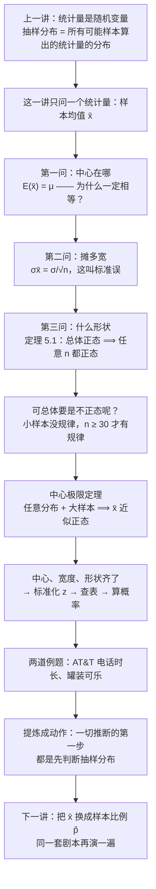
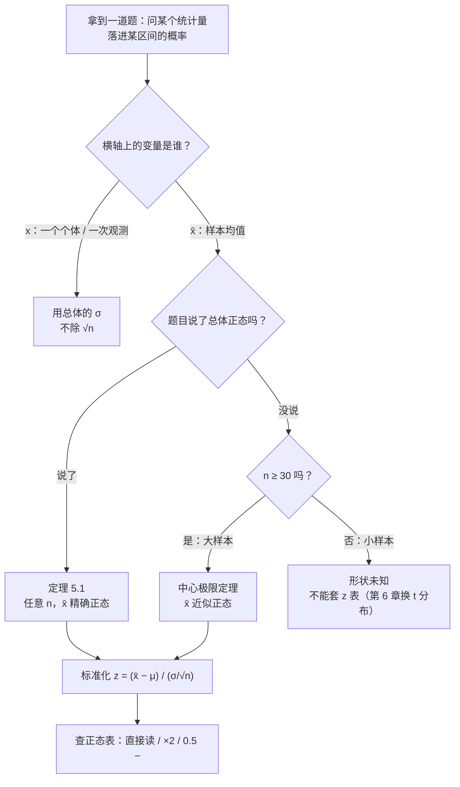

# C5.2 样本均值的抽样分布与中心极限定理 Sampling Distribution of the Sample Mean & the Central Limit Theorem

> [!abstract] 这一讲的任务
> 上一讲把"统计量"提升成了随机变量：抽一次变一个值，于是它自己有分布。这一讲只盯住其中最常用的那一个——**样本均值 $\bar x$**——把它的分布完整写出来。
> 一份分布要三样东西：**中心在哪、摊多宽、什么形状**。这一讲三样都补齐：中心永远是 $\mu$，宽度是 $\sigma/\sqrt n$，形状靠**定理 5.1**（总体正态）和**中心极限定理**（大样本）两条路保证。
> 补齐之后你才能做一件实际的事：**算"样本均值落进某个区间"的概率**。而这件事，后面每一章都要做——置信区间、假设检验、两均值比较、控制图，第一步全是"先判断它的抽样分布"。

> [!info] 怎么读这份讲义
> 顺序：第 0 节先给一个具体到能动手的问题；第 1 节把上一讲的机器接上（**抽样分布**到底是什么）；第 2–3 节补中心与宽度（**$\mu$ 与标准误**）；第 4–5 节讲形状与**标准化**；第 6 节做第一道完整例题；第 7–8 节处理"总体不正态"这件事并引出**中心极限定理**；第 9 节做第二道例题；第 10 节把这一讲提炼成一个**动作顺序**；第 11 节是接到机器学习上的**拓展**。
> 标注约定：标有 **（拓展）** 或 **【拓展】** 的内容，是**课堂上没有展开、由教材与通行讲法延伸补充**的部分。复习时先掌握未标注的主干——考点集中在主干上。
> 勘误一句话：本篇有三处口头演算的失误已复算更正（第 8 节的 $1$ 与 $20$ 求平均、第 8 节的"方差还是标准差除以 $\sqrt n$"、第 9 节的中间量提前取整），都不影响结论，但错的方式很典型，逐一写在对应小节里。

---

## 0. 开场：老板只给了你两个数（p.31）

你在一条灌装线上做质检。这条线每罐标 12 盎司，工艺稳定之后，罐与罐之间有波动，标准差大约 0.2 盎司。

老板走过来问了一句：

> "从线上随机抽 50 罐，量一量，**这 50 罐的平均灌装量低于 11.95 盎司的比例**会有多大？要是这个数不小，我们就得停机调机器。"

你手上只有两个数：总体的均值 $\mu = 12$、总体的标准差 $\sigma = 0.2$，再加上这句话里的 $n = 50$。没有原始数据，没有直方图，也没有任何关于"灌装量服从什么分布"的说明。

把问题翻译成符号，它问的是

$$P(\bar x < 11.95) = ?$$

到这里必须停住一秒，因为这里藏着一个身份问题：**$\bar x$ 不是一个固定的数**。同样抽 50 罐，这一批的平均可能是 11.98，下一批可能是 12.01。它是一个**随机变量**。

而"一个随机变量落进某个区间的概率有多大"，只能从它的**分布**里读出来——中心在哪、摊多宽、什么形状。你手上关于分布的信息，只有总体的 $\mu$ 和 $\sigma$。这两个数**不是** $\bar x$ 的分布，它们是原始数据的分布。

> [!question] 停一下，先自己想想
> 不看任何公式，你猜这个比例大概是多少？1%？5%？20%？
> 提示：每罐平均灌 12，抽 50 罐再一平均，应该离 12 更近；11.95 只差 0.05，而单罐就能上下差 0.2。所以这个比例应该很小——但"很小"到底多小，凭感觉说不出来。

说不出来是正常的。这一讲要造的，就是**把 $\mu$、$\sigma$、$n$ 三个数喂进去、输出一个分布**的那台机器。机器造好之后，老板这句话就变成"查一次表"。

> [!question] 停一下，先自己想想（第二个，更难）
> 你手里没有总体分布的信息，那这台机器凭什么能工作？

先记着这个问题。答案在第 8 节——它是整门课最值钱的一条定理，也正是老板这道题能算出来的唯一理由。

---

## 1. 先把上一讲的机器接上：$\bar x$ 是一个随机变量（p.20–21）

### 1.1 抽样分布：把"抽一次"变成"抽全部"

先把这个工具重新讲一遍，因为后面每一节都要用它。

**抽样分布 sampling distribution**，说白了一句话：**先把样本容量 $n$ 定死；再把所有可能的 $n$ 元样本都抽一遍、每个样本压成一个数（这里就是 $\bar x$）；最后看这些数排成什么形状。**

名字逐字拆开：**抽样**（对象是"抽出来的样本"）+ **分布**（看这些样本算出的同一个统计量怎么分布）。它和直方图看着像，但横轴上的东西换了人——直方图的横轴是"一个人的取值"，抽样分布的横轴是"一个样本算出的统计量"。

它有一个很别扭的地方，值得提前说清：**这东西你永远抽不出来。** 总体如果有 1200 万罐，$n=50$ 的所有可能样本数是天文数字，把"所有可能"真的走一遍是不可能的。所以抽样分布不是"收集"来的，是**推**出来的。这一讲的全部工作，就是把这台"推"的机器造出来。

| | 总体分布 | 抽样分布（以 $\bar x$ 为例） |
|---|---|---|
| 横轴 | 一个个体的取值 $x$ | 一个样本算出的均值 $\bar x$ |
| 纵轴 | 出现可能性（密度 / 概率） | 同左 |
| 图上一个点代表 | 一次观测 | **一次完整的抽样** |
| 中心 | $\mu$ | $\mu$（第 2 节） |
| 标准差 | $\sigma$ | $\sigma/\sqrt n$（第 3 节） |
| 形状 | 由数据本身决定 | 由定理 5.1 或中心极限定理决定（第 4、8 节） |
| 怎么拿到 | 收集数据、画直方图 | **推出来**（所有可能太多，抽不出来） |

"图上一个点代表一次抽样"这句话不是废话，它决定了后面所有概率怎么算：**横轴上任何一个点，对应的都是一个可能出现的样本均值；那段面积，就是那个均值出现的可能性。** 所以只要知道了 $\bar x$ 的分布，问"$\bar x$ 落在哪里"就等于问"那段面积有多大"。

> [!warning] 横轴换人：$x$ 与 $\bar x$ 不是一回事
> 这是全章最容易糊的地方，值得单独钉一颗钉子：**总体的横轴是 $x$，抽样分布的横轴是 $\bar x$。** 两张图的纵轴都是"出现可能性"，但横轴差了一个"平均"的动作。
> 后果很直接：两张图的宽度不一样（第 3 节）、形状可能不一样（第 4、8 节），而算概率时**分母用哪个标准差**（$\sigma$ 还是 $\sigma/\sqrt n$），完全取决于你面前这张图的横轴是谁。第 9 节会专门拿这一条收账。

### 1.2 两条性质，先把结论摆出来（p.21）

$\bar x$ 的分布里，有两件事**和总体分布长什么样无关**，永远成立。

记号先认一下：$\mu_{\bar x}$ 读作 "mu 下标 x bar"，下标 $\bar x$ 的意思是"**这是 $\bar x$ 这个随机变量自己的均值**"，不是在乘什么东西；同理 $\sigma_{\bar x}$ 是 $\bar x$ 自己的标准差。下标是"属于谁"的标签，这条约定从这一节一直用到最后一章。

> [!important] 样本均值抽样分布的两条性质
> **① 中心：抽样分布的均值等于总体均值。**
> $$\mu_{\bar x} = E(\bar x) = \mu$$
> **② 宽度：抽样分布的标准差等于总体标准差除以 $\sqrt n$。**
> $$\sigma_{\bar x} = \frac{\sigma}{\sqrt n}$$
> 两条都成立的前提是**可重复抽样**（p.24、p.28 都专门标注了 sampling with replacement）；有限总体不放回时要乘一个修正因子，见第 3.2 节末尾。
> 注意 ① 里写的是 $E(\bar x)$ 而不是"$\bar x$ 的平均"——这个写法不是装饰，第 2.4 节专门解释为什么。

② 里那个 $\sigma/\sqrt n$ 有一个专门的名字——**均值的标准误**（standard error），第 3 节专门拆这个名字；先记住它回答的问题不是"数据散多开"，而是"平均值差多少"。

这两条给的是**中心**和**宽度**。形状还没给，那是第 4 节和第 8 节的事。但顺序不能乱：中心与宽度是"永远成立"的地基，先把它们坐实，形状才有地方挂。

---

## 2. 性质一：为什么 $\bar x$ 的平均一定回到 $\mu$（p.21）

### 2.1 先猜，再撞墙

> [!question] 停一下，先自己想想
> 从同一个总体里抽 100 次，每次抽 $n$ 个、算出一个 $\bar x$，得到 100 个 $\bar x$。把这 100 个 $\bar x$ 再平均一次，结果会比 $\mu$ 大、比 $\mu$ 小、还是正好等于 $\mu$？

最自然的猜测是：**"差不多吧，可能大一点也可能小一点。"**

这个答案不算错，但它答的不是这个问题。它说的是"**没有系统性偏差**"——平均下来不会一味偏高或一味偏低。可"没有系统偏差"和"正好相等"是两件事。掷 10 次硬币，正面出现 7 次一点不稀奇；随机的平均会抖，只是抖得越来越小。所以"样本是随机抽的"这句话本身，**推不出"平均正好等于 $\mu$"**。

这里必须另找一个理由。而那个理由不是概率，是"**所有可能**"这四个字。

### 2.2 把 16 个样本全抽一遍

挑一个能用手算完的总体：$\{1,\ 3,\ 5,\ 7\}$，$N = 4$。

$$\mu = \frac{1+3+5+7}{4} = 4,\qquad \sigma^2 = \frac{(-3)^2+(-1)^2+1^2+3^2}{4} = 5,\qquad \sigma = \sqrt 5 \approx 2.236$$

样本容量取 $n = 2$，**有放回**地抽，那么所有可能的样本共 $4^2 = 16$ 个。把 16 个均值全部列出来：

| 样本均值 $\bar x$ | 由哪些样本算出 | 出现次数 |
|---|---|---|
| 1 | (1,1) | 1 |
| 2 | (1,3)、(3,1) | 2 |
| 3 | (1,5)、(5,1)、(3,3) | 3 |
| **4** | (1,7)、(7,1)、(3,5)、(5,3) | **4** |
| 5 | (3,7)、(7,3)、(5,5) | 3 |
| 6 | (5,7)、(7,5) | 2 |
| 7 | (7,7) | 1 |

一共 $1+2+3+4+3+2+1 = 16$ 个，一个不多一个不少。现在做三件事：

**第一件，看中心。**

$$\frac{1\times1+2\times2+3\times3+4\times4+5\times3+6\times2+7\times1}{16} = \frac{64}{16} = 4 = \mu$$

**正好是 4，不是约等于 4。** 这就是性质 ①。

**第二件，看宽度。** 均值与 4 的偏差是 $-3,-2,-1,0,1,2,3$ 各若干次：

$$\frac{9\times1+4\times2+1\times3+0\times4+1\times3+4\times2+9\times1}{16} = \frac{40}{16} = 2.5$$

而 $\sigma^2/n = 5/2 = 2.5$，一分不差。标准差是 $\sqrt{2.5} \approx 1.581$，而 $\sigma/\sqrt n = 2.236/1.414 \approx 1.581$，也对上了。这就是性质 ②。

**第三件，看形状。** 出现次数排起来是 $1,2,3,4,3,2,1$——一个三角形。可总体的形状是**平的**（四个值各占 $1/4$）。只抽两个数一平均，形状就变尖了。这不是巧合，是第 8 节那条定理的苗头。

> [!note] 停一下，我们刚才干了什么
> 我们用一个 4 个数的总体，把"所有可能的样本"真的走了一遍，得到 16 个均值，然后**直接数出**了它们的中心和宽度：中心 $=4=\mu$，方差 $=2.5=\sigma^2/n$。
> 这不是证明，只是"在一个小例子里看见它成立"。但这次的"看见"很有价值——它把两条公式从"要背的东西"变成了"能算出来的东西"。证明在下一小节。

### 2.3 为什么一定成立：所有可能 = 没有偶然

先讲道理，再写式子。

**道理。** 想象你的统计学真实水平是固定的——这是"必然"的部分；考试那天的状态、心情、睡眠会让人考高一点或低一点——这是"偶然"的部分。有人今天状态特别好，有人今天状态特别差，把这些偶然**正负抵消**掉之后，剩下的还是你的真实水平。

抽样是同一件事：**每一个 $\bar x$ 都带着偶然性**（这一次抽到的恰好偏大或偏小）。但如果你把**所有可能**的样本都取遍，那么"这一次恰好抽到哪一批"这种运气就被彻底用光了——没有"恰好"，只剩下必然。而那个必然的落点，就是总体均值 $\mu$。

"所有可能"是这句话的关键。运气只存在于"抽到哪一个样本"里；把全部样本都算一遍，"抽到哪一个"这个问题就不存在了。

**式子。** 把上面这段话写成代数。下面这几行不要求背，但它能把"必然"到底必然在哪落在纸面上——设总体是 $\{x_1, x_2, \dots, x_N\}$，$N^n$ 个样本（有放回）的均值再平均一次：

$$\frac{1}{N^n}\sum_{\text{所有样本}}\bar x
= \frac{1}{N^n}\cdot\frac{1}{n}\sum_{\text{所有样本}}\sum_{i=1}^{n}x_i
= \frac{1}{N^n}\cdot\frac{1}{n}\cdot nN^{\,n-1}\sum_{j=1}^{N}x_j
= \frac{1}{N}\sum_{j=1}^{N}x_j = \mu$$

中间那个 $nN^{n-1}$ 是怎么来的？**总体里每一个个体，在所有 $N^n$ 个样本里都出现同样多次**：它出现在第 1 个位置时，其余 $n-1$ 个位置随便填，有 $N^{n-1}$ 种；$n$ 个位置各算一次，共 $nN^{n-1}$ 次。既然人人都一样，平均下来自然谁也占不到便宜——这就是"没有偶然"的代数版本。

拿第 2.2 节的例子验一下这个计数：$n=2$、$N=4$，每个个体应出现 $2\times4^{1} = 8$ 次。16 个样本的均值总和是 $64$，而样本总和是 $128$；四个个体共出现 $8\times4 = 32$ 次取值，$32 \times$ 平均值 $4 = 128$ ✓。

> [!important] 这条性质有多强
> 它**对总体分布没有任何要求**——均匀的、U 型的、右偏的、双峰的，全都一样。第 7 节会看到：总体不正态时，中心还是 $\mu$、宽度还是 $\sigma/\sqrt n$，**只有形状变了**。所以这一条不是"正态分布的性质"，是"平均这个操作的性质"。

这条性质有一个正式名字：**无偏性 unbiasedness**——估计量的期望等于它要估计的参数。正式定义等讲点估计时再给（[[C5.1 抽样分布：统计量也是随机变量]]），这一讲只要记住它在说什么。

### 2.4 均值还是期望值：这句话为什么不是同义反复

性质 ① 写成 $\mu_{\bar x} = E(\bar x) = \mu$，中间那个 $E(\cdot)$ 是**期望值 expected value**。

现在有一个必须分清的地方，因为这句话很容易被读成一句废话："样本均值的均值等于总体均值"——听起来像"均值等于均值"，什么都没说。

它当然不是废话。症结在**"均值"这个词在这儿出现了两次，意思并不完全一样**。

先看算法：**两者算得一模一样**，都是"取值 × 权重"再加起来。

差别在**时态和身份**：

| | 均值 mean | 期望值 expected value |
|---|---|---|
| 对的是 | 一批**已经发生、已经确定**的数 | 一个**还没发生**的随机变量 |
| 权重来自 | 每个观测各占 $1/n$ | 每个可能取值的**概率（可能性）** |
| 时态 | 过去 / 现在：数就在那儿 | 未来：只知道可能性 |
| 例子 | 这学期全班统计学的平均分 | 下一个走进考场的人的分数期望 |
| 在这里是谁 | 如果你真抽了 100 次、算出 100 个 $\bar x$，这 100 个的平均 | $E(\bar x)$：设想"所有可能的样本"时，$\bar x$ 的平均 |

一句话记住：**期望值 = 用可能性加权的均值；普通均值只是"每个权重都是 $1/n$"的特例。** 所以可以说"均值包括期望值"，反过来不成立。

落到这条式子上：**"所有可能的 $\bar x$ 的平均"这一批样本并没有真的被抽出来**，我们只是在设想它们，所以写成 $E(\bar x)$；而如果你真的抽了 100 次，那 100 个 $\bar x$ 的平均就是一个均值，记作 $\bar{\bar x}$（x 双杠）。第 2.2 节算出来的 $4$ 与 $4$ 数值相同，但一个是"设想的平均"，一个是"已经抽出来的平均"。

> [!warning] 最容易误读的一句
> $E(\bar x) = \mu$ **不是**说"$\bar x$ 等于 $\mu$"。它说的是"$\bar x$ **平均下来**等于 $\mu$"。单次抽样照样会偏，偏多少由第 3 节的 $\sigma/\sqrt n$ 标价。
> 把这句话读成"$\bar x = \mu$"，后面所有置信区间都会跟着理解错——因为置信区间的全部意义，就建立在"单次估计一定会偏"之上。

---

## 3. 性质二：$\sigma/\sqrt n$ —— 均值的标准误（p.21–22）

### 3.1 为什么不是 $\sigma$

> [!question] 停一下，先自己想想
> $\bar x$ 这个统计量自己的标准差是多少？直接猜。

最直觉的答案是 $\sigma$——"样本均值也是从同一个总体里出来的，波动应该一样大"。

这个猜测**方向错了**：$\bar x$ 比单个观测**更稳**。理由很简单：要算均值，得先把 $n$ 个数加起来。一个偏大的值，会被同批里偏小的值抵掉一部分；要让它把均值整个拽走，得所有 $n$ 个都偏大才够。

把这个直觉说成可验证的句子——它只要三行，就能说清"窄"是怎么来的：

- 所有可能的样本均值里，**最大的那一个**，至多是"总体中最大的 $n$ 个值"的平均。它一定**小于**总体的最大值（除非 $n$ 个数恰好全是最大值，那概率极小）。
- 同理，**最小的那一个**，一定**大于**总体的最小值。
- 两头都被削掉了 ⟹ 这一堆 $\bar x$ 的分布一定比总体**窄**。

所以标准差一定小于 $\sigma$。剩下的问题只有一个：**小多少？**

### 3.2 推导：方差除以 $n$，标准差除以 $\sqrt n$

这个式子不要求自己推，但它只用到一条性质，值得花三行看清——因为"为什么是 $\sqrt n$ 而不是 $n$"的答案全在这三行里。

那条性质是整套推导的支点：**独立随机变量相加，方差可以直接相加**（因为交叉项的平均为零）。

$$\operatorname{Var}(x_1 + x_2 + \cdots + x_n) = \operatorname{Var}(x_1) + \cdots + \operatorname{Var}(x_n) = n\sigma^2$$

这一步已经能看出"窄"的来源：$n$ 个独立波动相加，波动**不是**按 $n$ 倍增长，而只按 $\sqrt{n}$ 增长（那个平方根，来自"方差相加 → 开根号"）。

但均值不只是相加，还要除以 $n$。常数提出方差时要平方：

$$\operatorname{Var}(\bar x) = \operatorname{Var}\!\left(\frac{1}{n}\sum_{i=1}^{n}x_i\right) = \frac{1}{n^2}\cdot n\sigma^2 = \frac{\sigma^2}{n}$$

**方差除以 $n$。** 开根号得到标准差：

$$\boxed{\ \sigma_{\bar x} = \frac{\sigma}{\sqrt n}\ }$$

> [!warning] 方差是 $1/n$ 倍，标准差才是 $1/\sqrt n$ 倍
> 这两个数不是一个数。$n=25$ 时，方差缩到 $1/25$，标准差只缩到 $1/5$。现场推到这一步时，这一句说串过一次（先说成"方差等于 $1/\sqrt n$ 倍"，随即改口），因为两个式子长得太像。
> 记法：**方差跟平方走，标准差跟根号走。** 任何时候不确定，就回到"开根号"那一步。

拿第 2.2 节的 16 个样本验：$\sigma^2/n = 5/2 = 2.5$ ✓，$\sqrt{2.5} = 1.581 = 2.236/\sqrt 2$ ✓。

**这个 $\sqrt n$ 意味着什么？** 意味着**样本量的边际收益是递减的**，而且是按平方递减的。

![[C5.3-标准误按根号n收窄.png]]
读这张图只需要三件事：

- **曲线一开始极陡、后面越来越平。** $n$ 从 1 到 4，标准误从 10 掉到 5（减半）；从 4 到 16，再减半到 2.5；从 16 到 64，才又减半到 1.25。
- **想把精度提高一倍（标准误减半），样本量要翻四倍。** 想把精度提高十倍，样本量要加一百倍（$n=100$ 时 $\sigma_{\bar x} = 1$）。
- **样本量是最贵的资源。** 所以现实里所有"再多抽一点就能看出来"的期待，都得按平方来估成本——这也是第 6 章算样本量、第 13 章定控制限时反复要用的一条。

> [!note] 有限总体、不放回怎么办（拓展）
> 上面两条性质都假定可重复抽样（等价于总体无穷大）。若总体只有 $N$ 个、抽样**不放回**，样本之间不再独立，方差要乘一个**有限总体校正因子 finite population correction**：
> $$\sigma_{\bar x} = \frac{\sigma}{\sqrt n}\sqrt{\frac{N-n}{N-1}}$$
> 用 $\{1,3,5,7\}$、$n=2$ 不放回验一下：6 个样本的均值是 $2,3,4,4,5,6$，均值仍为 4，方差是 $10/6 = 1.667$，而 $\dfrac{\sigma^2}{n}\cdot\dfrac{N-n}{N-1} = 2.5\times\dfrac{2}{3} = 1.667$ ✓。当 $n$ 远小于 $N$ 时这个因子接近 1，可以忽略；$n/N$ 一大就必须带。第 6 章（[[C6.3 样本量、有限总体校正与方差的置信区间]]）会正式处理它。

### 3.3 名字：标准误 standard error

$\sigma_{\bar x}$ 有一个专门的名字：**均值的标准误 standard error of the mean**（p.22 就一句话：这个标准差常常被称为均值的标准误）。

名字逐字拆：

- **standard** = 标准差。它就是一个标准差——$\bar x$ 这个统计量自己的标准差。
- **error** = 这里**不是"错误"**，是"**估计误差**"：你拿一个 $\bar x$ 去猜 $\mu$，猜完总会差一点；差多少没有定数，于是给它一个"典型大小"当价签。
- 合起来：**标准误 = 估计量的标准差。** 均值的标准误就是 $\sigma/\sqrt n$。

为什么非要给它一个单独的名字，而不是直接叫"$\sigma$ 除以根号 $n$"？因为它回答的问题和 $\sigma$ 完全不同：

- $\sigma$ 说的是"**一个个体**离总体均值多远"——描述数据的。
- $\sigma/\sqrt n$ 说的是"**一次估计**离真值多远"——描述推断的。

做决策时你要的是后者。老板问"你这批货的平均值靠得住吗"，问的不是罐子之间差多少，而是"你这个平均数差多少"。这就是标准误的用处：**它把"我这次估计有多不靠谱"量化成了一个数。**

### 3.4 三个"标准差"：$\sigma$、$\sigma/\sqrt n$、$s$（必错点）

学到这儿，手上有三个都带"标准差"字样的量。它们长得像，描述的对象完全不同：

| 符号 | 名字 | 描述的是谁 | 怎么来 | 随 $n$ 变吗 |
|---|---|---|---|---|
| $\sigma$ | 总体标准差 population standard deviation | **一个个体的取值**离 $\mu$ 多远 | 总体参数，通常**未知**、拿不到 | 不变（总体的固有属性） |
| $\sigma/\sqrt n$ | 均值的标准误 standard error of the mean | **一次抽样的 $\bar x$** 离 $\mu$ 多远 | $\sigma$ 除以 $\sqrt n$ | 随 $n$ 变大而变小 |
| $s$ | 样本标准差 sample standard deviation | **这 $n$ 个观测值彼此**散多开（也是 $\sigma$ 的估计） | 从**这一个**样本算出，分母用 $n-1$ | 每个样本算出来都不一样 |

> [!warning] 三个必须分清的地方
> **① $s \neq \sigma/\sqrt n$。** 两者差的不是一点，是 $\sqrt n$ 倍。$n=25$ 时若 $s = 10$，那么 $s$ 说的是"个体之间差 10 个单位"，而 $s/\sqrt n = 2$ 说的才是"平均值的误差是 2 个单位"。把这两个数混着报，误差会大到离谱。
> **② $\sigma$ 未知时，用 $s$ 顶替 $\sigma$，标准误就变成 $s/\sqrt n$。** 这个替换不是免费的：小样本里 $s$ 会系统性低估 $\sigma$，于是 $s/\sqrt n$ 偏小、区间偏窄。第 6 章会为此专门换一个分布（$t$ 分布）来补偿——**$t$ 分布的整个存在理由，就是从 $s/\sqrt n$ 这个替换里长出来的**。
> **③ 除不除 $\sqrt n$，取决于横轴上的变量是谁。** 变量是 $\bar x$（样本均值、样本比例）⟹ 除 $\sqrt n$；变量是 $x$（一个个体的取值）⟹ 不除。这条判据第 9 节会拿一道题收账，第 10 节会画成流程图。

> [!note] 停一下，我们刚才干了什么
> 两条性质到手，而且是"永远成立"的两条：
> $$\mu_{\bar x} = \mu \qquad\qquad \sigma_{\bar x} = \frac{\sigma}{\sqrt n}$$
> 第一条的来源是"所有可能 = 没有偶然"，第二条的来源是"方差相加、再除以 $n^2$"。
> 但这两条只说了 $\bar x$ 的分布**在哪、多宽**。一条曲线光有中心与宽度是画不出来的——**还缺形状**。

---

## 4. 定理 5.1：总体正态，$\bar x$ 就正态（p.23–24）

形状从哪来？最省事的情形是：总体本来就知道是正态的。

> [!important] 定理 5.1 Theorem 5.1
> 若从一个**正态分布**的总体中随机抽取 $n$ 个观测，则 $\bar x$ 的抽样分布**也是正态分布**。
> 连同前两条性质，完整说法是
> $$\bar x \sim N\!\left(\mu,\ \frac{\sigma^2}{n}\right)$$
> 关键词是"**任意 $n$**"——不管 $n$ 是 2 还是 200，只要总体正态，$\bar x$ 就精确正态。

p.24 用一个具体例子把三件事并列摆出来：总体 $\mu = 50$、$\sigma = 10$。

| $n$ | $\sigma_{\bar x} = 10/\sqrt n$ | 中心 |
|---|---|---|
| 4 | $10/2 = 5$ | 50 |
| 16 | $10/4 = 2.5$ | 50 |

中心一动不动，宽度减半再减半。这就是第 2、3 节两条性质在具体数字上的样子。

> [!warning] 看分布示意图，只读"谁胖谁瘦"
> 这类示意图只保证"哪一条更瘦"，高度与峰的左右位置都是手绘的：实际 $n=16$ 的那条比画出来的还瘦得多、也高得多（密度下的总面积必须都是 1，越瘦必然越高）。**不要拿示意图去读偏移量**，要读具体数值就回到公式。

**为什么"总体正态 ⟹ $\bar x$ 正态"？**

这一条不需要另起炉灶去证，因为正态分布有一个很好用的性质：**它在"相加"和"乘常数"这两个操作下都是封闭的**——独立的正态变量相加还是正态，乘一个常数还是正态。而 $\bar x = \dfrac{1}{n}(x_1 + \cdots + x_n)$ 恰好只是"相加 + 乘常数"，所以它必然还是正态。【拓展：这条封闭性是正态分布的一个定义性特征，这里只给结论，不展开证明。】

**一个必须提前分清的地方**：定理 5.1 只保证"**形状**"。中心还是 $\mu$、宽度还是 $\sigma/\sqrt n$，那是第 2、3 节的内容，定理本身没说。三条合起来，才是"$\bar x$ 的分布"这个完整答案。

最后还剩一个纯操作的问题：分布知道了，可一张曲线本身不会告诉你面积。把任意一条正态曲线搬到同一把标尺上、让它对应同一张表——这个动作叫**标准化**，下一节做。

---

## 5. 标准化：把任意正态压成一张表（p.25）

### 5.1 z 分数换了主角

现在中心、宽度、形状都有了。要算概率，还差最后一步：把面积读出来。

问题在于：$\mu$ 和 $\sigma$ 的组合有无穷多，每个组合都印一张表，永远印不完。解法是**标准化 standardization**——把所有正态分布压成同一个分布，只留一张表。

$z$ 分数在 [[C2.6 百分位数与 z 分数]] 已经学过，一句话：**一个变量值离它自己的均值有几个标准差。** 现在的变化只有一处——**变量换人了**：

$$z = \frac{\bar x - \mu_{\bar x}}{\sigma_{\bar x}} = \frac{\bar x - \mu}{\dfrac{\sigma}{\sqrt n}}$$

逐个符号拆：

- $\bar x$：这一次抽样算出来的样本均值（**现在的变量是它，不是 $x$**）。
- $\mu_{\bar x} = \mu$：$\bar x$ 自己的均值，也就是总体均值。
- $\sigma_{\bar x} = \sigma/\sqrt n$：$\bar x$ 自己的标准差，也就是标准误。

所以这个式子在说：**这次的样本均值，离总体均值有几个标准误。**

如果 $\bar x$ 服从正态分布，那么 $z$ 一定服从**标准正态分布**：均值 0、方差 1、中间高两边低。

![[C5.3-标准化只换刻度不换面积.png]]
读这张图要看三件事：

- **两张图的横轴都是"$\pm 3$ 个标准误"**：左边刻的是分钟（$8 \pm 3\times0.4$），右边刻的是 $z$。所以两条曲线形状**完全重合**——标准化只换了刻度标签。
- **阴影面积一模一样**：左边 $7.8$ 到 $8.2$，右边 $-0.5$ 到 $0.5$，都是 $0.1915 + 0.1915 = 0.3830$。
- **位置没变、谁大谁小没变**：$7.8$ 一定小于 $8.2$，标准化之后 $-0.5$ 一定小于 $0.5$，中间那条虚线（均值）一定对应 $0$。标准化不做任何"扭曲"，它只是换了一把尺子。

这一步的意义：**所有正态分布的概率问题，都可以搬到同一张表上查。** 这就是为什么非要标准化。

### 5.2 怎么查正态表（p.27）

这一步考试必考，而表本身有个坑：**不同书印的表给的不是同一块面积。**

表的结构先认清楚：

- 表里的每一个数，是**从 0 拉到 $z$ 的那块面积**（表头上的小图会画出阴影，先看阴影）。
- 最小 $z = 0.00$，对应面积 $0.0000$；最大 $z = 3.99$，对应 $0.49997$。**为什么不可能到 0.5？** 因为"0 到 $z$"最多只能覆盖右半边，而右半边总共才 $0.5$。
- 表里**没有负数**。这不是遗漏，是对称：$P(z < -a) = P(z > a) = 0.5 - P(0 < z < a)$。

于是查表只有三种拼法：

| 要什么 | 怎么拼 |
|---|---|
| $0$ 到 $z$ 的面积（$z>0$） | 直接查 |
| 中间一段、两侧对称（如 $-0.5$ 到 $0.5$） | 查 $0$ 到 $0.5$ 的半个，再 $\times 2$ |
| 一条尾巴（如 $z < -1.77$） | 查 $0$ 到 $1.77$ 的块，再用 $0.5$ 减掉它 |

> [!warning] 认阴影，不认书名
> 有的教材的表给"$0$ 到 $z$"，有的给"左尾"，有的给"右尾"。同一个题目，换个版本的表，就要换个拼法。**唯一的通用办法是：先看表头上那张小图里的阴影在哪，再决定是直接读、$\times 2$、还是 $0.5-$。** 这条经验比背公式管用。

这一讲反复用到两个表值，先记住（后面每章都会再遇到）：

| $z$ | $0$ 到 $z$ 的面积 |
|---|---|
| 0.50 | 0.1915 |
| 1.77 | 0.4616 |

---

## 6. Thinking Challenge：AT&T 的电话时长（p.26–27）

> [!example] Thinking Challenge（p.26）
> 你是一家电信公司的运营分析师。长途电话的时长服从正态分布，均值 $\mu = 8$ 分钟、标准差 $\sigma = 2$ 分钟。
> 如果你随机抽取 $n = 25$ 通电话，那么**样本均值落在 7.8 到 8.2 分钟之间**的比例是多少？

题目里那个"比例"其实是概率的另一种说法：所有可能的样本均值里，有多大一块落在 7.8 与 8.2 之间。求法与算任何概率一样：**先把分布确定下来，再标准化，再查表。**

**第 ① 步：判断抽样分布。** 题目明说 long-distance calls are **normally distributed**，而且 $\mu$、$\sigma$ 用的是希腊字母——这是总体的参数。总体正态 ⟹ 由定理 5.1，**不管 $n$ 是几**，$\bar x$ 精确正态。

**第 ② 步：算标准误。**

$$\sigma_{\bar x} = \frac{\sigma}{\sqrt n} = \frac{2}{\sqrt{25}} = \frac{2}{5} = 0.4$$

**第 ③ 步：把两个端点标准化。**

$$z_{7.8} = \frac{7.8 - 8}{0.4} = -0.50, \qquad z_{8.2} = \frac{8.2 - 8}{0.4} = +0.50$$

**第 ④ 步：查表。** $0$ 到 $0.50$ 的面积是 $0.1915$。区间跨两侧，两侧对称：

$$P(7.8 < \bar x < 8.2) = 0.1915 \times 2 = 0.3830$$

**答案：约 38.3% 的样本均值会落在 7.8 到 8.2 分钟之间。**

> [!example] 复核
> 用精确正态算：$P(-0.5 < Z < 0.5) = 0.3829$。与 $0.3830$ 差 $0.0001$，来源是表只印四位小数（每个半块真值 $0.19146$，表上记 $0.1915$）。**差在这一位上是正常的，不是算错。**

现在回头感受一下这个答案为什么"这么大"。7.8 到 8.2 只跨了 0.4 分钟，看起来是很窄的一段；可 $\bar x$ 的标准误只有 $0.4$，这一段正好是 $\pm$ 半个标准误。**窄不窄是相对的：0.4 分钟对单通电话（$\sigma=2$）不算什么，对 25 通电话的平均值（$\sigma_{\bar x}=0.4$）就是半个标准差。**

把 $n$ 换成 1 对照一下：只抽 1 通电话，$\sigma_{\bar x} = 2$，同样这段 7.8–8.2 只对应 $z = \pm 0.1$，概率是

$$2 \times (0.5398 - 0.5) = 0.0797$$

约 $8\%$。**样本量从 1 变成 25，同一段区间的概率从 8% 抬到 38%。** 这就是第 3 节那条 $\sqrt n$ 在起作用——把 $\sigma_{\bar x}$ 从 2 压到 0.4，同一段"不可信区间"就被撑成了"很常见"。

---

## 7. 非正态总体：中心与宽度照旧，形状没保证（p.28）

第 6 节那道题之所以能算，是因为题目**直接告诉了你总体正态**。现实里这种好事不多：收入、点击量、响应时间、电话时长——多数是右偏的，谁也不告诉你它正态。

那么把"总体正态"这个条件拿掉，剩下什么？p.28 给的答案很干脆：

$$\mu_{\bar x} = \mu \qquad\qquad \sigma_{\bar x} = \frac{\sigma}{\sqrt n}$$

**两条一字不改。** 具体数字：$\mu=50$、$\sigma=10$ 时，$n=4$ 给 $\sigma_{\bar x}=5$，$n=30$ 给 $\sigma_{\bar x}=1.8$（实际 $10/\sqrt{30}=1.826$，取一位小数是 1.8）。注意 $n=4$ 时的 $5$ 和正态总体那一页的 $5$ 一模一样——**因为公式一样，跟分布没关系**。

变的只有**形状**，而且变的方式很难看：

- **$n$ 小的时候，$\bar x$ 的分布没有统一规律，它与总体分布直接绑在一起。** 换一个总体，就换一副形状。
- 均匀总体抽 2 个：一左一右抽到时，平均跑回中间；两个都抽在同一侧时，平均偏到那一侧——但"都在同一侧"比"一左一右"难，所以中间高、两头低，成一个**三角形**。
- **U 型总体**（两端高、中间低——死亡率与年龄就是这种形状）抽 2 个：去处只有三个——都抽左端、都抽右端、一左一右，于是出现**三座峰**。这座分布的长相完全由那个 U 型决定。
- 抽 5 个："五个全在同一侧"难得多，两座侧峰塌掉，只剩中间一座小山。
- 抽 30 个：只剩一座尖峰，形状与总体分布**再无关系**。

![[C5.3-样本均值的分布随样本量变大变正态.png]]
这张图值得逐个格子看，注意三件事：

- **横轴都是变量值（0 到 1），纵轴都是出现可能性。** 四个格子横轴范围相同，所以"变窄"是真的变窄，不是坐标轴在骗人。
- **每格里虚线都落在 0.5。** 不管 $n$ 是 2、5 还是 30，中心一动没动——第 2 节那条性质在非正态总体里照样成立。
- **$n=2$ 那一列是"没规律"的样子**：均匀总体给出三角形，U 型总体给出三座峰。到 $n=30$，两行的形状几乎没有区别了——**它们已经忘了自己来自什么总体。**

> [!warning] 读分布图的规矩：横轴是值，纵轴是可能性
> 这个是这一节最容易犯的错，值得单独立一条规矩。
> **横轴 = 变量值；纵轴 = 出现的可能性（高度）。** 说"平均"的时候，平均的是**横轴上的值**，不是高度。
> 混了这两个轴，就会得出"数据都挤在中间，所以中间那个值本身更可能出现"这类结论——那是把"平均值的集中"错读成"数据的集中"。
> 检验自己有没有混：问一句"这个图的横轴单位是什么"。答得出（分钟、盎司、块钱）就是对的；答"可能性"就混了。

还有一件事没解释：为什么不管总体是均匀的还是 U 型的，$n=30$ 之后都收敛到**同一条**钟形曲线？这不是这两类总体特有的运气——它有一个名字，而且是一条定理。

---

## 8. 中心极限定理：为什么大样本一定正态（p.29–30）

### 8.1 定理本身

上一节的最后一行其实已经把答案说出来了：$n=30$ 时，均匀总体和 U 型总体给出的 $\bar x$ 分布**长得一样**。两个形状完全不同的总体，平均之后落到同一条曲线上——这不可能是巧合。

> [!important] 中心极限定理 Central Limit Theorem (CLT)
> 从一个**任意分布**的总体（均值 $\mu$、标准差 $\sigma$）中抽取 $n$ 个观测。当 $n$ **足够大**时，$\bar x$ 的抽样分布**近似**为正态分布，其均值为 $\mu_{\bar x} = \mu$，标准差为 $\sigma_{\bar x} = \sigma/\sqrt n$。
> **$n$ 越大，这个正态近似越好。**

名字逐字拆开：

- **中心 central**：收敛的落点是分布的中心 $\mu$。不管总体长什么样，$\bar x$ 都往 $\mu$ 聚。
- **极限 limit**：它讲的是一个 $n \to \infty$ 的极限陈述。"足够大"这三个字就是在说"离极限已经够近"。

所以这个定理的完整意思：**当样本量走向极限时，样本均值的分布以 $\mu$ 为中心收敛到一个正态分布**——而且这个结论**不需要知道总体的分布**。

这是整门课最值钱的一条，原因很实际：它让你在"什么都不知道"的情况下还敢算概率。老板那道可乐题，靠的就是它（第 9 节）。

### 8.2 为什么"平均"会把形状抹平

定理的证明超出本课范围，但机理可以用两个数说清。

**平均是一次"把两头往中间拉"的操作。** 抽到 $1$ 块和 $20$ 块，平均是

$$\frac{1 + 20}{2} = 10.5$$

不管这两个数原本在总体里多极端，它们的平均值一定落在两者之间，而且被拉向中间。要得到一个**极端**的平均值，必须"抽到的每一个都极端"——四个字：**不能有对手**。

而"每一个都极端"这件事，随着 $n$ 增大，迅速变得不可能：

- 抽 2 个都落在同一侧，不算稀奇（所以 U 型总体在 $n=2$ 时两头还有小峰，甚至变成三座峰）。
- 抽 5 个全在同一侧，难得多（侧峰塌掉）。
- 抽 30 个全在同一侧，几乎不可能（只剩中间那座峰）。

于是 $n$ 越大，极端的平均值越稀罕，分布越往 $\mu$ 挤、越尖——而"中间密、两边稀、对称递减"这个形状，正是正态。**中心极限定理说的就是这件事：平均这个操作反复施加，会把任何形状都压成同一条钟形曲线。**

> [!warning] 这里的口头演算有两处失误，都不影响结论
> **① "$1$ 块和 $20$ 块平均是 $10$ 块"** —— 现场口算报成 $21 \div 2 = 10$，实际 $(1+20)/2 = 10.5$，漏了 $0.5$。道理不变：平均值确实被拉到了中间。
> **② "方差等于总体方差的 $1/\sqrt n$ 倍"** —— 随即改口成 $1/n$。正确的分工是：**方差是 $1/n$ 倍，标准差才是 $1/\sqrt n$ 倍**（第 3.2 节）。
> 这两处之所以值得记下来，是因为它们正好是这一讲最容易被记住错的两个点：一个是"中间"到底在哪，一个是"平方根落在谁身上"。

### 8.3 "足够大"是多大：$n \ge 30$

定理里写的是 sufficiently large，没有给数字。这门课（也是多数教材）采用的**经验门槛**是

$$n \ge 30$$

三条必须说清的边界：

- **30 不是定理的一部分**，它是一条经验约定。定理只说"足够大"，多大算够取决于总体有多偏。
- **$n \ge 30$ 时，这个样本叫大样本。** $n < 30$ 且总体不正态，就叫小样本——这时 $\bar x$ 的分布**未知**，不能硬套正态。
- **30 这个数字取决于偏度。** 对称的总体，10 个就够正态了；严重右偏的总体（收入、房价、点击量），可能要 100 以上才像。所以 30 应当读作"**通常够用**"，不是"保证够用"。

这条门槛在后面的用法非常固定：**题目没说总体分布，但 $n \ge 30$，就用中心极限定理把 $\bar x$ 当正态。** 第 9 节就是标准动作。

### 8.4 两条路摆在桌上

到这里，"$\bar x$ 的分布"这件事可以完整地查表了：

| 总体分布 | 样本量 | $\bar x$ 的分布 | 依据 |
|---|---|---|---|
| 正态 | 任意 $n$（含 $n=2$） | **精确**正态 $N(\mu,\ \sigma^2/n)$ | 定理 5.1 |
| 任意 | $n \ge 30$ | **近似**正态 $N(\mu,\ \sigma^2/n)$ | 中心极限定理 |
| 任意 | $n < 30$ | **未知**，不能套正态 | 要另找工具（第 6 章 $t$ 分布） |

这张表要背下来，但更要理解它的两个方向：**定理 5.1 是"总体保证形状"，中心极限定理是"样本量保证形状"。** 一个从上游来，一个从下游来；两条路都通向同一条钟形曲线，落点都是 $\mu$，宽度都是 $\sigma/\sqrt n$。

---

## 9. 例题：罐装可乐（p.31–32）

现在回到开场那道题。四步，与第 6 节完全一样——**唯一的区别在第 ① 步**。

> [!example] 例题（p.31）
> 某品牌罐装汽水的灌装量均值为 12 盎司、标准差为 0.2 盎司。若随机抽取 50 罐作为一个样本，那么**样本均值小于 11.95 盎司**的比例是多少？

**第 ① 步：判断抽样分布。** 题目只给了 $\mu = 12$、$\sigma = 0.2$，**没有说总体服从什么分布**。这不是出题人偷懒，而是故意把形状的来源拿掉了——只剩中心极限定理这一条路。

$n = 50 \ge 30$ ⟹ 大样本 ⟹ 由中心极限定理，$\bar x$ **近似**正态，中心 12、标准误 $\sigma/\sqrt n$。

**第 ② 步：算标准误。**

$$\sigma_{\bar x} = \frac{0.2}{\sqrt{50}} = 0.028284 \approx 0.0283$$

**第 ③ 步：标准化。**

$$z = \frac{11.95 - 12}{0.028284} = -1.7678 \approx -1.77$$

**第 ④ 步：查表。** 表给的是 $0$ 到 $1.77$ 这块面积，$0.4616$。而题目要的是**左边那条尾巴**——用 $0.5$ 减掉中间那块：

$$P(\bar x < 11.95) = 0.5 - 0.4616 = 0.0384$$

**答案：约 3.84% 的样本均值会低于 11.95 盎司。**

> [!example] 复核
> 精确算 $P(Z < -1.7678) = 0.0385$，与 $0.0384$ 一致（差在四位小数取整）。

> [!warning] 中间量别提前取整：这一处能把答案抬高 25%
> p.32 的图上把标准误印成 $.03$（那是 $0.0283$ 取两位的结果）。如果真拿 $0.03$ 往下算：
> $$z = \frac{11.95-12}{0.03} = -1.667 \Rightarrow 0.5 - 0.4522 = 0.0478$$
> 比正确答案 $0.0384$ **大了约 25%**。
> 一条一般规则：**标准误这类中间量至少留四位小数**，最后一步再取整。因为它站在分母上，分母的一点点误差会被放大到 $z$ 上，再被放大到面积上。

> [!question] 停一下，先自己想想：这道题除 $\sqrt n$，C2.6 那些 $z$ 分数题为什么不用除？
> 同一个 $z$ 公式，为什么这里分母要除以 $\sqrt n$？

答案不在题目里，在**横轴上的变量是谁**：

- 这道题问的是"**样本均值**小于 11.95"，横轴上的随机变量是 $\bar x$，它的标准差是 $\sigma_{\bar x} = \sigma/\sqrt n$ ⟹ 分母除 $\sqrt n$。
- C2.6 那些题问的是"**某一个观测值**落在哪里"（某个学生的分数、某罐的实际灌装量），横轴上的变量是 $x$，它的标准差就是 $\sigma$ ⟹ 分母不除。

**除不除 $\sqrt n$ 不取决于题目难不难，只取决于横轴上那个变量是谁。** 这一条在整门课里反复出现，下一节把它画成一张图。

---

## 10. 方法论：一切推断的第一步都是判断抽样分布

这一讲真正要留下的，不是那两个公式，而是**一个动作顺序**。

看第 6 节和第 9 节：题目的背景一个卖电话、一个卖汽水，一个明说总体正态、一个什么分布都没说，但解题动作完全一样——**先确定抽样分布，再标准化，再查表。** 中间的差别只有一处：形状从哪来（定理 5.1 还是中心极限定理）。

这个顺序不是这一讲的技巧，是整门课的**通用第一步**。后面每一章都会先问一遍"$\bar x$ 的分布是什么"，然后才敢往下算。

三步，顺序不能换：

1. **问的是谁？** $x$ 还是 $\bar x$——这一步决定分母，也决定整道题往哪边走。
2. **形状从哪来？** 总体正态 ⟹ 定理 5.1；没说是正态但 $n \ge 30$ ⟹ 中心极限定理；两个都不满足 ⟹ **形状没有保证**，这道题缺条件，不能硬算。
3. **形状有了才能标准化、才能查表。** 注意第 2 步的第三种情形不是"换个公式"，而是"**这条路走不通**"——判断不出分布还硬套 $z$ 表，是这一章最典型的错误。

这三步的共同要求只有一句：**每一步都要说得出理由。** 为什么用这个分布、为什么这里除 $\sqrt n$、为什么这一段要乘 2 —— 三步里任何一步答不上来，那个答案就是碰运气碰上的，换一道题就崩。

这一步在后面的落点，可以提前看一眼：

| 后面用到它的地方 | 用到的形式 |
|---|---|
| 第 6 章 置信区间 | $\bar x \pm z_{\alpha/2}\cdot\dfrac{\sigma}{\sqrt n}$ |
| 第 7 章 均值的假设检验 | $z = \dfrac{\bar x - \mu_0}{\sigma/\sqrt n}$ |
| 第 8 章 两个均值之差 | 标准误变成 $\sqrt{\dfrac{\sigma_1^2}{n_1}+\dfrac{\sigma_2^2}{n_2}}$，逻辑不变 |
| 第 13 章 $\bar x$ 控制图 | 控制限 $= \mu \pm 3\dfrac{\sigma}{\sqrt n}$ |

四处的骨架都是同一个：**一个统计量、一个中心、一个标准误、再标准化。** 这也解释了为什么这一处卡住的代价特别大——后面每一章都从这里出发，卡在这儿，后面的公式就全成了死记。这一讲被当作全章的地基，原因就在这里。

---

## 11. 这条 $1/\sqrt n$ 曲线在机器学习里长什么样（拓展）

**【拓展】** 这一讲的主线不涉及机器学习，但这条曲线的另一副面孔几乎每天都会遇到。

训练深度网络时，梯度不是用整个数据集算的，而是用一个 **mini-batch** 估的。把 batch 里 $b$ 个样本的梯度平均一下，得到的**平均梯度**就是全体梯度的估计。这时这一讲的两条性质原封不动地搬过来：

- **中心**：$E(\text{batch 平均梯度}) = \text{全体梯度}$ —— 这就是"无偏估计"，对应第 2 节的 $E(\bar x) = \mu$。
- **宽度**：梯度噪声的标准差 $\propto \sigma/\sqrt b$ —— 对应第 3 节的标准误。

由此得到三条很实用的推论：

- **batch 从 32 加到 128（4 倍），噪声才减半。** 这与第 3 节那张图是同一条曲线，不是巧合。
- **任何"误差棒"的宽度都按 $1/\sqrt n$ 缩。** A/B 测试要判"差异显著不显著"，公式里那个 $\sqrt n$ 就是从这里来的；看到"样本量翻四倍才能把置信区间减半"，也就是这一条。
- **bootstrap 重采样的理论依据也是这一讲。** 第 1 节说抽样分布"抽不出来"；bootstrap 的办法是**用重采样模拟"所有可能"**——从手上的样本里有放回地反复抽，近似出 $\bar x$ 的分布。它之所以能用，正是因为不管总体长什么样，$\bar x$ 的分布都被中心极限定理管着。

一句话收尾：**平均值的可靠性只按 $\sqrt n$ 改善，而 $\sqrt n$ 涨得很慢——所以"多抽一点"永远比直觉更贵。** 这一条在统计里叫标准误，在机器学习里叫 batch size 与梯度噪声的权衡，是同一件事。

---

> [!tip] 速查表
> | 量 | 公式 | 什么时候用 |
> |---|---|---|
> | 抽样分布的均值 | $\mu_{\bar x} = E(\bar x) = \mu$ | 永远（可重复抽样） |
> | 均值的标准误 | $\sigma_{\bar x} = \dfrac{\sigma}{\sqrt n}$ | 永远（可重复抽样） |
> | 有限总体校正 | $\sigma_{\bar x} = \dfrac{\sigma}{\sqrt n}\sqrt{\dfrac{N-n}{N-1}}$ | 不放回、$n/N$ 不小 |
> | 标准化 | $z = \dfrac{\bar x - \mu}{\sigma/\sqrt n}$ | 要知道 $\bar x$ 落区间的概率 |
> | 定理 5.1 | 总体正态 ⟹ $\bar x \sim N(\mu,\sigma^2/n)$，任意 $n$ | 题目说了总体正态 |
> | 中心极限定理 | 任意分布 + $n \ge 30$ ⟹ $\bar x \approx N(\mu,\sigma^2/n)$ | 题目没说分布 |
> | 常用表值 | $0\to0.50$：$0.1915$；$0\to1.77$：$0.4616$ | 查表 |
> | 三个标准差 | $\sigma$ 说个体，$\sigma/\sqrt n$ 说估计，$s$ 说这一个样本 | 决定分母时 |

> [!tip] 下一讲预告
> 这一讲把 $\bar x$ 的分布写全了：中心 $\mu$、标准误 $\sigma/\sqrt n$、形状靠两条定理。
> 下一讲换一个统计量——**样本比例 $\hat p$**（抽 36 个人，其中有百分之几参加过培训）。剧本一模一样：中心是 $\pi$，标准误是 $\sqrt{\pi(1-\pi)/n}$，大样本照样近似正态。**唯一变的是"标准差"那一格**，因为比例的波动规则与均值不同。
> 顺带会回答一个这一讲埋下的问题：为什么"所有 $n$ 个样本的均值再平均"能算，而"所有 $n$ 个样本的比例再平均"也算——**因为它们都是"平均"，而平均这个操作对中心是无情的。**

---

## 这一讲的三句话

1. **一个分布要三样东西：中心、宽度、形状。** 中心永远是 $\mu_{\bar x} = \mu$，宽度永远是 $\sigma_{\bar x} = \sigma/\sqrt n$，这两条与总体长什么样无关；形状靠**定理 5.1**（总体正态，任意 $n$）或**中心极限定理**（任意分布，$n \ge 30$）。
2. **标准误不是 $\sigma$。** $\sigma$ 说"一个个体离均值多远"，$\sigma/\sqrt n$ 说"一次估计离真值多远"，$s$ 说"这一个样本内部多散"。要精度翻倍，样本量得翻四倍——因为改善只按 $\sqrt n$ 来。
3. **一切推断的第一步都是先判断抽样分布。** 问的是 $x$ 还是 $\bar x$ 决定分母；总体正态还是大样本决定形状；形状不确定就**不能**查表。这一步后面每一章都会重来一次。

---

## 相关笔记 Related Notes

- 相关：[[C5.1 抽样分布：统计量也是随机变量]]（抽样分布的定义、统计量为什么是随机变量）、[[C2.6 百分位数与 z 分数]]（$z$ 分数的原始定义与查表）、[[C2.4 离散程度：极差、方差与标准差]]（$\sigma$、$s$ 与除以 $n-1$ 的来历）、C4.3 连续概率密度与正态分布（密度曲线、标准正态表、反查）、[[C6.1 参数估计与置信区间]]（$\bar x \pm z\cdot\sigma/\sqrt n$ 的直接应用）、[[C6.3 样本量、有限总体校正与方差的置信区间]]（有限总体校正因子的正式处理）
- 上一讲：[[C5.1 抽样分布：统计量也是随机变量]]
- 下一讲：[[C5.3 样本比例的抽样分布]]
- 返回：[[统计学课程 MOC]]
