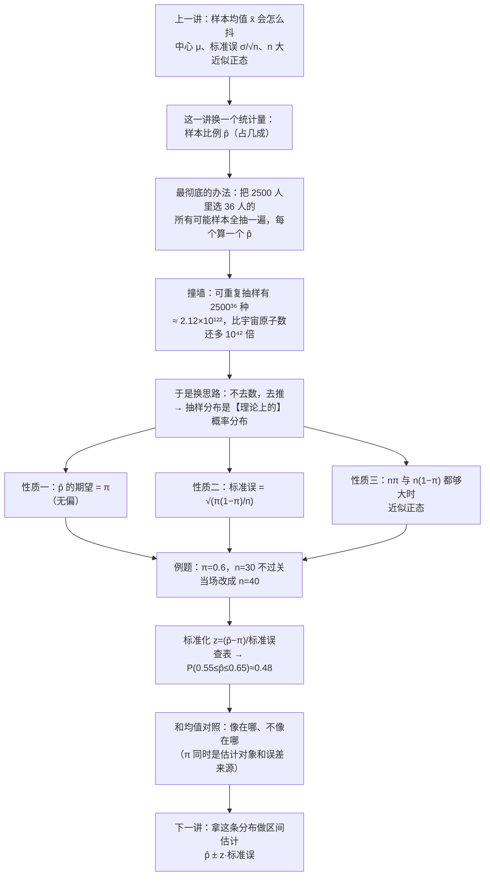
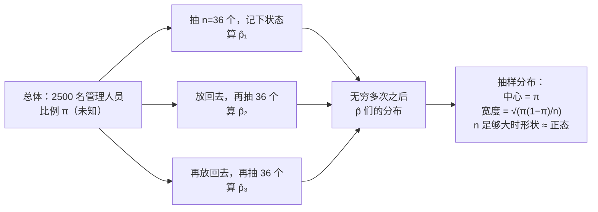

# C5.3 样本比例的抽样分布 Sampling Distribution of the Sample Proportion

> [!abstract] 这一讲的任务
> 上一讲把"样本均值 $\bar x$ 会怎么抖"讲透了：中心是 $\mu$、标准误是 $\sigma/\sqrt n$、$n$ 一大就近似正态。可现实里有一大类问题问的不是"平均多少"，而是"**占多大比例**"——参加过培训的占几成、次品占几成、点进广告的占几成。这一讲把同一套机器搬到比例上：样本比例 $\hat p$ 会怎么抖？
> 答案还是三条：**期望等于 $\pi$、标准误等于 $\sqrt{\pi(1-\pi)/n}$、$n$ 大时近似正态。** 看上去只是把 $\mu$ 换成 $\pi$、把 $\sigma$ 换成 $\sqrt{\pi(1-\pi)}$，可是有一处本质的不同——标准误里那个 $\pi$，**正是我们要估的东西**。这个"自己出现在自己误差里"的结构，是第 6 章比例区间估计全部麻烦的源头。

> [!info] 怎么读这份讲义
> 按小节读。第 0 节给一个具体到不能再具体的场景（2500 个管理人员里抽 36 个），把"$\hat p$ 会抖"这件事摆出来；第 1 节走一条**最朴素也最彻底**的路——把所有可能的样本都抽一遍——然后看它是怎么撞墙的，这一节的墙很重要，撞过才知道抽样分布为什么只能是"理论上的"；第 2 节正式定义；第 3–5 节一条一条建立三条性质（第 5 节里有一段课堂上真实发生的"判据之争"，值得细读）；第 6 节是一道完整例题，它会当场把样本量从 30 改成 40；第 7 节把 $\hat p$ 的抽样分布和 $\bar x$ 的抽样分布摆在一起，逐条说清**哪像、哪不像**；第 8 节是接到 A/B 测试与模型评测上的**拓展**。
> 标注约定：标有 **（拓展）** 或 **【拓展】** 的内容，是**课堂上没有展开、由教材与通行讲法延伸补充**的部分。复习时先掌握未标注的主干——考点集中在主干上。
> 勘误一句话：正态近似的判据印的是 $n\pi\ge 5$，这门课教材用的是 $n\pi\ge 15$、$n(1-\pi)\ge 15$，**按 15 用**，理由见第 5 节。



---

## 0. 开场：2500 个人里抽 36 个，你猜这个比例有多准（p.33–34）

一家叫 EVI 的公司有 **2500 名管理人员**（同一案例在别处也写作 EAI，指同一家公司）。公司花了不少钱办管理培训，现在 HR 想知道一件事：

> 参加过管理培训的人，**占多大比例**？

最笨也最准的办法是**挨个问**：2500 个人一个一个查完，比例就出来了，一分不差。但真要这么做，HR 得把 2500 份档案翻一遍——时间、人力、还有一大堆本来不必碰的面谈。所以现实里的做法永远是：**抽一小撮人，用这一小撮人的比例，去猜 2500 人的比例。**

于是抽 **36 个人**，问完，数出来参加过培训的有多少。假设这一把数出 22 个，那么这个样本给我们的答案是

$$\hat p=\frac{22}{36}=0.6111\approx 61.1\%$$

（这个 22 是我们随手举的数，好让后面每一步都有具体的数字可算；真实抽出来是多少，只是运气。）

61.1%。现在 HR 拿着这个数去汇报，接下来一定会被问一句：**"那真实的比例，跟这个 61.1% 差多少？"**

这个问题问得非常自然，也非常难。难在：**真实比例 $\pi$ 我们根本不知道**——知道就不用抽了。不知道真值，就没法算"差多少"。

那换个问法。不问"这一次差多少"，而问：

> **如果我把这个抽样过程重复一万次，每次抽 36 个人，得到一万个 $\hat p$，这一万个 $\hat p$ 会散成什么样子？**

这个问题是可以回答的：答案是"它会散成一个固定的形状，中心在 $\pi$、宽度由 $\pi$ 与 $n$ 共同决定"。**形状本身不依赖 $\pi$ 的具体取值，只有宽度里那个 $\pi$ 需要你正面处理**——那正是后面每一节都要算的账。**"一个统计量在反复抽样下会形成什么分布"，就叫这个统计量的抽样分布 sampling distribution。** 这一整讲就是在做这一件事，只不过统计量从上一讲的 $\bar x$ 换成了 $\hat p$。p.34 把这句话说得很直接：正如样本均值是总体均值的好估计量，样本比例 $\hat p$ 是总体比例 $\pi$ 的好估计量；而它到底有多"好"，取决于**这个统计量的抽样分布**。

先把三个记号钉死，不然后面每次都要重新解释：

| 记号 | 读法 | 是什么 | 在 EVI 里 |
|---|---|---|---|
| $\pi$ | pi，读"派" | **总体比例**：2500 人里真有多少比例参加过培训 | 未知，就是我们想知道的那个数 |
| $\hat p$ | p hat，p 戴帽子 | **样本比例**：36 人里参加过的比例 | 一次抽样算出来一个数，如 0.611 |
| $n$ | — | 样本容量 | 36 |

> [!note] 为什么戴一顶帽子
> 统计学里给一个符号**戴上帽子**，是一个固定的动作约定：**这个数不是真值，是从样本里"估"出来的。** 所以 $\hat p$ 的意思是"我拿样本替你猜出来的那个 $\pi$"，$\hat\sigma$、$\hat\beta$ 全是同一个意思。帽子的作用是提醒你：它**每次都会变**。$\pi$ 是固定的（虽然不知道），$\hat p$ 是随机的（换一批人就换一个数）。

> [!warning] 记号上的一个坑：教材把 $\pi$ 写成 $p$
> 这门课的教材用 $p$ 表示总体比例，于是"总体比例 $p$"和"样本比例 $\hat p$"只差一顶帽子，写在纸上几乎分不清。本篇统一改用 $\boldsymbol{\pi}$ 表示总体比例，$\hat p$ 表示样本比例——**读的时候别把这两个当成一个东西**：一个是固定的未知数，一个是会变的随机变量。这是本节最容易翻车的地方，比公式本身更容易错。

---

## 1. 最彻底的办法：把所有可能的样本都抽一遍（p.34–35）

既然想知道 $\hat p$ 会散成什么样子，那最朴素的想法就是：**别猜了，全列出来。**

2500 人里选 36 人，把**每一种可能的选法**都取一遍，每一种算出一个 $\hat p$，然后看这些 $\hat p$ 各自出现了多少次、分布成什么形状。这一步做完，$\hat p$ 的抽样分布就到手了——一点猜测都没有，全是数出来的。

这个办法干净、彻底、无懈可击。唯一的问题是：**得数多久？**

### 1.1 先定死"怎么抽"：抽完放不放回（p.34–35）

数之前有一个动作必须先定下来，否则"有多少种样本"这个问题没有答案。

抽完一个人、记下他的情况，**要不要把他放回人群**？

- **放回**（可重复抽样 sampling with replacement）：同一个人**可能被抽到一次、两次、三次**，极端情况下 36 次抽到的都是同一个人。每一次抽取都是"从完整的 2500 人里抽"，各次之间互不影响。
- **不放回**（不可重复抽样 sampling without replacement）：抽过的人就从人群里拿掉，一个人最多出现一次。

这两种抽法给出的样本总数完全不同。而这一讲要用的、p.37 那台"生成机器"背后默认的，是**可重复抽样**——因为只有它才能让"每次抽 36 个人"这个动作变成 2500 个格子各自独立地取一次，概率分布才算得干净。

### 1.2 36 个格子，每格 2500 种：可重复抽样有多少种可能

> [!question] 停一下，先自己想想
> 可重复抽样的话，从 2500 人里抽 36 个，**一共有多少种可能的样本**？
> 先凭感觉估一个数量级再往下看——是几千？几百万？还是别的什么？

最清楚的算法是"摆格子"。在面前摆 **36 个方框**，一个方框装一个人：

$$\underbrace{\Box\ \Box\ \Box\ \cdots\ \Box}_{36\ \text{个框}}$$

第一个框可以是 1 到 2500 号里的任何一个——**2500 种选法**。因为是**可重复**抽样，第一个人选完不影响第二个框：第二个框照样有 2500 种选法。第三个、第四个……一直到第 36 个框，每一个都是 2500 种。36 个框的选法**彼此独立**，所以总数是相乘：

$$\boxed{\ 2500\times 2500\times\cdots\times 2500=2500^{36}\ }$$

这个数有多大？用 python 老老实实算：

```python
print(len(str(2500**36)))      # 123     —— 这个整数有 123 位
print("%.4e" % (2500**36))     # 2.1176e+122
```

$$\text{可重复抽样的样本数}=2500^{36}\approx 2.12\times 10^{122}$$

**这是 1 后面跟 122 个零。** 拿它跟一个著名的"巨大数"比：可观测宇宙里的原子总数大约是 $10^{80}$ 个。也就是说，**把所有 2500 个管理人员选 36 个的样本一个个写出来，需要的纸张数量是宇宙原子总数的 $2\times 10^{42}$ 倍以上。**

再换个更扎心的算法：假设有一台机器，**每秒钟抽一亿个样本**，从宇宙大爆炸（约 138 亿年前）一直抽到现在，它一共抽了

$$10^{8}\times 1.38\times 10^{10}\times 3.156\times 10^{7}\approx 4.4\times 10^{25}\ \text{个}$$

还不到总量的 $10^{-96}$。**这条路走不通，不是"慢"，是根本不可能。**

> [!warning] 一个容易混的说法：顺序算不算
> 你可能会想：**"我在意的是这 36 个人是谁，又不在意他们的先后顺序，为什么要按 36 个格子乘？"** 这个想法是对的，而且数出来会小一些——但小得毫无意义。三种数法列在一起对比（$n=36$、$N=2500$）：
>
> | 数法 | 公式 | 数值 |
> |---|---|---|
> | 可重复、计先后顺序 | $2500^{36}$ | $2.12\times10^{122}$ |
> | 可重复、不计顺序（同一个人重复几次算一组） | $C(2535,36)$ | $7.32\times10^{80}$ |
> | 不可重复、不计顺序（普通的"选 36 个人"） | $C(2500,36)$ | $4.42\times10^{80}$ |
>
> 从 $10^{122}$ 掉到 $10^{80}$，看起来掉了 42 个数量级，可 $10^{80}$ 依然是宇宙原子数那个量级。**在"能不能数完"这个问题上，三种数法给出的是同一个答案：不能。**

### 1.3 撞墙之后：抽样分布为什么只能是"理论上的"

墙撞得很清楚了。**枚举所有可能样本这件事，对一个 $n=36$ 的小问题都做不到。**

但注意，撞墙撞掉的只是"**数出来**"这条路径，不是这个概念本身。"所有可能的 $\hat p$ 各自有多大概率"这个东西是**客观存在**的：

- 每一个 $\hat p$ 就是 $X/36$，其中 $X$ 是"36 人里参加过培训的人数"；
- 而 $X$ 服从**二项分布** $X\sim \mathrm{Bin}(36,\pi)$——二项分布就是"做 $n$ 次一样的'是/不是'试验，数其中有多少次是'是'"的那个分布；这里每一次抽人就是一次"成功/失败"的试验，36 次独立重复；
- 所以 $\hat p$ 的每一个可能取值的概率，都可以用二项分布公式**直接写出来**，一个都不用抽。

$$P\!\left(\hat p=\frac{k}{36}\right)=P(X=k)=\binom{36}{k}\pi^{k}(1-\pi)^{36-k},\qquad k=0,1,\dots,36$$

也就是说：**不需要真的抽 2500$^{36}$ 次，只要会写公式，就能知道每一个可能值有多大概率。** 这就是"理论概率分布"的含义——它描述的是"如果重复抽样无穷多次，会形成的那个分布"，而这个分布的计算完全靠模型推，不靠真的去抽。

顺手得到一个很有用的观察：$n=36$ 时，$\hat p$ 只能取 **37 个值**（$0/36$、$1/36$、……、$36/36$）。它是个**离散**的分布，而且取值之间的间隔是 $1/36\approx0.028$。这个"格子太粗"的事实，第 5 节讲"什么时候才像正态"时会派上大用场。

---

## 2. 正式定义：抽样分布（p.35）

> [!important] 定义：统计量的抽样分布 Sampling Distribution of a Statistic
> **一个统计量在重复抽样下形成的理论概率分布**（p.35：the theoretical probability distribution of the statistic in repeated sampling）。
> 注意两处措辞：**理论**（theoretical）——指它不是靠实际抽一万次数出来的，而是由模型推出来的；**重复抽样**（repeated sampling）——指它描述的是"$\hat p$ 这个随机变量"的分布，不是某一次抽样得到的那一堆数据。

把名字拆开看：**抽样** + **分布**。"抽样"说的是这个分布的**对象**——不是一个观测值，而是"抽一次样、算一个统计量"这个动作的产物；"分布"说的是它给出**每个可能取值出现的概率**。合起来：**$\hat p$ 这个数（而不是某个人的数值）会取哪些值、各有多大概率。**

依赖的前置工具只有一个：**第 4 章的二项分布**。这一节用到的全部零件就两句话（第 3、4 章课堂上不展开，这里补上）：

> [!note] 前置工具：0/1 变量与二项分布
> 给每个人记一个数：参加过培训记 $1$，没参加记 $0$。于是一个人的状态就是一个**只取 0 和 1 的随机变量** $Y$，它的分布由一个数完全决定：
> $$P(Y=1)=\pi,\qquad P(Y=0)=1-\pi$$
> 由此（这是"取值的加权平均"，也就是期望的定义）：
> $$E(Y)=1\cdot\pi+0\cdot(1-\pi)=\pi,\qquad \mathrm{Var}(Y)=E(Y^2)-[E(Y)]^2=\pi-\pi^2=\pi(1-\pi)$$
> 抽 $n$ 个人就是 $n$ 个这样的 $Y$ 相加，记 $X=Y_1+\cdots+Y_n$，$X$ 就是"参加过培训的人数"，它服从**二项分布** $X\sim\mathrm{Bin}(n,\pi)$。$n$ 次抽样彼此独立，所以期望与方差各自乘以 $n$：
> $$E(X)=n\pi,\qquad \mathrm{Var}(X)=n\pi(1-\pi)$$
> 就这两条，本节全部公式都由它们推出来。

现在，同一件事有三个不同的"分布"，初学者最容易在这里打结：

| 名字 | 描述的是谁 | 在 EVI 里长什么样 |
|---|---|---|
| **总体分布** population distribution | 2500 人的培训状态 | 一个 0/1 变量的分布，$P(1)=\pi$ |
| **样本分布** sample distribution | 抽出来的这 36 个人的状态 | 36 个 0/1，其中 22 个 1 |
| **抽样分布** sampling distribution | **$\hat p$ 这一个数** | $\hat p$ 的 37 个可能值各自的概率 |

第三行才是这一讲的主角。它的生成过程可以画成一台机器（p.37 画过这台机器的 $\bar x$ 版本，形状一模一样）：



三个箭头进、一个箭头出。左边是"总体"，中间是"反复抽样"，右边是"统计量的分布"。这一讲讲的全部内容，就是右边那个方框里的三行字。

> [!question] 停一下，先自己想想
> 这台机器的"无穷多次"，是必须真的转无穷多次吗？如果只抽了 5 次，还能不能谈"抽样分布"？

不能真的转。**抽样分布是一个理论对象**：它存在、可以用公式算，但不需要（也不可能）真的把无穷多次抽样做完。只抽 5 次得到 5 个 $\hat p$，那 5 个数是"样本"，不是"抽样分布"——就像掷 5 次硬币得到 3 正 2 反，并不等于"正面的概率是 0.6"。**分布描述的是长期规律，样本只是它的一次实现。** 这个区分后面会反复用到：第 6 章我们用**一个**样本去估参数，凭的就是"这个样本来自一个已知形状的抽样分布"。

---

## 3. 性质一：$\hat p$ 的期望就是 $\pi$（p.34–35）

第一条性质，先让直觉猜一猜。

> [!question] 停一下，先自己想想
> 反复抽 36 个人，得到一大堆 $\hat p$。把它们**平均**起来，会大于 $\pi$、小于 $\pi$、还是正好等于 $\pi$？

直觉上该是"正好等于"：抽样的运气有好有坏，运气好的样本里参加培训的人偏多，$\hat p$ 偏大；运气坏的偏少，$\hat p$ 偏小。**多和少应该互相抵消。** 这个直觉是对的，而它可以算得很干净。

### 3.1 关键的一句话：$\hat p$ 就是一个样本均值

这是整节最省力的一步，千万看仔细。

把 36 个人的状态写成 36 个 0/1：$Y_1,Y_2,\dots,Y_{36}$。那么"参加过培训的人数"就是它们加起来：

$$X=Y_1+Y_2+\cdots+Y_{36}$$

于是

$$\hat p=\frac{X}{36}=\frac{Y_1+Y_2+\cdots+Y_{36}}{36}=\bar Y$$

**$\hat p$ 就是这 36 个 0/1 数据的样本均值。** 一分不差——上一讲的 $\bar x$ 公式 $\sum x_i/n$，只不过这里的 $x_i$ 只能取 0 和 1。

这句话一出来，上一讲关于 $\bar x$ 的两条性质就几乎免费地搬到 $\hat p$ 上了：上节课说的是"$\bar x$ 的期望等于总体均值 $\mu$、方差等于 $\sigma^2/n$"，那是**任何**数据的样本均值都成立的规则。现在数据换成了 0/1，只要把它的 $\mu$ 和 $\sigma^2$ 换成 $\pi$ 和 $\pi(1-\pi)$ 就行。

### 3.2 把两条式子推出来

$$\begin{aligned}
E(\hat p)&=E\!\left(\frac{X}{n}\right)=\frac{E(X)}{n}=\frac{n\pi}{n}=\pi\\[4pt]
\mathrm{Var}(\hat p)&=\mathrm{Var}\!\left(\frac{X}{n}\right)=\frac{\mathrm{Var}(X)}{n^{2}}=\frac{n\pi(1-\pi)}{n^{2}}=\frac{\pi(1-\pi)}{n}
\end{aligned}$$

这里用到一条常用规则（上一讲已经用过）：**常数提出去要平方**，$\mathrm{Var}(X/n)=\mathrm{Var}(X)/n^2$（标准差提出去只需除以 $n$，方差要除以 $n^2$）。方差开个根号，就得到这个统计量的标准差——它有个专门的名字叫**标准误**（上一讲起就这么叫：估计量的标准差），展开讲在下一节：

$$\sigma_{\hat p}=\sqrt{\mathrm{Var}(\hat p)}=\sqrt{\frac{\pi(1-\pi)}{n}}$$

这条是下一节的主角，先记着。

### 3.3 "不偏"这个名字：无偏估计量（p.35）

> [!important] 定义：无偏估计量 Unbiased Estimator
> 如果一个统计量的**抽样分布的均值**，正好等于它所要估计的**总体参数**，这个统计量就叫**无偏的**（p.35：a statistic with a sampling distribution mean equal to the population parameter being estimated）。
> 在公式上就一行：
> $$E(\hat p)=\pi\qquad\Longleftrightarrow\qquad \hat p\ \text{是}\ \pi\ \text{的无偏估计量}$$

为什么叫"无偏"？**"偏"指的是系统性偏离**——不是"这一次错了"，而是"平均下来总是朝一个方向错"。无偏的意思是：**多抽几把，偏高和偏低正好抵消，平均值落回真值上。** 所以"无偏"讲的是**长期平均的行为**，不是"每次都很准"。

这条直觉在 [[C2.3 集中趋势：均值、中位数、众数]] 里已经露过一次脸：一组数据对均值的偏差加起来**恒等于零**（$\sum(x_i-\bar x)=0$），偏高与偏低必然抵消。现在把"一组数据的偏差"换成"一大堆 $\hat p$ 的偏差"，抵消的机理是同一个——**偶然因素让某些样本偏高、某些样本偏低，平均之后互相抹平，剩下的就是那个确定的参数。**

> [!warning] 无偏 ≠ 每次都准，这是最常被记混的一句
> $E(\hat p)=\pi$ 说的是"反复抽、平均起来不偏"。它**不**意味着 36 个人算出来的 $\hat p$ 就接近 $\pi$。第 4 节会算出来：$n=36$ 时 $\hat p$ 的标准误是 **0.0816**——**即使完全无偏，单次的估计也可能差出八个百分点。** 无偏管"对不对得准方向"，标准误管"抖得有多厉害"，两件事必须分开说。

**验一遍（模拟）。** 用 $\pi=0.6$、$n=36$ 模拟 20 万次抽样：

```python
import numpy as np
rng = np.random.default_rng(20261026)
x = rng.binomial(36, 0.6, 200000) / 36     # 一次抽样 = 一次 Bin(36,0.6)
print(x.mean(), x.std(ddof=1))
# 0.6001   0.0817        理论值：0.6000   0.0816
```

20 万个 $\hat p$ 的平均是 **0.6001**，跟 $\pi=0.6$ 差 0.0001，纯属模拟误差；它们的标准差是 **0.0817**，正好对上公式给的 0.0816。**期望与标准误两个数都对上了。**

---

## 4. 性质二：标准误是 $\sqrt{\pi(1-\pi)/n}$（p.34）

第二条性质，p.34 只给了一行形状：抽样分布的标准差等于 $\sqrt{\pi(1-\pi)/n}$。上一小节已经推完了，这里讲它**是什么、像谁、哪里不一样**。

> [!important] 比例的抽样分布的标准误 Standard Error of the Proportion
> $$\boxed{\ \sigma_{\hat p}=\sqrt{\frac{\pi(1-\pi)}{n}}\ }$$
> 它衡量的是：**$\hat p$ 这个估计量，平均会离开真值 $\pi$ 多远。** 和上一讲 $\sigma_{\bar x}=\sigma/\sqrt n$ 是同一个构造：总体离散度开方后除以 $\sqrt n$。

为什么这里叫"**误**"而不叫"标准差"？因为它的角色不是描述数据，而是描述**误差**：$\hat p-\pi$ 就是这次估计的误差，而 $\sigma_{\hat p}$ 是这个误差的典型大小（标准差）。同一个量，站在"分布"的角度叫标准差，站在"估计"的角度叫**标准误**。上一讲已经这样叫过一次，这是第二次——以后凡是看到"标准误"，都读成"**估计值平均离真值多远**"。

**手算一遍。** $n=36$、$\pi=0.6$：

$$\sigma_{\hat p}=\sqrt{\frac{0.6\times 0.4}{36}}=\sqrt{\frac{0.24}{36}}=\sqrt{0.006667}=0.0816$$

把这个数和开场的 0.611 放在一起，就能看出 36 个人有多不够用：

$$\hat p\pm 1.96\,\sigma_{\hat p}=0.611\pm 1.96\times0.0816=0.611\pm0.160=[0.451,\ 0.771]$$

**"参加过培训的比例在 45% 到 77% 之间"**——这么一个区间，对 HR 来说几乎等于没说。**样本只有 36 个的时候，比例估计就是这么粗。** 这句话先记着，第 6 章会把它变成一件正经的工具（置信区间），并回答"那到底该抽多少人"。

### 4.1 像的那一面：$n$ 翻四倍，误差减半

公式里 $n$ 在根号内的分母上，所以标准误按 $1/\sqrt n$ 缩小——这和 $\sigma/\sqrt n$ 一模一样：

| 样本量 $n$ | 标准误（$\pi=0.6$） | 相对上一行 |
|---|---|---|
| 36 | 0.0816 | — |
| 144 | 0.0408 | 减半 |
| 576 | 0.0204 | 再减半 |

**想把误差缩小一半，样本量要翻四倍。** 这条"$\sqrt n$ 的暴政"是抽样调查里最花钱的一条规律，比例和均值都躲不掉。

### 4.2 不像的那一面之一：分子里的 $\pi$ 不是一个独立的参数

$\sigma_{\bar x}=\sigma/\sqrt n$ 里，$\sigma$ 是总体的标准差——它当然也未知，但它和 $\mu$ **是两个互不相干的数**：总体可以是"均值 12、标准差 2"的汽水，也可以是"均值 12、标准差 0.5"的汽水，$\mu$ 定不了 $\sigma$。

比例这边不一样。$\sigma_{\hat p}=\sqrt{\pi(1-\pi)/n}$ 里只有**一个**未知数 $\pi$，它同时决定了中心**和**宽度。$\pi$ 一旦知道，中心定了，宽度也定了，没有第二个自由度。

这个差别有一个很实用的推论：

> [!important] 比例的标准误有上限
> 因为 $\pi(1-\pi)$ 在 $\pi=0.5$ 时取最大值 $1/4$，所以对固定的 $n$：
> $$\sigma_{\hat p}=\sqrt{\frac{\pi(1-\pi)}{n}}\ \le\ \sqrt{\frac{1/4}{n}}=\frac{1}{2\sqrt n}$$
> $n=36$ 时这个上限是 $1/12=0.0833$，而 $\pi=0.6$ 的实际值是 0.0816——已经贴着上限了。
> **含义：最难受的情形是"一半一半"**（$\pi=0.5$），因为那时候分布最胖、最难估准；而 $\pi$ 靠近 0 或 1 时，标准误反而小。所以做调查时，如果对 $\pi$ 一无所知，**按 $\pi=0.5$ 来设计样本量最保险**。

**【拓展】** 这条上限直接长成第 6 章的样本量公式。要求"误差不超过 $E$、置信水平 $1-\alpha$"，就解

$$z_{\alpha/2}\cdot\frac{1}{2\sqrt n}\le E\quad\Longrightarrow\quad n\ge\frac{z_{\alpha/2}^{2}}{4E^{2}}=\frac{1}{4}\left(\frac{z_{\alpha/2}}{E}\right)^{2}$$

取 $z=1.96$、$E=0.03$（三个百分点）：$n\ge0.25\times(1.96/0.03)^2=1067.1$，也就是**至少 1068 人**。这就是新闻里"全国民意调查访问 1000 余人、误差 ±3%"那个 1000 的来历——它不是拍脑袋定的，是 $\pi=0.5$ 的最坏情形反解出来的。

### 4.3 不像的那一面之二：$\pi$ 出现在自己的标准误里

这是本节真正的麻烦，也是它区别于均值的地方。

要用 $\sigma_{\hat p}$，得先把 $\pi$ 代进去；可 $\pi$ **正是我们要估的那个未知数**。同一个符号，既是"待估的对象"，又是"误差的尺度"。这叫**自己出现在自己的误差里**。

实际怎么办？手上只有 $\hat p$，那就拿 $\hat p$ 顶替 $\pi$：

$$\hat\sigma_{\hat p}=\sqrt{\frac{\hat p(1-\hat p)}{n}}$$

头顶加帽子，因为它是估出来的。第 6 章就会这么写：$\hat p\pm z\sqrt{\hat p(1-\hat p)/n}$。这一步"用估计值当标准误"看着顺手，其实藏着账：$\hat p$ 自己会抖，所以 $\hat\sigma_{\hat p}$ 也会抖，样本小的时候这个近似就开始不靠谱（第 6.2 节会给出小样本的修正办法）。

均值的处境稍好一些：$\sigma/\sqrt n$ 里的 $\sigma$ 也是个未知数，也要用 $s$ 顶替，由此引出了 $t$ 分布——但至少 $\mu$ 和 $\sigma$ 是**两个独立的未知数**，不会出现"同一个数既当答案又当误差"的纠缠。比例这里只有一个未知数，所以这个纠缠躲不开。

> [!warning] 公式默认了什么：可重复抽样／总体无限大
> $\sqrt{\pi(1-\pi)/n}$ 是在**可重复抽样**（或总体相对于样本无限大）的前提下推出来的。EVI 这个例子里 $n=36$ 只占 $N=2500$ 的 1.4%，不放回抽样其实会让 $\hat p$ 抖得**略微小一点**：严格算要乘一个有限总体校正因子
> $$\sqrt{\frac{N-n}{N-1}}=\sqrt{\frac{2500-36}{2500-1}}=0.9930$$
> 于是真实标准误是 $0.0816\times0.9930=0.0811$，而不是 0.0816。
> **差别只有 0.7%，本例可以忽略**；但如果抽样比例上到 10%、20%，这个因子就不能扔了。它叫有限总体校正 finite population correction，第 6.3 节的 [[C6.3 样本量、有限总体校正与方差的置信区间]] 会正式处理它。这里只记住一条判据：**样本占总体不到 5%，这个因子就当它不存在。**

---

## 5. 性质三：$n$ 大时才近似正态（p.36）

前两条给了中心和宽度，可要算"$\hat p$ 落在某个区间里的概率"，光有中心和宽度不够——**必须知道形状**。上一讲的主力（**中心极限定理**：不管总体长什么样，样本均值的分布只要 $n$ 够大就趋近钟形）在这里对比例再说一遍，p.36 把两条并成一条：

> [!important] 中心极限定理对比例的说法（p.36）
> 样本均值 $\bar x$ 与样本比例 $\hat p$，**在 $n$ 大时抽样分布都近似正态**（approximately normal for large $n$）。
> 合上前两条，一句话：
> $$\hat p\ \dot\sim\ N\!\left(\pi,\ \frac{\pi(1-\pi)}{n}\right)$$
> 读作"近似服从均值为 $\pi$、方差为 $\pi(1-\pi)/n$ 的正态分布"。有了它，任何区间概率都能标准化后查表。

### 5.1 这里的"大"和均值的"大"不一样：门槛由 $\pi$ 决定

上一讲说"$n\ge30$ 就差不多"，那条经验只对"形状不太离谱的总体"成立。比例这边情况更微妙：$\hat p$ 的原始分布是二项分布，而**二项分布的形状完全由 $\pi$ 决定**。

- $\pi=0.5$ 时，二项分布左右对称，$n$ 小也很好看；
- $\pi=0.01$ 时，$\hat p$ 绝大多数时候是 0，偶尔跳到 0.03、0.06——**分布死死挤在左边，右边拖一条极长的细尾**，这时候给它套一条对称的钟形曲线，误差大得没法看；
- $\pi=0.9$ 时镜像：挤在右边。

所以"够不够大"不能只看 $n$，得看**$n$ 与 $\pi$ 配合起来，两边各有几个"预期的观测"**。这给出了判据。

> [!important] 大样本判据 Normal Approximation Criterion
> 当 **$n\pi\ge15$ 且 $n(1-\pi)\ge15$** 时，$\hat p$ 的抽样分布可以按正态处理。
> $n\pi$ 是"**预期有几个人成功**"，$n(1-\pi)$ 是"**预期有几个人失败**"。**两边都要够多**，钟形才立得住。

> [!warning] 判据的数字：印的是 5，这门课用 15
> 材料上印的判据是 $n\pi\ge5$、$n(1-\pi)\ge5$，而这门课选的教材写的是 **15**。**按 15 用**，把那个 5 划掉。
>
> 为什么会有这种分歧？同一门课上一个真实的对照：**国内多数教材用 5，美国的 AP 统计（大学先修课）用 10，这本教材用 15。** 三个数没有谁"错"——它们回答的是同一个问题的三种严格程度：
>
> | 出处 | 判据 | 态度 |
> |---|---|---|
> | 国内多数教材 | $\ge 5$ | "大致像个钟就算" |
> | AP Statistics | $\ge 10$ | 折中 |
> | 本课程教材 | $\ge 15$ | "要求比较严" |
>
> 关键在"**近似**"这两个字：$\hat p$ 的真分布永远是离散的二项分布，正态只是拿来用的替身，**替身有多像，取决于你要求多高**。5 是"懒得计较"，15 是"计较一点"。

**为什么两条都要看？** 只盯 $n\pi$ 会漏掉一半的问题。取 $n=80$、$\pi=0.9$：$n\pi=72$，早就过了 15；可 $n(1-\pi)=8$，**不到 15**。这时候 $\hat p$ 被顶在 0.9 附近，左边有一小段"掉到 0.8 以下"的可能，右边几乎出不去——**上下不对称**，仍然是偏的。所以判据必须是两条，一条管右边、一条管左边。

### 5.2 固定 $n=80$，把 $\pi$ 从 0.01 往上推：三个门槛长什么样

课堂上做过这样一组对照：**$n$ 固定 80，只改 $\pi$**，看 $n\pi$ 什么时候够。

| $\pi$ | $n\pi$ | $n(1-\pi)$ | 按哪个标准算"够大" |
|---|---|---|---|
| 0.01 | 0.8 | 79.2 | 哪个都不够：分布挤在最左边 |
| 0.0625 | **5** | 73.75 | 国内教材的标准勉强算 |
| 0.125 | **10** | 70 | AP 的标准算 |
| 0.1875 | **15** | 65 | 本课程教材算（$5/80$ 就是 0.0625，$15/80$ 就是 0.1875） |
| 0.20 | 16 | 64 | 稳稳过关 |

这几个数都是除法算出来的，看一眼就懂：**$n=80$ 时，$\pi$ 要到 0.1875 才够 15**；同样 $n=80$，$\pi=0.01$ 时 $n\pi$ 只有 0.8——那是"80 个人里平均不到 1 个"，这种数据画出来是一条贴在左边的细线，谈不上钟形。

**反过来**，$\pi$ 越靠近 0.5，就越容易正态：$\pi=0.5$、$n=17$ 时 $n\pi=n(1-\pi)=8.5$，严格按 15 的标准都不过关，可它的形状已经左右相当对称——因为它离 0.5 太近了。

> [!important] 一条可以背下来的规律
> **$\pi$ 越靠近 0.5，越容易呈现正态；越靠近 0 或 1，越需要大的 $n$。**
> 机理在第 4.2 节已经算过：$\pi(1-\pi)$ 在 $\pi=0.5$ 时最大、在两端趋近于 0。$\pi(1-\pi)$ 大处，分布"胖"而对称；小处，分布被压扁在边界上。
> **所以"大样本"从来不是单看 $n$，而是看 $n$ 乘以两侧中较小的那一侧够不够大**：$n\cdot\min(\pi,\,1-\pi)\ge15$。判据 $n\pi\ge15$、$n(1-\pi)\ge15$ 只是把这一句话写成两条便于检查的不等式。

### 5.3 现场没跑成的那段模拟，这里补上

"为什么 $n$ 一大就像正态"这句话，光靠记是记不住的，得看。课上本来打算放一段模拟把这件事演一遍，第一次没跑成（程序把一些东西弄散了），歇过之后换了个版本才演示出来——成功的那一次走的就是 5.2 节那条路子：**$n$ 固定 80，只把 $\pi$ 往上扫**，眼睛看着分布从"贴在左边的一条线"慢慢长成一个钟。

这里再补一个互补的角度，因为课本要求的那个判据（15）是按"$n$ 要多大"来问的：**把 $\pi=0.6$ 钉死，只换样本量 $n$。**

![[C5.4-大样本才近似正态-三种样本量的比例抽样分布.png]]
三个子图用的是**同一把横轴**（$0$ 到 $1$）、同一个纵轴，所以可以直接比：

- **$n=10$**：$n\pi=6$、$n(1-\pi)=4$，两条都不到 15。柱子的高度歪歪扭扭，钟形轮廓（红线）只能算"大概的方向"，**这不能当正态用**。
- **$n=40$**：$n\pi=24$、$n(1-\pi)=16$，**刚好过关**。柱子已经贴着红线走，钟形立住了。
- **$n=200$**：$n\pi=120$、$n(1-\pi)=80$，柱子密到几乎连成一条曲线，红线几乎完全重合。

同时看三张图的**宽度**：从 0.155 到 0.077 再到 0.035，一步一步收窄——那是 $\sqrt{\pi(1-\pi)/n}$ 在起作用。**中心一直钉在 0.6 那条竖虚线上**，那是 $E(\hat p)=\pi$ 在起作用。三条性质，一张图全在里面。

### 5.4 判据过了，能有多准？——把近似误差摆出来

"$n=40$ 过关"这个说法容易让人误解成"$n=40$ 时算出来的概率就准了"。把精确值和近似值摆在一起，才知道这道坎到底意味着什么。

取 $\pi=0.6$，用二项分布精确算 $P(0.55\le\hat p\le0.65)$，再和"当成正态"算出来的值比：

| $n$ | 精确值（二项分布） | 正态近似 | 差 |
|---|---|---|---|
| 30 | 0.4230 | 0.4238 | $-0.0008$ |
| 40 | 0.5799 | 0.4814 | $+0.0985$ |
| 100 | 0.7386 | 0.6926 | $+0.0460$ |
| 400 | 0.9637 | 0.9588 | $+0.0050$ |

两点必须说清：

1. **$n=30$ 那一行的"几乎一样"是巧合，不是规律。** 那一行差 0.0008，是因为区间端点 0.55 和 0.65 恰好落在 30 的格点**之间**（$\hat p$ 只能取 $\dots,17/30=0.567,\ 18/30=0.6,\ 19/30=0.633,\dots$，正好三个点落在窗口里），误差碰巧抵消。换一个窗口就露馅。**别看这一行就以为"$n$ 越小越准"。**
2. **$n=40$ 时差 0.0985，相当大。** 原因就是第 1.3 节埋的那个伏笔：$\hat p$ 只有 $n+1$ 个离散取值，$n=40$ 时步长 $0.025$，差不多是标准误的 $1/3$——**格子太粗，连续的正态曲线罩不住这些台阶**。$n$ 越大格子越细（$n=400$ 时步长 0.0025），差距就缩到 0.005。

> [!important] 所以 $n\pi\ge15$ 这条判据到底保证了什么
> 它保证的是**形状**大致是个钟——**不保证**在任何窄区间上都能算到小数点后两位。用它算概率，误差在百分之几的量级，样本越大越可信。想要更准，要么把 $n$ 加大，要么老老实实用二项分布精确算（$n$ 不大时完全可行）。**"通过了判据"是好用的起点，不是精确的保证。**

### 5.5 顺带一句：$\hat p$ 还是 MVUE（p.36）

p.36 还留了一句评价：$\bar x$ 是 $\mu$ 的 **MVUE**，$\hat p$ 是 $\pi$ 的 MVUE。

> [!important] 定义：最小方差无偏估计量 MVUE
> **Minimum-Variance Unbiased Estimator** = "在所有无偏估计量里，方差最小的那个"。
> 拆开读：**无偏**保证"平均下来不偏"（$E(\hat p)=\pi$）；**方差最小**保证"抖得最少"。两条同时满足，才叫 MVUE。
> 名字是三个词的缩写，正好是三个条件叠在一起：minimum（最小）+ variance（方差）+ unbiased（无偏）。合起来一句人话：**在"至少不骗你"的那批估计量里，它是"最稳"的那个。**

为什么这个评价重要？因为"无偏"本身不唯一。想估 $\pi$，可以有很多无偏的玩法（比如把样本拆成两半各算一个再平均，它也无偏），挑哪一个？挑**方差最小**的那个，因为方差小意味着"单次估计离真值的典型距离小"。$\hat p$ 在这场比赛里是冠军——这一点在教材里是作为结论给的，严格证明超出本讲范围。

所以到这儿，$\hat p$ 已经把三件事全占了：**不偏、最稳、$n$ 大时分布已知。** 一个估计量能有的好处，它都有了。

---

## 6. 一道完整的题：$\pi=0.6$，$n$ 从 30 改成 40（p.34–36）

概念都齐了，跑一道完整的。这道题的骨架就是 EVI 那件事：管理培训的完成率 $\pi=0.6$，从中抽 $n$ 个人，记 $\hat p$ 为样本比例。三个问题：

1. 求 $\hat p$ 抽样分布的均值与标准差；
2. 画出 $\hat p$ 的抽样分布，并在图上标出 $\pi$ 的位置；
3. 求 $P(0.55\le\hat p\le0.65)$。

### 6.1 动手之前先验判据，结果第一把就卡住了

题上给的是 $n=30$。别急着代公式，先问一句：**这个 $n$ 够不够大？** 三条性质里，只有第三条是有条件的，条件不过关，后面查表全是白算。

$$\pi=0.6,\quad n=30:\qquad n\pi=30\times0.6=18\ \checkmark,\qquad n(1-\pi)=30\times0.4=12\ \times$$

**$12<15$，不过关。** 也就是说，$n=30$ 的时候 $\hat p$ 的分布还不够像钟，不能查正态表。

这就尴尬了：题上白纸黑字写着 30。怎么办？课堂上当场把题目改了——**$n$ 改成 40**，再验一遍：

$$n\pi=40\times0.6=24\ \checkmark,\qquad n(1-\pi)=40\times0.4=16\ \checkmark$$

两边都过 15，可以按正态做。**这个改动不是随手凑的**，它把"判据是动手的第一步"这句话演示得清清楚楚：**先验形状，再算参数，最后查表。** 顺序反了，后面一定返工。

（顺便说一句：$n=30$ 在我们的教材里不够大，但在判据取 5 的国内教材里是够大的——同一道题，换个教材，答案的合法性就变了。所以用之前一定先确认判据。）

### 6.2 第一问：均值与标准差

均值不用算，性质一直接给：

$$E(\hat p)=\pi=0.6$$

标准差代公式：

$$\sigma_{\hat p}=\sqrt{\frac{\pi(1-\pi)}{n}}=\sqrt{\frac{0.6\times0.4}{40}}=\sqrt{\frac{0.24}{40}}=\sqrt{0.006}=0.07746\approx0.0775$$

所以

$$\hat p\ \dot\sim\ N(0.6,\ 0.0775^2)$$

一个中心、一个宽度，这条正态曲线就定死了——**正态分布只有两个参数，给了均值和标准差，图就唯一确定**，不需要再知道别的。

### 6.3 第二问：画出这条曲线，把 $\pi$ 标在中心

画图这一步不是装饰，它把"两个参数决定一条曲线"变成眼睛能看见的东西：

- 横轴是 $\hat p$，范围取 $0.3$ 到 $0.9$ 就够（中心 $0.6$ 左右各四个标准差）；
- 顶点在 $\hat p=0.6$ 处，高度由标准差决定；
- 在 $0.6$ 处画一条竖线，标上 $\pi=0.6$——**这条竖线就是"真值"，它永远是曲线的对称轴**；
- 把 $0.55$ 和 $0.65$ 也画出来，中间那一段就是第三问要的概率。

这条曲线有两个读法，都值得记住：**中心告诉你"估计的平均落点"，宽度告诉你"单次估计大概偏多远"**。图上同一位置，$\pi=0.6$ 是参数，$\hat p$ 是变量——**一个是钉子，一个是尺子上滑动的读数。**

### 6.4 第三问：标准化，然后查表

要求 $P(0.55\le\hat p\le0.65)$。$\hat p$ 不是标准正态，先把它标准化：

$$z=\frac{\hat p-\pi}{\sigma_{\hat p}}=\frac{\hat p-0.6}{0.07746}$$

两个端点各自标准化：

$$z_1=\frac{0.55-0.6}{0.07746}=-0.6455\approx-0.65,\qquad z_2=\frac{0.65-0.6}{0.07746}=+0.6455\approx+0.65$$

于是

$$P(0.55\le\hat p\le0.65)=P(-0.65\le z\le0.65)$$

查标准正态表：$z=0.65$ 对应的面积（从 0 到 0.65 那一块）是 **0.2422**。表给的是**单侧**面积，而我们的区间左右各一块、完全对称，所以

$$P=2\times0.2422=\mathbf{0.4844}$$

换句话说：**抽 40 个人，样本比例落在 55% 到 65% 之间的机会大约是 48%。** 反过来读：**还有一半以上的机会，它会落到这个区间之外。** 真值 $\pi=0.6$ 就摆在区间正中间，可一个只有 40 人的样本，还是有一半的时候会偏出 ±5 个百分点——**这就是第 4 节那个 0.0775 的直接后果。**

这里出现的三张"面积"要分清，否则很容易以为哪里算错了：

| 算法 | 数值 | 差在哪 |
|---|---|---|
| 把 $z=0.6455$ **精确**代入正态 | 0.4814 | — |
| 把 $z$ **舍到 0.65** 再查表（就是上面这一步） | 0.4844 | 差 0.003，全来自 $z$ 的四舍五入 |
| 用**二项分布精确**算 | 0.5799 | 差 0.0985，全来自"格子太粗"（第 5.4 小节） |

三个数都对，只是"精确"的对象不同：一个是对 $z$ 不四舍五入，一个是对 $z$ 四舍五入，一个是对分布本身不近似。**做题按教材的路线走 0.4844**，但心里要有数：它是三张里最省事、也最任人打扮的那一张。

> [!warning] 查表这一步，两个坑
> **坑一：表给的是"0 到 $z$"的面积，不是"$-\infty$ 到 $z$"的。** 标准正态表中间那块面积（从均值 0 到 $z$）才是印在上面的数。所以算双侧区间要**乘 2**，算"大于 $z$"要**用 0.5 减**。弄错这个，答案会差出 0.5 或者一半。
> **坑二：$z$ 要四舍五入到两位小数再查表。** 这里是 $0.6455$，查 $0.65$；如果查 $0.64$，面积是 0.2389，乘 2 得 0.4778，差 0.007。考试里不算错，但和标准答案对不上。**先算到四位、再决定舍到哪位，最后照那一行查。**

### 6.5 顺手回答一个自然的问题：为什么 $n$ 一大，同一个窗口就更容易罩住？

题上原来的 $n=30$ 也值得算一遍，因为两版一比，规律就出来了：

| | $n=30$ | $n=40$ |
|---|---|---|
| 标准误 | 0.0894 | 0.0775 |
| 精确的 $z$ | $0.5590$ | $0.6455$ |
| 舍到两位再查表 | $0.56$ | $0.65$ |
| 查表面积（单侧） | 0.2123 | 0.2422 |
| 双侧概率（查表值） | 0.4246 | 0.4844 |

（这两列都是"把 $z$ 舍到两位再查表"的结果；第 5.4 小节表里那列"不四舍五入的正态值"是 0.4238 与 0.4814，差在小数第三位，来源就是这一步舍入。）

同样是 $0.55$ 到 $0.65$ 这个窗口（宽度固定 0.10），$n$ 从 30 加到 40，概率从 0.4246 升到 0.4844。原因不是 $\hat p$ 变准了——**是分布变窄了，同一个窗口在更窄的分布上占的比例更大。**

![[C5.4-比例窗口的概率-样本越大装得越多.png]]
两条曲线中心都在 $0.6$，只有宽度不同。看阴影那一段：$n=40$ 的曲线（实线）比 $n=30$ 的（虚线）更瘦更高，**同样两条竖线之间的面积就更大**。这就是"样本越大，估计越靠得住"在图上最直白的样子——**不是中心变了，是离散程度降了。**

> [!question] 停一下，先自己想想
> 如果我把窗口改成 $0.58$ 到 $0.62$（只要求 ±2 个百分点），$n=40$ 时这个概率大概是多少？
> 先估一下再算。

$z=\pm0.02/0.07746=\pm0.258$，查表得单侧 0.1026（$z=0.26$），双侧约 **0.205**。窗口窄了 2.5 倍，概率掉到 0.2 左右。**想同时要"窗口窄"和"概率高"，唯一的办法还是加大 $n$。**

---

## 7. 同一台机器，换了两个零件：像与不像（p.36–37）

现在把这一讲和上一讲并排放在一起看。p.37 那台"生成机器"原本是为 $\bar x$ 画的，它的四个部件是：

- **左边**：总体，均值 $\mu$、标准差 $\sigma$、**形状未知**；
- **中间**：反复抽 $n$ 个，每抽一次算一个 $\bar x$，记作 $\bar x_1,\bar x_2,\bar x_3,\dots$；
- **重复**：无穷多次；
- **右边**：$\bar x$ 们的分布——均值 $\mu_{\bar x}=\mu$，标准差 $\sigma_{\bar x}=\sigma/\sqrt n$，由中心极限定理（$n$ 大时）是正态。

换成比例，只需换掉两个零件：**总体均值 $\mu\to$ 总体比例 $\pi$；总体标准差 $\sigma\to\sqrt{\pi(1-\pi)}$；统计量 $\bar x\to\hat p$。** 右边就变成：均值 $\pi$、标准差 $\sqrt{\pi(1-\pi)/n}$、$n$ 大时正态。

零件一换，整台机器的用法一点没变。**这就是"像"的来源——$\hat p$ 本来就是 0/1 数据的样本均值，它不是"另一套理论"，是同一套理论换了个数据格式。**

但有两处是真的不像，而且都是 $\pi$ 惹的：

> [!important] 像与不像：$\hat p$ 的抽样分布 vs $\bar x$ 的抽样分布
> | 对比项 | 样本均值 $\bar x$ | 样本比例 $\hat p$ | 一样吗 |
> |---|---|---|---|
> | 中心 | $E(\bar x)=\mu$ | $E(\hat p)=\pi$ | **像**：都是"期望等于被估参数" |
> | 宽度 | $\sigma/\sqrt n$ | $\sqrt{\pi(1-\pi)/n}$ | **像**：都是"总体离散度 $/\sqrt n$" |
> | 形状 | $n\ge30$ 左右近似正态 | $n\pi,\ n(1-\pi)\ge15$ 近似正态 | **不太像**：门槛由 $\pi$ 决定，两端要更大的 $n$ |
> | 估计量评价 | $\bar x$ 是 $\mu$ 的 MVUE | $\hat p$ 是 $\pi$ 的 MVUE | **像**：都是 MVUE |
> | 未知量的个数 | $\mu$ 与 $\sigma$ **两个**独立未知数 | 只有 $\pi$ **一个** | **不像** |
> | 取值 | 连续（随数据而定） | **离散**，只有 $n+1$ 个可能值 | **不像** |
> | 标准误的上限 | 没有上限（$\sigma$ 可以很大） | $\le\dfrac{1}{2\sqrt n}$ | **不像** |
> | 标准误里的参数 | $\sigma$ 是独立参数 | $\pi$ **同时**决定中心和宽度 | **不像** |

把"不像"那四行合起来读，其实是同一件事的四种说法：

**$\pi$ 只有一个，它既是要估的答案，又是误差的尺度，还是离散格子的中心。** 所以比例的推断比均值的推断更"吃样本量"：既要用 $\hat p$ 顶替 $\pi$ 才能算标准误（第 4.3 节），又要 $n\pi$ 与 $n(1-\pi)$ 双双过线才敢用正态（第 5.1 节），而 $\pi$ 贴近 0.5 时标准误又最大（第 4.2 节）。**同一个未知数，在三个地方各咬你一口。**

> [!tip] 一句话记住这一讲
> **$\hat p$ 就是 0/1 数据的 $\bar x$**：中心、宽度、形状三条规律全部照搬；**唯一要额外记住的是那个 $\pi$ 在标准误里**——它让你必须用 $\hat p$ 顶替它，也让"大样本"这件事多了一道 $n\pi$、$n(1-\pi)$ 的门槛。

---

## 8. 接到 AI 与后面的章节（拓展：课堂未展开）

**【拓展】** 这一节把比例的抽样分布接到这门课之后的内容，以及这个 vault 的读者最可能撞见的场景上。

**① 后面每一章都会用到它。**

| 章节 | 用在哪 |
|---|---|
| [[C6.1 参数估计与置信区间]] | $\hat p\pm z\sqrt{\hat p(1-\hat p)/n}$，比例的置信区间 |
| [[C6.2 小样本 t 区间与比例的置信区间]] | $n$ 小或 $\hat p$ 贴近 0/1 时的修正（Wilson 区间等） |
| [[C6.3 样本量、有限总体校正与方差的置信区间]] | $n=z^2\pi(1-\pi)/E^2$ 与有限总体校正 |
| C7.3 均值与比例的假设检验 | 检验 $H_0:\pi=\pi_0$，此时标准误用 $\pi_0$ 而不是 $\hat p$ |
| C8.2 配对差实验与两个比例之差 | 两个 $\hat p$ 相减，方差相加 |
| C13.3 极差图、比例图与过程能力 | $p$ 控制图：把 $\hat p$ 的三条性质倒过来用，画控制限 |

**② A/B 测试就是两个比例的抽样分布之差。** 对照组转化率 $\hat p_A$、实验组 $\hat p_B$，两者都抖，差值也抖。要判断"B 真的更好"，靠的就是这两个抽样分布的宽度——**这就是"这个提升显著吗"背后的全部数学**。工业界那句"每组至少要有 15 个成功和 15 个失败"，正是本讲判据 $n\pi\ge15$、$n(1-\pi)\ge15$ 的通俗版。

**③ 模型评测的准确率就是一个比例。** 在 500 条测试样本上测出准确率 0.82，那它的标准误是

$$\sqrt{\frac{0.82\times0.18}{500}}=0.0172$$

95% 的波动范围约 $\pm1.96\times0.0172=\pm0.034$——**±3.4 个百分点**。所以"模型 A 82%、模型 B 80%"这种差距，在 500 条样本上根本分不出来，很可能是抽样噪声。**这个认识比多调一个超参数值钱。**

**④ 一个反直觉的推论。** 由 $\sigma_{\hat p}\le1/(2\sqrt n)$：要估一个 $\pi\approx0.002$ 的极低点击率（广告、欺诈、罕见病），光靠"$n\pi\ge15$"这条判据只能保证**形状**够像正态，估得准还差得远。$n=7500$ 时 $n\pi=15$ 刚过关，标准误 $=\sqrt{0.002\times0.998/7500}=0.00052$，相对误差 $0.00052/0.002=26\%$。**判据管"能不能用正态"，不管"估得准不准"——这两件事经常被混为一谈。**

---

> [!tip] 速查表
> | 名称 | 公式 / 数值 | 备注 |
> |---|---|---|
> | 样本比例 | $\hat p=X/n$，$X\sim\mathrm{Bin}(n,\pi)$ | $\hat p$ 就是 0/1 数据的样本均值 |
> | 期望 | $E(\hat p)=\pi$ | 无偏 |
> | 标准误 | $\sigma_{\hat p}=\sqrt{\pi(1-\pi)/n}$ | $n=36,\pi=0.6$：0.0816；$n=40$：0.0775 |
> | 正态近似 | $\hat p\ \dot\sim\ N\!\left(\pi,\ \pi(1-\pi)/n\right)$ | 判据 $n\pi\ge15$ 且 $n(1-\pi)\ge15$ |
> | 标准化 | $z=\dfrac{\hat p-\pi}{\sqrt{\pi(1-\pi)/n}}$ | 查表得单侧面积，双侧要乘 2 |
> | 标准误上限 | $\le1/(2\sqrt n)$ | $\pi=0.5$ 时取等 |
> | 有限总体校正 | $\sqrt{(N-n)/(N-1)}$ | 抽样比 < 5% 可忽略；$36/2500$ 时为 0.9930 |
> | 样本数 | 可重复：$2500^{36}\approx2.12\times10^{122}$ | 不可重复、不计顺序：$C(2500,36)\approx4.42\times10^{80}$ |
> | 关键数值 | $P(0.55\le\hat p\le0.65)$：$n=40$ 时 0.4844 | 精确二项值 0.5799 |

> [!tip] 下一讲预告
> 至此，"一个统计量会怎么抖"这件事讲完了：$\bar x$ 和 $\hat p$ 各有中心、各有标准误、大样本时都近似正态。可这只是**地基**——真正的活儿是：**只抽一个样本，凭什么去估总体参数？**
> 下一讲开始盖楼：**参数估计与置信区间**。核心动作只有一句话——**把"$\hat p$ 大约等于 $\pi$"翻过来写成"$\pi$ 大概落在 $\hat p$ 附近多大一段里"**，而这一段有多宽，正是本讲的 $\sigma_{\hat p}$ 说了算。届时会看到"95% 置信区间"那个最容易被读错的说法，到底该怎么读。

---

## 这一讲的三句话

1. **$\hat p$ 就是 0/1 数据的样本均值**——所以三条性质（期望 $=\pi$、标准误 $=\sqrt{\pi(1-\pi)/n}$、$n$ 大时近似正态）不是新理论，是上一讲的规律套在 0/1 上。
2. **不像的地方全在 $\pi$**：它同时是"要估的答案"和"误差的尺度"，还决定离散格子的位置；于是必须用 $\hat p$ 顶替它算标准误，且要 $n\pi$、$n(1-\pi)$ 双双过 15 才敢用正态。
3. **判据 $n\pi\ge15$ 只管"形状像不像钟"，不管"算得准不准"**；$n=36$ 时一个标准误就有 8 个百分点——要估得准，靠的是 $\sqrt n$ 与第 6 章的样本量公式，不是这条判据。

---

## 相关笔记 Related Notes

- 相关：[[C5.2 样本均值的抽样分布与中心极限定理]]（$\bar x$ 的三条性质，本篇的全部素材来源）、[[C5.1 抽样分布：统计量也是随机变量]]（抽样分布的定义、无偏与最小方差）、[[C2.3 集中趋势：均值、中位数、众数]]（偏差正负抵消的直觉，无偏性的前身）、[[C2.4 离散程度：极差、方差与标准差]]（$\pi(1-\pi)$ 就是 0/1 数据的方差）、C4.2 二项分布、泊松分布与超几何分布（$\hat p$ 的精确分布）、C4.3 连续概率密度与正态分布（标准化与查表）、[[C6.1 参数估计与置信区间]]（下一篇：把这条分布翻成区间）、[[C6.2 小样本 t 区间与比例的置信区间]]（$\hat p$ 顶替 $\pi$ 的账怎么还）、[[C6.3 样本量、有限总体校正与方差的置信区间]]（$1/(2\sqrt n)$ 长成样本量公式）
- 上一讲：[[C5.2 样本均值的抽样分布与中心极限定理]]
- 下一讲：[[C6.1 参数估计与置信区间]]
- 返回：[[统计学课程 MOC]]
