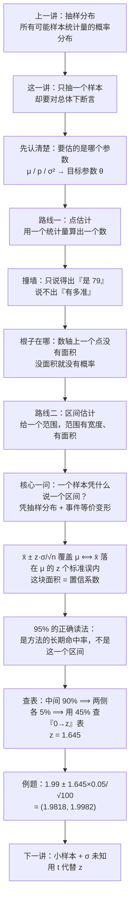
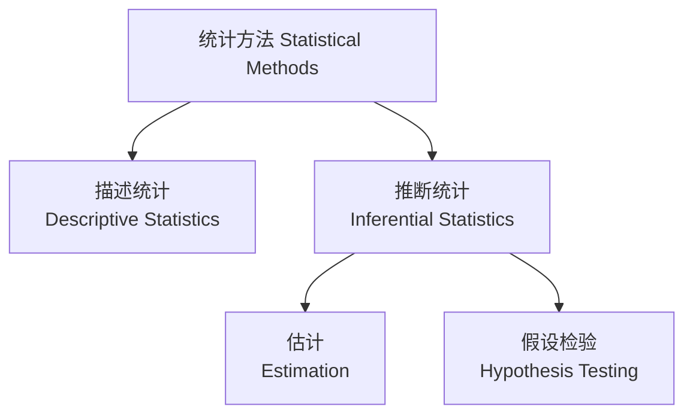
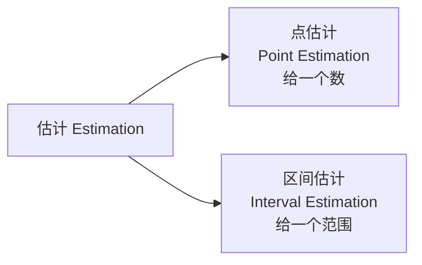
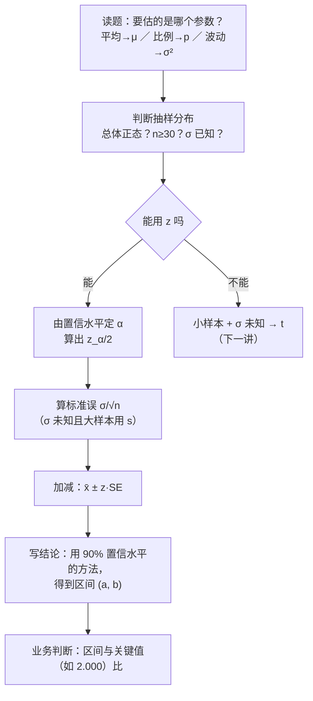

# C6.1 参数估计与置信区间 Identifying and Estimating the Target Parameter / Confidence Interval for a Population Mean

> [!abstract] 这一讲的任务
> 上一讲把**抽样分布**讲完了：容量相同的所有可能样本，其统计量构成一个分布，均值等于总体参数、标准差是 $\sigma/\sqrt n$、大样本时形状接近正态。那是纯粹"向后看"的一讲——它在描述"如果一直抽，会抽出什么"。
> 这一讲第一次**向前看**：现实里你只抽**一个**样本、只算**一个**数，却要对整个总体下一句断言。凭什么？
> 两件事要做。第一，把"估计"这件事拆成两条路线——**点估计**（给一个数）与**区间估计**（给一个范围），并说清前者为什么不够用。第二，回答全篇的核心问题：**一个样本，凭什么能给出一个带概率的区间**。答案的全部依据就是上一讲的抽样分布——这也是为什么所有推断统计的第一步都是先判断抽样分布。

> [!info] 怎么读这份讲义
> 第 0 节先摆一个具体到"你兜里有多少钱"的场景；第 1–3 节定位全章、认出要估的那个参数、把两条路线分开；第 4–5 节讲点估计并撞上第一堵墙（一个点没有面积）；第 6 节用一个二战案例把点估计做到极致，再指出它到底差在哪；第 7 节补上"什么叫好的估计量"；第 8–10 节是**全篇的重心**：区间估计的四要素、它成立的原理、置信系数的正确读法；第 11 节专攻查表时"该拿中间面积还是单侧面积"这个坑；第 12–13 节给出大样本公式与使用条件，并埋下下一讲 $t$ 分布的引子；第 14 节把 2 升瓶装饮料那道题算到底；第 15 节讨论精确度与置信度的拉锯；第 16 节收口。
> 标注约定：标有 **（拓展）** 或 **【拓展】** 的内容，是**课堂上没有展开、由教材与通行讲法延伸补充**的部分。复习时先掌握未标注的主干——考点集中在主干上。
> 勘误一句话：本篇有一处必须点名的印法差异——最后那道例题的答案印作 $1.982\le\mu\le1.998$，那是**三位小数**四舍五入的结果，精确值是 $(1.981775,\ 1.998225)$，见第 14 节。



---

## 0. 开场：这个班每个人兜里有多少钱（p.5、16）

先从一个不太好意思回答的问题开始：

> [!question] 停一下，先自己想想
> 假设你想知道**这个班每个学生身上平均带多少钱**。"这个班全体学生"就是总体，"平均带多少钱"就是你要的那个未知数。**你会怎么查出来？**

最直接的做法是**普查**：让每个人把钱掏出来数一遍，加总除以人数。这个数一定准确，一分不差。

但它有三个绕不过去的毛病：

1. **拿不到**。要是总体是"全国大学生""全厂一年生产的钢瓶""所有德国造过的坦克"，普查根本没法做。
2. **代价高**。就算做得到，也慢、也贵。
3. **人会撒谎或拒答**。涉及钱、涉及隐私的量，普查反而可能比抽样更不准——被问的人会往小了说。

所以只能抽样：抽一部分人，数他们的钱，算出一个平均数。整件事是一条单向的链（p.16）：

$$\text{总体（}\mu\text{ 未知）}\ \longrightarrow\ \text{随机抽取一个样本}\ \longrightarrow\ \bar x=50\ \longrightarrow\ \text{“我有 95\% 的把握，}\mu\text{ 在 40 到 60 之间”}$$

这条链的前两步毫无悬念。**悬念全在最后那一步**：你手上只有一个 $\bar x=50$，怎么忽然就跳出一对数字 40 和 60，还带上了一个"95%"？

> [!important] 这一讲要回答的唯一问题
> 只抽了**一个**样本、只算了**一个**数，凭什么能给出一个**带概率的区间**？
> 这个问题答不上来，后面每一章（假设检验、方差分析、回归）都只是在抄公式；答上来了，公式就不需要背——它是这个道理的自然产物。

课上把这件事的分量讲得很直白：这是"基础里的基础"，因为往后的统计课，几乎每一章都要做参数估计。

---

## 1. 全章地图：从"看见"到"断言"（p.3–4、6）

统计方法先分成两支（p.6）：



这条分叉线你要记住位置：**本章站在"推断统计 → 估计"这一格里**。

- **描述统计**：手上的数据是什么样，就说成什么样。均值、方差、直方图、箱线图——第 2 章做的全是这件事。它不越界。
- **推断统计**：拿手上的样本，去说**没拿到的那部分**。这一步天生有风险，所以必须带一个概率。

推断统计只有两条腿：**估计**（这个参数大概是多少）与**假设检验**（这个参数是不是等于某个值）。两条腿用的是同一套肌肉——抽样分布。

全章要交的三件事（p.4）：

1. 用一个**大样本**去估计总体参数（均值、比例、方差）；
2. 用统计量的**抽样分布**构造置信区间；
3. 决定该抽**多大的样本**。

第 3 件留在 [[C6.3 样本量、有限总体校正与方差的置信区间]]，第 2 件是这一讲的主线。

课上有个比喻值得留着：学推断统计像盖房子，**抽样分布是地基**，估计与假设检验是柱子和梁。地基没打好就往上砌，砌到第三层一定塌。

> [!important] 全篇总纲（这一句要背下来）
> **所有推断统计，第一步都是判断它的抽样分布。**
> 不先判断抽样分布，你就不知道手上这个统计量服从什么分布，也就没有资格说"中间那块面积是 95%"——而"面积是 95%"正是后面每一个公式的**全部**依据。
> 具体到操作，就是这三问：**① 总体是不是正态？② 样本够不够大？③ $\sigma$ 知不知道？** 三问答完，用 $z$、用 $t$、还是根本不能用，就定了。

---

## 2. 先认参数：目标参数是哪个"未知数"（p.9–10）

在动手估之前，得先说清"我们要估的是什么"。这个词不难，但含糊过去后面全乱。

> [!important] 定义：目标参数 Target Parameter
> **总体里那个未知的、我们想知道的数值**，叫目标参数（p.9）。
> 用 $\theta$ 泛指它。三个最常见的 $\theta$：
> - $\mu$：总体均值（population mean）
> - $p$（也写作 $\pi$）：总体比例（population proportion）
> - $\sigma^2$：总体方差（population variance）

先给一句人话，因为"参数"和"统计量"这两个词太容易含糊：

- **参数**在总体里，是一个**固定的数**，但你**拿不到**。全中国大学生的平均身高就是一个确定的数——它不随机，只是没人知道。
- **统计量**在样本里，是**算得出来**的数，但每次抽样都不一样，所以它是**随机变量**。

一句话：**参数是"想知道但拿不到"，统计量是"拿得到但不一定准"。** 这一对关系在第 1 章 [[C1.1 统计学是什么：从数据到决策]] 定过，在第 5 章 [[C5.1 抽样分布：统计量也是随机变量]] 升级成"统计量是随机变量"，这里第三次用到。

### 2.1 用词表认出参数（p.10）

题目不会直说"请估计总体均值"，它会写成一堆日常说法。参数对照表（p.10）的用处就在这里：

| 参数 | 题干里的关键词 | 数据类型 |
|---|---|---|
| $\mu$ | 平均、均值（mean, average） | 定量 Quantitative |
| $p$ | 比例、百分比、占比、比率（proportion, percentage, fraction, rate） | 定性 Qualitative |

第二列是"读题"，第三列是"验算"：两列必须对得上。**如果你按"平均"判成了 $\mu$，但数据本身是分类变量，那一定读错了题。**

> [!example] 三道小辨认（自己先判，再看后面的答案）
> ① "这批 2 升瓶装饮料**平均**实际装了多少？"
> ② "有多大**比例**的顾客会二次购买？"
> ③ "两台灌装机的装量**波动**是不是一样大？"

答案：① $\mu$，定量（容量是数）；② $p$，定性（买/不买，是个类别，只能数比例）；③ $\sigma^2$，定量。

第 ③ 问值得多看一眼：它问的不是"装多少"，而是"装得稳不稳"。**同一个变量可以问出不同的目标参数**——问中心就是 $\mu$，问波动就是 $\sigma^2$。本章只做到 $\mu$ 的区间，$\sigma^2$ 的区间留到第 6.7 节。

---

## 3. 两条估计路线（p.8）

认出 $\theta$ 之后，估法只有两条路：



用一句话把两条路的差别说到骨头里：

- **点估计**：算出一个数，把这个数当作答案。答案是数轴上的**一个点**。
- **区间估计**：算出两个数，说"答案在这两个数之间"。答案是数轴上的一段**线段**。

这个"点"与"段"的差别看起来只是形式，其实是这一讲全部张力的来源——因为**概率只肯跟"段"打交道，不肯跟"点"打交道**。为什么，第 5 节说。

顺序上先讲点估计。原因不是为了排队，而是因为：**区间估计的中心就是点估计**（第 8 节会看到，区间是"点估计 ± 一个量"）。点估计搞不清楚，区间就没有骨架。

---

## 4. 点估计：把答案压成一个点（p.11–12）

> [!important] 定义：点估计量 Point Estimator
> **一条规则（或公式）**，它告诉你怎样用样本数据算出一个**单一的数**，用来估计目标参数（p.11）。
> 常用的一对一搭配：
> $$\bar x\ \longrightarrow\ \mu,\qquad \hat p\ \longrightarrow\ p,\qquad s^2\ \longrightarrow\ \sigma^2$$

用"先……再……"讲清动作：**先按规则抽一个样本、把样本数据收齐；再代进那条公式算出唯一的一个数；这个数就是答案。**

为什么叫"点"？因为结果落在数轴上的**一个点**上——它没有宽度。这个命名方式后面还会再用一次：区间估计之所以叫"区间"，就是因为它有宽度。

点估计的脾气可以列成三条（p.12），其中一条是优点、一条是缺点，值得对号入座：

1. **给出单一的值**，基于**一个**样本的观测。——这是它最讨人喜欢的地方：简单、干脆、能写进报告。
2. **不提供"这个值离真参数有多近"的任何信息**。——这是它致命的短板。
3. 例：样本均值 $\bar x=3$，就是未知总体均值 $\mu$ 的点估计值。

第 1 条是优点，第 2 条是缺点——这两条是同一件事的两面：**它只肯给你一个数，所以它也只能给你一个数。**

### 4.1 一个必须先分清的对子：估计量 vs 估计值

这里有个词要钉住，否则第 9 节会读不懂。

- **估计量 estimator**：那条**规则**。它是随机变量——因为它的取值随样本变。写成 $\bar X$。
- **估计值 estimate**：按规则算出来的**那个数**。它是一个具体数字，不随机。写成 $\bar x=3$。

英文里两个词只差三个字母，含义差一个世界。课上有一句话把这个区别说得很清楚：**"一个估计量是用来估计总体参数的一个随机变量"**。它是随机变量，所以它有分布——这就是**抽样分布**。有了分布，才谈得上"均值等于 $\theta$"（无偏）、"方差有多小"（有效）。

> [!warning] 一个常见的混用
> "$\bar x$ 是 $\mu$ 的点估计"这句话里，$\bar x$ 其实扮演的是**估计量**的角色（在讲它的分布），但写的却是小写。这种混用在教材里到处都是，读的时候要自己补一句：**说性质时它是随机变量，说数值时它是数。**

---

## 5. 第一次撞墙：一个点没有面积（p.12）

点估计最大的问题，第二条性质只用了一行字打发："不给关于有多接近的信息"（p.12）。但"有多接近"这件事到底难在哪？值得停下来想透，因为这是全篇的转折点。

先试着用一句最朴素的话补上这个缺口：

> "我估计这班平均每人带 50 块。"

这句话听起来完整，但它漏了一个必然会被追问的东西：**"你有多确定？"**

你可能会本能地想说"我很确定"或者"大概吧"。可"很确定"是多确定？70%？95%？**只要你说不出一个数，这句话就没法用来做决策。** 一个质检员不能凭"大概是 1.99 升"就决定一批瓶子出不出厂；一个投资经理不能凭"大概是 8% 收益"就下单。决策需要的是**误差的范围**加**把握的大小**，而点估计两样都给不了。

那为什么不能给？这里有一个几何上的硬理由。

回想概率在连续分布里是怎么定义的：**概率就是曲线下面的面积**。想知道"$X$ 落在某个范围内"的概率，就去算那个范围对应的面积。

现在把点估计放到这张图上：它对应横轴上的**一个点**。一个点下面的面积是多少？

$$\text{面积}\big(\text{一个点}\big)=0\quad\Longrightarrow\quad P(\text{某个统计量恰好等于某个值})=0$$

这就是那堵墙。**点没有宽度，所以没有面积；没有面积，所以没有概率。** 于是"$\bar x=3$ 有多准"这句话在数学上根本无处落脚——不是我们偷懒不肯算，是这个问法本身没有对应的面积可算。

> [!important] 这堵墙的出口只有一条
> 想谈概率，就必须给一个**有宽度的东西**。
> 所以：把一个点撑成一段。**这就是区间估计。**
> 换句话说，区间估计不是点估计的"升级版包装"，它是"想把概率接进来"这个需求逼出来的**唯一可行形式**。

课上还有一句很妙的旁证：查标准正态表的时候，你查的从来都是"$z$ 落在某个范围里"的概率——**表里给的全是区间，没有一条是"$z$ 恰好等于某个值"的概率**。这不是巧合，原因就是上面这个面积为零。

---

## 6. 德军坦克：点估计能做到多好，又差在哪（案例）

在正式定义区间之前，先看一个把点估计用到极致的例子。它不在主干公式里，但它把"点估计能干什么、不能干什么"演示得比任何定义都清楚。

**场景。** 二战期间，盟军想知道德国一共造了多少辆坦克。德国人有个习惯：出厂时给坦克**从 1 开始顺序编号**，1、2、3……一直到总数 $N$。盟军能做的只有一件事——在战场上缴获若干辆，记下它们的编号。

问：**怎么用几个缴获的编号，估计出 $N$？**

> [!question] 停一下，先自己猜
> 假设缴获了 5 辆，编号是 12、27、33、58、71。你估总数是多少？先写一个数，再往下看。

**最朴素的做法：报最大的那个编号。** 这里就是 71。

撞墙很快：缴获的 5 辆里，**几乎不可能**恰好包含最后一辆。所以"最大值"这个估计**一定偏低**，而且样本越小偏得越狠——缴获 1 辆时你只会报那一辆的编号，可能只有真总数的十分之一。

**第二个做法：算样本均值，乘以 2。**

先看它凭什么成立。编号是 $1,2,\dots,N$ 的一串连续整数，它们的**均值**是

$$\mu=\frac{1+2+\cdots+N}{N}=\frac{N(N+1)/2}{N}=\frac{N+1}{2}$$

（这里用了等差数列求和：$1+2+\cdots+N=\dfrac{N(N+1)}{2}$。）而这一串数**对称**，所以均值、中位数、中点三者重合，都落在 $\dfrac{N+1}{2}$ 上。

于是反过来解：

$$\boxed{\ \hat N=2\bar x-1\ }$$

代进去：$\bar x=\dfrac{12+27+33+58+71}{5}=\dfrac{201}{5}=40.2$，所以

$$\hat N=2\times 40.2-1=79.4\approx 79$$

真总数是 80 的话，误差只有 1 辆。

**为什么"乘 2"能用？** 课上把这个说法问了两遍，答案值得说破：乘 2 之所以行，**不是因为均值本身有什么魔力，而是因为在"1 到 N 连续编号"这个特殊结构里，均值恰好是最大值的一半**。换一个结构（比如编号从 1000 开始，或者编号不连续），乘 2 立刻失效。

这也正是第 2.3 节 [[C2.3 集中趋势：均值、中位数、众数]] 埋过的那句话在起作用：**均值代表的是"结构"，不是"数字"**。结构一换，同一个公式就废了。

**它还真是无偏的。** 用 python 模拟一遍：设真实 $N=80$，每次随机抽 5 辆、按 $\hat N=2\bar x-1$ 估，重复 20 万次，估值的平均是 **80.03**——正中靶心。

```python
import random, statistics
random.seed(7)
N, k, reps = 80, 5, 200_000
tot = 0
for _ in range(reps):
    s = [random.randint(1, N) for _ in range(k)]   # 随机缴获 k 辆
    tot += 2 * statistics.mean(s) - 1              # 2x̄ − 1
print(tot / reps)      # 80.03  ← 期望正好等于 N
```

> [!note] 【拓展】这段历史后来怎么了
> 这确实是一个真实用过的方法。二战后期，盟军通过缴获坦克的编号、齿轮箱上的序列号、轮胎批次等，估出德国的月产量在**几百辆**的量级；而当时情报部门凭"数工厂、数厂房"估出来的数字要高出一个数量级。战后核对德国生产记录，统计方法给出的估计明显更接近真相。
> 一句流传很广的评语：**统计学家比间谍干得好。**

**现在看这堵墙在哪里。** 你给出了 79.4。这个数很好——它无偏、它比"报最大值"强得多、它甚至比情报部门还准。

可是**你能说"我有 95% 的把握认为总数在 70 到 90 之间"吗？**

不能。你手上只有 $\hat N=79.4$ 这一个数，**没有任何概率信息**。你甚至说不清这个 79.4 的波动有多大——如果换一批缴获的坦克再算一次，可能是 65，也可能 95。**点估计的最大问题就是这个：不管它估得多好，它只能报一个数，报不出"这个数有多可信"。**

这不是这道题的问题，是所有点估计的通病。要做出厂决策、要敢在报告上写"这批货不合格"，光有一个数是不够的。

---

## 7. 好估计量的三条标准：无偏、有效、一致

在换路线之前，先要能回答一个附带问题：**点估计那么多，凭什么用这个不用那个？**

用 $\bar x$ 估 $\mu$ 是常识，但常识不等于理由。理由在抽样分布里——一个估计量是随机变量，它有分布，于是可以用**分布的三个特征**来打分。

### 7.1 无偏性 unbiasedness

> [!important] 定义：无偏估计量 Unbiased Estimator
> 如果一个估计量的**抽样分布的均值**等于被估的总体参数，它就是无偏的：
> $$E(\hat\theta)=\theta$$
> 口语版：**容量相同的所有可能样本，算出来的估计值平均一下，正好等于真值。**

为什么叫"无偏"？"偏"指的是**系统性偏离**。如果所有可能样本算出来的值平均起来偏高，说明这个方法本身带一个"往高里拽"的固有倾向——不是运气差，是方法歪。

> [!warning] 这里最容易混的一步
> 无偏**不是**"每一次估计都准"。它说的是**平均起来对准**。
> 一个无偏的估计量，单次照样可能偏得很远；一个有偏的估计量，也可能某一次碰巧很准。区别只在"重复无数次之后的平均值落在哪"。

两个必须记住的判定：

- $\bar x$ 是 $\mu$ 的**无偏**估计量。原因是 $\bar x$ 的期望就是 $\mu$（第 5 章那条 $E(\bar x)=\mu$）。背后是第 2.3 节讲过的"均值的必然性"：由于偶然因素，$\bar x$ 有时大于 $\mu$、有时小于 $\mu$，正负偏差在平均中相互抵消。
- **样本中位数不是** $\mu$ 的无偏估计量。把所有可能样本的中位数平均起来，并不等于 $\mu$——右偏总体里它系统偏小，左偏里系统偏大。所以它是**有偏**的。

还有一个更常考的：**为什么样本方差要除以 $n-1$？** 因为只有除以 $n-1$，$s^2$ 才是 $\sigma^2$ 的无偏估计量；除以 $n$ 得到的那一个，平均起来偏小，是**有偏**的。这条线索在 [[C2.4 离散程度：极差、方差与标准差]] 已经埋过，这里是它的正式回收。

### 7.2 有效性 efficiency

> [!important] 定义：有效性 Efficiency
> **在都是无偏的前提下**，抽样分布的**方差越小**，这个估计量越**有效**。
> 若两个估计量同样本量、都无偏，则方差小的那个**相对有效性**更高。

为什么**一定要先无偏，才谈有效**？这一步课上问了好几遍，理由值得单独讲：

假设真值 $\theta$ 在 0。A 估计量的抽样分布以 0 为中心、比较胖；B 估计量的抽样分布以 0 为中心、很瘦。B 方差小，B 更有效——没问题。

现在换成 C 估计量，它的分布也很瘦，但中心在 3。**它方差再小都是灾难**：方差越小，意味着它越稳定地落在 3 附近，而真值在 0——**它稳定地错**。

所以：

> [!important] 一句话
> **有偏时，"方差小"不是优点，是"错得更稳定"。**
> 有效性是给"已经瞄在靶心上的枪"比的散布；瞄偏了的枪，散布再小也是脱靶。

这也是为什么"无偏 + 最小方差"要连在一起说：先正，再准。

### 7.3 一致性 consistency

> [!important] 定义：一致估计量 Consistent Estimator
> 随着**样本量增大**，估计值以越来越高的概率**靠近**总体参数。
> 极端情形：当 $n$ 增大到等于总体容量 $N$ 时（抽样变成普查），估计值就等于参数本身。

这个性质最直观。回想上一讲的结论：$\bar x$ 的抽样分布标准差是 $\sigma/\sqrt n$。$n$ 变大，$\sigma/\sqrt n$ 变小，**整条分布往中间收窄**。

一路收下去会怎样？$n\to N$ 时，$n$ 与 $N$ 已经没有区别，抽样就是普查——$\bar x$ 只剩一种可能，就是 $\mu$。**整条分布缩成了一条竖线，宽为零，随机性彻底消失。**

这条"分布缩成一条线"的图景，是判断一个估计量是否一致的最好抓手：**问它"n 大到顶时会怎样"，如果答案是"塌成一点"，它就一致。**

反过来，如果 $n$ 越来越大，估计值反而离真值越来越远，那这个方法一定不能用。

### 7.4 三个性质的合称

一个估计量如果**无偏**、并且在**所有无偏估计量中方差最小**，就给它一个专门的称号：

$$\text{MVUE}=\text{minimum variance unbiased estimator}\ \text{（最小方差无偏估计量）}$$

> [!warning] 名字别记错
> 全名是 **minimum** variance unbiased estimator——**最小**方差，不是 "medium"（中等）方差。这两个词只差几个字母，意思正好相反：一个是"所有无偏估计量里最好的那个"，一个是"中等水平"。

常用的三个 MVUE：$\bar x$ 是 $\mu$ 的 MVUE；自由度取 $n-1$ 的 $s$ 是 $\sigma$ 的 MVUE；$\hat p$ 是 $p$（$\pi$）的 MVUE。

> [!tip] 三条标准怎么用于答题
> 被问到"这个估计量好不好"，按顺序答三句：
> ① **无偏吗？**（抽样分布的均值 = 参数？）——不满足，后面无须再谈。
> ② **无偏的前提下，方差小吗？**——小则更有效。
> ③ **$n$ 增大时靠得近吗？**——是则一致。
> 三条全过，才配叫"好的点估计"。

---

## 8. 区间估计：把"点"撑成"段"（p.13–14、16–17）

标准补完了，回到主线。第 5 节那堵墙说得很清楚：要有概率，就得有面积。那就给面积。

> [!important] 定义：区间估计量 / 置信区间 Interval Estimator / Confidence Interval
> **一条公式**，它告诉你怎样用样本数据算出**一个区间**，用这个区间去估计目标参数（p.13）。
> 写出来是：
> $$\big[\ \text{下置信限},\ \text{上置信限}\ \big]=\big[\ \bar x-\text{一个量},\ \ \bar x+\text{一个量}\ \big]$$

中文习惯叫**置信区间**。"置信"两个字直译自 confidence——**你对这个区间有多大的信心，它就有多"置信"**。这个译名不完美（它容易让人以为在说"这个区间有多可信"），后面第 10 节会专门掰正。

### 8.1 四个要素（p.17）

一个区间可以拆成四件东西（p.17），一件不能少：

| 要素 | 是什么 | 在数轴上 |
|---|---|---|
| 样本统计量（点估计） | $\bar x$ | 区间的**中心** |
| 置信区间 | 整段范围 | 从下限到上限那一段 |
| 置信下限 lower limit | $\bar x-\text{半宽}$ | 左端点 |
| 置信上限 upper limit | $\bar x+\text{半宽}$ | 右端点 |

一句话定义很好用（p.17）：置信区间给出的是总体参数的**一个"合理取值"的范围**（a range of plausible values）。注意"plausible"这个词——它不说"真值一定在这里"，说的是"这些值看起来都讲得通"。

用"先……再……"讲清动作：**先用一个样本算出点估计 $\bar x$，把它摆在正中间；再算出一个"允许多大误差"的半宽；然后左右各加一份，得到两个端点。** 就这么三步。

半宽这个词是关键。它有个专门的名字：**误差界限**（error bound），有时也叫**边际误差**（margin of error）。新闻里说的"民调误差 ±3%"就是它——**没有这个 ±，一个估计值没法用。**

### 8.2 区间估计的三条性质（p.14）

区间估计有三条性质（p.14），前两条与点估计对照着看，第三条最绕，要单独拆：

1. **给出一个取值范围**（而不是一个值）。基于**一个**样本的观测。
2. **提供关于"有多接近未知参数"的信息**，而且这个信息**用概率来表述**。
3. **想知道确切的"有多近"，需要知道那个未知参数。**

第 3 条读第一遍会觉得是废话，其实是这一讲最诚实的一句话，值得拆开：

> [!important] 为什么"确切的接近程度"永远拿不到
> 想知道"我这次估得准不准"，就必须拿估计值和真值比。
> 可真值 $\mu$ **正是你不知道的那个东西**——知道了就不用估了。
> 所以"这次到底准不准"这个问题**在逻辑上无法回答**。
> 能回答的只有另一个问题：**"用这套方法造出来的区间，长期来看有多大比例能盖住真值？"**
> 这就是为什么区间估计的一切说法都必须挂在"概率/长期频率"上，而不能挂在"这一次"上。

### 8.3 估计的流程图（p.16）

这条流程值得记住（p.16），因为它把整件事的时间顺序摆清楚了：


注意中间那个 50：**它没有消失，它变成了区间的中心。** 区间估计不是推翻点估计，而是"以点估计为圆心画一个圆"。这也解释了为什么第 4–7 节要先讲点估计——**区间是点估计加了一圈"误差"。**

---

## 9. 原理：一个样本凭什么说一个区间（p.18–19）

到这里，全部准备工作做完了。剩下的是这一讲真正的难关，也是课上花了最多时间的地方：

> [!question] 停一下，先自己想想
> 你只抽了一个样本，算出 $\bar x=50$。然后你说："$\mu$ 在 40 到 60 之间，我有 95% 的把握。"
> **凭什么？** 你连 $\mu$ 在哪都不知道，怎么敢给它划一个范围、还附带一个概率？

这个问题不答清楚，后面所有公式都是死记。答清楚了，公式不用背。

### 9.1 先看清"你知道什么、不知道什么"

把三件事分清楚，这是整段推理的地基：

| | 知不知道 | 会不会变 |
|---|---|---|
| 总体均值 $\mu$ | **不知道**（这正是要估的） | 固定，不随机 |
| 样本均值 $\bar x$ | **知道**（算得出来） | 随抽样变，是随机变量 |
| $\bar x$ 的抽样分布 | **知道形状**（大样本近似正态，中心在 $\mu$，标准差 $\sigma/\sqrt n$） | — |

第三行是上一讲留下的全部家当。注意其中那个微妙的裂缝：

> [!important] 关键的一句
> 抽样分布的形状我们知道，**它的位置我们不知道**——因为它的中心就是 $\mu$，而 $\mu$ 未知。
> 所以你手里那张"抽样分布图"是**一张画好了形状、却不知道贴在哪里的透明胶片**。

这就是为什么"我抽到的这个 $\bar x$ 落在分布的哪个位置"答不上来：要定位，得先知道中心在哪。

### 9.2 但有一件事你确实知道：它一定在面积里

位置不知道，**范围**却是确定的：

$$\bar x\ \text{一定落在这条曲线下的某个地方，概率 100\%}$$

因为它就是"所有可能样本均值"当中的一个，而这条曲线下的面积装的正是全部可能性。就像往一个已知形状、未知位置的靶子上打了一枪——**你不知道打中了几环，但你知道子弹一定在靶子上。**

### 9.3 换个问法，问题就解了

现在做一次视角翻转。

**原本的问法**（没法算）：$\bar x$ 落在哪？——答不上来，因为不知道 $\mu$ 在哪。

**改成这个问法**（能算）：**$\bar x$ 离 $\mu$ 有多远？**

这个问法能算，因为"距离"只用相对位置。而 $\bar x$ 与 $\mu$ 的距离在抽样分布里是**有刻度的**：

$$Z=\frac{\bar x-\mu}{\sigma/\sqrt n}\ \sim\ N(0,1)$$

分母 $\sigma/\sqrt n$ 就是那把尺子的刻度。于是

$$P\!\left(-1.96\le\frac{\bar x-\mu}{\sigma/\sqrt n}\le 1.96\right)=0.95$$

这句话说的是：**随机抽一个样本，$\bar x$ 落在 $\mu$ 上下 1.96 个标准误之内的概率是 0.95。**

**现在做那步关键的代数变形。** 括号里那个不等式，两边同乘 $\sigma/\sqrt n$、再加 $\mu$、再减 $\bar x$，得到的是同一个事件的另一种写法：

$$-1.96\le\frac{\bar x-\mu}{\sigma/\sqrt n}\le 1.96
\quad\Longleftrightarrow\quad
\bar x-1.96\frac{\sigma}{\sqrt n}\ \le\ \mu\ \le\ \bar x+1.96\frac{\sigma}{\sqrt n}$$

**这两个不等式说的是同一件事，一个字都没多。** 左边读作"$\bar x$ 离 $\mu$ 不超过 1.96 个标准误"，右边读作"$\mu$ 落在 $\bar x$ 上下 1.96 个标准误之间"。

于是概率可以直接搬过去：

$$\boxed{\ P\!\left(\bar x-1.96\frac{\sigma}{\sqrt n}\ \le\ \mu\ \le\ \bar x+1.96\frac{\sigma}{\sqrt n}\right)=0.95\ }$$

> [!important] 这就是全部的秘密
> **"区间盖住 $\mu$" 与 "$\bar x$ 落在 $\mu$ 附近" 是同一个事件。**
> 前者你没法直接算（因为 $\mu$ 的位置不知道），后者你一查表就能算（因为它只用到相对距离，而相对距离的分布是标准正态）。
> 所以：**一个样本之所以能说一个区间，凭的是抽样分布给了它一把刻度已知的尺子。**

课上把这个转折叫做"换位思维"：真实世界里是 $\mu$ 钉住不动、$\bar x$ 到处乱跑；但你在纸上推的时候，可以反过来把 $\bar x$ 钉在你算出来的那个值上，让 $\mu$ 在它周围晃。**两种画法描述的是同一个概率。**

### 9.4 三个熟悉的倍数

同一条式子，把 1.96 换成别的数，就得到别的把握：

| 倍数 $z$ | 中间覆盖的概率 | 记忆点 |
|---|---|---|
| $1$ | $0.6827$ | 一个标准差 ≈ 68.27% |
| $1.645$ | $0.90$ | 90% 区间 |
| $1.96$ | $0.9500$ | 95% 区间（教科书标准） |
| $2$ | $0.9545$ | 两个标准差 ≈ 95.45% |
| $2.576$ | $0.99$ | 99% 区间 |
| $3$ | $0.9973$ | 三个标准差 ≈ 99.73% |

> [!warning] $1.96$ 与 $2$ 不是同一个数
> 95% 用的是 $1.96$；"两个标准差"给的是 $95.45\%$。
> 两个倍数只差 $0.04$，覆盖概率却差 $0.45$ 个百分点。记法：**$1.96$ 是"刚好 95%"，$2$ 是"约 95.45%"——题目要 95% 就写 1.96，别图省事写 2。**

这张表就是 [[C2.5 标准差怎么用：切比雪夫定理与经验法则]] 里那条经验法则的"正式版"：那里说"约 68%、约 95%、约 99.7%"，这里把它精确到小数点后四位，并且**从"描述数据"升级成了"做推断"**。

同一套倍数，用途完全不同：
- 在经验法则里，它回答"**数据**有多少落在这个范围内"；
- 在这里，它回答"**区间**有多大的概率盖住参数"。

---

## 10. 置信系数：95% 到底在说谁（p.20–21）

倍数定了，接着给那个"95%"一个正式名字。

> [!important] 定义：置信系数 Confidence Coefficient
> **随机选出的一个置信区间包含总体参数的概率**——也就是：当这套估计方法被**重复使用非常多次**时，构造方式相同的那些区间里，包含参数的比例（p.20）。
> 用百分比表示时，叫**置信水平 confidence level**，记作
> $$1-\alpha$$
> 其中 $\alpha$ 是"没盖住"的那部分概率，叫**显著性水平 significance level**。

名字拆一下：coefficient 是"系数"，在这里指"一个决定强度的数"；level 是"水平"。中文"置信"= 相信的程度。**置信系数 0.95 = 置信水平 95%。** 同一个东西的两种写法。

### 10.1 为什么用 $1-\alpha$ 表示，而不给它一个自己的字母

这是个细节，但能看出这套符号系统的脾气。

$\alpha$ 叫**显著性水平**，在统计学的后半段（假设检验，第 7 章起）是绝对的主角；置信水平虽然重要，却只能委屈地用 $1-\alpha$ 表示。

原因：**$\alpha$ 更基本。** 它直接对应"我允许自己犯错的那块面积"，而置信水平只是"剩下的那块"。后面学假设检验时会发现，一切判断都从 $\alpha$ 出发（"$\alpha=0.05$ 时拒还是不拒"），置信水平反倒退成配角。所以符号系统把主角的位置留给了 $\alpha$。

### 10.2 95% 的正确读法（这一节最容易考，也最容易说错）

> [!question] 停一下，先自己想想
> 我算出区间 $(1.9818,\ 1.9982)$，置信水平 95%。下面哪句话是对的？
> ① $\mu$ 有 95% 的概率落在这个区间里。
> ② 这个区间有 95% 的概率包含 $\mu$。
> ③ 如果反复抽样、反复造区间，约 95% 的区间会包含 $\mu$。
> ④ 全部瓶子里有 95% 的容量落在这个区间内。

答案是 **③**。其余三句都错，而且错得各有各的道理，值得一句句拆：

**① 与 ② 错在同一处：把 $\mu$ 当成了随机的。**
$\mu$ 是一个**固定的数**——这批瓶子的真实平均容量就那么多，它不随你抽不抽样而变。区间一旦算出来，两个端点也固定了。两个固定的东西之间，"包含"或"不包含"是一个**已经确定的事实**，没有概率可言：要么是 1，要么是 0。

我们只是**不知道**这个事实是 1 还是 0。**"不知道"不等于"随机"。**

**④ 错在偷换了对象。** 它把"参数落在区间内"换成了"观测值落在区间内"。那是两件完全不同的事：前者讲的是**均值** $\mu$（一个数），后者讲的是**单个瓶子**的容量分布。区间 $(1.9818,1.9982)$ 窄到只有 0.0164 升，而单瓶容量的标准差就有 0.05 升——**绝大多数瓶子根本不在这个区间里**。

**③ 为什么对**：它把概率挂在了**方法**上，而不是**结果**上。这句话里的"95%"修饰的是"反复造区间"这个动作的**长期命中率**，不是某一次的结果。

> [!important] 一句话记住
> **95% 是这套"造区间"的手艺的命中率，不是这一个区间的运气。**
> 说得再直白一点：这杆枪打中靶心的概率是 95%——但你这一枪打没打中，只有靶子知道。

那实际该怎么说？两种都行，都诚实：

- **挂在方法上**："我用了一个命中率 95% 的方法，它给出的区间是 $(1.9818,\ 1.9982)$。"
- **挂在长期频率上**："如果重复抽 100 次、造 100 个区间，大约 95 个会盖住 $\mu$，5 个不会。"

课上把这份诚实说得很到位：真实的你到底包不包括，其实我们并不知道——**95% 的情形会命中，那 5% 也照样可能发生。** 我们做的一切，只是**尽可能把"盖住"的概率做大**——做不到保证。

下图把这句话画出来了：同一批总体，反复抽 24 次、每次造一个 95% 区间。

![[C6.1–6.2-重复抽样的区间覆盖.png]]
读图三件事：

1. **每一条横线的长度完全一样**（都是 $2\times1.96\times\sigma/\sqrt n$）。**区间的宽度由方法决定，不由运气决定。**
2. **蓝点是每次算出来的 $\bar x$，位置各不相同**——随机性全在中心上，不在宽度上。
3. 红色那两条没盖住 $\mu$。**24 条里有 2 条没盖住，约 8%**；这是随机波动，样本多了会稳定在 5% 附近。

> [!tip] 这张图也解释了"为什么不能报单次概率"
> 看着图你会发现：到底哪几条会红，**事前完全无法预知**。方法能承诺的只有"红的比例约 5%"，不能承诺"这一条不红"。
> 这就是置信水平的全部含义——**它是对方法的承诺，不是对结果的承诺。**

### 10.3 一般形式（p.21）

把 1.96 换成任意 $z_{\alpha/2}$，就得到置信水平 $1-\alpha$ 的通式：

$$\boxed{\ \bar x\ \pm\ z_{\alpha/2}\,\sigma_{\bar x}\ =\ \bar x\ \pm\ z_{\alpha/2}\left(\frac{\sigma}{\sqrt n}\right)\ }$$

三个符号各管一件事：

- $z_{\alpha/2}$：**倍数**，由置信水平决定（查表得来）；
- $\sigma_{\bar x}=\sigma/\sqrt n$：**标准误**（standard error），抽样分布的标准差，也就是那把尺子的刻度；
- $\bar x$：**中心**，点估计。

**为什么要 $\alpha/2$ 而不是 $\alpha$？** 因为 $z_{\alpha/2}$ 的定义就是"**右尾面积为 $\alpha/2$** 的那个 $z$"（p.21），而尾巴的面积正是"我不要的那部分"。

这个道理很简单，但值得说明白：置信区间是**加减**结构，左边减一份、右边加一份，所以"不要的那部分概率"也得分给两边——**每边一半**。$1-\alpha$ 是中间要留下的，$\alpha$ 是两边要丢掉的，一边丢 $\alpha/2$。

$$1-\alpha=\underbrace{0.95}_{\text{中间要的}},\qquad \alpha=\underbrace{0.05}_{\text{两侧合起来丢掉的}},\qquad \frac{\alpha}{2}=\underbrace{0.025}_{\text{每一侧}}$$

> [!important] 什么时候用 $\alpha$、什么时候用 $\alpha/2$
> **看你要的是"一边"还是"两边"。**
> 区间估计天生是两边的（加减），所以永远用 $\alpha/2$。
> 到了假设检验，如果备择假设是"不等于"，还是两边，仍用 $\alpha/2$；如果备择假设是"大于"或"小于"，只用一边，才用整个 $\alpha$（第 7 章会正式出现）。
> 现在只要记住：**加减 = 两边 = 除以 2。**

### 10.4 置信水平是谁定的

这一点很容易被忽略：**$z$ 不是算出来的，是选出来的。**

- 想要 90% 的把握，就取 $z=1.645$；
- 想要 95%，取 $z=1.96$；
- 想要 99%，取 $z=2.576$；
- 想要 68.27%，取 $z=1$；想要 95.45%，取 $z=2$；想要 99.73%，取 $z=3$。

**是你自己对自己的要求决定了这个倍数。** 这句话背后是一个角色转换：做研究的人是你，不是公式。**你想让别人对这个结论有多大信心，你就选多大的置信水平**——选完再回头看，为了这个信心要付出多宽的区间（第 15 节讲这个代价）。

---

## 11. 查表那一坑：中间 90% 该拿 45% 去查（p.21）

现在到了最容易出错、也最值得单独拎出来讲的一步。

题目要求 90% 的置信区间。你需要 $z_{0.05}$。问题来了：**标准正态表上那么多数字，你该拿哪个去查？**

先列出正确的推理链，一步一步来：

1. **中间要 90%**：$1-\alpha=0.90$。
2. **两侧合起来剩 10%**：$\alpha=0.10$。
3. **每侧 5%**：$\alpha/2=0.05$。这就是 $z_{0.05}$ 的由来——**下标 $0.05$ 指的是"右边尾巴的面积"**，不是"置信水平"。
4. **查表**：标准正态表给的不是"中间面积"，也不是"右尾面积"，而是**从 0 到 $z$ 的面积**。中间 90% 从 $z=0$ 处被切成两半，一半是 $0.90/2=0.45$。
5. 在表里找**表体值 0.4500**，读出对应的 $z$：

$$z_{0.05}=\Phi^{-1}(0.95)=1.6449\approx 1.645$$

> [!warning] 顺口说错的那一步：$\alpha$ 到底是 10% 还是 5%
> 90% 的置信水平，$\alpha=0.10$（**两侧合起来** 10%），每侧 $\alpha/2=0.05$。
> 现场推的时候很容易脱口而出"$\alpha$ 是 5%"——那是个很自然的结巴，因为下一步用到的、写在 $z$ 下标上的确实是 $0.05$。**但这两个 0.05 身份不同**：一个是单侧尾巴的面积，一个是 $\alpha$ 的一半。
> 判断方法：**问自己"这个数管一边还是管两边"**。管两边的是 $\alpha$，管一边的是 $\alpha/2$。

![[C6.1–6.2-查表用哪块面积.png]]
图上两种情形并排放着：橙色那块才是**表里能查到的数**（90% 时是 0.450，95% 时是 0.475），红色是两侧丢掉的尾巴，浅紫是中间那整块。**查表要用的是"半个中间"，不是整个中间。**

> [!warning] 这个坑的两副面孔
> **错法 A（把 0.90 当入口）**：想都不想就拿 0.90 去查。
> 若手上是**累加表**（表体给 $\Phi(z)$，左尾面积），0.90 堂而皇之地在表里，查出来 $z\approx1.28$。于是你算出 $1.99\pm1.28\times0.005=(1.9836,\ 1.9964)$，宣称"90% 的置信区间"。
> **实际覆盖多少？** $2\Phi(1.28)-1=0.7995$——**嘴上说 90%，实际只有约 80%。** 区间变窄了，看着更"精确"，代价是偷偷把可靠性砍掉一档。而 $z=1.28$ 本来是**80% 区间**的倍数，差就差在这里。
> **错法 B（拿 0.90 查 0→z 表）**：这张表的表体最大也只到 $0.499$ 附近，**根本找不到 0.90**。找不到时慌了、随手抓一个 $0.4990$（对应 $z\approx3.09$），区间立刻宽到没有意义——把该做 90% 的题做成了 99.8%。
> 两种错法方向相反：一个把区间做窄（可靠性不足），一个把区间做宽（精度不足）。**共同的病根只有一个：没先问清"这张表给的是哪块面积"。**

这类错误的根源不在算术，而在**读表的习惯**：不同的表给的面积不一样，必须每次先问一句"**这张表给的是哪块面积？**"

| 表给的是 | 90% 时该查什么 | 95% 时该查什么 |
|---|---|---|
| $0$ 到 $z$ 的面积（本课用的这种） | $0.450$ | $0.475$ |
| 左尾面积 $\Phi(z)$ | $0.950$ | $0.975$ |
| 右尾面积 $1-\Phi(z)$ | $0.050$ | $0.025$ |

三张表查出来的 $z$ 完全一样，只是入口不同。

> [!important] 三条口诀
> **① 先定中间要多少**（$1-\alpha$）。
> **② 再算两侧剩多少、每侧多少**（$\alpha/2$）。
> **③ 最后换算成这张表要的面积，再去查**（本课的表：$(1-\alpha)/2$）。
> 90% → 0.45 → 1.645；95% → 0.475 → 1.96；99% → 0.495 → 2.576。这三组背下来，考试时不用推。

---

## 12. 大样本均值的置信区间：公式与两条硬条件（p.22–23）

工具齐了，可以写正式结论。

> [!important] 大样本 $(1-\alpha)$ 置信区间（总体均值 $\mu$）
> $$\bar x\ \pm\ z_{\alpha/2}\,\frac{\sigma}{\sqrt n}$$
> 其中 $z_{\alpha/2}$ 是标准正态分布中**右尾面积为 $\alpha/2$** 的那个 $z$ 值；$\sigma$ 是被抽样总体的标准差；$n$ 是样本量（p.23）。
> 当 $\sigma$ **未知**但 $n$ **很大**（$n\ge30$）时，用样本标准差 $s$ 代替：
> $$\bar x\ \pm\ z_{\alpha/2}\,\frac{s}{\sqrt n}$$

用"先……再……"讲清动作，一共四步：

1. **判断抽样分布**（这一步永远第一）：总体是否正态？样本是否够大？$\sigma$ 知不知道？——决定用 $z$、用 $t$、还是不能用。
2. **查倍数**：由置信水平定 $\alpha$，再按第 11 节的口诀查出 $z_{\alpha/2}$。
3. **算标准误**：$\sigma/\sqrt n$（$\sigma$ 未知且大样本时换 $s$）。
4. **加减**：$\bar x\pm z_{\alpha/2}\times$ 标准误，得两个端点。

### 12.1 两条条件，各有各的用处（p.22）

两条条件（p.22）不是并列的，**它们解决的是两个不同的问题**：

| 条件 | 解决什么 |
|---|---|
| ① 从目标总体中抽取**随机样本** | 保证样本有代表性（否则抽样偏差一进来，公式再准也没用） |
| ② 样本量 $n$ **足够大**（$n\ge30$） | 保证 $\bar x$ 的抽样分布**近似正态**（CLT），并且 $s$ 可以当作 $\sigma$ 用 |

第 ① 条与第 1 章 [[C1.2 收集数据：抽样方法与代表性]] 讲的自愿样本、方便抽样是一体两面：**公式假设你抽的是随机样本。抽歪了，公式不负责。**

第 ② 条有两个作用，第二个常被忽略：**它不只让分布变正态，还让 $s$ 能顶替 $\sigma$。** 大样本时 $s$ 与 $\sigma$ 已经非常接近，用它带来的误差可以忽略。

> [!warning] 第 ② 条不是"万能的通行证"
> 小样本**并非永远不能用区间估计**，它只是不能**用这一条**公式。如果总体本来就服从正态分布，那么无论 $n$ 多小，$\bar x$ 都精确正态，照样能造区间——只是 $\sigma$ 未知时得改用 $t$ 分布（下一讲）。
> 条件该这样记：**"大样本"是给"总体分布未知"准备的退路，不是所有情形的门槛。**

---

## 13. 什么时候必须换成 $t$（p.23）

"$\sigma$ 未知且 $n$ 大时用 $s$ 代替"这句话（p.23）里埋了一个伏笔。伏笔的内容值得现在就拆开，因为它决定了你以后做题时选哪个公式的**全部判断逻辑**。

### 13.1 $z$ 的来历

$z$ 是怎么来的？一句话：

$$z=\frac{\bar x-\mu}{\sigma/\sqrt n}$$

分母用的是**总体的**标准差 $\sigma$——一个**固定的常数**。所以整条式子里，**唯一随抽样变动的东西只有 $\bar x$**。

只要 $\bar x$ 服从正态分布（总体正态，或者大样本靠 CLT），这个式子就精确服从标准正态。干净、利落。

### 13.2 用 $s$ 代替之后，为什么就不干净了

$\sigma$ 不知道时，只能用样本标准差 $s$：

$$\frac{\bar x-\mu}{s/\sqrt n}$$

看上去只是把 $\sigma$ 换成 $s$，实际上**换进了一个新的随机变量**。

> [!important] 关键区别
> $s$ 是从**这一次的样本**算出来的。换一批样本，$\bar x$ 变，$s$ **也变**。
> 所以在 $\dfrac{\bar x-\mu}{s/\sqrt n}$ 里，**分子分母都在随机波动**：分子里的 $\bar x$ 在变，分母里的 $s$ 也在变。
> 一个"两个随机量相除"的式子，不会再是标准正态。

它服从的是 **$t$ 分布**。$t$ 分布的形状由**自由度**决定——因为算 $s$ 时用了 $n-1$ 个自由度，这个自由度就跟着进了分布。

$t$ 分布长什么样？一句话：**比正态更矮、更胖、尾巴更厚**。道理也很直白：$s$ 本身有波动，有时候偏小、有时候偏大；$s$ 偏小的时候，$s/\sqrt n$ 偏小，商就偏大——**多出来的这些"偏大"的值堆在尾部**，于是尾巴变厚。

自由度越大，$s$ 越稳定，$t$ 越像正态。**当自由度足够大时，$t$ 与 $z$ 几乎重合。**

### 13.3 于是"大样本可以直接用 $z$"就有了解释

这就说通了：$n$ 大 ⟹ 自由度 $n-1$ 大 ⟹ $t$ 与 $z$ 几乎重合 ⟹ **用 $z$ 代替 $t$ 造成的误差小到可以忽略**。

所以那句"$\sigma$ 未知且 $n\ge30$ 时用 $s$ 代替 $\sigma$"，本质是：**在 $t$ 已经长得跟 $z$ 一样的时候，偷懒用 $z$。**

### 13.4 一张判断表

把第 12–13 节合成一张表，这就是做题时的第一道关：

| 总体分布 | $\sigma$ 知道吗 | 样本量 | 用什么 |
|---|---|---|---|
| 正态 | 知道 | 任意 | $z$（精确） |
| 正态 | 不知道 | 大（$n\ge30$） | $z$（近似，$s$ 代 $\sigma$） |
| 正态 | 不知道 | 小（$n<30$） | **$t$**（下一讲） |
| 非正态 | 知道 | 大（$n\ge30$） | $z$（CLT 近似） |
| 非正态 | 不知道 | 大（$n\ge30$） | $z$（CLT + $s$ 代 $\sigma$） |
| 非正态 | 知道 | 小（$n<30$） | **都不行**——抽样分布给不出正态近似 |
| 非正态 | 不知道 | 小（$n<30$） | **都不行**——同上 |

最后两行是这张表的重点：**小样本 + 总体非正态，是死路，不是"换个公式"能救的。** 这也是为什么"先判断抽样分布"这条总纲不能跳——它有时候会告诉你"这题做不了"，而这个答案本身就有价值。

> [!note] 下一讲预告（一句话）
> $t$ 分布的自由度怎么用、小样本区间长什么样、比例 $p$ 的区间怎么造，都在 [[C6.2 小样本 t 区间与比例的置信区间]]。

---

## 14. 例题：2 升瓶装饮料的 90% 区间（p.24–25）

现在把整套流程走一遍。

> [!example] Thinking Challenge（p.24）
> 你是 Gallo 酒厂的质检员。2 升瓶装线的装量标准差 $\sigma=0.05$ 升。随机抽 **100 瓶**，测得样本均值 $\bar x=1.99$ 升。
> 求真实平均装量 $\mu$ 的 **90% 置信区间**。

**第一步：认参数。** 问的是"平均装量"，关键词"平均" + 数据是容量（定量）⟹ 目标参数是 $\mu$。

**第二步：判断抽样分布。** 这一步不能省：

- $n=100\ge30$ ⟹ 大样本；
- 由中心极限定理，$\bar x$ 的抽样分布**近似正态**；
- $\sigma$ 已知（$0.05$），用 $z$。

所以，用 $z$ 统计量，公式可用。**如果这一步判断不出来，后面查表、代公式全是无根的。**

**第三步：查倍数。** 90% ⟹ $\alpha=0.10$ ⟹ 每侧 $0.05$ ⟹ 表体查 $0.45$ ⟹

$$z_{0.05}=1.645$$

**第四步：算标准误与半宽。**

$$\sigma_{\bar x}=\frac{\sigma}{\sqrt n}=\frac{0.05}{\sqrt{100}}=\frac{0.05}{10}=0.005\ \text{升}$$

$$\text{半宽}=z_{0.05}\times\sigma_{\bar x}=1.645\times0.005=0.008225\ \text{升}$$

**第五步：加减。**

$$1.99-0.008225\ \le\ \mu\ \le\ 1.99+0.008225$$

$$\boxed{\ 1.981775\ \le\ \mu\ \le\ 1.998225\ }\quad\text{即}\quad (1.9818,\ 1.9982)$$

**关于原稿的印法。** 同一道题的结果印作 $1.982\le\mu\le1.998$——那是把两个端点**四舍五入到三位小数**的结果：$1.981775\to1.982$，$1.998225\to1.998$。数值本身没错，但**做题时建议保留四位**，因为三位小数的精度在中间步骤里会损失信息（宽度的差只有 0.0164，三位小数一切就只剩 0.016）。

**第六步：解读（这一步比算更值钱）。**

> [!important] 这句结论该怎么写
> 正确："用 90% 置信水平的方法，得到 $\mu$ 的区间估计 $(1.9818,\ 1.9982)$ 升。"
> 正确："若重复抽样很多次，按同样方法造出的区间约有 90% 会包含真实平均装量。"
> **错误**："$\mu$ 有 90% 的概率落在 $(1.9818,1.9982)$ 内。"（$\mu$ 是固定的，见第 10.2 节）

**业务结论是什么？** 这是质检员真正要的那句话：

$$\text{区间上端 } 1.9982\ <\ 2.000$$

整个区间都在标称值 **2 升以下**。所以：**有 90% 的把握，这条线灌出来的瓶子平均装量不足 2 升**——这就是"缺斤少两"的证据。质检员该做的是停机检查灌装头。

注意这句话的措辞：说的是**平均装量**不足，不是"每一瓶都不足"。总会有个别瓶子超过 2 升（$\sigma=0.05$ 摆在那里），法规管的通常是平均值。

### 14.1 三个追问

> [!question] 停一下，先自己算
> ① 如果把置信水平换成 95%，区间变成什么？
> ② 如果查表时把 0.90 当入口（在累加表上会读出 $z=1.28$），会算出什么？后果是什么？
> ③ 如果 $n$ 只有 25 瓶，还能这么做吗？

**① 95%：** $z=1.96$，半宽 $=1.96\times0.005=0.0098$，

$$(1.9802,\ 1.9998)$$

区间变宽了（宽度从 0.0164 涨到 0.0196）。**想要更大的把握，就得接受更宽的区间**——第 15 节专门讲这笔账。

**② 用 1.28：** 半宽 $=1.28\times0.005=0.0064$，

$$(1.9836,\ 1.9964)$$

区间确实变窄了，看上去"更精确"。**但它实际的覆盖概率只有 $2\Phi(1.28)-1=0.7995$，也就是约 80%，不是 90%。** 这是拿可靠性换精度，而账面上还写着 90%——**这是最坏的一种错：数字没错，说法错了。**

**③ $n=25$：** 这时候按第 13.4 节的表，如果 $\sigma$ 已知、总体近似正态，$z$ 仍可用；但若 $\sigma$ 未知、要用 $s$ 代替，就必须换 $t$（自由度 24），$t$ 的临界值比 $z$ 大，区间会更宽。**大样本时被忽略的那点误差，小样本时不能再忽略。**

---

## 15. 好的区间：精确度与置信度的拉锯

区间估计也有"好坏"之分，但它的评价标准跟点估计完全不同——点估计问"准不准"，区间估计要问**两件事**，而且这两件事互相拆台。

先看两个极端的例子，都是统计学期末考试的平均分。

**第一个区间：** "我有 **99.9%** 的把握，认为全班的平均成绩在 **20 到 99 分**之间。"

听起来信心满满。可是——20 到 99？**你不告诉我，我也知道。** 这个区间宽到没有信息量，等于什么都没说。

**第二个区间：** "我估计平均分在 **91 到 92** 之间，把握是 **0.5%**。"

这区间窄得漂亮，但是 0.5% 的把握意味着几乎肯定错。**一个几乎肯定错的精确答案，不如一个大致可信的粗略答案。**

两个极端都废掉，说明评价区间要用**两个指标**：

> [!important] 区间估计的两条评价标准
> **① 精确度 accuracy**：由**区间的宽度**决定。越窄越精确。
> **② 置信度 confidence**：由**覆盖概率**决定（就是中间那块面积）。越高越可信。
> 两个都要高——但它们**互相牺牲**。

### 15.1 为什么会互相牺牲

原因就在公式里：

$$\text{宽度}=2\times z_{\alpha/2}\times\frac{\sigma}{\sqrt n},\qquad \text{置信度}=1-\alpha$$

$z_{\alpha/2}$ 同时出现在这两个式子里，方向相反：

- 要**更高的置信度** ⟹ $\alpha$ 变小 ⟹ $z_{\alpha/2}$ 变大 ⟹ **区间变宽** ⟹ 精确度下降；
- 要**更窄的区间** ⟹ $z_{\alpha/2}$ 变小 ⟹ 置信度下降。

**这是一笔没有免费午餐的交易。** 唯一能"两头都赚"的办法，是动另外两个量：

| 旋钮 | 动它 | 后果 |
|---|---|---|
| 置信水平 $1-\alpha$ | 调高 | 区间变宽（精度换可靠） |
| 样本量 $n$ | 调大 | 区间变窄，**置信度不变** |
| 总体标准差 $\sigma$ | 调小（改工艺、改测量） | 区间变窄，置信度不变 |

后两个才是真本事：**它们能在不牺牲置信度的前提下把区间变窄。** 其中 $\sigma$ 往往是既定的（你能决定的是测量方法，不是世界本身），所以实际操作里最常动的是 $n$。

下面这张图把这两件事画在一起，左边是同一批数据在三个置信水平下的区间，右边是宽度随 $n$ 的衰减。

![[C6.1–6.2-同一批数据三种置信水平.png]]
读图三件事：

1. **左图三条区间共用同一个中心 $1.99$**（因为数据是同一批），长度不同（因为倍数不同）。
2. **99% 那条越过了标称线 $2.000$**。这正好演示了"区间太宽会失去判断力"：置信度到 99% 时，连"平均装量够不够 2 升"都判不出来了——**区间把两种结论都装了进去，等于什么都没说。**
3. **右图：宽度 $\propto 1/\sqrt n$。** $n$ 从 100 加到 400（四倍），宽度才从 0.0164 减到 0.0082（一半）。**想让精度翻倍，样本量得翻四倍**——这是抽样调查里最让人心疼的一条规律。

### 15.2 该报多宽：一个反向问题

既然宽度由 $n$ 和置信水平共同决定，就可以反过来问：**我想要一个指定宽度的区间，该抽多少？**

从 $\text{半宽}=z_{\alpha/2}\sigma/\sqrt n$ 解出 $n$：

$$n=\left(\frac{z_{\alpha/2}\,\sigma}{\text{想要的半宽}}\right)^2$$

**算一个具体的。** 瓶装线那道题，如果要求 90% 区间的半宽不超过 $0.005$ 升（宽度不超过 0.01 升）：

$$n=\left(\frac{1.645\times0.05}{0.005}\right)^2=(16.45)^2=270.6\ \Longrightarrow\ n=271$$

（**解出来一律向上取整**——取 270 就达不到要求的精度。）

现在的 $n=100$ 只能给到 0.008225 的半宽；要把半宽压到 0.005，得抽 271 瓶。**这就是"精度"的价格：多抽 171 瓶。**

这套反向计算是 6.5 节的正题，[[C6.3 样本量、有限总体校正与方差的置信区间]] 会正式展开（还要处理"$\sigma$ 也不知道"时的麻烦）。

---

## 16. 收口：回到开场那道题，以及三句必须说准的话

### 16.1 「40 到 60」是怎么来的

回到第 0 节：那个班平均每人带多少钱，$\bar x=50$，"$\mu$ 在 40 到 60 之间，95% 的把握"。

现在你能把这个说法**反推**出来了：40 到 60 意味着半宽是 10。若置信水平 95%（$z=1.96$），则

$$1.96\times\frac{\sigma}{\sqrt n}=10$$

假设每人携带金额的标准差 $\sigma=30$ 元、抽了 $n=36$ 人，则

$$\sigma_{\bar x}=\frac{30}{6}=5,\qquad 1.96\times5=9.8$$

区间是 $(50-9.8,\ 50+9.8)=(40.2,\ 59.8)$ ——**四舍五入到整十，就是"40 到 60"**。

这道题到这里才算做完：**一个区间不是天上掉下来的，它由三个数决定——中心（$\bar x$）、刻度（$\sigma/\sqrt n$）、倍数（$z$）。** 三个数一摆，区间就定了。反过来，任何一句"我有 x% 的把握认为参数在 a 到 b 之间"，背后都藏着这三个数。

### 16.2 三句必须说准的话

| 说法 | 对不对 | 原因 |
|---|---|---|
| "$\mu$ 有 95% 的概率在 $(1.9818,1.9982)$ 内" | ✗ | $\mu$ 固定，区间也固定，"包含"是既定事实，没有概率 |
| "这个区间有 95% 的概率包含 $\mu$" | ✗ | 同上，把概率挂到了结果上 |
| "反复抽样造区间，约 95% 会包含 $\mu$" | ✓ | 概率挂在**方法**上，这才是置信系数的定义 |

### 16.3 完整流程（做题按这个顺序走）



---

> [!tip] 速查表
> | 名称 | 内容 | 关键点 |
> |---|---|---|
> | 目标参数 $\theta$ | $\mu$（均值，定量）／$p$（比例，定性）／$\sigma^2$（方差） | 从题干关键词 + 数据类型两处交叉验证 |
> | 点估计 | $\bar x\to\mu$，$\hat p\to p$，$s^2\to\sigma^2$ | 优点：单一值；缺点：不给接近程度 |
> | 好估计量三标准 | 无偏（$E(\hat\theta)=\theta$）、有效（无偏前提下方差小）、一致（$n$ 大则近） | 有偏时方差小 = 错得更稳定 |
> | MVUE | 最小方差无偏估计量 | **minimum** 不是 medium |
> | 置信区间通式 | $\bar x\pm z_{\alpha/2}\dfrac{\sigma}{\sqrt n}$ | 中心 + 刻度 + 倍数 |
> | 置信系数 | $1-\alpha$；两侧各 $\alpha/2$ | 95% 是方法的长期命中率 |
> | 查表口诀 | 90%→0.45→1.645；95%→0.475→1.96；99%→0.495→2.576 | 表给"0→z"面积，用半个中间 |
> | 常用倍数 | $z=1$（68.27%）、$1.645$（90%）、$1.96$（95%）、$2$（95.45%）、$2.576$（99%）、$3$（99.73%） | 1.96 与 2 不是同一件事 |
> | 宽度 | $2z_{\alpha/2}\sigma/\sqrt n$ | 宽度 $\propto1/\sqrt n$：$n$ 翻四倍，宽度减半 |
> | 反解 $n$ | $n=\left(\dfrac{z\sigma}{\text{半宽}}\right)^2$ | 向上取整 |
> | 大样本两条条件 | 随机样本；$n\ge30$ | 前者管代表性，后者管正态性与 $s$ 代 $\sigma$ |

> [!tip] 下一讲预告
> 这一讲所有的公式都站在一个前提上：**$\sigma$ 已知，或者 $n$ 大到足以用 $s$ 顶替 $\sigma$。** 可现实里 $\sigma$ 往往是未知的，样本也常常只有十几二十个——**药企做一次临床试验、材料系测五个样品，都凑不出 30 个。**
> 下一讲处理这个缺口：把 $z$ 换成 $t$，把"总体的标准差"换成"样本的标准差 + 自由度"，并解释为什么 $t$ 分布要比正态更胖、胖多少由自由度决定。顺带把**比例 $p$ 的置信区间**补上——那是另一条完全不同的公式，因为它用的是比例的抽样分布（[[C5.3 样本比例的抽样分布]]），而不是均值的。

---

## 这一讲的三句话

1. **点估计只能给一个数，给不出概率——因为数轴上一个点没有面积；想谈概率，就必须把点撑成有宽度的区间。**
2. **区间之所以成立，靠的是"区间盖住 $\mu$"与"$\bar x$ 落在 $\mu$ 附近"是同一个事件的两种写法；前者无法直接算（$\mu$ 未知），后者查表就能算（相对距离服从标准正态）——这就是抽样分布的全部价值，也是所有推断统计第一步都要先判断抽样分布的原因。**
3. **95% 是这套"造区间"的手艺的长期命中率，不是某一个区间的运气；查 $z$ 时表给的是"0 到 $z$"的半个中间面积（90% 查 0.45、95% 查 0.475），不是整个中间面积。**

---

## 相关笔记 Related Notes

- 相关：[[C5.2 样本均值的抽样分布与中心极限定理]]（区间估计的地基：$\bar x$ 的分布与标准误）、[[C5.1 抽样分布：统计量也是随机变量]]（无偏／有效／一致三标准的出处）、[[C2.4 离散程度：极差、方差与标准差]]（$n-1$ 与无偏性的第一处伏笔）、[[C2.5 标准差怎么用：切比雪夫定理与经验法则]]（68／95／99.7 的经验版）、[[C1.2 收集数据：抽样方法与代表性]]（随机样本这条条件）、[[C6.2 小样本 t 区间与比例的置信区间]]（$\sigma$ 未知 + 小样本的出路）
- 上一讲：[[C5.3 样本比例的抽样分布]]
- 下一讲：[[C6.2 小样本 t 区间与比例的置信区间]]
- 返回：[[统计学课程 MOC]]
