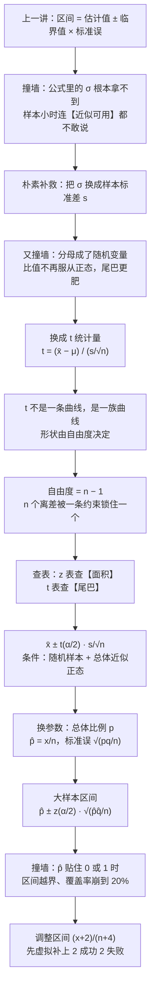

# C6.2 小样本 t 区间与比例的置信区间 Small-Sample $t$ Interval & Confidence Interval for a Proportion

> [!abstract] 这一讲的任务
> 上一讲把区间估计的骨架搭好了：**估计值 ± 临界值 × 标准误**。可这条骨架有一个隐蔽的前提——那个"标准误"是用总体标准差 $\sigma$ 算出来的。
> 现实里 $\sigma$ 几乎永远拿不到。样本小的时候，你连"用 $\hat\sigma$ 顶上去、误差可以忽略"这句话都不敢讲。这一讲就先补这个洞：$\sigma$ 未知、样本又小时，唯一能顶上去的是样本标准差 $s$，而这一顶，整个分布就换了人——**从 $z$ 换成 $t$**。
> 补完均值，再换一个参数：**比例 $p$**（合格率、就业率、次品率）。它的思路与均值一模一样，但标准误里藏着自己，于是又多出一个"什么时候会失灵、失灵了怎么修"的故事。

> [!info] 授课进度说明
> 目前拿到的授课转写稿覆盖到**第 6 节课**，内容截止于**第 6.2 节（区间估计的原理与置信系数）**。
> **第 6.3 节之后（含本篇的 6.3、6.4 两节）尚未在课堂上讲授**，因此本篇内容全部来自**教材与通行讲法整理**，暂不逐条区分"课堂讲过"与"拓展补充"。
> 等后续转写稿补充进来，会按与前面各章相同的规则（标题后缀 **（拓展）**、段首 **【拓展】**）标注出课堂未讲的部分。

> [!info] 怎么读这份讲义
> 按小节读。第 0 节用一道只有 6 个数的秒表题把矛盾摆出来；第 1–2 节讲清"为什么必须换统计量、换成了什么"；第 3 节把**自由度**讲成人话——[[C2.4 离散程度：极差、方差与标准差]] 里那句"第 6 章讲 $t$ 区间时回收"的伏笔，在这一节兑现；第 4 节专讲**查表**，$z$ 表与 $t$ 表的查法方向相反，这是全篇最容易错的地方；第 5–6 节是公式、条件与两道例题；第 7 节回头总结；第 8–11 节换参数：比例的抽样分布、大样本区间、它怎么坏掉、怎么修。
> 勘误一句话：p.37 那题的解把 $s$ 印成 $3.8987$（应为 $0.38987$），于是区间下限掉到 $0.49$，比样本里最短的一次任务时间还短。第 6 节会一步步复算，并说明为什么这种错"看一眼就该发现"。

---

## 0. 开场：六次秒表读数，一个 90% 的区间（p.36）

你是一家工厂的工时分析员（time study analyst）。同一个工序，你拿秒表量了 6 次，单位是分钟：

$$3.6,\quad 4.2,\quad 4.0,\quad 3.5,\quad 3.8,\quad 3.1$$

老板问：**"这个工序平均要多久？给我一个 90% 的区间。"**

"平均要多久"就是总体均值 $\mu$，"一个 90% 的区间"就是上一讲学的置信区间。看起来只是套公式。上一讲的公式长这样：

$$\bar x \pm z_{\alpha/2}\cdot\frac{\sigma}{\sqrt n}$$

先把能算的算出来：$\bar x = 22.2/6 = 3.7$ 分钟。剩下的两样，$z_{\alpha/2}$ 查表就有（90% ⟹ $\alpha/2=0.05$ ⟹ $z_{.05}=1.645$），**可 $\sigma$ 是多少？**

不知道。你手上只有这 6 个数，工厂也不会告诉你"这个工序总体标准差是几"。而且 $\sigma$ 不是"暂时没查到"，是**原理上就拿不到**——总体的标准差要用总体里所有可能的观测值去算，而你永远只有样本。

> [!question] 停一下，先自己想想
> 你手上唯一能替代 $\sigma$ 的东西是什么？把它代进去，你觉得算出来的区间会偏宽还是偏窄？先猜，再看下去。

最顺手的替代是**样本标准差 $s$**。上一章已经会算它了：

$$\sum (x_i-\bar x)^2 = 0.76,\qquad s^2=\frac{0.76}{6-1}=0.152,\qquad s=\sqrt{0.152}=0.38987$$

于是朴素的区间是 $3.7\pm 1.645\times\dfrac{0.38987}{\sqrt 6}=3.7\pm 0.2618$，也就是 $[3.438,\ 3.962]$。

这个答案**数字上并不算错得离谱**，但它的"90%"是假的。为什么假？这是这一讲要讲透的第一件事。

---

## 1. $\sigma$ 换成 $s$ 之后，赌的是什么（p.27）

先把上一讲那个 $z$ 摊开看。它的构造是

$$z=\frac{\bar x-\mu}{\sigma_{\bar x}}=\frac{\bar x-\mu}{\sigma/\sqrt n}$$

这个量服从标准正态，**前提是分母那个 $\sigma/\sqrt n$ 是一个固定的数**。固定的数做分母，随机性就只剩分子一处——而分子的随机性长什么样，中心极限定理已经交代清楚了。

现在把 $\sigma$ 换成 $s$：

$$t=\frac{\bar x-\mu}{s/\sqrt n}$$

分子还是那个分子，**分母变了**。$\bar x$ 每次抽样都变，$s$ 每次抽样也在变，于是这个比值是"两个随机量相除"。它不再服从正态分布。

换个角度看得更清楚。把上面的 $t$ 拆成两部分：

$$t=\frac{(\bar x-\mu)\big/(\sigma/\sqrt n)}{s\big/\sigma}=\frac{z}{s/\sigma}$$

也就是说：**$t$ 等于 $z$ 再除以一个自己也在抖的数 $s/\sigma$。** 这一步拆解是整节的枢纽，它一次性解释了三件事：

1. **为什么 $t$ 的尾巴更肥。** $s$ 有时比 $\sigma$ 小（分母偏小），一除，比值就被放大——于是"离中心很远"的情况比正态分布更常见。极端值变多，尾巴自然变厚。
2. **为什么 $s$ 会系统性地偏小。** $s$ 是**有偏**的：$\sqrt{E(s^2)}=\sigma$，但 $E(s)<\sigma$（开方是凹函数，凸性让平均值往下掉）。$n=6$ 时，$s$ 平均只有 $\sigma$ 的 $0.9515$ 倍——**平均低估约 5%**。这就是朴素做法"偏窄"的根源：分母偏小 ⟹ 区间偏窄 ⟹ 嘴里说的置信度够不上。
3. **为什么样本越大越无所谓。** $n$ 越大，$s$ 越贴着 $\sigma$（$n=25$ 时 $E(s)/\sigma=0.9896$，$n=51$ 时 $0.9950$），$s/\sigma$ 几乎是个常数 1，$t$ 就退回成 $z$。

**偏窄到底有多严重？** 这不是"稍微不准"，可以精确算：如果样本来自正态总体、$n=6$（自由度 5），你硬用 $1.96$ 当临界值搭一个"95%"的区间，它真正盖住 $\mu$ 的概率只有

$$P(|t_5|\le 1.96)=0.8927$$

**89.3%，不是 95%。** 十次里差不多有一次落空。$n=25$（自由度 24）时好一些，也只有 $93.8\%$。所以"$\sigma$ 未知就代 $s$、临界值照抄 1.96"这条路，在小样本上是**系统性的过度自信**——不是运气不好，是每次都偏。

> [!important] 结论
> $\sigma$ 未知时，把 $s$ 代进去**这一步必须做**（没有别的选择），但**临界值不能再取 $z$**。分歧不在"用不用 $s$"，而在"用 $s$ 之后，这个比值服从什么分布"。答案是：$t$ 分布。

> [!note] 名字的来历
> 这个分布叫 **Student's $t$ 分布**，Student 不是"学生"这个身份，是一个人的**笔名**。1908 年，格拉斯哥 Guinness 啤酒厂的化学家 William Sealy Gosset 要判断小批量原料的质量，样本量只有几个，正态近似根本用不上。厂里不许员工发表论文，他只好署名为 "Student" 投到 *Biometrika*。所以"学生 t 分布"里的"学生"，是一个被公司规定逼出来的化名——这条历史本身就说明了它的用途：**小样本、真实数据、等不及大数定律**。

---

## 2. $t$ 分布长什么样：三个一样，三个不一样（p.28, p.30）

> [!important] 定义：$t$ 分布
> 若 $x_1,\dots,x_n$ 来自均值为 $\mu$ 的正态总体，则
> $$t=\frac{\bar x-\mu}{s/\sqrt n}$$
> 服从自由度为 $n-1$ 的 $t$ 分布。

**和标准正态一样的三个地方**（p.28 的措辞是 "mound-shaped, symmetric, with mean 0"）：

- 钟形、单峰；
- 关于 0 对称；
- 均值（也是中位数、众数）都是 0。

**不一样的三个地方**：

- **它更分散。** 方差不是 1，而是 $\dfrac{df}{df-2}$（$df>2$）。$df=5$ 时方差是 $5/3=1.667$，比 1 大了一半还多。
- **尾巴更肥。** 同样远的地方，$t$ 的尾部面积更大（图 1 里那片深色区域）。
- **它不是一条曲线，是一族。** 每一个自由度对应一条。$df=5$ 和 $df=13$ 是两条不同的曲线（p.30 画的就是这两条加一条标准正态），$df$ 越大越贴近正态，$df\to\infty$ 时完全重合——那时 $s$ 恒等于 $\sigma$，$t$ 就是 $z$。

![[C6.3–6.4-t分布与标准正态-厚尾与临界值.png]]
读图抓住三点：**① 三条曲线的峰都在 0**，只是高的矮的——$t$ 更分散，峰就矮一些；**② 竖线的位置才是要害**：想把 0.025 的面积切到右边去，$z$ 只要走到 $1.96$，$t(13)$ 要走到 $2.160$，$t(5)$ 要走到 $2.571$；**③ 深色那块面积的差**就是"厚尾"的代价——同一个 $1.96$ 往右，$z$ 只留 $0.025$，$t(5)$ 留了 $0.054$，多出来的那 $0.029$ 就是"名义 95%、实际 89.3%"的来路。

> [!warning] 别把"$t$ 更分散"理解成"$t$ 更保守所以更好"
> $t$ 更分散是**事实**，不是**选择**。它之所以分散，是因为你手里的信息确实更少（$\sigma$ 不知道，只能用 $s$ 猜）。信息少 ⟹ 判断必须留更多余地 ⟹ 区间更宽。这不是"为了安全故意放宽"，是"诚实反映你知道多少"。等 $n$ 大到 $s$ 几乎就是 $\sigma$，这份余地自然收回，$t$ 自动变回 $z$。

---

## 3. 自由度：$n-1$ 到底是"几个能自己说了算的数"（p.29）

$t$ 分布的形状由**自由度 degrees of freedom（df）**决定，而公式里给的是 $df=n-1$。这个 $n-1$ 上一章出现过一次——样本方差 $s^2$ 的分母。当时只留了一句伏笔，说"到 $t$ 区间时回收"。现在回收。

> [!important] 自由度（人话版）
> 一组数据里，**真正能自由取值的个数**。
> 为什么不是 $n$ 而是 $n-1$？因为算 $s^2$ 时用的不是 $\mu$ 而是 $\bar x$，而 $\bar x$ 自己是从这 $n$ 个数里算出来的。一旦 $\bar x$ 定了，$n$ 个离差 $(x_1-\bar x),\dots,(x_n-\bar x)$ 就被一条硬约束绑住：
> $$\sum_{i=1}^{n}(x_i-\bar x)=0$$
> 前面 $n-1$ 个离差报什么数都行，**最后一个只能被逼着取"前面之和的相反数"**，它没有选择权。所以能自己说了算的只有 $n-1$ 个。

名字拆开就是字面意思：**degree（度数、个数）+ freedom（自由）**。

举个能摸到的例子。设 $n=4$，而 $\bar x=10$，于是四个数之和必须是 40。前三个你随便写：$7,\ 13,\ 9$，和是 29，**第四个只能是 11**，写成 12 就凑不出 40。三选一，自由度 $4-1=3$。

> [!question] 停一下，先自己想想
> 那为什么 $t$ 的自由度也是 $n-1$，而不是 $n$？$t$ 的公式里明明只出现 $s$，$s^2$ 才除 $n-1$。

因为**区间的不确定性全部来自"用 $s$ 顶替 $\sigma$"这一件事**。分子 $\bar x-\mu$ 的分布是干净的（正态，方差 $\sigma^2/n$）；唯一说不清的就是分母，而分母里装的 $s$ 只有 $n-1$ 份独立信息。自由度的含义不是"有几个数参与运算"，而是"**这个统计量的抽样分布里，有几份互相独立的信息在决定它的形状**"。$s$ 只有 $n-1$ 份，所以 $t$ 只有 $n-1$ 个自由度。

三个必须记住的推论：

1. **区间用 $df=n-1$，不是 $n$。** 这是查表时最常犯的错，$n=6$ 时写成 6 就会查到 $t_{.05}=1.943$（$df=6$）而不是 $2.015$（$df=5$），区间偏窄 3.6%。
2. **$s^2$ 的分母与 $t$ 的自由度是同一个 $n-1$。** 不是巧合：为了让 $s^2$ 无偏（除 $n-1$），你已经把一份自由度交给了 $\bar x$；$t$ 用的是那个 $s$，自然继承同一个数。
3. **$df$ 越大，$t$ 越像 $z$。** 信息越多，需要留的余地越少。$df=1$ 时 $t$ 极端肥尾（$t_{.025}=12.706$，是 $z$ 的 6.5 倍），$df=30$ 时已经只差 4%，$df=120$ 时差 1%。

> [!warning] 一个容易糊过去的说法
> "自由度是 $n-1$ 因为除以 $n-1$ 才无偏"——这句话**记住了也不理解**，而且它会让你以为自由度只是"分母上的一个数"。真正的内容是"$n$ 份信息里有一份被 $\bar x$ 征用了"，所以**任何用到 $\bar x$ 的统计量，自由度都要减掉被征用的份数**。后面还会遇到这个规律：两个独立样本合并方差时 $df=n_1+n_2-2$（各被征用一份），回归里 $df=n-k-1$（截距加 $k$ 个斜率各征用一份）。都是同一句话。

---

## 4. 两张表，两个查法方向（p.31–32）

$t$ 分布没法手算，只能查表。问题来了：$z$ 表查了一整个学期，$t$ 表的查法**方向是反的**。这一节专门把两张表摆在一起。

### 4.1 $z$ 表查的是"面积"，$t$ 表查的是"尾巴"

标准正态表（Table IV）的表体里装的是**从 0 到 $z$ 的累积面积**。要搭一个 95% 的双侧区间，步骤是"先算面积、再查表"：

- 两边各留 $\alpha/2=0.025$，中间留 $0.95$；
- 中间那一半是 $0.475$；
- 到表体里**找 $0.4750$ 这一格**，它落在行 $1.9$、列 $0.06$ 的交叉处，读出 $z_{.025}=1.96$。

$t$ 表（Table V）反过来：**表头直接写着尾巴面积**，$t_{.100}\ t_{.050}\ t_{.025}\ t_{.010}$ 四列（有的版本多一列 $t_{.005}$），行是自由度。要 95% 双侧区间，**直接在 $t_{.025}$ 那一列里，找 $df=n-1$ 那一行**，读出数字就完了——中间不需要做 $0.5-0.025$ 的减法。

| | $z$ 表 | $t$ 表 |
|---|---|---|
| 表体里装的是 | 均值 0 到某点的**累积面积** | **右尾**面积（单尾） |
| 行是什么 | 无（只有一条曲线） | 自由度 $df$ |
| 列是什么 | $z$ 的个位与百分位 | 尾巴面积 $\alpha$（$.100,.050,.025,.010$） |
| 95% 双侧区间怎么查 | 算 $0.475$，到表体里**找面积** | 直接到 $t_{.025}$ 列、$df$ 行**读数字** |
| 90% 双侧区间怎么查 | 算 $0.450$，找面积 ⟹ $1.645$ | 到 $t_{.050}$ 列读数字 |

### 4.2 查表时最容易踩的四个坑

> [!warning] 坑 ①：$t$ 表头是**单尾**面积
> 95% 双侧区间的 $\alpha=0.05$，但 $t$ 表要查的是 $\alpha/2=0.025$，所以列名是 $t_{.025}$ 而不是 $t_{.05}$。90% 双侧才查 $t_{.050}$。**查错一列，区间的宽度就差两成以上**（$df=5$ 时 $2.571/2.015=1.28$）。

> [!warning] 坑 ②：行是 $n-1$，不是 $n$
> $n=25$ 就查 $df=24$。$n=6$ 就查 $df=5$。表里没有"第 25 行 = 25 个观测"这回事。

> [!warning] 坑 ③：表只给几个固定概率
> $z$ 表是连续的，任何面积都能查到对应的小数点后两位；$t$ 表只给四五个尾巴面积。要查 87% 的区间？表里没有。只能取邻近的更保守那一列（宁宽勿窄），或者用软件算。

> [!warning] 坑 ④：$df$ 在 30 之后跳着走
> 表的前 30 行是逐行给的，之后跳到 $40,\ 60,\ 120$，最后一行是 $\infty$（**这一行就是 $z$**，$1.96$ 就来自那里）。$df=35$ 这种中间值表里没有，落到区间里就**取较小的那个 $df$**（更保守、临界值更大）。

### 4.3 手算对照：p.32 那道查表题

题目要一个"右尾面积 0.025、自由度 4"的 $t$ 值。走一遍：

- 列：找 $t_{.025}$ 那一列；
- 行：找 $df=4$ 那一行；
- 交叉：$\mathbf{2.776}$。

而同一个 0.025 的尾巴，标准正态只需要走到 $z_{.025}=1.96$。**同样一块面积，$t$ 要多退 $41.6\%$ 的距离。**

| $df$ | $t_{.100}$ | $t_{.050}$ | $t_{.025}$ | $t_{.010}$ |
|---|---|---|---|---|
| 1 | 3.078 | 6.314 | 12.706 | 31.821 |
| 2 | 1.886 | 2.920 | 4.303 | 6.965 |
| 3 | 1.638 | 2.353 | 3.182 | 4.541 |
| 4 | 1.533 | 2.132 | **2.776** | 3.747 |
| 5 | 1.476 | **2.015** | 2.571 | 3.365 |
| 13 | 1.350 | 1.771 | 2.160 | 2.650 |
| 24 | 1.318 | 1.711 | 2.064 | 2.492 |
| 30 | 1.310 | 1.697 | 2.042 | 2.457 |
| $\infty$ | 1.282 | 1.645 | 1.960 | 2.326 |

（表中 5 行以内的数字与 p.31 的印刷表一致；13、24、30、$\infty$ 四行是按 $t$ 分布算出来的补充，用来观察"$df$ 变大 ⟹ 贴上 $z$"的趋势。$\infty$ 行就是标准正态的临界值。）

这张表值得当速查表用：**$df=5$ 的 $t_{.025}=2.571$ 是 $1.96$ 的 1.31 倍**，这就是小样本区间比"看起来应该的宽度"宽三成的来路。

![[C6.3–6.4-临界值与覆盖率的代价.png]]
左图是"临界值随自由度往下贴 1.96"的过程：$df=5$ 时 $2.571$，$df=13$ 时 $2.160$，$df=24$ 时 $2.064$，$df=30$ 时 $2.042$，再往后基本看不出差别。右图把"照抄 1.96"的代价算出来了：**名义 95% 的区间，$df=5$ 时实际只覆盖 $89.3\%$，$df=24$ 时 $93.8\%$**。两条线在 $df$ 小时差得最远，这不是画图效果，是"$\sigma$ 未知"这件事的真实成本。

---

## 5. 小样本均值的置信区间：公式与两个条件（p.33–34）

工具齐了。把上一讲的 $\bar x\pm z\cdot\sigma/\sqrt n$ 里的两样东西换掉——$\sigma\to s$、$z\to t$：

> [!important] 定义：小样本均值置信区间（$\sigma$ 未知）
> $$\boxed{\ \bar x\ \pm\ t_{\alpha/2}\cdot\frac{s}{\sqrt n}\ }$$
> 其中 $t_{\alpha/2}$ 取自由度 $n-1$ 的那个值。把 $\pm$ 写成区间的样子是
> $$\bar x-t_{\alpha/2}\frac{s}{\sqrt n}\ \le\ \mu\ \le\ \bar x+t_{\alpha/2}\frac{s}{\sqrt n}$$
> 结构一点没变：**中心是点估计 $\bar x$，两侧各伸出"临界值 × 标准误"那么长**。换的只是"临界值用哪一列"和"标准误里拿什么当 $\sigma$"。

**这个名字为什么带"小样本"？** 不是规定"$n<30$ 才能用"，而是说：**这条公式是为"$n$ 小到不能用中心极限定理兜底"的情形准备的**。$n$ 大的时候它照样成立、照样可以用，只是那时 $t\approx z$，用它和用 $z$ 几乎没差别。

用"先……再……"把动作说清楚：**先算 $\bar x$ 与 $s$；再定 $df=n-1$、按置信水平定 $\alpha/2$；然后查 $t$ 表拿临界值；接着算标准误 $s/\sqrt n$；最后把"临界值 × 标准误"往两边各伸一次。**

但这条公式不是无条件成立的，p.34 给了两条：

> [!important] 成立的两个条件
> **① 随机样本**：样本是从目标总体里随机抽的。这条从第 1 章一路管到现在——不随机，后面的概率计算全部失去依据。
> **② 总体近似正态**：总体的相对频率分布近似正态。这条在第 5 章讲中心极限定理时也出现过，但**在小样本里它从"可以不管"变成了"必须管"**。

为什么第 ② 条在这里突然变重要？因为中心极限定理的承诺是"$n$ 足够大时，$\bar x$ 的分布不管总体长什么样都近似正态"。这句话里的"$n$ 足够大"是**前提**，不是修饰语。$n=6$ 的时候，中心极限定理根本没生效：$\bar x$ 的分布形状就是总体形状的缩小版——总体偏，$\bar x$ 就偏；总体有两个峰，$\bar x$ 也有两个峰。而 $t$ 分布的整套推导（包括"$t$ 的分子是正态的"这一条）都建立在正态假定上。**所以总体不正态、样本又小，这条区间就不准，而且没有任何东西能替你兜底。**

> [!warning] 条件不满足时怎么办
> **① 如果样本其实不小**（经验上 $n\ge 30$ 就够），中心极限定理接得住，直接用 $z$ 也可以，$t$ 也可以——两者数字差别在 5% 以内。很多软件干脆一律用 $t$，因为大样本时 $t$ 就退化成 $z$，不会算错。
> **② 如果样本小、总体又明显偏态**：先看能不能变换（取对数常用于右偏的收入、金额、时长数据）；变换后近似正态，就在变换后的尺度上做区间。变不了，就换非参数方法（第 15 章），代价是区间更宽、也只能给出中位数的区间。
> **③ 如果总体严重偏态且样本极小**：老实说"这个数据撑不起一个可靠的区间"。这比报一个假 95% 更专业。

---

## 6. 两道例题：一道顺、一道埋了个小数点（p.35–37）

### 6.1 例一：$n=25$，$s=8$，95% 区间（p.35）

某随机样本 $n=25$，$\bar x=50$，$s=8$，求 $\mu$ 的 95% 置信区间。

**第一步，定自由度。** $df=n-1=25-1=24$。

**第二步，查临界值。** 95% ⟹ $\alpha/2=0.025$ ⟹ 在 $t_{.025}$ 列、$df=24$ 行读出 $t_{.025}=2.064$。（不是 $1.96$，也不是 $df=25$ 的 $2.060$。）

**第三步，算标准误。**

$$\frac{s}{\sqrt n}=\frac{8}{\sqrt{25}}=\frac{8}{5}=1.6$$

**第四步，往两边伸。**

$$\bar x\pm t_{.025}\frac{s}{\sqrt n}=50\pm 2.064\times 1.6=50\pm 3.3024$$

$$\boxed{46.70\ \le\ \mu\ \le\ 53.30}$$

验算一下：$2.064\times 1.6=3.3024$，$50-3.3024=46.6976$，$50+3.3024=53.3024$，四舍五入到两位正好是 $46.70$ 与 $53.30$ ✓。

**顺便对照 $z$ 版**：若误用 $1.96$，半宽是 $1.96\times 1.6=3.136$，区间 $[46.864,\ 53.136]$，宽度 $6.272$；正确做法宽度 $6.605$，**宽了 $5.3\%$**。这就是 $df=24$ 时"信息不足"要付的价钱。

### 6.2 例二：六次秒表读数，90% 区间（p.36–37）

回到开场那道题。数据：$3.6,\ 4.2,\ 4.0,\ 3.5,\ 3.8,\ 3.1$，要 90% 区间。

**第一步，$\bar x$。**

$$\sum x_i=3.6+4.2+4.0+3.5+3.8+3.1=22.2,\qquad \bar x=\frac{22.2}{6}=3.7$$

**第二步，$s$。** 先算离差与平方：

| $x_i$ | 3.6 | 4.2 | 4.0 | 3.5 | 3.8 | 3.1 |
|---|---|---|---|---|---|---|
| $x_i-\bar x$ | $-0.1$ | $0.5$ | $0.3$ | $-0.2$ | $0.1$ | $-0.6$ |
| $(x_i-\bar x)^2$ | $0.01$ | $0.25$ | $0.09$ | $0.04$ | $0.01$ | $0.36$ |

平方和是 $0.76$，自由度 $6-1=5$：

$$s^2=\frac{0.76}{5}=0.152,\qquad s=\sqrt{0.152}=0.38987$$

**第三步，定 $df$ 与临界值。** $df=6-1=5$；90% ⟹ $\alpha/2=0.05$ ⟹ $t_{.05}=2.015$。

**第四步，算标准误并伸出。**

$$\frac{s}{\sqrt n}=\frac{0.38987}{\sqrt 6}=\frac{0.38987}{2.44949}=0.15916$$

$$3.7\pm 2.015\times 0.15916=3.7\pm 0.3207$$

$$\boxed{3.38\ \le\ \mu\ \le\ 4.02}\quad(\text{分钟})$$

也就是说：平均工时大概在 **3.4 到 4.0 分钟**之间。这个区间很宽——六个数撑不起更窄的结论，这是实话。

> [!warning] 原稿在这一步错了两个地方
> **① $s$ 的小数点错了一位。** 原稿写 $s=3.8987$，实际是 $0.38987$。差 10 倍。
> **② 区间跟着错。** 原稿给的是 $0.492\le\mu\le 6.908$。按 $s=3.8987$ 复算，半宽 $=2.015\times 3.8987/\sqrt 6=3.207$，$3.7\pm 3.207$ 确实得 $[0.49,\ 6.91]$——**它的算术没错，错的是抄进来的那个 $s$**。
> 正确结果是 $[3.379,\ 4.021]$，写成 $[3.38,\ 4.02]$。
>
> 这类错误有个**廉价的自检办法**：下限 $0.49$ 分钟等于 **29 秒**能完成这个工序，而六次观测里最快的一次是 $3.1$ 分钟。一个"总体均值"的区间跑到比所有观测值都小得多的地方，在 $n=6$、观测又这么集中的情况下是荒谬的。**答案越出界，越该回头查输入的三个数（$\bar x$、$s$、$n$）。**

**再对照一次 $z$ 版**：若用 $1.645$，半宽 $=1.645\times 0.15916=0.2618$，区间 $[3.438,\ 3.962]$。t 的半宽比它宽

$$\frac{2.015}{1.645}=1.2249\ \Rightarrow\ 22.5\%$$

**六个数的时候，用错临界值会让区间窄两成多。** 这就是"小样本必须换 $t$"的实际分量。

---

## 7. 停一下，我们刚才干了什么

- **发现缺口**：区间公式里的 $\sigma$ 拿不到，而样本小的时候"用 $\hat\sigma$ 顶替、误差可忽略"这句话说不出口。
- **试了朴素做法**：把 $s$ 代进去，临界值仍用 $1.96$。结果不是"略微不准"，而是系统性偏窄——$n=6$ 时名义 95% 实际只有 **89.3%**。
- **找到病根**：$t=z/(s/\sigma)$，分母自己在抖，而且 $s$ 系统性偏小（$n=6$ 时平均低 5%）。比值因此比 $z$ 更分散、尾巴更肥。
- **换统计量**：$t=(\bar x-\mu)/(s/\sqrt n)$，它服从的是**一族**分布，形状由 $df=n-1$ 定。
- **讲清 $df$**：$n$ 个离差被 $\sum(x_i-\bar x)=0$ 锁住一个，只剩 $n-1$ 份独立信息。$s$ 只有 $n-1$ 份，所以 $t$ 只有 $n-1$ 个自由度。
- **学会查表**：$z$ 表查面积（先算 $0.475$），$t$ 表查尾巴（直接进 $t_{.025}$ 列、$df$ 行）。
- **落成公式**：$\bar x\pm t_{\alpha/2}s/\sqrt n$，两个条件——随机样本、总体近似正态。

均值这条路走完了。**下一个参数换一个量纲完全不同的东西：比例。**

---

## 8. 比例：$p$ 是天生的 0/1 平均值（p.39）

前面全在估"平均多少"。但实务里问得更多的是"**占多大比例**"：这批货的次品率、这个专业的就业率、这次抽检的合格率。这些量的共同点是——每个个体只回答是/否，然后把"是"的个数除以总数。

> [!important] 定义：样本比例
> 设样本里具有某种特征的个体有 $x$ 个，样本量为 $n$，则
> $$\hat p=\frac{x}{n},\qquad \hat q=1-\hat p$$
> $\hat p$ 读作 "p hat"，是总体比例 $p$ 的点估计。

用人话说动作：**先数"是"的个数，再除以总个数。** 就这一步。名字里的 hat 是统计学对"估计值"的通用记号——戴上帽子就表示"这是我算出来的，真值不戴帽子"。

$\hat p$ 与 $\bar x$ 其实是同一件事。把"是"记成 1、"否"记成 0，这 $n$ 个 0/1 数的平均就是

$$\bar x=\frac{\text{1 的个数}}{n}=\frac{x}{n}=\hat p$$

**比例就是 0/1 数据的均值。** 认清这一点，下面三条性质几乎不用背，直接从均值的性质搬过来：

| 性质 | 均值的情形 | 比例的情形（p.39） |
|---|---|---|
| 无偏 | $E(\bar x)=\mu$ | $E(\hat p)=p$，即 $\hat p$ 是 $p$ 的无偏估计 |
| 标准误 | $\sigma_{\bar x}=\sigma/\sqrt n$ | $\sigma_{\hat p}=\sqrt{pq/n}$，其中 $q=1-p$ |
| 形状 | $n$ 大 ⟹ 近似正态（CLT） | $n$ 大 ⟹ 近似正态 |

第三条的"大样本"在比例这里有一个**可以当场检验的判据**：$n\hat p\ge 15$ **且** $n\hat q\ge 15$。

> [!important] 为什么判据写成 $n\hat p$ 与 $n\hat q$，而不是"$n\ge 30$"
> 因为 $n\hat p$ 就是**样本里"是"的个数**，$n\hat q$ 就是**"否"的个数**（p.41 明确点出这一点）。二项分布的正态近似好不好，看的不是总数 $n$，而是**两边各有几个计数**。
> 举例：$n=400$、$\hat p=0.08$，$n\hat p=32$、$n\hat q=368$，两边都超过 15 ✓。反过来 $n=100$、$\hat p=0.02$，$n\hat p$ 只有 $2$ 个——总数 100 不算小，可"是"这一边只有 2 个观测，正态曲线怎么也对不上这种极偏的形状。
> **门槛为什么是 15 而不是 5？** 15 是偏保守的约定（很多软件用 10 甚至 5）。它的作用是把二项分布的**偏度**压到可以忽略：偏度公式是 $(q-p)/\sqrt{npq}$，在"一边恰好 15 个计数、另一边很大"的边界上，偏度约 $1/\sqrt{15}=0.258$；再偏下去，正态近似就撑不住了。

第 5 章已经系统讲过 $\hat p$ 的抽样分布（[[C5.3 样本比例的抽样分布]]），这里只用它的结论：**中心在 $p$、标准差是 $\sqrt{pq/n}$、样本大时形状近似正态。**

---

## 9. 大样本比例区间：结构与均值一模一样（p.40–41）

有了抽样分布，套上一讲的骨架就行：

> [!important] 定义：大样本比例置信区间
> $$\boxed{\ \hat p\ \pm\ z_{\alpha/2}\sqrt{\frac{\hat p\hat q}{n}}\ }$$
> 其中 $\hat p=x/n$，$\hat q=1-\hat p$。

**这里有一个循环依赖，值得停一下。** 严格地讲，标准误应该是 $\sqrt{pq/n}$——可 $p$ 正是我们要估的那个未知量。这就像"我要称体重，但我的秤需要用我的体重来校准"。

解法很务实：**用 $\hat p$ 顶替 $p$**。当 $n$ 大时 $\hat p$ 离 $p$ 很近，$\hat p\hat q$ 与 $pq$ 差不了多少，代进去的误差小到可以忽略（p.40 那句 note 说的就是这件事）。所以你会看到两个版本：

$$\hat p\pm z_{\alpha/2}\sqrt{\frac{pq}{n}}\ \approx\ \hat p\pm z_{\alpha/2}\sqrt{\frac{\hat p\hat q}{n}}$$

**左边是定义、右边是能算的。** 考试和实务都用右边。

> [!important] 成立的两个条件（p.41）
> **① 随机样本**——理由与均值那条完全一样。
> **② $n$ 足够大**，判据是 $n\hat p\ge 15$ 且 $n\hat q\ge 15$。
> 注意这里**没有"总体正态"这一条**。比例的总体天生只有两个值（0 和 1），谈不上正态；正态性是从"大样本"里长出来的，不是从总体上要求的。

### 9.1 例三：400 个毕业生，32 个读研（p.42）

某随机样本 400 名毕业生中有 32 人继续读研，求 $p$ 的 95% 置信区间。

$$\hat p=\frac{32}{400}=0.08,\qquad \hat q=0.92$$

**先验条件**：$n\hat p=32\ge 15$、$n\hat q=368\ge 15$ ✓。

**标准误**：

$$\sqrt{\frac{\hat p\hat q}{n}}=\sqrt{\frac{0.08\times 0.92}{400}}=\sqrt{\frac{0.0736}{400}}=\sqrt{0.000184}=0.013565$$

**伸出**（95% ⟹ $z_{.025}=1.96$）：

$$\hat p\pm 1.96\times 0.013565=0.08\pm 0.02659$$

$$\boxed{0.053\ \le\ p\ \le\ 0.107}$$

也就是"读研比例大概在 5.3% 到 10.7% 之间"。点估计 8%，区间的半宽 2.66 个百分点——**相对误差有三分之一**，因为 400 人里只有 32 个"是"。想把这个比例估得更准，只能加样本量（下一讲）。

### 9.2 例四：200 份报纸，35 份有缺陷（p.43–44）

某随机样本 200 份报纸中有 35 份存在缺陷，求缺陷率 $p$ 的 90% 置信区间。

$$\hat p=\frac{35}{200}=0.175,\qquad \hat q=0.825$$

验条件：$n\hat p=35$、$n\hat q=165$，都 $\ge 15$ ✓。

$$\sqrt{\frac{0.175\times 0.825}{200}}=\sqrt{\frac{0.144375}{200}}=\sqrt{0.000721875}=0.026868$$

90% ⟹ $z_{.05}=1.645$：

$$0.175\pm 1.645\times 0.026868=0.175\pm 0.044197$$

$$\boxed{0.1308\ \le\ p\ \le\ 0.2192}$$

即缺陷率在 **13.1% 到 21.9%** 之间。注意 90% 比 95% 的区间窄（$1.645<1.96$），这是"降低把握换精度"的老交易，与上一讲一致。

> [!tip] 两道比例例题的读法
> 报比例区间时，**半宽要换算成"百分点"说**。例三里半宽 $2.66$ 个百分点，落在 $8\%$ 上就是"上下三成"；例四半宽 $4.4$ 个百分点，落在 $17.5\%$ 上只有"上下两成半"。**同样是几百个样本，比例的绝对水平越靠近 0 或 1，相对精度越差**——这一点在第 10 节会变成硬伤。

---

## 10. 撞墙：$\hat p$ 贴住 0 或 1 时，这个区间会坏掉

前面的公式看起来很顺。但它有一个隐藏假设，一旦 $\hat p$ 靠近 0 或 1 就崩。先算两个数看清楚。

> [!question] 停一下，先自己算
> 抽 $n=50$ 个产品，只有 2 个次品（$x=2$）。用上面的公式给 95% 区间，下界是多少？

$$\hat p=0.04,\qquad \sqrt{\frac{0.04\times0.96}{50}}=\sqrt{0.000768}=0.027713$$

$$0.04\pm 1.96\times 0.027713=0.04\pm 0.054317$$

区间是 $[-0.0143,\ 0.0943]$。**下界是负数。**

比例不可能是负数。这不是"精度差"，这是**区间说出了不可能的话**。再走极端一点：$n=20$ 里一个次品都没抽到（$x=0$），$\hat p=0$、$\hat q=1$，标准误 $\sqrt{0}=0$，区间退化成

$$[0,\ 0]$$

**一个宽度为零的区间**，等于宣称"总体次品率精确等于 0"，置信度 95%。这显然是胡说。

**第二个毛病更隐蔽：覆盖率悄悄崩掉。** 上面那个 $[0,0]$ 不是"保守"或"激进"的问题，而是"名义 95%，实际几乎为 0"。用二项分布精确算一遍（把每个可能的 $x$ 的概率乘以"该 $x$ 的区间是否盖住真 $p$"再求和）：

| 情形 | 未调整区间的实际覆盖率 | 调整区间 |
|---|---|---|
| $n=20$，$p=0.15$ | $81.9\%$ | $97.8\%$ |
| $n=20$，$p=0.05$ | $63.9\%$ | $98.4\%$ |
| $n=20$，$p=0.01$ | $18.2\%$ | $98.3\%$ |
| $n=50$，$p=0.02$ | $63.5\%$ | $98.2\%$ |

**名义 95% 的区间，在 $p$ 很小时实际只覆盖 18%。** 这不是小数点误差，是完全失效。

![[C6.3–6.4-比例区间覆盖率-未调整与调整.png]]
图上横轴是总体真实比例 $p$，纵轴是"区间真正盖住 $p$ 的概率"，虚线是名义上的 95%。红线（未调整）在 $p$ 小的地方一头栽下去：$n=20$ 时在 $p\approx 0.015$ 处只剩 $26\%$，$n=50$ 时同位置只剩 $53\%$；即使 $p$ 到了 $0.1$ 附近，红线还在 $80\%$–$90\%$ 之间打转，并且沿路**锯齿状地抖**（因为 $x$ 是离散的，$p$ 稍微一动，$\hat p$ 就跳一格，区间跟着跳）。蓝线（调整区间）几乎贴着 95% 走。

> [!warning] 为什么会崩——一句话说清
> 崩的根源是**"用 $\hat p$ 顶替 $p$"在 $\hat p$ 靠近边界时最不准**。$\hat p=0$ 时，代进去的 $\hat p\hat q=0$，标准误算成 $0$，区间缩成一个点；$\hat p=0.04$ 时用 $0.04\times0.96$ 估 $pq$，把"$p$ 到底离 $0$ 有多远"这份不确定性整个抹掉了。
> 换句话说：**$n\hat p\ge 15$ 这个条件不是装饰，是这条公式的命门。** 条件满足时它很好用；不满足时它不是"差一点"，是"错得离谱"。

---

## 11. 调整区间：先虚拟补上 2 个成功、2 个失败（p.45）

修法出人意料地朴素：**别让 $\hat p$ 有机会贴到 0 或 1。** 具体动作是往样本里"补" 4 个虚拟观测——2 个成功、2 个失败，然后再照原公式算。

> [!important] 定义：调整（adjusted）置信区间
> $$\boxed{\ \tilde p\ \pm\ z_{\alpha/2}\sqrt{\frac{\tilde p(1-\tilde p)}{n+4}}\ },\qquad \tilde p=\frac{x+2}{n+4}$$
> 其中 $x$ 是样本中"是"的个数，$n$ 是样本量。$\tilde p$ 读作 "p tilde"。

用"先……再……"说清动作：**先把成功数加 2、失败数加 2（于是总数加 4），用新的比例 $\tilde p=\frac{x+2}{n+4}$ 当中心；再用 $n+4$ 当分母算标准误；最后照常伸出 $z_{\alpha/2}$ 倍。**

**为什么叫"调整"？** 因为它调整的是**样本本身**，不是公式。你也可以理解成：分析者先在脑子里虚拟地多抽了 4 个观测，恰好 2 个成功、2 个失败，把 $\hat p$ 往中间拉一点，然后再报区间。名字里的 tilde（$\sim$）是统计学对"修正过的估计量"的常用记号。

**关键性质：无论 $x$ 是 0 还是 $n$，$\tilde p$ 都严格落在 $(0,1)$ 里。** $x=0$ 时 $\tilde p=2/(n+4)>0$；$x=n$ 时 $\tilde p=(n+2)/(n+4)<1$。贴边这件事从根上被解决了。

### 11.1 把两道例题重算一遍

**例三（400 人，32 人读研），95% 区间：**

$$\tilde p=\frac{32+2}{400+4}=\frac{34}{404}=0.084158$$

$$\sqrt{\frac{\tilde p(1-\tilde p)}{n+4}}=\sqrt{\frac{0.084158\times 0.915842}{404}}=\sqrt{\frac{0.077074}{404}}=0.013812$$

$$0.084158\pm 1.96\times 0.013812=0.0842\pm 0.02707$$

$$\boxed{0.0571\ \le\ p\ \le\ 0.1112}$$

对照未调整的 $[0.0534,\ 0.1066]$：**中心从 $0.0800$ 抬到 $0.0842$，宽度从 $0.0532$ 变成 $0.0541$（宽了 $1.7\%$）。** 差别很小——因为 $n=400$、$n\hat p=32$ 已经远超门槛，本来就没病，调整只是让它更稳一点。

**例四（200 份，35 份缺陷），90% 区间：**

$$\tilde p=\frac{37}{204}=0.181373,\qquad \sqrt{\frac{\tilde p(1-\tilde p)}{204}}=0.026978$$

$$0.181373\pm 1.645\times 0.026978=0.1814\pm 0.04438$$

$$\boxed{0.1370\ \le\ p\ \le\ 0.2257}$$

对照未调整的 $[0.1308,\ 0.2192]$：中心从 $0.175$ 抬到 $0.181$（朝 $0.5$ 那边挪了一点），宽度几乎没变——$0.0884$ 变成 $0.0888$。**条件满足时，两套结果几乎一样**——这也解释了为什么实务里很多人图省事直接用未调整的。

### 11.2 真正需要它的时候

**回到 $n=50$、$x=2$ 那道：**

$$\tilde p=\frac{4}{54}=0.074074,\qquad \sqrt{\frac{0.074074\times0.925926}{54}}=0.035639$$

$$0.074074\pm 1.96\times 0.035639=0.0741\pm 0.0699$$

$$\boxed{0.0042\ \le\ p\ \le\ 0.1439}$$

**下界从 $-0.0143$ 变成 $+0.0042$，回到合法范围。** 中心也从 $0.04$ 挪到 $0.074$——这是个重要的诚实：**看到 50 个里 2 个，你其实无法断言比例低于 4%；数据能支撑的说法是"大致在 0.4% 到 14%"这个很宽的区间。**

再看 $x=0$、$n=20$：$\tilde p=2/24=0.0833$，标准误 $\sqrt{0.0833\times0.9167/24}=0.05642$，区间 $0.0833\pm 0.1106$，即 $[-0.027,\ 0.194]$。下界还是负的，实务上截断成 $[0,\ 0.194]$——**"一个也没抽到"能告诉你的极限是"比例大概不超过 19%"，而不是"比例等于 0"。** 这个结论比 $[0,0]$ 有用得多。

回到上面那张覆盖率图：蓝线（调整后）在 $n=20$ 与 $n=50$ 两个子图里都稳稳贴在 95% 上方，连 $p\to 0$ 那一段也不再塌下去。**代价是略微偏保守**：覆盖常在 $97\%$–$98\%$，比名义值高，区间稍微宽一点。这个买卖通常是划得来的——"说 95% 实际 98%"只是保守，"说 95% 实际 18%"是失效。

> [!note] 一点背景：这个修正叫什么、从哪来
> 这个"加 2 个成功、2 个失败"的做法在文献里叫 **Agresti–Coull 区间**（1998），是"调整 Wald 区间"的一种。更早还有一种加 2 个成功、0 个失败的版本（Wilson 区间的一种近似），教材这里用的是 2/2 版本，因为在 $p$ 接近 0 与接近 1 的两头表现都比较均衡。
> 有意思的是，这个修正的直觉在贝叶斯框架里有干净的来路：给 $p$ 配一个 Beta(2,2) 先验，后验均值恰好就是 $(x+2)/(n+4)$，区间也就是后验的可信区间。**"虚拟补 4 个观测"与"先验加 4 个观测的信息"，是同一件事的两种说法。**
> 什么时候该用它？判据就是那两个条件：**$n\hat p<15$ 或 $n\hat q<15$ 时换用它**；两边都够 15，两者差别可以忽略，用哪个都行。但既然换一下只多一步除法，**小样本比例一律用调整区间**是更稳的习惯。

---

## 12. 速查：这一讲的公式与临界值

> [!tip] 速查表
> | 场景 | 公式 | 临界值 | 条件 |
> |---|---|---|---|
> | 均值，$\sigma$ 已知（大样本） | $\bar x\pm z_{\alpha/2}\dfrac{\sigma}{\sqrt n}$ | $z$ 表 | 随机样本；$n$ 大或总体正态 |
> | 均值，$\sigma$ 未知，小样本 | $\bar x\pm t_{\alpha/2}\dfrac{s}{\sqrt n}$ | $t$ 表，$df=n-1$ | 随机样本 + 总体近似正态 |
> | 比例，大样本 | $\hat p\pm z_{\alpha/2}\sqrt{\dfrac{\hat p\hat q}{n}}$ | $z$ 表 | 随机样本 + $n\hat p\ge15$ 且 $n\hat q\ge15$ |
> | 比例，小样本或贴边 | $\tilde p\pm z_{\alpha/2}\sqrt{\dfrac{\tilde p(1-\tilde p)}{n+4}}$，$\tilde p=\dfrac{x+2}{n+4}$ | $z$ 表 | 随机样本（无计数门槛） |
>
> | 常用临界值 | 90% | 95% | 99% |
> |---|---|---|---|
> | $z_{\alpha/2}$ | 1.645 | 1.960 | 2.576 |
> | $t_{\alpha/2}$，$df=5$ | 2.015 | 2.571 | 4.032 |
> | $t_{\alpha/2}$，$df=10$ | 1.812 | 2.228 | 3.169 |
> | $t_{\alpha/2}$，$df=24$ | 1.711 | 2.064 | 2.797 |
> | $t_{\alpha/2}$，$df=30$ | 1.697 | 2.042 | 2.750 |
>
> **一句话记法**：$\sigma$ 不知道就用 $s$，用 $s$ 就得用 $t$，用 $t$ 就得有 $df=n-1$，$df$ 越大 $t$ 越像 $z$。

> [!tip] 下一讲预告
> 这一讲把公式用熟了，但有一个问题一直绕着走：**"95%"这个数字是谁定的？想要更窄的区间，代价是什么？**
> 下一讲回答三件事：**该抽多少**（把"我要半宽不超过 2 个百分点"翻译成 $n$）；从**有限总体里不放回地抽**，标准误为什么要乘一个修正因子 $\sqrt{(N-n)/(N-1)}$；以及怎么给**方差**本身搭区间——那时会出现这一讲的兄弟分布 $\chi^2$，它的形状同样由一个自由度决定。

---

## 这一讲的三句话

1. **$\sigma$ 拿不到的时候，用 $s$ 顶上不是一个免费的替换：$t=z/(s/\sigma)$，分母自己也在抖，所以比值更分散、尾巴更肥。临界值必须从 $z$ 换成 $t$，否则名义 95% 实际只有 89%（$n=6$ 时）。**
2. **自由度的内容不是"分母上那个数"，而是"$n$ 份信息里有几份还能自己说话"：$\sum(x_i-\bar x)=0$ 把 $n$ 个离差锁住一个，所以只剩 $n-1$；$s$ 只有 $n-1$ 份，$t$ 就只有 $n-1$ 个自由度。查 $t$ 表时行是 $df=n-1$、列是单尾面积（95% 查 $.025$），与 $z$ 表"先算面积再查"的方向正好相反。**
3. **比例就是 0/1 数据的均值，所以公式照搬：$\hat p\pm z\sqrt{\hat p\hat q/n}$；但它的命门是 $n\hat p\ge 15$ 且 $n\hat q\ge 15$——一旦 $\hat p$ 贴住 0 或 1，区间会越界、覆盖率会崩到 18%。修法是把成功与失败各虚拟补 2 个：$\tilde p=(x+2)/(n+4)$，分母用 $n+4$。**

---

## 相关笔记 Related Notes

- 相关：[[C6.1 参数估计与置信区间]]（区间 = 估计值 ± 临界值 × 标准误的骨架）、[[C5.2 样本均值的抽样分布与中心极限定理]]（$\bar x$ 的分布与"$n$ 足够大"这个前提）、[[C5.3 样本比例的抽样分布]]（$\hat p$ 的无偏性与 $\sqrt{pq/n}$）、[[C2.4 离散程度：极差、方差与标准差]]（$n-1$ 与自由度的第一课，本篇回收）、[[C2.6 百分位数与 z 分数]]（$z$ 表怎么查、$z_{\alpha/2}$ 从哪来）、[[C5.1 抽样分布：统计量也是随机变量]]（$s$ 也是随机变量，这是 $t$ 的起点）
- 上一讲：[[C6.1 参数估计与置信区间]]
- 下一讲：[[C6.3 样本量、有限总体校正与方差的置信区间]]
- 返回：[[统计学课程 MOC]]
