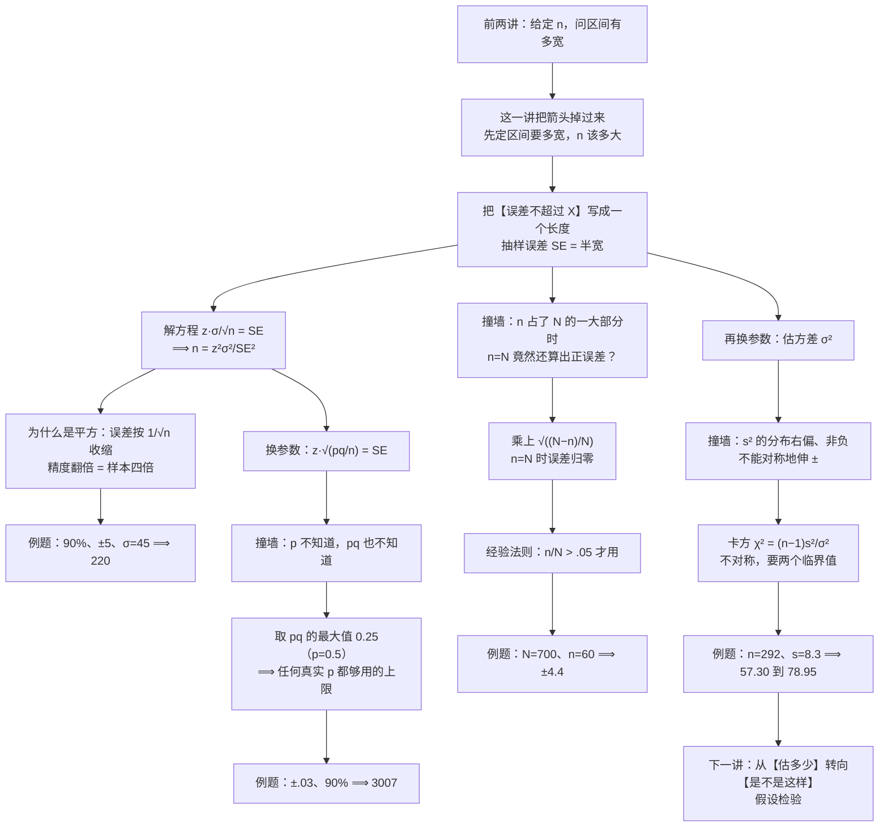

# C6.3 样本量、有限总体校正与方差的置信区间 Determining the Sample Size, Finite Population Correction & Confidence Interval for a Variance

> [!abstract] 这一讲的任务
> 前两讲一直在算同一个方向的题：**样本量 $n$ 已经有了，问区间有多宽。** 现在把箭头掉过来——**我要误差不超过 30 元、把握 95%，该抽多少人？**
> 这个问题的答案是**解方程解出来的**，不是拍出来的。解出来的式子会告诉我们一件很贵的事：**精度是平方级的奢侈品**，误差减半要付四倍的样本。
> 后半讲再补两个缺口：一是总体其实是**数得清的**（一个公司 700 人、一批货 500 件）时，标准误要不要修；二是**方差本身**怎么给区间——那里第一次遇到一个不对称的分布，左右两端必须查两个不同的临界值。

> [!info] 授课进度说明
> 目前拿到的授课转写稿覆盖到**第 6 节课**，内容截止于**第 6.2 节（区间估计的原理与置信系数）**。
> **第 6.5–6.7 节尚未在课堂上讲授**，因此本篇内容全部来自**教材与通行讲法整理**，暂不逐条区分"课堂讲过"与"拓展补充"。
> 等后续转写稿补充进来，会按与前面各章相同的规则（标题后缀 **（拓展）**、段首 **【拓展】**）标注出课堂未讲的部分。

> [!info] 怎么读这份讲义
> 按小节读。第 0 节用一句"报告上要写误差不超过 30 元"把箭头掉过来；第 1 节先把"误差"这个日常词钉成一个长度，并分清它与**标准误**这对撞名的概念；第 2 节解方程，同时讲清**为什么平方**这个动机；第 3 节手算一遍；第 4 节回答"公式里的 $\sigma$ 到底从哪来"；第 5–6 节换参数估**比例**，核心是"不知道 $p$ 时取 0.5"这条保险策略；第 7–8 节处理**有限总体**，包括"$n$ 就等于 $N$ 时误差竟然不为零"这个悖论；第 9–10 节给**方差**搭区间，卡方分布只学到"不对称、要两个临界值"为止；第 11 节把全章的要点收成一张表。
> 勘误一句话：p.69 的常用 $z$ 值表里，98% 那一行印作 $z_{.005}=2.326$，按定义应为 $z_{.01}=2.326$（$z_{.005}=2.5758$ 才是 99% 那一行的）。另有一处需要留意的是 p.65 把 $df=291$ 取整到 300 行查表，这会让整个区间往下平移，第 10 节会复算给你看。

---

## 0. 开场：报告上要先写"误差不超过 30 元"，然后才有人去数人头（p.46–47）

市消费者协会要做一次年度调查：**本市家庭每月在外卖上花多少钱**。报告里要写的句子是这样的：

> "本市家庭月均外卖支出约 1,250 元，误差不超过 ±30 元（95% 把握）。"

记者接着问了一句：**"你们调查了多少户？"**

这句话必须现在回答，不能等调查完了再说。原因不是礼貌，是抽样设计本身的要求：**样本量要在抽样之前定死。** 抽完了嫌区间太宽再补几百户，那几百户就不是随机样本的一部分了，而是"看到结果才决定要不要加"——这一步一做，前面所有概率陈述（包括那个 95%）全部失效。这跟"做到显著为止"是同一种病。

你手上已有的东西：上一年的同类调查给出 $\sigma$ 大约 260 元。于是问题变成一句话：

> **已知 $\sigma\approx 260$，要 95% 把握、误差不超过 30 元，要抽多少户？**

先别算，先看看两条本能反应都不行。

**反应一："越多越好，抽 2000 户。"** 这话不错，但它不是答案。2000 户对应多少误差？说不出来。如果 2000 户只需要 ±12 元，那其中一半预算是白花的；如果连 ±30 都保证不了，那这笔钱花下去报告还是不能用。**"越多越好"没有回答"够不够"。**

**反应二："抽 500 户，人家都抽五百。"** 这是把别人的场景抄过来。别人估的可能是"支持率"（$\sigma$ 天生不超过 0.5），你估的是"支出"（$\sigma$ 是几百元），两个数根本不在一个量级上，凭什么用同一个 $n$？

两条都不行，说明少了一样东西：**我们一直把"样本量"当成输入，其实它可以当输出。**

回头看那个已经用熟了的式子：

$$\bar x \pm z_{\alpha/2}\frac{\sigma}{\sqrt n}$$

$\pm$ 后面那一整块，就是"误差"（行话叫**半宽**，第 1 节会给它正式的名字）。前两讲里 $n$ 是已知的，所以这一块是算出来的结果；现在反过来——**这一块是我们先定的目标，$n$ 才是未知数。**

$$\underbrace{z_{\alpha/2}\frac{\sigma}{\sqrt n}}_{\text{先定这个，问 }n\text{ 该多大}}=30$$

一个方程、一个未知数。**"该抽多少"根本不是估计问题，是解方程问题。** 你刚才做的这件事——把"要多准、要多有把握"翻译成一个方程，再解出人数——就是一次完整的**样本量规划**。

本篇剩下的部分，就是把这个方程解干净，然后回答三个"解出来以后才发现的新问题"：$n$ 为什么是平方地涨、$\sigma$ 从哪来、以及总体数得清时这个式子要不要改。

---

## 1. 抽样误差：把"可靠"翻译成一个长度（p.47）

日常说法里，"可靠"是个形容词。统计里它必须变成数，而且**要两个数一起**才说得完整：

- **把握**（置信水平）$1-\alpha$：这套动作长期来看命中多少次；
- **误差**：允许估计值离真值差多少。

只报一个都不够。"误差 ±1 元"听起来很准，但没说把握，那可能是 5% 把握下的 ±1 元；"99.99% 把握"听起来很稳，但没说误差，那可能是 ±500 元。**两个数凑在一起，才是一句可检验的承诺。**

> [!important] 定义：抽样误差 Sampling Error
> 区间"$\bar x \pm$ 某个数"里那个**某个数**，也就是区间的**半宽 half-width**，记作 $SE$：
> $$\boxed{\ SE=z_{\alpha/2}\frac{\sigma}{\sqrt n}\ }$$
> 一句话说清它是什么：**先定下"我愿意容忍多大的偏差"，再要求"以 $1-\alpha$ 的把握保证偏差不超过它"——那个容忍度就是 $SE$。**

**为什么叫这个名字？** `sampling`（抽样的）+ `error`（误差）。它**不是"算错了"**，而是"抽样这件事本身就注定要产生的那点偏差"：你只看了 100 户就去代表全市，凭什么一分不差？这份"注定差一点"就是它。名字里没有"错误"的意思，只有"抽样带来的"。

这里必须跟第 1 章那个词分开。[[C1.2 收集数据：抽样方法与代表性]] 里画过一张打靶图：**抽样误差**是弹着点围着靶心散开（无偏但抖），**抽样偏差 bias** 是整张靶纸被挪偏了（打得再集中也不在靶心上）。本节的 $SE$ 只管前一种；后一种不是靠加大 $n$ 能救的——样本再大，靶心还是偏的。

> [!warning] $SE$ 这个词在这门课里撞了名，必须分清
> 两个东西都常被缩写成 $SE$：
> - **标准误 standard error**：$\sigma_{\bar x}=\sigma/\sqrt n$，是 $\bar x$ 这个随机变量的标准差；
> - **抽样误差 sampling error**：$z_{\alpha/2}\cdot\sigma/\sqrt n$，是区间的半宽。
>
> 它们**只差一个 $z_{\alpha/2}$**。判据很简单：**看它站在哪儿**——紧跟在 $\pm$ 后面、或者被说成"误差不超过多少"的，是半宽；被说成"分布的标差""分母下面那个"的，是标准误。第 95% 的区间里，半宽是标准误的 $1.96$ 倍；换成 90% 就只剩 $1.645$ 倍。**同一份样本，"误差"的大小取决于你要求的把握**——这句话本身就是这两个概念的区别。

### 1.1 三件套：把握、精度、人数，定两个求第三个

$SE=z_{\alpha/2}\sigma/\sqrt n$ 这条式子里一共四个量：$1-\alpha$（把握）、$SE$（精度）、$n$（成本）、$\sigma$（总体的脾气，你改不了）。$\sigma$ 是给定的事实，剩下三个互相牵制，**任意给定两个，第三个就被定死了**。三组搭配对应三种完全不同的问题：

| 你已知 | 你要求 | 用什么式子 | 这类问题叫什么 |
|---|---|---|---|
| $n$、$\sigma$、把握 | 半宽 $SE$ | $SE=z_{\alpha/2}\sigma/\sqrt n$ | 区间估计（前两讲一直在做） |
| **半宽 $SE$**、$\sigma$、把握 | **$n$** | $n=\dfrac{z_{\alpha/2}^2\sigma^2}{SE^2}$ | **样本量确定（本节）** |
| $n$、$\sigma$、半宽 | 把握 | $z_{\alpha/2}=\dfrac{SE\sqrt n}{\sigma}$ | 事后评估；第 7 章算 $\beta$ 与功效时反过来用 |

同一个式子，三个方向。**考试里最容易错的不是算，是没先判断题目给的是哪两个、要的是哪一个。**

> [!question] 停一下，先自己想想
> 老板说"误差别超过 3 个百分点"。这句话里的"3 个百分点"，是 $SE=0.03$，还是 $SE=0.015$？

答案取决于"3 个百分点"说的是**半宽**还是**整个区间的宽度**。区间是 $\pm SE$，所以全宽是 $2SE$。说"误差不超过 ±3"是半宽 3；说"区间宽度 3"是半宽 1.5——**差了四倍样本量**。

这不是抠字眼，题目里两种写法都有：p.49 的题写 "within $\pm\,5$"，那个 5 就是半宽；p.51 的题写 "within .03"，解题时先做了一步 $SE=\text{width}/2=.03/2=.015$，即把 .03 当成**全宽**。所以读题时第一件事是找那个 $\pm$ 号：**有 $\pm$、或者写成"误差不超过 $\pm X$"的，$X$ 是半宽；只说"区间宽 X"的，半宽是 $X/2$。** 真到了实务里，这一句必须回去跟提要求的人确认——问错一句，预算差四倍。

---

## 2. 解方程：$n$ 为什么在平方里（p.48）

目标式子是

$$z_{\alpha/2}\frac{\sigma}{\sqrt n}=SE$$

四步解出来，每一步都别跳：

1. 两边乘 $\sqrt n$：$z_{\alpha/2}\sigma=SE\cdot\sqrt n$；
2. 两边除以 $SE$：$\sqrt n=\dfrac{z_{\alpha/2}\sigma}{SE}$；
3. 这时 $n$ 还藏在根号里，两边**平方**；
4. 得到答案。

> [!important] 定义：估计均值所需的样本量
> $$\boxed{\ n=\left(\frac{z_{\alpha/2}\,\sigma}{SE}\right)^{2}=\frac{z_{\alpha/2}^{2}\,\sigma^{2}}{SE^{2}}\ }$$
> 其中 $SE$ 是你要的半宽，$1-\alpha$ 是你要的把握，$\sigma$ 是总体标准差（拿不到就估，见第 4 节）。
> **永远向上取整**——不是四舍五入。

用"先……再……"把动作串起来：**先按把握查出 $z_{\alpha/2}$；再把 $z$、$\sigma$、$SE$ 三个数代进 $z^2\sigma^2/SE^2$；最后把结果往上取整。** 三步，没有第四步。

### 2.1 那个平方是怎么来的：两层，都要讲清

**第一层：为什么误差里带着 $1/\sqrt n$。** 这一点 [[C5.2 样本均值的抽样分布与中心极限定理]] 已经算过：$\bar x$ 的标准差是 $\sigma/\sqrt n$。根子在于"独立"两个字——$n$ 个观测各自的偏差是独立加的，**方差按 $n$ 倍增长**（$n\sigma^2$），而标准差是方差开方，所以只按 $\sqrt n$ 增长；再除以 $n$（求平均），落到 $\sigma/\sqrt n$。

一句话：**加法在方差上做，开方在标准差上做，所以"多抽一倍"永远换不到"误差减半"。**

**第二层：为什么解出来是平方。** 因为 $n$ 原本躲在根号底下。这条关系是 $\text{误差}\propto 1/\sqrt n$，反解的时候 $\sqrt n$ 被单独留出来，一平方，$n$ 就站到了平方的位置上：

$$\text{误差}=\frac{z\sigma}{\sqrt n}\quad\Longleftrightarrow\quad n=\left(\frac{z\sigma}{\text{误差}}\right)^{2}$$

所以那个平方不是推导过程留下的疤，**它就是"精度与样本量不成正比"这件事的代数写法**。

**这个平方有多贵？** 取 $\sigma=400$、95% 把握，把半宽一档一档往下压：

| 想要的半宽 $SE$ | 需要的 $n$ | 相对上一行 |
|---|---|---|
| $\pm100$ | 62 | — |
| $\pm50$ | 246 | $\times 4$ |
| $\pm25$ | 984 | $\times 4$ |
| $\pm12.5$ | 3934 | $\times 4$ |

每一行都是"精度翻一倍、样本翻四倍"。前两行还像是在"加把劲"，到 $\pm12.5$ 就是**用四倍的钱买小数点后第二位**。这就是为什么实务里的调查精度都停在百分之几——不是不想更准，是再准一档的价钱没有人愿意付。

![[C6.5–6.7-精度与样本量的平方关系.png]]
左图是"$n$ 变大、误差变小"，注意曲线**越往右越平**：从 246 加到 984（加 738 户）把误差从 50 压到 25，再从 984 加到 3934（加 2950 户）才又压一半。右图把同一件事反过来画成柱状：同样"减半"，每次都要在**上一档的总量**上乘四。两张图说的是同一句话——**精度在平方的那一侧，越往后越买不起。**

同样的平方也作用在另外两个数上，这一点最容易被忽略：

> [!important] 三个"平方"的后果
> **① $SE$ 减半 ⟹ $n$ 四倍。** 上式。
> **② 把握从 95% 提到 99% ⟹ $n$ 变成 $\left(\frac{2.5758}{1.96}\right)^2=1.73$ 倍。** 只要多抽七成，比"精度翻倍"便宜得多——**提把握比提精度划算**，这是实务里普遍选 95% 而不是 99% 的一个现实理由。
> **③ $\sigma$ 估大一倍 ⟹ $n$ 四倍。** 所以第 4 节那句"$\sigma$ 宁大勿小"是有代价的，但方向不能反。

---

## 3. 手算一遍：90% 把握、误差 $\pm5$、$\sigma=45$（p.49）

> [!example] 题目
> 要以 **90%** 的把握把总体均值估在 **$\pm5$** 之内。一次预调查显示标准差约为 **45**。需要多大的样本？

三个输入认准：$z_{\alpha/2}=z_{.05}=1.645$（90% ⟹ $\alpha=0.10$ ⟹ $\alpha/2=0.05$）、$\sigma=45$、$SE=5$。

**第一步，平方都先算好。**

$$z_{.05}^{2}=1.645^{2}=2.7060,\qquad \sigma^{2}=45^{2}=2025$$

**第二步，代进公式。**

$$n=\frac{2.7060\times2025}{5^{2}}=\frac{5480.7}{25}=219.23$$

**第三步，向上取整。**

$$\boxed{n=220}$$

**为什么是 220 而不是 219？** 这一步不是形式主义，可以验：取 $n=219$，半宽

$$1.645\times\frac{45}{\sqrt{219}}=1.645\times3.0405=5.0021>5\ \times$$

差 0.002，但**已经破约了**。取 $n=220$：

$$1.645\times\frac{45}{\sqrt{220}}=1.645\times3.0336=4.9908\le5\ \checkmark$$

所以规矩是**进位，不是四舍五入**：四舍五入会得到 219，恰好不够。

> [!warning] 取整方向只有一个：往上
> 样本量是"承诺的下限"。少一个人，半宽就大一点点，你嘴上说的 90%/±5 就变成了假话。多一个人只是多花一点钱。**这个不对称，就是"必须进位"的全部理由**（p.50 那句 "Always round $n$ up" 说的就是这件事）。

**回头验一遍开场那道题。** $\sigma\approx260$、95%、$SE=30$：

$$n=\frac{1.96^{2}\times260^{2}}{30^{2}}=\frac{3.8416\times67600}{900}=288.55\ \Longrightarrow\ 289\ \text{户}$$

取 289 户时半宽是 $1.96\times260/\sqrt{289}=29.98$ 元，刚好压住 30。**报告上那句"误差不超过 ±30 元（95% 把握）"，背后是 289 这个数**——不是 500，也不是 2000。

---

## 4. 公式里那个 $\sigma$ 到底从哪来（p.49 的 pilot study）

公式看着很干净，可它要一个**总体的**标准差 $\sigma$。这正是上一讲折腾了一整篇的那个东西：**你永远拿不到它。** 那这道题怎么算的？题目里那句 "a pilot study suggested that the standard deviation is 45"——**先做一次小规模预调查，用它的 $s$ 当 $\sigma$ 用。**

这就是**预调查 pilot study** 的作用。名字拆开：pilot 是"领航的"，它是正式调查之前先飞一趟，为的是探路，不是为了拿结论。预调查的样本量通常几十个，它给出的 $s$ 当然不准，但它把"$\sigma$ 完全不知道"变成了"$\sigma$ 大概是多少"——而后者已经足够定 $n$ 了，因为公式对 $\sigma$ 只是平方依赖，估偏 10% 只让 $n$ 偏 21%。

$\sigma$ 的四个来源，按可靠性排：

| 来源 | 怎么用 | 可靠度 |
|---|---|---|
| **预调查** | 抽几十个先算 $s$，直接代 | 最贴合当前场景，样本小所以有点抖 |
| **历史数据** | 上一次同类调查、去年的月度记录 | 高，但要确认口径没变 |
| **文献 / 行业基准 / 规格书** | 供应商标称的容差、行业报告里的标差 | 中，注意别人的总体和你的不一样 |
| **极差法** | 只知道"最小到最大差多少"时，$s\approx R/4$ | 粗，但比没有强 |

极差法那个 4 是怎么来的，值得看一眼，因为它把 [[C2.5 标准差怎么用：切比雪夫定理与经验法则]] 里的经验法则用上了：正态时约 95% 的观测落在 $\bar x\pm2s$ 内，也就是**全距差不多等于 $4s$**。所以 $s\approx R/4$。例：某工序耗时最短 3 分钟、最长 9 分钟，$R=6$，则 $s\approx1.5$ 分钟。

> [!warning] $\sigma$ 估错的方向不对称，宁可估大
> $n$ 与 $\sigma^{2}$ 成正比，所以 $\sigma$ 估大 10% ⟹ $n$ 多 21%（浪费钱）；$\sigma$ 估小 10% ⟹ $n$ 少 21%（**达不到承诺的精度**）。
> 一边是多花钱，一边是报告作废。**所以拿不准时往上估。** 预调查给的 $s$ 本身有波动，通常还要再往上抬一点。

> [!note] 如果坚持用 $t$：方程两边都有 $n$，只能迭代
> 严格讲 $\sigma$ 未知时该用 $t$：$n=\dfrac{t_{\alpha/2,\,n-1}^{2}s^{2}}{SE^{2}}$。麻烦在于右边的 $t$ 要靠 $df=n-1$ 查，而 $n$ 正是要求的那个数——**未知数出现在了自己的下标里**。
> 解法是迭代：先按 $z$ 算一个 $n_0$，用它定 $df$ 查出 $t$，再算一个新的 $n_1$，再看要不要再改。
> 拿第 3 节那道题试：$n_0=220$ ⟹ $df=219$ ⟹ $t_{.05}=1.6518$ ⟹ $n_1=\dfrac{1.6518^{2}\times2025}{25}=221.0$ ⟹ 取 221，再用 $df=220$ 查得 $t=1.6518$，不再变动。**停在 221。**
> 与 $z$ 版的 220 只差一个人。这解释了为什么实务上定样本量几乎一律用 $z$：**在"要抽几百人"这个尺度上，$t$ 与 $z$ 的差别不到 1%，而 $\sigma$ 估得准不准的差别有 20%。** 精度花在刀刃上——先操心 $\sigma$。

---

## 5. 换参数：估比例要抽多少人（p.50–51）

现在把目标从"平均多少"换成"占多大比例"。合格率、就业率、次品率、支持率——这类问题的点估计是 $\hat p$，标准误是 $\sqrt{pq/n}$（[[C5.3 样本比例的抽样分布]]）。照第 2 节的老办法，把"半宽 = 目标"写成方程：

$$z_{\alpha/2}\sqrt{\frac{pq}{n}}=SE$$

同样四步：两边除以 $z$、平方、把 $n$ 乘过去、把 $pq$ 除下来：

> [!important] 定义：估计比例所需的样本量
> $$\boxed{\ n=\frac{z_{\alpha/2}^{2}\,pq}{SE^{2}}\ },\qquad q=1-p$$
> 结构完全一样：**上面是"临界值平方 × 参数自己的方差因子"，下面是"精度的平方"。** 均值的 $\sigma^{2}$ 换成了比例的 $pq$。

**但这里立刻撞墙。** 均值那条式子里的 $\sigma$ 虽然拿不到，好歹能用预调查的 $s$ 顶上；比例这条式子里的 $p$ **正是你要估的东西**——你还没抽样，所以你没有 $\hat p$；你要 $n$ 才能抽样，所以要 $n$ 之前你没有 $\hat p$。**这是个闭环。**

"先用 $\hat p$ 代进去"这条朴素做法在这里行不通（有上一次的调查结果时才行，见下）。那怎么办？

**出路是：不去猜 $p$，而是取最坏情况。** 注意 $pq=p(1-p)$ 只跟 $p$ 有关，而它有一条很硬的性质：

$$pq=p(1-p)\ \text{是一条开口向下的抛物线，顶点在}\ p=0.5,\ \text{最大值}=0.25$$

所以**无论真实的 $p$ 是多少，$pq$ 都不会超过 $0.25$**。把 $0.25$ 代进公式，算出来的 $n$ 就是"任何真实 $p$ 都够用"的上限。

> [!important] 为什么 $\pi$（总体比例，本课程记作 $p$）未知时取 $0.5$ 最保守
> **① 数学上：** $pq$ 在 $p=0.5$ 处取最大值 $0.25$，在 $p=0$ 与 $p=1$ 处取 0。$n$ 与 $pq$ 成正比，所以 $p=0.5$ 给出的 $n$ 最大。
> **② 逻辑上：** "保守"在这里不是"更准"，而是"**不冒不够的风险**"。既然 $p$ 未知，就按最难估的那种情形备料——真的 $p=0.5$ 时刚好够用，真的 $p$ 偏到一边时**多抽了一些，但绝不会不够**。
> **③ 代价方向是不对称的：** 抽少了，整份调查作废；抽多了，只是多花预算。**在这两个错误之间，统计学一律选后者。**

![[C6.5–6.7-比例方差抛物线-0.5最保守.png]]
左图就是那条抛物线：$p=0.1$ 时 $pq=0.09$，$p=0.3$ 时 $0.21$，顶点 $p=0.5$ 时 $0.25$。右图把 "$0.5$ 的保险"折成钱：按 0.5 算出来的 $n=3007$ 是一条水平的天花板，**任何真实 $p$ 对应的需求都在它下面**。若真实 $p=0.1$，其实只要 1082 份——多出来的 1925 份买的不是精度，是"不知道 $p$"这件事的保险。

**这笔保险费有多贵？** 看真实 $p$ 离 0.5 有多远：

| 真实 $p$ | $pq$ | 所需 $n$（90%、$SE=.015$） | 与 3007 比 |
|---|---|---|---|
| 0.5 | 0.25 | 3007 | 1.00 |
| 0.3 | 0.21 | 2526 | 0.84 |
| 0.2 | 0.16 | 1924 | 0.64 |
| 0.1 | 0.09 | 1082 | 0.36 |
| 0.05 | 0.0475 | 571 | 0.19 |

**越靠近 0.5，保险费越便宜；越靠近两端，越亏。** 所以如果手上有可信的先验比例 $p^{*}$（上一次的调查、行业数据），就直接用 $p^{*}q^{*}$ 代进去，不要死守 0.5——教材把这个叫 "prior information"。只有在**完全没有任何线索**时才用 0.5。

### 5.1 例题：误差 .03、90% 把握（p.51）

> [!example] 题目
> 要以 **90%** 把握把总体比例估在 **.03** 之内。需要多大的样本？

先把"误差"的口径定下来（第 1.1 节那个坑）：这里把 .03 当作**整个区间的宽度**，所以半宽是先除以 2：

$$SE=\frac{\text{width}}{2}=\frac{.03}{2}=.015$$

然后照公式，$p=q=.5$：

$$n=\frac{1.645^{2}\times(.5\times.5)}{.015^{2}}=\frac{2.7060\times0.25}{0.000225}=\frac{0.67651}{0.000225}=3006.7\ \Longrightarrow\ \boxed{3007}$$

验：$n=3007$ 时半宽 $=1.645\sqrt{0.25/3007}=0.0150$ ✓，全宽正好 .03。

> [!warning] 这一题的两种读法，差四倍
> 如果 .03 指的是**半宽**（"±3 个百分点"），那就该取 $SE=.03$：
> $$n=\frac{2.7060\times0.25}{.03^{2}}=751.7\ \Longrightarrow\ 752$$
> **752 与 3007，差了四倍。** 两个数都不算错，错的是读题时没定口径。所以：
> **看到 "within X"，先找 $\pm$。** 有 $\pm$，$X$ 是半宽；没有 $\pm$、只说"区间宽度"，半宽是 $X/2$。这一句在考场上值一道大题。

---

## 6. Thinking Challenge：246 份问卷（p.52–53）

> [!example] 题目
> 你在美林证券（Merrill Lynch）的人力资源部，要调查员工的平均医疗支出。你希望以 **95%** 的把握，保证样本均值落在真值的 **$\pm\$50$** 之内。一次预调查显示 $\sigma\approx\$400$。你要抽多少人？

三个输入：$z_{.025}=1.96$、$\sigma=400$、$SE=50$（题里有 $\pm$，所以 50 是半宽）。

$$n=\frac{1.96^{2}\times400^{2}}{50^{2}}=\frac{3.8416\times160000}{2500}=\frac{614656}{2500}=245.86\ \Longrightarrow\ \boxed{246}$$

验：$n=246$ 时半宽 $=1.96\times400/\sqrt{246}=49.99$ ✓；取 245 会是 $50.09$，破约。

这道题三个数都干净，正好用来做三个追问——**每一个都只改一个输入，看 $n$ 怎么动，这样平方关系就长在手上了。**

**追问 1：误差压到 $\pm\$25$，要多少人？**

$$n=\frac{3.8416\times160000}{625}=983.45\ \Longrightarrow\ 984$$

**984 正好是 246 的四倍**（$246\times4=984$）。精度翻一倍，样本翻四倍——第 2 节那条表不是背出来的，是这么来的。

**追问 2：把握从 95% 提到 99%，要多少人？**

$$n=\frac{2.575^{2}\times160000}{2500}=\frac{6.6306\times160000}{2500}=424.4\ \Longrightarrow\ 425$$

只要多抽七成（$425/246=1.73$）。**提把握比提精度便宜**——这就是为什么绝大多数调查停在 95%。

**追问 3：如果预算只够 150 人，误差会变成多少？**

反过来用同一个式子：$SE=1.96\times400/\sqrt{150}=\$64.0$。也就是说报告上只能写"$\pm\$64$"，达不到"$\pm\$50$"。**这就是预算与承诺之间那条硬约束**：要么加钱，要么改报告里的那句话。

> [!note] 还有一件事：问卷发出去不等于收得回来
> 上面算的 246 是**有效样本量**。若经验回收率是 60%，那要发出去的是 $246/0.6=410$ 份。这一步在第 1 章讲**无回答偏差**时提过：回收率低不只减少样本，还可能改变样本的构成（愿意填的人往往不一样）。**样本量公式只管"要多少份有效数据"，不管"要发多少份"**，后者是调查执行的问题，两个数都要在方案里写清。

---

## 7. 有限总体校正：如果 $n$ 就等于 $N$（p.54–57）

前面所有标准误公式都默认了一件事：**总体是"无穷大"的**，或者说抽样是**有放回**的——你抽走一个，总体不变，下一个还是从同样多的候选里挑。

可现实里的总体经常是数得清的：一个公司 700 人、一批货 500 件、一届学生 300 人。这时抽走一个，剩下的就少一个。

**这个差别有多大？** 用一个极端情形逼出来。

> [!question] 停一下，先自己想
> 一个公司有 $N=60$ 人，你把**全部 60 人**都问了。这时"平均工资"的抽样误差是多少？

答案是 **0**。全员都问了，算出来的 $\bar x$ 就是 $\mu$ 本身，一分不差——没有任何"抽样"发生，所以没有任何抽样误差。

**可公式不这么认为。** 把 $n=60$ 代进 $s/\sqrt n$，得到一个正数；再乘 $1.96$，还给你一个正的"误差"。**公式说了错话。**

错在哪儿？错在"有放回"那个隐含前提。$s/\sqrt n$ 描述的是"从无穷总体里抽 $n$ 个"的波动；而从不放回地抽 60/60，波动是零。**差别就在"抽走的部分占了总体的多大一块"这件事上。**

修法很轻：**乘一个小于 1 的因子，把这块补回来。**

> [!important] 定义：有限总体校正因子 Finite Population Correction Factor
> $$fpc=\sqrt{\frac{N-n}{N}}$$
> 标准误乘上它：
> $$\hat\sigma_{\bar x}=\frac{s}{\sqrt n}\sqrt{\frac{N-n}{N}},\qquad
> \hat\sigma_{\hat p}=\sqrt{\frac{\hat p(1-\hat p)}{n}}\sqrt{\frac{N-n}{N}}$$
> 名字逐字拆：**finite**（有限的）+ **population**（总体）+ **correction**（校正）+ **factor**（因子、乘数）。它做的动作就一句话：**先把标准误照常算出来，再乘上这个数，把"总体其实是数得清的"这件事补进去。**

**先验一下它是不是真管事。** 代三个端点：

- $n\to0$（几乎没抽）：$\sqrt{(N-0)/N}=1$，**一点不改**——没抽当然没有"占了多少"的问题；
- $n=N$（全抽）：$\sqrt{(N-N)/N}=0$，**误差归零** ✓ 那个悖论被解决了；
- $n=N/2$（抽一半）：$\sqrt{(N-N/2)/N}=\sqrt{0.5}=0.707$，误差小了三成。

**为什么它小于 1 反而是"好事"？** 因为**不放回抽样比有放回携带更多信息**：你抽走 60 个人，同时也知道了"剩下 640 个人"的大致情况——两边加起来就是全体，这份"互补"是白送的。所以同样 $n$ 个观测，从不放回里抽出来的估计更准，区间更窄。**这个因子不是惩罚，是奖励。**

它随 $n/N$ 掉下去的速度是这样的：

| $n/N$ | 0.01 | 0.05 | 0.086 | 0.10 | 0.25 | 0.50 | 0.90 | 1.00 |
|---|---|---|---|---|---|---|---|---|
| $fpc$ | 0.995 | 0.975 | 0.956 | 0.949 | 0.866 | 0.707 | 0.316 | 0 |

前两列几乎看不出差别（0.5%、2.5%），中间开始有感觉，到抽一半时只剩七成，全抽就是零。

### 7.1 那条 5% 的经验法则，以及它为什么是 5%（p.56）

> [!important] 经验法则 Rule of Thumb
> **当 $n/N>.05$ 时，用有限总体校正因子；$n/N\le.05$ 时可以不用。**

"经验法则"这个名字听起来很虚，其实就是**一条靠经验定下的分界线**：不需要精确、只要够用。这里它挡的是"为了 2.5% 的差别去做一次额外运算"。

看表就明白 5% 是怎么选出来的：$n/N=0.05$ 时因子 $0.975$，误差只小 2.5%；而 $s$ 本身的不确定性（采样波动）通常就有百分之几。**两项一对比，校正带来的那 2.5% 淹没在噪声里，不值得算。** 反过来 $n/N=0.25$ 时因子 $0.866$，误差小了 13%——这就不能不管了。

> [!warning] 5% 不是"安全的边界"，是"可以偷懒的边界"
> 它说的是"**小于 5% 时忽略它不会错到要紧**"，不是"大于 5% 时世界的性质变了"。$n/N=0.06$ 不用校正，其实也没大错；$n/N=0.2$ 用 5% 这条线判"用不用"，答案是"用"，但你若不看这条线、直接照 $s/\sqrt n$ 算，误差会**高估 11%**（区间偏宽）。
> 判据的用途是**决定要不要多算一步**，不是描述一条自然规律。

---

## 8. 有限总体的区间与一道例题（p.57–60）

把因子塞进前两讲的公式里，其它一字不改。

> [!important] 有限总体下的近似 95% 区间
> **均值：**
> $$\bar x\pm2\hat\sigma_{\bar x}=\bar x\pm2\cdot\frac{s}{\sqrt n}\sqrt{\frac{N-n}{N}}$$
> **比例：**
> $$\hat p\pm2\hat\sigma_{\hat p}=\hat p\pm2\sqrt{\frac{\hat p(1-\hat p)}{n}}\sqrt{\frac{N-n}{N}}$$
> 两处都用 $2$ 代替 $1.96$，所以叫"近似 95%"（写的是 approximate 95%）。$1.96$ 换成 $2$ 只会让区间宽 2%，在有限总体这种"本来就在做近似"的场合无所谓。

**为什么这里敢用 $2$？** 因为 $1.96$ 与 $2$ 的差别（2.04%）比 $\sigma$ 估不准带来的差别小一个量级。这一条与第 4 节"精度花在刀刃上"是同一个判断：**近似要近似在不要紧的地方。**

> [!example] 题目（p.59–60）
> 估总体均值 $\mu$，已知 $\bar x=115$、$s=18$、$N=700$、$n=60$。求近似 95% 的置信区间。

**第一步，先判要不要校正。**

$$\frac{n}{N}=\frac{60}{700}=0.0857>.05\ \Longrightarrow\ \text{要校正}$$

（p.59 印的是 $.086$，是四舍五入后的写法；后面算因子时要用没被舍掉的 $0.0857$。）

**第二步，算因子。**

$$\sqrt{\frac{N-n}{N}}=\sqrt{\frac{700-60}{700}}=\sqrt{0.9143}=0.9562$$

**第三步，算标准误，乘上因子。**

$$\frac{s}{\sqrt n}=\frac{18}{\sqrt{60}}=\frac{18}{7.7460}=2.3238$$
$$\hat\sigma_{\bar x}=2.3238\times0.9562=2.2220$$

**第四步，伸出两倍。**

$$115\pm2\times2.2220=115\pm4.4439$$

$$\boxed{110.56\ \le\ \mu\ \le\ 119.44}\quad\text{即}\quad 115\pm4.4$$

与 p.60 印的 $115\pm4.4$、$(110.6,\ 119.4)$ 一致 ✓。

**这个校正值多少钱？** 不校正的话，半宽是 $2\times2.3238=4.648$，区间 $[110.35,\ 119.65]$——**校正只把半宽从 4.65 压到 4.44，窄了 4.4%。** 在 $n/N=8.6\%$ 这个位置上，它确实不值多少钱，这也正是 5% 那条线允许你偷懒的原因。

**但换个 $N$，它就值钱了。** 同样 $s=18$、$n=60$，若总体只有 $N=120$（抽了一半）：

| $N$ | $n/N$ | 因子 | 半宽 | 区间 |
|---|---|---|---|---|
| 700 | 0.086 | 0.9562 | 4.44 | $[110.56,\ 119.44]$ |
| 120 | 0.500 | 0.7071 | 3.29 | $[111.71,\ 118.29]$ |
| 不校正 | — | 1 | 4.65 | $[110.35,\ 119.65]$ |

抽一半的时候，区间一下子窄了 **29%**——因为你已经知道了这个总体的一半，剩下的未知只有一半。**$n/N$ 越大，校正越不是"修正"，而是"红利"。**

> [!note] 两点补充
> **① 分母到底写 $N$ 还是 $N-1$？** 有些教材写 $\sqrt{\dfrac{N-n}{N-1}}$，本课程用 $\sqrt{\dfrac{N-n}{N}}$。两者在 $N$ 大时几乎相同（$N=700$ 时 $700$ 与 $699$ 差 0.07%），只有在 $N$ 很小的时候才看得出。**记法按本课程走，遇到别的书不必慌**——它们说的是同一件事，只是"要不要再做一次小样本无偏修正"的选择不同。
> **② 有限总体下的样本量也要改。** 若先按无穷总体算出 $n_0=\dfrac{z^{2}\sigma^{2}}{SE^{2}}$，再要求 $\dfrac{z\sigma}{\sqrt n}\sqrt{\dfrac{N-n}{N}}=SE$，解出来是
> $$\boxed{\ n=\frac{n_0N}{n_0+N}\ }$$
> 即"有限总体下可以少抽一点"。例：$n_0=220$、$N=1000$，则 $n=\dfrac{220\times1000}{1220}=180.3\to181$，比 220 少了 39 个人。道理与上面那张表一样——**总体数得清，抽的比例越大，每个观测越值钱。**

### 8.1 停一下：到这里，均值与比例的四类问题都能回答了

把第 0 节那个箭头掉过来的动作做完，其实一次性解锁了四类问题。它们用的是**同一个式子**，只是未知数不同：

| 你手上有什么 | 你想知道什么 | 走哪条路 |
|---|---|---|
| 把握 + 精度（$SE$）+ $\sigma$ 或 $pq$ | **要抽多少人** | $n=\dfrac{z^{2}\sigma^{2}}{SE^{2}}$ 或 $n=\dfrac{z^{2}pq}{SE^{2}}$，向上取整 |
| 人数 + 把握 + $\sigma$ 或 $pq$ | **误差有多大** | $SE=z\dfrac{\sigma}{\sqrt n}$，或 $SE=z\sqrt{\dfrac{pq}{n}}$ |
| 人数 + 精度 + $\sigma$ 或 $pq$ | **能有多大的把握** | 反解 $z=\dfrac{SE\sqrt n}{\sigma}$，再查表换成 $1-\alpha$ |
| 人数占了总体一大块（$n/N>.05$） | **要不要打折** | 上面三条全部再乘 $\sqrt{\dfrac{N-n}{N}}$ |

**这四行就是第 6.5、6.6 两节的全部内容。** 三行来自同一个方程的三个方向，最后一行是给这个方程加一个"总体有限"的补丁。

那还剩下什么没解决？**参数本身。** 上面所有式子估的都是"平均多少"或"占多大比例"——它们都是**位置**。而一台机器是否合格，有时问的不是位置，是**抖动**。这就是下一节换的那个参数。

---

## 9. 方差的置信区间：为什么这里不能对称地伸（p.61–63）

到这儿，均值和比例都齐了。可有一类问题还没法回答，而且它在工业里比"平均多少"更常见：

- 灌装机每瓶标 500 mL，质检关心的不是"平均灌了多少"，而是"**每瓶之间差多少**"——平均正好 500、但一瓶 480 一瓶 520 的机器，是要召回的；
- 一支基金的"平均年化收益"和"波动率"，后者才决定你睡不睡得着；
- 一条生产线的 $\sigma$ 决定控制图的上下限（第 13 章整章都建立在这个数上）。

这三个问的都是**方差 $\sigma^{2}$**。它的点估计是 $s^{2}$——而一个点没有面积，所以要给区间。**问题是怎么给。**

**朴素尝试：照抄前两讲的形状，$\bar x\pm z\cdot\sigma$ 的位置换成 $s^{2}\pm z\cdot\sigma_{s^2}$。**

**立刻撞两堵墙。**

**第一堵：$s^{2}$ 的分布不对称。** 方差是平方和除以自由度，平方和**永远非负**，而且"往大偏"比"往小偏"容易得多（一个大离群点就能把 $s^{2}$ 拉很高，但 $s^{2}$ 最小只能到 0）。所以 $s^{2}$ 的抽样分布是**右偏**的。右偏的分布上，用"中心 $\pm$ 同一个数"去切中间 95%，切出来的两块面积不相等——**对称的做法在这里从原理上就不对。**

**第二堵：$\pm$ 会给出负数。** 右偏 + 非负，意味着左尾紧贴着 0。若照抄对称的形式，一个不确定性稍大的样本就会算出"方差的下界是负数"。方差不存在负数，那是句废话。

所以这里要换一个分布。它的名字就直接说明了它是怎么造出来的：

> [!important] 卡方分布 Chi-Square Distribution
> 先把每个观测的偏差**标准化**（除以 $\sigma$）、**平方**，再把它们**全加起来**：
> $$\chi^{2}=\sum_{i=1}^{n}\left(\frac{x_i-\mu}{\sigma}\right)^{2}$$
> 这个"标准化平方和"服从的分布，就叫**卡方分布**，自由度 $n-1$。实际计算时用等价的写法
> $$\chi^{2}=\frac{(n-1)s^{2}}{\sigma^{2}}$$
> **名字拆开：** `chi` 是希腊字母 $\chi$ 的音译（读"开"），`square` 就是**平方**。名字没有隐喻，它说的就是"平方（和）"。

它的三条性质，只需要记三条：

1. **只取非负值**——平方和不可能为负，所以整条曲线站在 0 的右边；
2. **右偏、不对称**——尾巴拖在右边，而且**自由度越小越歪**；
3. **是一族曲线**，形状由自由度定，均值恰好等于 $df$。$df$ 越大越对称，$df\to\infty$ 时趋近正态。

第 2 条就是全部麻烦的来源，也是**求区间必须查两个临界值**的原因：

> [!important] 因为不对称，左右两个临界值不是"同一个数加正负号"
> 正态里，两边各留 $\alpha/2$ 时，两个临界值就是 $\pm z_{\alpha/2}$——一个数、两个符号。卡方里没有这回事：左边那个临界值记 $\chi^{2}_{1-\alpha/2}$（左尾面积 $\alpha/2$），右边那个记 $\chi^{2}_{\alpha/2}$（右尾面积 $\alpha/2$），**两个数、都要查表**。
> 而且它们离"中心"的距离不相等：$df=5$ 时是 $0.831$ 与 $12.833$（离中心的距离 $4.17$ 对 $7.83$，差快一倍）；$df=291$ 时才接近对称，$245.6$ 与 $340.1$（$45.4$ 对 $49.1$）。

![[C6.5–6.7-卡方分布不对称-两个临界值.png]]
左图 $df=5$：曲线从 0 处直接冲上去、再慢慢拖长尾，**左边的红色小块几乎贴在 0 上**（临界值 $0.83$），右边那一块远在 $12.8$ 处。右图 $df=291$：形状已经很接近钟形了，但两个临界值仍不严格对称。**两张图放一起看，就明白"自由度越大越对称"是什么意思，也明白为什么不能图省事只查一个数。**

### 9.1 公式，以及那个最容易翻车的分母（p.62）

把"中间 95%"写成概率陈述：

$$P\left(\chi^{2}_{1-\alpha/2}\ \le\ \frac{(n-1)s^{2}}{\sigma^{2}}\ \le\ \chi^{2}_{\alpha/2}\right)=1-\alpha$$

中间那个 $\chi^{2}$ 落在两个临界值之间的概率是 $1-\alpha$。现在要把它**解成 $\sigma^{2}$ 在中间**的形式，分三步：

**第一步，取倒数**（三个部分都翻过来，不等号方向全部反过来）：

$$\frac{1}{\chi^{2}_{\alpha/2}}\ \le\ \frac{\sigma^{2}}{(n-1)s^{2}}\ \le\ \frac{1}{\chi^{2}_{1-\alpha/2}}$$

**第二步，三边同乘 $(n-1)s^{2}>0$**（正数，不等号方向不变）：

$$\frac{(n-1)s^{2}}{\chi^{2}_{\alpha/2}}\ \le\ \sigma^{2}\ \le\ \frac{(n-1)s^{2}}{\chi^{2}_{1-\alpha/2}}$$

> [!important] 定义：方差的置信区间
> $$\boxed{\ \frac{(n-1)s^{2}}{\chi^{2}_{\alpha/2}}\ \le\ \sigma^{2}\ \le\ \frac{(n-1)s^{2}}{\chi^{2}_{1-\alpha/2}}\ }$$
> 条件是 $df=n-1$。分子是完全一样的那个 $(n-1)s^{2}$，**两个区间限的差别只在分母上放了哪个临界值**。

**这一步有个必须看穿的细节：大的那个临界值在下面。** $\chi^{2}_{\alpha/2}>\chi^{2}_{1-\alpha/2}$（右边那个当然更大），而"除以一个大的数得到小的结果"，所以：

$$\text{下界}=\frac{(n-1)s^{2}}{\chi^{2}_{\alpha/2}}\leftarrow\text{分母是【大】的那个}$$

> [!warning] 全篇最贵的一个对调
> 把两个临界值放反，下界会大于上界，**区间直接写成 $[78.95,\ 57.30]$** 这种形式。这个错有个好处：**一眼能发现**，因为下限大于上限是荒谬的。所以在写完区间后加一步自检——**下限小于上限吗？** 一秒钟的事，能救一整道题。
> 记忆锚点：**$\chi^{2}_{\alpha/2}$ 里的 $\alpha/2$ 指的是"右尾那一小块"，右尾的临界值当然更大；更大的数进分母，得到更小的下界。**

公式用"先……再……"说清动作：**先算 $(n-1)s^{2}$；再按 $df=n-1$ 和 $\alpha/2$ 查出两个临界值；然后分别去除那个分子，小的当下界、大的作上界；最后（要报标准差就）开方。**

条件是两条（p.63），第二条比在 $t$ 区间里更硬：

> [!important] 成立的两个条件
> **① 随机样本**——从目标总体里随机抽的，理由与前两讲一字不差。
> **② 总体近似正态。** 这一条在这里**比在 $t$ 区间里更严格**，原因值得说清：$\chi^{2}$ 的整套推导依赖"平方和"的分布，而平方和对**尾部形状极其敏感**——一个厚尾总体里偶尔冒出的极端值，平方之后会被放大成 $s^{2}$ 的巨大跳变，整条分布就变形了。而 $t$ 区间好歹还有中心极限定理给大样本兜底；$s^{2}$ 没有这样一个"越大越正态"的免费通行证（它对四阶矩有要求，收敛也慢得多）。

> [!warning] 条件破了怎么办
> 方差区间**对正态假设的敏感度远高于均值区间**，所以实务里它比均值区间更少被单独报出来。样本小、总体又明显偏态时，稳妥的做法是：**别报方差的区间**，改报均值的稳健区间（用 $t$ 或非参数方法，见第 15 章），或者对数据先做变换（取对数常用于右偏的金额、时长）再在变换后的尺度上算。**报一个建立在被违反的假设上的区间，比不报更糟。**

---

## 10. 例题：292 名跑者，$s=8.3$ 分钟（p.64–65）

> [!example] 题目
> 你是一场 5 公里赛的营销经理。从上一次比赛的选手中随机抽了 **292** 名，完赛时间均值 **28.5** 分钟、标准差 **8.3** 分钟。求总体**方差**的 95% 置信区间。

**第一步，定两个临界值。** $df=292-1=291$，$\alpha/2=.025$，所以要查 $\chi^{2}_{.975}$ 与 $\chi^{2}_{.025}$。表里没有 291 这一行，**取最接近的 300 行**：

$$\chi^{2}_{.975}=253.912,\qquad \chi^{2}_{.025}=349.874$$

**第二步，算分子。**

$$(n-1)s^{2}=291\times8.3^{2}=291\times68.89=20046.99$$

**第三步，分别除，小的当下界。**

$$\frac{20046.99}{349.874}=57.298,\qquad \frac{20046.99}{253.912}=78.952$$

$$\boxed{57.30\ \le\ \sigma^{2}\ \le\ 78.95}$$

与 p.65 印的 $57.30\le\sigma^{2}\le78.95$ 完全一致 ✓。

**第四步，要报标准差就开方。**

$$\sqrt{57.30}=7.57,\qquad \sqrt{78.95}=8.89\ \Longrightarrow\ 7.57\ \le\ \sigma\ \le\ 8.89\ \text{分钟}$$

**怎么读这个区间？** 5 公里完赛时间的总体标准差大概在 **7.6 到 8.9 分钟**之间。区间相当宽（上下限差了 17%），这不是算错了——**$s^{2}$ 本身的抽样波动就大**，292 个人只够把它压到这个程度。

> [!warning] 取 300 行不是"保守"，它会平移整个区间
> 表里没有 $df=291$，取 300 行是"最接近的一行"，但**这不等于是安全的一侧**。用软件按 $df=291$ 精确算，两个临界值是 $245.638$ 与 $340.148$，区间是
> $$58.94\ \le\ \sigma^{2}\ \le\ 81.61$$
> 对比取 300 行的 $[57.30,\ 78.95]$：**下界低了 1.6，上界低了 2.7——整个区间往下平移了，并没有变宽。**
> 原因很清楚：两个限都是"分子 ÷ 临界值"，而 $df$ 从 291 涨到 300 时**两个临界值同时变大**，于是**两个限同时变小**。所以"取整行"在两个方向上都不保险，它只是近似。$df$ 落在两行之间时，**真正的做法是用软件**；只能用表时，要意识到这个偏差的方向。

> [!question] 停一下，用第 2 节的平方关系猜一下
> 想让上面这个方差区间**宽度减半**，样本量要多少？

方差区间的宽度大致也按 $1/\sqrt n$ 缩（因为两个临界值都随 $df$ 线性增长，而分子也随 $df$ 线性增长）。所以宽度减半 ⟹ $n$ 四倍：$292\times4=1168$。按 $df=1167$ 复算，区间是 $[63.63,\ 74.84]$，宽度 $11.2$，正好是原来 $22.7$ 的一半。**同一条平方定律，换了一个参数仍然成立。**

---

## 11. 全章收束：Key Ideas 里的六件事（p.66–74）

这一节把第 6 章的所有东西收成六张卡，每一张都值得在考前过一遍。

先把地基上的两个定义回放一遍（p.67）：**置信区间 confidence interval** 是"以某个置信水平 $1-\alpha$ 圈住未知总体参数的一段范围"；**置信系数 confidence coefficient** 是"随机抽出的一个区间圈住真值的概率"，也就是 $1-\alpha$。**两个词只差一个字：一个指那段范围，一个指那个概率。** 这一对在 [[C6.1 参数估计与置信区间]] 里已经拆开讲过，这里再钉一次，因为从第 7 章开始，"区间"会变成"拒绝域"，而"置信系数"会变成"显著性水平"——**同一个概率，换了个立场看它。**

### 11.1 四列对照：参数、估计量、标准误、估计标准误（p.66）

| 参数 $\theta$ | 估计量 $\hat\theta$ | 估计量的标准误 $\sigma_{\hat\theta}$ | **估计的**标准误 $\hat\sigma_{\hat\theta}$ |
|---|---|---|---|
| 均值 $\mu$ | $\bar x$ | $\sigma/\sqrt n$ | $s/\sqrt n$ |
| 比例 $p$ | $\hat p$ | $\sqrt{pq/n}$ | $\sqrt{\hat p\hat q/n}$ |

**这张表的要害在第三列和第四列。** 第三列里带着**未知的总体参数**（$\sigma$ 或 $p$），第四列里全是**能从样本算出来的量**（$s$ 或 $\hat p$）。第三列是理论，第四列是你能写进报告的。

**戴上帽子就表示"这个能算"。** 这条记号约定贯穿全书，现在它有了一个具体用处：区间的公式里永远用第四列，因为区间是一份要交出去的报告。

### 11.2 用词表：从题目的措辞认出目标参数（p.68）

| 题里出现这些词 | 目标参数 |
|---|---|
| mean、average、典型值、平均、均值 | $\mu$ |
| proportion、fraction、percentage、rate、probability、比例、率、占比 | $p$ |
| variance、variation、波动、一致性、稳定性 | $\sigma^{2}$ |

这张表在考场上救急。**最容易滑过去的是 rate 与 probability**——它们中文常被译成"率"和"可能性"，看着不像"比例"，其实都是 $p$。而"稳定性""一致性""波动"这三个词不会出现"方差"二字，却在问 $\sigma^{2}$——**第 9 节那台灌装机的例子就是典型**。

### 11.3 常用 $z$ 值（p.69，附一处印刷勘误）

| 置信水平 | $1-\alpha$ | $\alpha/2$ | 临界值 |
|---|---|---|---|
| 90% | .10 | .05 | $z_{.05}=1.645$ |
| 95% | .05 | .025 | $z_{.025}=1.960$ |
| 98% | .02 | **.01** | $z_{.01}=2.326$ |
| 99% | .01 | **.005** | $z_{.005}=2.575$ |

**原稿在 98% 那一行印的是 $z_{.005}=2.326$，下标写错了。** 按定义，98% 的 $\alpha=.02$、$\alpha/2=.01$，所以该是 $z_{.01}=2.326$；$2.5758$ 才对应 $z_{.005}$（那是 99% 那一行）。两个数都复算过：$z_{.01}=2.3263$、$z_{.005}=2.5758$。**下标错、数值没错**，所以算出来的 $n$ 不会受影响，但你要是照下标去查表就会查错一格。

这四个数在本篇里被用了两次：一次在**样本量**里（$z$ 被平方），一次在**区间**里。记住"提把握的代价是 $z$ 变大的平方"——95% → 99% 是 $1.73$ 倍样本。

### 11.4 两个样本量公式（p.70，第 6.5 节的全部内容）

| 估什么 | 公式 | 关键输入 |
|---|---|---|
| 均值 $\mu$ | $n=\dfrac{z_{\alpha/2}^{2}\sigma^{2}}{(ME)^{2}}$ | $\sigma$ 要靠预调查/历史估 |
| 比例 $p$ | $n=\dfrac{z_{\alpha/2}^{2}pq}{(ME)^{2}}$ | $p$ 未知时取 $pq=0.25$ |

**注意这一页把"半宽"写成 $ME$**（margin of error，误差界限），而 p.47 写的是 $SE$，p.57 只用 $\hat\sigma$。**同一个东西，三个记号。** 这不是笔误，是不同章节的书写习惯；考场上看到任何一个都该认成"$\pm$ 后面那一块"。

### 11.5 有限总体与方差区间的两条判据（p.71–72）

| 问题 | 判据 / 用的分布 |
|---|---|
| 要不要乘校正因子 | $n/N>.05$ 就乘 $\sqrt{\dfrac{N-n}{N}}$ |
| 方差的区间用什么分布 | $\chi^{2}$ 分布，需要 $\alpha/2$ 与 $df=n-1$ |

### 11.6 "95% 置信"到底在说什么（p.73–74）

最后两页回到最根本的那个问题：95% 是谁的概率。图上是一根标着 $\mu$ 的竖线，旁边横着挂了一排短杠，每一根短杠都是一次抽样算出来的区间。

- **绝大多数横杠穿过了竖线**（encloses $\mu$）；
- **少数几条没穿过**（misses $\mu$），图上明确把"没穿过"标了出来。

**这套图想说的就一句话：95% 说的是"这套动作的长期命中率"，不是"我手上这一个区间有 95% 的概率装住 $\mu$"。** $\mu$ 是固定的，区间是随机的；一个已经算出来的区间，要么装住、要么没装住，没有"95% 装住"这回事。

这条在 [[C6.1 参数估计与置信区间]] 已经讲透过（那里用的是"撒网"那个比喻），这里是全章收尾时的第二次回收。**两讲里它出现在一头一尾，说明它是这一章唯一一处最容易说错、也最值得反复确认的地方。**

---

> [!tip] 速查表
> | 场景 | 公式 | 备注 |
> |---|---|---|
> | 抽样误差（半宽） | $SE=z_{\alpha/2}\dfrac{\sigma}{\sqrt n}$ | 不是标准误；差一个 $z$ |
> | 均值所需样本量 | $n=\dfrac{z_{\alpha/2}^{2}\sigma^{2}}{SE^{2}}$ | **永远向上取整** |
> | 比例所需样本量 | $n=\dfrac{z_{\alpha/2}^{2}pq}{SE^{2}}$ | $p$ 未知取 $pq=0.25$（$p=.5$） |
> | 有限总体校正因子 | $fpc=\sqrt{\dfrac{N-n}{N}}$ | $n/N>.05$ 才用；$n=N$ 时为 0 |
> | 有限总体均值区间 | $\bar x\pm2\dfrac{s}{\sqrt n}\sqrt{\dfrac{N-n}{N}}$ | 近似 95% |
> | 有限总体比例区间 | $\hat p\pm2\sqrt{\dfrac{\hat p\hat q}{n}}\sqrt{\dfrac{N-n}{N}}$ | 近似 95% |
> | 有限总体所需样本量 | $n=\dfrac{n_0N}{n_0+N}$ | $n_0$ 是无穷总体的答案 |
> | 方差的区间 | $\dfrac{(n-1)s^{2}}{\chi^{2}_{\alpha/2}}\le\sigma^{2}\le\dfrac{(n-1)s^{2}}{\chi^{2}_{1-\alpha/2}}$ | **大病：大的临界值进分母当下界** |
>
> | 常用数 | 90% | 95% | 98% | 99% |
> |---|---|---|---|---|
> | $z_{\alpha/2}$ | 1.645 | 1.960 | 2.326 | 2.575 |
> | $z_{\alpha/2}^{2}$（样本量里用） | 2.706 | 3.842 | 5.411 | 6.631 |

> [!tip] 下一讲预告
> 到这儿，"估一个数"这件事已经做到头了：点估计、区间、样本量、有限总体、方差，全覆盖。
> 但整章有一个前提一直没被质疑——**我们从来只是在问"它大概是多少"，没问过"它是不是我以为的那个值"。** 工程师说"这批货的平均强度是 50 MPa"，你想反驳他，靠区间够吗？不够：区间只能说"大概在 48 到 52 之间"，**它不能替你做"接受还是拒绝"这个决定**。
> 下一讲把这些全部翻过来：先把 claim 写成一对互斥的命题（原假设与备择假设），再规定"什么样的观测结果算离谱到不能再用运气解释"。**这一讲的样本量公式会在那里以另一个名字再出现一次——功效 power（真有问题时能把它查出来的概率）。**

---

## 这一讲的三句话

1. **样本量不是拍出来的，是解方程解出来的：把"要多准"设成半宽，$n=z^{2}\sigma^{2}/SE^{2}$。因为误差按 $1/\sqrt n$ 收缩，这个式子里 $n$ 站在平方的位置上——精度翻一倍要付四倍样本，而且 $z$ 与 $\sigma$ 也都带平方，所以"提把握"和"$\sigma$ 估大一倍"同样是四倍量级的代价。**
2. **比例没有 $\sigma$，只有 $pq$；而 $pq=p(1-p)$ 在 $p=0.5$ 处最大（0.25）。所以"不知道 $p$"时的正确动作不是猜，是取 0.5——它给出的是任何真实 $p$ 都够用的上限。保守的代价可能是多抽两三倍，收益是绝不会不够；这两个错误的方向不对称，所以统计学一律选后者。**
3. **当 $n$ 占了 $N$ 的可观比例（$n/N>.05$），标准误要乘 $\sqrt{(N-n)/N}$——它在 $n=N$ 时把误差压到 0，正好对应"全体都问了就没有抽样误差"。而方差的区间要换成不对称的 $\chi^{2}$：左右各查一个临界值，$\chi^{2}_{\alpha/2}$ 更大、进分母，得到的是下界；写完记得自检"下限小于上限吗"。**

---

## 相关笔记 Related Notes

- 相关：[[C6.1 参数估计与置信区间]]（区间 = 估计值 ± 临界值 × 标准误的骨架；95% 的正确读法在本篇第 11.6 节回收）、[[C6.2 小样本 t 区间与比例的置信区间]]（$\sigma$ 未知时换 $t$、$df=n-1$；本篇第 4 节把这条用到样本量上）、[[C5.2 样本均值的抽样分布与中心极限定理]]（$\sigma/\sqrt n$ 那个 $1/\sqrt n$ 的来历，是"平方关系"的第一层）、[[C5.3 样本比例的抽样分布]]（$\sqrt{pq/n}$ 与"比例就是 0/1 的均值"）、[[C2.5 标准差怎么用：切比雪夫定理与经验法则]]（极差法 $s\approx R/4$ 的依据）、[[C1.2 收集数据：抽样方法与代表性]]（抽样误差 vs 抽样偏差；无回答偏差与本篇第 6 节的回收率）、[[C7.4 方差的检验、第二类错误与功效]]（同一个 $\chi^{2}$ 统计量，从"给区间"变成"做检验"；样本量与功效是同一枚硬币）
- 上一讲：[[C6.2 小样本 t 区间与比例的置信区间]]
- 下一讲：[[C7.1 假设检验的要素与假设的建立]]
- 返回：[[统计学课程 MOC]]
