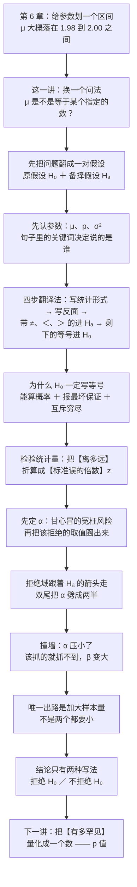

# C7.1 假设检验的要素与假设的建立 Elements of a Test of Hypothesis

> [!abstract] 这一讲的任务
> 第 6 章把"估计"做完了：给一个参数划一个带概率的区间，比如那瓶标 2 升的饮料，算出来 "$\mu$ 大概在 1.98 到 2.00 之间"。这一讲换一个问法——不问"$\mu$ 在哪"，只问**"$\mu$ 是不是等于某个指定的数"**，然后回答"是"或"不是"。这个问法看起来更弱，实际上更狠：因为它必须给出一个**二选一的决定**，而任何决定都会犯两种错。
> 要搭起来的是一整套骨架：把一句大白话翻成一对互斥的假设（$H_0$ 与 $H_a$）、把"样本离假设有多远"折算成一把通用的尺子（检验统计量 $z$）、先定下"甘心冒多大的冤枉风险"（$\alpha$）、再把这把尺子上"该拒绝"的取值圈出来（拒绝域）。最后要回答三个最容易错的问题：**为什么原假设非得写成等号、为什么结论只能说"拒绝／不拒绝"而不能说"接受"、以及两类错误为什么此消彼长。**
> 这一讲不出现 $p$ 值——那是下一讲的事。这里只把"判决机器"造出来，并把它每个零件为什么长这样讲透。

> [!info] 授课进度说明
> 目前拿到的授课转写稿覆盖到**第六节课**，内容截止于**第 6 章（参数估计与置信区间）**。
> **第 7 章尚未在课堂上讲授**，因此本篇内容全部来自**教材与通行讲法整理**，不逐段区分"课堂讲过"与"拓展补充"，正文里也不加（拓展）标记。
> 等后续转写稿补充进来，会按与第 6 章相同的规则补标。

> [!info] 怎么读这份讲义
> 按小节读，但**别跳过第 6、11、12 节**——那三节是整章最常考、也最容易含糊过去的地方，各自只回答一个问题："$H_0$ 为什么写等号""两类错误为什么不能一起变小""为什么不能说接受"。
> 顺序是这样安排的：第 0 节摆一个"差得远"的具体场面，把三个疑点先挂出来；第 1–2 节说清"假设"是什么、说的是谁；第 3–4 节立起 $H_0$ 与 $H_a$ 这两个角色；第 5 节给一套四步翻译法；第 6 节深挖等号；第 7–9 节造零件（检验统计量、$\alpha$、拒绝域）；第 10–11 节讲两种错误与它们的拉扯；第 12 节讲结论的措辞；第 13 节用一个例子把七要素一次走完，并把整套逻辑的底牌（概率反证法）翻开。
> 勘误一句话：p.38 那张临界值表里，$\alpha=.01$ 双尾一栏印作 **2.575**，精确值是 $2.5758$，按四舍五入应为 **2.576**（上一讲 99% 置信区间用的正是 2.576）；其余各格与复算一致。

---

## 0. 开场：一个坚持"平均年龄 50 岁"的人（p.8）

设想一位老先生，坚信他所住那个片区居民的**平均年龄是 50 岁**。这个信念听起来很具体：不是"偏大"，不是"中老年居多"，而是一个确切的数——50。

有人不服，去做了一次随机抽样，回来报了一个数：样本的平均年龄是 **20 岁**。

老先生摇头：**"Reject hypothesis. Not close."**（拒绝这个假设，差得太远了。）

这件事里藏着三个必须回答的问题，本讲的全部内容就是这三个问题的答案：

1. **"差得太远"是可以算的，还是凭感觉？** 30 岁的差距，到底算远还是不算远？这要看**样本有多大、年龄的分布有多散**。同样是差 30 岁，抽 5 个人和抽 500 个人，说服力天差地别。
2. **谁定的那条线？** 样本均值是 48 就接受、49.9 就拒绝吗？总得有一个事先讲好的判决标准，而且这个标准不能等看到数据以后再拍。
3. **拒绝了之后，我们知道了什么？** 是不是等于"证明了平均年龄不是 50"？——**不是。** 这个"不是"是本篇第 12 节的全部内容。

先把第 1 问算一遍，让"差得远"有一个量。

> [!example] 把"差得远"折算成标准误
> 假设这个片区居民的年龄标准差是 $\sigma=15$ 岁，这次抽了 $n=100$ 人。样本均值的标准误是
> $$SE=\frac{\sigma}{\sqrt n}=\frac{15}{\sqrt{100}}=1.5\ \text{岁}$$
> 那么 $20$ 岁离 $50$ 岁有多少个标准误？
> $$z=\frac{20-50}{1.5}=-20$$
> **负二十个标准误。** 如果 $\mu$ 真的是 50，抽到一个偏这么远的样本均值，概率约 $2.8\times10^{-89}$。

这个数在数学上还有意义，在实践上只等于一件事：**不可能**。

所以老先生那句"差得太远"其实是**对的**，只是他不知道自己算的是什么。整章要做的事，就是把这个"差得远"变成一个有名字、有单位、有概率的数字，并且在看数据之前就把判断标准钉死。

先用一句话概括这套流程，后面每一节都在补它的细节：

> [!important] 一句话的全景
> **先假定总体参数等于某个值（$H_0$）；再抽一个样本，把它算成一个"离这个值有多少个标准误"的数（检验统计量）；最后看这个数有没有落到一块事先划好的、概率只有 $\alpha$ 的区域里（**拒绝域**——检验统计量落进去、你就得拒绝 $H_0$ 的那一段取值）——落进去了就拒绝 $H_0$，没落进去就不拒绝。**

---

## 1. 什么叫"统计假设"：一句关于总体、带数字、有方向的话（p.9）

上面那句"平均年龄是 50 岁"，在统计学里有一个正式身份。

> [!important] 定义：统计假设 Statistical Hypothesis
> 一句**关于总体参数数值**的陈述（*a statement about the numerical value of a population parameter*）。
> 三个要件缺一不可：**说的是哪个参数**（$\mu$、$p$ 还是 $\sigma^2$）、**说它等于几**、**方向是什么**（$=$、$\neq$、$>$、$<$）。

先把名字拆开看。

**"假设"**——这个词在日常里带点贬义（"那只是你的假设"），但在数学传统里它恰恰是最正经的一个词：假设是**暂时放在脚下当垫子的东西**，先踩上去，再看它撑不撑得住。它不需要你相信，只需要你**同意拿它当出发点**。"平均年龄 50 岁"就是这么一个垫子：老先生踩上去，抽样的人从旁边踹一脚，看它塌不塌。

**"统计"**——这两个字限定的是**这句话说的对象**。它必须说**总体**，不能说样本。这个区别是致命的：

- "这个班平均 GPA 是 3.5"——如果这里的"这个班"指**你抽到的那 30 个人**，那这句话不是假设，是**已知事实**。加总除以 30 就完了，不需要检验。
- "这个班**全体学生**的平均 GPA 是 3.5"——"全体"拿不到，只能猜。这才是假设。

p.9 那张图上的人说的是 **"I believe the mean GPA of this class is 3.5"**，对应的是后一种读法。

那为什么不能干脆一点——**"我猜 $\mu=3.5$，抽个样本算算 $\bar x$ 是不是 3.5，相等就接受"**？

这个朴素做法会立刻撞墙：

> [!warning] 撞墙：$\bar x$ 几乎永远不等于 $\mu$
> $\bar x$ 是一个**连续取值**的随机变量。连续分布下，"$\bar x$ 恰好等于 3.5"这件事的概率是 **0**——不是很小，是零。就像在一根连续的尺子上随机扎一针，扎中"3.500000…"这个点的概率是零。
> 所以"相等就接受、不等就拒绝"这条规则会把**每一个**真的 $\mu=3.5$ 的总体都判成拒绝。规则废了。

撞墙之后，出路只有一条：**不再问"相不相等"，改问"差得是不是太多了"**。"太多"是一个关于**距离**的判断，而距离要跟"正常的波动有多大"比——这就是第 7 节的检验统计量要做的事。

> [!question] 停一下，先自己想想
> 下面四句话，哪几句是合格的统计假设？
> ① 本厂螺栓的平均长度是 5.00 厘米。
> ② 本厂螺栓的平均长度比标准长。
> ③ 这批产品的不合格率不超过 2%。
> ④ 这批产品的合格率比上一批高。

答案：① 和 ③ 合格；② 和 ④ 不合格。

① 有参数（$\mu$）、有数值（5.00）、有方向（$=$）。③ 有参数（不合格率，也就是比例 $p$）、有数值（2%）、有方向（$\leq$）。
② 缺数值——"比标准长"里的"标准"如果不是一个具体数字，就没法算。④ 缺数值，而且严格说它比较的是**两个**总体（这一批与上一批），属于第 8 章"两总体"的范围，不是单样本假设。

---

## 2. 先认出要检验的是哪个参数（p.29）

假设里必须点名一个参数。可参数有三个候选，怎么一眼看出该用哪个？

办法是**看句子里的关键词**——出题人不会明说"要求检验 $\mu$"，但他一定会用某个词。

| 参数 | 中文关键词 | 英文关键词 | 数据类型 |
|---|---|---|---|
| $\mu$ | 平均、均值、平均值 | mean, average | 定量 |
| $p$ | 比例、百分比、占比、率 | proportion, percentage, fraction, rate | 定性 |
| $\sigma^2$ | 方差、波动、离散程度、稳定性 | variance, variability, spread | 定量 |

这张表（p.29）就是"翻译词典"：句子里出现"平均每户每月用电量"，参数就是 $\mu$；出现"次品率"，参数就是 $p$；出现"每袋重量的波动"，参数就是 $\sigma^2$。

三个例子对照：

- "检验这家公司员工的**平均**通勤时间是不是 40 分钟" → $\mu$（定量数据，算均值）。
- "检验该市**赞成**这项政策的**比例**是不是 60%" → $p$（定性数据，数"是/否"）。
- "检验这台灌装机灌装量的**方差**是不是超过了 5（毫升$^2$）" → $\sigma^2$（定量数据，算方差）。

**为什么非得先认参数？** 因为参数决定后三步用哪套工具：抽样分布不一样（$\bar x$ 用正态或 $t$，$\hat p$ 用正态，$s^2$ 用卡方）、检验统计量的公式不一样、拒绝域的形状也不一样。参数认错了，后面全错，而且错得很隐蔽——公式照样能算出一个数，只是那个数没有意义。

> [!warning] 最容易混的一处：平均值 vs 比例
> "这箱苹果里**坏果占几成**"是 $p$（每个苹果只有"好/坏"两种，是定性）；"这箱苹果的**平均重量**"是 $\mu$（每个苹果有重量，是定量）。
> 如果一箱苹果里每个都称了重，"坏果率"仍要用 $p$ 的公式去检验，**不能**因为它能算成一个百分数就当成 $\mu$。判断依据是**原始观测值的类型**，不是最后报出来那个数的样子。

这一讲只做到"认出参数、写下假设"。真正的计算公式（$z$ 检验、$t$ 检验、$\chi^2$ 检验）分别在 [[C7.3 均值与比例的假设检验]] 与 [[C7.4 方差的检验、第二类错误与功效]]。

---

## 3. 原假设 $H_0$：默认站得住的那一方（p.10）

认完参数，就要立两个角色。第一个叫**原假设**。

> [!important] 定义：原假设 Null Hypothesis $H_0$
> 记作 $H_0$。它是**除非数据给出有说服力的证据证明它不成立、否则就一直被接受**的那个假设（*the hypothesis that will be accepted unless the data provide convincing evidence that it is false*）。
> 它通常代表**现状（status quo）**，或者研究者想要检验的某个关于总体参数的说法。

先把名字读对：$H_0$ 念 "H nought" 或 "H zero"，下标那个 0 就是"零"的意思——**零差异、零变化、零效应**。它是"什么都没发生"的那一方。

用"先……再……"讲它的动作：**先把"世界没变"这个说法摆在桌上，当作暂时成立；再拿着样本去撞它，撞得动就推翻，撞不动就先留着。**

它为什么必须是"默认"的那一方？三条理由，一条比一条实在。

**第一条：检验需要一个靶子。** 你说"样本均值是 20"，这句话本身没有信息——20 离 50 远不远、离 48 远不远，全看跟谁比。必须有一个具体的数值被立在前面当靶心，才能谈"偏了多少"。$H_0$ 就是这个靶心。

**第二条：这件事在日常生活中本来就是这么办的。** 法庭上先假定被告无罪，只有证据足够才判有罪；新药上市前先假定它无效，只有临床试验做出显著差异才准它宣称有效；生产线先假定一切正常，只有控制图报警才停机。**"默认无事"是社会运转的成本最低方案**——因为绝大多数时候确实无事，而每一次误判都要付代价。

**第三条：举证责任要落在"改变"那一方。** 想推翻现状的人，得自己拿出证据；不想改变的人，不需要证明现状是对的。这条规矩保证了"改变"这件事总有门槛，不会被随机波动轻易推动。

> [!warning] $H_0$ 不是"我认为对的"
> 这是初学最常拧的一处。研究者真正想证明的往往是"有变化""有效果""超标了"，而那一个恰恰**不是** $H_0$，而是 $H_a$。
> $H_0$ 是**你要打的那个**，不是**你信仰的那个**。你在 $H_0$ 这一边站得越稳，推翻它时说话才越硬气。

---

## 4. 备择假设 $H_a$：要拿证据去争的那一方（p.11–12）

第二个角色是**备择假设**，也叫**研究假设**。

> [!important] 定义：备择假设 Alternative (Research) Hypothesis $H_a$
> 记作 $H_a$。它是**只有在数据给出有说服力的证据证明它成立时才会被接受**的那个假设（*the hypothesis that will be accepted only if the data provide convincing evidence of its truth*）。
> 它通常代表**研究者想要收集证据去支持**的那个参数取值。

名字拆开：**备择** = "备用的、可选择的那个"——它在 $H_0$ 被推翻之后才上台；**研究假设**说的是它的来历——它是**你想让人相信的那句话**，是整项研究的动机所在。

$H_a$ 只能有三种形态（p.12），这条要背下来，因为后面拒绝域在哪儿全由它决定：

$$H_a:\ \mu\neq\mu_0\qquad H_a:\ \mu<\mu_0\qquad H_a:\ \mu>\mu_0$$

三者对应三种检验：第一种叫**双尾**（两个方向都算"偏离"），后两种叫**单尾**，分别是**左尾（下尾）**与**右尾（上尾）**。

两个角色摆在一起，关系可以一句话说清：

> [!important] $H_0$ 与 $H_a$ 的分工
> **$H_a$ 是你想让人相信的那句话；$H_0$ 是挡在它前面、必须先被推翻的那句话。**
> 数据的作用不是"支持 $H_a$"，而是"**看能不能推翻 $H_0$**"。推翻不了，你什么也没争到；推翻了，$H_a$ 才有资格被采用。

注意 $H_a$ 的写法里**永远带严格不等号**（$\neq$、$<$、$>$），**从不带等号**。这不是排版习惯，是第 5、6 两节要讲的那条"互斥且穷尽"逼出来的。

---

## 5. 四步把一句大白话翻成一对假设（p.13–17）

现在有了两个空位，问题是：一句话进来，谁坐哪个位子？

有一套机械的四步法（p.13），照着走不会错。

> [!important] 四步翻译法
> **① 把问题写成统计形式**——用参数和符号把这句话直译出来（例："均值不是 3" → $\mu\neq3$）。
> **② 写出它的反面**——（例：$\mu=3$）。这两个式子必须**互斥且穷尽**（mutually exclusive & exhaustive）：不能有重叠，也不能有遗漏。
> **③ 挑出带 $\neq$、$<$、$>$ 的那一个，作 $H_a$。**
> **④ 剩下的那一个，写成等号，作 $H_0$。**

第 ③ 步是纯机械的：**严格不等号归 $H_a$，等号归 $H_0$**。记住这一条，假设的写法就再也不会错。

第 ② 步那句"互斥且穷尽"值得停一下，因为它是后面所有规矩的源头：

- **互斥**：两个假设不能同时成立。所以 $H_0$ 与 $H_a$ 的式子不能重叠——$H_a$ 写成 $\mu\geq20$ 而 $H_0$ 写 $\mu=20$，就在 $\mu=20$ 这一点上打架了。
- **穷尽**：两个假设加起来要盖住全部可能。所以不能留缝——$H_0:\mu=20$、$H_a:\mu>20$ 这两条其实漏掉了 $\mu<20$ 一整片（下一节解释：$H_0$ 的等号在那里代表的是"$\mu\leq20$"这一片，写法是取代表点）。

把这套工序用在五个句子上，就得到全章所有的例题类型（p.13–17）：

| 要检验的说法 | ① 统计形式 | ② 反面 | ③ $H_a$ | ④ $H_0$ | 尾 |
|---|---|---|---|---|---|
| 总体均值**不是** 3 | $\mu\neq3$ | $\mu=3$ | $\mu\neq3$ | $\mu=3$ | 双尾 |
| 平均看电视时间**是** 12 小时吗 | $\mu=12$ | $\mu\neq12$ | $\mu\neq12$ | $\mu=12$ | 双尾 |
| 平均看电视时间**不同于** 12 小时吗 | $\mu\neq12$ | $\mu=12$ | $\mu\neq12$ | $\mu=12$ | 双尾 |
| 帽子平均成本**不超过** \$20 吗 | $\mu\leq20$ | $\mu>20$ | $\mu>20$ | $\mu=20$ | 右尾 |
| 书店平均花费**超过** \$25 吗 | $\mu>25$ | $\mu\leq25$ | $\mu>25$ | $\mu=25$ | 右尾 |

看第 2、3 两行：语序不同、一个问"是"一个问"不同"，**答案却完全一样**。原因在四步法里——"$=$"和"$\neq$"互为反面，谁是 $H_a$ 不看语气，只看**哪个带严格不等号**。这一点很省事，也很容易反直觉：问"是不是 12 小时"和问"是否不同于 12 小时"，在统计上是同一个检验。

### 5.1 最容易错的一处：$\leq$ 不能整个抄进 $H_0$

看第 4 行（p.16）那一步。问题是"帽子均价**不超过** \$20 吗"，直译出来是 $\mu\leq20$。**但 $H_0$ 不写 $\mu\leq20$，写的是 $\mu=20$。**

两个错法都要点出来：

- ❌ 把 $\mu\leq20$ 抄进 $H_0$：$H_0$ 不许带不等号（第 6 节讲为什么）。
- ❌ 把 $\mu\leq20$ 整个抄进 $H_a$：$H_a$ 不许带等号，而且这样一来 $H_0$ 与 $H_a$ 在 $\mu=20$ 这一点上重叠，"互斥"就破了。

正确做法是四步法的机械结果：**严格不等号那一侧（$\mu>20$）进 $H_a$，等号那一侧（$\mu=20$）进 $H_0$。**

### 5.2 同一个 20 元，可以是两个完全不同的检验

这一小节不在主干上，但它能防止你在考场上写反。

第 4 行那个句子，四步法把 $H_a$ 定在了 $\mu>20$。可如果提问的人其实是想证明"均价**没有**超过 20"呢？那他要争的是另一侧。于是：

| 提问者想拿证据支持的 | $H_a$ | $H_0$ | 拒绝域在哪 |
|---|---|---|---|
| 均价**涨过** 20 了 | $\mu>20$ | $\mu=20$ | 右尾（$\bar x$ 偏大才拒绝） |
| 均价**没涨过** 20 | $\mu<20$ | $\mu=20$ | 左尾（$\bar x$ 偏小才拒绝） |

**同一个数字 20，两套假设，两个相反的拒绝域。** 所以写假设时不能只盯着那个数字，还要问一句：**是谁在举证、想证明什么方向？** 四步法能保证你写出"一对互斥且穷尽的式子"，但"哪一侧才是研究的真正目的"这一步，机器替不了你。

> [!question] 停一下，先自己想想
> 一家厂商宣称它的电池平均续航**至少** 10 小时。一个消费者协会想检验这个宣称是否**虚高**。请写出 $H_a$ 与 $H_0$。
>
> 先自己写，再对下面的答案。

答案：$H_a:\mu<10$，$H_0:\mu=10$。

推法：协会怀疑的是"实际续航**不到** 10 小时"，那就是它想拿证据支持的，所以进 $H_a$（带严格不等号 $<$）。剩下的 $\mu=10$ 进 $H_0$——注意厂商原话是"至少 10 小时"（$\mu\geq10$），这个"至少"落在 $H_0$ 这一片里，写的时候取它的边界值 10。

**这里有个商业上的细节值得留意**：厂商的宣称之所以能写成 $H_0$，是因为"默认相信宣称"符合我们第 3 节说的举证责任——**要推翻它，协会得自己拿证据。**

---

## 6. 为什么原假设一定要写成等号（p.31–32）

到这里，四步法的第 ④ 步（"剩下的写成等号"）还只是一条**规矩**。可规矩总得有个理由，否则记不住、也用不踏实。

这一节把它逼出来。**这是全章第一处必须讲透的地方。**

问题的起点是一个很自然的抗议：

> "我根本不相信 $\mu$ 恰好等于 2400。我信的是 $\mu\leq2400$。凭什么逼我写一个我不信的等号？"

这个抗议是合理的，答案分三层。先看最硬的一层：**不算等号，你连概率都算不出来。**

### 6.1 第一层：只有钉在一个数上，抽样分布才唯一

回想上一讲的整套机器是怎么转起来的：要算"$\bar x$ 偏得这么远"的概率，必须知道 $\bar x$ 的**抽样分布**。而 $\bar x$ 的分布是

$$\bar x\sim N\!\left(\mu,\ \frac{\sigma^2}{n}\right)$$

**这个分布的中心就是 $\mu$。**

- 若 $H_0:\mu=2400$，分布被完全确定：中心 2400、标准差 $\sigma/\sqrt n$。于是"$\bar x$ 落在 2449.35 以上"的概率算得出来，等于 .05。
- 若 $H_0:\mu\leq2400$，这是**一整族**分布：$\mu=2400$ 一个、$\mu=2399$ 一个、$\mu=2000$ 一个……每一个给出的右尾概率都不一样（2400 时是 .05，2380 时只有 .0104，2350 时只有 .00046）。**你没法算"这个概率"，因为"这个"指哪一个都说不清。**

所以等号不是信仰声明，它是**一个锚点**：把分布钉住，概率才有定义。

### 6.2 第二层：锚点必须钉在边界，因为那是最坏的情形

好，那就钉一个。钉哪儿？

钉在 $\mu=2380$ 行不行？技术上算得出来：临界值不变（2449.35），$P(\bar x>2449.35\mid\mu=2380)=.0104$。于是你向读者报告："我这个检验，犯第一类错误的概率只有 **.0104**。"

这个报告是**不诚实**的。因为读者真正想知道的是"当 $H_0$（也就是 $\mu\leq2400$ 这一整片）为真时，你错误拒绝的概率最大有多大"。而当 $\mu$ 恰好取到 2400 时，真实的错误率是 **.05**——是你报的 4.8 倍。

**这就是"必须钉在边界"的全部理由：边界是这一整片里最容易误判的那个点，在那里算出来的 $\alpha$ 是整片上的最大值，报最大值才叫给出保证。**

![[C7.1–7.2-原假设写等号-最坏边界.png]]
读图时看三件事：① 横轴是**总体的真实均值**，纵轴是"拒绝 $H_0$ 的概率"；② 在阴影那一片（$\mu\leq2400$）里，曲线从左到右一路上升，最高点就在**边界 2400**，值恰好 .05——所以整片上的概率都不超过 .05，报 .05 就覆盖了最坏情况；③ 越过 2400 之后，同一条曲线的含义变了：这时候拒绝是**正确决定**，"拒绝的概率"不再是 $\alpha$，而是**功效**（power，$1-\beta$——"该拒绝时真的拒绝了"的那个概率）（第 11 节、[[C7.4 方差的检验、第二类错误与功效]]）。

左上角那个小图把左边那段放大了一次：它确实在上升，只是数值小到在主图上贴着横轴——这正说明**离开边界越远，冤枉它的机会越小**。

### 6.3 第三层：等号是"最强硬的对手"，打败它整片就都败了

还有一层更漂亮的逻辑，它解释了为什么"拒绝 $\mu=2400$"等于"拒绝 $\mu\leq2400$"。

以右尾为例（$H_a:\mu>2400$）。拒绝域的形状是"$\bar x$ 越大越该拒绝"。现在假设数据强到足以拒绝边界值 2400，也就是 $\bar x$ 越过了 2449.35。那么对任何一个**更小的** $\mu$（比如 2380、2350）来说，同样的 $\bar x$ 相对它偏得**更远**、更该被拒绝。

$$\text{拒绝 }\mu=2400\ \Longrightarrow\ \text{拒绝一切 }\mu<2400$$

所以把 $H_0$ 写在边界上，相当于**把对手摆成它最强的形态**：连这个最站得住的点都倒了，它身后整片自然跟着倒。反过来，如果你把 $H_0$ 写在 2000（一个更容易被打倒的点），赢了它也不能说明 2400 站不住——**你可能只是打了个软柿子。**

三条合起来，可以合成一句可以背的话：

> [!important] 为什么 $H_0$ 写等号
> **① 能算概率**：只有钉在一个数上，$\bar x$ 的抽样分布才唯一确定，"偏这么远的概率"才有定义。
> **② 报最坏保证**：$H_0$ 写成一片时，错误拒绝的概率在**边界**取到最大；锚在边界上算出的 $\alpha$ 是整片的上界，报它才不算虚报。
> **③ 打赢最强的**：边界值是最难推翻的那个点，拒绝它就等于拒绝了整片。
> 三条有个共同点：**等号不是"我们认为 $\mu$ 恰好等于它"，而是"我们把靶心放在最硬的那个位置"。**

p.32 把那两步写成一条规矩，值得逐字读：

> **第一步**：把 $H_a$ 选成"抽样实验想要建立的那个"，它取三种形态之一（上尾、下尾、双尾）。
> **第二步**：把 $H_0$ 选成现状。在**单尾**检验里，$H_0$ 取**离 $H_a$ 最近的那个参数值**；在**双尾**检验里，$H_0$ 取那个**互补的（也是唯一没被指定的）值**。

"离 $H_a$ 最近"这句话就是上一小节的另一种说法：$H_a$ 是 $\mu>2400$，紧挨着它的边界就是 2400；$H_a$ 是 $\mu<20$，紧挨着的边界就是 20。**等号永远落在离备择最近的那个点上。**

> [!warning] 一个必须说清的边界
> $H_0:\mu=2400$ 这句话**不代表**我们认为 $\mu$ 就是 2400。它代表的是"$\mu\leq2400$ 这一片，取边界 2400 作代表"。
> 这一点在后面讲结论措辞时有直接后果：既然这个等号代表的是一整片，那么"不拒绝它"当然也不能翻译成"证明了 $\mu$ 恰好是 2400"（第 12 节）。

---

## 7. 检验统计量：把"差多远"折算成一把通用的尺子（p.18–19）

靶子立好了，接下来要把样本变成一个能跟靶子比的东西。

> [!important] 定义：检验统计量 Test Statistic
> 一个**由样本算出来的统计量**，研究者用它来在 $H_0$ 与 $H_a$ 之间作决定（*a sample statistic, computed from information provided in the sample, that the researcher uses to decide between the null and alternative hypotheses*）。

名字拆开：**检验**说的是它的用途（拿来判决），**统计量**说的是它的出身（只由样本决定，不含任何未知参数）。合起来：**一个专门为判决而造的样本统计量。**

先用"先……再……"讲清动作：**先算出"样本值离假设值有多远"（$\bar x-\mu_0$）；再把这个距离除以"正常情况下它会晃多大"（标准误 $\sigma/\sqrt n$）。** 得到的倍数，就是检验统计量。

$$z=\frac{\bar x-\mu_0}{\sigma/\sqrt n}=\frac{\text{偏离}}{\text{标准误}}$$

三个部件逐个认：

- $\bar x-\mu_0$：**信号**。样本均值离假设值差多少，单位是"元"或"岁"。
- $\sigma/\sqrt n$：**噪声**。就算 $\mu$ 真的等于 $\mu_0$，$\bar x$ 也会因为抽样而晃动，晃动的典型幅度就是这个标准误（[[C5.2 样本均值的抽样分布与中心极限定理]]）。
- 两者相除：**信噪比**。把"差多少"换成"差了几个标准误"。

**为什么非要做这一步除法？** 因为不做就没法比。看两个场景：

| 场景 | 偏离 $\bar x-\mu_0$ | 标准误 $\sigma/\sqrt n$ | $z$ |
|---|---|---|---|
| A：$\sigma=300$，$n=100$ | $+100$ 元 | $30$ 元 | $3.33$ |
| B：$\sigma=3000$，$n=100$ | $+100$ 元 | $300$ 元 | $0.33$ |

同样多出的 100 元，在 A 里是"差了三个多标准误"（罕见），在 B 里只是"差了三分之一标准误"（家常便饭）。**光看偏离会得出相反结论，看了倍数才不会。** 这就是标准化的意义：把不同单位、不同离散程度的问题，折算到同一把尺子上——**"标准误的倍数"是没单位的纯数**，所以一张 $z$ 表可以服务所有问题。

除以标准误还有第二个好处：这个倍数在 $H_0$ 成立时服从一个**已知的分布**（这里是大样本下的标准正态），于是"多大算大"可以直接查表。这一条是下一节拒绝域的全部依据。

> [!example] p.19 那个数字：1.645 与 .05
> 假设 $\mu=2400$，抽样分布的中心也就是 2400。图上划出一条线，位置在 2400 以上 **1.645 个标准误**处。那么"$\bar x$ 越过这条线"的概率是多少？
> $$P(z>1.645)=1-\Phi(1.645)=0.04998\approx .05$$
> 这句话的措辞必须读准：**"如果真实的 $\mu$ 就是 2400"，那么观察到这么偏（或更偏）的样本均值的概率只有 .05。** 这是一个**条件概率**，条件就是 $H_0$。它**不是**"$\mu=2400$ 的概率是 .05"——$\mu$ 是一个固定的数，不是随机变量，谈概率没有意义；它说的是"**在 $\mu=2400$ 这个前提下**，样本偏这么远的概率"。下一节的 $\alpha$ 正是这个条件概率，只是换了一个角度来用它。

顺着把本讲一直在用的那组数算完：

> [!example] 手算：从 $\bar x$ 到 $z$
> 已知 $\mu_0=2400$，$\sigma=300$，$n=100$，$\alpha=.05$，右尾检验。观测到 $\bar x=2500$。
> **第一步**，标准误：$SE=300/\sqrt{100}=30$。
> **第二步**，把分界线折算回 $\bar x$ 的尺度：**临界值**就是"拒绝"与"不拒绝"的分界点（第 9 节正式定义），位置在 $\mu_0+1.645\times30=2400+49.35=2449.35$。
> **第三步**，把观测值折成 $z$：
> $$z=\frac{2500-2400}{30}=\frac{100}{30}=3.33$$
> **第四步**，比一比：$3.33>1.645$，落在拒绝域里，拒绝 $H_0$。

---

## 8. 第一类错误与显著性水平 $\alpha$：先定下你甘心的冤枉（p.20、p.25）

上一节的最后一步用了一个叫"$\alpha$"的东西，说"$z>1.645$ 就拒绝"，可 1.645 是哪儿来的？**它是从 $\alpha=.05$ 反查出来的。** 所以在画拒绝域之前，必须先把 $\alpha$ 说清楚。

先看这个场面里到底能出几种错。因为判决只有两个选项（拒绝／不拒绝），而真相也只有两种（$H_0$ 真／$H_0$ 假），交叉起来是四格，其中两格是错的。

> [!important] 定义：第一类错误 Type I Error
> 当 $H_0$ **实际上是真的**，研究者却**拒绝**了它、转而采用 $H_a$，这叫第一类错误。
> 犯这个错误的概率记作 $\alpha$：
> $$\alpha=P(\text{拒绝 }H_0\mid H_0\text{ 为真})$$

用"先……再……"讲它的动作：**先在脑子里假定 $H_0$ 是真的；再看你划出来的拒绝域有多大；$\alpha$ 就是那块面积。** 它衡量的是"靶子明明没倒，你却宣布它倒了"的概率。

名字拆开："第一类"不是"第一种被发现的"，而是按**后果的严重性排序**的惯例——先控制住最不能容忍的那一种，再谈其他。中文里它还有个更传神的叫法：**弃真**（把真的扔了）。

$\alpha$ 还有一个正式的名字：

> [!important] 定义：显著性水平 Level of Significance
> $\alpha$ 通常取得很小（$.01$、$.05$、$.10$ 是三个常见值），这个 $\alpha$ 就叫检验的**显著性水平**（p.25）。

三个字逐个拆：

- **显著**（significant）：在这个语境里它**不是**"重要""了不起"，而是"**不太可能是偶然造成的**"。一个"显著的结果"，意思是"如果 $H_0$ 为真，这个结果罕见得不像是碰巧"。
- **水平**：一个阈值，一条线。
- 合起来：**你愿意把"多罕见"才当成"不是偶然"的那条线**。$\alpha=.05$ 的意思是：只要"纯属偶然"的概率低于 5%，我就当它不是偶然。

为什么必须**在看数据之前**把它定下来？因为它是一个**尺度**，而尺度一旦允许事后调整，就什么都检验不出来了——结果偏得少就把 $\alpha$ 放宽到 .10，偏得多就收紧到 .01，永远能凑出一个"显著"。这不是学术洁癖，而是一套防止自欺的流程约束：**先定标准，再看数据**。

> [!warning] 三个常见误读
> ① **$\alpha$ 不是"$H_0$ 为真的概率"**。它是 $P(\text{拒绝}\mid H_0\text{真})$，条件在 $H_0$ 上；而"$H_0$ 为真的概率"是另一个量（先验概率），检验里没有它的位置。
> ② **$\alpha$ 不是"我这次判错的概率"**。它只是"在 $H_0$ 为真这一种情形下判错"的概率；若 $H_0$ 为假，判错的概率叫 $\beta$（下一节）。
> ③ **$\alpha$ 小不等于结论可靠**。$\alpha$ 小只保证"冤枉好人的机会小"，完全不管"该抓的有没有抓到"——那由 $\beta$ 管，而 $\beta$ 你可能根本不知道（第 11、12 节）。

---

## 9. 拒绝域与临界值：把 $\alpha$ 画成图上的一块面积（p.21、p.33–38）

现在把 $\alpha$ 落到尺子上。

> [!important] 定义：拒绝域 Rejection Region
> 一个统计检验的**拒绝域**，是**检验统计量**的那些取值构成的集合——只要统计量落进这个集合，就拒绝 $H_0$、采用 $H_a$（p.21）。
> 拒绝域的边界值叫**临界值 critical value**。
> 拒绝域按这样一条要求来选：**当 $H_0$ 为真时，统计量落进拒绝域的概率恰好等于 $\alpha$**（p.25）。

用"先……再……"讲动作：**先在检验统计量的分布上，找出尾巴面积为 $\alpha$ 的那一段（临界值就是分界点）；再看你算出来的 $z$ 落没落进那一段。**

所以三段结构一目了然。**单尾**只切一刀，留出一块面积 $\alpha$：

$$\underbrace{(-\infty,\ -z_\alpha]}_{\text{左尾拒绝域：面积 }\alpha}\qquad\text{或}\qquad\underbrace{[z_\alpha,\ +\infty)}_{\text{右尾拒绝域：面积 }\alpha}$$

**双尾**切两刀，两边各分一半，中间那块才是"不拒绝区"：

$$\underbrace{(-\infty,\ -z_{\alpha/2}]}_{\alpha/2}\qquad\underbrace{(-z_{\alpha/2},\ z_{\alpha/2})}_{\text{不拒绝区：面积 }1-\alpha}\qquad\underbrace{[z_{\alpha/2},\ +\infty)}_{\alpha/2}$$

### 9.1 拒绝域在哪边，由 $H_a$ 的箭头决定

这是很省力的一条：**不用想"数据偏哪边"，只看 $H_a$ 的箭头。**

- $H_a:\mu>\mu_0$（右尾／上尾）：只有 $\bar x$ **偏大**才说明 $\mu$ 大，所以拒绝域在右边，$z>z_\alpha$。
- $H_a:\mu<\mu_0$（左尾／下尾）：只有 $\bar x$ **偏小**才说明 $\mu$ 小，所以拒绝域在左边，$z<-z_\alpha$。
- $H_a:\mu\neq\mu_0$（双尾）：偏大偏小**都**说明 $\mu$ 不是 $\mu_0$，所以两边都是拒绝域，两边**各分 $\alpha/2$**。

p.33 给的定义是：**单尾检验**指 $H_a$ 有方向、带 $<$ 或 $>$ 的检验；p.34 给的：**双尾检验**指 $H_a$ 不指定偏离方向、只写 $\neq$ 的检验。

> [!warning] 双尾为什么要劈成两半
> 因为 $\alpha$ 是**总预算**，不是"每一边的预算"。$H_a:\mu\neq\mu_0$ 有两个可以犯错的方向，预算就得对半分：左边 $\alpha/2$、右边 $\alpha/2$，两边加起来才等于 $\alpha$。
> 这直接解释了为什么双尾的临界值比单尾**更远**：$\alpha=.05$ 时单尾用 1.645，双尾要用 1.96。因为每一侧只分到 .025，得往更远处退。**代价是更难拒绝**——双尾检验比同 $\alpha$ 的单尾检验保守。

![[C7.1–7.2-拒绝域由备择假设的箭头决定.png]]
三张图共用同一块 $\alpha$：**切一刀（单尾）还是切两刀（双尾），决定的是这块面积放在哪儿，不是它有多大。** 图上横轴是检验统计量 $z$（也就是"标准误的倍数"），粉色区域是拒绝域，绿色标出的中间部分是"不拒绝区"，面积 $1-\alpha$。

### 9.2 一张临界值表，全部复算过（p.38）

$z$ 的临界值不随问题变，只随 $\alpha$ 和"几尾"变。所以可以造一张表反复用：

| 显著性水平 $\alpha$ | 左尾（$H_a:\mu<\mu_0$） | 右尾（$H_a:\mu>\mu_0$） | 双尾（$H_a:\mu\neq\mu_0$） |
|---|---|---|---|
| $.10$ | $z<-1.282$ | $z>1.282$ | $z<-1.645$ 或 $z>1.645$ |
| $.05$ | $z<-1.645$ | $z>1.645$ | $z<-1.96$ 或 $z>1.96$ |
| $.01$ | $z<-2.326$ | $z>2.326$ | $z<-2.576$ 或 $z>2.576$ |

表里每个数都是"尾巴面积恰好等于 $\alpha$（双尾则是 $\alpha/2$）"的那个点，可以逐个验：

| $\alpha$ | 单尾临界值 | 复算 $P(z>\text{临界值})$ | 双尾临界值 | 复算 $P(\lvert z\rvert>\text{临界值})$ |
|---|---|---|---|---|
| $.10$ | $1.2816$ | $0.0999$ | $1.6449$ | $0.1000$ |
| $.05$ | $1.6449$ | $0.0500$ | $1.9600$ | $0.0500$ |
| $.01$ | $2.3263$ | $0.0100$ | $2.5758$ | $0.0100$ |

（p.38 那张表印成三位小数：$1.282$、$1.645$、$2.326$、$1.96$、$2.575$。前四个都是四舍五入的结果，与复算一致；**只有 $\alpha=.01$ 双尾那一格的 $2.575$ 是截断**——精确值 $2.5758$，三位小数应作 $2.576$，上一讲 99% 置信区间用的正是 $2.576$。差别虽小，写作业时以 $2.576$ 为准。）

**表的读法有一个诀窍**：三列之间不是三个独立的知识点。$\alpha=.05$ 的双尾临界值 1.96，其实就是 $\alpha=.05$ 单尾那一格换成"每边 .025"的结果——**双尾的每一格，都等于"$\alpha$ 加倍后的单尾格"**：双尾 $.05$ 用 1.96，而单尾 $\alpha=.05$ 是 1.645；1.96 正好是单尾 $\alpha=.025$ 的值。记住一条，推出三列。

> [!tip] 速查：三个最常用的数
> $1.645$（单尾 $.05$／双尾 $.10$）｜$1.96$（双尾 $.05$）｜$2.576$（双尾 $.01$）。
> 这三个数在后面的每一讲都会出现，值得和上一讲的置信区间倍数（[[C6.1 参数估计与置信区间]]）一起背下来——它们本来就是同一批数，只是用法相反。

---

## 10. 第二类错误 $\beta$：该抓的没抓到（p.22–23）

$\alpha$ 管的是"冤枉好人"。另一种错是反过来的。

> [!important] 定义：第二类错误 Type II Error
> 当 $H_0$ **实际上是假的**，研究者却**没有拒绝**它，这叫第二类错误。
> 犯这个错误的概率记作 $\beta$：
> $$\beta=P(\text{不拒绝 }H_0\mid H_0\text{ 为假})$$

中文旧称叫**取伪**（把假的当成真的）。

这一节有个坎必须提前说：**$\beta$ 不是一个数。** $\alpha$ 只要 $H_0$ 定下来就是一个确定的数（因为"$H_0$ 为真"只对应一个参数值，就是那个等号）；可"$H_0$ 为假"对应的是**一整片**参数值——$\mu$ 可能是 2410、2470、3000，每一种情况下 $\beta$ 都不一样。所以 $\beta$ 是**真实参数值的函数**，写成 $\beta(\mu)$。下一讲之后会专门给它画成"功效曲线"，那是 [[C7.4 方差的检验、第二类错误与功效]] 的内容。

把四种组合画成一张表（p.23），整个结构就清楚了：

| | 真相：$H_0$ 为真 | 真相：$H_a$ 为真 |
|---|---|---|
| **结论：不拒绝 $H_0$** | 正确决定 | **第二类错误**（概率 $\beta$） |
| **结论：拒绝 $H_0$** | **第一类错误**（概率 $\alpha$） | 正确决定 |

（表头那两行"结论"在 p.23 上写的是 "Accept $H_0$" 与 "Reject $H_0$"——其中 "Accept" 的用法留到第 12 节算账。）

> [!note] 这张表就是机器学习里的混淆矩阵
> 换成 AI 的话说，四个格子一个不差：
> **第一类错误 = 假阳性（false positive）**：$H_0$ 说"没有"，你判"有"。垃圾邮件过滤器把一封正常邮件扔进垃圾箱，就是它。
> **第二类错误 = 假阴性（false negative）**：$H_0$ 说"有"，你判"没有"。癌症筛查漏掉一个真正的病灶，就是它。
> 于是 $1-\alpha$ 是**特异度**（没病的有没有被放过），$1-\beta$ 是**召回率／敏感度**（该抓的抓到了几成）。这也解释了为什么"提高准确率"这句口号在实务里常常没有意义——**两类错误的价格不一样**，而准确率把它们当成一样贵。
> A/B 测试是同一件事的商业版本：把 $\alpha$ 从 .05 放宽到 .10，更多"其实没效果"的功能会带着"显著"的标签上线（假阳性）；收紧到 .01，又会把真有效果的功能漏掉（假阴性）。第 11 节那条取舍曲线，在工业界就是"上线门槛定多高"这个产品决策。

这两种错误不是对称的，差别在于三处，每一处都很实际：

**第一处：后果的代价往往不对称。** 所以两种错误的名字和阈值都不一样，得分开管。

- **新药的三期临床**：$H_0$ 是"这药无效"。犯第一类错误 = 把无效的药判成有效 → 病人吃下没用的药、耽误治疗、公司面临索赔。犯第二类错误 = 把有效的药判成无效 → 好药被埋没、研发投入打水漂。两边的代价都很大，但方向完全不同，监管通常把 $\alpha$ 压得很死（$.05$ 甚至 $.01$）。
- **火灾报警器**：$H_0$ 是"没有火"。第一类错误 = 误报（虚惊一场，代价是白跑一趟）；第二类错误 = 漏报（代价是烧掉一栋楼）。这时候人们会**故意**把 $\alpha$ 调大——宁可多误报，也不能漏报。
- **法庭**：$H_0$ 是"无罪"。第一类错误 = 冤枉好人，第二类错误 = 放走坏人。现代法律体系用"排除合理怀疑"这个极高的举证门槛，本质就是把 $\alpha$ 定得极小——宁纵勿枉。

**第二处：只有 $\alpha$ 可以由你主动选定。** $\alpha$ 在实验设计阶段就被定下来（$.01$／$.05$／$.10$），$\beta$ 不是——它是 $\alpha$、样本量、真实差距三者共同决定的**结果**，你往往连它等于多少都不知道。这一条是第 12 节"为什么不能说接受"的直接依据。

**第三处：两种错误的概率此消彼长，但不能同时压小。** 这是下一节。

---

## 11. 两类错误此消彼长：为什么不能两个一起变小（p.20、p.22）

现在提一个很自然的要求：**$\alpha$ 和 $\beta$ 我都想要小，行不行？**

先用一个具体场面把它算出来。设定照旧：$\mu_0=2400$、$\sigma=300$、$n=100$（标准误 30），右尾检验。现在假设**真值其实是 2470**（比 $H_0$ 高 70），我们来看 $\alpha$ 一改，$\beta$ 怎么动。

| 你选的 $\alpha$ | 临界值 $z_\alpha$ | 临界值在 $\bar x$ 上的位置 | 若真值 2470，漏掉的概率 $\beta$ | 功效 $1-\beta$ |
|---|---|---|---|---|
| $.10$ | $1.282$ | $2438.46$ | $.147$ | $.853$ |
| $.05$ | $1.645$ | $2449.35$ | $.246$ | $.754$ |
| $.01$ | $2.326$ | $2469.78$ | $.497$ | $.503$ |

$\beta$ 这一列怎么算出来的？把临界值当成一条线，问"真值为 2470 时，$\bar x$ 落在**线左边**（于是不拒绝）的概率"：

$$\beta=P(\bar x<c\mid\mu=2470)=\Phi\!\left(\frac{c-2470}{30}\right)$$

以 $\alpha=.01$ 那一行为例，$c=2469.78$：

$$\beta=\Phi\!\left(\frac{2469.78-2470}{30}\right)=\Phi(-0.007)\approx .497$$

**这个数很说明问题**：明明真值 2470 比 2400 高出 70 元，可当 $\alpha=.01$ 时，这个检验有**将近一半**的机会什么都没发现。

规律一目了然：**$\alpha$ 从 .10 压到 .01，$\beta$ 就从 .147 涨到 .497**——你把"冤枉"的门槛抬高了，代价是"漏掉"的机会跟着变大。原因也很直白：$\alpha$ 变小意味着临界值**往外推**，拒绝域缩小；可拒绝域一缩，那些本该被抓住的偏大样本均值就有更多落在了拒绝域外面。

![[C7.1–7.2-两类错误此消彼长.png]]
左图把两块面积画在同一张图上：蓝曲线是"$H_0$ 为真时 $\bar x$ 的分布"，紫曲线是"真值其实是 2470 时 $\bar x$ 的分布"。临界值 2449.35 那条竖线把两块面积切出来——**蓝曲线右侧那一小块（粉）是 $\alpha$，紫曲线左侧那一大块是 $\beta$。** 竖线只要往右挪，粉的变小、紫的变大，图上就能直接看出来。

右图把这件事画成一条曲线：横轴是 $\alpha$，纵轴是 $\beta$，蓝线是 $n=100$ 时的取舍关系。**它是一条下降的曲线，曲线上每一点都是一次"合法"的检验。** 你不可能既让 $\alpha$ 小又让 $\beta$ 小，只能**在曲线上选一个点**。

那出路在哪？图上还有一条橙色虚线：$n=400$。同一个真值、同一个 $\alpha=.05$，$\beta$ 从 $.246$ 掉到 $.0013$——**几乎把所有该抓的都抓住了。**

原因在于标准误：$n$ 从 100 加到 400，$SE$ 从 30 减到 15。两条分布变得**更瘦更高、彼此分得更开**，于是同一条临界值能把它们切得更干净。

> [!important] 两类错误的取舍规则
> **在样本量固定时，$\alpha$ 与 $\beta$ 反向变动**：压小一个，必然抬高另一个。这不是设计得不好，而是两块面积共用同一条临界值线——**线只有一根，只能往一边挪。**
> **要让两个都变小，只有一条路：加大样本量**（或者让真实差距本身变大，但那个你控制不了）。
> 实务上的推论：**"不拒绝 $H_0$"这句话，在样本量小的时候几乎没有信息量。**

最后这句话值得看一个数字。把样本量缩小到 $n=25$（标准误变成 60），$\alpha=.05$、真值仍是 2470：

| $n$ | 标准误 | 临界值 | 真值 2470 时漏掉的概率 $\beta$ |
|---|---|---|---|
| $25$ | $60$ | $2498.69$ | $.684$ |
| $100$ | $30$ | $2449.35$ | $.246$ |
| $400$ | $15$ | $2424.67$ | $.0013$ |

$n=25$ 时，**即使真值高了 70，也有近七成的概率判成"没差别"**。所以看到"未能拒绝 $H_0$"，第一句话该问的不是"那就是没差别吧"，而是"**这个检验有多大的本事发现差别？**"

> [!note] 一个类比：撒网
> 网眼大（$\alpha$ 小、轻易不拒绝）：大鱼也漏。
> 网眼小（$\alpha$ 大、动不动就拒绝）：什么水草都捞上来。
> 想少漏鱼又不想捞杂物，唯一的办法是**多撒几网**（加大 $n$）。

---

## 12. 为什么结论只能说"拒绝／不拒绝"，不能说"接受"（p.27–28）

判决做完了，怎么写结论？这里有一个全章最常被扣分的地方。

先说清楚两种写法在逻辑上的地位完全不同：

$$H_0\text{ 被拒绝}\ \Longrightarrow\ \text{数据与 }H_0\text{ 不相容}$$

$$H_0\text{ 未被拒绝}\ \Longrightarrow\ \text{数据没能提供足够的反证}$$

第二句只说了"**没找到证据**"，没说"**证明没有**"。这两件事差得很远。

p.28 把理由写得很干脆，而且指出了它的技术根源：

> 如果检验统计量**不**落在拒绝域里，我们**不拒绝** $H_0$；因此我们对"哪个假设为真"**保留判断**。我们**不**下"$H_0$ 为真"的结论，因为（在一般情况下）我们**不知道**这个检验程序会错误地接受 $H_0$（也就是犯第二类错误）的概率 $\beta$。

这三句话可以拆成三条独立成立的理由：

**理由一：证据的不对称。** 拒绝这一边，你手里有一个**量化过的保证**——$\alpha$ 是你选的，明明白白写着"如果 $H_0$ 为真，我这样判错的概率不超过 5%"。不拒绝这一边，你手里什么都没有：$\beta$ 是多少？取决于真实参数，你**不知道**（第 11 节算过，它可能是 .0013，也可能是 .684）。**一边有保证、一边没保证，就不能用同样的句式去陈述。**

**理由二：数据只能排除，不能确认。** 不拒绝 $H_0:\mu=2400$ 时，被排除的是什么？几乎没有。$\bar x=2403$ 这个结果，与 $\mu=2400$ 相容，也与 $\mu=2403$、$\mu=2397$、$\mu=2410$ 全都相容——它们都在"这一个样本说不出话"的范围内。样本能做的是**逐步缩小嫌疑范围**（这正是置信区间干的事），而不是**指认某一个点为真**。
换句话说：**拒绝是"排除"，不拒绝是"尚未排除"。** 而"尚未排除"离"确认为真"还隔着一整个 $\beta$。

**理由三：$\alpha$ 可控、$\beta$ 不可控。** 你在设计检验时只选了一个数，就是 $\alpha$。$\beta$ 是结果，不是选择。结论里能带概率保证的，只有"拒绝"那一边。既然"不拒绝"这一边连自己有多不可靠都说不清，就不能把它写成"接受"。

三条合起来，就是那句必须背下来的话：

> [!important] 三种写法，只有两种是对的
> ✅ **拒绝 $H_0$，有充分证据支持 $H_a$。**（带 $\alpha$ 的保证）
> ✅ **不拒绝 $H_0$（do not reject $H_0$）／证据不足。**（不给保证，只报告"没找到"）
> ❌ **接受 $H_0$／证明 $H_0$ 为真。**（把"没找到证据"偷换成"没有这回事"）

### 12.1 p.23 那张表里的 "Accept $H_0$" 怎么理解

这里必须处理一处表面上的矛盾：第 10 节引的 2×2 表，左上格写的是 **"Accept $H_0$ (Assume $H_0$ True)"**，看起来跟上面说的"不能说接受"打架。

不打架，因为那是**两种不同层面的语言**：

- **决策语言（decision）**：我现在要**采取行动**——继续按"$\mu=2400$"这个假设安排生产、继续用这个供应商、继续认为这药无效。"接受"在这里的意思是"**按它行动**"，这在实务上完全合法，也必须有个说法。
- **结论语言（conclusion）**：我对世界下了什么判断——"$\mu$ 等于 2400"这句话被证实了吗？没有。所以这一层**不能说接受**。

p.28 管的是第二种。**行动上可以照旧，认识上不能宣称。** 一句更短的记法：**可以"当作它成立"来办事，不能"断言它成立"来交差。**

> [!warning] 考场上怎么判
> 题目问 "conclusion"／"结论"，写 **do not reject $H_0$**／**fail to reject $H_0$**。
> 题目问 "decision"／"该采取什么行动"，可以说 "accept $H_0$（继续按现状行动）"。
> 只要看到自己写出 "accept $H_0$ 所以 $\mu$ 等于 X" 这种句子，就是踩坑了。

### 12.2 三个类比，把这层区别钉住

- **法庭**：证据不足，无罪释放。这不等于"查清了他是清白的"，只等于"检方没能证明他有罪"。判决书上写的是"罪名不成立"，不是"此人清白"。
- **安检**：安检门没响，不等于行李里没有违禁品；只等于"这台机器的灵敏度下没发现"。换台更灵敏的（加大 $n$、放宽 $\alpha$），可能就响了。
- **体检**：一次筛查没查出问题，不等于没病，只等于"这次没查出来"。所以才有"建议半年后复查"——复查就是加大 $n$。

**这个区别有实际后果。** 如果把"不拒绝"当成"证明相同"，就会得出这类结论："两种药疗效一样"（其实只是样本太小没测出差别）、"这个广告没效果"（同上）、"这批货和上批一样"（同上）。这些结论的错，都不是算错，而是**把"证据不足"读成了"证据表明没有"**。

---

## 13. 把一次检验从头到尾走一遍：七要素与它的底牌（p.24–28、p.35）

零件齐了，现在按顺序装一遍。

### 13.1 七个要素（p.24–28）

| # | 要素 | 要写清什么 | 本讲对应 |
|---|---|---|---|
| 1 | 原假设 $H_0$ | 关于参数取值的"现状"，写成等号 | 第 3、6 节 |
| 2 | 备择假设 $H_a$ | 想拿证据去支持的那一句，带严格不等号 | 第 4、5 节 |
| 3 | 检验统计量 | 用哪个样本统计量判决、怎么折算 | 第 7 节 |
| 4 | 拒绝域 | 统计量的哪些取值导致拒绝；由 $\alpha$ 定 | 第 8、9 节 |
| 5 | 假定 | 对总体做了哪些前提假设（随机样本、$\sigma$ 已知或大样本等） | 第 7 节、[[C5.2 样本均值的抽样分布与中心极限定理]] |
| 6 | 实验与计算 | 真正抽一次样，把统计量的数值算出来 | 第 7 节 |
| 7 | 结论 | 落在拒绝域里就拒绝、支持 $H_a$；否则**不拒绝**、保留判断 | 第 12 节 |

第 5 条"假定"最容易被漏掉，但它决定了整台机器成不成立。本讲所有公式都站在两个前提下：**样本是随机抽的**（保证代表性，[[C1.2 收集数据：抽样方法与代表性]]）、**$\bar x$ 的抽样分布近似正态**（$\sigma$ 已知，或 $n$ 足够大使得 $s$ 能顶替 $\sigma$，[[C5.2 样本均值的抽样分布与中心极限定理]]）。前提不成立，后面算得再漂亮也是空转。

> [!example] 七要素实例：月均消费是不是 2400
> 某银行宣称其信用卡客户**月均消费 2400 元**。一个研究团队怀疑实际更高，抽了 $n=100$ 位客户，$\sigma=300$，算得 $\bar x=2500$，取 $\alpha=.05$。
> **① $H_0$**：$\mu=2400$　　**② $H_a$**：$\mu>2400$（右尾——想证明的是"更高"）
> **③ 检验统计量**：$z=\dfrac{\bar x-2400}{\sigma/\sqrt n}$
> **④ 拒绝域**：$z>1.645$（$\alpha=.05$，单尾）
> **⑤ 假定**：样本随机；$\sigma=300$ 已知（若未知则改用 $t$）；$\bar x$ 近似正态
> **⑥ 计算**：$SE=300/10=30$，$z=\dfrac{2500-2400}{30}=3.33$
> **⑦ 结论**：$3.33>1.645$，落在拒绝域内 ⟹ **拒绝 $H_0$**，有充分证据支持"月均消费高于 2400"；这个判断在 $H_0$ 为真时有 5% 的机会是错的。

### 13.2 底牌：这套逻辑其实是"概率版的反证法"（p.35）

七步走完，回头看一眼这套东西到底在干什么。

p.35 的那张图画的是最基本的想法：如果 $H_0$ 为真（$\mu=50$），$\bar x$ 的抽样分布就以 50 为中心；现在观测到的样本均值落在 20 那个位置——**离中心极远的位置**。图上标注的逻辑链是这样的：

> **"如果 50 真的是总体的均值，我们几乎不可能抽到这么大的样本均值……所以，我们拒绝 $\mu=50$ 这个假设。"**

把这个推理摆成三段：

1. **假定** $H_0$ 成立；
2. **推出**"观测到这么极端的样本"是一个小概率事件（概率不超过 $\alpha$）；
3. **观测结果真的发生了**这个极端值；
4. **于是**在"$H_0$ 成立"与"观测结果"之间只能留一个——我们选择不留 $H_0$。

看着像数学里的反证法（假定命题成立 → 推出矛盾 → 命题为假），但有一处关键差别，这处差别正是整个学科的性格所在：

> [!important] 它推出来的不是"矛盾"，是"罕见"
> 数学反证法里，假定 $H_0$ 会推出一个**逻辑上不可能**的结论，所以 $H_0$ 必假，结论是**确定的**。
> 这里推出来的是"**小概率**"——小概率**仍然可能发生**。所以在 $H_0$ 为真时，你仍有 $\alpha$ 的机会抽到那个"极端"样本，从而冤枉它。
> 因此结论**永远带概率**，不能是"证明了 $H_0$ 为假"，只能是"在 5% 的冤枉风险下拒绝 $H_0$"。

这也顺带解释了为什么整章的措辞那么讲究：**因为结论本身就是概率性的，"接受／拒绝"这些日常词的绝对语气在这里都不够用。**

### 13.3 与上一讲的接口：拒绝域和置信区间是一枚硬币的两面

最后一个观察，把这一讲接回上一讲。

第 6 章造的是区间：$\bar x\pm1.96\,\sigma/\sqrt n$（[[C6.1 参数估计与置信区间]]）。这一讲造的是拒绝域：$|z|>1.96$ 就拒绝。**它们其实是同一件事的两种说法**：

$$\mu_0\text{ 落在 }(1-\alpha)\text{ 置信区间之外}\iff |z|>z_{\alpha/2}\iff \text{拒绝 }H_0:\mu=\mu_0$$

用本讲的数验一遍。$\bar x=2500$、$SE=30$、95% 的双尾区间：

$$2500\pm1.96\times30=2500\pm58.8=(2441.2,\ 2558.8)$$

而 $\mu_0=2400$ **不在**这个区间里 → 应当拒绝。用拒绝域算：$z=(2500-2400)/30=3.33>1.96$ → 也拒绝。两条路结论一致。

**这个对偶关系很有用**：它说明"区间估计"和"假设检验"不是两套知识，而是同一套抽样分布的两个用法——一个问"参数可能在哪"，一个问"某个指定值在不在那里"。下一讲会看到，$p$ 值就是这个对偶关系里最方便的那个刻度。

> [!tip] 速查表
> | 名称 | 定义 / 算式 | 一句话记 |
> |---|---|---|
> | 统计假设 | 关于总体参数数值的陈述 | 必须点名参数、数值、方向 |
> | 目标参数 | $\mu$（平均）｜$p$（比例）｜$\sigma^2$（波动） | 看句子里的关键词 |
> | $H_0$ | 现状；**永远写成等号** $\mu=\mu_0$ | 你要打的那个靶子 |
> | $H_a$ | 想建立的那个；**只带** $\neq$、$<$、$>$ | 等号绝不进这一边 |
> | 四步法 | 写统计形式 → 写反面 → 带严格不等号的进 $H_a$ → 等号进 $H_0$ | 两条必须互斥且穷尽 |
> | 检验统计量 | $z=\dfrac{\bar x-\mu_0}{\sigma/\sqrt n}$ | 偏离 ÷ 标准误 = 信噪比，无单位 |
> | 第一类错误 $\alpha$ | $P(\text{拒绝}\mid H_0\text{ 真})$，常取 $.01/.05/.10$ | 冤枉好人；自己选，且先选 |
> | 拒绝域 | 使 $H_0$ 被拒绝的那些 $z$，面积恰为 $\alpha$ | 在哪边由 $H_a$ 的箭头定 |
> | 单尾临界值 | $\alpha=.10/.05/.01\Rightarrow1.282/1.645/2.326$ | 切一刀 |
> | 双尾临界值 | $\alpha=.10/.05/.01\Rightarrow1.645/1.96/2.576$ | 切两刀，每边 $\alpha/2$ |
> | 第二类错误 $\beta$ | $P(\text{不拒绝}\mid H_0\text{ 假})$，是真实 $\mu$ 的函数 | 该抓没抓到；往往不知道它是多少 |
> | 功效 | $1-\beta$ | 检验"抓得住"的能力 |
> | 结论措辞 | 拒绝 $H_0$ ／ **不拒绝** $H_0$ | 不说"接受"，不说"证明" |

> [!tip] 下一讲预告
> 这一讲的结论只有两种（拒绝／不拒绝），信息量其实很少：$z=3.33$ 和 $z=1.70$ 都"拒绝"，可**前者比后者强硬得多**，而现在的写法把这点信息丢掉了。
> 下一讲补上这个刻度：**$p$ 值**。它的定义是"**在 $H_0$ 成立的条件下，出现当前或更极端结果的概率**"——把"有多罕见"直接折算成一个数报出来，于是每个读者可以拿自己的 $\alpha$ 去比，不用再看别人的临界值。
> 同时会讲清三件容易混的事：$p$ 值不是"$H_0$ 为真的概率"、$p$ 小不等于效应大、以及为什么"看到 $p<.05$ 就宣布重大发现"这套做法正在被统计学界检讨。

---

## 这一讲的三句话

1. **$H_0$ 写等号不是信仰，是三个技术要求叠出来的结果：只有钉在一个数上抽样分布才唯一（能算概率）、只有钉在边界上算出的 $\alpha$ 才是整片 $H_0$ 上的最坏保证（不虚报）、而边界正是最难推翻的那个点（打赢它整片就都倒了）。**
2. **两类错误共用同一条临界值线，所以固定样本量下 $\alpha$ 与 $\beta$ 必然反向变动；要两个都小，唯一的办法是加大样本量——因此"不拒绝 $H_0$"在样本量小时几乎不含信息。**
3. **数据只能排除、不能确认：拒绝 $H_0$ 有 $\alpha$ 这个量化保证，不拒绝 $H_0$ 却连 $\beta$ 是多少都不知道。所以结论只能是"拒绝"或"不拒绝"，"接受 $H_0$／证明 $H_0$ 为真"是逻辑上不成立的写法。**

---

## 相关笔记 Related Notes

- 相关：[[C6.1 参数估计与置信区间]]（区间与拒绝域是同一套抽样分布的两个用法）、[[C5.2 样本均值的抽样分布与中心极限定理]]（检验统计量的分母从哪来）、[[C2.6 百分位数与 z 分数]]（$z$ 的读法与查表）、[[C1.2 收集数据：抽样方法与代表性]]（"随机样本"那条前提）、[[C7.2 p 值与显著性水平]]（把"有多罕见"折成一个数）、[[C7.4 方差的检验、第二类错误与功效]]（$\beta$ 与功效曲线的正式算法）
- 上一讲：[[C6.3 样本量、有限总体校正与方差的置信区间]]
- 下一讲：[[C7.2 p 值与显著性水平]]
- 返回：[[统计学课程 MOC]]
