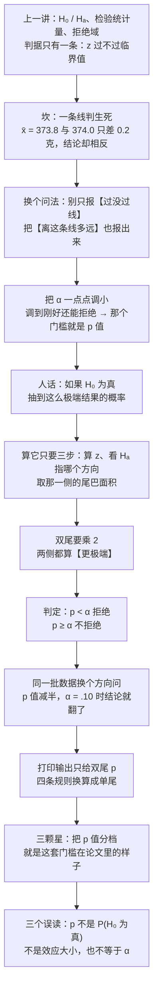

# C7.2 p 值与显著性水平 Observed Significance Levels: p-Values

> [!abstract] 这一讲的任务
> 上一讲把假设检验的机器装好了：先立一个原假设 $H_0$，把样本压成一个检验统计量 $z$，再拿它跟临界值比——进了拒绝域就拒绝。这套机器能用，但它只给一个二值答案：**过线 / 没过线**。
> 这一讲把这台机器的输出换一种写法：别只报"过没过线"，把**离这条线有多远**也报出来。那个数叫 **p 值 p-value**，是 0 到 1 之间的一个概率。它的读法只有一句人话：**如果原假设为真，抽到一个至少和这次一样不利于 $H_0$ 的结果，概率有多大。**
> 学会它，你就能读懂论文回归表上的 `***`、看懂软件打印出来的 `p = .004`、并且——更要紧的——不被三种最常见的误读骗过去。

> [!info] 授课进度说明
> 目前拿到的授课转写稿覆盖到**第六节课**，内容截止于**第 6.2 节（区间估计的原理与置信系数）**。
> **第 7 章尚未在课堂上讲授**（7.1–7.2 与本篇的 7.3 都是），因此本篇内容全部来自**教材与通行讲法整理**，暂不逐条区分"课堂讲过"与"拓展补充"。
> 等后续转写稿补充进来，会按与前面各章相同的规则（标题后缀 **（拓展）**、段首 **【拓展】**）标注出课堂未讲的部分。

> [!info] 怎么读这份讲义
> 第 0 节是一个组会现场，把那三颗星先摆到桌面上；第 1 节补回上一讲的四个零件，并当场演示"一条线判生死"别扭在哪——**这一节是全篇的动机，别跳**；第 2 节把 p 值**逼**出来（先给一句人话，再上定义，再拆名字）；第 3 节是怎么算的三步；第 4 节讲判定与报告；第 5–7 节是三道完整的例题（双尾、单尾、油耗）；第 8 节处理一个很实际的坑：软件只给双尾 p，怎么换算，以及三颗星到底是怎么打的；第 9 节是三个常见误读，**考试和审稿都爱考这几条**；第 10 节收口。
> 一句话勘误：原稿（p.41）把 p 值叫作"能拒绝 $H_0$ 的最小 $\alpha$"，严格说它不是一个取得到的值（$\alpha$ 恰好等于 $p$ 时按约定**不拒绝**），准确说法是"拒绝与不拒绝这条分界线上的那个 $\alpha$"。第 2.2 节会把这件事说清，不影响任何用法。

---

## 0. 开场：一张回归表上的三颗星（p.39）

组会。师兄把一篇 *Journal of Finance* 的论文投到屏幕上，回归表长这样（数值只是示意，格式是真的）：

| 变量 | 系数 | 星星 |
|---|---|---|
| Size（公司规模） | 0.042 | `**` |
| Book-to-Market（账面市值比） | 0.031 | （空） |
| Momentum（动量） | 0.008 | `***` |

导师问了一句："这三个变量，哪个最重要？"

师兄答得很快："动量最重要，三颗星。"

你盯着这张表，觉得有地方不对：**Size 的系数是 Book-to-Market 的 1.35 倍，只拿到两颗星；Momentum 的系数只有 Size 的五分之一，反而拿了三颗星。** 如果星号代表"影响力大小"，这张表自相矛盾。

它不自相矛盾——**因为星号根本不是在说影响力。** 星号说的是另一件事：这个系数**有多不像抽样运气造成的**。系数 0.008 可能小得可怜，但如果它稳定得几乎不可能靠运气碰出来，照样能拿三颗星；系数 0.042 看着大，如果它上下飘得厉害，一颗星也拿不到。

第 1 章留过一个悬念，当时只能说到一半：

> [!quote] 顶刊上的三颗星（[[C1.1 统计学是什么：从数据到决策]]）
> 经济金融类的顶级期刊里，回归表里常标 `***`、`**`、`*`。这三颗星是什么？是**显著性水平**，说白了就是"这个结果有多不像巧合"。有位台湾学者半开玩笑地说，他们那边博士生写论文就是"**找星星**"，找到了就能毕业，找不到就得推倒重来。

当时讲不了太细：要说清那颗星怎么打出来，得先有抽样分布（第 5 章）、区间估计（第 6 章）、和整套检验机器（7.1–7.2）。现在这些都齐了，这一讲把那颗星一直拆到最底下。

先说明一件事：**星号是二手信息。** 真正被算出来的，是一个 0 到 1 之间的数；星号只是把这个数切成几档之后贴上去的标签。两个系数的 p 值是 0.049 和 0.051 时，一个两颗星、一个一颗星，可这两个数本身几乎一模一样——**标签会骗人，数不会。** 这一讲要讲的是那个数。

---

## 1. 上一讲留下的那道坎：一条线判生死（p.39）

先把上一讲装好的机器摆回来，四句话就够（细节在 [[C7.1 假设检验的要素与假设的建立]]）：

| 零件 | 干一件什么事 | 谁定 |
|---|---|---|
| 原假设 $H_0$ | 先假定成立的那个"没变化、没差别"的说法 | 你，按问题定 |
| 备择假设 $H_a$ | 你想找出证据来支持的那个说法 | 你，按问题定 |
| 检验统计量 | 把整批样本压成**一个数**，用来量它离 $H_0$ 有多远；均值检验用 $z$ | 数据算出来 |
| 显著性水平 $\alpha$ | 你愿意容忍的"$H_0$ 本来为真、却被你拒掉"的最大概率（这种误判有个专名叫**第一类错误 Type I error**） | 你，**事先**定 |

判据是一条：$z$ 落进**拒绝域 rejection region** 就拒绝 $H_0$，否则不拒绝。拒绝域说白了就是"统计量得离谱到什么程度才翻脸"的那块区域：它的边界叫**临界值 critical value**，由 $\alpha$ 和 $H_a$ 的方向共同决定（双尾 $\alpha=.05$ 时是 $\pm1.96$）。

这套机器有一个让人不舒服的地方：**$\alpha$ 只给了你一条线。**

算给你看。麦片盒标称 368 克，已知 $\sigma=15$ 克，抽 $n=25$ 盒，于是标准误是

$$\sigma_{\bar x}=\frac{\sigma}{\sqrt{n}}=\frac{15}{\sqrt{25}}=3\ \text{克}$$

检验统计量是 $z=\dfrac{\bar x-368}{3}$。现在抽两次，只差 0.2 克：

| 抽到的 $\bar x$ | $z$ | 与临界值 $\pm1.96$ 比 | 结论 |
|---|---|---|---|
| 373.8 克 | $1.933$ | 没到 1.96 | **不拒绝 $H_0$** |
| 374.0 克 | $2.000$ | 过了 1.96 | **拒绝 $H_0$** |

0.2 克——大约几十粒麦片——一个"没有证据"，一个"证据确凿"。

这条线本身没有错：**做决策必须有门槛**，没有门槛就永远做不了决定。问题在于这条线把"证据有多强"这个连续的东西切成了两半，然后把"切在哪"以外的信息全扔了。而读论文、做决策的时候，人最想知道的恰恰是扔掉的那部分：**它离那条线到底有多远？**

> [!question] 停一下，先自己想想
> 现在只准你报**一个 0 到 1 之间的数**，用来描述"这批数据有多不像 $H_0$ 说的那样"。你会怎么定义这个数？
> 先把你脑子里的答案记下来，第 2 节开头会对一遍。

**第一个朴素尝试：报差了多少。** 就是 $\bar x-\mu_0=4.5$ 克。立刻撞墙——4.5 克算多吗？如果 $\sigma=30$ 克（每盒分量本来就很飘），4.5 克是家常便饭；如果 $\sigma=1$ 克（机器精准得像天平），4.5 克就是天大的事。**同一个差，含义完全取决于它相对"正常的波动"有多大。**

**第二个尝试：报标准化之后的 $z$。** 这一步走对了方向——$z$ 已经把"差"除以了"正常波动"，量纲被约掉了，跨题可比。但它还是撞墙：$z=1.5$ 到底意味着什么？你没法对老板说"$z$ 是 1.5，所以……"。$z$ 是一个坐标，不是一个概率。**人听得懂的是概率。**

**第三个尝试，也是正确答案：把 $z$ 换算成一个概率。** 概率有统一的尺子——0 到 1，小就是罕见，大就是常见，谁都不用解释。这个概率就是 p 值。

---

## 2. p 值：把"不像巧合"换成一个概率（p.40–41）

### 2.1 先说人话，再上定义

> [!important] p 值的一句话读法（先记这句）
> **如果原假设为真，抽到一个至少和这次一样"不利于 $H_0$、有利于 $H_a$"的结果，概率有多大。**
> 这个概率就是 p 值。它越小，说明"这批数据出现在 $H_0$ 的世界里"越不像话。

拆成动作，是"先……再……"两步：

1. **先假装 $H_0$ 是真的**（这就是"如果原假设为真"这半句的全部作用，不是修辞）。
2. **再问：在这个假想的世界里，我这次的结果有多罕见？** 这里的"罕见"不是"恰好等于我这次的结果"（连续分布里，恰好等于任何一个数的概率都是 0），而是"**和这次一样离谱、或者更离谱**"——把尾巴上所有更极端的情形全都算进来。

现在给正式定义（p.40）：

> [!important] 定义：观测显著性水平 Observed Significance Level（p 值）
> 对一个具体的检验，p 值是**在 $H_0$ 为真的前提下**，观测到一个**至少和样本数据算出的那个值一样与 $H_0$ 相矛盾、一样支持 $H_a$** 的检验统计量的概率。
> $$p=P\big(\text{检验统计量至少和观测值一样极端}\ \big|\ H_0\ \text{为真}\big)$$

定义里每个部件都在承重，逐字读一遍：

- **"在 $H_0$ 为真的前提下"**：这是全句的地基。p 值描述的不是"数据出现的概率"，而是"**在 $H_0$ 成立的那个世界里**，数据出现的概率"。这个条件写在竖线右边，位置一换，意思全变（第 9.1 节专门算给你看）。
- **"至少和观测值一样极端"**：不是"恰好等于"。连续分布里"恰好等于某个值"的概率是 0，所以只能用"至少这么极端"来累计。
- **"与 $H_0$ 相矛盾、支持 $H_a$"**：这半句定义了什么叫"极端"。**极端不是"离得远"，而是"朝 $H_a$ 那一侧远"。** 同一个 $z=1.5$，如果 $H_a$ 说"大于"，它是"偏得厉害"；如果 $H_a$ 说"小于"，它是"偏反了方向"。这两件事的 p 值完全不同（第 6、8 节会算）。

### 2.2 名字拆开：为什么叫"观测"显著性水平

这个名字不是随口起的，每个字都能对上一样东西：

- **significance level（显著性水平）**：这个词本来属于 $\alpha$，是你**事先**定的那道门槛。
- **observed（观测到的）**：加这个词是为了区分——p 值不是事先定的，是**这一次的数据自己算出来的**。
- 合起来：**$\alpha$ 是你定的门槛，p 值是这次数据自己挣出来的"门槛"。**

p.41 有一句更精确的等价说法：p 值是**"$H_0$ 还能被拒绝"的那个最小的 $\alpha$**。这句话值得验一遍。

判据是 $p<\alpha$ 才拒绝（注意是严格小于）。所以：

- $\alpha=0.20$：$0.1336<0.20$ ⟹ 拒绝
- $\alpha=0.15$：$0.1336<0.15$ ⟹ 拒绝
- $\alpha=0.14$：$0.1336<0.14$ ⟹ 拒绝
- $\alpha=0.1336$：$0.1336<0.1336$ 不成立 ⟹ **不拒绝**
- $\alpha=0.10$：$0.1336<0.10$ 不成立 ⟹ 不拒绝

所有"能拒绝"的 $\alpha$ 构成区间 $(0.1336,\ 1]$，而这个区间**没有最小值**——0.14 能拒绝，0.134 也能，0.13361 还能，一直往下逼近却永远取不到 0.1336 本身。所以"最小的 $\alpha$"严格说并不存在，**p 值是这条分界线**：$\alpha$ 只要比它大一点点就拒绝，比它小一点点就不拒绝。

这个精确化不改任何用法，但它解释了一件重要的事：**为什么 p 值可以直接代替 $\alpha$ 来读**。$\alpha=.05$ 这条线是死的，p 值是活的——它告诉你"如果门槛落在这里，你会怎么判"。

### 2.3 它是"面积"，不是"点"

第三个必须捏住的性质：**p 值是一块面积**。

$z$ 落在某一个点上没有概率可言（连续分布，单点概率为 0），有概率的是"落在某一个区间里"。所以 p 值永远是"从观测值出发、朝 $H_a$ 的方向一直延伸到无穷"那一整块尾巴的面积。这就决定了三件事：

1. p 值一定在 $[0,1]$ 里，因为它是总面积 1 的一部分；
2. $z$ 越往 $H_a$ 那边跑，尾巴越细，p 值越小；
3. $H_a$ 的方向决定了取哪条尾巴——这直接派生出第 3 节的三步算法。

### 2.4 如果原假设为真，重复抽一万次会看到什么

定义里那句"在 $H_0$ 为真的前提下"太抽象，做成实验就清楚了。

麦片那台机器如果真的按 368 克在装，那么每次抽 25 盒算出来的 $\bar x$ 会围着 368 上下晃，晃的标准差是 3 克。把它标准化成 $z$，$z$ 就服从标准正态。于是可以做一个思想实验：**假装 $H_0$ 为真，重复抽一万次，看看会抽出些什么。**

![[C7.3-p值的来历-如果原假设为真重复抽一万次.png]]
一万次里，有 1344 次的 $|z|$ 达到了 1.5 或更大——占 13.4%，理论值 13.36%。**这就是 p 值：不是"这次结果的概率"，而是"和这次一样离谱或更离谱的结果，在一万个 $H_0$ 为真的世界里出现了多少回"。**

图里还有一点要看出声：紫色的两块是**两边**的。因为 $H_a$ 说的是"不等于 368"，往大了偏和往小了偏**都算**"不利于 $H_0$"，都得算进去。如果 $H_a$ 只问"大于 368"，那就只有右边那块算数，p 值当场减半——第 6 节就做这件事。

### 2.5 判定规则（p.41）

有了 p 值，判定就一句话：

> [!important] p 值判据
> $$p<\alpha\ \Longrightarrow\ \text{拒绝}\ H_0,\qquad p\ge\alpha\ \Longrightarrow\ \text{不拒绝}\ H_0$$
> 取等号时**不拒绝**（约定与临界值法一致：$|z|$ 恰好等于临界值时算"没进拒绝域"）。

它跟临界值法为什么必然一致？因为两条路比的是同一块面积（下面以双尾为例）：

- 临界值法：$|z|>z_{\alpha/2}$ ⟺ 观测值跑到了临界值外面；
- p 值法：$p<\alpha$ ⟺ 观测值外面的尾巴比 $\alpha/2$ 那块还小。

而"尾巴越小 ⟺ 观测值越靠外"，是同一句话的两种说法。所以两种判法**永远给出同一个结论**，只是 p 值多告诉了你"差多远"。

---

## 3. 怎么算：算 z、定方向、取面积（p.42–44）

计算步骤就三步，一步都不能省：

**第一步：算检验统计量。** 把样本压成一个 $z$：

$$z=\frac{\bar x-\mu_0}{\sigma/\sqrt n}$$

这一步在上一讲已经练过，它回答"观测值离 $H_0$ 几个标准误"。

**第二步：看 $H_a$ 的形状定方向。** 这一步最容易漏，也是最容易错的地方——因为方向不是由数据决定的，是**由你问的问题决定的**。

**第三步：取面积。** 顺着第二步定下的方向，把尾巴的面积取出来（查表或让软件算）。

第二步与第三步合起来，就是一张对照表：

| $H_a$ 的形状 | 名字 | p 值取哪块面积 |
|---|---|---|
| $\mu>\mu_0$ | 上尾 / 右尾 | $P(z\ge z_{\text{obs}})$ |
| $\mu<\mu_0$ | 下尾 / 左尾 | $P(z\le z_{\text{obs}})$ |
| $\mu\neq\mu_0$ | 双尾 | $2\times P(z\ge\lvert z_{\text{obs}}\rvert)$ |

双尾那一行还有一个等价的写法（p.44 用的就是这个）：**取 $z$ 符号那一侧的尾巴，再乘 2。** $z>0$ 就取右边那条尾巴乘 2，$z<0$ 就取左边那条乘 2。

对称分布下这两种写法结果完全一样（左右尾巴一样大），那为什么还要专门写"看符号"这一版？因为**换成不对称的分布时，"乘 2"就不成立了**——卡方检验与 $F$ 检验（[[C7.4 方差的检验、第二类错误与功效]]、C8.3 样本量的确定与两总体方差的 F 检验）左右尾巴不一样长，那时候唯一还成立的说法是"把另一侧的对应面积也加上"。所以记"跟着 $z$ 的符号走"比记"乘 2"更耐用。

> [!warning] 单尾检验里最容易翻车的一种情形
> 如果 $H_a$ 说"大于"，而算出来的 $z$ 是**负数**，那么 p 值 $=P(z\ge z_{\text{obs}})$ 会大于 0.5。这不矛盾，它恰恰是定义的正确表达：**数据往反方向跑了，它比 $H_0$ 说的还要"小"，当然一点也不支持 $H_a$。**
> 例如 $z=-1.5$、$H_a:\mu>\mu_0$ 时，$p=P(z\ge-1.5)=0.9332$——93% 的概率能抽到比这更"支持 $H_a$"的结果，等于什么证据都没有。第 8 节那张换算表会把这四种组合一次列全。

---

## 4. 用 p 值报告结果（p.45）

拿到 p 值之后，报告与判定只有两步：

1. **先选一个你能容忍的最大 $\alpha$**（研究惯例是 .05，风险高的场合用 .01，探索性分析用 .10）；
2. **再比**：p 值小于它就拒绝 $H_0$，否则不拒绝。

注意这两步的顺序——**先定门槛，再拿数据来比**。顺序反了，整件事就废了（第 9.3 节讲为什么）。

$\alpha$ 与 p 值这一对，分工要划清：

| | 显著性水平 $\alpha$ | p 值 |
|---|---|---|
| 谁定的 | **你**，看数据之前定 | **数据**，算出来 |
| 是什么 | 一条**规则**：$H_0$ 为真时我最多容忍 5% 的误判 | 一份**证据**：这批数据有多不像 $H_0$ 的世界 |
| 范围 | 通常 .01 / .05 / .10 | 0 到 1 之间任意一个数 |
| 会不会变 | 定下来就不该动 | 换一批样本就换一个值 |
| 回答的问题 | "我打算多严格？" | "这次有多不像巧合？" |

一句话记住：**$\alpha$ 是门槛，p 值是球飞出去多远。** 门槛是赛前划的，球是赛后量的。

### 4.1 两条路，同一个结论

同一个检验，用 $\alpha$ 和用 p 值会得到完全一样的结果。把麦片那道题（下一节）两条路并排放：

| | 临界值法 | p 值法 |
|---|---|---|
| 手里有什么 | $z=1.50$ | $p=0.1336$ |
| 比什么 | $\lvert1.50\rvert$ 与 $1.96$ | $0.1336$ 与 $0.05$ |
| 判断 | $1.50<1.96$，没进拒绝域 | $0.1336\ge0.05$，不够小 |
| 结论 | 不拒绝 $H_0$ | 不拒绝 $H_0$ |

两条路结论必然一致，但**信息量不同**：$z=1.50$ 离 1.96 还差 0.46，"差得不远也不近"；$p=0.1336$ 直接告诉你"如果 $H_0$ 为真，这种程度的结果有 13% 的机会出现"——后者能直接说给人听。

### 4.2 第三条等价的路：把 $\mu_0$ 放进置信区间里

还有一条路，不用 $z$ 也不用 p，只用第 6 章的区间估计。

> [!important] 检验与区间的对偶
> 对同一个 $\alpha$，下面两句话**永远同真同假**：
> - 双尾检验在 $\alpha$ 水平上**不拒绝** $H_0:\mu=\mu_0$；
> - $\mu_0$ **落在** $1-\alpha$ 的置信区间里。

麦片那道题验一遍。95% 置信区间是

$$\bar x\pm1.96\,\frac{\sigma}{\sqrt n}=372.5\pm1.96\times3=372.5\pm5.88=[366.62,\ 378.38]$$

标称值 368 **确实落在这个区间里**——所以不拒绝 $H_0$，和 $p=0.1336\ge0.05$ 完全一致。

这条路为什么成立？因为"$\mu_0$ 落在区间里"和"$\bar x$ 离 $\mu_0$ 不超过 1.96 个标准误"是同一件事，只是把谁当中心换了。**置信区间是"所有不被拒绝的 $\mu_0$ 的集合"**——这句话是第 6 章和第 7 章的接缝，也是读论文时一个好用的交叉验算：如果文章报了区间又报了 p 值，两者应该互相印证。

---

## 5. 双尾 $z$ 检验的 p 值：一盒麦片够不够 368 克（p.46–50）

概念齐了，做一道完整的题。这道题后面还会被换方向问一次，所以每一步都别跳。

> [!example] 例题（p.46）
> 一盒麦片平均是不是装了 368 克？
> 随机抽 $n=25$ 盒，样本均值 $\bar x=372.5$ 克。已知 $\sigma=15$ 克。
> 求 p 值，并与 $\alpha=.05$ 比较。

**第一步：把问题翻译成两个假设。** 问的是"是不是 368 克"，两个方向都有可能出问题（装少了是缺斤短两，装多了是成本），所以是双尾：

$$H_0:\mu=368\qquad H_a:\mu\neq368$$

**第二步：算检验统计量。**

$$\sigma_{\bar x}=\frac{15}{\sqrt{25}}=3,\qquad z=\frac{372.5-368}{3}=\frac{4.5}{3}=1.50$$

先在这里停一下。4.5 克听起来不小，但它是 **1.5 个标准误**——而标准误本身就是"光靠抽样运气，$\bar x$ 会晃多少"的度量。如果 $H_0$ 为真，$\bar x$ 服从 $N(368,3^2)$，意味着**什么都不出错、纯粹因为抽签，$\bar x$ 就有大约 68% 的机会落在 $365\sim371$ 之间**。372.5 落在了这个范围外面，但只出去了一点点。

所以"4.5 克算不算多"这个问题，在没算 p 值之前没有答案。

**第三步：取面积。** $H_a$ 是 $\neq$，双尾；$z=+1.50$ 为正，取右侧尾巴再乘 2。

查标准正态表，$z=1.50$ 时从 0 到 1.50 的面积是 $0.4332$。右侧尾巴是

$$0.5000-0.4332=0.0668$$

两侧都要算：

$$\boxed{\,p=2\times0.0668=0.1336\,}$$

精确值（用正态分布函数直接算）是 $0.133614$，用表得到的 $0.1336$ 在小数第四位上就对得上了——**表只给四位的精度，报结果时报到四位就够，不要为了"精确"编出五六位**。

**第四步：判定。**

$$p=0.1336\ \ge\ \alpha=0.05\ \Longrightarrow\ \text{不拒绝}\ H_0$$

用临界值法复核一遍：双尾 $\alpha=.05$ 的临界值是 $\pm1.96$，$1.50$ 落在里面，同样不拒绝。**两条路一致。**

**第五步：把它说成人话。** 这一步是报告结果时最要紧的，因为"不拒绝 $H_0$"这句话本身什么也没说清：

> 如果每盒平均真是 368 克，那么抽 25 盒、得到"平均分量离 368 至少 4.5 克远"的结果，概率大约是 **13.4%**——差不多七个批次里就会碰上一次。这点偏差完全可以用抽样运气解释，**没有足够证据说这批货的平均分量不等于 368 克**。

![[C7.3-同一批数据的双尾与单尾p值.png]]
左边那幅图就是这道题的几何形状：两块紫色加起来 0.1336，而红色点线标出的拒绝域边界在 $\pm1.96$——观测的 1.50 夹在**界线之内**，所以不拒绝。

> [!warning] 这里有一句话千万别说
> "不拒绝 $H_0$"**不等于**"证明了 $\mu=368$"。
> 证据不足只能说明"这批数据没给出足够强的反对意见"，不能说明"$H_0$ 是对的"。样本太小、$\sigma$ 太大、机器磨损到看不出差别，都会给出一个大的 p 值——那是**看不见**，不是**不存在**。这条在第 9.3 节会再讲一次，因为它是 p 值最容易被滥用的地方。

---

## 6. 单尾：同一批数据，换个问法（p.51–55）

现在换一个问题，**数据一个都不改**：不是"是不是 368 克"，而是——

> [!example] 例题（p.51）
> 一盒麦片平均是否装了**超过** 368 克？
> 同样是 $n=25$、$\bar x=372.5$、$\sigma=15$。求 p 值，并与 $\alpha=.05$ 比较。

假设变了：

$$H_0:\mu\le368\qquad H_a:\mu>368$$

很多教材把单尾的 $H_0$ 写成 $\mu=368$，效果一样（判据只用到边界值），这里按 p.51 问法的意思写成 $\le$，是为了让"$H_0$ 与 $H_a$ 合起来覆盖全部可能"这件事看得出来。

$z$ 还是那个 $z$：

$$z=\frac{372.5-368}{15/\sqrt{25}}=1.50$$

变的只有第三步——$H_a$ 是 "$>$"，只取右侧尾巴：

$$\boxed{\,p=P(z\ge1.50)=0.0668\,}$$

**同一批数据，同一个 $z$，p 值从 0.1336 掉到 0.0668，正好一半。**

为什么正好一半？因为双尾把"往小了偏"那一边也算成了证据，而那边的面积和这边一样大（对称）。单尾只说"我要找的是偏大"，于是那另一半被扔掉了。**这不是数学技巧，这是问题变了**：你原来问"有没有偏"，现在问"是不是偏大"，问题的严格程度不一样，付的代价也不一样。

判定与 $\alpha=.05$ 比：

$$p=0.0668\ \ge\ 0.05\ \Longrightarrow\ \text{不拒绝}\ H_0$$

临界值法复核：单尾 $\alpha=.05$ 的临界值是 $1.645$，$1.50<1.645$，同样不拒绝。**两条路还是一致。**

但真正值得看的是接下来这一步——把 $\alpha$ 换掉会怎样：

| $\alpha$ | 双尾判据 | 双尾结论 | 单尾判据 | 单尾结论 |
|---|---|---|---|---|
| .05 | $0.1336\ge.05$ | 不拒绝 | $0.0668\ge.05$ | 不拒绝 |
| **.10** | $0.1336\ge.10$ | **不拒绝** | $0.0668<.10$ | **拒绝** |

**门槛降到 .10 时，两个问法给出了相反的结论。** 临界值那一侧也验一遍：双尾 $\alpha=.10$ 的临界值是 $\pm1.645$，$1.50$ 还在里面；单尾 $\alpha=.10$ 的临界值是 $1.2816$，$1.50$ 已经出去了。两边都对得上。

回到上面那张双图，右半幅就是单尾的形状：只有一块紫色（0.0668），边界挪到了 1.645，于是观测的 1.50 仍然是"没过界"——**但只差 0.145 了**。这就是 p 值能看见、而"不拒绝"这三个字看不见的东西。

> [!warning] 方向必须在看数据之前定
> 单尾检验的 p 值天生比双尾小一半，所以**先看数据、再决定用单尾**，等于偷偷把门槛减半。
> 具体说：如果你先算出来 $\bar x=372.5>368$，然后心想"那我用单尾吧，这样更容易显著"——这个动作已经把 $\alpha$ 从 .05 悄悄改成了 .10，而你报告的仍然是"$\alpha=.05$"。
> 正确的顺序是：**问题决定方向，方向决定假设，假设决定 p 值怎么算。** 数据只负责算，不负责挑方向。这种"看着数据凑门槛"的做法在学术界有个通名，叫 **p-hacking**（也叫数据窥探 data snooping），第 9.3 节会再碰它。

---

## 7. Thinking Challenge：Ford Escort 的油耗（p.56–57）

换一个场景，把方向反过来——这次是"往小了偏"。

> [!example] Thinking Challenge（p.56）
> 你是 Ford 的分析师，想知道 Escort 的平均油耗是否**低于** 32 mpg。
> 同类车型的标准差是 $3.8$ mpg。你抽了 $60$ 辆，样本均值 $30.7$ mpg。
> 求 p 值，并与 $\alpha=.01$ 比较。

**假设。** "是否低于"是单方向，上界写在 $H_0$ 里：

$$H_0:\mu\ge32\qquad H_a:\mu<32$$

**算 $z$。** 标准误先算：

$$\sigma_{\bar x}=\frac{3.8}{\sqrt{60}}=\frac{3.8}{7.7460}=0.4906\ \text{mpg}$$

$$z=\frac{30.7-32}{0.4906}=\frac{-1.3}{0.4906}=-2.65$$

注意这个 $-1.3$：样本均值比标称值**低**了 1.3 mpg，方向与 $H_a$（"低于 32"）**一致**，所以 $z$ 是负的、p 值会是左边的小尾巴。如果它反而高于 32，$z$ 就会是正的，p 值会大于 0.5（回到第 3 节那条警告）。

**取面积。** $H_a$ 是 "$<$"，取左尾：

$$p=P(z\le-2.65)$$

查表得 $z=2.65$ 时从 0 到 2.65 的面积是 $0.4960$，于是左尾

$$p=0.5000-0.4960=\boxed{0.0040}$$

精确值是 $0.004025$，用表得到的 $0.004$ 在小数第三位上对得上（原稿报的就是 $p=.004$，保留到三位，没问题）。

**判定。**

$$p=0.004\ <\ \alpha=0.01\ \Longrightarrow\ \text{拒绝}\ H_0$$

临界值复核：单尾 $\alpha=.01$ 的临界值是 $2.326$，$\lvert-2.65\rvert=2.65>2.326$，同样落在拒绝域里。

**人话结论。** 如果 Escort 的平均油耗真有 32 mpg，那么抽 60 辆、抽到"平均只有 30.7 mpg 或更低"（mpg 越低越费油，所以这对厂商是坏消息）的结果，概率只有 **0.4%**——四百次里才一次。这么小的概率，更合理的解释是"平均油耗真的低于 32 mpg"，而不是"运气太差"。**所以有充分证据认为它低于 32。**

顺带看一眼这两个例子的对比，很能说明 p 值的量级感：

| 例子 | $z$ | p 值 | 直观读法 |
|---|---|---|---|
| 麦片（双尾） | $+1.50$ | $0.1336$ | 七个批次里碰上一次，很平常 |
| 麦片（单尾） | $+1.50$ | $0.0668$ | 十五次里碰上一次，还算平常 |
| 油耗（单尾） | $-2.65$ | $0.0040$ | 二百五十次里才一次，很不平常 |

---

## 8. 打印输出只给双尾 p：四条换算规则（p.58）

到这一步，p 值的原理和算法都通了。剩下一个纯工程的坑，但它每年都坑到人。

**软件的默认行为是给双尾 p。** 原因很合理：软件不知道你的 $H_a$ 长什么样（它只看到一堆数），而双尾 p 是"不预设方向"的那个版本，最保险。所以你从 SPSS、R、Excel 里拿到的 `p-value`，八成是双尾的。

于是问题来了：**你的 $H_a$ 是单尾的，怎么办？**

答案取决于两件事：$H_a$ 的方向，和 $z$ 的符号。**两者同向，除以 2；两者反向，用 1 减去一半。**（p.58）

| $H_a$ 的形状 | $z$ 的符号 | 换算 |
|---|---|---|
| $\mu>\mu_0$ | $z>0$（同向） | $p=\dfrac{\text{Reported }p}{2}$ |
| $\mu<\mu_0$ | $z<0$（同向） | $p=\dfrac{\text{Reported }p}{2}$ |
| $\mu>\mu_0$ | $z<0$（反向） | $p=1-\dfrac{\text{Reported }p}{2}$ |
| $\mu<\mu_0$ | $z>0$（反向） | $p=1-\dfrac{\text{Reported }p}{2}$ |

**为什么是这样？** 双尾 p 是"两条尾巴之和"，每条尾巴都是 $\dfrac{\text{Reported }p}{2}$。而这条尾巴在**哪一侧**，由 $z$ 的符号决定：

- $H_a$ 与 $z$ **同向**：你要的那条尾巴正好就是"$\dfrac{\text{Reported }p}{2}$"的那条 ⟹ 直接取一半。
- $H_a$ 与 $z$ **反向**：你要的尾巴在**另一边**，而"另一边那条小尾巴"之外的全部面积才是你要的 ⟹ $1-\dfrac{\text{Reported }p}{2}$。

拿麦片那道题试一遍。打印输出给的是 $p=.1336$，$z=+1.50$（为正）：

- 若 $H_a:\mu>368$（同向）：$p=.1336/2=\mathbf{.0668}$ ✓ 和单尾那一节算出来的一模一样；
- 若 $H_a:\mu<368$（反向）：$p=1-.1336/2=1-.0668=\mathbf{.9332}$。

那个 $.9332$ 不是笔误，它正是"数据往反方向跑"的正确表达：$93\%$ 的概率能抽到比这更支持"低于 368"的结果，等于什么证据都没有。

> [!warning] 换算之前先看 $z$ 的符号
> 四种组合里，**反向**那两种给出的 p 值大于 0.5，几乎必然导致"不拒绝"。这不是算错了，而是数据在告诉你：**你猜的方向和数据指的方向相反。** 遇到这种结果，该重审的是假设，不是 p 值。

### 8.1 三颗星到底是怎么打的

现在可以回去拆开场那张表了。

星号就是"把 p 值分档"：

| 记号 | 常见门槛 | 读作 |
|---|---|---|
| `***` | $p<0.01$ | 在 1% 水平上显著 |
| `**` | $p<0.05$ | 在 5% 水平上显著 |
| `*` | $p<0.10$ | 在 10% 水平上显著 |
| （空） | $p\ge0.10$ | 不显著 |

这就是"找星星"的全部内容：**把 p 值压到某一条线以下**。经济金融类期刊（*Journal of Finance* 等）多用 $1\%/5\%/10\%$ 这一套；医学、心理学的一些期刊用 $0.001/0.01/0.05$。**看表之前先看脚注**——星号的门槛是期刊自己定的，不是天上掉下来的。

回到开场那张回归表，矛盾当场解开：

| 变量 | 系数 | p 值（示意） | 星号 | 它在说什么 |
|---|---|---|---|---|
| Size | 0.042 | $0.021$ | `**` | 这个系数很稳，不太可能是抽样运气 |
| Book-to-Market | 0.031 | $0.117$ | （空） | 系数不小，但飘得厉害，说不准 |
| Momentum | 0.008 | $0.003$ | `***` | 系数很小，但稳得出奇 |

**星号回答的是"稳不稳"，不是"大不大"。** 一个 0.008 的系数可以稳如磐石（`***`），一个 0.042 的系数可以飘忽不定（没星）。这就是第 9.2 节那条误读的核心，也是读论文时最容易看错的一处。

> [!note] 为什么这几年 p 值被骂得很惨
> 星号把连续的 p 值压成了三档，代价很大：$p=0.049$ 和 $p=0.051$ 差 0.002，一个"显著"一个"不显著"，读者却以为两者天差地别。
> 2016 年，美国统计协会（ASA）发过一份关于 p 值的六条原则声明，其中两条正好打在本篇的两个误读上：p 值**不衡量"假设为真的概率"**，也**不衡量效应的大小或结果的重要性**；而且单靠一个 p 值，不算关于某个模型的充分证据。2019 年，*Nature* 上有 800 多位科学家联署，主张干脆**停用"统计显著"这个词**。
> 这些争论不改变 p 值的定义和算法，但改变了对它的态度：**它是一个有用的证据量，不是一个判决书。** 报 p 值的时候顺手报效应大小和置信区间，比只报星号负责得多。

---

## 9. 三个常见误读

p 值之所以名声不好，一大半要归给三个流传极广的误读。这三条不是"考试里的坑"，而是审稿意见、新闻标题、商业报告里天天出现的东西。

### 9.1 误读一：p 值是"原假设为真的概率"

这是最流行、也最严重的一个。$p=0.04$ 常被读成"$H_0$ 只有 4% 的可能是真的"。**错了，而且错在条件反了。**

p 值说的是：

$$p=P(\text{这样的数据}\mid H_0\ \text{为真})$$

而"$H_0$ 为真的概率"是：

$$P(H_0\ \text{为真}\mid\text{这样的数据})$$

这两个东西完全是两码事，就像"下雨时带伞的概率"和"带伞时下雨的概率"。前者可以很大，后者可以很小。

算一个能让人彻底记住的例子。

> [!example] 一枚你亲手验过的硬币
> 你手里有一枚硬币，来源可靠，你也验过——它**确实是公平的**，$P(H_0\ \text{为真})=1$。
> 现在掷 10 次，**10 次全是正面**。这个结果的 p 值是多少？
> 双侧检验：$H_0$ 是"公平"，$p=P(\text{10 正})+P(\text{10 反})=\frac{1}{1024}+\frac{1}{1024}=0.00195$。
> 如果"p 值就是 $H_0$ 为真的概率"，那就该得出结论：这枚硬币不公平的概率是 $99.8\%$。**可你明明验过它是公平的。**
> 矛盾说明什么？说明 p 值根本没在回答"$H_0$ 有多真"。它只回答了一件事：**"如果它公平，出现这种结果有多罕见"**——0.2%，很罕见，但罕见不等于不可能，你刚好就是这一千零二十四分之一。

要把 p 换成 $P(H_0\mid\text{数据})$，还得再乘上一件 p 值里根本没有的东西：**在做这个检验之前，你认为 $H_0$ 有多大的可能是真的。** 那是贝叶斯那一套的活儿（C3.2 条件概率、独立性与贝叶斯法则），p 值里没装这个部件。

> [!warning] 一句话版
> $p=0.04$ 的意思是"**如果 $H_0$ 为真，这种数据有 4% 的机会出现**"，不是"$H_0$ 有 4% 的机会为真"。
> 前一句是关于**数据**的，后一句是关于**假设**的。p 值永远只说前一句。

### 9.2 误读二：p 值小 = 效应大

第二个误读在工业界的危害最大：看到 $p<0.001$ 就以为"这个效果很强"。

p 值里同时装了两样东西：**效应有多大**，和**样本有多大**。它分不开这两者，因为它只是"标准误的倍数"的一个换算：

$$z=\frac{\bar x-\mu_0}{\sigma/\sqrt n}=\underbrace{\frac{\bar x-\mu_0}{\sigma}}_{\text{效应大小}}\times\underbrace{\sqrt n}_{\text{样本量}}$$

**效应不变，只把 $n$ 放大，$z$ 就会一路涨，p 值一路掉。**

![[C7.3-偏差不变样本量放大p值一路下降.png]]
横轴是样本量（对数刻度），纵轴是双尾 p 值（对数刻度），三条曲线分别是三种真实偏差。图里三件事值得逐个看：

1. **曲线全是往下走的**：偏差不变，样本越大，p 值越小。这不是巧合，是 $\sqrt n$ 直接乘在 $z$ 上。
2. **每盒只多 0.75 克（0.05 个标准差）也能"显著"**：只要抽到 $n\approx1537$ 盒，$p$ 就掉到 0.05 以下。可 0.75 克是什么概念？一盒麦片几百克，这点分量连包装误差都算不上。**"显著"只说"不像运气"，没说"重要"。**
3. **麦片那道题就落在最陡的那条线上**：$n=25$ 时 $p=0.1336$，看着"差一点"。要是把那 25 盒换成 400 盒（偏差仍是 4.5 克），$z=4.5/(15/20)=6.0$，$p\approx2\times10^{-9}$——**同一批货、同一个偏差，结论从"没有证据"变成"证据强到荒谬"。**

所以正确的话永远是两句一起说：**效应有多大**（差了多少克、多少个百分点、多少标准差），以及**这个效应有多确定**（p 值或置信区间）。只说后一句，等于把"精确地测到了一个微不足道的差别"说成"发现了重要的东西"。

> [!example] 一个工业界的真实翻版
> **A/B 测试**（把两个版本分别投放给两批用户，比谁的转化率高，是互联网行业每天都在做的检验）：老版本的转化率 3.20%，新版本 3.30%，各投放 50 万人，两比例 $z$ 检验给出 $z=2.82$、$p=0.0048$。
> 该不该上线？
> ——$p$ 很小，说明这 0.1 个百分点**很可能不是运气**；但 0.1 个百分点**是不是值得为它改代码、改投放、承担一次全量风险**，是另一个问题。前者是统计问题，后者是决策问题。把两者混为一谈，是数据驱动最典型的翻车方式。
> 顺便：如果各只有 5000 人，同样的 3.20% 对 3.30%，$z=0.28$、$p=0.78$，"显著"当场消失——不是因为效应变小了，是因为**看不见了**。

### 9.3 误读三：把 p 值和 $\alpha$ 混着说

第三个误读是一整套说法，它们都源于把"门槛"和"球的位置"当成同一个东西。

| 错的说法 | 错在哪 | 对的说法 |
|---|---|---|
| "p 值是犯第一类错误的概率" | 第一类错误的概率是 $\alpha$，是你**事先**定的，不是算出来的 | "$H_0$ 为真时，我拒绝它的概率上限是 $\alpha$" |
| "$p\ge\alpha$，所以 $H_0$ 是真的" | 证据不足 ≠ 证据为零 | "没有足够证据拒绝 $H_0$"（可能是样本太小） |
| "$p<\alpha$，所以 $H_0$ 为假的概率是 $1-p$" | 又回到 9.1 那个条件反了的问题 | "$H_0$ 为真的世界里，这种数据很罕见" |
| "先算 p，再挑一个刚好能拒绝的 $\alpha$" | 门槛变成了事后凑的，$\alpha$ 就不再是 $\alpha$ | "**先定 $\alpha$，再算 p**，顺序不能反" |
| "$p=0.06$，那就当 $\alpha=0.10$ 吧" | 这是 p-hacking，是把结论倒推成标准 | "报 $p=0.06$，说明在 .05 水平上不显著，在 .10 水平上显著，由读者判断" |

最后两行值得多说一句，因为它们是"善意"的作弊——做研究的人往往不是想造假，只是想让结果"能发"。

同一批数据，如果反复换假设方向、换剔除异常值的规则、换分组方式、换协变量，直到某一个组合凑出 $p<0.05$，那么**这个 0.05 已经没有意义了**：你做了 20 次检验，纯靠运气也该有一次过线（$1-0.95^{20}\approx64\%$）。这就是**多重比较 multiple comparisons** 问题，第 10 章的卡方检验（C10.2 列联表与独立性检验）之后会专门处理；工业界的对策是**预注册**（先把分析和门槛写死，再看数据）和**校正**（Bonferroni 之类，把门槛按检验次数收紧）。

> [!important] 三条误读，一句话各打一枪
> 1. **p 值不是 $P(H_0\ \text{为真})$**，它是 $P(\text{数据}\mid H_0\ \text{为真})$——**条件反了**。
> 2. **p 值小不等于效应大**，它同时被样本量推着走——**小效应 + 大样本 = 极小的 p**。
> 3. **p 值不是 $\alpha$**：$\alpha$ 是赛前划的门槛，p 值是赛后量出的距离——**门槛不能追着球改**。

---

## 10. 停一下，我们刚才干了什么

回头看这条路：

1. 上一讲的机器只能给出"过线/没过线"。**问题是它把"离得多远"扔了**——0.2 克的差别能让结论翻转（第 1 节）。
2. 于是换一种输出：把观测值换算成**概率**。做法是"先假装 $H_0$ 为真，再问这次的结果有多罕见"（第 2 节）。
3. 这个概率就是 **p 值**，也叫**观测显著性水平**——因为它是"这次数据自己挣出来的那个 $\alpha$"，是拒绝与不拒绝的分界线。
4. 算它只要三步：**算 $z$、看 $H_a$ 定方向、取那一侧的尾巴面积**；双尾要两侧都算（第 3 节）。
5. 判据：**$p<\alpha$ 拒绝，$p\ge\alpha$ 不拒绝**。它和临界值法、和"$\mu_0$ 是否落在置信区间里"三条路永远同结论（第 4 节）。
6. 同一批数据换个问法，p 值差一倍——**结论甚至能翻转**（第 6 节：$\alpha=.10$ 时双尾不拒绝、单尾拒绝）。
7. 软件只给双尾 p 时，**同向除 2、反向 1 减一半**（第 8 节）；星号就是 p 值的分档，回答的是"稳不稳"，不是"大不大"（第 8.1 节）。
8. 最后三条误读：**不是 $P(H_0)$、不是效应大小、不等于 $\alpha$**（第 9 节）。

一句话收口：**p 值是一个"惊讶度"的度量——它量的是"如果 $H_0$ 是真的，我该有多惊讶"。它没有告诉你 $H_0$ 是真是假，也没有告诉你这件事重不重要。**

---

> [!tip] 速查表
> | 名称 | 式子 / 数值 | 备注 |
> |---|---|---|
> | p 值定义 | $p=P(\text{至少一样极端}\mid H_0)$ | 条件在 $H_0$ 上，不能反过来 |
> | 单尾（上尾） | $p=P(z\ge z_{\text{obs}})$ | $H_a:\mu>\mu_0$ |
> | 单尾（下尾） | $p=P(z\le z_{\text{obs}})$ | $H_a:\mu<\mu_0$ |
> | 双尾 | $p=2\times P(z\ge\lvert z_{\text{obs}}\rvert)$ | $H_a:\mu\neq\mu_0$ |
> | 判定 | $p<\alpha$ 拒绝；$p\ge\alpha$ 不拒绝 | 取等号不拒绝 |
> | 双尾临界值 | $\alpha=.10$：$1.645$；$\alpha=.05$：$1.96$；$\alpha=.01$：$2.576$ | 双侧各一半 |
> | 单尾临界值 | $\alpha=.10$：$1.282$；$\alpha=.05$：$1.645$；$\alpha=.01$：$2.326$ | 只看一侧 |
> | 麦片例（双尾） | $z=1.50$，$p=0.1336$ | 不拒绝（$\alpha=.05$） |
> | 麦片例（单尾） | $z=1.50$，$p=0.0668$ | $\alpha=.05$ 不拒绝，$\alpha=.10$ 拒绝 |
> | 油耗例（单尾） | $z=-2.65$，$p=0.0040$ | 拒绝（$\alpha=.01$） |
> | 双尾 p 换单尾 | 同向 $\div2$；反向 $1-\dfrac{p}{2}$ | 先看 $z$ 的符号 |
> | 三颗星 | `***` $p<.01$；`**` $p<.05$；`*` $p<.10$ | 门槛看期刊脚注 |

> [!tip] 下一讲预告
> 这一讲把 p 值这层"报告语言"装好了，但全程都用着同一个检验统计量：$z=\dfrac{\bar x-\mu_0}{\sigma/\sqrt n}$。它藏着一个前提——**$\sigma$ 已知**。
> 现实里 $\sigma$ 几乎永远拿不到。下一讲就补这个洞：用样本标准差 $s$ 顶上去之后，$z$ 要换成 $t$，分布变了、临界值变了，但**p 值的算法一个字都不改**（还是取尾巴面积）。再把同样的套路搬到**比例** $p$ 上去——合格率、支持率、转化率，都是同一台机器的不同零件。
> 再往后一讲还有一个悬着的问题：这一讲一直在测**均值**，那**方差**能不能检验？能，但要换一种分布；而且"一个不显著的结果到底是'没差别'还是'看不出来'"这件事，从此有了一个新的名字——**功效 power**。

---

## 这一讲的三句话

1. **p 值是一句条件句：如果 $H_0$ 为真，抽到"至少和这次一样不利于 $H_0$"的结果的概率有多大。** 它量的是惊讶度，不是 $H_0$ 的真假。
2. **算它只要三步：算 $z$、看 $H_a$ 定方向、取那一侧的尾巴；双尾乘 2。** 判据是 $p<\alpha$ 拒绝、$p\ge\alpha$ 不拒绝——$\alpha$ 事先定，p 值事后算，顺序不能反。
3. **同一批数据换个方向问，p 值差一半，结论可能翻转；p 值小不等于效应大。** 报结果时要一起报效应大小，星号只是 p 值的分档，它回答"稳不稳"，不回答"大不大"。

---

## 相关笔记 Related Notes

- 上一讲：[[C7.1 假设检验的要素与假设的建立]]（$H_0$/$H_a$、两类错误、拒绝域与临界值）
- 下一讲：[[C7.3 均值与比例的假设检验]]（把 p 值这套语言用到 $t$ 检验与比例检验上）
- 相关：[[C1.1 统计学是什么：从数据到决策]]（"顶刊三颗星"的悬念在此回收）、[[C6.1 参数估计与置信区间]]（置信区间是"所有不被拒绝的 $\mu_0$"，第 4.2 节的对偶）、[[C5.2 样本均值的抽样分布与中心极限定理]]（$z$ 的分布从哪来）、[[C2.6 百分位数与 z 分数]]（$z$ 表怎么查、尾巴怎么减）、C3.2 条件概率、独立性与贝叶斯法则（为什么 $P(\text{数据}\mid H_0)\neq P(H_0\mid\text{数据})$）、[[C7.4 方差的检验、第二类错误与功效]]（$\beta$ 与功效：p 值没告诉你的事）
- 返回：[[统计学课程 MOC]]
