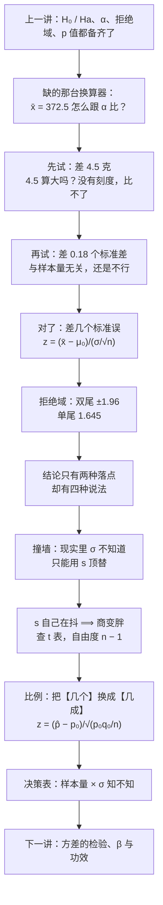

# C7.3 均值与比例的假设检验 Tests of Hypothesis about a Mean and a Proportion

> [!abstract] 这一讲的任务
> 上一讲把假设检验的零件全摆齐了：原假设与备择假设怎么写、$\alpha$ 是什么、拒绝域长什么样、$p$ 值怎么读。可零件齐了还开不了工——手里只有一个 $\bar x=372.5$，它既不在 $z$ 的刻度上，也不在 $\alpha$ 的面积刻度上。**缺的是一台换算器。**
> 这一讲就造这台换算器，一次造三个版本：均值且 $\sigma$ 已知（或大样本）用 $z$；均值且 $\sigma$ 未知、样本又小时用 $t$；比例用 $z$。三个版本的骨架是同一台机器——**差距 ÷ 标准误**——变的只是分母里那个量从哪儿来。
> 顺带把两件最容易被含糊过去的事说死：**结论只有两种落点，却有四种说法**；以及**到底什么时候查 $z$ 表、什么时候查 $t$ 表**。

> [!info] 授课进度说明
> 目前拿到的授课转写稿覆盖到**第 6 节课**，内容截止于第 6 章的 6.1–6.2（参数估计与置信区间）。
> **第 7 章尚未在课堂上讲授**，因此本篇内容全部来自**教材与通行讲法整理**，暂不逐条区分"课堂讲过"与"拓展补充"。
> 等后续转写稿补充进来后，会按与第 6 章相同的规则（标题后加 **（拓展）**、段落前加 **【拓展】**）标注出课堂未讲的内容。

> [!info] 怎么读这份讲义
> 按小节读。第 0 节是质检员的一个早晨，把"缺一台换算器"摆出来；第 1 节试错三次，把 $z$ 统计量逼出来；第 2 节画拒绝域；第 3 节是**措辞纪律**（最容易丢分的地方）；第 4–5 节是同一组数据的双尾版与单尾版；第 6 节讲 $\sigma$ 不知道时怎么替换、代价是什么；第 7–8 节是 $t$ 检验的四道题；第 9–10 节把同一台机器搬到比例上；第 11 节是那张**决策表**；第 12 节用一张表把全篇十道题的数字对齐；第 13 节接 A/B 测试。
> 勘误一句话：本篇有四处印刷问题（p.62 的面积写法、p.71 的 $\sigma$、p.88 的拒绝域不等号、p.93 的结论句），都在正文对应位置点名，不影响主干。

---

## 0. 开场：一个质检员的早晨（p.59）

你是麦片厂的质量检验员。合同上写着：每盒净含量 **368 克**。

今天早上你从生产线上随机抽了 **25 盒**，称出平均 **372.5 克**。厂长走过来问了一句："这是超装了，还是只是抽样抽歪了？"

这个问题其实上一讲已经教过你怎么问了：

- $H_0:\ \mu=368$（生产线没变，还是 368 克）
- $H_a:\ \mu\neq 368$（变了）
- $\alpha=.05$
- 然后……然后就没有然后了。

因为上面这套东西全是**框架**：它告诉你"要拿一个统计量去跟一条边界比"，却没告诉你**那个统计量长什么样**。你手里只有 372.5，而这个数既不在 $z$ 的刻度上（$z$ 是"标准差的个数"，372.5 是"克"），也不在 $\alpha$ 的面积刻度上。

> [!question] 停一下，先自己想想
> 先别管公式。就凭直觉，你想知道"372.5 是不是抽歪了"，还需要哪些信息？
> 把答案写在纸上，再看下一段。

想清楚了大概会列出三件事：

1. **每盒之间本来波动多大？**——如果每盒本来就上下浮动 25 克，那 4.5 克的差距只是毛毛雨；如果只浮动 1 克，4.5 克就是天大的事。合同附件里确实写了一个数：$\sigma=25$ 克。
2. **抽了多少盒？**——25 盒。
3. **多离谱才算离谱？**——这就是上一讲的 $\alpha$。

第 1、2 条合起来回答的是同一件事：**"平均值的典型波动有多大"**。这个量第 5 章已经命名过，叫**标准误 standard error**，记作 $\sigma_{\bar x}$，它等于

$$\sigma_{\bar x}=\frac{\sigma}{\sqrt{n}}=\frac{25}{\sqrt{25}}=\frac{25}{5}=5\ \text{克}$$

于是"372.5 离 368 有多远"这个问题，第一次有了一个像样的答案：**远了 $4.5/5=0.9$ 个标准误。** 这一讲的第一个概念就是从这个 0.9 开始的。

先把一个悬念留在门口：**如果厂长改口说"我们要证明的是不低于 368 克"，同一组数据给出的答案会变吗？** 第 5 节回答，答案是"结论不变，但理由和门槛都变了"。

---

## 1. 检验统计量：把"差多少克"换成"差几个标准误"（p.60、p.63）

上一节那个 $0.9$ 不是随手除出来的，它是三次试错之后剩下的东西。把三次都走一遍，比直接背公式有用。

### 1.1 第一次试错：直接看差多少克

$$372.5-368=4.5\ \text{克}$$

**撞墙**：4.5 克算大吗？这个问题没法回答，因为**克不是一把统一的尺子**。同一把尺子在两个厂里刻度完全不同：波动 25 克的厂，4.5 克是日常；波动 1 克的厂，4.5 克是事故。**没有统一的刻度，差距本身不携带任何信息。**

### 1.2 第二次试错：差几个标准差

那就把克换算成"标准差"——这就是第 2 章 z 分数的老办法：

$$\frac{4.5}{\sigma}=\frac{4.5}{25}=0.18$$

**这次无量纲了**，0.18 个标准差，任何厂都能比。但它还有一处硬伤：**这个数跟你抽了多少盒完全无关。** 可你明明知道，抽 25 盒平均 372.5，和抽 2500 盒平均 372.5，可信程度差着一个数量级。一个对样本量视而不见的指标，不能用来判断"证据够不够"。

**为什么会漏掉样本量？** 因为分母用的是**单盒的波动** $\sigma$。而你要判断的不是"某一盒"，是"25 盒的平均"。

### 1.3 第三次：差几个标准误

平均值自己有它的波动，就是第 5 章那个结论：$\bar x$ 的抽样分布均值是 $\mu$、标准差是 $\sigma/\sqrt{n}$。于是正确的刻度是**标准误**，不是标准差：

$$z=\frac{\bar x-\mu_0}{\sigma/\sqrt{n}}=\frac{372.5-368}{25/\sqrt{25}}=\frac{4.5}{5}=0.90$$

这一次三件事全对上了：**有刻度**（标准误的个数）、**无量纲**、**带着样本量**（$n$ 在分母的根号里，$n$ 越大这把尺子越短、同样的差距显得越大）。

> [!important] 定义：检验统计量 test statistic（大样本均值的 $z$ 统计量）
> 要判断样本均值 $\bar x$ 与假设值 $\mu_0$ 差得够不够远，先把这个差距除以 $\bar x$ 自己的标准误：
> $$\boxed{\ z=\frac{\bar x-\mu_0}{\sigma_{\bar x}}=\frac{\bar x-\mu_0}{\sigma/\sqrt{n}}\ \approx\ \frac{\bar x-\mu_0}{s/\sqrt{n}}\ }$$
> 它在 $H_0$ 成立时近似服从**标准正态分布** $N(0,1)$，所以叫 **$z$ 统计量**（也叫 normal statistic——名字来自它背后那张正态表，不来自某个叫 $z$ 的人）。
> $\mu_0$ 是**原假设指定的那个数值**，不是未知的 $\mu$；$\sigma$ 未知而 $n$ 大时，用样本标准差 $s$ 顶替（p.60 后半式）。

用"先……再……"讲清动作：**先算出这次抽样均值的标准误；再把"观测均值与假设值之差"除以这个标准误；最后拿这个商去跟临界值比。** 三步，中间不许跳。

为什么叫**检验统计量**？"统计量"是说它只由样本算出来、不含任何未知参数（第 5 章的定义）；"检验"是说它的用途固定——专门用来跟一条边界比大小。所以它跟第 6 章那个"枢轴量"是同一类东西，只是用途从"框一个区间"换成了"做一次裁决"。

### 1.4 三个必答的"为什么"

**① 为什么分子里减的是 $\mu_0$，不是 $\bar x$？**

因为整场检验都活在**"假定 $H_0$ 成立"**这个虚拟世界里。在这个世界里，$\mu=\mu_0$ 是已知的，而你手上只有 $\bar x$ 这一个随机的东西。所以"离中心多远"只能是 $\bar x-\mu_0$。p.60 的公式里写的是 $\mu$，那是简写；p.62 末尾专门补了一句：$\mu_0$ 是**原假设下赋予 $\mu$ 的那个具体数值**。做题时把它当成一个数（368），不是当一个未知符号。

**② 为什么除以标准误，而不是标准差？**

这是 1.2 与 1.3 的分水岭。标准误是"$\bar x$ 这个随机变量的标准差"，除完之后，$z$ 的分布才与 $n$、$\sigma$ 都无关，变成那张固定的标准正态表。**除以别的任何东西，表都查不了。**

**③ $\sigma$ 不知道时凭什么能把 $\sigma$ 换成 $s$？**

因为 $s$ 是 $\sigma$ 的**一致估计**（样本一大，$s$ 就贴着 $\sigma$，见 C6.1 第 7.3 节）。$n\ge 30$ 时这种"顶替"带来的误差小到可以忽略——这一条下一节会变成一个正式条件，第 6 节还会把它撕开来看。

### 1.5 成立的条件（p.63）

$z$ 统计量不是想用就能用，它要两个条件：

> [!important] 大样本均值检验的两条条件
> **① 随机样本**：样本是从目标总体里随机抽的。这条不满足，后面全是白算——自愿样本、方便样本没有推断资格（C1.2）。
> **② 样本量足够大，$n\ge 30$**：因为中心极限定理（C5.2），$n$ 一大，$\bar x$ 的抽样分布就近似正态，**不管总体本身长什么样**。
> 两条合起来保证：$H_0$ 成立时，$z$ 近似服从标准正态，于是 $\pm1.96$ 这样的数字才有意义。

第 ② 条值得多说一句：它保证的**不是"$\bar x$ 接近 $\mu$"**，而是"$z$ 的分布接近标准正态"。前者是关于准确性的，后者是关于**能不能查表**的。检验里所有临界值都来自"分布已知"，所以第 ② 条守的是这张表的合法性。

---

## 2. 拒绝域：尾巴长在哪一边（p.61–62）

有了 $z=0.90$，还缺一条线：多离谱才算离谱。

上一讲已经定了规则：先把 $\alpha$ 定死（比如 .05），再让"离谱到只可能偶然发生 $5\%$ 次"的那块区域当**拒绝域**。现在只剩下一个问题——**这 $5\%$ 的面积放在曲线的哪一头？**

答案由 $H_a$ 的写法决定，不由你的心情决定。

**双尾（$H_a:\mu\neq\mu_0$）。** 备择假设只说"不等于"，没说偏哪边。既然两个方向都算"异常"，那 $\alpha$ 就得**平分给两头**，各 $.025$：

$$\text{拒绝域}:\ |z|>z_{\alpha/2}=1.96\qquad\text{其中 } z_{\alpha/2}\ \text{满足}\ P\big(|z|>z_{\alpha/2}\big)=\alpha$$

**单尾（$H_a:\mu<\mu_0$ 或 $\mu>\mu_0$）。** 备择假设指明了方向，只有那一头算异常，于是整块 $\alpha$ 都堆在那一边：

$$\text{拒绝域}:\ z<-z_{\alpha}\quad(\text{或 } z>z_\alpha)\qquad\text{其中 } z_\alpha\ \text{满足}\ P(z>z_\alpha)=\alpha$$

记号要在第一次见面时读对：$z_\alpha$ 读作 "$z$ sub alpha"，含义是"**右尾面积恰好剩下 $\alpha$ 的那个分位点**"。所以 $z_{.05}=1.645$、$z_{.025}=1.96$、$z_{.01}=2.33$——$\alpha$ 越小，这个点越往右跑（面积越难留），这和第 6 章查 $t$ 表是同一个动作。

| $\alpha$ | 单尾边界 $z_\alpha$ | 双尾边界 $z_{\alpha/2}$ |
|---|---|---|
| .10 | 1.282 | 1.645 |
| .05 | 1.645 | 1.960 |
| .025 | 1.960 | 2.241 |
| .01 | 2.326 | 2.576 |
| .005 | 2.576 | 2.807 |

（顺手记一条：**双尾的 $z_{\alpha/2}$ 等于单尾的 $z_{\alpha}$ 再降一档**——双尾 .05 的边界 1.96，正是单尾 .025 的边界。这不是巧合，是同一块面积换了个说法。）

![[C7.4–7.6-双尾与单尾的拒绝域.png]]
图上两件事要看清楚：**① $\alpha$ 的总量一样**，都是 .05，只是切法不同——双尾切成两个 .025，单尾一整个堆在右边；**② 边界因此不一样**：1.96 与 1.645。蓝线标的是同一个 $z=1.75$：在双尾里它还在界内（不拒绝），在单尾里它已经越界（拒绝）。**同一个数、同一批数据，换个问法就换了答案。**

> [!warning] 原稿 p.62 的面积写法
> 原印作 $P(|z|>z_{\alpha/2})=\alpha/2$，实际应为 $P(|z|>z_{\alpha/2})=\alpha$。理由：$|z|>z_{\alpha/2}$ 是**两边一起**超过，左边 .025 加右边 .025，合计正好 $\alpha$。写成 $\alpha/2$ 就等于说"两边加起来只占 2.5%"，那拒绝域就白设了一半。

> [!warning] 原稿 p.88 的不等号
> 两尾比例检验的拒绝域原印作 $|z|<z_{\alpha/2}$，实际应为 $|z|>z_{\alpha/2}$。写成"小于"就把拒绝域说成了接受域，正好反了。

> [!important] 单尾不是"更严格"，是"更集中"
> 单尾的边界（1.645）比双尾（1.96）更靠里，所以**同样的数据在单尾下更容易被拒绝**。这不是放水，而是把 $\alpha$ 集中投放到一个方向上，代价是**另一个方向彻底放弃监测**：真实情况若朝反方向偏，你永远发现不了。
> 所以选单尾的唯一合法理由是**业务上只关心一个方向**（合同只罚少装、不罚多装），而且必须在看数据**之前**定下来。

---

## 3. 结论只有两种落点，却有四种说法（p.64–65）

统计量算出来了，边界也画好了，接下来是"把话说出来"。这一步看似最简单，其实是全篇最容易被扣分的地方——因为**判决只有两种，但句子必须跟着 $H_a$ 的方向变，一共四种。**

先看判定本身。落进拒绝域，就拒绝 $H_0$；没落进去，就不能拒绝。到此为止只有两种。

p.64 与 p.65 分别规定了这两种落点该怎么表述：

> [!important] 两种落点，两句话
> **落进拒绝域**：拒绝 $H_0$，并断言备择假设 $H_a$ 为真；报告"在 $\alpha$ 的显著性水平上拒绝 $H_0$"。
> **没落进拒绝域**：结论是"**这次抽样没有提供足够证据来拒绝 $H_0$**（在 $\alpha$ 水平上）"。
> 原文还补了一句要紧的：**置信落在"检验这个过程"上，不落在"某一次检验的结果"上**；以及，**一般不说"接受 $H_0$"，除非第二类错误的概率 $\beta$ 已经被算出来**。

把方向配上去，就得到四种完整说法。以 $\mu_0=368$、$\alpha=.05$ 为例：

| 落点 | 双尾 $H_a:\mu\neq368$ | 单尾 $H_a:\mu>368$ |
|---|---|---|
| **落进拒绝域** | 在 $\alpha=.05$ 的水平上拒绝 $H_0$，有证据表明总体均值**不等于** 368 克。 | 在 $\alpha=.05$ 的水平上拒绝 $H_0$，有证据表明总体均值**大于** 368 克。 |
| **没落进拒绝域** | 在 $\alpha=.05$ 的水平上，样本**没有提供足够证据**表明总体均值不等于 368 克。 | 在 $\alpha=.05$ 的水平上，**证据不足以**表明总体均值大于 368 克。 |

注意右列和左列在"没落进"那一格上的差别：双尾说的是"不等于"这件事没证据，单尾说的是"大于"这件事没证据。**这两句话不是同一句话**——一组数据完全可能"没有证据说它不等于"、同时"有证据说它大于"（当 $z$ 落在 1.645 与 1.96 之间时就是这样）。**结论句必须复述 $H_a$ 的原话，不能顺手改成 $H_0$ 的反面。**

### 3.1 四条措辞纪律

> [!important] 纪律一：不说"接受 $H_0$"
> 不拒绝只说明"这批数据没能把它推翻"，**不等于"它被证实了"**。就像一个嫌疑人证据不足被放出来，不等于他清白。真要谈"接受"，得先知道 $\beta$ 有多大（下一讲）。
> ❌ "接受 $H_0$：均值等于 368。" ✅ "不能拒绝 $H_0$：没有足够证据表明均值不等于 368。"

> [!important] 纪律二：不说"证明了"
> 假设检验的逻辑是**反证法式的**：假定 $H_0$ 成立，看数据有多离谱。它只能**推翻**，不能**证实**。所以"证明了均值不是 368"这种话，一律改成"有证据表明"。

> [!important] 纪律三：结论必须带 $\alpha$，而且要带上方向
> 同一个 $z=1.9$，在 $\alpha=.05$ 双尾下不拒绝（$1.9<1.96$），在 $\alpha=.10$ 双尾下就拒绝（$1.9>1.645$）。**不写 $\alpha$ 的"显著"是没有意义的。**
> 也不要把"显著"当成"重要"：样本足够大时，0.1 克的偏差也能显著；显著只回答"是不是抽样波动"，不回答"是不是值得管"。

> [!important] 纪律四：双尾拒绝时，只说"不等于"
> 如果 $H_a$ 是 $\mu\neq368$，那么拒绝了只能说"不等于"。你不能因为看到 $\bar x=372.5>\mu_0$，就顺手说成"大于"——那个方向上的检验（单尾）你并没有做，它的 $\alpha$ 也不是 .05。
> 想下"大于"的结论，就得**重新做一次单尾检验**，并承认这次检验是你看到数据之后设计的（这在实务里是要打折扣的，见第 5.2 节）。

> [!warning] 一个现成的反例（p.93）
> 那道审计题算出 $z=1.14$，判定是 "Do not reject at $\alpha=.05$"，可结论句却印成 "There is evidence proportion is not 4%"——**判定说不拒绝，结论却说有证据**，正好自相矛盾。按上面的纪律，正确写法是 "There is **no** evidence that the proportion is not 4%"。这不是小事：读者只看结论句，就会被引到相反的结论上。第 10.2 节会把这道题完整走一遍。

---

## 4. 双尾 $z$ 检验：368 克那盒麦片（p.66–69）

回到开场那道题，按完整的五步走一遍。**检验的书写格式本身也是考点**：假设、水平、统计量、判定、结论，一步都不能省。

> [!example] 麦片净含量（双尾）
> 一盒麦片标称 368 克。随机抽 $n=25$ 盒，样本均值 $\bar x=372.5$ 克。已知 $\sigma=25$ 克。在 $\alpha=.05$ 下检验平均净含量是否为 368 克。

**第一步，写假设。** 问的是"是不是 368"，没有方向，所以双尾：

$$H_0:\ \mu=368\qquad H_a:\ \mu\neq368$$

**第二步，定水平与临界值。** $\alpha=.05$，双尾，$\alpha/2=.025$，查表 $z_{.025}=1.96$，拒绝域是 $|z|>1.96$，也就是 $z<-1.96$ 或 $z>1.96$。

**第三步，算统计量。** 标准误是 $\sigma/\sqrt n=25/5=5$：

$$z=\frac{372.5-368}{25/\sqrt{25}}=\frac{4.5}{5}=0.90$$

**第四步，判定。** $|0.90|=0.90<1.96$，**没有落进拒绝域，不拒绝 $H_0$**。

**第五步，结论。** 在 $\alpha=.05$ 的水平上，没有足够证据表明平均净含量不等于 368 克。

顺手用 $p$ 值核一遍（上一讲的判法）：$p=2\times P(z>0.90)=2\times0.1841=0.3681$。$0.3681>.05$，同样不拒绝。**两种判法必须永远一致**——它们问的是同一件事：这个观测值在 $H_0$ 的世界里有多常见。

0.90 这个数该怎么读？它说的是"观测均值比假设位置高出 0.9 个标准误"。而标准正态下，随便抽一次就有 $36.8\%$ 的机会至少偏这么远。**这么常见的偏离，当然不能当证据。**

### 4.1 练习：电线拉力（p.68–69）

> [!question] 停一下，先自己想想
> 规格 70 磅，$\sigma=3.5$ 磅。抽 $n=36$ 根，平均 69.7 磅。差了 0.3 磅——你觉得这算"证据"吗？先猜一个答案，再往下看。

> [!example] 电线拉力（双尾）
> 你是质检员，要查新机器生产的电线平均断裂强度是否达到客户规格 70 磅。已知 $\sigma=3.5$ 磅，抽 $n=36$ 根，$\bar x=69.7$ 磅。$\alpha=.05$。

$$H_0:\ \mu=70\qquad H_a:\ \mu\neq70$$

标准误 $\sigma/\sqrt n=3.5/6=0.5833$，于是

$$z=\frac{69.7-70}{3.5/\sqrt{36}}=\frac{-0.3}{0.5833}=-0.514\approx-0.51$$

$|-0.51|<1.96$，不拒绝。$p=2\times P(z<-0.51)=0.607$。

**猜对了吗？** 0.3 磅听起来像"差一点"，可它是半个标准误都不到——一半以上的抽样都会差这么远。这道题的价值在于提醒：**"差得不多"和"差得不显著"是两件事，而"差了 0.3"这种绝对量在没换算成标准误之前，什么也说明不了。**

---

## 5. 单尾 $z$ 检验：同一个 372.5，换一个问法（p.70–73）

现在把厂长的话改一改。

原来他问："是不是 368？"现在他问："**是不是超过了 368？**"——因为超装要报损耗，他要的是一个方向上的证据。

数据一个字没变：$n=25$、$\bar x=372.5$、$\sigma=25$、$\alpha=.05$。变的只有 $H_a$：

$$H_0:\ \mu=368\qquad H_a:\ \mu>368$$

$\alpha$ 全部堆在右尾，临界值从 1.96 降到了 $z_{.05}=1.645$。

$$z=\frac{372.5-368}{25/\sqrt{25}}=\frac{4.5}{5}=0.90\quad(\text{没变})$$

$0.90<1.645$，仍然不拒绝。$p=P(z>0.90)=0.1841$。

**同一组数据，两次都不拒绝，但两次的"理由强度"不同**：双尾时 $0.90$ 离边界 1.96 差得远；单尾时离边界 1.645 也还差 0.745。真正的区别在"门槛"上——如果观测值恰好是 $z=1.75$，双尾不拒绝（$1.75<1.96$）而单尾拒绝（$1.75>1.645$）。**图 1 里那条蓝线就是这件事。**

> [!warning] 原稿 p.71 的 $\sigma$
> 这道题的分母被印成了 $15/\sqrt{25}$，于是统计量算成 $4.5/3=+1.50$。可题干给的 $\sigma$ 是 **25** 克（p.70），所以分母应为 $25/\sqrt{25}=5$，$z=4.5/5=\mathbf{0.90}$。
> 值得注意：**这次错得不巧也错得巧**——1.50 仍然小于 1.645，判定仍是"不拒绝"，结论碰巧对。这正说明为什么每一步都要写出来：错误的中间结果，有时会给出一模一样的判决，于是错误就被掩盖到下一次才发作。

### 5.1 练习：福特 Escort 的油耗（p.72–73）

> [!example] 油耗（单尾，$\alpha=.01$）
> 你是福特的分析师，要查 Escort 的平均油耗是否**至少** 32 mpg。同类车型的 $\sigma=3.8$ mpg，抽 $n=60$ 辆，$\bar x=30.7$ mpg。$\alpha=.01$。

$$H_0:\ \mu=32\qquad H_a:\ \mu<32$$

标准误 $3.8/\sqrt{60}=3.8/7.746=0.4906$，于是

$$z=\frac{30.7-32}{3.8/\sqrt{60}}=\frac{-1.3}{0.4906}=-2.65$$

单尾左边界 $-z_{.01}=-2.33$。$-2.65<-2.33$，**落进拒绝域，拒绝 $H_0$**。$p=P(z<-2.65)=0.0040$。

结论：在 $\alpha=.01$ 的水平上拒绝 $H_0$，有证据表明平均油耗低于 32 mpg。（注意这里能说"低于"，正因为 $H_a$ 一开始就是"低于"。）

把三道 $z$ 题并排看，规律很清楚：

| 题目 | $H_a$ | 边界 | 统计量 | 判定 |
|---|---|---|---|---|
| 麦片（双尾） | $\mu\neq368$ | $\pm1.96$ | $+0.90$ | 不拒绝 |
| 麦片（单尾） | $\mu>368$ | $1.645$ | $+0.90$ | 不拒绝 |
| 福特（单尾） | $\mu<32$ | $-2.33$ | $-2.65$ | **拒绝** |

前两行的统计量一模一样，只因为 $H_a$ 换了方向、边界从 1.96 换到 1.645，离拒绝的距离就变了。第三行则是反过来：统计量本身就够远（2.65 个标准误），换成哪个边界都拒绝。

### 5.2 单尾的合法用法与不合法用法

**合法**：业务上只关心一个方向，而且这个方向在**看数据之前**就定了。合同只罚少装不罚多装（$H_a:\mu<368$ 不行，得看合同怎么写）；新工艺只可能改善、考核只看是否"优于"旧值。

**不合法**：数据摆在那儿，$\bar x>368$，于是把原本的双尾改成单尾，好让结论显著。这等于**偷偷把 $\alpha$ 从 .05 放大到 .10**（因为 $|z|>1.645$ 的两尾合计概率是 .10）。这类操作有个统称叫 $p$-hacking，它是后面第 10 章、第 15 章反复要防的东西。

判断标准很简单：**看假设的时候，数据在哪里？** 数据已经在手，就无法假装没见过。

---

## 6. $\sigma$ 不知道：$s$ 顶上去之后，表要换（p.74–77）

前面所有 $z$ 检验都建立在一个奢侈的前提上：$\sigma$ 已知。

**这件事在现实里几乎不成立。** 要知道总体标准差，等于要知道整个总体的形状——那你还需要检验什么？真实场景里，你手上只有样本，能算的只有 $s$。

### 6.1 朴素做法：把 $\sigma$ 换成 $s$ 就完事了？

很自然的想法：

$$t\overset{?}{=}\frac{\bar x-\mu_0}{s/\sqrt n}$$

公式跟 $z$ 一模一样，只是分母换了个字母。**问题恰恰出在这个"换了个字母"上。**

$z$ 的分母 $\sigma/\sqrt n$ 里，$\sigma$ 是一个**固定的常数**。而 $s$ 不是常数，它是**从同一批样本里算出来的另一个随机变量**。于是这个商里有两个随机的东西在动：

- 分子的 $\bar x$ 在抖（抽样波动）；
- 分母的 $s$ 也在抖（有些样本碰巧更整齐，$s$ 偏小；有些碰巧更散，$s$ 偏大）。

**两个随机的东西相除，尾巴会变胖。** 具体地说：分母偶尔偏小的时候，商就被放大；而 $z$ 里没有这种"分母自己乱动"的情况，所以极端值出现得更频繁。

胖到什么程度？不是凭感觉，可以精确算：

> [!important] 用错表的代价，是真实错误率变大
> 若本该用 $t$（自由度 $n-1$）却拿正态的 $1.96$ 当边界，真实的第一类错误率是 $P(|t|>1.96)$，不是 $5\%$：
> - $n=5$：$\mathbf{12.2\%}$
> - $n=10$：$\mathbf{8.2\%}$
> - $n=20$：$6.5\%$
> - $n=30$：$6.0\%$
> - $n=64$：$5.4\%$
> $n$ 越大越接近 $5\%$（因为 $s\to\sigma$），但**永远回不到 5% 以下**。

![[C7.4–7.6-误用z临界值的真实错误率.png]]
这张图解释了两件事：**① 小样本时不能用正态表**——$n=5$ 时你以为自己在做 5% 的检验，实际是 12% 的检验，判错的机会翻了一倍多；**② 为什么"大样本就没事"**——曲线在 $n\ge30$ 之后压到了 $6.0\%$ 左右，再往上走缓慢趋近 $5\%$，这也正是第 11 节决策表里"大样本 + $\sigma$ 未知"敢用 $z$ 的底气。

### 6.2 正确的表：$t$ 分布与自由度

正确的参照分布是**学生 $t$ 分布 Student's $t$-distribution**，形状由**自由度 degrees of freedom** 决定，这里等于 $n-1$。

名字与自由度都不是新东西（第 6 章那篇 [[C6.2 小样本 t 区间与比例的置信区间]] 已经拆过）："Student" 是 Guinness 酒厂的化学家 Gosset 发表论文时用的笔名，因为他东家不让员工署真名；自由度是 $n-1$ 而不是 $n$，是因为算 $s$ 时先用掉了 $\bar x$ 这一个估计，$n$ 个偏差里只有 $n-1$ 个能自由变动（[[C2.4 离散程度：极差、方差与标准差]] 里"为什么除以 $n-1$"讲的就是同一件事）。

> [!important] 定义：小样本均值的 $t$ 统计量
> $$t=\frac{\bar x-\mu_0}{s/\sqrt n}$$
> 在 $H_0$ 成立、且总体近似正态时，它服从自由度为 $n-1$ 的 $t$ 分布。
> 拒绝域与 $z$ 检验完全同构，只是把 $z$ 换成 $t$、把正态表换成 $t$ 表：
> - 单尾：$t<-t_\alpha$（或 $t>t_\alpha$）
> - 双尾：$|t|>t_{\alpha/2}$
> 其中 $t_\alpha$、$t_{\alpha/2}$ 都基于 $(n-1)$ 个自由度。

**结构没变，参照分布变了。** 这就是为什么 $t$ 检验学起来几乎不费劲：你已经在第 4、5 节学会了整台机器，这里只是换了一块表。

### 6.3 成立的条件（p.77）

> [!important] 小样本均值检验的两条条件
> **① 随机样本**；
> **② 总体近似正态**。
> 注意这里**没有** $n\ge30$ 这一条——小样本也能做检验，但要用"总体正态"这个更强的前提来换。

这条替换关系值得说透：$z$ 检验靠**大样本 + 中心极限定理**换来"不用管总体形状"；$t$ 检验靠**总体正态**换来"样本可以很小"。**天下没有免费的午餐，只有换法不同的代价。**

---

## 7. 双尾 $t$ 检验（p.78–81）

### 7.1 麦片第二版：同一个 372.5，结论反了

> [!example] 麦片净含量（双尾 $t$）
> 还是那个 368 克。随机抽 $n=36$ 盒，$\bar x=372.5$ 克，**样本标准差 $s=12$ 克**（$\sigma$ 未知）。$\alpha=.05$。

$$H_0:\ \mu=368\qquad H_a:\ \mu\neq368$$

自由度 $df=36-1=35$，双尾边界 $t_{.025,35}=2.030$。标准误 $12/\sqrt{36}=12/6=2$：

$$t=\frac{372.5-368}{12/\sqrt{36}}=\frac{4.5}{2}=2.25$$

$|2.25|>2.030$，**拒绝 $H_0$**。$p=2\times P(t_{35}>2.25)=0.0308$。

结论：在 $\alpha=.05$ 的水平上拒绝 $H_0$，有证据表明平均净含量不等于 368 克。

**停一下。** 第 4 节那道题也是 372.5、也是 368、也是 $\alpha=.05$，结论却是"不拒绝"。同一个观测均值，两次判决相反。为什么？

> [!question] 停一下，先自己想想
> 有人会说："因为 $t$ 检验比 $z$ 检验更容易拒绝。" 这个说法对吗？先自己判一下，再往下看。

**不对。** 把两个式子的每个零件摆出来对比：

| | 第 4 节（$z$） | 这一节（$t$） |
|---|---|---|
| 观测均值 | 372.5 | 372.5 |
| 假设值 | 368 | 368 |
| 分子（差距） | 4.5 | 4.5 |
| 标准误（分母） | $25/\sqrt{25}=5$ | $12/\sqrt{36}=2$ |
| 统计量 | $0.90$ | $2.25$ |
| 边界 | $\pm1.96$ | $\pm2.030$ |

答案在这里：**边界只从 1.96 挪到 2.030（t 其实更严格一点点），真正翻天的是分母——从 5 缩到了 2。** 同样的 4.5 克差距，在 5 克宽的尺子上是 0.9 格，在 2 克宽的尺子上是 2.25 格。

分母为什么小了？两件事叠在一起：$\sigma$ 从 25 变成 $s=12$（这批数据的离散程度本来就小得多），$n$ 从 25 加到 36（标准误再除以 $\sqrt{36/25}=1.2$）。

![[C7.4–7.6-同一观测值两种标准误的落点.png]]
图上把两件事分得很清楚：**两个子图的横轴都是"$\bar x$ 的取值（克）"，中心都是 368**；上面那条曲线胖（标准误 5 克），接受域一直伸到 377.8 克，372.5 稳稳落在里面；下面那条瘦（标准误 2 克），接受域只到 372.06 克，同样的 372.5 克只超出 0.44 克就出了界。**判决翻转的原因是"尺子变短了"，与"用的是 $z$ 还是 $t$"无关。**

> [!warning] 这条误解非常常见
> "$t$ 检验比 $z$ 检验更容易拒绝"是**假的**。同一个数据、同一个 $\alpha$，$t$ 的边界总比 $z$ 略大（$2.030>1.96$、$2.093>1.96$……），所以 $t$ 是**更难**拒绝的那个——这是它为"$\sigma$ 未知"付的保险费。
> 真正让结论翻转的，永远是**标准误**，也就是数据的离散程度与样本量。

### 7.2 练习：洗洁精的重量（p.80–81）

> [!example] 洗洁精（双尾 $t$，$\alpha=.01$）
> 厂商声称平均净重 3.25 磅。你抽 $n=64$ 桶，算得 $\bar x=3.238$ 磅、$s=0.117$ 磅。$\alpha=.01$，厂商说得对吗？

$$H_0:\ \mu=3.25\qquad H_a:\ \mu\neq3.25$$

$df=63$，双尾边界 $t_{.005,63}=2.656$。标准误 $0.117/\sqrt{64}=0.117/8=0.014625$：

$$t=\frac{3.238-3.25}{0.117/\sqrt{64}}=\frac{-0.012}{0.014625}=-0.82$$

$|-0.82|<2.656$，不拒绝。$p=2\times P(t_{63}<-0.82)=0.415$。

**这里有一个故意的陷阱**：$n=64$，明显"大样本"，为什么还用 $t$ 而不是 $z$？

答案是：**"$n$ 大"不是用 $z$ 的理由，"$\sigma$ 已知"才是。** 这道题的 $\sigma$ 未知，能拿到的只有 $s$，所以严格来说就该查 $t$ 表。当然，$df=63$ 时 $t_{.005,63}=2.656$ 与 $z_{.005}=2.576$ 已经差得不远，实际结论大概率一样——但"一样"是结果，不是理由。第 11 节的决策表会把这条讲成一条能背下来的判据。

---

## 8. 单尾 $t$ 检验（p.82–85）

### 8.1 电池容量（p.82–83）

> [!example] 电池（单尾 $t$）
> 要查电池平均容量是否**低于** 140 安时。抽 $n=20$ 只，$\bar x=138.47$，$s=2.66$。假定总体正态，$\alpha=.05$。

$$H_0:\ \mu=140\qquad H_a:\ \mu<140$$

$df=19$，左边界 $-t_{.05,19}=-1.729$。标准误 $2.66/\sqrt{20}=2.66/4.4721=0.5948$：

$$t=\frac{138.47-140}{2.66/\sqrt{20}}=\frac{-1.53}{0.5948}=-2.57$$

$-2.57<-1.729$，**拒绝 $H_0$**。$p=P(t_{19}<-2.57)=0.0093$。

结论：在 $\alpha=.05$ 的水平上拒绝 $H_0$，有证据表明平均容量低于 140 安时。

### 8.2 泰迪熊的周销量（p.84–85）：从原始数据开始手算

本篇十道题里，只有这一道给的是**原始数据**，其余都直接给了 $\bar x$ 与 $s$。所以它值得完整手算一遍——顺便复习"先算 $s$，再算标准误，最后算 $t$"这三步。

> [!example] 泰迪熊（单尾 $t$）
> 沃尔玛 10 家门店上周的泰迪熊销售额（单位：百美元）：
> $$8,\ 11,\ 0,\ 4,\ 7,\ 8,\ 10,\ 5,\ 8,\ 3$$
> 在 $\alpha=.05$ 下，能否说明每家店的平均销售额**超过** 5（百美元）？

**第一步：均值。**

$$\sum x_i=8+11+0+4+7+8+10+5+8+3=64,\qquad \bar x=\frac{64}{10}=6.4$$

**第二步：样本标准差。** 先算偏差，再平方求和：

| $x_i$ | 8 | 11 | 0 | 4 | 7 | 8 | 10 | 5 | 8 | 3 |
|---|---|---|---|---|---|---|---|---|---|---|
| $x_i-\bar x$ | 1.6 | 4.6 | −6.4 | −2.4 | 0.6 | 1.6 | 3.6 | −1.4 | 1.6 | −3.4 |
| $(x_i-\bar x)^2$ | 2.56 | 21.16 | 40.96 | 5.76 | 0.36 | 2.56 | 12.96 | 1.96 | 2.56 | 11.56 |

$$\sum(x_i-\bar x)^2=102.4,\qquad s^2=\frac{102.4}{10-1}=11.378,\qquad s=3.373$$

**第三步：标准误。** $s/\sqrt n=3.373/\sqrt{10}=3.373/3.1623=1.0667$。

**第四步：统计量。**

$$t=\frac{6.4-5}{3.373/\sqrt{10}}=\frac{1.4}{1.0667}=1.31$$

**第五步：判定。** $df=9$，右边界 $t_{.05,9}=1.833$。$1.31<1.833$，**不拒绝**。$p=P(t_9>1.31)=0.111$。

结论：在 $\alpha=.05$ 的水平上，证据不足以表明平均周销售额超过 5（百美元）。

注意那个 $0$——有一家店一周一只都没卖出去。它是这组数据里最"离群"的点，而它的作用很微妙：**它同时把均值往下拉、把 $s$ 往上推**。两个方向叠加，使得 $t$ 变得很小。

> [!question] 停一下，先自己想想
> 如果把那家卖 0 的店去掉（假设那天它装修没营业，样本确实不该算它），结论会不会翻？先猜，再算。

会翻。去掉 0 之后：$n=9$，$\sum x_i=64$，$\bar x=7.111$；$\sum(x_i-\bar x)^2=56.889$，$s^2=56.889/8=7.111$，$s=2.667$；标准误 $2.667/3=0.889$：

$$t=\frac{7.111-5}{2.667/\sqrt 9}=\frac{2.111}{0.889}=2.375>t_{.05,8}=1.860\quad\Longrightarrow\quad\text{拒绝}$$

$p=0.022$。**一个观测值的去留，改变了判决。**

> [!warning] 这既是统计学问题，也是职业伦理问题
> 上面这个计算说明：样本里一个点就能让结论翻转。所以"看结论不显著就把不顺眼的点删掉"是一条绝不能碰的红线——那不是分析，那是编造。真要剔除，理由必须来自**数据之外**（比如那家店确实停业、那个读数确实是仪器故障），并且必须在看结果之前就定下规则。这也是第 2 章讲异常值时为什么强调"先判是不是错误，再决定要不要删"。

---

## 9. 比例检验：把"几个"换成"几成"（p.86–89）

到这里，均值的三种情形（$z$、$t$、单双尾）都走完了。现在换一类问题。

**"200 盒里有 11 盒不良"**——这问的不是"平均多少克"，而是"**占几成**"。参数是总体比例 $p$，估计量是样本比例 $\hat p=x/n$。

第 5 章已经把 $\hat p$ 的抽样分布拆过（[[C5.3 样本比例的抽样分布]]）：均值是 $p$，标准误是

$$\sigma_{\hat p}=\sqrt{\frac{p\,q}{n}},\qquad q=1-p$$

于是"差距 ÷ 标准误"这台机器可以原封不动搬过来。唯一的新问题是：**分母里的 $p$ 用哪个数？**

### 9.1 最大的坑：分母用 $p_0$，不是 $\hat p$

做置信区间时（第 6 章），分母里用的是 $\hat p$：

$$\hat p\pm z_{\alpha/2}\sqrt{\frac{\hat p\,\hat q}{n}}$$

做检验时，分母里必须用 **$p_0$**：

$$z=\frac{\hat p-p_0}{\sqrt{\dfrac{p_0q_0}{n}}},\qquad q_0=1-p_0$$

**为什么同一个标准误，两处用的不是同一个 $p$？** 因为两件事的假定不同：

- **区间估计**不假设 $p$ 等于任何值，$p$ 是你要去框住的未知数，只能用 $\hat p$ 去估它。
- **假设检验**从头到尾假定 $H_0$ 成立，而 $H_0$ 说的就是 $p=p_0$。既然在这个虚拟世界里 $p_0$ 是"已知"的，就没有理由再去估它——**用 $p_0$ 才是忠实地活在 $H_0$ 的世界里**，也和"$z$ 在 $H_0$ 下服从标准正态"这个前提对得上。

差多少？拿第 10.2 节那道审计题算给你看：$\hat p=0.05$、$p_0=0.04$、$n=500$ 时，

$$\sqrt{\frac{p_0q_0}{n}}=\sqrt{\frac{.04\times.96}{500}}=0.008764,\qquad \sqrt{\frac{\hat p\hat q}{n}}=\sqrt{\frac{.05\times.95}{500}}=0.009747$$

用前者 $z=1.14$，用后者 $z=1.03$。这道题两者都不拒绝，看不出差别；但换一道 $z$ 刚好在 1.96 附近的题，**这点差别就足以翻转判决**。（这两个版本在统计学史上有名字：用 $p_0$ 的叫 score 检验，用 $\hat p$ 的叫 Wald 检验，见第 13 节。）

### 9.2 公式与条件

> [!important] 定义：大样本比例的 $z$ 统计量
> $$z=\frac{\hat p-p_0}{\sigma_{\hat p}},\qquad \sigma_{\hat p}=\sqrt{\frac{p_0q_0}{n}},\qquad q_0=1-p_0$$
> $p_0$ 是**原假设指定的那个比例数值**。$H_0$ 成立且样本够大时，$z$ 近似服从标准正态。
> 拒绝域与均值完全同构：单尾 $z<-z_\alpha$（或 $z>z_\alpha$），双尾 $|z|>z_{\alpha/2}$。

> [!important] 成立的条件（p.89）
> **① 随机样本，且来自二项总体**（每个观测只分成功/失败两类）；
> **② 样本量够大：$n p_0\ge 15$ 且 $n q_0\ge 15$。**
> 第 ② 条的用途是保证正态近似靠得住——比例靠近 0 或 1、或 $n$ 太小时，$\hat p$ 的分布是偏的，$z$ 表就不准了。

与第 5 章的衔接要说一句：那条门槛在 [[C5.3 样本比例的抽样分布]] 里已经定过（$n\pi\ge15$、$n(1-\pi)\ge15$；那里还专门交代了"材料上印 5、本课程按 15 用"的来龙去脉）。这一节的 $np_0\ge15$、$nq_0\ge15$ 是**同一个判据**，只是把未知的 $p$ 换成了 $H_0$ 指定的 $p_0$——因为做检验时只有 $p_0$ 是"已知"的。

顺带把两个符号对上：第 5 章用 $\pi$ 记总体比例，本章的材料用 $p$ 记，指的是同一个量；样本比例两边都写 $\hat p$。

---

## 10. 单比例 $z$ 检验（p.90–93）

### 10.1 不良率降了吗（p.90–91）

> [!example] 包装不良率（单尾）
> 现行包装系统的不良率是 $10\%$。换新系统后，随机抽 $n=200$ 盒，发现 11 盒不良。$\alpha=.05$ 下，能否说明新系统的不良率更低？

问的是"更低"，方向明确，单尾：

$$H_0:\ p=.10\qquad H_a:\ p<.10$$

**先算 $\hat p$**：$\hat p=11/200=0.055$。**再算标准误**（注意用 $p_0=.10$）：

$$\sigma_{\hat p}=\sqrt{\frac{.10\times.90}{200}}=\sqrt{0.00045}=0.021213$$

$$z=\frac{0.055-0.10}{\sqrt{\dfrac{.10\times.90}{200}}}=\frac{-0.045}{0.021213}=-2.12$$

左边界 $-z_{.05}=-1.645$。$-2.12<-1.645$，**拒绝 $H_0$**。$p=P(z<-2.12)=0.0169$。

结论：在 $\alpha=.05$ 的水平上拒绝 $H_0$，有证据表明新系统的不良率低于 $10\%$。

顺手核一下条件：$np_0=200\times.10=20\ge15$ ✓，$nq_0=200\times.90=180\ge15$ ✓，正态近似站得住。

### 10.2 审计：交易错误率变了吗（p.92–93）

> [!example] 审计（双尾）
> 年终审计发现 $4\%$ 的交易有错。实施新流程后，随机抽 $n=500$ 笔，其中 25 笔有错。$\alpha=.05$ 下，错误率**是否改变**？

"是否改变"没有方向，双尾：

$$H_0:\ p=.04\qquad H_a:\ p\neq.04$$

$\hat p=25/500=0.05$，

$$\sigma_{\hat p}=\sqrt{\frac{.04\times.96}{500}}=\sqrt{0.0000768}=0.0087636$$

$$z=\frac{0.05-0.04}{\sqrt{\dfrac{.04\times.96}{500}}}=\frac{0.01}{0.0087636}=1.14$$

$|1.14|<1.96$，不拒绝。$p=2\times P(z>1.14)=0.254$。

结论：在 $\alpha=.05$ 的水平上，没有足够证据表明错误率不等于 $4\%$。

条件也就地核一遍：$np_0=20\ge15$ ✓，$nq_0=480\ge15$ ✓。

> [!warning] 原稿 p.93 的结论句写反了
> 判定印的是 "Do not reject at $\alpha=.05$"，结论却印成 "There is evidence proportion is not 4%"——**"不拒绝"却给出了"有证据不是 4%"**，两句互相打架。正确写法是 "There is **no** evidence that the proportion is not 4%"。
> 这道题也正好说明第 3 节那四条纪律为什么值得背：$p=0.254$，离显著差得很远，写成"有证据"是彻底的反向误导。**判定与结论必须同向**，这是复核时第一眼要查的东西。

这一节选尾巴的方式也值得记一条**实战判据**：

| 题目的问法 | 尾巴 |
|---|---|
| "是否**改变**／是否**不同**／是否**达到**" | 双尾 |
| "是否**更低**／是否**更高**／是否**超标**" | 单尾（方向与问法一致） |

---

## 11. 决策表：什么时候用 $z$，什么时候用 $t$

现在把全篇的工具压成一张表。这张表要背下来，因为考试与实务里第一句话永远是"这题该查哪张表"。

先记住一句话：**判据不是"$n$ 大不大"，而是"分母里那个 $\sigma$ 是不是真的知道"。**

| | $\sigma$ **已知** | $\sigma$ **未知**（只能用 $s$） |
|---|---|---|
| **大样本** $n\ge30$ | $z$ 检验，查正态表。 条件：随机样本（$n$ 大时 CLT 兜住总体形状） | $z$ 检验，用 $s$ 顶替 $\sigma$（p.60 后半式）； 也可以查 $t$ 表，两者结果几乎相同 |
| **小样本** $n<30$ | $z$ 检验，但**必须**假定总体近似正态。 （$n=25$ 的麦片题就属这一格） | $t$ 检验，$df=n-1$。 条件：随机样本 **＋ 总体近似正态** |

比例是另一条独立的线（因为 $p_0$ 在 $H_0$ 下总是"已知"的，没有"未知"这一列）：

| 情形 | 统计量 | 参照分布 | 附加条件 |
|---|---|---|---|
| 总体比例 $p$ | $z=\dfrac{\hat p-p_0}{\sqrt{p_0q_0/n}}$ | 标准正态 | $np_0\ge15$ 且 $nq_0\ge15$ |

三条补充说明，每一句都对应全篇某道题：

> [!important] 关于这张表的三句话
> **① "$n\ge30$ 就用 $z$"是错的说法。** 洗洁精那题 $n=64$ 却用了 $t$（$\sigma$ 未知）；麦片那题 $n=25$ 却用了 $z$（$\sigma$ 已知，且这是教材 7.4 的例题）。**决定查哪张表的是 $\sigma$，不是 $n$。**
> **② 大样本 + $\sigma$ 未知时用 $z$ 只是"图省事"。** 严格做法是查 $t$；$df$ 大时 $t$ 与 $z$ 的临界值几乎重合（$t_{.025,63}=1.998$ vs $z_{.025}=1.96$），所以教材允许用 $s$ 顶替后直接查正态表。**近似合法，但不是"精确"。**
> **③ 小样本 + $\sigma$ 未知是唯一没得选的一格。** 只能 $t$，而且必须交代"总体近似正态"这个前提——它没法被样本证明，只能靠经验或图形（正态概率图，C4.4 正态性判断、均匀分布与指数分布）来支持。

> [!warning] 一处口径要留意
> p.63 把 $z$ 检验的条件写成"$n\ge30$"，可 p.66 的例题 $n=25$ 却做了 $z$ 检验。**这两处并不矛盾**：p.63 的条件针对的是"用 $s$ 顶替 $\sigma$ 的大样本近似"（这时确实要靠 CLT 让 $n$ 大），而 p.66 那道题是 $\sigma$ **已知**的 25 克，$z$ 的正态性不依赖 $n$，只依赖"总体正态或 $\sigma$ 已知"。
> 这也是为什么上面那张表把"$\sigma$ 是否已知"放在横轴上、把"$n$"放在纵轴上：**两个维度都要看，只盯 $n$ 会出错。**

---

## 12. 同一件事的两种读法：临界值与 $p$ 值（接 p.39–58）

上一讲给了 $p$ 值，这一讲一直在用临界值。两者是同一件事的两种读法：

- **临界值法**：把统计量与边界比。$|z|>1.96$ ⟹ 拒绝。
- **$p$ 值法**：把面积与 $\alpha$ 比。$p<\alpha$ ⟹ 拒绝。

因为边界 $1.96$ 对应的尾巴面积恰好是 $.025$（双尾 $.05$），所以"$|z|>1.96$"与"$p<.05$"是同一句话的两种写法。**永远应该一致**——如果不一致，一定是某处算错了（最常见的是单尾/双尾的 $p$ 忘了乘 2）。

把全篇十道题的数字对齐，可以当速查表用：

| 题目 | $H_a$ | 统计量 | 值 | 边界 | $p$ 值 | 判定 |
|---|---|---|---|---|---|---|
| 麦片（$z$，双尾） | $\mu\neq368$ | $z$ | $+0.90$ | $\pm1.96$ | .368 | 不拒绝 |
| 电线（$z$，双尾） | $\mu\neq70$ | $z$ | $-0.51$ | $\pm1.96$ | .607 | 不拒绝 |
| 麦片（$z$，单尾） | $\mu>368$ | $z$ | $+0.90$ | $1.645$ | .184 | 不拒绝 |
| 福特（$z$，单尾） | $\mu<32$ | $z$ | $-2.65$ | $-2.33$ | .0040 | **拒绝** |
| 麦片（$t$，双尾） | $\mu\neq368$ | $t_{35}$ | $+2.25$ | $\pm2.030$ | .031 | **拒绝** |
| 洗洁精（$t$，双尾） | $\mu\neq3.25$ | $t_{63}$ | $-0.82$ | $\pm2.656$ | .415 | 不拒绝 |
| 电池（$t$，单尾） | $\mu<140$ | $t_{19}$ | $-2.57$ | $-1.729$ | .0093 | **拒绝** |
| 泰迪熊（$t$，单尾） | $\mu>5$ | $t_9$ | $+1.31$ | $1.833$ | .111 | 不拒绝 |
| 不良率（$z$，单尾） | $p<.10$ | $z$ | $-2.12$ | $-1.645$ | .0169 | **拒绝** |
| 审计（$z$，双尾） | $p\neq.04$ | $z$ | $+1.14$ | $\pm1.96$ | .254 | 不拒绝 |

两处对照特别值得盯：

- **麦片的两行**：统计量完全一样（$0.90$），双尾 $p=.368$、单尾 $p=.184$——**双尾 $p$ 恰好是单尾的两倍**（同一侧时）。这就是"单尾更容易拒绝"的算术来源。
- **麦片的 $z$ 行与 $t$ 行**：统计量从 $0.90$ 跳到 $2.25$，全部来自标准误从 5 缩到 2（第 7.1 节）。

---

## 13. 从单样本到 A/B 测试（拓展）

**【拓展】** 这一节超出本讲，但它是这台机器在工业里最常出现的形态，值得看一眼。

网页改版、推荐算法换模型、广告换文案——做法基本都是**A/B 测试**：一部分用户看 A（老版），一部分看 B（新版），比转化率。

如果拿老版的历史转化率当"已知常数" $p_0$，那 B 组就是一个标准的**单比例 $z$ 检验**：$H_0:p=p_0$，$H_a:p\neq p_0$。本篇第 10 节那两个例子的骨架，一字不改地可以用。

工业实践里有三处与本讲不同，都值得知道：

1. **通常做两比例检验，而不是与常数比。** 因为 A 组也在抽样，它自己的转化率也有标准误——两个都在抖，就变成第 8 章的"两个比例之差"（C8.2 配对差实验与两个比例之差）。
2. **分母用 $\hat p$ 的版本叫 Wald 检验，用 $p_0$ 的版本叫 score 检验。** 这正是第 9.1 节那个"坑"的学术名字。大样本下两者差别很小，但小样本或比例接近 0/1 时，score 版本更稳。
3. **最大的风险不是算错，是"看得太多"。** 每天盯一次 $p$ 值，看到 $p<.05$ 就停——这样得到的"显著"多半是假的。反复检验会把第一类错误率累加起来，这是 A/B 测试平台为什么要固定样本量、固定观察窗口的原因。

一句话收尾：**这套检验的逻辑是"假定没差别，看数据有多离谱"。它天生只会说"证据不足"或"有证据"，永远不会说"证明了有效"。** 工业界所有"A/B 测试证明新版更好"的说法，严格讲都该改成"有证据表明新版更好"。

---

> [!tip] 速查表
> | 场景 | 统计量 | 分母（标准误） | 参照分布 | 双尾拒绝域 |
> |---|---|---|---|---|
> | 均值，$\sigma$ 已知 | $z=\dfrac{\bar x-\mu_0}{\sigma/\sqrt n}$ | $\sigma/\sqrt n$ | $N(0,1)$ | $\lvert z\rvert>z_{\alpha/2}$ |
> | 均值，$\sigma$ 未知、$n$ 大 | $z\approx\dfrac{\bar x-\mu_0}{s/\sqrt n}$ | $s/\sqrt n$ | $N(0,1)$（近似） | $\lvert z\rvert>z_{\alpha/2}$ |
> | 均值，$\sigma$ 未知、$n$ 小 | $t=\dfrac{\bar x-\mu_0}{s/\sqrt n}$ | $s/\sqrt n$ | $t_{n-1}$ | $\lvert t\rvert>t_{\alpha/2}$ |
> | 比例，$n$ 大 | $z=\dfrac{\hat p-p_0}{\sqrt{p_0q_0/n}}$ | $\sqrt{p_0q_0/n}$ | $N(0,1)$（近似） | $\lvert z\rvert>z_{\alpha/2}$ |
>
> 常用临界值：$z_{.10}=1.282$、$z_{.05}=1.645$、$z_{.025}=1.960$、$z_{.01}=2.326$、$z_{.005}=2.576$；
> $t_{.05,9}=1.833$、$t_{.05,19}=1.729$、$t_{.025,35}=2.030$、$t_{.005,63}=2.656$。

> [!tip] 下一讲预告
> 这一讲有两条线索被刻意按住了，下一讲要放开：
> ① 一直只谈"$\bar x$ 和 $\hat p$"，**方差**怎么检验？（卡方检验）
> ② "不拒绝"到底有几分可信？——**第二类错误 $\beta$ 与功效 power**。第 3 节说"不说接受 $H_0$，除非算出 $\beta$"，下一讲就把 $\beta$ 算出来给你看：同样是 $n=25$、$\alpha=.05$，如果真实均值其实是 375 克，这次检验有多大概率能发现？答案会让你重新理解"样本量"这三个字。

---

## 这一讲的三句话

1. **检验统计量的全部工作，是把"差多少"换算成"差几个标准误"**：$z=(\bar x-\mu_0)/(\sigma/\sqrt n)$。分子放 $\mu_0$ 而不是 $\mu$，是因为整场检验都假定 $H_0$ 成立；分母放标准误而不是标准差，是因为要判断的是"均值"而不是"某一盒"。
2. **用 $z$ 还是 $t$，判据是分母里的 $\sigma$ 是否真的知道，不是样本量本身。** 一旦要用 $s$ 顶替，商就变胖——$n=10$ 时拿 1.96 当边界，真实犯错率是 8.2% 而不是 5%——于是必须查 $t$ 表、自由度 $n-1$，并额外假定总体近似正态。比例的检验与区间估计有一处关键分歧：**检验用 $p_0$，区间用 $\hat p$**。
3. **结论只有两种落点（拒绝 / 证据不足），却必须按 $H_a$ 的方向说成四种句子**：带 $\alpha$、不说"接受 $H_0$"、不说"证明"、双尾拒绝只说"不等于"。

---

## 相关笔记 Related Notes

- 相关：[[C7.1 假设检验的要素与假设的建立]]（$H_0$/$H_a$ 怎么设、两类错误）、[[C7.2 p 值与显著性水平]]（$p$ 值的定义与读法）、[[C5.2 样本均值的抽样分布与中心极限定理]]（标准误 $\sigma/\sqrt n$ 与 CLT）、[[C6.2 小样本 t 区间与比例的置信区间]]（$t$ 分布、自由度、查表方向）、[[C5.3 样本比例的抽样分布]]（$\hat p$ 的均值与标准误）、[[C2.4 离散程度：极差、方差与标准差]]（为什么除以 $n-1$）、[[C8.1 两个总体均值之差]]（把这台机器扩到两个样本）
- 上一讲：[[C7.2 p 值与显著性水平]]
- 下一讲：[[C7.4 方差的检验、第二类错误与功效]]
- 返回：[[统计学课程 MOC]]
