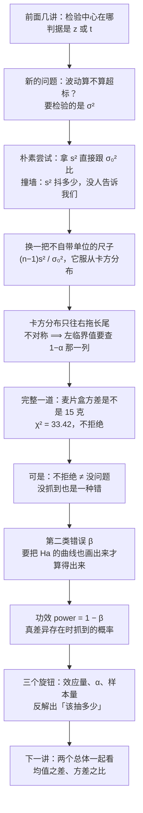

# C7.4 方差的检验、第二类错误与功效 Tests of Variance, Type II Error and Power

> [!abstract] 这一讲的任务
> 前面几讲检验的都是"中心在哪"：均值、比例。可是有些问题问的根本不是中心，而是**波动有多大**——灌装线平均装得很准，但忽多忽少；药片平均含量合格，但每片之间差得离谱。这类问题要检验的是 $\sigma^2$，用的不再是 $z$ 或 $t$，而是一个全新的统计量 $\chi^2$。
> 后半篇换一个方向：前面每一讲的结论都有两种写法——"拒绝"和"不拒绝"。**"不拒绝"到底证明了多少事？** 答案是几乎什么都没证明：它只说明"这一次没抓到"。要把"没抓到"和"真的没有"分开，就得算**漏抓的概率 $\beta$**，以及它的补数——**功效 power**，也就是"这个检验有多大的本事，能在差异真实存在时把它揪出来"。

> [!info] 授课进度说明
> 目前拿到的授课转写稿覆盖到**第 6 章**（六节课），内容截止于**参数估计与置信区间**。
> **第 7 章尚未在课堂上讲授**，因此本篇内容全部来自**教材与通行讲法整理**，暂不逐条区分"课堂讲过"与"拓展补充"。
> 等后续转写稿补充进来后，会按与前面各章相同的规则（标题后加 **（拓展）**、段落前加 **【拓展】**）标注出课堂未讲的内容。

> [!info] 怎么读这份讲义
> 前半（第 0–4 节）讲方差的检验：第 1 节先把"为什么不能拿 $s^2$ 直接跟 $\sigma_0^2$ 比"这道坎摆出来，第 2 节补上 $\chi^2$ 分布（它的不对称是全篇最容易出错的地方），第 3 节学会查表，第 4 节跑完一道完整例题。
> 后半（第 5–8 节）讲 $\beta$ 与功效：第 5 节说清"不拒绝"这三个字的份量，第 6 节讲怎么把两条曲线画在一起算出 $\beta$，第 7 节是完整例题，第 8 节把功效和**效应量、$\alpha$、样本量**三者的关系讲透——**这一节是实务里最常用的**。
> 第 9 节把整章（7.1–7.8）的 Key Ideas 收成一张清单，适合考前过一遍。
> 标注约定：标有 **（拓展）** 或 **【拓展】** 的内容，是**课堂上没有展开、由教材与通行讲法延伸补充**的部分。复习时先掌握未标注的主干。
> 勘误一句话：原稿有几处查表面积是按两位小数取的，与本篇的精确复算差在第三位小数（$0.4522$ 对 $0.4511$、$0.7190$ 对 $0.7174$），量级与结论都不受影响；另有一页的标题与它实际做的检验不符，见第 7 节开头。

---

## 0. 开场：平均值一直合格，客户却在投诉（p.94–95）

你在一条奶粉灌装线上做质检。机器设定每罐净含量 500 克，这个月的抽检报告上，**平均净含量 500.3 克**——离 500 只差 0.3，漂亮得可以拿去当宣传。

可客户还是在投诉，而且投诉的内容很奇怪：**"有的罐明显少，有的罐明显多。"**

你把 25 罐挨个上秤，发现重量从 486 克到 517 克都有。平均没问题，**问题在"散"**。

厂里的内控标准写得很具体：单罐净含量的**方差不得超过 25 克²**（也就是标准差不超过 5 克）。而这个月抽的 25 罐：

$$\text{样本标准差}\ s=6.2\ \text{克}\quad\Longrightarrow\quad s^2=38.44\ \text{克}^2$$

$38.44$ 比 $25$ 大。于是质检会上有人拍板："超标了，停机检修。"

先别急。**$38.44>25$ 这一句能不能当作"超标"的证据？**

> [!question] 停一下，先自己想想
> 就算机器完全正常、真实方差正好是 25，你抽 25 罐算出来的 $s^2$ 会**正好**等于 25 吗？
> 如果不会，那它会抖到多少？28？35？45？

这就是全部问题的起点：**$s^2$ 是一个随机变量**。换 25 罐再称一次，$s^2$ 就换一个值。它在真实方差附近抖，抖多大取决于样本量。所以"$38.44>25$"这句话本身什么都不能说明——必须知道**在 $\sigma^2=25$ 的前提下，$s^2$ 抖成一个大于等于 38.44 的值的概率有多大**。这概率小，才有理由说机器变了；这概率不小，就只是抽样波动。

前半篇（第 1–4 节）就是把这件事做成一个能算的检验。

后半篇从另一句会上没人说的话开始。假设做完检验，结论是"没有证据说方差不是 25"。厂长松了口气："那机器没问题？"

**这句话不成立。** "没抓到"有两种可能：机器真没问题，或者——**你的检验太笨，抓不到**。这两件事在报告上一模一样，都是"不拒绝 $H_0$"。要分清它们，就得回答一个前面几讲一直绕开的问题：**如果差异真的存在，我这个检验有多大的概率能发现它？** 这个概率叫**功效**，它的补数叫 $\beta$。第 5–8 节讲这件事。

---

## 1. 方差的检验：先问"为什么不能直接比"（p.95–98）

### 1.1 朴素尝试，以及它撞上的三堵墙

要检验"方差是不是 25"，最直觉的做法是：**把算出来的 $s^2$ 和 25 比，大得多就拒绝。** 这在逻辑上没错，但没法执行，因为"大得多"没有刻度。具体撞三堵墙：

**第一堵：抖动幅度未知。** $s^2$ 会抖，但抖多少？均值的抖动幅度我们知道得很清楚——标准误 $\sigma_{\bar x}=\sigma/\sqrt n$，因为中心极限定理给了 $\bar x$ 的分布。方差的抖动呢？我们手上没有一条对应的"方差版 CLT"，给不出 $s^2$ 的分布。

**第二堵：抖动幅度还跟尺度绑在一起。** 同一台机器，用"克"量出来 $s^2=38.44$，换成"千克"量就是 $0.03844$。可"抖得厉害不厉害"这件事，不该因为换了单位就变。所以任何能当判据的量，都必须是**无量纲**的。

**第三堵：$s^2$ 的分布依赖总体本身。** 这比均值的处境差得多。均值的抽样分布在 $n$ 大时靠 CLT 自动变正态，不管总体什么形状；而 $s^2$ 的分布**必须**假定总体近似正态，没有"大样本自动救回来"这回事。这一点第 1.4 节还会回来强调。

### 1.2 出路：除以假设值，再乘自由度

三堵墙指向同一个修法：把 $s^2$ 变成一个**比值**，让单位约掉；再乘一个跟样本量有关的系数，让抖动幅度固定下来。

$$\chi^2=\frac{(n-1)s^2}{\sigma_0^2}$$

用"先……再……"讲清这个动作：**先拿实测的波动 $s^2$ 除以"假设的波动" $\sigma_0^2$，看实测是假设的几倍；再乘上自由度 $n-1$，把"抽了多少个"折算进去。** 得到的这个数没有单位，而且它的抖动规律是已知的——这正是我们要的东西。

两个细节必须交代清楚：

- **为什么除以 $\sigma_0^2$ 而不是 $s^2$？** 因为检验的立场是"**先假装 $H_0$ 成立**"。$H_0$ 说 $\sigma^2=\sigma_0^2$，那就拿 $\sigma_0^2$ 当尺子去量。如果 $H_0$ 是真的，这个比值应该在 1 附近；$s^2$ 远大于 $\sigma_0^2$，比值就远大于 1。
- **为什么乘 $n-1$？** 因为抖动的相对幅度大约是按 $1/\sqrt{n-1}$ 收缩的，乘上 $n-1$ 之后，这个量的"典型大小"就固定成 $n-1$，不再随样本量漂移。这样不同样本量的检验才能用同一张表。

分子里那个 $(n-1)s^2$ 其实就是**平方和**：$(n-1)s^2=\sum_{i=1}^{n}(x_i-\bar x)^2$。所以这个统计量可以写成更"素"的样子：

$$\chi^2=\frac{\sum_{i=1}^{n}(x_i-\bar x)^2}{\sigma_0^2}=\sum_{i=1}^{n}\left(\frac{x_i-\bar x}{\sigma_0}\right)^2$$

意思是：**把每个观测值离均值的偏差，用假设的标准差 $\sigma_0$ 折成"几个标准差"，再平方，全部加起来。** 偏差越大、或者假设的 $\sigma_0$ 越小，这个和就越大。它天然是一堆平方的和，所以永远不会是负数——这一条待会儿会决定整个检验的形状。

### 1.3 这个统计量服从什么：卡方分布

$$\boxed{\ \text{若总体近似正态，则}\ \ \chi^2=\frac{(n-1)s^2}{\sigma^2}\ \sim\ \chi^2_{n-1}\ }$$

右下角那个 $n-1$ 是**自由度 degrees of freedom**，这里它等于样本量减一。为什么少一个？因为分子里用了 $\bar x$ 代替真实的 $\mu$：$n$ 个偏差 $x_i-\bar x$ 并不是 $n$ 个自由的信息，它们必须满足 $\sum(x_i-\bar x)=0$（这条恒等式在 [[C2.4 离散程度：极差、方差与标准差]] 里推过），知道其中 $n-1$ 个，最后一个就被定死了。所以真正"自由"的只有 $n-1$ 个——**这是除以 $n-1$ 的另一个理由**（第一个理由是无偏性，见 [[C2.4 离散程度：极差、方差与标准差]]）——两者是同一枚硬币的两面。

于是检验就有了判据：

> [!important] 定义：总体方差的卡方检验 Chi-Square Test for $\sigma^2$
> **假设**：$H_0:\ \sigma^2=\sigma_0^2$
> **统计量**：
> $$\chi^2=\frac{(n-1)s^2}{\sigma_0^2}$$
> **它在 $H_0$ 成立时服从自由度为 $n-1$ 的卡方分布**。$\sigma_0^2$ 是假设的方差值。
> **拒绝域**（三种备择各一套，见下表）。

| 备择假设 | 拒绝域 | 直觉 |
|---|---|---|
| $H_a:\ \sigma^2<\sigma_0^2$ | $\chi^2<\chi^2_{1-\alpha}$ | 实测波动**远小于**假设 ⟹ 左尾 |
| $H_a:\ \sigma^2>\sigma_0^2$ | $\chi^2>\chi^2_{\alpha}$ | 实测波动**远大于**假设 ⟹ 右尾 |
| $H_a:\ \sigma^2\neq\sigma_0^2$ | $\chi^2<\chi^2_{1-\alpha/2}$ 或 $\chi^2>\chi^2_{\alpha/2}$ | 两头都算 |

注意这里的下标写法：$\chi^2_{\alpha}$ 指的是**上尾面积为 $\alpha$ 的那个临界值**（右边的分位点），$\chi^2_{1-\alpha}$ 指的是**上尾面积为 $1-\alpha$、也就是下尾面积为 $\alpha$ 的那个临界值**（左边的分位点）。这个"下标指的是上尾面积"的约定是全篇最容易读错的一处，第 3 节查表时会反复用到。

方向也要对上：**$s^2$ 越大 ⟹ $\chi^2$ 越大**。所以"方差变大了"对应右尾，"方差变小了"对应左尾。这一步别绕晕——分母 $\sigma_0^2$ 是固定的假设值，不是随机量。

### 1.4 两个前提条件，第二个是硬条件（p.98）

> [!warning] 卡方检验的两个前提
> **① 样本是随机抽取的**（针对目标总体）。
> **② 总体分布近似正态。**
> 第二条**不是形式主义**。$z$ 检验和 $t$ 检验在大样本下靠中心极限定理能兜住非正态；**方差检验没有这层保护**。$(n-1)s^2/\sigma^2$ 服从 $\chi^2$ 这件事，完全建立在"总体是正态"上。总体一旦重尾或强偏，这个统计量的真实分布会明显偏离 $\chi^2$，尾部概率被扭曲，$p$ 值就不可信了——而且样本量再大也不会自动修好。

实务上的做法是：**先看数据像不像正态**（正态概率图，见 C4.4 正态性判断、均匀分布与指数分布），像才用这个检验。这也解释了为什么方差检验在实际工作里出现得比均值检验少得多——它的门槛高。

> [!note] 同一个分布，第六章已经用过一次
> $(n-1)s^2/\sigma^2\sim\chi^2_{n-1}$ 这条式子在第 6.7 节做**方差的置信区间**时已经出现过（[[C6.3 样本量、有限总体校正与方差的置信区间]]）：那里把它从中间解开，得到 $\sigma^2$ 的区间两端；这里把它当成检验统计量，看它落在分布的哪个位置。**同一个枢轴量，做区间是"解出参数"，做检验是"量出距离"。** 两条路的接口是同一个式子，这也是为什么这两节总被放在一起讲。

---

## 2. 卡方分布：一条只会往右拖尾巴的曲线（p.99）

现在必须停下来，把 $\chi^2$ 这个分布本身看清楚。**不看它的形状，后面查表一定出错。**

先给一句人话：**卡方分布，说白了就是"若干个标准正态的平方加起来"服从的那个分布。** 取 $k$ 个互相独立的标准正态 $Z_1,\dots,Z_k$，令

$$X=Z_1^2+Z_2^2+\cdots+Z_k^2$$

则 $X\sim\chi^2_k$。这个定义直接解释了它的三个脾气：

- **永远非负。** 平方和不可能为负，所以横轴从 0 开始，左边没有尾巴。
- **右边拖长尾。** 平方把负的一半折到正的半边，所以概率质量堆在 0 附近；而"某一个 $Z_i$ 特别大"这种事总有可能发生，一旦发生平方就被放大，于是右边拖出一条长尾。
- **只有一个参数：自由度 $k$。** 均值是 $k$，方差是 $2k$。$k$ 越大，峰越往右移、形状越对称，最后逼近正态。

**名字怎么来的？** 中文"卡方"是音译加意译：$\chi$ 是希腊字母 chi（读"开"），square 是平方，所以"卡方"= **chi 的平方**。英文写作 chi-square，符号固定是 $\chi^2$。看到 $\chi^2$ 就念"卡方"，看到下标就是它的自由度。

![[C7.7–7.8-卡方分布家族与拒绝域.png]]
上图左边画了 $df=1,4,6,10$ 四条曲线。**只看形状就够了**：它们全都在 0 处起步、全部右偏、右边都不封顶。右边这张图是第 4 节那道题的现场：$df=24$，双尾各留 $.025$ 的面积，两条红线就是两个临界值。

> [!question] 停一下：为什么不干脆像 $z$ 检验那样，用 $\pm1.96$ 对称地切？
> 因为**分布不对称，对称的切法就没有意义**。$z$ 的分布两边一样，所以"左右各留 $.025$"对应的距离相等（$\pm1.96$）。$\chi^2$ 的左半边很短、右半边很长，左尾留 $.025$ 只需要走很短一段（$df=24$ 时是 $12.401$，离均值 24 有 11.6 远），右尾留 $.025$ 却要走很远（$39.364$，离均值 15.4 远）。**同样的面积，短的那边只有长的那边的四分之三。** 所以临界值必须左右分别查，不能拿一个数加个负号。

这一点是整个方差检验里唯一的"新东西"，其余全是照搬前面的检验流程。凡是这里出错，几乎都是把 $\chi^2$ 当成对称分布用了。

---

## 3. 查表：这张表只给"上尾面积"（p.100–103）

$\chi^2$ 表（附录 D）长这样：**行是自由度 $df$，列是上尾面积 upper tail area**，从 $.995$ 一路排到 $.005$。格子里的数是**临界值**。

| $df$ | $.995$ | $.975$ | $.95$ | $\cdots$ | $.05$ | $.025$ | $.01$ |
|---|---|---|---|---|---|---|---|
| 1 | $0.000$ | $0.001$ | $0.004$ | $\cdots$ | $3.841$ | $5.024$ | $6.635$ |
| 2 | $0.010$ | $0.051$ | $0.103$ | $\cdots$ | $5.991$ | $7.378$ | $9.210$ |
| 5 | $0.412$ | $0.831$ | $1.145$ | $\cdots$ | $11.070$ | $12.833$ | $15.086$ |
| 10 | $2.156$ | $3.247$ | $3.940$ | $\cdots$ | $18.307$ | $20.483$ | $23.209$ |
| 24 | $9.886$ | $12.401$ | $13.848$ | $\cdots$ | $36.415$ | $39.364$ | $42.980$ |

**读法只有一句话：先定 $df$ 走行，再定上尾面积走列，交叉的格子就是临界值。** 比如 $df=2$、上尾面积 $.05$ 的格子是 $5.991$，含义是"$\chi^2$ 大于 5.991 的概率是 0.05"。

### 3.1 第一个例：右尾直接查（p.101）

> [!example] 例题：求右临界值
> 已知 $H_a:\ \sigma^2>0.7$，$n=3$，$\alpha=.05$，求临界值。

因为备择是"大于"，拒绝域在右尾。$df=n-1=2$，直接查上尾面积 $.05$ 那一列：

$$\chi^2_{.05}=5.991$$

也就是说，$H_0$ 为真时 $\chi^2$ 超过 5.991 的机会只有 5%。算出来的统计量超过它，才有底气说方差变大了。

（复算：$\chi^2$ 分布 $df=2$ 的上 $.05$ 分位点精确值是 $5.9915$。）

### 3.2 第二个例：左尾要绕着查（p.102–103）

> [!example] 例题：求左临界值
> 已知 $H_a:\ \sigma^2<0.7$，$n=3$，$\alpha=.05$，求临界值。

这次拒绝域在**左尾**，需要的是"下尾面积 $.05$"的那个点。可是**表里没有"下尾面积"这一列**——它只给上尾。

怎么办？把两边的关系翻过来：**下尾面积 $.05$ 的点，就是上尾面积 $.95$ 的点**（整条曲线下面积是 1）。所以去查 $df=2$、上尾面积 **$.95$** 那一列：

$$\chi^2_{1-.05}=\chi^2_{.95}=0.103$$

$H_0$ 为真时，$\chi^2$ 小于 0.103 的机会只有 5%。算出来的统计量掉到 0.103 以下，才有底气说方差变小了。

（复算：精确值 $0.1026$。）

> [!warning] 三个必错的点
> **① 左临界值要查 $1-\alpha$，不是查 $\alpha$。** 这是最常见的一种错：看到 $\alpha=.05$ 就一头扎进 $.05$ 那一列，查出来 $5.991$，然后把它当成左边界——那就把"方差变小"的拒绝域画到右边去了，整个检验反了。
> **② $df=n-1$，不是 $n$。** 样本量 3 要查第 2 行。
> **③ 双尾时两边各查 $\alpha/2$**：右临界值查上尾 $\alpha/2$，左临界值查上尾 $1-\alpha/2$。第 4 节那道麦片题就是 $\alpha/2=.025$ 与 $1-\alpha/2=.975$ 两列。

> [!tip] 一个不会错的自检动作
> 查完之后比一下大小：**左临界值一定小于 $df$，右临界值一定大于 $df$**（因为 $\chi^2$ 分布的均值就是 $df$，而左尾在均值左边、右尾在均值右边）。
> 比如 $df=2$，左临界 $.103<2$、右临界 $5.991>2$ ✓；$df=24$，$12.401<24<39.364$ ✓。
> 如果你查出来"左临界 5.991、右临界 0.103"，这一眼就能看出是列查反了。

---

## 4. 完整一道：麦片盒的方差是不是 15 克（p.104–105）

> [!example] 例题：Cereal-O's 的灌装波动
> 麦片盒的**方差**（衡量灌装量的波动）是否等于 15 克²？随机抽取 25 盒，样本标准差为 17.7 克。在 $\alpha=.05$ 下检验。

先把已知条件摆清：$n=25$，$s=17.7$，$\sigma_0^2=15$（注意题目给的是**方差**，而 $17.7$ 是**标准差**，两个量要分清），$\alpha=.05$。

**第一步：假设。** 题目问的是"是否等于 15"，没有方向，所以是双尾：

$$H_0:\ \sigma^2=15\qquad H_a:\ \sigma^2\neq 15$$

**第二步：自由度与临界值。** $df=25-1=24$。双尾，左右各留 $.025$：

$$\chi^2_{.975}=12.401\qquad \chi^2_{.025}=39.364$$

**第三步：算统计量。** 分子里的 $s^2$ 要先平方：

$$\chi^2=\frac{(n-1)s^2}{\sigma_0^2}=\frac{24\times(17.7)^2}{15^2}=\frac{24\times 313.29}{225}=\frac{7518.96}{225}=33.42$$

**第四步：判断。** $12.401<33.42<39.364$，统计量落在两条临界值之间，**不拒绝 $H_0$**。

**第五步：结论。** 没有足够的证据说明方差不是 15 克²。

顺手补两个数字，让这个结论更结实：

- **$p$ 值。** 双尾 $p=2\times P(\chi^2_{24}>33.42)=2\times 0.0956=0.191$。这个数和 $\alpha=.05$ 一比，离得很远，不拒绝得很干净。
- **如果改用单尾 $H_a:\ \sigma^2>15$ 呢？** 临界值变成 $\chi^2_{.05}=36.415$，$33.42<36.415$，还是不拒绝；而单尾 $p$ 值就是 $.0956$，正好是双尾的一半。**同一组数据，双尾 $p$ 是单尾的两倍**——这条在 [[C7.2 p 值与显著性水平]] 里讲过，这里见到它在 $\chi^2$ 上的实例。

> [!warning] 结论那句话，措辞是有讲究的
> 别写成"方差等于 15 克²"。我们**没有**证明它等于 15，只是**没能证明它不等于 15**。这两句话的差别就是下一节的全部内容。
> 原稿这里的结论句写成 "There is no evidence $\sigma^2$ is not 15"，翻成中文是"没有证据说明方差不等于 15"——读起来别扭，但它精确：**被否定的是"不等于"，不是"等于"。**

回到开场那条灌装线：如果 25 罐的 $s=6.2$、$\sigma_0^2=25$，则

$$\chi^2=\frac{24\times 38.44}{25}=\frac{922.56}{25}=36.90$$

$df=24$ 时右临界值（双尾）是 $39.364$，$36.90<39.364$——**不拒绝**。虽然 $s^2=38.44$ 看上去比 25 大了 54%，但在这个样本量下，这种程度的超出完全可能是抽样波动。要停机检修，这点证据不够。

---

## 5. 不拒绝，不等于没问题（p.106–107）

上一节那道麦片题，结论是"没有证据说方差不等于 15"。现在换个角度问一句：

> [!question] 停一下，先自己想想
> 假设真实方差其实是 30 克²（是假设值的两倍，相当严重的超标），抽 25 盒，这次检验**发现它**的概率有多大？
> 是 95%？80%？还是有可能只有 50%？

这个问题在上一节的分析里**根本没有被问过**。而它决定了"不拒绝"这三个字有多重。

先把两类错误的账本摊开（这张表在 [[C7.1 假设检验的要素与假设的建立]] 已经出现过，这里要用它做主线）：

| | $H_0$ 为真 | $H_0$ 为假 |
|---|---|---|
| **拒绝 $H_0$** | 第一类错误，概率 $\alpha$ | 正确决定，概率 $1-\beta$（功效） |
| **不拒绝 $H_0$** | 正确决定，概率 $1-\alpha$ | 第二类错误，概率 $\beta$ |

**$\alpha$ 和 $\beta$ 的地位完全不对等**，这一点必须讲透：

- **$\alpha$ 是我们自己定的。** 因为画拒绝域只需要一条曲线——$H_0$ 那条。$H_0$ 说 $\sigma^2=\sigma_0^2$，分布就定死了，我们说"留 5% 的尾巴当拒绝域"，$\alpha$ 就是 .05。它是**设计参数**。
- **$\beta$ 不是我们定的。** 因为要算"$H_0$ 为假时没抓住的概率"，得先知道"假成什么样"。而"假"有无穷多种：$\sigma^2=16$、$30$、$50$……每一种对应一个不同的 $\beta$。所以 $\beta$ **不是一个数，是一族数**——写作 $\beta(\sigma_a^2)$，对每个具体的备择值给一个值。

这就是那句措辞的来源。既然"不拒绝"时的错误概率是我们不知道的，那么说"接受 $H_0$"就等于在为一个**量级不明的风险**背书。所以统计学的标准做法是：

> [!important] 只说"不拒绝"，不说"接受"
> 当统计量没有落进拒绝域时，我们说 **not reject $H_0$（不拒绝 $H_0$）**，而不说 **accept $H_0$（接受 $H_0$）**。
> 理由：接受意味着"承认它为真"，而这一步的风险 $\beta$ 大小未知；不拒绝只意味着"这批数据不足以推翻它"，是一个关于**证据**的陈述，不是一个关于**真相**的陈述。

所以"不拒绝"能说的话只有一句：**数据没有提供足够的证据**。它**不能**说的话有两句：①"$H_0$ 是真的"；②"效应不存在"。第二句尤其危险——**它把"我没看见"偷换成了"它不在"**。

> [!note] $\beta$ 的定义为什么要挂在"$H_0$ 为假"上
> 因为 $\beta$ 的定义就是"$H_0$ 为假时却接受了它"的概率。要算一个概率，先得有一个分布；"$H_0$ 为假"只是说了"不是 $\sigma_0^2$"，没说是多少，分布还悬着。**所以算 $\beta$ 的第一步永远是：指定一个具体的备择值。** 这一步不是数学上的形式，是整个计算的地基——第 6 节的第一步就是它。

---

## 6. $\beta$ 怎么算：把两条曲线画在一起（p.108–111）

$\beta$ 的算法有一个很漂亮的几何解释。先把结论说成一句话：

**判据是一条竖线。$\alpha$ 是"$H_0$ 那条曲线"越过竖线的那块面积，$\beta$ 是"$H_a$ 那条曲线"没越过竖线的面积。同一条线，两把尺子。**

为什么是"两把尺子"？因为 $H_0$ 和 $H_a$ 是两个不同的世界，各自有各自的分布，中心分别在 $\mu_0$ 和 $\mu_a$。判据（拒绝域的边界）落在 $x$ 轴上的某个位置，两个世界都用同一条边界，但**各自量各自的面积**：

- 在 $H_0$ 的世界里，越过边界 = 拒绝 = 犯第一类错误，这块面积是我们定死的 $\alpha$；
- 在 $H_a$ 的世界里，**没**越过边界 = 不拒绝 = 漏抓，这块面积就是 $\beta$。

（这里用均值检验来演示。方差检验的 $\beta$ 用的是 $\chi^2$ 分布，思路完全一样，只是曲线换成不对称的那条，手算麻烦得多，不在本讲范围内。）

### 6.1 四个步骤（p.108–111）

> [!important] 算 $\beta$ 的四步
> **第 1 步：把拒绝域的边界翻译成 $\bar x$ 的值。** 拒绝域原本是写给 $z$ 的，但要画在 $x$ 轴上，得换成同一把尺子。三种检验各有自己的边界公式（见下表）。
> **第 2 步：指定一个具体的 $\mu_a$。** 就是在备择假设里挑一个值——"如果真相是它，会怎样"。
> **第 3 步：用 $\mu_a$ 的分布把边界标准化。** 注意在这里做标准化的分母是 $\sigma_{\bar x}$，中心是 $\mu_a$ 而不是 $\mu_0$：
> $$z=\frac{\bar x_0-\mu_a}{\sigma_{\bar x}}$$
> **第 4 步：查表求面积。** 落在"不拒绝区"的那块面积就是 $\beta$；$1-\beta$ 就是功效。

第 1 步的三个公式（$\sigma_{\bar x}=\sigma/\sqrt n$，大样本时用 $s/\sqrt n$ 代替）：

| 检验类型 | 边界值 |
|---|---|
| 上尾（$H_a:\mu>\mu_0$） | $\bar x_0=\mu_0+z_\alpha\sigma_{\bar x}$ |
| 下尾（$H_a:\mu<\mu_0$） | $\bar x_0=\mu_0-z_\alpha\sigma_{\bar x}$ |
| 双尾（$H_a:\mu\neq\mu_0$） | $\bar x_{0,L}=\mu_0-z_{\alpha/2}\sigma_{\bar x}$，$\bar x_{0,U}=\mu_0+z_{\alpha/2}\sigma_{\bar x}$ |

这三个式子只是把"$z$ 的临界值"翻译回"$x$ 的临界值"：$z_\alpha$ 是"离中心几个标准误"，乘上 $\sigma_{\bar x}$ 就变成"离中心多少个 $\bar x$ 单位"。

> [!warning] 第 3 步最容易算错的一处
> 标准化时**分母永远是 $\sigma_{\bar x}$，中心永远是 $\mu_a$**，不是 $\mu_0$。
> 直觉：这一步是在问"这个边界，在**真相那个世界**里，离中心有多远"。世界换了，中心就得跟着换。用了 $\mu_0$ 就会得到一个毫无意义的小 $z$，$\beta$ 会算成接近 1。

---

## 7. 完整一道：368 克与 360 克（p.113–117）

> [!example] 例题：一盒麦片平均是否装 368 克（检验只是个引子，真正要算的是功效）
> 一盒麦片平均是否装 368 克？随机抽 25 盒，$\bar x=372.5$。公司规定 $\sigma=15$ 克。在 $\alpha=.05$ 下检验。

> [!warning] 一处照抄会出事的标注
> 这道题的大标题写作 Two-Tailed $z$ Test Example（双尾 $z$ 检验），可是紧接着给出的两行假设是 $H_0:\mu_0\ge 368$、$H_a:\mu_0<368$——**单尾下尾检验**；后面算出的判据 $363.065=368-1.645\times 3$ 用的也是单尾的 $z_{.05}=1.645$。所以这里按**单尾**处理。标题里那个 "Two-Tailed" 是沿用上一道题（同一只麦片盒、同一个 368 克）留下的标签，不是这一页实际做的事——**做习题时以假设和临界值为准，别以标题为准。**

先按常规把检验走完（这部分很快）：$H_0:\mu\ge 368$，$H_a:\mu<368$，$\sigma_{\bar x}=15/\sqrt{25}=3$，

$$z=\frac{372.5-368}{3}=1.5\quad\Longrightarrow\quad p=0.067>0.05\ \Longrightarrow\ \text{不拒绝}$$

**这道题的样本均值 372.5 是个烟幕。** 它比 368 还高，而下尾检验只在"样本均值明显偏低"时才拒绝，所以结论注定是不拒绝，没什么可算的。这道题真正要问的是另一件事：

> 如果机器其实**少灌了 8 克**（真相是 360 克），我这个"抽 25 盒、$\alpha=.05$"的检验，有多大的把握发现它？

这就是算功效的标准场景。按第 6 节四步走。

**第 1 步：把边界翻译成 $\bar x$。** 下尾检验，边界在左边：

$$\bar x_L=\mu_0-z_\alpha\sigma_{\bar x}=368-1.645\times\frac{15}{\sqrt{25}}=368-1.645\times 3=363.065$$

含义：样本均值低于 363.065 就拒绝。$1.645$ 是标准正态的上 $.05$ 分位点（$z_{.05}=1.6449$）。

**第 2 步：指定 $\mu_a=360$。** 这就是"如果真相是它"那句话。

**第 3 步：用 $\mu_a$ 的世界标准化。**

$$z=\frac{\bar x_L-\mu_a}{\sigma_{\bar x}}=\frac{363.065-360}{3}=\frac{3.065}{3}=1.0217$$

注意：如果误用 $\mu_0=368$ 做中心，会得到 $z=(363.065-368)/3=-1.645$——那只是把 $\alpha$ 重算了一遍，什么新信息都没有。**这一步的中心必须是 360。**

**第 4 步：求面积。** 在 $\mu_a=360$ 的世界里，"不拒绝"对应 $\bar x>363.065$，即 $z>1.0217$：

$$\beta=P(z>1.0217)=0.153\qquad 1-\beta=0.847$$

![[C7.7–7.8-beta与功效的两个面积.png]]
上图把这两步摆在一起看最清楚。**上半张是 $H_0$ 的世界**（中心 368）：虚线左边那块红色，是我们自愿承担的第一类错误，面积 $.05$。**下半张是 $H_a$ 的世界**（中心 360）：同一条虚线，右边那块橙色是 $\beta=.153$——真相是 360，但抽到的 25 盒平均值恰好偏高、越过了判据，于是我们漏掉了；左边那块绿色是功效 $.847$。

**同一条竖线，红色那块由我们定，橙色那块由真相定。** 这就是 $\alpha$ 与 $\beta$ 地位不对等的几何版本。

> [!important] 这道题的答案要这样读
> 如果机器真的只灌 360 克，这套检验**有 84.7% 的机会发现**，还有 **15.3% 的机会漏掉**。
> 换句话说：**每 6 到 7 次这样的检查，就有 1 次会把一台已经出问题的机器判成"没问题"。**
> 这就是"不拒绝"三个字的重量——它不是"没问题"的证据，只是"这一次没抓到"。

两个顺带的核对：

- **$z$ 取 $1.64$ 还是 $1.645$？** 用 $1.64$ 得边界 $363.08$，$\beta=.152$；用 $1.645$ 得 $363.065$，$\beta=.153$。差在第三位小数，不影响结论，但**写算式时要统一**——查表给的 $1.645$ 更精确。
- **$\bar x=372.5$ 那个数自始至终没进过功效计算。** 这提醒一件事：**功效是检验的设计属性，跟这一次抽到多少无关**。它说的是"如果……，这套流程有多大本事"，在抽样本之前就已经定下来了。

---

## 8. $\beta$ 与功效：这个检验有多大的本事（p.112、p.118–120）

### 8.1 功效是什么

> [!important] 定义：功效 Power
> $$\text{功效}=P(\text{拒绝 }H_0\mid H_0\text{ 为假})=1-\beta$$
> 用一句人话：**如果差异真的存在，这个检验有多大的概率把它揪出来。**
> 它是**正确决定**的概率（不是错误），所以越大越好；它是 $1-\beta$，不是 $\beta$ 本身。

名字拆开看：**功**是"功力、本事"，**效**是"效果、见效"。功效衡量的不是"结论对不对"，而是**这个检验这套流程（样本量 + 显著性水平 + 判据）本身的能力**。p.112 给它的用途是 used in determining test adequacy——**这个检验够不够用**。

功效由三个旋钮控制。这三条是全篇最该记住的实务结论，下面每一条都配一段真实数据。

### 8.2 旋钮一：效应量（真实差异有多大）

> [!important] 性质 1
> 固定 $n$ 与 $\alpha$，**$\mu_0$ 与 $\mu_a$ 的距离越大，$\beta$ 越小、功效越大。**

道理很直白：两条曲线中心的距离越大，重叠越少，就越容易分开。拿第 7 节那道题（$n=25$，$\alpha=.05$，$\sigma=15$）把 $\mu_a$ 一路挪过去：

| 真相 $\mu_a$ | 真实差异 $\delta=368-\mu_a$ | 判据不变 $363.065$ | 功效 $1-\beta$ |
|---|---|---|---|
| 368 | 0 | $z=-1.645$ | $0.050$（= $\alpha$，本来就该只有 5%） |
| 366 | 2 | $z=-0.978$ | $0.164$ |
| 364 | 4 | $z=-0.312$ | $0.378$ |
| 362 | 6 | $z=0.355$ | $0.639$ |
| **360** | **8** | $z=1.022$ | $\mathbf{0.847}$ |
| 358 | 10 | $z=1.689$ | $0.954$ |
| 356 | 12 | $z=2.355$ | $0.991$ |

这张表值得盯一会儿：**同一个检验，差异 2 克时只有 16% 的把握，差异 8 克时有 85%，差异 12 克时几乎必抓。** 所以"这个检验好不好用"这句话本身没有答案——**必须先问"要抓多大的差异"**。

（顺带一个必须说清的地方：$\delta=0$ 时功效正好等于 $\alpha$。这不是巧合，而是定义必然——$H_0$ 为真时"拒绝"就是第一类错误，概率当然是 $\alpha$。功效曲线在 $\delta=0$ 处的高度永远等于 $\alpha$，它是曲线的"起点"，也称底。）

原稿还用另一组数据把这一条演示得更直白：$\mu_0=2400$、上尾检验、$\alpha=.05$、$\sigma_{\bar x}=200/\sqrt{50}=28.284$，判据落在 $2446.5$；把 $\mu_a$ 一路往右挪：

| 真相 $\mu_a$ | $z=(2446.5-\mu_a)/28.284$ | $\beta$（原稿查表） | $\beta$（复算） |
|---|---|---|---|
| 2425 | $0.761$ | $.7764$ | $.7767$ |
| 2450 | $-0.123$ | $.4522$ | $.4511$ |
| 2475 | $-1.007$ | $.1562$ | $.1571$ |

三个值一路往下掉（$.78\to.45\to.16$），就是"差异变大 ⟹ 漏抓变少"的算术版本。复算值与查表值差在第三位小数，原因很简单：原稿把 $z$ 四舍五入到两位（$0.76$、$-0.12$、$-1.01$）再查表。

**这就引出一个词：效应量 effect size。** 它指的是**真实差异相对于波动的大小** $\delta/\sigma$，而不是差异的绝对值。同样是差 8 克，如果 $\sigma=15$，效应量是 $0.53$；如果 $\sigma$ 只有 $5$，效应量就是 $1.6$，好抓得多。**"差异大不大"要拿波动当分母来量**——这也是为什么后面的样本量公式里，$\delta$ 和 $\sigma$ 总是成对出现。

### 8.3 旋钮二：显著性水平 $\alpha$

> [!important] 性质 2
> 固定 $n$、$\mu_0$、$\mu_a$，**$\alpha$ 调小，$\beta$ 变大、功效变小。**

为什么？$\alpha$ 是"拒绝域占多大一块"，它是我们从 $H_0$ 那条曲线上切下来的一块。$\alpha$ 调小，切下来的那块就少，判据就往尾巴里挪。判据一挪，$H_a$ 那条曲线"落在拒绝域里"的部分也跟着变小——功效就掉了。

还是那道题（$n=25$，$\mu_a=360$）：

| $\alpha$ | $z_\alpha$ | 判据 $\bar x_L$ | $\beta$ | 功效 |
|---|---|---|---|---|
| $.10$ | $1.282$ | $364.155$ | $0.083$ | $0.917$ |
| $.05$ | $1.645$ | $363.065$ | $0.153$ | $0.847$ |
| $.025$ | $1.960$ | $362.120$ | $0.240$ | $0.760$ |
| $.01$ | $2.326$ | $361.021$ | $0.367$ | $0.633$ |

**这就是"$\alpha$ 与 $\beta$ 此消彼长"的确切含义**：把犯第一类错误的风险压到 1%，代价是漏抓率从 15% 涨到 37%。这不是哪个选择更"对"的问题，是两个风险怎么分配的问题——**没有免费的午餐**。

原稿另有一组数据专门演示这个两难：$\mu_0=12$、$\sigma_{\bar x}=.05$、双尾、真相 $\mu_a=11.9$。

- $\alpha=.05$：判据 $12\pm1.96\times.05=[11.902,\ 12.098]$，$\beta=.4840$；
- $\alpha=.01$：判据放宽到 $12\pm2.575\times.05=[11.871,\ 12.129]$，$\beta$ 涨到 $.7190$（复算 $.7174$）。

同一份数据、同一个真相，只因为我们对第一类错误更苛刻，漏抓率就从 48% 涨到 72%。**这就是"$\alpha$ 与 $\beta$ 是一对"的最直白证据**——判据每往外挪一点，两边的面积就一增一减。

> [!warning] 所以"把 $\alpha$ 定小一点更严谨"是错的
> 常见误解：$\alpha$ 越小越严格、越保险。真实情况是：**$\alpha$ 小只是把风险从一边挪到另一边**。一个 $\alpha=.001$ 的检验可能对什么都"不显著"，因为它几乎什么都不拒绝——这在实务里比犯第一类错误更糟：你会错过真实存在的问题。
> 稳妥的做法不是死抠 $\alpha$，而是**同时报告 $\alpha$、样本量和功效**。

### 8.4 旋钮三：样本量 $n$

> [!important] 性质 3
> 固定 $\mu_0$、$\mu_a$ 与 $\alpha$，**$n$ 越大，$\beta$ 越小、功效越大。**

这一条是唯一一个"**不需要在两种风险之间取舍**"的旋钮。原因是 $n$ 只改变曲线的胖瘦，不改变它们的位置：$\sigma_{\bar x}=\sigma/\sqrt n$ 变小，两条曲线都变瘦，重叠部分自然变少（p.120 用两张图对比过这件事：小样本时两条曲线又胖又靠，重叠一大片；大样本时都变瘦，几乎分开）。而判据是按 $\alpha$ 切的，$\alpha$ 保持不变。

还是那道题（$\mu_a=360$）：

| $n$ | $\sigma_{\bar x}=15/\sqrt n$ | 判据 $\bar x_L$ | 功效 |
|---|---|---|---|
| 10 | $4.743$ | $360.198$ | $0.517$ |
| 15 | $3.873$ | $361.630$ | $0.663$ |
| 20 | $3.354$ | $362.483$ | $0.770$ |
| **22** | $3.198$ | $362.740$ | $\mathbf{0.804}$ |
| 25 | $3.000$ | $363.065$ | $0.847$ |
| 50 | $2.121$ | $364.511$ | $0.983$ |
| 100 | $1.500$ | $365.533$ | $0.9999$ |

![[C7.7–7.8-功效与样本量效应量显著性水平.png]]
左图是**功效曲线**：横轴是真实差异 $\delta$，纵轴是功效，四条线是四个样本量。看三件事——① **曲线都是单调上升的**（效应量旋钮，性质 1）；② **$n$ 越大，整条线越往左上抬**（样本量旋钮，性质 3）；③ **所有线都从同一个点出发**：$\delta=0$ 处四条线的高度都是 $.05$，因为那里功效就等于 $\alpha$（这一条把三个旋钮串起来了）。右图是**$\alpha$ 旋钮**：横轴放宽 $\alpha$，所有曲线都抬高，但代价是第一类错误变大。

### 8.5 反过来用：该抽多少（实务里最常用的一条）

三个旋钮里，$\delta$ 由现实决定（老板不会因为你嫌麻烦就把差异变大），$\alpha$ 由行业惯例定死（医疗 .01、一般 .05），**唯一能动的就是 $n$**。所以实务里的问法总是反过来：

> **要在真实差异为 $\delta$ 时达到功效 $1-\beta$，需要多大的样本？**

把功效的定义倒过来解，就能得到公式。推导只有两步。功效 $=1-\beta$ 的意思是：在 $\mu_a$ 的世界里，判据 $\bar x_L$ 左边的那块面积要有 $1-\beta$，也就是 $\bar x_L$ 要正好落在 **$z_\beta$** 处（$z_\beta$ 指上尾面积为 $\beta$ 的那个点，$\beta=.20$ 时 $z_{.20}=0.8416$）：

$$\frac{\bar x_L-\mu_a}{\sigma/\sqrt n}=z_\beta,\qquad \bar x_L=\mu_0-z_\alpha\frac{\sigma}{\sqrt n}$$

把第二式代进第一式，两边同乘 $\sqrt n/\sigma$：

$$\frac{\delta\sqrt n}{\sigma}-z_\alpha=z_\beta\ \Longrightarrow\ \sqrt n=\frac{(z_\alpha+z_\beta)\,\sigma}{\delta}$$

$$\boxed{\ n=\left[\frac{(z_\alpha+z_\beta)\,\sigma}{\delta}\right]^{2}\ }$$

（$z_\alpha$ 与 $z_\beta$ 都是"上尾面积"口径：$z_{.05}=1.645$、$z_{.20}=0.8416$。别写成 $z_{1-\beta}$——那个数是负的，符号一错全错。）

**代回那道麦片题**：$\delta=8$、$\sigma=15$、$\alpha=.05$、目标功效 $80\%$（即 $\beta=.20$）：

$$n=\left[\frac{(1.645+0.8416)\times 15}{8}\right]^{2}=(4.66)^2=21.7\ \Longrightarrow\ \text{取 }n=22$$

验证一下这个 22：$n=21$ 时功效是 $.788$（不够），$n=22$ 时是 $.804$（刚过）——**公式给的是最少样本量，宁可往上取整一格**。这也顺带解释了第 7 节那道题为什么取 25：它已经跨过了 22 这条线，功效 $.847$，够用。

想把功效提到 $95\%$（$\beta=.05$，$z_{.05}=1.645$）：

$$n=\left[\frac{(1.645+1.645)\times 15}{8}\right]^{2}=38.0\ \Longrightarrow\ \text{取 }n=39$$

从 22 盒涨到 39 盒，就是为了把"每 5 次漏 1 次"改成"每 20 次漏 1 次"。**这个交换值不值，是业务问题，不是统计问题**——统计只负责把价钱算清楚。

> [!tip] 功效的三种用法
> **① 事前**：设计实验时定样本量（8.5 节这条公式）。
> **② 事后**：一个不显著的结果，到底是"真没差异"，还是"检验太弱抓不到"？算出功效就能分开。**功效低的不显著结果，什么都不能证明。**
> **③ 比较**：两个方案（换仪器、改流程）哪个更容易查出问题，用功效曲线比。

> [!note] 【拓展】为什么这套东西在 A/B 测试里天天出现
> 互联网的 A/B 测试就是同一件事：$\delta$ 是新旧方案的真实差距（常常只有 $0.5\%$），$\sigma$ 是用户行为的天然波动（很大），$\alpha$ 惯例取 $.05$。把这两个数代进 8.5 节的公式，立刻看出为什么"小改动要跑很久"——**$\delta$ 小，$n$ 就得大，而且是按 $(\sigma/\delta)^2$ 的量级涨**：效应量减半，样本量要翻两番。
> 机器学习里也一样：说"模型 A 比 B 的准确率高 $0.1\%$"，如果测试集只有 1000 条，这个 $0.1\%$ 只值 1 条样本，功效低得可怜——**这个"提升"很可能只是噪声**。评估模型时的"要测多少条"，问的就是功效。

---

## 9. Key Ideas：把第 7 章收成一张清单（p.121–125）

这一章到这里讲完了。最后四页是整章的收束，值得单独过一遍——它们是考前的清单，也是做题时的检查表。

### 9.1 先认参数：题干里的关键词提示你检验什么（p.121）

| 关键词 | 目标参数 | 用什么检验 |
|---|---|---|
| mean、average（平均、均值） | $\mu$ | $z$ 检验 / $t$ 检验 |
| proportion、fraction、percentage、rate、probability（比例、占比、比率、概率） | $p$ | 比例 $z$ 检验 |
| **variance、variability、spread（方差、波动、离散程度）** | $\sigma^2$ | **卡方检验** |

这张表是第一道关：**题目问的是哪种参数，决定用哪个统计量**。三个参数、三套流程，步骤完全一样（假设 → 统计量 → 临界值/p 值 → 判断 → 结论），只是统计量不同。搞错参数，后面全错。

### 9.2 一个假设检验的六个要素（p.122）

1. **原假设 $H_0$**（null hypothesis）
2. **备择假设 $H_a$**（alternative hypothesis）
3. **检验统计量**（$z$、$t$ 或 $\chi^2$）
4. **显著性水平 $\alpha$**
5. **$p$ 值**
6. **结论**

这六项就是一道完整解答的骨架。**注意第 3 项现在有三个候选了**：这决定了第 9.1 节那张表的重要性。

### 9.3 两类错误与功效（p.123）

| 概念 | 定义 | 概率 |
|---|---|---|
| 第一类错误 Type I Error | $H_0$ 为真时拒绝它 | $\alpha$ |
| 第二类错误 Type II Error | $H_0$ 为假时"接受"它（按第 5 节，读作"不拒绝"） | $\beta$ |
| 功效 Power | $H_0$ 为假时拒绝它 | $1-\beta$ |

这三行是本篇后半的全部内容。**一句话串起来：$\alpha$ 是我们买的保险，$\beta$ 是我们承担的风险，功效是这套流程的真本事。**

### 9.4 三种备择假设（p.124）

| 备择假设 | 名称 | 拒绝域 |
|---|---|---|
| $H_a:\ \mu<50$ | 下尾 lower-tailed | 左边一块 |
| $H_a:\ \mu>50$ | 上尾 upper-tailed | 右边一块 |
| $H_a:\ \mu\neq 50$ | 双尾 two-tailed | 两边各一块 |

**方向由"问题怎么问"决定，不由数据决定。** 不许先看 $\bar x$ 落在哪边，再倒过来写 $H_a$——那是拿数据定假设，是作弊。

### 9.5 用 $p$ 值判断（p.125）

三步：① 选显著性水平 $\alpha$；② 算出检验的 $p$ 值；③ **若 $\alpha>p$ 值，拒绝 $H_0$**。

> [!warning] 这个不等式方向要背死
> $\alpha>p$ ⟺ 拒绝。等价的说法是"$p<\alpha$ 则拒绝"。记不住就用极端例子想：**$p$ 极小（比如 $.0001$）意味着"如果 $H_0$ 是真的，几乎不可能看到这样的数据"，那当然拒绝。** 所以 $p$ 越小越该拒绝，方向不会记反。

> [!tip] 本章的四个"接下去"
> ① **两个总体的均值之差**——下一讲（[[C8.1 两个总体均值之差]]），难点在"独立还是配对"；
> ② **两个总体的方差之比**——统计量从 $\chi^2$ 换成 $F$，前提条件同样是正态（C8.3 样本量的确定与两总体方差的 F 检验）；
> ③ **功效与样本量设计**——往后每个检验（$t$、比例、ANOVA）都会各有一个版本，套路完全一样：定 $\alpha$、定要抓的 $\delta$、解 $n$；
> ④ **$\chi^2$ 的第二种用途**——第 10 章用它检验**计数数据**的拟合优度与独立性（C10.1 多项实验与卡方拟合优度检验）。同一个分布、同一种"偏差平方和"的味道，但那里检验的是"频数分布合不合某个模型"，跟这里的"方差等于多少"是两回事，别混。

---

## 这一讲的三句话

1. **方差的检验换了统计量：$\chi^2=\dfrac{(n-1)s^2}{\sigma_0^2}$，它在 $H_0$ 成立时服从 $df=n-1$ 的卡方分布。卡方不对称，所以左临界值要查上尾面积 $1-\alpha$ 那一列——这是全篇最容易出错的一步。**
2. **"不拒绝"只说明没抓到，不证明没问题。** 漏抓的概率 $\beta$ 必须先指定一个具体的备择值才算得出来；功效 $=1-\beta=P(\text{拒绝}H_0\mid H_0\text{假})$，就是这个检验抓真差异的本事。
3. **功效由三个旋钮决定：真实差异越大、$\alpha$ 越松、样本量越大，功效越高。** 实务里前两个常常动不了，所以总是反过来用：$n=\left[(z_\alpha+z_\beta)\sigma/\delta\right]^2$——**先问"要抓多大的差异"，再算"该抽多少"。**

> [!tip] 速查表
> | 项目 | 内容 |
> |---|---|
> | 方差检验统计量 | $\chi^2=\dfrac{(n-1)s^2}{\sigma_0^2}$，$df=n-1$ |
> | 拒绝域（下尾／上尾／双尾） | $\chi^2<\chi^2_{1-\alpha}$ ／ $\chi^2>\chi^2_{\alpha}$ ／ $\chi^2<\chi^2_{1-\alpha/2}$ 或 $\chi^2>\chi^2_{\alpha/2}$ |
> | 查表规则 | 表只给上尾面积；左临界查 $1-\alpha$；双尾查 $\alpha/2$ 与 $1-\alpha/2$ |
> | 自检 | 左临界 $<df<$ 右临界 |
> | 前提 | 随机样本 + 总体近似正态（第二条件不能靠大样本救） |
> | 判据（$\beta$ 用） | 下尾 $\bar x_L=\mu_0-z_\alpha\sigma_{\bar x}$；上尾 $\bar x_U=\mu_0+z_\alpha\sigma_{\bar x}$；双尾 $\mu_0\pm z_{\alpha/2}\sigma_{\bar x}$ |
> | $\beta$ 的 $z$ | $z=\dfrac{\bar x_0-\mu_a}{\sigma_{\bar x}}$（中心是 $\mu_a$） |
> | 功效 | $1-\beta=P(\text{拒绝}H_0\mid H_0\text{假})$ |
> | 三个旋钮 | $\delta\uparrow\Rightarrow$ 功效 $\uparrow$；$\alpha\uparrow\Rightarrow$ 功效 $\uparrow$；$n\uparrow\Rightarrow$ 功效 $\uparrow$ |
> | 样本量公式 | $n=\left[\dfrac{(z_\alpha+z_\beta)\sigma}{\delta}\right]^2$（向上取整；$z_\beta$ 是上尾面积 $\beta$ 的点） |
> | 常用分位点 | $z_{.10}=1.282$，$z_{.05}=1.645$，$z_{.025}=1.960$，$z_{.01}=2.326$，$z_{.20}=0.842$ |

> [!tip] 下一讲预告
> 到这里，所有的检验都只针对**一个**总体：一个均值、一个比例、一个方差。可现实里的问题几乎都是"**两个**"——新工艺比老工艺好多少？两个班的平均分有没有差别？男女生对某题的通过率是否一样？
> 下一讲开始第 8 章：**两个总体**。第一个难点不在公式，在**它们是不是配对的**——同样的两组数，来源不同（独立样本还是配对样本），算法完全不同，答案也可能相反。而方差检验也会在那里遇到它的兄弟：两个方差之比服从 **$F$ 分布**。

---

## 相关笔记 Related Notes

- 相关：[[C7.1 假设检验的要素与假设的建立]]（两类错误与拒绝域的来历）、[[C7.2 p 值与显著性水平]]（双尾 $p$ 是单尾两倍）、[[C7.3 均值与比例的假设检验]]（$z$ 检验与 $t$ 检验的完整流程）、[[C2.4 离散程度：极差、方差与标准差]]（$n-1$ 与平方和）、[[C6.3 样本量、有限总体校正与方差的置信区间]]（同一个 $\chi^2$ 枢轴量做区间）、[[C5.2 样本均值的抽样分布与中心极限定理]]（$\sigma_{\bar x}$ 与判据的换算）、C8.3 样本量的确定与两总体方差的 F 检验（两个方差的 $F$ 检验）、C10.1 多项实验与卡方拟合优度检验（$\chi^2$ 的另一种用途）
- 上一讲：[[C7.3 均值与比例的假设检验]]
- 下一讲：[[C8.1 两个总体均值之差]]
- 返回：[[统计学课程 MOC]]
