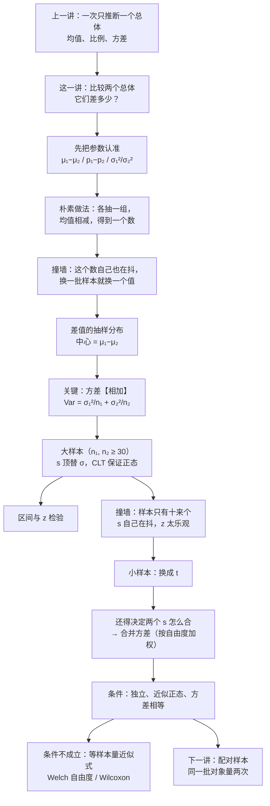
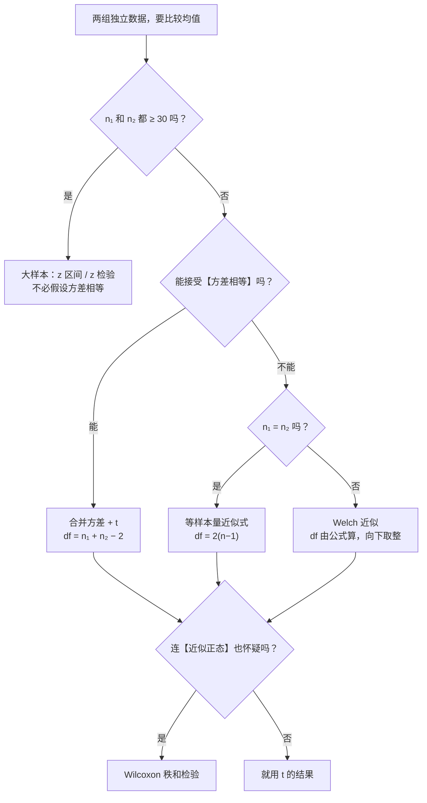

# C8.1 两个总体均值之差 Comparing Two Population Means

> [!abstract] 这一讲的任务
> 上一讲为止，所有的推断都只问**一个**总体：它的均值是多少、比例是多少、方差是多少。可现实里的问题几乎都是比较——两个市场谁高、两种教法谁快、两个车型谁省油。一比较，参数就从 $\mu$ 变成了 $\mu_1-\mu_2$，而"两个数相减"这一步会把两个样本各自的抖动**叠在一起**，抖得比你预想的更大。
> 这一讲做三件事：先把要估的那个参数认准（8.1）；再推出**两个均值之差**的抽样分布，看清方差为什么是**相加**而不是相减（8.2）；最后把这个分布变成区间和检验——大样本用 $z$，小样本换 $t$ 并且要把两组的方差**合并**成一个。
> 末尾留一条分水岭：同样是"两组数"，**独立样本**与**配对样本**走的是两套公式，下一讲专门处理配对。

> [!info] 授课进度说明
> 目前拿到的授课转写稿覆盖到**第 6 节课**，内容截止于**第 6.2 节（区间估计的原理与置信系数）**。
> **第 7 章与第 8 章尚未在课堂上讲授**，因此本篇内容全部来自**教材与通行讲法整理**，暂不逐条区分"课堂讲过"与"拓展补充"。
> 等后续转写稿补充进来，会按与第 5、6 章相同的规则（标题后缀 **（拓展）**、段首 **【拓展】**）标注出课堂未讲的部分。

> [!info] 怎么读这份讲义
> 按小节读。第 0 节把客户的两个问题摆在桌上，第二个问题这一讲**不解决**，它是下一讲的主角；第 1 节把"比较"翻译成一个参数；第 2 节是全篇的地基——**差值的方差为什么相加**，这一节想不通，后面所有公式都只能背；第 3–4 节是大样本的区间与检验，两节的数字互相对得上；第 5–6 节回答"样本一小，到底坏在哪两处"，其中**合并方差**那一节给出了它作为加权平均的推导；第 7 节把五道题的数字并排放；第 8 节是假定不满足时的三条退路；第 9 节把独立样本与配对样本分开，为下一讲铺路。
> 标注约定：标有 **（拓展）** 或 **【拓展】** 的内容，是**课堂上没有展开、由教材与通行讲法延伸补充**的部分。复习时先掌握未标注的主干——考点集中在主干上。
> 勘误一句话：本篇有两处原稿印刷问题——p.19 的检验统计量分母把 $1.30$ 印成了 $1.69$（$1.69$ 是方差，被又平方了一次），p.25 第 2 条把 approximately **normal** 印成了 approximately **equal**；两处都在对应小节里复算并说明。

---

## 0. 开场：一位客户的两个问题（p.15、p.26）

你在嘉信理财做数据分析。一位客户打来电话，问了两件事。

**第一件。** 他两边都持有一篮子股票：一篮在纽交所（NYSE）上市，一篮在纳斯达克（NASDAQ）上市。他想知道——**这两个市场的股息率，差多少？**

你手上只有两批样本：纽交所 121 只，平均股息率 3.27%，标准差 1.30；纳斯达克 125 只，平均 2.53%，标准差 1.16。

| | 纽交所 NYSE | 纳斯达克 NASDAQ |
|---|---|---|
| 样本只数 Number | 121 | 125 |
| 均值 Mean | 3.27% | 2.53% |
| 标准差 Std Dev | 1.30% | 1.16% |

两个平均数一减：$3.27-2.53=0.74$。你在电话里可以立刻回答：**"纳斯达克低 0.74 个百分点。"**

可客户接着问了半句更要命的话：**"这是这一年的偶然，还是这两个市场本来就不一样？"**

0.74 回答不了这个问题。因为它是**一批样本**算出来的数。换一年、换一批股票，你可能算出 1.1，可能算出 0.2，甚至可能算出 $-0.3$。客户真正想要的不是"这一次的差"，而是"**这两个市场上所有股票的平均股息率，差多少**"——那是 $\mu_1-\mu_2$，一个我们永远看不到真值的参数。

所以这一讲要做的，和第 6、7 章做的是同一件事，只是目标换了个形状：**用 $\bar x_1-\bar x_2$ 去估计 $\mu_1-\mu_2$**，并且说清这个估计有多不靠谱。

**第二件。** 客户又问：同一批股票，今年的股息率和去年比，涨了没有？

这个问题看起来只是"再比一次"，但数据结构完全不同：**今年和去年是同一只股票的两个读数**。那只股票自己的"性格"（比如它一贯就爱分红、或者一贯不分红）在两年里是同一个，把两年相减，这部分性格就被**抵消掉了**。这种数据结构叫**配对样本 paired samples**，它有自己的公式，而且往往比"当成两组独立数据"要灵敏得多。

这一讲只解决第一件——**两组互不相干的数据**怎么比。第二件留到 C8.2 配对差实验与两个比例之差。

> [!question] 停一下，先自己想想
> 如果明天你重新抽 121 只纽交所股票和 125 只纳斯达克股票，再算一次差值，你估计会得到多少？
> 会**正好**是 0.74 吗？如果不是，它会偏离 0.74 多远——一两个百分点，还是零点零几个百分点？凭什么判断？

这最后一句"凭什么判断"，就是下一节要建的东西。答案在第 2 节末尾。

---

## 1. 先认参数：比较两个总体，比的是哪一个数（p.6–8）

p.7 摆了两个很日常的问题：

- **男生和女生，谁的成绩高？**
- **Word 和 Excel，哪个学起来更快？**

"你会怎么回答？"——注意这个问法。它不是在问答案，而是在问**你打算怎么拿到答案**。

最自然的做法是：男生抽一批、女生抽一批，各算一个平均分；学 Word 的一组、学 Excel 的一组，各算一个平均学习时间；然后**两个平均数相减**。这一步谁都想不到别的方式。

但"相减"这个动作，已经把问题翻译成了另一种语言。原来问的是"谁高"，翻译完就变成"**两个总体的均值相差多少**"，写成 $\mu_1-\mu_2$。这个数有几个特点：它由两个总体共同决定；它是固定的；它**不在任何一个样本里**——你手上永远只有 $\bar x_1-\bar x_2$。

> [!important] 定义：目标参数 Target Parameter
> **目标参数**就是这次推断最后要落在它身上的那个总体参数。做任何一道两样本题，第一步永远是把它认准，因为**参数决定了统计量、统计量决定了公式、公式决定了查哪张表**。
> 8.1 这一节的全部内容，就是一张"从问题里的关键词认出参数"的对照表。

p.8 给了三行，一行一个参数：

| 参数 Parameter | 关键词 Key Words or Phrases | 数据类型 |
|---|---|---|
| $\mu_1-\mu_2$ | 均值之差、平均数的差（mean difference, differences in averages） | 定量 Quantitative |
| $p_1-p_2$ | 比例、百分比、分数、比率之间的差（proportions, percentages, fractions, rates） | 定性 Qualitative |
| $\dfrac{(\sigma_1)^2}{(\sigma_2)^2}$ | 方差之比、变异性或离散程度的差异（ratio of variances, compare variation） | 定量 Quantitative |

**名字要拆开读。** "目标"两个字说的是**终点**：区间估计、假设检验、样本量计算，全都要落在这一个数上；"参数"说的是**身份**：它是总体的、未知的、固定的，不是样本里算出来的那个统计量。所以"目标参数"合起来就是"**这次推断要瞄准的那一个总体数值**"。瞄准错了，后面算得再漂亮也是答非所问。

三个参数对应三种问法，这一点值得用一句话钉住：

- 问"**平均**差多少"（收入、分数、续航、收益率）⟹ $\mu_1-\mu_2$；
- 问"**比例**差多少"（合格率、就业率、点击率、支持率）⟹ $p_1-p_2$；
- 问"**波动**差多少"（哪个更稳定、哪个风险更大）⟹ 方差之比 $\sigma_1^2/\sigma_2^2$。

第三种为什么是**比**而不是差？因为方差是平方量、单位是原来的平方，两个方差相减得到的数没有自然的刻度（$4-1=3$ 和 $400-100=300$ 说的其实是同一件事）；用比值就没有这个问题——比值等于 1 就是"一样波动"，大于 1 就是"第一组更波动"。这条约定在 8.6 节会正式用上。

> [!warning] 认参数之前，先认数据结构
> 同样是"两组数"，有两种来源：两组**互不相干**的对象，或者**同一批对象量了两次**。前者对应 $\mu_1-\mu_2$，后者对应 $\mu_d$（差值的均值）。两者长得像、公式完全不同。判据只有一句：**第一个样本里的某个观测值，和第二个样本里的某一个观测值之间，有没有一条只属于它们的纽带？**（同一只股票、同一个人、同一对双胞胎、同一个地块的两半。）有，就是配对；没有，就是独立。第 9 节会把这条判据讲透。

---

## 2. 差值本身也是一个随机变量（p.9–10）

现在把"再抽一次"这件事真的做一遍。

从总体 1 抽 $n_1$ 个，算 $\bar x_1$；从总体 2 抽 $n_2$ 个，算 $\bar x_2$；相减，得到**一个**数。把这个过程重复无数次，就得到无数个 $\bar x_1-\bar x_2$——p.10 用的词是 "an astronomical number of $\bar x_1-\bar x_2$ values"，天文数字那么多个。

这些数自己构成一个分布。它的名字沿用第 5 章的叫法：

> [!important] 复习：抽样分布 Sampling Distribution
> **抽样分布**是"统计量"的分布，不是数据的分布。做法是：**先**把"抽样 + 算统计量"这一整套动作重复无数次，**再**看这些统计量落在哪里、散得多开。
> 名字拆开：**抽样**说的是这个分布的来源（靠反复抽样得到），**分布**说的是它描述的对象（统计量的取值规律）。它和第 2 章画的数据分布是两回事：数据分布的横轴是观测值，抽样分布的横轴是**统计量**。

现在这个统计量是 $\bar x_1-\bar x_2$。要描述它的分布，只需要三样东西：**中心在哪、散得多开、形状是什么**。

### 2.1 中心：它围绕着 $\mu_1-\mu_2$ 转

$$\mathrm{E}\left(\bar x_1-\bar x_2\right)=\mathrm{E}(\bar x_1)-\mathrm{E}(\bar x_2)=\mu_1-\mu_2$$

第一行到第二行用的是"期望可以逐项拆开"这条性质，不需要任何额外假设。这一步说明：**$\bar x_1-\bar x_2$ 是 $\mu_1-\mu_2$ 的无偏估计**——平均而言，它不多不少正好落在目标上。第 5 章讲 $\mathrm{E}(\bar x)=\mu$ 时用过同一招，这里是它的两样本版本。

但"平均而言对"是一句很弱的话。它只说**重复无数次之后**中心对得上，完全没说**单次**会偏多远。偏多远，由第二样东西决定。

### 2.2 散得多开：这里是加号，不是减号（全篇的地基）

先别急着看公式，我们先猜。

已知 $\bar x_1$ 的标准误是 $\sigma_1/\sqrt{n_1}=1.30/\sqrt{121}=0.118$，$\bar x_2$ 的标准误是 $\sigma_2/\sqrt{n_2}=1.16/\sqrt{125}=0.104$。那么**差**的标准误是多少？

> [!question] 停一下，先自己想想
> 下面三个答案，你选哪个？先选，再看后面的复算。
> ① 两个标准误**相减**：$0.118-0.104=0.014$
> ② 取**较大的那个**：$0.118$
> ③ 把两个**方差相加再开根号**：$\sqrt{0.118^2+0.104^2}$

**① 错得最离谱。** 它的意思是"两个均值之差的抖动只有 0.014"，也就是差值几乎不动。这显然荒谬：两个各自会抖 0.1 上下的量相减，结果怎么可能稳如磐石？照这个数去搭区间，宽度会窄到几乎是一条线，任何一点小差别都会被判成"显著"。

**② 也不对，而且错得隐蔽。** "取较大的那个"听起来很保守——取大的总不会低估吧？可它偏偏就是低估。因为差值的抖动来自**两个**来源，两个来源一起抖，结果只会比任何一个单独抖得更厉害。

**③ 才对。** 把两个方差加起来再开根号：

$$\sigma_{\bar x_1-\bar x_2}=\sqrt{\frac{\sigma_1^2}{n_1}+\frac{\sigma_2^2}{n_2}}=\sqrt{0.118^2+0.104^2}=\sqrt{0.01397+0.01077}=\sqrt{0.02474}=0.157$$

注意这个数：$0.157$ **比 0.118 大**，也比 0.104 大。它比"取较大的那个"还要大三分之一。这就是"取大者"错在哪——它低估了。

**为什么是加？** 这是全篇最值得想清楚的一步。

道理在方差的可加性上。对任意两个随机变量 $X$、$Y$：

$$\mathrm{Var}(X-Y)=\mathrm{Var}(X)+\mathrm{Var}(Y)-2\,\mathrm{Cov}(X,Y)$$

关键在最后那一项。**如果两个样本是独立抽的**，$\bar x_1$ 和 $\bar x_2$ 之间没有任何关联，$\mathrm{Cov}=0$，那一项就消失了：

$$\boxed{\ \mathrm{Var}(\bar x_1-\bar x_2)=\frac{\sigma_1^2}{n_1}+\frac{\sigma_2^2}{n_2}\ }$$

所以"相减"这个动作是在**均值**上做的，不是在**方差**上做的。均值相减，方差相加——这两件事同时成立，一点也不矛盾：

- **均值**：两个中心一左一右，差自然要减；
- **方差**：两个抖动各抖各的，互不抵消，所以叠起来只会更大。

用一句话记住：**减的是位置，加的是不确定性。**

> [!important] 名字：两个均值之差的标准误
> $$\sigma_{\bar x_1-\bar x_2}=\sqrt{\frac{\sigma_1^2}{n_1}+\frac{\sigma_2^2}{n_2}}$$
> 它叫"**两个均值之差的标准误**"（standard error of the difference between two means）。逐字拆：**标准误** = 统计量的标准差（第 5 章的老词）；**两个均值之差** = 这个统计量是谁。$\sigma$ 未知时用 $s$ 顶上去，得到一个估计值，记作 $s_{\bar x_1-\bar x_2}$。

**两个特例，把加号的含义钉住。**

**特例一（同方差、同样本量）。** 若 $\sigma_1=\sigma_2=\sigma$、$n_1=n_2=n$，则

$$\sigma_{\bar x_1-\bar x_2}=\sqrt{\frac{\sigma^2}{n}+\frac{\sigma^2}{n}}=\sqrt{2}\cdot\frac{\sigma}{\sqrt n}\approx1.414\times\frac{\sigma}{\sqrt n}$$

差值的抖动是单个均值的 **1.41 倍**。取 $\sigma=10$、$n=25$：单个均值的标准误是 2，差值的标准误是 2.83。**这就是"比较两个东西"比"估计一个东西"更费样本的根本原因**——不是误差变大了，是误差**叠起来**了。

**特例二（完全正相关）。** 若两组的抖动完全同步（$\mathrm{Cov}$ 取到最大），上式最后一项就会把两个方差**减掉**，差值的方差甚至可以是 0。什么时候会同步？——**同一批对象量两次**的时候。同一只股票，市场整体涨它就涨、跌它就跌，这部分"共同的抖动"在做差时被抵消了，留下来的只有它自己的那点变化。这正是配对设计为什么灵敏的原因，第 9 节回收。

现在回头看第 0 节那个"停一下"：换一批样本，差值会偏多远？答案是**标准差 0.157 的抖动**。不是一两个百分点，而是**零点一五个百分点**左右——它只有 0.74 的**五分之一**，所以这次抽到的 0.74 不大可能是纯噪声。但"不大可能"要有刻度，那就是区间和检验。

### 2.3 形状：为什么它会接近正态

- 若两个总体本来就正态，那么 $\bar x_1-\bar x_2$ 是两个正态变量的线性组合，**精确正态**，与样本量无关；
- 若两个总体不正态，靠**中心极限定理**：只要 $n_1$、$n_2$ 都够大，$\bar x_1$ 与 $\bar x_2$ 各自近似正态，它们的差也近似正态。

第二条把"大样本"这三个字变成了一个**具体条件**（p.14 要求两个样本都 $\ge30$），也解释了为什么整章要分成"大样本 / 小样本"两条路：形状靠的是谁，决定了后面查 $z$ 表还是 $t$ 表。

![[C8.1–8.2-差值抽样分布-方差相加不是相减.png]]
> [!note] 图怎么看
> 左图是"各算一个均值"这一步：两条曲线中心分别在 105 和 100，胖瘦相同（标准误都是 2）。右图是"相减"这一步：中心落到 5，形状还是钟形，但**明显地更宽**——标准误从 2 变成了 2.83。两图横轴是同一把尺子，所以可以直接比胖瘦。
> 右图左边那一小块阴影是"差值为负"的可能性，占 3.9%。也就是说：**即使两个总体真的差 5，也还有约 4% 的抽样会给出"差是负的"这种结论。** 这就是"单次实验会骗人"的具体规模。

### 2.4 停一下：我们刚才干了什么

- 把"比较两个总体"翻译成一个统计量 $\bar x_1-\bar x_2$，它无偏地围着 $\mu_1-\mu_2$ 转；
- 它的抖动由**方差相加**决定，$\sqrt{\sigma_1^2/n_1+\sigma_2^2/n_2}$，比任何一组单独的抖动都大；
- 加号的合法性来自**独立性**——两个样本互不相干，协方差项才为零。这一条不是数学细节，它是"独立样本"这个词的**技术含义**。

---

## 3. 大样本：把骨架搬过来搭区间（p.11、p.13–16）

第 6 章搭好的骨架只有一行的长度：

$$\text{区间}=\text{估计值}\ \pm\ \text{临界值}\times\text{标准误}$$

现在三样东西全都有了替身：估计值换成 $\bar x_1-\bar x_2$，标准误换成上节那个根号，临界值按"大样本、已知形状近似正态"取 $z_{\alpha/2}$。

> [!important] 大样本置信区间（p.11）
> $\sigma_1^2,\sigma_2^2$ **已知**：
> $$\left(\bar x_1-\bar x_2\right)\pm z_{\alpha/2}\sqrt{\frac{\sigma_1^2}{n_1}+\frac{\sigma_2^2}{n_2}}$$
> $\sigma_1^2,\sigma_2^2$ **未知**（大样本时 $s$ 顶替）：
> $$\left(\bar x_1-\bar x_2\right)\pm z_{\alpha/2}\sqrt{\frac{s_1^2}{n_1}+\frac{s_2^2}{n_2}}$$

**手算这道股息率的题（p.15–16）。** 95% 置信水平，$z_{.025}=1.96$，$s_1=1.30$、$n_1=121$、$s_2=1.16$、$n_2=125$：

$$\left(3.27-2.53\right)\pm1.96\sqrt{\frac{1.30^2}{121}+\frac{1.16^2}{125}}=0.74\pm1.96\times0.1573=0.74\pm0.308$$

$$\boxed{\ 0.43\leq\mu_1-\mu_2\leq1.05\ }$$

跟 p.16 印的 $.43$ 到 $1.05$ 一致。

**怎么读这个区间，三句话。**

1. **单位是百分点。** 3.27 与 2.53 都是百分数，相减得到的是"个百分点"，不是"百分之 0.74"。μ 之差 0.74 的意思是"纽交所的平均股息率比纳斯达克高 0.74 个百分点"。
2. **整个区间在 0 的右边。** 下限 0.43 都大于 0，说明"没有差别"这个可能性被排除掉了——第 4 节的检验会给出同一个结论，这不是巧合。
3. **但它没有说"差很多"。** 真值可能只有 0.43，也可能有 1.05。区间的两个端点都要报出来，只报 0.74 等于把不确定性藏起来了。

> [!warning] 置信区间的读法，别退回旧错
> 不能说"$\mu_1-\mu_2$ 落在这个区间里的概率是 95%"。参数是固定的，它要么在里面要么不在，没有概率可言。正确的说法是：**"用这套方法反复抽样、反复搭区间，约有 95% 的区间会盖住真值；这一次盖住的区间是 0.43 到 1.05。"** 这条在第 6 章已经掰开讲过，两样本情形一个字都不用改。

---

## 4. 大样本：假设怎么提、怎么判（p.12–14、p.17–21）

检验的骨架也是旧的：**把估计值标准化，看它离假设有多远**。新的只有一处——分子里的"估计值"现在是 $\bar x_1-\bar x_2$，"假设值"是一个叫 $D_0$ 的数。

> [!important] 大样本检验（p.12–13）
> $$H_0:\left(\mu_1-\mu_2\right)=D_0\qquad H_a:\left(\mu_1-\mu_2\right)\neq D_0\ \text{（或}<\ ,\ >\text{）}$$
> $$z=\frac{\left(\bar x_1-\bar x_2\right)-D_0}{\sigma_{\bar x_1-\bar x_2}}\approx\frac{\left(\bar x_1-\bar x_2\right)-D_0}{\sqrt{\dfrac{s_1^2}{n_1}+\dfrac{s_2^2}{n_2}}}$$
> 拒绝域：双尾 $|z|>z_{\alpha/2}$；单尾 $z<-z_\alpha$ 或 $z>z_\alpha$（方向跟着 $H_a$ 走）。

**$D_0$ 是什么？为什么经常取 0？** $D_0$ 是"**假设的差值**"（hypothesized difference）。最常见的检验是"两组**没有**差别"，这时 $D_0=0$，$H_0$ 就是 $\mu_1=\mu_2$。取 0 不是因为公式要求，而是因为**这是最常用的那个"无事发生"的状态**。

但 $D_0$ 可以不等于 0，而且这种题特别容易栽。举个例子：供应商声称新包装每袋**比旧包装多装 5 克**，而你怀疑它其实没做到。这时检验的就不是"差是否为 0"，而是"差是否达到 5"：$H_0:\mu_1-\mu_2=5$（注意：等号挂在 $H_0$ 上，$\geq5$ 那一边也归它），$H_a:\mu_1-\mu_2<5$。分子里减的是 5，不是 0。

**把 $D_0$ 当成摆设，就会在非零检验上全盘算错**——尤其当样本算出来的差正好是 4.6 时：对 $D_0=0$ 它"显著大于 0"，对 $D_0=5$ 它却"没达到 5"，两个结论都成立，因为它们问的不是同一个问题。

p.17 那张表把"研究问题"和"假设怎么写"摆在一起，还专门写了一个 **Be Careful!**：

| 研究问题 | 无差别 / 有差别 | 总体 1 ≥ 总体 2 / 总体 1 < 总体 2 | 总体 1 ≤ 总体 2 / 总体 1 > 总体 2 |
|---|---|---|---|
| $H_0$ | $\mu_1-\mu_2=0$ | $\mu_1-\mu_2\geq0$ | $\mu_1-\mu_2\leq0$ |
| $H_a$ | $\mu_1-\mu_2\neq0$ | $\mu_1-\mu_2<0$ | $\mu_1-\mu_2>0$ |

> [!warning] 这张表最容易看反的一格
> 中间一列，研究问题是"**总体 1 是不是比总体 2 差**"——这句话是我想证明的，所以它进 $H_a$：$\mu_1-\mu_2<0$。而 $H_0$ 只能写它的反面：$\mu_1-\mu_2\geq0$。
> 所以这张表不是"三种写法"，而是**同一句话的两次翻译**：先确定你想证明什么（没差别 / 1 更差 / 1 更好），把它写进 $H_a$；$H_0$ 永远是"没差别、或没朝那个方向偏"，因此**带等号的那一边一律归 $H_0$**。最右一列同理：想证明"1 比 2 好"，就写 $H_a:\mu_1-\mu_2>0$，反面 $\leq0$ 归 $H_0$。

**成立条件（p.14）。** 两条，缺一不可：

1. 两个样本分别从两个目标总体中**独立地**随机抽取；
2. $n_1\geq30$ 且 $n_2\geq30$。

第 2 条的道理前面说过：中心极限定理保证 $\bar x_1-\bar x_2$ 近似正态，与两个总体长什么形状无关；同时大样本下 $s_1^2,s_2^2$ 能把 $\sigma_1^2,\sigma_2^2$ 顶得足够好。**注意是"两个都 $\ge30$"**，不是"加起来 $\ge30$"。一组 50 配一组 8，仍然不算大样本。

### 4.1 检验这道股息率的题（p.18–19）

七行写全：

- $H_0:\mu_1-\mu_2=0$（两个市场一样）
- $H_a:\mu_1-\mu_2\neq0$（不一样）
- $\alpha=.05$，$n_1=121$，$n_2=125$
- 临界值：$\pm1.96$
- 检验统计量：

$$z=\frac{(3.27-2.53)-0}{\sqrt{\dfrac{1.30^2}{121}+\dfrac{1.16^2}{125}}}=\frac{0.74}{0.1573}=+4.71$$

- 决策：$4.71>1.96$，**拒绝 $H_0$**
- 结论：有证据表明两个市场的平均股息率**不同**

$p$ 值是多少？$P(|Z|>4.71)=2.5\times10^{-6}$，百万分之二点五。这个量级已经远远不是"显著"两个字能描述的了。

> [!warning] 原稿这里印错了一个数（p.19）
> 检验统计量的分母印成 $\sqrt{\dfrac{1.69^2}{121}+\dfrac{1.16^2}{125}}$，其中 $1.69$ 应是 $1.30$。
> 为什么能断定是印错？因为 $1.30^2=1.69$——**$1.69$ 是方差，却把它放进了"标准差"的位置又平方了一次**。照印的式子算，分母变成 $0.1854$，$z=3.99$，与同一页印的 $+4.71$ 对不上；只有把 $1.69$ 换回 $1.30$，才得到 $4.71$。
> 顺带一提：这两个 $z$ 都落在拒绝域里，结论不变，但**数值错了就是错了**——考试按步骤给分，分母写错会直接扣掉。

### 4.2 另一道：城乡生均支出（p.20–21）

再看一道结论相反的，因为它更能说明"不拒绝"到底意味着什么。

教育部的经济学家想知道：城市与农村高中的**生均支出**有没有差别。各抽 35 所：

| | 城市 Urban | 农村 Rural |
|---|---|---|
| 学校数 | 35 | 35 |
| 均值 | \$6,012 | \$5,832 |
| 标准差 | \$602 | \$497 |

$\alpha=.10$，双尾，$z_{.05}=1.645$。

$$s_{\bar x_1-\bar x_2}=\sqrt{\frac{602^2}{35}+\frac{497^2}{35}}=\sqrt{\frac{362404+247009}{35}}=\sqrt{17411.8}=131.95$$

$$z=\frac{(6012-5832)-0}{131.95}=\frac{180}{131.95}=+1.36$$

$1.36<1.645$，**不拒绝 $H_0$**。结论："没有证据表明两个均值不同。"$p$ 值约 $0.17$。

**这句话必须说得准。** "没有证据表明有差别"**不等于**"证明了没有差别"。差 180 美元是实实在在发生在样本里的，只是这个差相对于抖动量（131.95）还不够大。给这个差搭一个 90% 的区间就一目了然：

$$180\pm1.645\times131.95=180\pm217.04\quad\Longrightarrow\quad -37.0\leq\mu_1-\mu_2\leq397.0$$

区间跨过 0，所以"没有差别"是可信的；但区间宽达 **434 美元**——真值完全可能是"农村比城市每个学生多花 300 美元"这种在政策上很重要的差别。**检验只回答"能不能排除 0"，不回答"差别有多大"。** 这也是为什么报结果时要报区间，不能只报一个"不显著"。

> [!question] 停一下，先自己想想
> 如果把两组的样本量都扩大到 350（标准差不变、均值差仍是 180），$z$ 会变成多少？结论会变吗？
> 会。$z$ 变成 $1.36\times\sqrt{10}\approx4.30$，稳稳拒绝。样本里同样的 180 美元，从"看不出来"变成"铁证如山"——变的是证据的强度，不是差别的大小。

---

## 5. 样本一小，两件事同时坏掉（p.22–25）

回到股息率的题，p.26 换了一组数据：均值、标准差**一模一样**，但样本只数从 $121$ 和 $125$ 变成了 **11 和 15**。

| | 纽交所 NYSE | 纳斯达克 NASDAQ |
|---|---|---|
| 样本只数 | 11 | 15 |
| 均值 | 3.27% | 2.53% |
| 标准差 | 1.30% | 1.16% |

同一个 0.74，同样两个 $s$，只是样本变小了。会发生什么？

### 5.1 第一件：$s$ 自己在抖，所以必须换 $t$

先把大样本公式硬套上去看看（只把 $n$ 换掉）：$s_{\bar x_1-\bar x_2}=\sqrt{1.30^2/11+1.16^2/15}=0.493$，于是

$$0.74\pm1.96\times0.493\quad\Longrightarrow\quad[-0.23,\ 1.71]$$

区间已经跨过 0 了。所以在这道题里，**结论翻转的主因是标准误变大了三倍**（$0.157\to0.493$），而不是临界值。

那为什么还要换 $t$？因为"95%"这三个字得是真的。第 6 章讲过：$\sigma$ 未知时用 $s$ 顶替，统计量 $\dfrac{\bar x-\mu}{s/\sqrt n}$ 不再服从正态，而是服从 $t$ 分布——分母自己也在抖，所以比值更分散、尾巴更肥。同样的道理搬到两样本：只要 $s_1,s_2$ 是从小样本算出来的，那个 $z$ 就**偏大**了，用它配 1.96 会系统性地**高估**置信水平、**低估** $p$ 值。

所以临界值从 $z_{\alpha/2}$ 换成 $t_{\alpha/2}$。自由度是多少？这里出现了一个新东西：**两组的自由度要相加**。

$$\mathrm{df}=(n_1-1)+(n_2-1)=n_1+n_2-2=11+15-2=24$$

为什么相加？因为两组数据各自锁掉了自己那个均值：第一组 $n_1$ 个离差被 $\sum(x_{1i}-\bar x_1)=0$ 锁住一个，第二组同理。所以两组一共剩下 $(n_1-1)+(n_2-1)$ 份"还能自己说话"的信息。**自由度相加，是因为信息量相加；不是因为公式好看。**

查表：$t_{.025,24}=2.064$，比 $1.96$ 大 $5\%$。同样按 $0.493$ 的标准误算，半宽从 $1.96\times0.493=0.97$ 变成 $2.064\times0.493=1.02$。

> [!note] 一个诚实的分寸
> 在这道题上，换不换 $t$ 只让半宽从 0.97 变成 1.02（宽约 $5\%$）——因为 $\mathrm{df}=24$ 已经不小，$t$ 和 $z$ 很像。但**方向必须对**：样本越小，两者差得越远。$\mathrm{df}=5$ 时 $t_{.025}=2.571$，比 1.96 大 $31\%$；若照样用 1.96，名义 95% 的区间实际只有约 90%。

### 5.2 第二件：两个 $s$，到底该听谁的

换 $t$ 只解决了"临界值"，还剩一个更麻烦的问题：标准误那个根号里，到底该放什么。

大样本时放的是 $\dfrac{s_1^2}{n_1}+\dfrac{s_2^2}{n_2}$，各用各的，谁也不碍谁。小样本时这个写法有个**技术麻烦**：这样算出来的量**不服从 $t$ 分布**（它只是两个方差的混合，分布形状没有表可查）。而 $t$ 表能用，前提是那个分母是"**同一个** $\sigma$ 的估计"。

于是问题变成：**有没有一个共同的 $\sigma^2$ 可以用？**

有——如果两个总体的方差本来就相等（$\sigma_1^2=\sigma_2^2$）。这时两组样本其实在估计**同一个数**，把两份信息合起来用，比各用各的更准，而且合出来的分母确实只有一个 $\sigma$，$t$ 表就能用了。

这就引出了这一讲最需要动脑子的一个公式：**合并方差**。

---

## 6. 合并方差：可加的是平方和，不是方差（p.22、p.25）

先把"两个 $s$ 怎么办"的几种朴素想法摆出来，逐个看它们死在哪。

> [!question] 停一下，先自己想想
> $s_1^2=1.69$（$n_1=11$），$s_2^2=1.3456$（$n_2=15$）。要合成一个数代表"共同的方差"，你会怎么合？

**想法一：用第一组的 1.69。** 直接扔掉第二组——那 15 个观测、14 个自由度白抽了。样本越小越不该这么干，而小样本恰恰是这里的情形。

**想法二：算术平均。** $(1.69+1.3456)/2=1.518$。它把两组当成"一样重"。可它们不一样重：一组贡献 10 个自由度，另一组贡献 14 个。给 10 和给 14 一样多的权重，等于让信息少的那个组说话过大。

**想法三：按样本量 $n$ 加权。** $(11\times1.69+15\times1.3456)/26=1.4913$。这个答案离正确答案只差 0.002，看起来几乎对了。**它是错的，而且错得很有教育意义**：它把 $s^2$ 当成了"每组的平均"，然后用 $n$ 去加权。但 $s^2$ 不是原始信息，**原始信息是平方和**：

$$\text{平方和 }SS=(n-1)s^2$$

能相加的是平方和，不是方差。拿 $n$ 去加权，等于给每个组都乘了一个 $\dfrac{n}{n-1}$ 的放大倍数——**两个组的放大倍数不一样**（小组被放得更多），于是合出来的数会被小组拖偏。只有两组样本量相等时，两个放大倍数才相同，这个错法才碰巧不出事。

**正解：把平方和相加，把自由度相加。**

> [!important] 定义：合并方差 Pooled Variance（p.22）
> $$s_p^2=\frac{(n_1-1)s_1^2+(n_2-1)s_2^2}{n_1+n_2-2}=\frac{SS_1+SS_2}{\mathrm{df}_1+\mathrm{df}_2}$$
> 其中分子是两组的**平方和相加**，分母是两组的**自由度相加**。名字里的 **pooled** 就是"并池"——把两池水倒进一个池子里。前提是这两池水**是同一浓度的**（$\sigma_1^2=\sigma_2^2$），否则并出来的浓度谁也不代表。

**手算。** $SS_1=10\times1.69=16.90$，$SS_2=14\times1.3456=18.84$：

$$s_p^2=\frac{16.90+18.84}{10+14}=\frac{35.74}{24}=1.4891,\qquad s_p=\sqrt{1.4891}=1.2203$$

与 p.27 印的 $1.489$ 一致。

![[C8.1–8.2-合并方差是按自由度加权的平均.png]]
这张图就是上面那三个数字的几何版本：**一个矩形的宽是自由度、高是方差、面积是平方和**。左边两个矩形各代表一组，面积分别是 16.90 和 18.84；把它们并成一个矩形，**面积相加、宽度相加，高度就被迫落到了 35.74/24 = 1.489**。落在两个方差之间，而且更靠近自由度大的那一侧（1.346 那边）——因为那一组信息更多，说话更算数。

### 6.1 为什么这样合出来是无偏的

这一步值得验算，因为它把"为什么除以 $n_1+n_2-2$"这件事说穿了。

第 2 章离散程度那一篇（[[C2.4 离散程度：极差、方差与标准差]]）讲过：单组的平方和除以它的自由度，是总体方差的无偏估计，即 $\mathrm{E}\left[(n-1)s^2\right]=(n-1)\sigma^2$。两组都成立：

$$\mathrm{E}(SS_1)=(n_1-1)\sigma^2,\qquad \mathrm{E}(SS_2)=(n_2-1)\sigma^2$$

（这里用了 $\sigma_1^2=\sigma_2^2=\sigma^2$ 这个前提，两组估计的是同一个数。）相加：

$$\mathrm{E}(SS_1+SS_2)=\left[(n_1-1)+(n_2-1)\right]\sigma^2=(n_1+n_2-2)\sigma^2$$

所以只要除以 $n_1+n_2-2$，期望就正好是 $\sigma^2$：

$$\mathrm{E}(s_p^2)=\sigma^2$$

**分母为什么不是 $n_1+n_2$？** 因为分子不是"所有观测值的平方和"，而是"**两组各自绕着自己均值**的平方和"。两个均值各锁掉一个自由度，所以一共少了 2。这条理由和第 2 章"为什么除以 $n-1$"是同一条，只是这次出现了两个均值，于是减 2。

**换个说法看这个公式。** 把分子分母同除以 $\mathrm{df}_1+\mathrm{df}_2$，就得到

$$s_p^2=\frac{\mathrm{df}_1}{\mathrm{df}_1+\mathrm{df}_2}s_1^2+\frac{\mathrm{df}_2}{\mathrm{df}_1+\mathrm{df}_2}s_2^2$$

它是一个**加权平均**，权重是各组自由度占的比例（这里是 $10/24=0.417$ 和 $14/24=0.583$，加起来正好 1）。这也解释了为什么它落在两个方差之间、并且靠近自由度大的那一侧。**"合并方差"这个名字听上去像一次运算，其实是一个加权平均**——权重不是随便定的，是各组能提供的独立信息量。

### 6.2 那为什么大样本不用合并？

因为**合并要付代价**：它默认 $\sigma_1^2=\sigma_2^2$。这是一条关于总体的、无法从数据里直接验证的假设（第 8.6 节会用 $F$ 检验去查它）。

大样本时不必付这个代价。$n_1,n_2$ 都大时，$s_1^2,s_2^2$ 各自都很准，"各用各的"已经足够，不需要借"方差相等"来换一个精确的 $t$ 分布——反正中心极限定理已经保证了正态。

换句话说：

> [!important] 两条路的交易
> **大样本**：不假设方差相等，代价是只能用近似正态（$z$）。
> **小样本**：假设方差相等 + 总体正态，换来一个精确的 $t$ 分布，代价是这两条假设必须成立。
> 这不是"哪个更准"的问题，是"你愿意拿哪条假设去换哪个性质"的问题。

**假设错了会怎样？** 给一组夸张的数感受一下：第一组 $n_1=5$、$s_1=10$，第二组 $n_2=50$、$s_2=1$。真实情况是"第一组波动大得多"，可合并方差算出来是

$$s_p^2=\frac{4\times100+49\times1}{4+49}=\frac{449}{53}=8.47$$

而第二组真实的方差只有 1——拿这个 $s_p^2$ 去代表第二组的波动，**大出了 8 倍多**。因为第一组虽然只有 4 个自由度，却带着 400 的平方和，一进池子就把整池水搅浑了。这就是"方差不等时不能合并"的具体后果：不是差一点点，是差一个量级。

### 6.3 小样本的区间与检验（p.22–25）

> [!important] 小样本置信区间（独立样本，p.22）
> $$\left(\bar x_1-\bar x_2\right)\pm t_{\alpha/2}\sqrt{s_p^2\left(\frac{1}{n_1}+\frac{1}{n_2}\right)}$$
> 其中 $t_{\alpha/2}$ 的自由度是 $n_1+n_2-2$。

> [!important] 小样本检验（p.23–24）
> $$H_0:\left(\mu_1-\mu_2\right)=D_0,\qquad t=\frac{\left(\bar x_1-\bar x_2\right)-D_0}{\sqrt{s_p^2\left(\dfrac{1}{n_1}+\dfrac{1}{n_2}\right)}}$$
> 双尾拒绝域 $|t|>t_{\alpha/2}$，单尾 $t<-t_\alpha$ 或 $t>t_\alpha$，自由度都是 $n_1+n_2-2$。

注意两件事：

1. **根号里换成了 $s_p^2$ 乘两个倒数之和**，而不是两个分式之和。因为现在只有**一个**方差，它可以提到括号外面。
2. **自由度从两个变成一个**：$n_1+n_2-2$。合并之后只剩一个方差要估，所以只剩一组自由度。

**成立条件（p.25）。** 三条，比大样本硬得多：

1. 两个样本分别**独立地**随机抽取；
2. 两个被抽样的总体，分布都**近似正态**；
3. 两个总体的**方差相等**（$\sigma_1^2=\sigma_2^2$）。

第 2 条为什么必须补上？大样本时形状靠中心极限定理兜底，小样本没有这个兜底——$n=11$ 的时候，总体的形状会直接透到 $\bar x$ 的分布上。第 3 条为什么必须？前面讲过：$s_p^2$ 只有在两组估计同一个 $\sigma^2$ 时才有意义。

> [!warning] 原稿这里印错了一个词（p.25）
> 第 2 条印的是 "Both sampled populations have distributions that are approximately **equal**"（两个总体的分布近似**相等**）。
> 应为 approximately **normal**（近似**正态**）。理由有两条：其一，"分布相等"与第 3 条"方差相等"语义重复，而小样本推断真正缺的那块拼图是**正态性**；其二，$t$ 统计量精确服从 $t$ 分布的前提正是"两个总体都正态"，缺了它就没有表可查。

---

## 7. 小样本的三道例题（p.26–35）

### 7.1 例一：同一道股息率题，区间（p.26–27）

$\alpha=.05$，$\mathrm{df}=11+15-2=24$，$t_{.025}=2.064$。合并方差上一节已算：$s_p^2=1.489$。标准误：

$$s_{\bar x_1-\bar x_2}=\sqrt{1.489\left(\frac{1}{11}+\frac{1}{15}\right)}=\sqrt{1.489\times0.15758}=\sqrt{0.2346}=0.4844$$

区间：

$$(3.27-2.53)\pm2.064\times0.4844=0.74\pm1.000$$

$$\boxed{\ -0.26\leq\mu_1-\mu_2\leq1.74\ }$$

与 p.27 印的 $-.26$ 到 $1.74$ 一致。

### 7.2 例二：同一道题，检验（p.28–31）

- $H_0:\mu_1-\mu_2=0$
- $H_a:\mu_1-\mu_2\neq0$
- $\alpha=.05$，$\mathrm{df}=24$，临界值 $\pm2.064$
- 检验统计量：

$$t=\frac{(3.27-2.53)-0}{\sqrt{1.489\left(\dfrac{1}{11}+\dfrac{1}{15}\right)}}=\frac{0.74}{0.4844}=+1.53$$

- 决策：$1.53<2.064$，**不拒绝 $H_0$**
- 结论：**没有证据**表明两个市场的平均股息率不同（$p$ 值约 $0.14$）

### 7.3 把两套结果并排放

同一组均值、同一组标准差，只改了样本量：

| | 大样本（121 / 125） | 小样本（11 / 15） |
|---|---|---|
| 点估计 $\bar x_1-\bar x_2$ | 0.74 | 0.74 |
| 标准误 | 0.157 | 0.484 |
| 临界值 | $z_{.025}=1.96$ | $t_{.025,24}=2.064$ |
| 95% 区间 | **0.43 ～ 1.05** | **−0.26 ～ 1.74** |
| 区间宽 | 0.62 | 2.00 |
| 检验统计量 | $z=4.71$ | $t=1.53$ |
| 结论 | 拒绝 $H_0$ | 不拒绝 $H_0$ |

![[C8.1–8.2-样本量一降结论就翻.png]]
这张图是全篇最该记住的一张。**点估计一个字没改，两个标准差一个字没改，只是样本从一百多个掉到十几个，结论就从"有差别"翻成了"没有证据"。** 差别还是那个 0.74，变的是我们**看清**它的能力。

> [!important] 结论的强度，取决于证据的精度
> 统计结论从来不是"两个市场一样"或"两个市场不一样"这种客观事实的转述，它说的是"**以我手上这点数据，能不能排除 0**"。数据少了，能排除的东西就少——这不是方法变差，这是信息变少之后必然的结果。
> 所以任何"不显著"的结论，都必须补一句区间：不显著可能因为"差别真的小"，也可能因为"样本太小看不出来"。这两种情况在政策、产品、医学上的含义完全不同。

### 7.4 例三：轿车与厢车的油耗（p.32–35）

通用汽车的研究分析师要比较两个车型的每加仑英里数（mpg），$\alpha=.05$，假定方差相等。

| | 轿车 Sedan | 厢车 Van |
|---|---|---|
| 样本数 | 15 | 11 |
| 均值 | 22.00 | 20.27 |
| 标准差 | 4.77 | 3.64 |

$\mathrm{df}=15+11-2=24$，$t_{.025}=2.064$。

$$s_p^2=\frac{14\times4.77^2+10\times3.64^2}{24}=\frac{318.54+132.50}{24}=\frac{451.04}{24}=18.793$$

$$s_{\bar x_1-\bar x_2}=\sqrt{18.793\left(\frac{1}{15}+\frac{1}{11}\right)}=\sqrt{18.793\times0.15758}=\sqrt{2.9613}=1.7209$$

$$t=\frac{(22.00-20.27)-0}{1.7209}=\frac{1.73}{1.7209}=+1.0053$$

$1.005<2.064$，**不拒绝**。结论：没有证据表明两个车型的平均油耗不同（$p$ 值约 $0.32$）。

顺手把区间也搭出来（原题只问检验，这里补上，正好验证"检验与区间是同一件事的两个说法"）：

$$1.73\pm2.064\times1.7209=1.73\pm3.55\quad\Longrightarrow\quad-1.82\leq\mu_1-\mu_2\leq5.28$$

区间跨过 0，且宽达 7.1 mpg——比样本里那 1.73 的差大了四倍。**"没差别"这个结论在这里有多弱，看宽度就知道。**

> [!note] 一处小账
> 复算得 $t=1.0053$，四舍五入应为 $1.01$，p.34 印的是 $+1.00$（截尾）。不影响结论——它离临界值 2.064 远得很。

> [!important] 检验与区间的对偶
> 双尾 $\alpha$ 的检验"拒绝 $H_0:\mu_1-\mu_2=D_0$" ⟺ "$\mu_1-\mu_2$ 的 $1-\alpha$ 置信区间**不含** $D_0$"。
> 本篇三道题全都对得上：$[0.43,1.05]$ 不含 0 ⟹ 拒绝；$[-0.26,1.74]$ 含 0 ⟹ 不拒绝；$[-1.82,5.28]$ 含 0 ⟹ 不拒绝。**算一遍区间，等于同时做了一次检验。**

---

## 8. 假定不满足时的三条退路（p.36–39）

小样本那三个条件是理想情形。现实中它们经常不成立，于是有三条退路，按"违反哪一条"来选。

### 8.1 只是方差不相等，但两组样本量相等（p.36）

若 $n_1=n_2=n$ 而 $\sigma_1^2\neq\sigma_2^2$，可以直接用：

$$\left(\bar x_1-\bar x_2\right)\pm t_{\alpha/2}\sqrt{\frac{s_1^2+s_2^2}{n}},\qquad \text{自由度 } \nu=n_1+n_2-2=2(n-1)$$

这里有一个很漂亮的巧合，值得点出来：**等样本量时，这个"近似式"和合并方差的公式是恒等的**。因为

$$s_p^2=\frac{(n-1)s_1^2+(n-1)s_2^2}{2n-2}=\frac{s_1^2+s_2^2}{2},\qquad s_p^2\left(\frac1n+\frac1n\right)=\frac{s_1^2+s_2^2}{n}$$

两式一模一样。所以这个式子**并不需要方差相等**——它只是把"等权平均"当成了共同方差。真正近似的部分在**自由度**：方差不等时，那个 $t$ 只是"近似"服从 $\mathrm{df}=2n-2$ 的 $t$ 分布，不再精确。

### 8.2 方差不相等，样本量也不相等（p.37–38）

这时不能再合并。标准误回到"各用各的"：

$$\left(\bar x_1-\bar x_2\right)\pm t_{\alpha/2}\sqrt{\frac{s_1^2}{n_1}+\frac{s_2^2}{n_2}},\qquad t=\frac{\left(\bar x_1-\bar x_2\right)-D_0}{\sqrt{\dfrac{s_1^2}{n_1}+\dfrac{s_2^2}{n_2}}}$$

但自由度不能再写 $n_1+n_2-2$ 了——那个数只对"合并"成立。真正的自由度要用下面这条式子算（p.38）：

$$\nu=\frac{\left(\dfrac{s_1^2}{n_1}+\dfrac{s_2^2}{n_2}\right)^2}{\dfrac{\left(s_1^2/n_1\right)^2}{n_1-1}+\dfrac{\left(s_2^2/n_2\right)^2}{n_2-1}}$$

这条式子叫 **Welch–Satterthwaite 近似**。它的直观意思是：**自由度不是一个整数，而是"这两组数据合起来相当于几个独立观测"**。当两组方差悬殊时，那个方差大的组贡献的自由度会被大幅压小——因为它的 $s^2$ 本身就很不可靠。

用第 7 节的数字算一遍：$\nu=20.17$。**通常不是整数**，p.38 底下专门提醒了一句：**向下取整**。

> [!important] 为什么要向下取整，而不是四舍五入
> 因为 $t$ 分布的临界值随自由度**单调递减**：$\mathrm{df}$ 越小，尾巴越肥，临界值越大。
> $t_{.025,20}=2.086$，$t_{.025,24}=2.064$；若把 $\nu=20.17$ 四舍五入成 20 没问题，但 $\nu=20.8$ 若舍成 21，$t$ 会偏小，区间偏窄、检验偏松——**犯第一类错误的机会变大**。
> 向下取整保证临界值只大不小，区间只宽不窄，结论**保守**。宁可说"没证据"，也不要说"有证据"却说错了。

### 8.3 连"近似正态"都怀疑（p.39）

如果样本很小、而且分布明显偏斜或者有极端值，前面那些 $t$ 方法的前提就都站不住了。这时改用**不依赖分布形状**的方法：

> [!important] p.39 的结论
> 若担心假定不满足，改用 **Wilcoxon 秩和检验**（Wilcoxon rank sum test，用于独立样本），检验两个总体的分布位置有没有整体平移。
> 它不看具体数值，只看"排名"，所以对极端值和偏斜免疫。详见 C15.2 Wilcoxon秩和检验与符号秩检验。

顺带说一句它的代价：秩和检验检验的是"分布位置是否相同"，比"均值之差"这个目标**更宽**也更模糊；而且数据本身接近正态时，它的功效略低于 $t$ 检验。**它是假定不成立时的保险，不是常规首选。**

### 8.4 一句话选路

> [!note] 【拓展】现代统计的默认选择
> 这一节先讲合并方差，是为了让"两个 s 怎么合"这件事有个完整的推导，也让"自由度相加"这条规律有一次干净的练习。但统计软件的默认做法近二十年已经变了：R 的 `t.test()` 默认用 Welch，Python 的 `scipy.stats.ttest_ind` 默认 `equal_var=False`（也是 Welch）。
> 理由很实际：**Welch 在方差相等时几乎不损失效率**（前面的例子里区间只宽了不到 2%），**而在方差不等时不会有系统性偏差**。也就是说，它把"赌方差相等"这个风险消掉了，代价极小。
> 但考试仍以合并方差为主——题目会明说"assuming equal variances"。看到这句话，就用合并方差；看到"assuming normal populations"而没提方差，才需要考虑 Welch。

---

## 9. 独立样本与配对样本：一条决定公式的分水岭（p.9、p.40）

现在回到第 0 节那个没解决的问题：**同一批股票，今年和去年比，涨了没有？**

从表面看，这也是"两组数、各算一个均值、相减"。可它与前面几节的数据结构完全不同：

- 前面：纽交所的 121 只与纳斯达克的 125 只，**没有任何一只股票同时出现在两边**；
- 这里：去年那只股票与今年的**同一只**股票，是同一个对象量了两次。

> [!important] 判据：一条纽带
> **第一个样本里的某个观测值，和第二个样本里的某一个观测值之间，有没有一条只属于它们的纽带？**
> **有** ⟹ 配对样本 paired samples。纽带的例子：同一个人（前后测）、同一只股票（两个年份）、同一对双胞胎、同一个地块的两半、同一批零件用两种仪器各测一次。
> **没有** ⟹ 独立样本 independent samples。两组人、两批产品、两个城市，互不重叠。

"独立"在这里不是随口一说，它有**技术含义**：两个样本的观测值互不影响，所以第 2 节那个协方差项才为零，方差才能相加。**这条判据同时是数学前提和设计前提。**

| | 独立样本 | 配对样本 |
|---|---|---|
| 数据结构 | 两组互不重叠的对象 | 同一批对象量两次（或按纽带一对一配上） |
| 参数 | $\mu_1-\mu_2$ | $\mu_d$（每对差值的均值） |
| 标准误 | $\sqrt{\sigma_1^2/n_1+\sigma_2^2/n_2}$ | $\sigma_d/\sqrt{n_d}$ |
| 自由度 | $n_1+n_2-2$ | $n_d-1$ |
| 关键的差 | 两份抖动**相加** | 共同部分被**抵消**，只剩差值的抖动 |

**配对为什么更灵敏？** 回去看第 2.2 节那条式子：

$$\mathrm{Var}(X-Y)=\mathrm{Var}(X)+\mathrm{Var}(Y)-2\,\mathrm{Cov}(X,Y)$$

配对时 $\mathrm{Cov}$ 不为零，而且往往是**大的正数**。举个具体数：若两组方差都是 $\sigma^2$、相关系数 $\rho=0.8$，则

$$\mathrm{Var}(d)=2\sigma^2(1-0.8)=0.4\,\sigma^2,\qquad \text{标准差}=0.632\,\sigma$$

比独立情形（标准差 $\sqrt2\sigma=1.414\sigma$）小了**一半还多**。因为样本量只需与方差成正比，达到同样的精度只要约 **40%** 的样本——**省掉六成**。

**代价也要说清。** 配对只用 $n_d-1$ 个自由度，通常只有独立情形 $n_1+n_2-2$ 的一半上下（10 个人配对是 9，10 对 10 独立是 18）。所以这是"用更少的自由度换更小的方差"的交易。当纽带很强（同一对象、前后测）时，这笔交易大赚；当"配对"只是勉强凑的（按年龄、地区硬配），$\rho$ 很小，反而可能亏。

> [!question] 停一下，先自己想想
> 要比较 Word 和 Excel 哪个学得快，下面两种设计各是什么样本？
> ① 找 20 个人，10 个只学 Word、10 个只学 Excel；
> ② 找 10 个人，每个人**两个都学**，记录各自花的时间。
> 哪个更"聪明"？为什么？

①是独立样本，②是配对样本。②更聪明，因为"这个人本身聪明不聪明"这件事在两次学习里是共通的——聪明的人两个都学得快。做差之后，这层"个人天赋"被抵消，剩下的只是"Word 与 Excel 的相对难度"。而①里这层差异变成了噪声，混进了两组的比较中。

代价是②只能招 10 个人（每人贡献两个读数，但自由度的算法不同），而且有**顺序效应**：先学的那个可能因为"刚上手"而吃亏。所以配对设计往往要做"一半人先学 Word、一半人先学 Excel"来平衡。这些设计层面的细节在 C9.1 实验设计与完全随机设计会系统展开。

> 配对的区间、检验、以及"两比例之差"，下一讲 C8.2 配对差实验与两个比例之差接上。

---

## 10. 公式速查（p.11–38）

> [!tip] 本篇所有公式
> | 场景 | 中心 | 标准误 | 临界值 / 自由度 |
> |---|---|---|---|
> | 差值的抽样分布 | $\mu_1-\mu_2$ | $\sqrt{\dfrac{\sigma_1^2}{n_1}+\dfrac{\sigma_2^2}{n_2}}$ | — |
> | 大样本区间 | $\bar x_1-\bar x_2$ | $\sqrt{\dfrac{s_1^2}{n_1}+\dfrac{s_2^2}{n_2}}$ | $z_{\alpha/2}$ |
> | 大样本检验 | — | 同上 | $z$，$n_1,n_2\geq30$ |
> | 小样本区间 | $\bar x_1-\bar x_2$ | $\sqrt{s_p^2\left(\dfrac1{n_1}+\dfrac1{n_2}\right)}$ | $t_{\alpha/2}$，$\mathrm{df}=n_1+n_2-2$ |
> | 小样本检验 | — | 同上 | $t$，同上 |
> | 合并方差 | — | — | $s_p^2=\dfrac{(n_1-1)s_1^2+(n_2-1)s_2^2}{n_1+n_2-2}$ |
> | 方差不等、等样本量 | — | $\sqrt{\dfrac{s_1^2+s_2^2}{n}}$ | $\mathrm{df}=2(n-1)$ |
> | 方差不等、不等样本量 | — | $\sqrt{\dfrac{s_1^2}{n_1}+\dfrac{s_2^2}{n_2}}$ | $\nu$ 由 Welch 式算，**向下取整** |
>
> | 常用临界值 | 90% | 95% | 99% |
> |---|---|---|---|
> | $z_{\alpha/2}$ | 1.645 | 1.960 | 2.576 |
> | $t_{\alpha/2}$，$\mathrm{df}=24$ | 1.711 | 2.064 | 2.797 |
> | $t_{\alpha/2}$，$\mathrm{df}=20$ | 1.725 | 2.086 | 2.845 |
>
> **一句话记法**：均值相减、方差相加；大样本看 $z$、小样本看 $t$；小样本要合并，自由度 $n_1+n_2-2$；条件不成就往下走——等样本量、Welch、Wilcoxon。

> [!tip] 下一讲预告
> 这一讲把"两组互不相干的数据"讲完了，但真正的实验数据往往不是这个样子：同一批人服药前后、同一台机器调参前后、同一只股票两个季度。**这类数据如果当成独立样本处理，等于把最值钱的那部分信息（共同部分被抵消）白扔了。**
> 下一讲做三件事：把配对差 $d$ 化成"单样本问题"（一个样本、一个均值，第 6 章的工具直接搬过来，自由度 $n_d-1$）；讲清配对设计在什么情况下会失灵（顺序效应、$d$ 不正态）；再换一个参数——**两个比例之差** $p_1-p_2$，那里的标准误要把两个未知比例也合并成一个。

---

## 这一讲的三句话

1. **先认参数，再算数。** 问的是两个**总体**之差 $\mu_1-\mu_2$，不是两个样本之差；而认参数之前要先认数据结构——两组互不相干是独立样本，同一批对象量两次是配对样本，两者公式完全不同。
2. **均值相减，方差相加。** 差值的标准误是 $\sqrt{\sigma_1^2/n_1+\sigma_2^2/n_2}$，比任何一组单独的抖动都大（等方差等样本量时恰好大 $\sqrt2$ 倍）；加号的合法性来自独立性。小样本时 $s$ 自己在抖，要换 $t$，并且把两组方差按**自由度**合并成 $s_p^2$——它本质是一个加权平均，自由度相加所以分母是 $n_1+n_2-2$。
3. **结论的强度由证据的精度决定。** 同一个 0.74 的差，样本 121/125 时区间是 $[0.43,1.05]$、结论是"有差别"；样本 11/15 时区间是 $[-0.26,1.74]$、结论是"没有证据"。而"没有证据"只说明排除不了 0，**不说明相等**——所以报结论必须连区间一起报。

---

## 相关笔记 Related Notes

- 相关：[[C5.2 样本均值的抽样分布与中心极限定理]]（$\bar x$ 的分布是这里的地基）、[[C6.1 参数估计与置信区间]]（"估计值 ± 临界值 × 标准误"这条骨架）、[[C6.2 小样本 t 区间与比例的置信区间]]（$t$ 分布与自由度的第一课）、[[C2.4 离散程度：极差、方差与标准差]]（"为什么除以 $n-1$"在这里变成"为什么除以 $n_1+n_2-2$"）、[[C7.1 假设检验的要素与假设的建立]]（$H_0/H_a$ 与 $D_0$ 的写法）、[[C7.2 p 值与显著性水平]]（$p=2.5\times10^{-6}$ 怎么读）、[[C7.3 均值与比例的假设检验]]（单样本的 $z$ 与 $t$，本篇的直接前身）、C8.2 配对差实验与两个比例之差（配对样本与两比例之差）、C8.3 样本量的确定与两总体方差的 F 检验（该抽多少、方差齐性怎么查）、C15.2 Wilcoxon秩和检验与符号秩检验（假定不成立时的非参数退路）、C9.1 实验设计与完全随机设计（配对与区组的设计层面）
- 上一讲：[[C7.4 方差的检验、第二类错误与功效]]
- 下一讲：C8.2 配对差实验与两个比例之差（尚未整理）
- 返回：[[统计学课程 MOC]]
