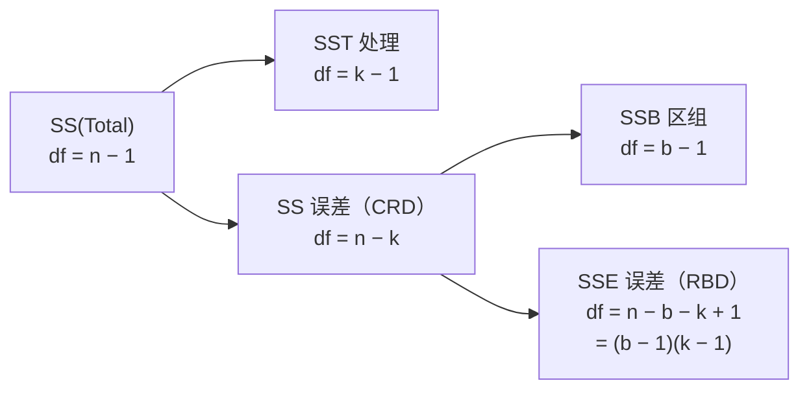
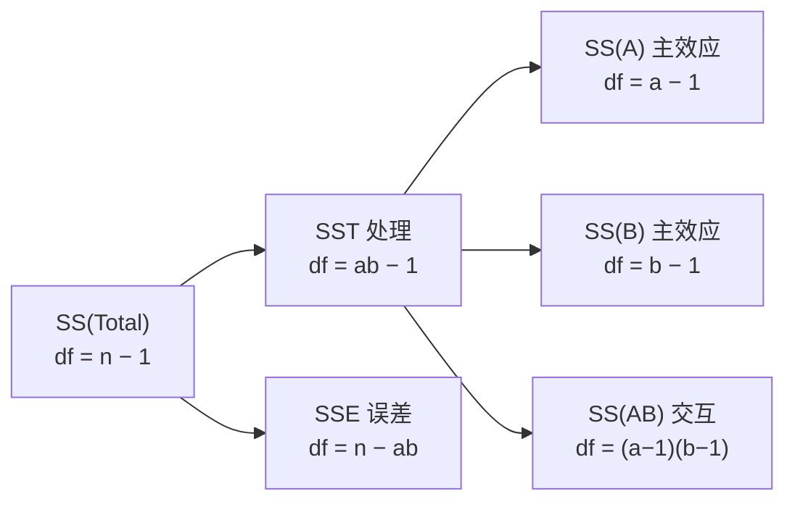

# C9 实验设计与方差分析 Design of Experiments and Analysis of Variance

> [!abstract] 这一讲的任务
> 前两讲（第 7、8 章）的检验都只面对**两个**东西：一个总体的均值等于多少，或者两个总体的均值差多少。可现实里的问题常常是三个以上——三种培训方法、四台机器、五种肥料，哪个更好？
> 直觉做法是两两比一遍。这一讲先算给你看：五个方案两两比要十次，每次留 5% 的误报，十次全对的概率只剩六成——**即使五个方案完全一样，也有四成的机会报出至少一个"显著差异"**。方差分析（ANOVA）换了个问法：不逐个比，只问"这几组的均值能不能看作同一个值"。
> 它的工具是**方差**：把总变异拆成"组间"和"组内"两份，看前一份相对后一份大不大。之后依次处理三件事——拒绝之后怎么找出谁跟谁不同（多重比较）、怎样靠**区组设计**把噪声提前拿掉、以及两个因子同时上时**交互作用**是什么意思。

> [!info] 授课进度说明
> 现有授课转写稿覆盖到**第 6 章**（六节课），内容截止于区间估计。
> **第 9 章暂无对应转写稿**，本篇按**教材与该章配套讲义整理**，暂不逐条区分"课堂讲过"与"拓展补充"。
> 等转写稿补进来，会按与第 1、2、5、6 章相同的规则（标题后缀 **（拓展）**、段首 **【拓展】**）标注出课堂未讲的部分。

---

## 从「两个」到 $k$ 个：为什么不能一直两两比（p.3–12）

第 7 章检验的是 $\mu=\mu_0$，第 8 章检验的是 $\mu_1-\mu_2$。两讲的工具链一模一样：认参数 → 推抽样分布 → 标准化 → 查表。到了三个总体，这套链子没有自然延伸——因为"三个数相等"不是一个数。

**朴素尝试：两两做 $t$ 检验。** 三组两两比三次；五组比十次（$c=k(k-1)/2$，这个组合数第 5 节还要用）。每次检验取 $\alpha=.05$，听上去每次只冒 5% 的风险。

问题出在"每次"这两个字上。若 $H_0$ 全真（五组本来就没差别），每次检验各有 95% 的机会不误报，**十次都不误报**的概率是

$$0.95^{10}=0.599$$

也就是说，**至少误报一次**的概率是 $1-0.599=40.1\%$。三组时这个数是 $1-0.95^3=14.3\%$。你想守住 5%，实际却放了 40% 的水。

> [!warning] 这堵墙有名字
> 一次实验里**至少犯一次第一类错误**的概率，叫**实验级错误率 experimentwise error rate（EER）**；而单次比较的 $\alpha$ 叫**比较级错误率 comparisonwise error rate**。
> 两两比 $c$ 次时 $\mathrm{EER}=1-(1-\alpha)^c$。这个数随 $c$ 长得很快，而 $c$ 随组数长得更快——所以"多比几次"从来不是免费的。第 5 节会回来收拾它。

**换一个问法。** 不逐个比，而是只问一件事：

$$H_0:\ \mu_1=\mu_2=\cdots=\mu_k\qquad\text{vs}\qquad H_a:\ \text{至少有两个均值不同}$$

一次检验，一个 $\alpha$，$H_0$ 只有一种"全相等"的情形要守。代价是结论变粗：拒绝之后你只知道"至少有一对不同"，不知道是哪一对——这正好是第 5 节（多重比较）的位置。

### 设计实验的五个要素

要问"几组均值是否相同"，先得把实验说清楚。五个词，缺一个题目就不完整。

| 术语 | 英文 | 一句话定义 | 例（培训方法） |
|---|---|---|---|
| 响应变量 | response variable（= dependent variable） | 实验里**要测量**的那个量，通常是定量的 | 学会操作所需的小时数 |
| 因子 | factor（= independent variable） | 你认为**会影响响应**、于是主动去改变的量；可定量也可定性 | 培训方法（定性） |
| 因子水平 | factor levels | 因子的**取值**，即实验里实际用到的几档 | 自学 / 课堂 / 电脑 |
| 处理 | treatment | **因子水平的组合**（一个以上因子时，处理是组合而不是单个水平） | 本讲只有因子，处理＝水平 |
| 实验单元 | experimental unit | **被施加处理、被测量**的对象 | 参加培训的那个人 |

> [!important] 两个最容易说错的地方
> 1. **处理不是"被处理的东西"，而是"施加的条件"。** 被处理的东西叫实验单元。说"处理是那个人"是错的，说"处理是那套培训方法"才对。
> 2. **单因子时处理＝水平，多因子时处理＝组合。** 两个因子各有 3 档，处理就有 $3\times3=9$ 个，而不是 6 个。第 7 节的双因子设计全靠这一条撑起来。

### 设计实验与观察研究：因果只能这样拿到

| | 谁决定处理怎么分配 | 能说什么 |
|---|---|---|
| **设计实验 designed study** | 分析师**控制**处理的内容，也控制**把哪个单元分到哪个处理** | 可以说"处理导致差异" |
| **观察研究 observational study** | 分析师只是**观察**已有的分组 | 只能说"两组有关联" |

差别不在数据，在**分配**。随机分配的作用是：把所有你没想到、也没测到的差别（年龄、基础、性格）**在期望上摊平**到各组里去，于是组间剩下的差异只能归给处理。观察研究做不到这一点——爱选这门课的人本来就不同，你分不清是课程的效果还是人的效果。

> [!question] 停一下，先自己想想
> 有人统计发现"常去图书馆的学生绩点更高"，于是建议学校多组织学生去图书馆。这条建议错在哪一步？
> 错在把观察研究当成了设计实验。"去不去图书馆"不是随机分配的——自律、有时间、目标明确的学生本来就更可能去，也更可能绩点高。真正起作用的是那些没被测量的品质。要做成实验，得**随机**挑一部分学生"要求他们每周去三次"，再比较。

两个标准形态（都是单因子、随机分配）：

1. 30 家门店**随机**分到 4 种陈列方式（因子＝陈列，4 个水平），看**销售额**（响应）的差别。
2. 200 名消费者**随机**分到 3 个果汁品牌（因子＝品牌，3 个水平），看**反应**（响应）的差别。

最后点一下名字。**方差分析 ANOVA = ANalysis Of VAriance**：名字里全是"方差"，问的却是"均值"。这不是起错了名——**判据是方差之比**，均值是否相等是从这个比值倒推出来的。整章最容易记混的就是这一句，后面每一节都在用它。

---

## 完全随机设计：把总变异拆成两份（p.13–26）

**完全随机设计 completely randomized design（CRD）**：对**每个处理**独立地抽取随机样本（等价说法：把实验单元随机分配到各处理）。单元之间假定是同质的，只有一个因子，用**单因子方差分析 one-way ANOVA** 处理。

先看一组具体数据。三种培训方法，各 3 人，响应是"学会所需的小时数"：

| 培训方法 | 学习时数（小时） | 组均值 |
|---|---|---|
| Level 1 自学 | 21, 27, 29 | 25.67 |
| Level 2 课堂 | 17, 25, 20 | 20.67 |
| Level 3 电脑 | 31, 28, 22 | 27.00 |

三组均值是 25.7、20.7、27.0，看起来不一样。可是——**这差别够大吗？**

第一组内部的三个数是 21 到 29，跨度 8 小时；第二组 17 到 25，也跨 8 小时。如果每个人本身就差这么多，那么"组均值的差"完全可能只是抽签的结果。**撞墙的地方就在这里：组间的差异要和组内的抖动比，才谈得上"大"。**

### 一次代数分解

记第 $i$ 组第 $j$ 个观测为 $x_{ij}$，第 $i$ 组均值 $\bar x_i$，总均值 $\bar x$。把每个观测相对总均值的离差拆成两段：

$$x_{ij}-\bar x=\underbrace{(x_{ij}-\bar x_i)}_{\text{离本组均值多远}}+\underbrace{(\bar x_i-\bar x)}_{\text{本组均值离总均值多远}}$$

两边平方、对所有观测求和。中间会出现交叉项 $2\sum_i\sum_j (x_{ij}-\bar x_i)(\bar x_i-\bar x)$，它对每个 $i$ 都能提出 $(\bar x_i-\bar x)$，剩下的 $\sum_j (x_{ij}-\bar x_i)$ **恰好等于 0**（一组数离自己均值的偏差之和永远是 0）。所以交叉项整块消失，只剩两个平方和：

$$\underbrace{\sum_i\sum_j (x_{ij}-\bar x)^2}_{\mathrm{SS(Total)}}=\underbrace{\sum_i n_i(\bar x_i-\bar x)^2}_{\mathrm{SST}}+\underbrace{\sum_i\sum_j (x_{ij}-\bar x_i)^2}_{\mathrm{SSE}}$$

> [!important] 三个名字，别被三种叫法骗了
> - $\mathrm{SS(Total)}$：**总变异**（全部观测相对总均值的平方和）。
> - $\mathrm{SST}$：**组间/处理变异**。同一件东西有四个名字——sum of squares among groups、between groups、treatment、among groups variation，全是它。
> - $\mathrm{SSE}$：**组内/误差变异**。也有四个名字——within groups、error、sum of squares error、within groups variation。
>
> 记名字没用，记**下标**有用：出现 $\bar x_i$ 的是组间，出现 $x_{ij}-\bar x_i$ 的是组内。

这就是"方差分析"这个名字的来历：它不比较均值，它把**总变异切成两块**，然后看两块的比例。

### 平方和不能直接比，要除以自由度

平方和是"累加出来的"，累加项越多它越大。三组各 3 人与五组各 30 人的平方和没法直接比，所以要先换成**平均每项的贡献**（mean square，均方）：

| 变异来源 | 平方和 | 自由度 | 均方 |
|---|---|---|---|
| 处理（组间） | $\mathrm{SST}$ | $k-1$ | $\mathrm{MST}=\dfrac{\mathrm{SST}}{k-1}$ |
| 误差（组内） | $\mathrm{SSE}$ | $n-k$ | $\mathrm{MSE}=\dfrac{\mathrm{SSE}}{n-k}$ |
| 总 | $\mathrm{SS(Total)}$ | $n-1$ | — |

自由度怎么来的：$k$ 个组均值只有 $k-1$ 个能自由变动（它们被"总均值"这一个约束绑住）；组内部分，第 $i$ 组有 $n_i-1$ 个自由度，加总 $\sum_i (n_i-1)=n-k$。两者相加正好 $n-1$，与总平方和的项数减一一致。

### 为什么比的是方差，而不是直接比均值

这是全章最该讲透的一句。$\mathrm{MSE}$ 是**组内**波动，它只反映"同一个人换个抽法会有多大差别"，**与 $H_0$ 真假无关**：

$$E(\mathrm{MSE})=\sigma^2$$

$\mathrm{MST}$ 则不同，它衡量"组均值离总均值多远"。若各组均值真的相等，组均值只会在 $\sigma^2/n_i$ 的量级上抖，此时 $E(\mathrm{MST})=\sigma^2$；若各组均值不全相等，它就会额外背上一个**系统性**的项：

$$E(\mathrm{MST})=\sigma^2+\frac{\sum_i n_i(\mu_i-\mu)^2}{k-1}$$

于是两者的比值

$$F=\frac{\mathrm{MST}}{\mathrm{MSE}}$$

在 $H_0$ 真时**围绕 1 上下摆**，在 $H_0$ 假时**系统性偏大**。这就是为什么"只拒绝大的 $F$"、为什么检验永远是**单尾**。

> [!important] 判据
> **$H_0$ 真时 $F\approx 1$；只有远大于 1 的 $F$ 才是证据。**
> 由此推出一条常被问到的性质：$F$ 不可能小于 0，所以不存在"左尾拒绝域"，方差分析的拒绝域**永远只在右边**。

分子分母各是一个"平方和除以自由度"，各自（在正态、独立、等方差下）服从卡方除以自由度；两个这样的量之比，就是 **$F$ 分布**。它有两个自由度：分子 $k-1$、分母 $n-k$，记作 $F_{\alpha}(k-1,\,n-k)$。

![[C9-两种变异与F比率.png]]

左图三组均值几乎重合，但组内各自摊得很开，$F$ 只有 0.15；右图组内很紧、组间拉开，$F=14.33$。**同一套公式，两种数据，答案完全相反**——这说明"看图觉得不一样"不能当判据，必须除一下噪声。

### 假设怎么写，以及一个经典的错法

$$H_0:\ \mu_1=\mu_2=\cdots=\mu_k\qquad H_a:\ \text{至少有两个处理均值不同}$$

> [!warning] $\mu_1\neq\mu_2\neq\cdots\neq\mu_k$ 是错的
> 它读起来像"每个都不同"，其实是个**更强**的命题（要求两两全部不等），比 $H_a$ 窄得多；而且"$\neq$"没有传递性，写成一串本身没有意义。
> 正确的说法只有两种：$H_0$ 里**全相等**，$H_a$ 里**至少有一对不同**。考试写成一串不等号会被扣分。

### 三个条件，以及条件不成立时怎么办

1. 各处理的样本是**独立随机**抽取的（靠随机分配实现）；
2. $k$ 个总体都**近似正态**；
3. $k$ 个总体的**方差相等**（$\sigma_1^2=\sigma_2^2=\cdots=\sigma_k^2$）。

第 3 条是硬条件，因为它正是 $F$ 分布成立的前提：若各组方差悬殊，$\mathrm{MSE}$ 就不再是一个统一的 $\sigma^2$ 的估计，$F$ 的参照分布失效。

条件不成立时，退到**非参数**方法：**Kruskal-Wallis $H$ 检验**（用秩代替数值，比较各组秩和的中心位置）。

这里要补一句"稳健性"的话：轻微到中等的**非正态**并不致命（Key Ideas 里把它列为 robust），**方差不齐**才更麻烦。所以实务里的检查顺序是：先看各组标准差是否相差在 2–3 倍以内，再看正态。

### 做一次方差分析的五个步骤（p.31–36）

1. 确认设计**真的是完全随机**：每个处理都有独立的随机样本。
2. 检查两个假定：正态、等方差。
3. 建汇总表，算出 $\mathrm{SST}$、$\mathrm{SSE}$ 与 $F$（用软件；没有软件就按附录里的计算公式算）。
4. 若**拒绝** $H_0$：①对想比较的那些均值对做多重比较，用结果总结"哪几对真的不同"；②如果需要，给个别处理均值构造置信区间。
5. 若**不拒绝** $H_0$，有两种可能，必须分开说：
   - **真的相等**——$H_0$ 成立；
   - **真的不等，但这个设计漏掉了别的重要因素**——那些因素抬高了抽样波动（也就是 $\mathrm{MSE}$），把 $F$ 压小了。出路是加大每个处理的样本量，或者换一个**能把这些因素吸收进去的设计**（下一节的随机区组、再下一节的双因子都是这个思路）。

> [!warning] 第 5 步最容易犯的错
> "不拒绝"就直接宣布"各组均值相等"。这是把**第二类错误**当成了结论——没抓到，不等于不存在。正确说法永远是"没有足够证据表明均值不同"。

> [!question] 停一下，先自己想想
> 上面那组培训数据（21/27/29、17/25/20、31/28/22），三组均值 25.7 / 20.7 / 27.0，你觉得 $F$ 会有多大？超过 3.89 吗？
> 直接算一遍：$\mathrm{SST}=66.89$，$\mathrm{SSE}=109.33$，$\mathrm{MST}=33.44$，$\mathrm{MSE}=9.11$，$F=3.67$。
> **3.67 < 3.885，在 $\alpha=.05$ 下不拒绝 $H_0$**，$p=0.057$——差一点点，但没过线。
> 这正是本章要反复提醒的事：**肉眼看"差得挺多"，在只有 3 个观测、组内又抖得厉害的时候，完全可能只是抽样波动。**

---

## 手算一遍：三台灌装机的装填时间（p.37–40）

> [!example] 题目
> 作为生产经理，你想知道三台灌装机（Mach1–3）的**平均装填时间**是否不同。你安排了 15 名训练程度相当的工人，每台机器 5 人。取 $\alpha=.05$。

| Mach1 | Mach2 | Mach3 |
|---|---|---|
| 25.40 | 23.40 | 20.00 |
| 26.31 | 21.80 | 22.20 |
| 24.10 | 23.50 | 19.75 |
| 23.74 | 22.75 | 20.60 |
| 25.10 | 21.60 | 20.40 |
| **$\bar x_i$：24.93** | **22.61** | **20.59** |

总均值 $\bar x=22.71$，$n=15$，$k=3$。

**第一步，组间平方和。** 每组 5 个观测，所以每个"组均值与总均值的偏差平方"要乘 5：

$$\mathrm{SST}=5\left[(24.93-22.71)^2+(22.61-22.71)^2+(20.59-22.71)^2\right]=5(4.9284+0.0100+4.4944)=47.1640$$

**第二步，组内平方和。** 逐组算"每个数离本组均值的偏差平方和"，再相加：

| 组 | 偏差平方和 |
|---|---|
| Mach1 | $0.47^2+1.38^2+0.83^2+1.19^2+0.17^2=4.2592$ |
| Mach2 | $0.79^2+0.81^2+0.89^2+0.14^2+1.01^2=3.1120$ |
| Mach3 | $0.59^2+1.61^2+0.84^2+0.01^2+0.19^2=3.6820$ |
| 合计 | $\mathrm{SSE}=11.0532$ |

**第三步，核对。** $\mathrm{SST}+\mathrm{SSE}=47.1640+11.0532=58.2172=\mathrm{SS(Total)}$。这一步不要省：两块的算术对不上，后面全错。

**第四步，填表并算 $F$。**

| 变异来源 | 自由度 | 平方和 | 均方 | $F$ |
|---|---|---|---|---|
| 处理（机器） | $3-1=2$ | 47.1640 | $23.5820$ | $\dfrac{23.5820}{0.9211}=25.60$ |
| 误差 | $15-3=12$ | 11.0532 | $0.9211$ | — |
| 总计 | $15-1=14$ | 58.2172 | — | — |

**第五步，查表判定。** 临界值 $F_{.05}(2,12)=3.885$（表上印 3.89）。$25.60>3.89$，**拒绝 $H_0$**。

**结论的说法。** "在 $\alpha=.05$ 下，有证据表明三台机器的平均装填时间存在差异。"

> [!warning] 三处措辞纪律
> 1. 结论里的主语是**总体均值**，不是"三台机器"本身；也不要说"三台机器的装填时间不同"——同一台机器每次也不一样，那是**个体**差异，不需要检验。
> 2. 只能说到"**存在差异**"，不能说"Mach1 与 Mach2 不同"——那是多重比较的事（下一节）。
> 3. $F=25.60$ 的读法：**组间方差是组内方差的 25 倍**。这个倍数是 $F$ 的定义，不是"均值差了 25 倍"。

顺带记一下 $p$ 值：$p\approx4.7\times10^{-5}$。判据与临界值法一致（$p<\alpha$ 拒绝），但 $p$ 值把"证据有多强"说清楚了——25.6 这个 $F$ 远远超过临界值，不是勉强过线。

---

## 再走一道：四种培训方法的半张汇总表（p.41–45）

> [!example] Thinking Challenge
> 你是微软的培训师。12 个人用 4 种培训方法，学习时数如下，取 $\alpha=.05$，问平均学习时间是否不同。

| M1 | M2 | M3 | M4 |
|---|---|---|---|
| 10 | 11 | 13 | 18 |
| 9 | 16 | 8 | 23 |
| 5 | 9 | 9 | 25 |
| **$\bar x_i$：8** | **12** | **10** | **22** |

这一题的难点不在计算，在于它**只给你半张表**：$\mathrm{SST}=348$、$\mathrm{SSE}=80$，其余留空。考试也常这样出。补全的顺序是固定的：

1. 先补**自由度**。$k=4$、$n=12$：处理 $4-1=3$，误差 $12-4=8$，总 $12-1=11$。
2. 再补**均方**。$\mathrm{MST}=348/3=116$，$\mathrm{MSE}=80/8=10$。
3. 最后补 $F=116/10=11.6$；总计 $=348+80=428$。

| 变异来源 | 自由度 | 平方和 | 均方 | $F$ |
|---|---|---|---|---|
| 处理（方法） | 3 | 348 | 116 | 11.6 |
| 误差 | 8 | 80 | 10 | — |
| 总计 | 11 | 428 | — | — |

临界值 $F_{.05}(3,8)=4.066$（表上印 4.07），$11.6>4.07$，拒绝 $H_0$：**有证据表明四种方法的平均学习时间不同**。$p=0.0028$。

顺便手算校验一遍（考场没有计算机时就这么走）：

- 总均值 $=(8+12+10+22)/4=13$（每组 3 人，所以是组均值的平均）；
- $\mathrm{SST}=3\left[(8-13)^2+(12-13)^2+(10-13)^2+(22-13)^2\right]=3(25+1+9+81)=348$；
- $\mathrm{SSE}=14+26+14+26=80$（组内偏差平方和逐组相加）。

注意 M4 的均值 22 明显偏高，而组内 $18,23,25$ 又很紧——这一个组就贡献了 $\mathrm{SST}$ 里的 $3\times81=243$。**方差分析对"某一组特别偏"最敏感**，这也是它比"两两比"更省力的地方。

---

## 拒绝之后：谁跟谁不一样（p.46–52）

$F$ 检验拒绝了，只说明"至少有一对不同"。要回答"到底哪几对不同"，就得做**多重比较 multiple comparisons**。$k$ 个均值两两配对的数目是

$$c=\binom{k}{2}=\frac{k(k-1)}{2}$$

$k=3$ 时 3 对，$k=4$ 时 6 对，$k=5$ 时 10 对。

### 为什么不能直接用 $\alpha=.05$ 一对一对地比

这就是开头那堵墙。做 $c$ 次水平为 $\alpha$ 的检验，实验级错误率是 $\mathrm{EER}=1-(1-\alpha)^c$：$c=3$ 时 14.3%，$c=6$ 时 26.5%，$c=10$ 时 40.1%。于是**"显著"变成了刮彩票**——比较次数越多，越容易刮出一个。

所以多重比较要解决的唯一问题是：**把 $\alpha$ 摊到整套比较上**，让"整套比较里至少错一次"的概率仍不超过 $\alpha$。三种通行做法，摊法不同、适用面不同：

| 方法 | 做法（一句话） | 样本量要求 | 比较的类型 | 区间宽度 |
|---|---|---|---|---|
| **Tukey** | 用**学生化极差分布**（把一组均值的极差除以其标准误，这个量的分布只依赖组数与自由度）一次算出所有两两比较的联合临界值 | 必须**相等** | 两两 | 最窄（等样本量 + 两两时） |
| **Bonferroni** | 每次比较用 $\alpha/c$ 当显著性水平 | 可相等也可不等 | 两两，或数量已知的若干对比 | 比 Scheffé 窄 |
| **Scheffé** | 针对**任意线性组合（contrast）**的联合区间 | 可相等也可不等 | 任意 contrast | 最宽 |

> [!important] 选择规则（一句够用）
> **等样本量 + 只想两两比 → Tukey**（区间最窄，功效最高）。
> **关心事先指定的少数几对、或样本量不等 → Bonferroni**（$\alpha$ 除以比较次数，保守但通用）。
> **要比较的是"组合"（比如 $\frac{\mu_1+\mu_2}{2}$ 与 $\mu_3$ 比），而不是单个均值两两比 → Scheffé**。
> 三者对两两比较给出的区间宽度排序是：Tukey ≤ Bonferroni ≤ Scheffé。这不代表 Scheffé 差，它换来的是**适用范围最广**。

Scheffé 之所以宽，是因为它要同时罩住**所有可能的线性组合**，而 Tukey 只需罩住两两差。反过来，如果你只关心两两差，用 Scheffé 就是白扔精度。

### Tukey 怎么做：一个算例（补充）

教材里 Tukey 的判据是两个均值之差与**HSD**（honestly significant difference）比：

$$\mathrm{HSD}=q_{\alpha}(k,\ n-k)\sqrt{\frac{\mathrm{MSE}}{n_0}}$$

其中 $q$ 是学生化极差分布的分位点（按组数 $k$ 与误差自由度 $n-k$ 查），$n_0$ 是每组的样本量（等样本量时就是 $n_i$）。

拿灌装机那道题接着做：$k=3$、$n-k=12$，查得 $q_{.05}(3,12)=3.773$，

$$\mathrm{HSD}=3.773\sqrt{\frac{0.9211}{5}}=3.773\times0.4292=1.619$$

三个均值是 24.93、22.61、20.59，两两之差为：

| 比较 | 差值 | 与 HSD 比 | 结论 |
|---|---|---|---|
| Mach1 − Mach2 | 2.32 | $>1.619$ | 显著 |
| Mach2 − Mach3 | 2.02 | $>1.619$ | 显著 |
| Mach1 − Mach3 | 4.34 | $>1.619$ | 显著 |

三对全部显著。这题的结论就是"**三台机器两两都不同**，Mach1 最慢（24.93），Mach3 最快（20.59）"。注意这一步用的是**同一个 $\mathrm{MSE}$**（0.9211）——多重比较从不重新估计误差，它只是换一个更严格的临界值。

### 怎么读软件输出里的 "groupings"

统计软件（SAS、SPSS、R）做 Tukey 后常打印一张"字母表"，形如：

```
Mean   N   Grouping   Method
25.10  5   A          Mach1
23.40  5   A          Mach2
20.90  5   B          Mach3
```

**同一字母的均值不显著，不同字母的显著。** 上表读作 $\mu_1=\mu_2\neq\mu_3$：三种均值被切成两堆，所以写 **2 groupings**。字母表数的是"一共被切成几块"，不是"比了几次"。（这是示意数据；前面灌装机那道题三对全部显著，输出会是三个不同字母、3 groupings。）

---

## 随机区组设计：先把「人」的差异拿掉（p.53–71）

回到灌装机那道题。15 名工人"训练程度相当"，但人总有快慢。**假设**你知道工人甲手快、工人乙手慢，那么把甲分到 Mach1、乙分到 Mach3，两台机器的差别里就混进了这两个人的差别——这部分差异是**噪声**，却和"机器的差别"一起被算进了 $\mathrm{SSE}$。

**随机区组设计 randomized block design（RBD）** 的办法是：先按"相似"把实验单元配成**块 block**，每块里放 $k$ 个（$k$ = 处理数），再把 $k$ 个处理**随机**分给块内的 $k$ 个单元。于是每个处理在每个块里各出现一次，共 $b$ 块、$n=bk$ 个观测。

> [!important] 一句话说清它与 CRD 的区别
> CRD 是"**同一批同质单元随机分到各处理**"；RBD 是"**先按某个已知的干扰因素分块，块内随机**"。
> 块的作用不是让你多一个结论，而是**把块与块之间的差异从误差里搬出去**——$\mathrm{MSE}$ 变小，$F$ 就变大。

### 变异拆成三份

**步骤 1**：配成 $b$ 个块，每块 $k$ 个单元，块内尽可能相似。
**步骤 2**：块内随机分配 $k$ 个处理，得到 $n=bk$ 个响应。

总变异相应拆成三份：

$$\mathrm{SS(Total)}=\mathrm{SST}+\mathrm{SSB}+\mathrm{SSE}$$



| 变异来源 | 自由度 | 平方和 | 均方 | $F$ |
|---|---|---|---|---|
| 处理 | $k-1$ | $\mathrm{SST}$ | $\mathrm{MST}$ | $\mathrm{MST}/\mathrm{MSE}$ |
| 区组 | $b-1$ | $\mathrm{SSB}$ | $\mathrm{MSB}$ | $\mathrm{MSB}/\mathrm{MSE}$ |
| 误差 | $n-b-k+1=(b-1)(k-1)$ | $\mathrm{SSE}$ | $\mathrm{MSE}$ | — |
| 总计 | $n-1$ | $\mathrm{SS(Total)}$ | — | — |

误差自由度从 $n-k$ 降到 $(b-1)(k-1)$：自由度**少了一半上下**。这是区组的代价——用更小的误差换更少的自由度，赚不赚取决于块内的相似程度。

### 同一批数据，两种分析：结论会翻

这是本讲最值钱的一个对照。三个装配方法、五名员工，装配时间（分钟）：

| 员工 | 方法 1 | 方法 2 | 方法 3 |
|---|---|---|---|
| 1 | 5.4 | 3.6 | 4.0 |
| 2 | 4.1 | 3.8 | 2.9 |
| 3 | 6.1 | 5.6 | 4.3 |
| 4 | 3.6 | 2.3 | 2.6 |
| 5 | 5.3 | 4.7 | 3.4 |
| **$\bar x_j$：4.90** | | **4.00** | **3.44** |

总均值 4.113，$\mathrm{SS(Total)}=17.797$。

**若当成完全随机设计**（忽略员工）：

| 变异来源 | 自由度 | 平方和 | 均方 | $F$ |
|---|---|---|---|---|
| 处理 | 2 | 5.425 | 2.713 | 2.63 |
| 误差 | 12 | 12.372 | 1.031 | — |
| 总计 | 14 | 17.797 | — | — |

$F_{.05}(2,12)=3.885$，$2.63<3.885$，$p=0.113$——**不拒绝 $H_0$，没有证据说三种方法不同**。

**若按随机区组设计**（员工＝块）：

| 变异来源 | 自由度 | 平方和 | 均方 | $F$ |
|---|---|---|---|---|
| 处理（方法） | $3-1=2$ | 5.43 | 2.71 | $2.71/0.21=12.9$ |
| 区组（员工） | $5-1=4$ | 10.69 | 2.67 | $12.7$ |
| 误差 | $15-3-5+1=8$ | 1.68 | 0.21 | — |
| 总计 | $15-1=14$ | 17.8 | — | — |

临界值 $F_{.05}(2,8)=4.459$（表上印 4.46），$12.9>4.46$——**拒绝 $H_0$，有证据说三种方法的平均装配时间不同**。

![[C9-区组把块间差异从误差里拿出来.png]]

**同一组 15 个数、同一个问题，因为设计不同，结论从"没有证据"变成"证据明确"。** 原因在左图：员工之间的差异占了 $\mathrm{SS(Total)}$ 的 60%（10.69/17.80）。在 CRD 里这 10.69 全被算成"误差"，把 $\mathrm{MSE}$ 撑到 1.031；在 RBD 里它被搬进 $\mathrm{SSB}$，$\mathrm{MSE}$ 只剩 0.210。分母小了五倍，$F$ 就大了五倍。

> [!important] 这一节真正的知识点
> **统计显著性不只由数据决定，也由设计决定。** 同样的数字，"配对/区组"能把它变成证据，"不配对"能把它埋掉。所以做实验时先想"有没有一个已知的干扰变量可以先分块"，再想公式。

### 第 6 步：块效应本身也值得检验

RBD 的汇总表里，区组那一行也有 $F=\mathrm{MSB}/\mathrm{MSE}$。检验它有什么用？**用来确认"区组是否必要"**：区组效应显著，说明块与块确实不同，这次分块分得值；若不显著，说明块内并没有比块间更相似，分成区组只是白白损失自由度。

本例 $\mathrm{MSB}/\mathrm{MSE}=2.67/0.21=12.7$，而 $F_{.05}(4,8)=3.838$，块效应显著——这正是"用 RBD 是对的"的统计支持。

### 条件、步骤与两条限制

条件（三条，与 CRD 平行）：$b$ 个块是随机选取的，且每个块都接受全部 $k$ 个处理（顺序随机）；所有 $bk$ 个"块×处理"组合的分布近似正态；这些组合的方差相等。

步骤：①确认设计是真的"分块 + 块内随机"；②检查正态与等方差（**这条往往做不到**，因为每个"块×处理"格子里只有一个观测）；③建汇总表算三个 $\mathrm{SS}$ 与 $F$；④若拒绝，用 Bonferroni 或 Tukey 做多重比较；⑤若不拒绝，考虑两种可能（真的相等 / 有别的因素抬高了 $\mathrm{MSE}$，同 CRD）；⑥如果需要，检验块均值是否相等。

两条限制要记清：

- **RBD 一般不能给单个处理均值构造置信区间。** 每个"块×处理"只有一个观测，处理均值的误差没有一个可以独立估出来的口径（教材原话是 cannot be used to form confidence intervals for individual treatment means）。要比就只能比**差**。
- **假定很难检查**，只有一个观测时无法分别估计"格子内"的方差。所以教材建议：一旦怀疑假定被破坏，直接转非参数方法——**Friedman $F_r$ 检验**（块内先把 $k$ 个处理排名次，再看各处理的名次和是否悬殊）。

> [!warning] 一个常见的混淆
> 完全随机设计条件不满足时用 **Kruskal-Wallis $H$**；随机区组设计条件不满足时用 **Friedman $F_r$**。两者都"不依赖正态"，但一个处理**独立组**、一个处理**分块数据**，不能互换。

---

## 双因子析因实验：一次实验回答三个问题（p.72–95）

前面的设计里只有一个因子。可"学习方法"这个问题，动机显然也有影响：高动机的人 13 小时学会，低动机的人 28 小时。**把两个因子放进同一个实验**，就成了**析因实验 factorial experiment**。

**完全析因设计 complete factorial design**：每一个"因子水平组合"都要做——处理数恰好等于组合总数 $ab$（$a$ 是因子 A 的水平数，$b$ 是因子 B 的水平数）。每个组合重复 $r$ 次，则

$$n=abr$$

也叫**双向分类 two-way classification**，用**双因子方差分析 two-way ANOVA** 处理。

### 记号：三个下标各管一件事

$$x_{ijk}=\text{因子 A 第 }i\text{ 水平、因子 B 第 }j\text{ 水平、第 }k\text{ 次重复的观测}$$

- 第一个下标 $i$：走 A 的水平；
- 第二个下标 $j$：走 B 的水平；
- 第三个下标 $k$：同一个格子里第几次重复。

记住这条，汇总表里的自由度就能自己推：$a-1$ 是 A 的自由度（$a$ 个水平减一）、$b-1$ 是 B 的、$(a-1)(b-1)$ 是交互的（两两组合的自由度相乘）、$n-ab$ 是误差的（$ab$ 个格子，每个格子 $r$ 个观测，每格贡献 $r-1$，共 $ab(r-1)=n-ab$）。

### 两级拆分：先把"处理"拆出来，再把"处理"拆成三份



第一级问的是老问题："$ab$ 个处理均值是否相等"（$F=\mathrm{MST}/\mathrm{MSE}$）。只有这一级拒绝了，才值得往下拆——若处理之间根本没差别，拆成三份也没有东西可看。

> [!note] 一种"自相矛盾"的结果
> 若第一级（处理均值）显著，但交互与两个主效应**都不**显著，教材把它称为一种 apparent contradiction：差异确实存在，却无法归因到 A、B 或 A×B 任何一个方向上。这时不建议硬解释，而是"进一步实验"——通常是加重复数（$r$ 变大）再看。

第二级把 $\mathrm{SST}$ 拆成三块，各配一个 $F$，分母**全是同一个 $\mathrm{MSE}$**：

| 检验 | $H_0$ | 统计量 | 自由度（分子, 分母） |
|---|---|---|---|
| 处理均值 | $ab$ 个处理均值全相等 | $\mathrm{MST}/\mathrm{MSE}$ | $(ab-1,\ n-ab)$ |
| 交互 | A、B **不**交互影响响应 | $\mathrm{MS(AB)}/\mathrm{MSE}$ | $((a-1)(b-1),\ n-ab)$ |
| A 的主效应 | A 各水平的均值全相等 | $\mathrm{MS(A)}/\mathrm{MSE}$ | $(a-1,\ n-ab)$ |
| B 的主效应 | B 各水平的均值全相等 | $\mathrm{MS(B)}/\mathrm{MSE}$ | $(b-1,\ n-ab)$ |

> [!warning] 主效应能不能解释，取决于交互
> **只有交互不显著时，主效应才有干净的读法。** 交互显著时，"A 的效应"随 B 的水平而变，一个平均值说明不了任何事——这时该做的是**按格子比较**（$ab$ 个处理均值的多重比较），而不是比 A 的边际均值。
> 这条规约在 Key Ideas 里被单独列出来：*Test for main effects in a factorial design: only appropriate if the test for factor interaction is nonsignificant.*

### 交互作用：它是什么，怎么看出来

**交互作用 interaction** 的定义是：**一个因子的效应随另一个因子的水平而变化**。反过来，若 A 的效应在每个 B 水平上都一样大，就叫无交互。

识别它有两个地方：

1. **看数据表**：一行里的格子均值模式，在另一行里是否重复。若两行的"起伏形状"不同，就有交互。
2. **看折线图**：把 B 的水平放横轴、A 的两个水平各画一条线。**两线平行 → 无交互；两线不平行（交叉、发散、收敛）→ 有交互。**

![[C9-交互作用-单元格均值.png]]

左图是教科书式的交互：两条线交叉，"哪种方法最好"在高动机与低动机下答案相反。右图是本讲算例的真实格子均值（高动机 13、11、19.5；低动机 28、16、40），两条线差距是 15.0、5.0、20.5——**差距明显不一样**，但 $F(\mathrm{AB})=1.97<5.14$，检验**不显著**。

> [!question] 停一下，先自己想想
> 既然格子均值的差距从 5 小时变到 20.5 小时，为什么检验还说"没有交互"？
> 因为每个格子里只有 **2 个重复**。差值 15.0 与 20.5 之间看似差 5.5 小时，可组内本身的标准差就有 $\sqrt{31.42}=5.6$ 小时，两个差值都带着自己的标准误。$r=2$ 时，交互项的检验几乎抓不住任何东西。
> 所以正确的话是：**"没有证据表明存在交互"**，而不是"没有交互"。后者是把"没抓到"当成了"不存在"——这正是第 7 章第二类错误的老问题。

### 为什么要双因子（而不是做两次单因子）

1. **省时省力**：一次实验能回答三个问题（A 的效应、B 的效应、A×B），而做两次单因子实验只能回答两个，还得各招一批人。
2. **控制混淆**：把已知的干扰因素放进模型，它的变异从误差里分出去，$\mathrm{MSE}$ 变小、检验更灵敏（与区组同一个思路）。
3. **能看交互**：分开做两次实验**永远看不到**交互——这正是双因子设计独有的产出。

前提是三条：每个"因子水平组合"的响应分布近似正态；各处理方差相等；各处理的实验单元是独立随机抽取的。

---

## 一个双因子算例走完四张表（p.96–108）

> [!example] 题目
> 人力资源部想知道：学习时间是否随**动机水平**（高 / 低）与**培训方法**（自学 / 课堂 / 电脑）而不同。每个格子 2 个重复，共 $n=12$，$\alpha=.05$。

| 动机 | 自学 | 课堂 | 电脑 |
|---|---|---|---|
| 高 | 15, 11 | 10, 12 | 22, 17 |
| 低 | 27, 29 | 15, 17 | 31, 49 |

先把六个格子均值算出来，后面的讨论全靠它：

| 格子均值 | 自学 | 课堂 | 电脑 | 行均值 |
|---|---|---|---|---|
| **高动机** | 13 | 11 | 19.5 | **14.5** |
| **低动机** | 28 | 16 | 40 | **28** |
| 列均值 | 20.5 | 13.5 | 29.75 | 总均值 21.25 |

**第一张表：处理（Model）对误差。**

| 变异来源 | 自由度 | 平方和 | 均方 | $F$ |
|---|---|---|---|---|
| Model（6 个处理） | $6-1=5$ | 1201.8 | 240.35 | 7.65 |
| Error | $12-6=6$ | 188.5 | 31.42 | — |
| Corrected Total | $12-1=11$ | 1390.3 | — | — |

临界值 $F_{.05}(5,6)=4.387$（表上印 4.39），$7.65>4.39$，**拒绝**："6 个处理均值不全相等。"

**第二张表：把 Model 拆成三块。**

| 变异来源 | 自由度 | 平方和 | 均方 | $F$ |
|---|---|---|---|---|
| A（动机，行） | $2-1=1$ | 546.75 | 546.75 | 17.40 |
| B（方法，列） | $3-1=2$ | 531.5 | 265.75 | 8.46 |
| AB（交互） | $1\times2=2$ | 123.5 | 61.75 | 1.97 |
| Error | 6 | 188.5 | 31.42 | — |
| Total | 11 | 1390.25 | — | — |

核对：$546.75+531.5+123.5=1201.75$，与第一张表的 Model 平方和一致（0.05 的差是四舍五入）。自由度 $1+2+2=5$，也一致。

**第三个检验：交互。** $H_0$：两因子不交互。临界值 $F_{.05}(2,6)=5.143$，$1.97<5.14$，**不拒绝**："没有证据表明动机与方法存在交互作用。"

**第四个检验：A 的主效应。** 临界值 $F_{.05}(1,6)=5.987$（表上印 5.99），$17.40>5.99$，**拒绝**："动机水平之间存在差异。"

**第五个检验：B 的主效应。** 临界值 $F_{.05}(2,6)=5.143$，$8.46>5.14$，**拒绝**："培训方法之间存在差异。"

**怎么把结论说成人话。** 交互不显著，所以主效应可以单独读：

- **动机**：低动机组平均 28 小时，高动机组 14.5 小时。低动机平均多花 $28-14.5=13.5$ 小时，是"慢了一倍"的量级。
- **方法**：课堂 13.5 小时最快；自学 20.5 小时；电脑 29.75 小时最慢。课堂比电脑平均少 $29.75-13.5=16.25$ 小时。

注意"快"与"慢"的方向：响应是**学习时数**，越小越好。凡是响应是"时间、成本、缺陷数"的题目，结论方向都要先想清楚再写，这是这类题最常见的失分点。

> [!warning] 三个容易错的判断
> 1. **交互不显著 ≠ 没有交互。** $r=2$ 时几乎没有检验力；本例格子均值差距 15 / 5 / 20.5 已经很像有交互，但证据不够。
> 2. **交互显著时不能只报主效应。** 这时"方法哪个好"的答案取决于动机水平，必须分格子说。
> 3. **四个 $F$ 的分母都是同一个 $\mathrm{MSE}$。** 不要因为"处理"那一级用了 Model 均方，就在主效应里也拿 240.35 当分母。

---

## 五条容易记混的结论（p.109–118）

章末把这些散在各处的规约收成一张清单，考前过一遍最划算。

1. **平衡设计 balanced design**：各处理样本量相等。Tukey 要求它，方差分析在平衡时对条件也更稳健。
2. **主效应的检验只在对交互不显著时才合适。** 见上一节。
3. **稳健性 robust**：轻微到中等的非正态不影响 $F$ 检验的有效性；**方差不齐**影响更大。这就是为什么检查顺序是先看标准差再看正态。
4. **三种设计的条件各是什么**（下面速查表里并排列出）：CRD 是"$k$ 个总体正态 + 等方差 + 独立随机"；RBD 是"$bk$ 个块×处理组合正态 + 等方差 + 块随机且每块接受全部处理"；完全析因是"各处理正态 + 等方差 + 独立随机"。
5. **实验级错误率 EER 的定义**：在方差分析里做多重比较时，**至少犯一次**第一类错误的风险。它是多重比较方法存在的理由，也是"三次 $t$ 检验拼不出一个 ANOVA"的根本原因。

---

## 课堂实录

（待补：本章暂无课堂转写稿。）

---

## 勘误

| 位置 | 原稿写的 | 实际应为 |
|---|---|---|
| 双因子汇总表的交互均方 | $\mathrm{MS(AB)}=61.76$ | $123.5/2=61.75$。$F=61.75/31.42=1.965$，印作 1.97，结论不受影响 |
| 随机区组一章的最后一页标题 | "…when the assumptions are not satisfied for an ANOVA for a **completely randomized design**?" | 该页给出的答案是 Friedman $F_r$，那是**随机区组设计**的非参数替代；标题沿用了上一节的旧句。完全随机设计对应的是 Kruskal-Wallis $H$ |

另有两处在导出件上只是**排版叠印**，原件内容无误，记在课程 MOC 的进度清单里：随机区组与培训法算例的"$\nu_1$、$\nu_2$"与数字叠在一起；单因子例的 $\mathrm{SST}$ 公式右括号与上标重叠。

---

## 速查

> [!tip] 本篇公式与判据
> | 场景 | 公式 |
> |---|---|
> | 两两比较的数目 | $c=\dfrac{k(k-1)}{2}$ |
> | 总变异分解（CRD） | $\mathrm{SS(Total)}=\mathrm{SST}+\mathrm{SSE}$ |
> | 总变异分解（RBD） | $\mathrm{SS(Total)}=\mathrm{SST}+\mathrm{SSB}+\mathrm{SSE}$ |
> | 总变异分解（双因子） | $\mathrm{SS(Total)}=\mathrm{SS(A)}+\mathrm{SS(B)}+\mathrm{SS(AB)}+\mathrm{SSE}$ |
> | $F$ 检验（各设计通用） | $F=\dfrac{\mathrm{MST}}{\mathrm{MSE}}$（分子按所检验的效应换，**分母永远是 MSE**） |
> | 实验级错误率 | $\mathrm{EER}=1-(1-\alpha)^c$ |
> | Tukey 判据 | $\lvert\bar x_i-\bar x_j\rvert>\mathrm{HSD}$，$\mathrm{HSD}=q_{\alpha}(k,n-k)\sqrt{\mathrm{MSE}/n_0}$ |
> | Bonferroni 判据 | 每次比较用 $\alpha/c$ 作显著性水平 |
>
> | 设计 | 处理/区组自由度 | 误差自由度 | 条件不满足时 |
> |---|---|---|---|
> | 完全随机 CRD | 处理 $k-1$ | $n-k$ | Kruskal-Wallis $H$ |
> | 随机区组 RBD | 处理 $k-1$、区组 $b-1$ | $n-b-k+1=(b-1)(k-1)$ | Friedman $F_r$ |
> | 完全析因 | A $a-1$、B $b-1$、AB $(a-1)(b-1)$ | $n-ab$ | —（降为单因子或非参数） |
>
> | 常用 $F$ 临界值（$\alpha=.05$） | 值 |
> |---|---|
> | $F(2,12)$ | 3.885 |
> | $F(3,8)$ | 4.066 |
> | $F(2,8)$ | 4.459 |
> | $F(4,8)$ | 3.838 |
> | $F(1,6)$ / $F(2,6)$ / $F(5,6)$ | 5.987 / 5.143 / 4.387 |
>
> **一句话记法**：把总变异切成"处理"和"误差"，再把处理按设计拆开；$F$ 是两份均方之比，分母永远是 $\mathrm{MSE}$，只有大 $F$ 才算证据。

> [!tip] 下一讲预告
> 本章的响应变量都是**量出来的**——小时、分钟、销售额。可还有很多问题，答案只能是"哪一类"：买的是可口可乐还是百事、评价的是三种考核方法里的哪一种、房子在城里还是乡下。
> 这类数据没法算均值，只能**数个数**。于是判据也换了一个：不比较均值，而比较"**观察到的个数**"与"**如果原假设成立本该有多少个**"之间的差距。
> 下一讲是第 10 章：**分类数据分析**。卡方检验会以两种形态出现（一个变量的 $k$ 个比例、两个变量的独立性），最后还会有一个很凶的教训——同一张表，合并看和分层看，关联的方向可以相反。

---

## 这一讲的三句话

1. **多组均值不要两两比。** 两两比会把 $\alpha$ 累积成实验级错误率 $\mathrm{EER}=1-(1-\alpha)^c$（五组十次比较就到了 40%）；方差分析把问题换成一个：这几个均值能否看作同一个值，一次检验只用一个 $\alpha$。
2. **判据是方差的比，不是均值的差。** $\mathrm{SS(Total)}$ 拆成"组间"与"组内"，各自除以自由度得到 $\mathrm{MST}$ 与 $\mathrm{MSE}$；$H_0$ 真时 $E(\mathrm{MST})=E(\mathrm{MSE})=\sigma^2$，比值围着 1 转；只有远大于 1 的 $F$ 才是证据，所以永远是单尾。
3. **设计能改变结论。** 同一批 15 个数，当成完全随机设计 $F=2.63$（没有证据），按员工分块后 $F=12.91$（证据明确）——差别只在于把员工之间的 10.69 从误差里搬进了区组。双因子设计更进一步：它让"交互作用"这个单独做两次实验永远看不到的东西变得可检验，而当交互显著时，主效应就失去了单独解释的资格。

---

## 相关笔记 Related Notes

- 相关：[[C7.1 假设检验的要素与假设的建立]]（假设怎么写、拒绝域从哪来）、[[C7.2 p 值与显著性水平]]（$p$ 值与临界值法是同一件事的两种说法）、[[C7.3 均值与比例的假设检验]]（单样本的 $t$ 与 $z$——本章的两两比较就是它的受限版本）、[[C7.4 方差的检验、第二类错误与功效]]（$\beta$ 与功效，解释"交互不显著"为何不等于"没有交互"）、[[C8.1 两个总体均值之差]]（$k=2$ 时的 ANOVA 与两样本 $t$ 等价）、[[C2.4 离散程度：极差、方差与标准差]]（平方和与 $n-1$ 的来历，本章每个 $\mathrm{SS}$ 都是它的推广）、[[C5.2 样本均值的抽样分布与中心极限定理]]（$\sigma^2/n_i$ 与组均值的抖动）
- 上一讲：[[C8.1 两个总体均值之差]]
- 下一讲：[[C10 分类数据分析]]
- 返回：[[统计学课程 MOC]]
