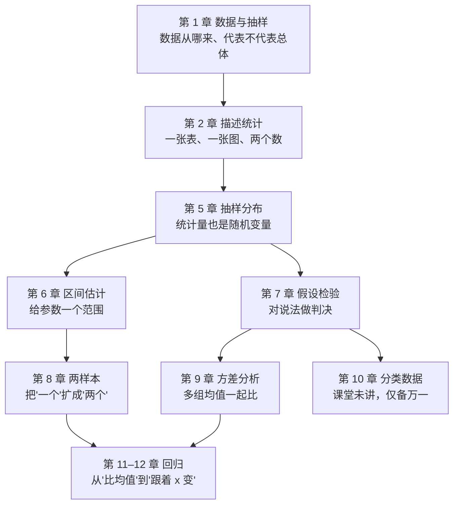

# 统计学 期末复习提纲

这份提纲按知识本身的依赖关系重排，不按讲义的教学顺序展开。每章回答四个问题：这个概念要解决什么、它凭什么成立、怎么用、什么时候不能用。术语在每章开头集中给出中英对照，正文首次出现时再随文标注。

## 0. 使用说明

**范围**。课堂实讲的是第 1 章、第 2 章（2.1–2.7）、第 5 章、第 6 章、第 7 章（7.1–7.7）、第 9 章、第 11 章与第 12 章的读数部分；第 3、4 章老师明确不学，第 8 章要求自学，第 10 章（分类数据）课堂上没有出现，2.8–2.10（散点图、时间序列、误导性图表）与 9.3 多重比较也没有展开。这些"未讲但课件有"的内容在文中单独标出，不占主线。

**结构**。第 1 节是全课的知识地图；第 2–9 节逐章讲知识点（第 1、2、5、6、7、8、9、11 章）；第 10 节做横向对比（把最容易混的东西并排放）；附录给公式墙、查表、术语总表、易错清单，最后附一页考试信息与课堂未讲内容。

**读法**。先看知识地图建立依赖关系，再逐章读。公式要能自己推一遍再背；例题要遮住答案自己算一遍；每章末尾的"边界与易错"是这一章真正会丢分的地方。

## 1. 知识地图：这门课在解决什么问题

统计学只做一件事：**用样本里有限的信息，对总体下一个有把握的结论**。为了这件事，它必须先解决三个前置问题——数据怎么来（第 1 章）、数据怎么描述（第 2 章）、样本统计量自己服从什么分布（第 5 章）。有了抽样分布，才谈得上"给参数一个区间"（第 6 章）和"对某个说法做判决"（第 7 章）。此后各章都是这两把刀在不同数据结构上的复用。

| 章 | 要解决的问题 | 核心工具 | 与前后章的关系 |
|---|---|---|---|
| 1 | 数据从哪来？能不能代表总体？ | 四种数据类型、五种抽样、两类误差 | 全课的地基，后面每个"样本"都默认是简单随机样本 |
| 2 | 手里这份数据长什么样？ | 表、图、均值与标准差、$z$ 分数、箱线图 | 给第 5 章提供"总体分布"的语言 |
| 5 | 抽一次得到的统计量会怎么抖？ | 抽样分布、标准误、中心极限定理 | 第 6、7 章的全部公式都从这里来 |
| 6 | 参数大概在哪个范围？ | $z$ 区间、$t$ 区间、比例区间、样本量 | 区间与检验是一枚硬币的两面 |
| 7 | 某个说法站得住吗？ | 五步法、$p$ 值、两类错误 | 第 9、11、12 章都在重复这套五步 |
| 8 | 两个总体有差别吗？ | 差值抽样分布、合并方差、配对 | 第 9 章"多组"的过渡 |
| 9 | 三组以上的均值一样吗？ | 变异分解、$F$ 比、区组与析因 | 把"多次比较"换成"一次检验" |
| 10 | 两个分类变量有关联吗？ | $\chi^2$ 拟合与独立性检验 | 与第 9 章同为"离散数据"的推断 |
| 11–12 | $y$ 怎么随 $x$ 变？ | 最小二乘、$R^2$、$t$ 与 $F$ 检验 | 第 9 章的平方和分解在这里再次出现 |

一句话记住三条主线：

1. **随机性**：样本统计量是随机变量，所以才有抽样分布、标准误、区间宽度和显著性。
2. **标准化**：所有推断统计量都是"估计值减假设值，再除以标准误"——$z,t,\chi^2,F$ 只是换了分母的分布。
3. **变异分解**：方差分析与回归都在把总变异拆成"被解释的"和"没解释的"，再用两者的比做判断。

---

## 2. 第 1 章　数据、抽样与统计思维

### 2.1 术语（中英对照）

| 中文 | 英文 | 一句话含义 |
|---|---|---|
| 统计学 | statistics | 收集、分类、汇总、组织、分析、解释数据的方法体系 |
| 描述统计 | descriptive statistics | 用表、图、数把手里这份数据说清楚 |
| 推断统计 | inferential statistics | 用样本推断总体，并给出把握程度 |
| 总体 | population | 研究对象的全体 |
| 个体／实验单元 | element / experimental unit | 总体中的每一个对象 |
| 变量 | variable | 个体的某个特征 |
| 样本 | sample | 从总体中抽出的一部分个体，容量记 $n$ |
| 参数 | parameter | 总体的数字特征，未知且固定 |
| 统计量 | statistic | 样本的数字特征，随样本变 |
| 定类数据 | nominal data | 只有类别，没有顺序 |
| 定序数据 | ordinal data | 有类别也有顺序，间距不一定相等 |
| 定距数据 | interval data | 等距，但没有自然零点 |
| 定比数据 | ratio data | 有自然零点，$0$ 表示"没有" |
| 抽样框 | sampling frame | 抽样时用来编号的名单 |
| 简单随机抽样 | simple random sampling | 每个容量为 $n$ 的样本被抽中的概率相同 |
| 系统抽样 | systematic sampling | 排序后每隔 $k$ 个抽一个 |
| 分层抽样 | stratified sampling | 先分层，每层都抽，再合并 |
| 整群抽样 | cluster sampling | 抽群，群内全部调查 |
| 多阶段抽样 | multistage sampling | 分阶段抽，前期阶段只能整群 |
| 随机化回答 | randomized response | 用随机装置保护隐私，估计敏感比例 |
| 抽样误差 | sampling error | 只抽到一部分个体带来的随机偏差 |
| 非抽样误差 | nonsampling error | 抽样以外的一切误差 |
| 抽样框误差 | selection bias | 有些单位根本没机会被抽中 |
| 理解、记忆、有意识误差 | understanding / memory / conscious bias | 问卷设计、回忆、隐私导致的测量误差 |
| 自愿回答、随机无回答、系统无回答 | voluntary / random / systematic non-response | 无回答偏差的三种来源 |
| 统计报表 | statistical report | 逐级上报的制度化数据 |
| 普查 | census | 对总体的全面调查 |

### 2.2 统计学是什么：一条从数据到决策的流水线

"statistics"有两个意思：作单数是一门学科，作复数指统计量或统计数据本身。词源上它来自"state"（国家）——最早被统计的是国家的人口、税收与军力，所以这门学问一开始就是"给国家算账"。作为学科，它的定义里有一串动词——**收集（collecting）、分类（classifying）、汇总（summarizing）、组织（organizing）、分析（analyzing）、解释（interpreting）**。这六个动作就是一条流水线：原始记录先被分类和汇总，才有形状；有了形状才能分析；分析完还要翻译回人能听懂的话。

**数据不等于信息**。一张 200 人的专业名单，逐行看只是 200 个名字；按专业数出频数、算出百分比，才看出"哪个专业人最多"。统计学的第一个动作永远是"把数据折成分布"。

**描述统计与推断统计的分界** 是结论有没有跨出样本：

- 算这 200 人的平均月消费，是描述统计；
- 用这 200 人估计全校学生的平均月消费，并说"误差不超过 30 元"，是推断统计。

跨出去就要付代价：样本有随机性，结论不可能百分之百确定，所以推断统计的每一次发言都必须带一个概率（置信水平、显著性水平、$p$ 值）。

老师把统计学的这一层讲成"数据 + 方法 + 概率"：数据是原料，方法是加工，概率是对"加工结果有多准"的度量。这也是它和机器学习相通的地方——模型从数据里学规律，本质上还是在用样本估计总体。

### 2.3 六个基本概念：一对必须分清的孪生兄弟

| 概念 | 英文 | 定义 | 记号 | 性质 |
|---|---|---|---|---|
| 总体 | population | 研究对象的全体 | $N$ | 通常拿不到 |
| 个体 | element | 总体中的每一个对象 | — | 是实体，不是属性 |
| 变量 | variable | 个体的某个特征 | $x$ | 有定量／定性之分 |
| 样本 | sample | 抽出的一部分个体 | $n$ | 实际观测到的 |
| 参数 | parameter | 总体的数字特征 | $\mu,\sigma,\pi,\rho$ | 未知、固定 |
| 统计量 | statistic | 样本的数字特征 | $\bar x,s,\hat p,r$ | 已知、随机 |

四对对应关系要背熟：

$$\bar x \leftrightarrow \mu,\qquad s \leftrightarrow \sigma,\qquad s^2 \leftrightarrow \sigma^2,\qquad \hat p \leftrightarrow \pi$$

**为什么参数是固定的、统计量是随机的**：总体定了，$\mu$ 就是一个确定的数，只是你不知道；样本每抽一次就换一批人，$\bar x$ 自然跟着变。所以"$\bar x$ 接近 $\mu$"不是必然，而是一个概率问题——这正是第 5 章要量化的东西。

判断一个数字是参数还是统计量，只看它 **从哪来**：1860 年林肯的得票率 39.82% 是全体选民的数字，是参数；今天抽 877 人得到 45% 不聘用有拼写错误者，是统计量。题干里出现"所有""全体""真实值"多半是参数，出现"抽样""调查了""样本"多半是统计量。

一个统计问题由五件事构成：目标总体、感兴趣的变量、要估计或检验的参数、样本、推断方法。五件事里任何一件说不清，后面的公式都会用错。

### 2.4 数据的四种类型：判据只有一条

| 类型 | 英文 | 判据 | 例子 | 允许的运算 | 能用的中心 |
|---|---|---|---|---|---|
| 定类 | nominal | 只能判断相等／不等 | 性别、专业、行业、血型 | 计数 | 众数 |
| 定序 | ordinal | 能排序，但间距不等 | 满意度、学历、名次 | 比较大小 | 中位数、众数 |
| 定距 | interval | 等距，但 $0$ 是人为规定的 | 摄氏温度、出生年份 | 加减 | 均值、标准差 |
| 定比 | ratio | 有自然零点，$0$ 表示"没有" | 年龄、体重、销售额 | 加减乘除 | 全部 |

判据浓缩成一句：**$0$ 是不是"没有"**。

- 年龄 0 岁＝没有年龄，所以年龄是定比；
- 公元 0 年不是"没有年份"，摄氏 0 度也不是"没有温度"，所以年份与温度是定距；
- 满意度"很满意／满意／一般"能排序，但"很满意"减"满意"没有意义，所以是定序。

**为什么这个分类重要**：它决定了你能用哪些统计方法。定类数据算均值没有意义（性别求平均？），只能用众数与频数；定序数据可以用中位数，但不能做加减；只有定量数据才能算均值、方差、$z$ 分数，也才能进入后面所有的 $t$ 检验与方差分析。

### 2.5 数据从哪来：四条来路与两种制度

| 来源 | 英文 | 特点 | 能回答什么 |
|---|---|---|---|
| 二手数据 | secondary data | 别人已收集好，成本最低 | 先查它，避免重复劳动 |
| 观察研究 | observational study | 只观察、不干预 | 能看关联，不能证因果 |
| 设计实验 | designed experiment | 主动控制处理、随机分配 | 唯一能证因果的来源 |
| 调查 | survey | 问卷、访问、电话 | 描述态度与行为，要防代表性偏差 |

**为什么只有设计实验能证因果**：要证明"$X$ 导致 $Y$"，必须保证除 $X$ 外其他因素都不变或随机平衡。观察研究里，$X$ 与 $Y$ 可能同时受第三个变量影响（混淆，confounding）；实验通过随机分配把混淆因素平均掉，才能把差异归给处理。

实验设计的三个必知概念：

| 概念 | 英文 | 含义 | 经典例子 |
|---|---|---|---|
| 对照组与处理组 | control group / treatment group | 只让一个因素变，其余控住 | 英国海军 4 艘军舰：1 艘喝柑橘汁（处理组），3 艘不喝（对照组），结果处理组没有坏血病 |
| 双盲 | double blind | 实施者与受试者都不知道分组 | 否则实施者会偏心关注实验组，受试者会有心理作用 |
| 混淆 | confounding | 同时变化的其他因素冒充处理效应 | 宣布"下周点名、缺席扣 5 分"后全到，也可能只是那天天气好 |

**两种制度化的调查**：

- **统计报表（statistical report）**：逐级上报。优点是口径统一、覆盖全；缺点是层层汇总容易失真，且被调查者有瞒报动机（营业额在门槛之下的小商户不愿上报）。
- **普查（census）**：全面调查。最大价值不是"算得准"，而是 **给抽样提供抽样框**；成本高、周期长，不宜频繁。我国四类普查的时间规律：人口普查逢 0、农业普查逢 5、经济普查逢 3 和 8，十年共四次。

来源的优先顺序：先查二手数据 → 明确研究问题、看出不足 → 再补一手数据（观察研究或实验）。

### 2.6 五种概率抽样：每一种都要能说出"为什么"

抽样的目的不是"抽到人"，而是 **让样本的结构逼近总体的结构**。概率抽样给每个单位一个已知的、非零的入样概率，这样才能计算抽样误差。

**（1）简单随机抽样（simple random sampling, SRS）**

定义的关键在"样本等概率"，不是"个人等概率"：从 $N$ 个个体中抽 $n$ 个，**每一个容量为 $n$ 的样本** 被抽中的概率都相同，等于 $1/\binom{N}{n}$。

操作两步：① 建抽样框，给每个个体编号；② 用随机数表或随机数发生器抽 $n$ 个编号。随机数表读数要事先定规则（从哪一列哪一行开始、取几位、超范围怎么办），否则"随机"就变成了"随手"。

- 优点：理论最完备，后面所有推断公式都默认样本来自 SRS；公平、无偏。
- 缺点：需要完整的抽样框；总体很大时编号与抽取都很麻烦；总体太小时也不合适（统计学研究的对象要求"大量性"）。
- 适用：总体规模不太大、个体之间差异不太大。

**（2）系统抽样（systematic sampling）**

三步：① 把总体按某种顺序排列；② 算间隔 $k=N/n$；③ 在第一个间隔内随机取一个起点，之后每隔 $k$ 个抽一个。

例：34 人抽 5 个，$k=34/5=6.8$，取整为 7；在 1–7 中随机取起点，之后每隔 7 人抽一个。

- 优点：只需一份名单，操作极简；如果排序用的变量与目标变量相关，等距抽样还可能提高精度（相当于隐式分层）。
- 缺点一：$k$ 除不尽时取整会破坏"等概率"。
- 缺点二：名单里若藏着周期（如每周 7 天、每班 40 人），等距就会与周期共振，抽到的永远是同一类人。

**（3）分层抽样（stratified sampling）**

先把总体按某个特征分成若干层（strata），要求 **层内差异小、层间差异大**；再在每一层内部分别抽样；最后合并估计。

三种分配方式：

| 分配 | 英文 | 每层抽多少 | 适用 |
|---|---|---|---|
| 等量分配 | equal allocation | 每层抽同样多 | 各层同等重要、层内差异相近 |
| 等比例分配 | proportional allocation | $n_h=\dfrac{N_h}{N}n$ | 最常用，样本结构与总体结构一致 |
| 最优分配 | optimal allocation | 层大、层内标准差大的多抽 | 层内差异差别很大 |

例：总体 1 万人分三层，占比 1%／50%／49%；抽 100 人，等比例分配就是 1／50／49。

**为什么分层抽样的精度最高**：抽样误差只来自"层内抽到谁"，层与层之间的差异被完全排除在误差之外。用方差的语言说，总方差被拆成层间方差与层内方差，分层把层间那一块从误差里拿掉了。

- 优点：精度最高；除了总体参数，还能同时估计各层的参数。
- 缺点：必须先有分层信息（收入、地区等），而这类信息往往难拿；分层指标选错，精度反而下降。
- 适用：层间差异大、层内差异小。

**（4）整群抽样（cluster sampling）**

把总体分成若干"群"（自然形成的组：班级、村、宿舍楼），随机抽若干个群，**群内全部调查**。

- 优点：只需要"群"的名单，不需要个体名单；省交通与组织成本。
- 缺点：群内个体往往相似，群与群之间差异大，这些差异全部进入误差，所以精度最差。
- 改进：把群切细（群内差异变大、群间差异变小），精度会上升；切到极限（一群一个个体）就退化成简单随机抽样。
- 适用：总体大、分散、没有个体名单。

**（5）多阶段抽样（multistage sampling）**

大规模调查分阶段抽：先抽群，再在抽中的群里抽下一级单位，逐级往下。例：全省 100 万农户抽 1000 户——抽 5 个县 → 每县抽 4 个乡 → 每乡抽 5 个村 → 每村抽 10 户。

铁律：**前期阶段只能用整群抽样**。原因不是统计原理，而是操作可行性——系统抽样要求全部个体的特征值，分层抽样要求分层指标（全国每户的年收入属于隐私），只有整群抽样只需要"下一级单位的名字"。最后一个阶段才考虑简单随机、系统或分层。

**分层与整群方向相反**（最容易混的一对）：

| | 分层抽样 | 整群抽样 |
|---|---|---|
| 划分依据 | 层内同质、层间异质 | 群内异质、群间同质 |
| 抽取方式 | 每层都抽 | 只抽部分群 |
| 误差来源 | 层内差异 | 群间差异 |
| 精度 | 最高 | 最低（同规模下） |
| 目的 | 提高精度 | 降低成本 |

**（6）随机化回答（randomized response）**

敏感问题（逃税、作弊、吸毒）直接问一定有人说假话。做法：让被访者先用随机装置（掷骰子、抽签）决定回答哪一题——一题是敏感问题，一题是无关问题——但不告诉调查员他回答的是哪一题。个体被保护，调查员只能从总体中"答是"的比例反解出敏感问题的比例。

### 2.7 误差：能消掉的与消不掉的

| 概念 | 英文 | 定义 | 能否消除 | 与样本量的关系 |
|---|---|---|---|---|
| 数据误差 | data error | 调查值与真值之差 | 目标是找原因、减小 | — |
| 抽样误差 | sampling error | 只抽到一部分个体带来的随机偏差 | 不能消除，只能估计与控制 | 增大 $n$ 会变小 |
| 非抽样误差 | nonsampling error | 抽样以外的一切误差 | 理论上可消除（测量误差实际很难） | 增大 $n$ 可能更大 |

**非抽样误差（一）：抽样框与测量**

| 类型 | 英文 | 怎么产生 | 例子 | 补救 |
|---|---|---|---|---|
| 抽样框误差 | selection bias | 有些单位根本没机会被抽中 | 1936 年《文学摘要》按电话簿与汽车登记簿寄出 1000 万份，回收约 230 万份，预测 Landon 胜 Roosevelt；结果罗斯福赢，杂志破产——1936 年的美国并非人人有电话和车 | 选对抽样框 |
| 理解误差 | understanding error | 问题本身模糊 | "你经常去公园吗"的 often／sometimes 各人理解不同；改成"一天抽几根烟" | 把问题写具体 |
| 记忆误差 | memory error | 记不准 | 报体重时频数在整十处出现尖峰 | 缩短回忆期、当场称 |
| 有意识误差 | conscious bias | 涉及隐私，故意报错 | 康熙 51 年"滋生人丁永不加赋"改按户征税后人口暴增——此前为逃税少报 | 匿名、密封回收、编号代替姓名 |

理解误差与记忆误差可高可低、平均下来问题不大；**有意识误差是有方向的（biased），最危险**——它不会因为样本变大而抵消，只会让估计整体偏移。

**非抽样误差（二）：无回答**

| 类型 | 英文 | 特征 | 补救 |
|---|---|---|---|
| 自愿回答 | voluntary response | 谁愿意答谁答，意见大的人更愿意填 | 不能用来推断总体，但开放题能提供线索 |
| 随机无回答 | random non-response | 与调查内容无关 | 加大发放量：要 1000 份、回收率八成，就发 1250 份 |
| 系统无回答 | systematic non-response | 与调查内容直接相关（不答的都是某类人） | 加大样本量无用，只能逐个突破 |

**为什么抽样误差可以算、非抽样误差不能算**：抽样误差来自"抽到谁"的随机性，只要抽样方式已知，它的分布就是确定的（第 5 章）；非抽样误差来自覆盖、问卷、谎报，每一项都没有概率模型，只能靠设计去防。

### 2.8 统计思维：把"变异"当成前提

- **过程与黑箱**：把系统看成"输入—过程—输出"。过程已知时按机制推；过程未知时只能靠数据反推——后者才是统计学的主场。
- **变异是前提**：如果所有个体都一样，抽一个就够了，不需要统计学。统计学的任务是区分"系统的差异"与"偶然的差异"，这也正是第 7 章假设检验的全部内容。
- **管理问题翻译成统计问题**：把"要不要进这个市场"翻译成"两个总体的平均销售额是否相等"，做完统计再翻译回管理语言。
- **小概率原理**：概率很小的事件在一次试验中认为不会发生。它是假设检验的思想基础——如果"原假设成立"时出现当前样本的概率只有 5%，我们就认为原假设站不住。

### 2.9 例题

**例 1：彩票的期望回报**

某期彩票发行 500 万张，2 元一张，总销售额 1000 万元；奖金总额约 400 万元，中奖约 250 万张。

- 中奖率 $=250/500=50\%$；
- 返还率 $=400/1000=40\%$；
- 每 2 元的期望回报 $=2\times40\%=0.8$ 元；每 1 元的期望回报是 $0.4$ 元。

**中奖率与返还率是两件事**：中奖率高不代表划算，返还率才是期望。私彩把返还率做到 80%，看似比官彩高，但期望仍是负的（每 1 元期望回收 0.8 元）；庄家留 20%，2000 万元流水就留下 400 万元。

**例 2：34 人抽 5 个（系统抽样）**

$k=34/5=6.8\to7$。在第 1 至第 7 号中随机取一个起点，之后每隔 7 人抽一个。注意 $k$ 取整后实际覆盖不到最后几人，等概率被破坏——这是系统抽样的固有代价。

**例 3：随机数表点名**

62 人，随机数表取两位读数。用秒表随机定起始位置（第 3 列第 5 行），按两位一组读数；超过 62 的剔除。若名单只有 49 人，读到 93 可减去 50 得 43 再用（这是老师课堂上的具体规则）。

**例 4：分层抽样的分配**

总体 1 万人，三层占 1%／50%／49%。抽 100 人：等量分配是 33／34／33；等比例分配是 1／50／49。等比例分配的样本结构与总体一致，所以样本均值可以直接当总体均值的估计。

**例 5：华工校园调查（多阶段）**

28 个学院 → 抽 12 个班 → 每班抽 120 间宿舍？更准确地说：学院 → 班级 → 宿舍 → 床位，逐级抽取，前几级都是整群，最后一级才在宿舍内抽床位。

### 2.10 边界与易错

1. SRS 是"样本等概率"，不是"每个人被抽中机会相同"。
2. 前几个阶段只能用整群；分层要分层指标，系统要全部特征值，都做不到。
3. 分层是"层内同质、层间异质"，整群是"群内异质、群间同质"，方向相反。
4. 抽样误差随 $n$ 减小；非抽样误差可能随 $n$ 增大（有意识误差、系统无回答）。
5. "有意识误差"是最危险的非抽样误差，因为它有方向，不会互相抵消。
6. 定距数据（年份、温度）不能算"翻几倍"；定类数据不能算均值。
7. 参数用希腊字母、统计量用拉丁字母，写反即错。
8. 统计报表的失真与普查的高成本，都是"制度化调查"的固有代价，不是执行问题。
---

## 3. 第 2 章　描述数据的方法

### 3.1 术语（中英对照）

| 中文 | 英文 | 一句话含义 |
|---|---|---|
| 汇总表 | summary table | 类别＋频数／相对频数 |
| 类、频数、相对频数、百分比 | class, class frequency, class relative frequency, class percentage | 定性数据的三件套 |
| 条形图 | bar chart | 柱高＝频数，柱间留空 |
| 饼图 | pie chart | 按相对频数切圆 |
| 帕累托图 | Pareto diagram | 降序条形＋累计百分比 |
| 点图 | dot plot | 一个点一个观测 |
| 茎叶图 | stem-and-leaf display | 拆茎与叶，保留原始值 |
| 直方图 | histogram | 分组计数 |
| 组数、组距 | number of classes, class width | 分组的两把尺子 |
| 频率多边形 | frequency polygon | 柱顶中点连线 |
| 概率密度曲线 | probability density curve | 直方图的极限 |
| 对称、右偏、左偏 | symmetric, right-skewed, left-skewed | 三种基本形状 |
| 双峰、均匀、U 型 | bimodal, uniform, U-shaped | 另外三种形状 |
| 均值、中位数、众数 | mean, median, mode | 三个中心 |
| 极差、方差、标准差 | range, variance, standard deviation | 三个离散程度 |
| 自由度 | degrees of freedom | 能自由变动的离差个数 |
| 无偏估计量 | unbiased estimator | 平均下来正中目标 |
| 经验法则 | empirical rule | 钟形对称下的 68／95／99.7 |
| 切比雪夫定理 | Chebyshev's theorem | 任意分布下的 $1-1/k^2$ |
| 百分位数、四分位数 | percentile, quartile | 位置测度 |
| 四分位距 | interquartile range | $Q_3-Q_1$ |
| $z$ 分数 | $z$-score | 离均值几个标准差 |
| 异常值 | outlier | 与其余观测明显不一致 |
| 内、外围栏 | inner / outer fence | $1.5\mathrm{IQR}$、$3\mathrm{IQR}$ |
| 五数概括 | five-number summary | min、$Q_1$、中位数、$Q_3$、max |
| 箱线图 | box plot | 箱体＋须＋异常点 |

### 3.2 描述统计的两个动作：先看形状，再算数字

一组数据拿到手，第一件事不是算均值，而是 **看形状**。形状决定后面该用哪个中心、哪个离散度，也决定能不能用正态分布那一套工具。

- 定性数据没有数轴，只能归类计数，用表与条形图／饼图／帕累托图；
- 定量数据有数轴，可以看位置、看分布，用点图／茎叶图／直方图／频率多边形。

**汇总表的三件套**：类（class）、频数（class frequency）、相对频数（class relative frequency）＝频数÷总观测数、百分比＝相对频数×100。三者相加分别等于 $n$、1、100%。汇总表的价值在于"把 $n$ 行记录折成几行分布"——左列是数据，右列才是信息。

**三张定性图怎么选**：

| 图 | 适合回答 | 关键规矩 |
|---|---|---|
| 条形图 | 哪一类最多？多多少？ | 定性变量用横条，定量变量用竖条；柱间留空 |
| 饼图 | 一个总体内部各占多少？ | 扇形角度与相对频数成比例；不能比较多个总体 |
| 帕累托图 | 主要矛盾是哪几类？ | 条形必须降序，再叠累计百分比折线 |

**为什么饼图不能比较两个总体**：饼图只画比例，不画基数。两个人数不同的总体，各画一个饼，看起来"份额一样"，实际人数可能差十倍。条形图带住了基数，所以跨总体比较要用它。

**帕累托图的降序为什么重要**：降序把"最重要的几类"排到最左边，眼睛不用比较就能看到主要矛盾；配合累计百分比，累计到 80% 左右的那几类就是重点。这个做法来自帕累托的 80/20 法则（vital few and trivial many）。

### 3.3 定量数据的图：从点图到概率密度曲线

**点图（dot plot）**：横轴是变量值，每个观测画一个点，重复的值垂直叠起来。样本几十个时最好用，形状一眼可见。

**茎叶图（stem-and-leaf display）**：把每个数拆成"茎"和"叶"。例如 196 拆成茎 19、叶 6。所有茎排成一列，叶横向升序排列。它比点图多给一样东西——**保留了原始数值**：从图上能直接读出"196 台出现了 5 天"，而不只是"这一带有 5 个点"。叶的位数必须统一，否则同一张图上的数不可比。

**直方图（histogram）**：数据上百上千时，前两张图都挤成一团，只能分组计数。三步：

1. **定组数**：Sturges 公式 $k=1+\log_2 n$。$n=120$ 时 $k=1+6.91=7.91$，取 8。
2. **定组距**：$(\max-\min)/k$。$n=120$、min 141、max 237 时，$(237-141)/8=12$，取整为 10。
3. **填频数表**：首组下限要低于最小值（从 140 开始），逐组计数。140–150 有 4 天，150–160 有 9 天……

两条约定：

- **组距必须一致**，否则柱高不可比；
- **组上限不在本组内**（左闭右开）：200 台归入 200–210 那一组，不归 190–200。

**纵轴的三种读法与"面积等于 1"**：纵轴可以放频数、相对频数或百分比。如果放的是 **频率密度**（相对频数÷组距），那么每根柱的面积＝组距×密度＝相对频数，所有柱的面积之和＝1。这就是"直方图面积等于 1"的含义：它表示"所有可能结果的总概率是 100%"。此时纵轴不是"另一个变量"，而是"单位横坐标上的概率"——与物理里"密度＝单位体积的质量"是同一个意思。

**频率多边形与概率密度曲线**：把每根柱顶边的中点连成折线，两端接回横轴，就是频率多边形。数据量越大、组分得越细，折线越平滑，极限就是 **概率密度曲线**。这条曲线是第 5 章"总体分布"的正式对象；直方图只是它的一次抽样近似。

**六种形状**：

| 形状 | 英文 | 典型例子 | 特征 |
|---|---|---|---|
| 对称 | symmetric | 考试成绩、身高 | 左右镜像，均值≈中位数 |
| 右偏 | right-skewed | 收入、住院天数 | 尾巴拖向右，均值被大值拉大 |
| 左偏 | left-skewed | 考试难度极大时的分数 | 尾巴拖向左，均值被小值拉小 |
| 双峰 | bimodal | 男女身高混在一起 | 两个峰，往往意味着两个总体混在一起 |
| 均匀 | uniform | 随机数、等概率事件 | 各段高度差不多 |
| U 型 | U-shaped | 死亡率与年龄 | 两头高、中间低 |

**双峰是一个警告**：两个峰通常说明数据里混了两个不同的总体（男女、两个车间、政策前后）。这时候不该算一个总均值，而应该先分组。

### 3.4 三个中心：均值是平衡点，中位数是面积平分线

**均值（mean）**：

$$\bar x=\frac{\sum x_i}{n}$$

它为什么叫"平衡点"？把数据画在数轴上、每个点放一个等重的砝码，均值就是这支尺子的支点。代数上，这等价于"支点两侧的力矩相等"：

$$\sum_{x_i<\bar x}(\bar x-x_i)=\sum_{x_i>\bar x}(x_i-\bar x)$$

也就是 **离差之和为零**：$\sum(x_i-\bar x)=0$。这条性质后面反复用到——算方差时先检查离差和是否为零，就知道均值有没有算错。

例：1 到 9 各放一个砝码，和为 45，均值 5；拿掉 8 上的砝码，和变 37，**要除以 8** 而不是 9，得 4.625。

**均值对极端值敏感**，因为它用的是"每个数离支点多远"。10 个人平均身高 1.6 m，再加入一个 1.9 m 的人，均值变 $(16+1.9)/11=1.627$；若样本是 100 人，只变到 1.603。样本越大，单个极端值的影响越小。

**结构决定均值**：30% 得 3 分、50% 得 2 分、10% 得 1 分、10% 得 0 分，均值恒为

$$0.3\times3+0.5\times2+0.1\times1+0.1\times0=2$$

10 人、20 人、200 人都一样。这说明均值只由 **比例结构** 决定，与人数无关——也说明抽样要让样本结构贴近总体结构。

**中位数（median）**：排序后中间位置上的 **变量值**（不是"中间的位置"）。

- $n$ 为奇数：第 $(n+1)/2$ 个；
- $n$ 为偶数：第 $n/2$ 与 $n/2+1$ 个的平均。

中位数只与"有多少个数在它两边"有关，所以 **不受极端值影响**。

**众数（mode）**：出现次数最多的值。可以没有（所有值都只出现一次），也可以不止一个（双众数）。众数是唯一能用于定类数据的中心。

**三者的选择**：

| 数据／形状 | 用哪个 | 理由 |
|---|---|---|
| 定类 | 众数 | 不能排序，更不能算均值 |
| 定序 | 中位数、众数 | 能排序但不能加减 |
| 定量、对称 | 均值 | 用上了全部信息，最有效 |
| 定量、偏态 | 中位数 | 不受尾部极端值影响（美国住户年收入公布的就是中位数） |

**偏态时三者的位置**（考点）：

| 形状 | 位置 | 原因 |
|---|---|---|
| 对称 | $\bar x\approx\text{median}\approx\text{mode}$ | 三者重合 |
| 右偏 | $\text{mode}<\text{median}<\bar x$ | 均值被右边的大值拉大 |
| 左偏 | $\bar x<\text{median}<\text{mode}$ | 均值被左边的小值拉小 |

几何上：众数是最高点对应的横坐标，中位数把面积一分为二，均值是重心。右偏时右边拖着一条长尾，重心被拖向右边，而把面积平分的点移动得少一些。

### 3.5 三个离散程度：极差、方差、标准差

**极差（range）**：$R=\max-\min$。算起来最快，但只用了两个观测，中间的数据全被忽略——两组数据可以极差相同而形状完全不同，所以它"rather insensitive"。

**为什么不用平均离差**：$\sum(x_i-\bar x)/n$ 恒等于 0（正负抵消），没有信息。要消除符号，只有两条路：取绝对值或平方。绝对值不可导、对大偏差惩罚不够；平方可导、惩罚大偏差、且正好对应"误差方差最小"，所以统计学选平方。

**方差（variance）**：

$$s^2=\frac{\sum(x_i-\bar x)^2}{n-1},\qquad \sigma^2=\frac{\sum(x_i-\mu)^2}{N}$$

**为什么样本方差除以 $n-1$**：如果除以 $n$，得到的估计平均下来偏小。用一个只有 3 个个体的小总体可以算穿：从总体里抽所有可能的样本，算每个样本的方差，再取平均——除以 $n$ 的版本平均值小于 $\sigma^2$，除以 $n-1$ 的版本正好等于 $\sigma^2$。所以 $s^2$ 是 $\sigma^2$ 的 **无偏估计量（unbiased estimator）**。

第二种解释是自由度：$n$ 个离差受 $\sum(x_i-\bar x)=0$ 约束，只有 $n-1$ 个能自由变动。分母用"能自由变动的个数"，才让方差成为"平均每个自由信息的变异"。

**标准差（standard deviation）**：$s=\sqrt{s^2}$。方差的问题是单位被平方（股价的方差单位是"元的平方"），开根号后单位回到原始数据，才能和均值直接比较、才能说"离均值几个标准差"。

### 3.6 标准差能说多少：经验法则与切比雪夫

**经验法则（empirical rule）**：若分布 **钟形且对称**，

- $\bar x\pm1s$ 内约 68%；
- $\bar x\pm2s$ 内约 95%；
- $\bar x\pm3s$ 内约 99.7%。

**切比雪夫定理（Chebyshev's theorem）**：对 **任意** 分布，$k>1$ 时

$$P(\lvert x-\mu\rvert<k\sigma)\ge1-\frac{1}{k^2}$$

即 $\pm2\sigma$ 内至少 75%，$\pm3\sigma$ 内至少 88.9%。

两者的分工：

| | 经验法则 | 切比雪夫 |
|---|---|---|
| 前提 | 钟形、对称 | 任意形状 |
| 措辞 | 大约 | 至少 |
| $k=1$ | 68% | 无信息（$1-1=0$） |
| 精度 | 高 | 宽（保守） |

**为什么切比雪夫只能说"至少"**：它不假设形状，最坏情况下数据可以几乎全堆在两端，所以只能给一个下界。$k=1$ 时下界是 0，什么也没说，因此规定 $k>1$。

**"至少 75%"与"大约 95%"打架吗**：不打架。切比雪夫说"无论什么形状，$\pm2s$ 内至少有 75%"；经验法则说"如果是钟形，大约有 95%"。75% 是保底，95% 是加了形状信息后的更精确说法。科学的东西没有理由是矛盾的。

### 3.7 位置：百分位数、四分位数与 $z$ 分数

**百分位数（percentile）**：第 $p$ 百分位数是有 $p\%$ 的观测不超过它、$(100-p)\%$ 不低于它的那个值。分 100 份要切 99 刀；分 4 份切 3 刀，所以

$$Q_1=P_{25},\qquad Q_2=\text{median}=P_{50},\qquad Q_3=P_{75}$$

**位置公式**：

$$L=\frac{p}{100}(n+1)$$

$L$ 不是整数时，用两侧的值线性插值。例：$n=8$ 求 $P_{25}$，$L=0.25\times9=2.25$，取第 2 个与第 3 个值的加权平均（0.75 与 0.25 的权重）。四分位数用 $i(n+1)/4$。

老师补充过一句：用分布曲线算面积更准确——这是方法上的争议点，考试按课本插值法。

例：GMAT 560 分处于第 58 百分位，意思是 58% 的考生比你低、42% 比你高。

**四分位距（interquartile range, IQR）**：

$$\mathrm{IQR}=Q_3-Q_1$$

它量的是中间 50% 数据的跨度（mid-spread），不受两端极端值影响。$\mathrm{IQR}=0$ 表示中间 50% 是同一个值（只有定序数据才可能出现）。

**$z$ 分数（$z$-score）**：

$$z=\frac{x-\bar x}{s}\quad\text{或}\quad z=\frac{x-\mu}{\sigma}$$

读法：这个观测离均值 **几个标准差**。它是一个无量纲的数，所以能跨总体比较——82 分的数学和 78 分的语文，要用各自的 $z$ 才能比。

$z$ 的三个用途：

1. **定位**：$z=1$ 约对应 84% 分位（左侧面积），$z=2$ 约 97.5%，$z=3$ 约 99.86%。
2. **判异常**：$\lvert z\rvert>3$ 视为异常值；高度偏态的数据 $\lvert z\rvert>2$ 就值得怀疑。
3. **标准化**：$z$ 变换只做平移与缩放，**位置不变、形状不变**（原来 U 型还是 U 型；$s>1$ 会"瘦身"、$s<1$ 会"增肥"）。

例：装配时间 $\mu=22.5$、$\sigma=2.5$。20 分钟：$z=(20-22.5)/2.5=-1$；27.5 分钟：$z=+2$。再用经验法则就能说出"比 20 分钟慢的人约占 84%"。

**高考标准分** 是 $z$ 的一个应用：$500+100z$，把 $z\in[-4,4]$ 映到 100–900 分。目的是拉开距离、避免负分；代价是"看不懂"，所以后来被取消。本课程期末用原始分数，不用标准分。

### 3.8 异常值与箱线图

**异常值（outlier）**：相对其他观测异常大或异常小的值。三种成因：

1. 记录／录入错误（能改就改）；
2. 来自另一个总体（该分组，不该硬算一个均值）；
3. 数值正确但代表稀有的真实事件（如 2003 年 SARS 让航空油料运输量断崖式下跌）——不能简单删掉，建模时要小心。

**两把判异常的尺子**：

| 尺子 | 判据 | 适用 |
|---|---|---|
| $z$ 分数 | $\lvert z\rvert>3$（偏态时 $>2$） | 近似对称 |
| IQR 围栏 | $x<Q_1-1.5\mathrm{IQR}$ 或 $x>Q_3+1.5\mathrm{IQR}$ | 任意形状 |

**为什么 IQR 判据更稳健**：$Q_1,Q_3$ 本身不受极端值影响，而 $\bar x,s$ 会被极端值拉大——一个特别大的观测会把 $z$ 的尺子自己撑长，于是它反而不显眼了。

**内外围栏与画法**：

1. 求五数概括：min、$Q_1$、median、$Q_3$、max；
2. 算 $\mathrm{IQR}=Q_3-Q_1$；
3. 内围栏 $Q_1-1.5\mathrm{IQR}$、$Q_3+1.5\mathrm{IQR}$；外围栏 $Q_1-3\mathrm{IQR}$、$Q_3+3\mathrm{IQR}$；
4. 画箱：箱体从 $Q_1$ 到 $Q_3$，中间画中位线；
5. 画须：没有异常值时连到 min 与 max；有异常值时，**须只连到围栏内的最大／最小观测**，围栏外的点单独标出——内栏与外栏之间是可疑异常值（Stata 标 `*`），超出外栏是高度可疑（标 `0`）。

**反过来读形状（考点）**：箱体四段各含 25% 的数据。把它映射到密度曲线上，**四段的面积必须相等**，所以 **某一段越短，那里的密度必须越高**。

| 形状 | 箱线图特征 |
|---|---|
| 对称 | 箱体中位线居中，两须等长 |
| 右偏 | 右侧须长、箱体偏左、中位线靠左 |
| 左偏 | 左侧须长、箱体偏右 |
| 均匀 | 箱子大、两须短，四段差不多宽 |

老师指出课本上配对的左偏／右偏两幅图都是错的，判断标准只有一条——"最窄的一段必然对应最高处"。

### 3.9 例题

**例 1：Barnes 医院临终关怀**

67 份记录，住院天数 1–185 天：

$$\bar x=35.7,\qquad \text{median}=17,\qquad \text{mode}=1$$

三者差距很大，说明分布严重右偏：一半病人 17 天内出院，最多人只住 1 天（家里无法照护，最后一天才送来），而少数长期住院者把均值拉到 35.7。**这时候报均值会高估"典型"住院天数，应报中位数。**

**例 2：八只新股收盘价**

$$17,\ 16,\ 21,\ 18,\ 13,\ 16,\ 12,\ 11$$

| 量 | 计算 | 结果 |
|---|---|---|
| 均值 | $124/8$ | $15.5$ |
| 排序 | 11, 12, 13, 16, 16, 17, 18, 21 | — |
| 中位数 | 第 4.5 位：$(16+16)/2$ | $16$ |
| 众数 | 16 出现两次 | $16$ |
| 平方和 | 逐行离差平方求和 | $78$ |
| 方差 | $78/7$ | $11.14$ |
| 标准差 | $\sqrt{11.14}$ | $3.34$ |

离差之和为 0（$+1.5+0.5+5.5+2.5-2.5+0.5-3.5-4.5=0$），说明均值没算错。

**例 3：六个观测**

$$10.3,\ 4.9,\ 8.9,\ 11.7,\ 6.3,\ 7.7$$

均值 $49.8/6=8.3$；$\mathrm{SS}=31.84$；$s^2=31.84/5=6.368$；$s=2.52$。若错用 $n=6$，得 $5.31$，偏小约 1.06。

**例 4：$z$ 分数与分位**

$\mu=22.5$、$\sigma=2.5$。20 分钟：$z=-1$，约 84% 的人比它慢；27.5 分钟：$z=+2$，约 97.5% 的人比它慢。

**例 5：四分位数与 IQR**

给定数据求得 $Q_3=10.3$、$Q_1=6.3$，$\mathrm{IQR}=4.0$；内围栏 $6.3-6=-0.3$ 与 $10.3+6=16.3$，超出者判为可疑异常值。

### 3.10 边界与易错

1. 直方图的纵轴若放频数，柱高不是概率；只有密度图的面积才是概率。
2. 组上限不在本组内（200 台归 200–210）。
3. 频率多边形两端要接回横轴。
4. 右偏时均值最大，不要写成最小。
5. 样本方差除 $n-1$、总体方差除 $N$。
6. 经验法则要"钟形对称"，切比雪夫才适用于任意形状。
7. 百分位数先排序，位置公式是 $\frac{p}{100}(n+1)$。
8. 有异常值时须线不能一路连到 max。
9. 箱线图读形状的核心是"四段面积相等、越短越高"，不是"箱子越长越偏"。
10. 双峰数据不要硬算一个总均值，先分组。
---

## 4. 第 5 章　抽样分布

### 4.1 术语（中英对照）

| 中文 | 英文 | 一句话含义 |
|---|---|---|
| 总体分布 | population distribution | 总体中个体取值的概率分布 |
| 样本数据分布 | sample data distribution | 这一次抽到的 $n$ 个数的分布 |
| 抽样分布 | sampling distribution | 容量相同的所有可能样本的统计量的概率分布 |
| 标准误 | standard error | 统计量抽样分布的标准差 |
| 中心极限定理 | central limit theorem | $n$ 大时样本均值近似正态 |
| 无偏估计量 | unbiased estimator | 抽样分布的均值等于参数 |
| 有效性 | efficiency | 无偏前提下方差更小 |
| 一致性 | consistency | $n\to\infty$ 时估计量趋近参数 |
| 最小方差无偏估计量 | minimum-variance unbiased estimator | 无偏估计量里方差最小 |

### 4.2 为什么需要抽样分布

样本均值 $\bar x$ 是算出来的一个数，但换一批样本它就会变——所以它是一个 **随机变量**。既然是随机变量，就该问它服从什么分布。这个分布叫 **抽样分布（sampling distribution）**：容量相同的所有可能样本的统计量的概率分布。

定义里有三个要点，缺一不可：

1. **容量相同**：$n$ 变了，分布就变了；
2. **所有可能样本**：不是"抽到的那个样本"，而是理论上把全部样本都抽一遍；
3. **横坐标是统计量**：不是原始变量 $x$，而是 $\bar x$、$\hat p$、$s$ 这类统计量。

第三点最容易错。总体分布的横坐标是"一个人的收入"，抽样分布的横坐标是"一个样本的平均收入"——两者形状可以完全不同。

**为什么它是理论分布**：没有人真的会把所有样本抽尽（组合数天文数字），它只是一个"如果抽无穷多次会怎样"的概率模型。正因为有它，我们才能用 **一个** 样本去推断总体：这个样本是抽样分布的一次实现，而抽样分布的形状已知。

### 4.3 三种分布只差一个横坐标

| 分布 | 横坐标 | 标准差 | 用途 |
|---|---|---|---|
| 总体分布 | 个体的取值 $x$ | $\sigma$ | 描述总体，通常未知 |
| 样本数据分布 | 这一次的观测 $x_i$ | $s$ | 描述样本，随抽样变 |
| $\bar x$ 的抽样分布 | 样本均值 $\bar x$ | $\sigma/\sqrt n$ | 做推断 |

**手算造一次抽样分布**：总体 $\{1,2,3,4\}$，可重复抽 $n=2$，共 $4^2=16$ 个样本：

| 样本 | 均值 | 样本 | 均值 |
|---|---|---|---|
| (1,1) | 1.0 | (3,1) | 2.0 |
| (1,2) | 1.5 | (3,2) | 2.5 |
| (1,3) | 2.0 | (3,3) | 3.0 |
| (1,4) | 2.5 | (3,4) | 3.5 |
| (2,1) | 1.5 | (4,1) | 2.5 |
| (2,2) | 2.0 | (4,2) | 3.0 |
| (2,3) | 2.5 | (4,3) | 3.5 |
| (2,4) | 3.0 | (4,4) | 4.0 |

把 16 个均值数频数：1.0 一个、1.5 两个、2.0 三个、2.5 四个、3.0 三个、3.5 两个、4.0 一个——中间高、两边低，已经有点像钟形。它的均值仍是 2.5，标准差是总体标准差 $1.118$ 除以 $\sqrt2$，约 $0.79$，比总体更窄。

这张表说明两件事：抽样分布不必与总体同形；它的中心与总体相同，宽度却更小。

### 4.4 样本均值的两条性质

**性质一：$\mu_{\bar x}=\mu$**

$$\mu_{\bar x}=E(\bar x)=\mu$$

证明只要一行：期望是线性的，

$$E(\bar x)=E\!\left(\frac{1}{n}\sum x_i\right)=\frac{1}{n}\sum E(x_i)=\frac{1}{n}\cdot n\mu=\mu.$$

含义：$\bar x$ 是 $\mu$ 的 **无偏估计量**——单个样本可能偏高或偏低，但"平均下来"正好回到 $\mu$。这就是"偶然性"与"必然性"的关系：每个样本的偏差是偶然的，所有样本平均后偏差抵消，剩下必然。

**性质二：$\sigma_{\bar x}=\sigma/\sqrt n$**

$$s^2_{\bar x}=\frac{\sigma^2}{n},\qquad \sigma_{\bar x}=\frac{\sigma}{\sqrt n}$$

推导：独立观测的和的方差可加，

$$\mathrm{Var}\!\left(\sum x_i\right)=n\sigma^2,\qquad \mathrm{Var}(\bar x)=\mathrm{Var}\!\left(\frac{1}{n}\sum x_i\right)=\frac{1}{n^2}\cdot n\sigma^2=\frac{\sigma^2}{n}.$$

开根号即得。含义：

- 样本量翻四倍，标准误减半（$1/\sqrt4=1/2$）——精度提升是"平方根级"的，想精度翻倍要四倍样本；
- $\bar x$ 的取值不会超过总体的最大值，也不会低于最小值，算均值本身就是一次收敛。

**标准误（standard error）** 这个名字专指"统计量抽样分布的标准差"，与样本标准差 $s$ 不同：$s$ 描述个体之间的差异，$\sigma/\sqrt n$ 描述"样本均值之间的差异"。第 5 章最常错的一处就是把两者混用。

### 4.5 形状：正态总体与中心极限定理

**总体正态时**：无论 $n$ 多小，$\bar x$ 都服从正态分布 $N(\mu,\sigma^2/n)$。

**总体非正态时**：$\bar x$ 的抽样分布没有简单形式，但 **$n$ 足够大** 时近似正态。这就是中心极限定理（central limit theorem, CLT）：

> 从任意分布（均值 $\mu$、标准差 $\sigma$）中抽容量为 $n$ 的样本，当 $n$ 足够大时，$\bar x$ 近似服从 $N(\mu,\sigma^2/n)$。

**"足够大"是多大**：经验线是 $n\ge30$。样本越小、总体越偏，近似越差；总体本身正态时不需要这条线。

**为什么"平均"会把形状抹平**：$n=2$ 时，极端值出现的概率还很大，抽样分布可能保持总体的怪形状（U 型总体甚至会出现三个小峰）；$n$ 增大后，"全部抽到同一侧"的概率迅速变小，左右都抽到、平均后向真实均值靠拢，分布越来越尖、越来越对称。老师要求记住那幅"总体分布 → $n=2$ → $n=5$ → $n=30$"的图，因为后面所有区间与检验都靠它。

**标准化**：

$$z=\frac{\bar x-\mu}{\sigma/\sqrt n}\sim N(0,1)$$

标准化只做平移与缩放，**位置不变、形状不变**：原来是正态，标准化后还是正态；只是把"元"换成了"几个标准误"。好处是只需要一张标准正态表就能算概率。

### 4.6 样本比例的抽样分布

比例 $\hat p=x/n$ 本质上是 0/1 变量的样本均值（成功记 1、失败记 0），所以两条公式可以照搬：

$$\mu_{\hat p}=\pi,\qquad \sigma_{\hat p}=\sqrt{\frac{\pi(1-\pi)}{n}}$$

**与均值的相同点**：都是无偏、标准误都随 $\sqrt n$ 缩小、大样本都近似正态。

**与均值的不同点**（两处）：

1. **$\pi$ 出现在自己的标准误里**。估计均值时 $\sigma$ 与 $\mu$ 互不相干（总体可以"均值 12、标准差 0.5"也可以是"均值 12、标准差 2"）；估计比例时，标准误由 $\pi$ 自身决定，$\pi$ 靠近 0 或 1 时标准误反而小。
2. **正态近似的门槛由 $\pi$ 与 $n$ 共同决定**，不能只看 $n\ge30$。本课程用

$$n\pi\ge15\quad\text{且}\quad n(1-\pi)\ge15.$$

教材幻灯片上印的是 5，老师说按 15 用。为什么会有分歧：$\hat p$ 的真分布永远是离散的二项分布，正态只是替身；5 是"懒得计较"，15 是"计较一点"。三者（国内教材 5、AP 统计 10、本教材 15）没有谁错，只是要求不同。

例：EAI 培训，$\pi=0.6$。$n=30$ 时 $n(1-\pi)=12<15$，不满足；改成 $n=40$ 后两边都过。此时 $\sigma_{\hat p}=\sqrt{0.6\times0.4/40}=0.0775$，求 $P(0.55\le\hat p\le0.65)$：$z=\pm0.6455$，查表得约 0.48。

### 4.7 点估计：一条规则，不是一个数

**点估计（point estimate）** 是用一个数估计参数；**估计量（estimator）** 是那条规则（比如"用样本均值估计总体均值"），估计值是规则用在某个样本上的结果。前者是随机变量，后者是一个数。

好估计量有三条标准：

| 标准 | 英文 | 含义 | 例 |
|---|---|---|---|
| 无偏 | unbiased | 抽样分布的均值等于参数 | $\bar x$ 是 $\mu$ 的无偏估计 |
| 有效 | efficient | 两个无偏估计量里方差更小 | 同样无偏，方差小的更好 |
| 一致 | consistent | $n\to\infty$ 时趋近参数 | $n=N$ 时退化为普查 |

**最小方差无偏估计量（MVUE）** 是三条里最强的那个：在所有无偏估计量中方差最小。$\bar x$ 是 $\mu$ 的 MVUE，$\hat p$ 是 $\pi$ 的 MVUE，$s$（除以 $n-1$）是 $\sigma$ 的 MVUE。

**一条必须说清的区分**：无偏不等于"这一次准"。无偏是说"重复抽样时平均下来正中靶心"，单个样本仍然可能偏得很远——这正是为什么还需要区间估计。

### 4.8 例题

**例 1：AT&T 长途电话**

总体正态，$\mu=8$ 分钟，$\sigma=2$ 分钟，$n=25$。求 $P(7.8<\bar x<8.2)$。

$$\sigma_{\bar x}=\frac{2}{\sqrt{25}}=0.4,\qquad z=\frac{7.8-8}{0.4}=-0.5,\quad z=\frac{8.2-8}{0.4}=0.5$$

查表 $0$ 到 $0.5$ 的面积为 0.1915，双侧乘 2：$P=0.383$。

**例 2：罐装汽水**

$\mu=12$ 盎司，$\sigma=0.2$，$n=50$（大样本），求 $P(\bar x<11.95)$。

$$z=\frac{11.95-12}{0.2/\sqrt{50}}=-1.77$$

查表 1.77 对应 0.4616，左尾 $=0.5-0.4616=0.0384$。

**例 3：2500 名管理人员抽 36 个**

$\hat p$ 只能取 $0/36,1/36,\dots,36/36$ 共 37 个值，是离散分布；$n=36$ 时标准误约 0.08，抽样误差很大——这正是第 6 章要用区间估计解决的问题。

### 4.9 边界与易错

1. 抽样分布不是"样本数据的分布"，横坐标是统计量。
2. 标准误 $\sigma/\sqrt n$ 与样本标准差 $s$ 不同。
3. 比例的正态近似看 $n\pi$ 与 $n(1-\pi)$，不看 $n\ge30$。
4. 本课程的比例判据用 15，不是 5。
5. 无偏不等于"每次都对"。
6. 总体非正态也能做推断，只要 $n$ 够大。
7. 算 $\bar x$ 的 $z$ 才除以 $\sqrt n$；算单个观测的 $z$ 不除。

---

## 5. 第 6 章　区间估计

### 5.1 术语（中英对照）

| 中文 | 英文 | 一句话含义 |
|---|---|---|
| 点估计 | point estimate | 一个数 |
| 区间估计 | interval estimate | 一个区间＋一个把握程度 |
| 置信系数、置信水平 | confidence coefficient / level | $1-\alpha$ |
| 置信区间 | confidence interval | 估计值 ± 可靠系数 × 标准误 |
| 误差界限 | margin of error | 区间的一半宽度 |
| 可靠系数 | reliability coefficient | $z_{\alpha/2}$ 或 $t_{\alpha/2}$ |
| 估计标准误 | estimated standard error | $s/\sqrt n$ |
| 调整比例 | adjusted proportion | $\tilde p=(x+2)/(n+4)$ |
| 有限总体校正因子 | finite population correction | $\sqrt{(N-n)/(N-1)}$ |

### 5.2 从"一个点"到"一个区间"

点估计的问题是：它只给一个数，给不出"这个数有多可信"。德军坦克的例子最能说明：缴获 5 辆编号 12、27、33、58、71，用 $\hat N=2\bar x-1=79.4$ 估出总数约 79（真值 80），方法好得惊人——但你能说"我有 95% 的把握认为总数在 70 到 90 之间"吗？不能。你手上只有一个数，没有概率信息。

区间估计补的正是这一块：给一个区间，再给一个"长期看有多准"的概率。

### 5.3 区间的构造：一次等价变形

设总体均值 $\mu$ 未知、$\sigma$ 已知。由第 5 章，

$$P\!\left(-z_{\alpha/2}<\frac{\bar x-\mu}{\sigma/\sqrt n}<z_{\alpha/2}\right)=1-\alpha.$$

把括号里的不等式解出 $\mu$：

$$P\!\left(\bar x-z_{\alpha/2}\frac{\sigma}{\sqrt n}<\mu<\bar x+z_{\alpha/2}\frac{\sigma}{\sqrt n}\right)=1-\alpha.$$

所以

$$\bar x\pm z_{\alpha/2}\frac{\sigma}{\sqrt n}.$$

**这个变形为什么合法**：$\bar x$ 落在 $\mu$ 两侧 $z\sigma_{\bar x}$ 之内，与"以 $\bar x$ 为中心、半径 $z\sigma_{\bar x}$ 的区间盖住 $\mu$"是同一件事。老师用一张图讲这个等价关系：先把"$\bar x$ 的抽样分布"画出来，再把同一个不等式翻译成"区间盖住参数"。

### 5.4 95% 到底在说谁

正确读法：**反复抽同样容量的样本，每次造一个区间，长期看约有 95% 的区间会盖住真参数**。

错误读法："这个区间有 95% 的概率包含 $\mu$"。参数是固定的，区间是随机的；概率属于"造区间"这个动作，不属于某一个已经算出来的区间。已经算出来的区间要么盖住、要么没盖住，没有概率可言。

**置信度与精度互相牺牲**：20–99（宽区间、99.9% 把握）与 91–92（窄区间、0.5% 把握）是老师给的两个反例——前者几乎等于没估计，后者几乎没有把握。想同时要好，只能加大样本量。

**置信系数为什么记作 $1-\alpha$**：$\alpha$ 是"区间没盖住"的概率。统计学的记号习惯把"错误率"放在 $\alpha$ 上，所以置信水平写成 $1-\alpha$。

**常用对应**（要背）：

| 置信水平 | $1-\alpha$ | $z_{\alpha/2}$ | 查表用中间面积 |
|---|---|---|---|
| 90% | 0.90 | 1.645 | **0.45** |
| 95% | 0.95 | 1.96 | 0.475 |
| 98% | 0.98 | 2.33 | 0.49 |
| 99% | 0.99 | 2.575 | 0.495 |

**查表方向**：标准正态表给的是"均值到 $z$ 之间的面积"，所以 90% 要拿 $0.90/2=0.45$ 去查，不是 0.05，也不是 0.90。90% 对应 1.645 这个数，可以从表里 1.64 与 1.65 之间插值得到。

### 5.5 大样本与小样本：$z$ 与 $t$ 的分工

**大样本均值区间**：

$$\bar x\pm z_{\alpha/2}\frac{\sigma}{\sqrt n}$$

条件：随机样本；$n\ge30$（或总体正态）；$\sigma$ 已知。$\sigma$ 未知但 $n\ge30$ 时，可以用 $s$ 代替 $\sigma$ 近似。

**为什么 $\sigma$ 换成 $s$ 就要换分布**：$z$ 的公式里只有 $\bar x$ 随抽样变，$\sigma$ 是常数；换成 $s$ 之后，$\bar x$ 与 $s$ 都在变，商不再服从标准正态，而服从 $t$ 分布。

**$t$ 分布** 与 $z$ 的"三个一样、三个不一样"：

| 一样 | 不一样 |
|---|---|
| 对称、钟形 | 尾部更厚（矮胖），同样置信水平对应更大的临界值 |
| 均值都是 0 | 方差大于 1，随自由度变化 |
| 都可查表 | 自由度越小越矮胖，$df\to\infty$ 才趋于标准正态 |

**自由度为什么是 $n-1$**：$n$ 个离差受 $\sum(x_i-\bar x)=0$ 约束，只有 $n-1$ 个能自由变动。$t$ 表按 $df$ 查，而且给的是 **右尾面积**（与 $z$ 表的"中间面积"方向相反）。

**小样本均值区间**：

$$\bar x\pm t_{\alpha/2}\frac{s}{\sqrt n},\qquad df=n-1$$

条件：随机样本；**总体近似正态**；$\sigma$ 未知。三条缺一不可——小样本时无法靠中心极限定理救场，总体不正态就没有可用的分布。

### 5.6 比例的区间

$$\hat p\pm z_{\alpha/2}\sqrt{\frac{\hat p\hat q}{n}}$$

条件：随机样本；$n\hat p\ge15$ 且 $n\hat q\ge15$。注意区间阶段用 **样本比例** $\hat p$（因为 $\pi$ 未知），检验阶段才用假设值 $\pi_0$。

**调整区间**：当 $\hat p$ 贴近 0 或 1、或 $n$ 很小时，上面的区间会坏掉（可能越过 0 或 1，或者宽度变成 0）。补救是先虚拟补上 2 个成功、2 个失败：

$$\tilde p=\frac{x+2}{n+4},\qquad \tilde p\pm z_{\alpha/2}\sqrt{\frac{\tilde p\tilde q}{n+4}}$$

### 5.7 样本量：把"精度"翻译成"人数"

由误差界限 $E=z_{\alpha/2}\sigma/\sqrt n$ 反解：

$$n=\frac{(z_{\alpha/2})^2\sigma^2}{E^2}.$$

比例的情形用 $\pi(1-\pi)$ 代替 $\sigma^2$；$\pi$ 未知时取 0.5，因为 $\pi(1-\pi)$ 在 0.5 处最大，给出的 $n$ 最保守。

**必须向上取整**：算出 245.86 就取 246，算出 3006.7 就取 3007。取小了，误差就超了。

**"within $X$" 要先找 $\pm$**：有 $\pm$，$X$ 是半宽（误差界限）；没有 $\pm$、只说"区间宽度"，半宽是 $X/2$。两种读法差四倍——同样的比例问题，$X=0.03$ 当半宽是 752 人，当全宽是 3007 人。

### 5.8 有限总体校正与方差的区间

**有限总体校正（finite population correction）**：当抽样比例 $n/N>5\%$ 时，均值标准误要乘

$$\sqrt{\frac{N-n}{N-1}}.$$

它只修标准误，不改中心。$n=N$ 时因子为 0，标准误为 0——普查没有抽样误差，与直觉一致。

**方差的区间**：由 $\dfrac{(n-1)s^2}{\sigma^2}\sim\chi^2(n-1)$ 反解，

$$\left[\frac{(n-1)s^2}{\chi^2_{\alpha/2}},\ \frac{(n-1)s^2}{\chi^2_{1-\alpha/2}}\right].$$

注意分母的摆放：**大的 $\chi^2$ 值放分母得下限**，小的放分母得上限。$\chi^2$ 分布右偏，所以方差的区间天生不对称——这是它与均值区间最大的不同。

### 5.9 例题

**例 1：2 升瓶装饮料**

$\sigma=0.05$ L，$n=100$，$\bar x=1.99$ L，求 90% 区间。

$$1.99\pm1.645\times\frac{0.05}{10}=1.99\pm0.0082=(1.9818,\ 1.9982)\ \text{L}$$

三个追问：置信度升到 95%，$z$ 换 1.96，区间变宽；要把误差压到 0.005，$n=(1.645\times0.05/0.005)^2\approx271$；若总体只有 500 瓶，$n/N=20\%>5\%$，还要乘校正因子。

**例 2：小样本 $t$ 区间**

$n=25$，$\bar x=15$，$s=8$，总体正态，95%：$t_{.025}(24)=2.064$，

$$15\pm2.064\times\frac{8}{5}=15\pm3.3024=(11.6976,\ 18.3024).$$

**例 3：六次秒表读数（90% 区间）**

$n=6$，$df=5$，$t_{.05}(5)=2.015$，代入 $\bar x\pm t s/\sqrt6$。小样本、$\sigma$ 未知，所以只能用 $t$，并且要假定读数近似正态。

**例 4：400 名毕业生 32 人读研**

$\hat p=0.08$，$n\hat p=32$、$n\hat q=368$ 都过 15：

$$0.08\pm1.96\sqrt{\frac{.08\times.92}{400}}=(0.0534,\ 0.1066).$$

**例 5：200 份报纸 35 份有缺陷**

$\hat p=0.175$，90%：$(0.1308,\ 0.2192)$。

**例 6：样本量**

| 题目 | 计算 | 结果 |
|---|---|---|
| 95% 把握、误差 $\pm50$ 美元、$\sigma=400$ | $(1.96\times400/50)^2$ | $245.86\to246$ |
| 90% 把握、比例估在 .03 之内（.03 为全宽） | $1.645^2\times.25/.015^2$ | $3006.7\to3007$ |
| 同上，.03 为半宽 | $1.645^2\times.25/.03^2$ | $751.7\to752$ |

**例 7：292 名跑者的方差区间**

$(n-1)s^2=291\times8.3^2=20046.99$，$df=291$（表上只有 200 与 300，用 300 近似），左右两个 $\chi^2$ 分位点夹出区间。

### 5.10 边界与易错

1. 置信区间的概率属于"造区间"，不属于某一次区间。
2. 90% 查 0.45、95% 查 0.475。
3. $\sigma$ 未知且 $n<30$ 用小样本 $t$，且必须总体近似正态。
4. 比例区间用 $\hat p$，检验用 $\pi_0$。
5. 样本量向上取整。
6. "within X" 先找 $\pm$。
7. 有限总体校正只在 $n/N>5\%$ 时用。
8. 方差区间不对称，大 $\chi^2$ 在分母。
9. 置信度与精度互相牺牲：想更保险，区间必然更宽。
---

## 6. 第 7 章　假设检验

### 6.1 术语（中英对照）

| 中文 | 英文 | 一句话含义 |
|---|---|---|
| 原假设 | null hypothesis, $H_0$ | 关于参数取值的默认说法，带等号 |
| 备择假设 | alternative hypothesis, $H_a$ | 与 $H_0$ 相反、想证明的说法 |
| 检验统计量 | test statistic | 用来决定是否拒绝 $H_0$ 的样本统计量 |
| 显著性水平 | level of significance, $\alpha$ | 甘愿冒的第一类错误概率 |
| 临界值 | critical value | 由 $\alpha$ 查表得到的边界 |
| 拒绝域 | rejection region | 使 $H_0$ 被拒绝的统计量取值集合 |
| 第一类错误 | Type I error | 弃真：$H_0$ 真却拒绝 |
| 第二类错误 | Type II error | 取伪：$H_0$ 假却不拒绝 |
| 功效 | power | $1-\beta$，正确拒绝的能力 |
| $p$ 值 | $p$-value | $H_0$ 为真时出现当前及更极端结果的概率 |
| 单侧／右侧 | one-tailed / upper-tailed | $H_a:\mu>\mu_0$ |
| 单侧／左侧 | one-tailed / lower-tailed | $H_a:\mu<\mu_0$ |
| 双侧 | two-tailed | $H_a:\mu\ne\mu_0$ |

### 6.2 假设检验的逻辑：概率版的反证法

假设检验借用了反证法的骨架，但换掉了最后一步。

反证法：假设命题成立 → 推出矛盾 → 命题不成立。

假设检验：假设 $H_0$ 成立 → 看在这个假设下，"抽到当前这样的样本"有多不可能 → 如果概率小到"小概率事件在一次抽样里居然发生了"，就认为 $H_0$ 站不住。

两处关键差别：

1. **不能证明，只能拒绝**。一个样本证明不了 $\mu=12$，但可以推翻它。所以结论只有"拒绝 $H_0$"与"不拒绝 $H_0$"，没有"接受 $H_0$"。
2. **判据是概率，不是确定性的矛盾**。就算 $H_0$ 为真，也可能抽到一个极端的样本；所以拒绝 $H_0$ 时仍可能犯错，这个错误概率就是 $\alpha$。

**为什么 $H_0$ 必须带等号**：检验的第二步要"以 $H_0$ 为真"确定抽样分布。如果 $H_0$ 写成 $\mu\ge12$，那 $\mu=12$、$\mu=13$、$\mu=20$ 都算"真"，抽样分布就有无穷多个，无法确定临界值。只有把 $H_0$ 钉在一个数上（$\mu=12$），分布才唯一。等号钉在边界上，是因为边界是"最不利于拒绝"的位置——如果连 $\mu=12$ 这个最接近的对手都能打败，整片 $\mu>12$ 就都败了。

### 6.3 假设怎么提：立场决定方向

规则只有一条：**等号在 $H_0$，你担心的、想证明的进 $H_a$**。

软饮料 12 盎司三问：

| 角色 | 担心什么 | $H_0$ | $H_a$ | 类型 |
|---|---|---|---|---|
| 质检员 | 多了少了都是故障 | $\mu=12$ | $\mu\ne12$ | 双侧 |
| 消费者 | 怕少装（2008 年金融危机"瓶子一样大、只灌三分之二"） | $\mu\ge12$ | $\mu<12$ | 左侧 |
| 公司老板 | 怕多装、成本上升 | $\mu\le12$ | $\mu>12$ | 右侧 |

题干关键词映射：

- more than / exceeds / at least（想证明"超过"）→ 上尾；
- less than / fewer / below → 下尾；
- has changed / is it correct / is not meeting / whether equals → 双侧。

### 6.4 五要素与拒绝域

一次完整的检验有五个要素：$H_0$ 与 $H_a$、检验统计量及其抽样分布、显著性水平 $\alpha$、拒绝域（临界值）、结论。操作上把它写成五步：

1. 写 $H_0$ 与 $H_a$，说明方向；
2. 说明检验统计量与抽样分布（以 $H_0$ 为真），含自由度；
3. 由 $\alpha$ 查临界值，画出拒绝域（或只写 $\alpha$，走 $p$ 值法）；
4. 用样本算统计量的值；
5. 比较并下结论。

**拒绝域的方位由 $H_a$ 的箭头决定**：$H_a$ 是"$>$"就把 $\alpha$ 全放右边，是"$<$"就全放左边，是"$\ne$"就两边各 $\alpha/2$。单侧检验的面积是 $\alpha$，不是 $\alpha/2$——这是最常见的错。

**$\alpha$ 的含义**：拒绝域的面积，也就是"$H_0$ 为真时仍落进拒绝域"的概率。所以 $\alpha=P(\text{拒绝}H_0\mid H_0\text{真})$，正好是第一类错误的概率。$\alpha$ 定得越小，拒绝 $H_0$ 越难。

### 6.5 两类错误：此消彼长

| | $H_0$ 为真 | $H_0$ 为假 |
|---|---|---|
| 不拒绝 | 正确 | 第二类错误 $\beta$ |
| 拒绝 | 第一类错误 $\alpha$ | 正确（功效 $1-\beta$） |

- **第一类错误（弃真）**：$H_0$ 真却拒绝，概率 $\alpha$。判据越松（$\alpha$ 越大），越容易犯。
- **第二类错误（取伪）**：$H_0$ 假却不拒绝，概率 $\beta$。样本越小、效应越弱，越容易犯。
- **功效（power）**：$1-\beta$，正确拒绝的能力。三个旋钮：效应量越大、$\alpha$ 越大、$n$ 越大，功效越高。

**为什么两类错误不能同时变小**：在 $n$ 固定时，把拒绝域缩小（$\alpha$ 变小），$\beta$ 就变大；反之亦然。想两个都小，只能增大样本量。本课程不考 $\beta$ 的计算，但要能说清这个方向。

**"不拒绝"不等于"接受"**：$\beta$ 未知，所以不拒绝 $H_0$ 时并不能说 $H_0$ 为真，只能说"证据不足"。老师的原话是"we reserve judgment about which hypothesis is true"。

### 6.6 $p$ 值：把"不像巧合"换成一个概率

**定义**：在 $H_0$ 为真的前提下，出现"与 $H_0$ 矛盾程度至少不弱于当前样本"的结果的概率。

**算法**：

1. 算检验统计量；
2. 单侧：取 $H_a$ 所指那一侧的尾部面积；
3. 双侧：$2\times$ 尾部面积。

**判据**：$p<\alpha$ 拒绝；$p\ge\alpha$ 不拒绝。

**第三重含义**：$p$ 值是 **还能拒绝 $H_0$ 的最小 $\alpha$**。因为 $\alpha$ 从大到小挪，挪到 $p$ 时刚好还能拒绝，再小就拒绝不了。

**三个常见误读**：

| 误读 | 正确说法 |
|---|---|
| $p$ 是"$H_0$ 为真的概率" | $p$ 是"$H_0$ 为真时出现这么极端数据的概率" |
| $p$ 小说明效应大 | $p$ 小只说明"不像巧合"，效应大小要看估计值本身 |
| $p$ 与 $\alpha$ 是一回事 | $\alpha$ 是事先定的门槛，$p$ 是数据算出来的 |

**软件只给双侧 $p$ 时的换算**：

| 单侧方向 | $t>0$（与 $H_a$ 同向） | $t<0$（反向） |
|---|---|---|
| $H_a:\mu>\mu_0$ | $p/2$ | $1-p/2$ |
| $H_a:\mu<\mu_0$ | $1-p/2$ | $p/2$ |

**星号制**：$p<0.01$ 三颗星、$p<0.05$ 两颗、$p<0.1$ 一颗。顶刊表格里的星号就是这套判据。

### 6.7 四种检验：公式从哪来、条件是什么

所有检验统计量都是同一个骨架：

$$\text{检验统计量}=\frac{\text{估计值}-\text{假设值}}{\text{估计量的标准误}}.$$

**（1）均值的 $z$ 检验**（$\sigma$ 已知，或大样本）

$$z=\frac{\bar x-\mu_0}{\sigma/\sqrt n}$$

分母是抽样分布的标准差。条件：随机样本；$n\ge30$（中心极限定理）或总体正态。

**（2）均值的 $t$ 检验**（$\sigma$ 未知）

$$t=\frac{\bar x-\mu_0}{s/\sqrt n},\qquad df=n-1$$

条件：随机样本；**总体近似正态**。小样本时必须用 $t$；大样本且只有 $s$ 时 $z$ 与 $t$ 都可（老师明确说两种都判对，但理由要写清）。

**（3）比例的 $z$ 检验**

$$z=\frac{\hat p-\pi_0}{\sqrt{\pi_0(1-\pi_0)/n}}$$

两个最容易错的点：

1. 判断大样本要用 **$\pi_0$**（原假设的比例），不是 $\hat p$；
2. 分母用 $\pi_0(1-\pi_0)$，不是 $\hat p\hat q$——因为整个检验是"以 $H_0$ 为真"展开的。

**（4）方差的 $\chi^2$ 检验**

$$\chi^2=\frac{(n-1)s^2}{\sigma_0^2},\qquad df=n-1$$

条件：随机样本；总体近似正态。这个检验在实务上几乎只做单侧：方差过大意味着设备出故障，方差过小反而没什么可担心的。双侧检验（$\sigma^2=\sigma_0^2$）意义不大。

**$z,t,\chi^2,F$ 的统一理解**：它们都是"标准化后的偏差"，区别只在于分母用哪个标准误、以及这个商服从什么分布。

### 6.8 结论怎么写

- **拒绝**：`reject H_0 at α = .05; there is sufficient evidence that ...`，并把 $H_a$ 的内容翻译成人话。
- **不拒绝**：`do not reject H_0; there is insufficient evidence that ...`。
- **禁止**："accept $H_0$""$H_0$ is true""prove $H_0$"。

否定词的位置要与 $H_a$ 对应："没有证据表明均值不是 368"（双侧）与"没有证据表明均值大于 368"（上尾）是两句不同的话，不要写反。

### 6.9 例题

**例 A：谷物箱双侧 $p$ 值**

$\sigma=15$ 克，$n=25$，$\bar x=372.5$，$\alpha=0.05$。

- $H_0:\mu=368$，$H_a:\mu\ne368$；
- $z=(372.5-368)/(15/5)=1.50$；
- 查表中间面积 0.4332，单尾 $0.5-0.4332=0.0668$，双侧 $p=0.1336$；
- $0.1336>0.05$，不拒绝。

注意：如果只算一边（0.0668），那叫 $p/2$，要和 $\alpha/2=0.025$ 比，不能直接和 0.05 比。

**例 B：同题改单侧（多于 368 克）**

$z$ 仍为 1.50，$p=0.0668$（不乘 2），与 0.05 比 → 不拒绝。这一组题把"单双侧换算"讲透：数据没变，问法变了，$p$ 值与临界值都变了。

**例 C 与 D：$\sigma=25$**

$z=(372.5-368)/(25/5)=0.9$。双侧与上尾都不拒绝，结论分别是"No evidence that the average is not 368"与"No evidence that the average is more than 368"。

**例 E：$n=36$、$s=12$（$t$ 与 $z$ 都行的示范）**

$t=4.5/(12/6)=2.25$，$df=35$。$t_{.025}(35)=2.03$，$z_{.025}=1.96$，两者都拒绝；老师说考试两种都判对，理由写清即可。

**例 F：福特油耗（左侧，$p$ 值）**

$\sigma=3.8$，$n=60$，$\bar x=30.7$，$\alpha=0.01$：$z=-2.65$，$p=0.004<0.01$，拒绝。

**例 G：福特（$n=16$，左侧）**

$z=-2.65<-2.33$，拒绝。

**例 H：电线抗拉强度（双侧）**

$\mu_0=70$，$\sigma=3.5$，$n=36$，$\bar x=69.7$：$z=-0.51$，落在中间，不拒绝。

**例 I：洗涤剂净重（FTC，双侧）**

$\mu_0=3.25$，$n=64$，$\bar x=3.238$，$z=-0.82$，不拒绝。

**例 J：电池容量（小样本 $t$，左侧）**

$n=20$，$\bar x=138.47$，$s=2.66$，总体正态：$t=-2.57$，$df=19$，$t_{.05}(19)=1.729$，拒绝。

**例 K：Walmart 泰迪熊（小样本 $t$，上尾）**

$n=10$，$df=9$，$t=1.31<2.262$，不拒绝。

**例 L：包装次品率（比例，左侧）**

$\pi_0=0.1$，$n=200$，$x=11$：$\hat p=0.055$，$z=-2.12<-1.645$，拒绝。

**例 M：审计差错率（比例，双侧）**

$\pi_0=0.04$，$n=500$，$x=25$：$\hat p=0.05$，$z=1.14<1.96$，不拒绝。

**例 N：方差是否等于 15**

$n=25$，$s^2=17.7$：$\chi^2=24\times17.7/15=28.32$，$df=24$，介于两个分位点之间，不拒绝。

### 6.10 边界与易错

1. $H_0$ 带等号；想证明的进 $H_a$。
2. 单侧用 $\alpha$，双侧用 $\alpha/2$。
3. 双侧 $p$ 值要乘 2，单侧不乘。
4. 不拒绝 ≠ 接受；$\beta$ 未知，不能断言 $H_0$ 为真。
5. 小样本用 $t$ 且必须总体近似正态。
6. 比例检验用 $\pi_0$ 判断大样本、用 $\pi_0(1-\pi_0)$ 作分母。
7. $p$ 值不是"$H_0$ 为真的概率"。
8. $z$ 的分子是 $\bar x$，不是 $x$。
9. 方差检验的双侧几乎没意义，实务上只做单侧。

---

## 7. 第 8 章　两样本推断（自学内容）

### 7.1 术语（中英对照）

| 中文 | 英文 | 一句话含义 |
|---|---|---|
| 独立样本 | independent samples | 两组观测互不相干 |
| 配对样本 | paired samples | 同一个体测两次，或按特征配对 |
| 合并方差 | pooled variance | 两组方差按自由度加权平均 |

### 7.2 一条分水岭：独立还是配对

判断先于计算：

- 题目说"同一批人""前后""配对""before/after"→ 配对；
- 说"两组""各自抽""A 厂与 B 厂"→ 独立。

两者的公式完全不同，选错就全错。

### 7.3 独立样本：差值也是一个随机变量

两个样本均值之差 $\bar x_1-\bar x_2$ 本身是随机变量，它有三条性质：

$$\mu_{\bar x_1-\bar x_2}=\mu_1-\mu_2,\qquad \sigma_{\bar x_1-\bar x_2}=\sqrt{\frac{\sigma_1^2}{n_1}+\frac{\sigma_2^2}{n_2}}$$

**为什么是加号**：两组各自的抖动会叠加。就算两组都无偏，它们各自偏一点，差值的抖动是两者之和——方差可加，所以标准差是平方和开根。

形状：两组都大样本（或都正态）时，差值近似正态。

**大样本区间与检验**：

$$(\bar x_1-\bar x_2)\pm z_{\alpha/2}\sqrt{\frac{s_1^2}{n_1}+\frac{s_2^2}{n_2}}$$

$$z=\frac{(\bar x_1-\bar x_2)-D_0}{\sqrt{s_1^2/n_1+s_2^2/n_2}}$$

**小样本：两件事同时坏掉**

1. $s$ 自己在抖，所以要换 $t$；
2. 两个 $s$ 该听谁的？假定两总体方差相等，就用合并方差：

$$s_p^2=\frac{(n_1-1)s_1^2+(n_2-1)s_2^2}{n_1+n_2-2},\qquad df=n_1+n_2-2.$$

**为什么合并的是平方和，不是方差**：自由度不同的两组，直接平均方差会偏向样本大的那一组；按自由度加权才是无偏的。

### 7.4 配对样本：把"人与人的差异"消掉

$$d_i=x_{1i}-x_{2i},\qquad \bar d\pm t_{\alpha/2}\frac{s_d}{\sqrt n},\qquad df=n-1$$

配对把每个个体当作自己的对照，个体之间的差异被减掉了，所以同样的数据用配对往往更容易显著。这正是第 9 章随机区组设计的思想来源。

### 7.5 假定不满足时的退路

1. 方差不等但样本量相等：$t$ 近似仍可用；
2. 方差不等且样本量不等：用分开的方差与近似自由度（Welch）；
3. 正态性也怀疑：改用非参数方法（秩和检验）。

### 7.6 例题与易错

- 股息率、城乡生均支出等题都是"两个独立样本、大样本"的标准形态：先写差值抽样分布，再套 $z$。
- 轿车与厢车油耗是"小样本、方差未知"：先算合并方差，再查 $t(n_1+n_2-2)$。
- 易错：差值标准误里写成减号；小样本忘记合并方差；把独立样本当配对样本（或反过来）。
---

## 8. 第 9 章　实验设计与方差分析

### 8.1 术语（中英对照）

| 中文 | 英文 | 一句话含义 |
|---|---|---|
| 实验设计 | experimental design | 主动控制处理、随机分配的安排 |
| 响应变量 | response variable | 被测量的结果 |
| 因子 | factor | 想比较的分类变量 |
| 水平 | level | 因子的具体取值 |
| 处理 | treatment | 因子水平的组合 |
| 实验单元 | experimental unit | 接受处理的个体 |
| 重复 | replication | 每个处理下的观测个数 |
| 完全随机设计 | completely randomized design | 处理随机分配给单元 |
| 随机区组设计 | randomized block design | 先分块，块内随机分配 |
| 析因实验 | factorial experiment | 同时研究两个及以上因子 |
| 交互作用 | interaction | 一个因子的效应随另一个因子的水平而变 |
| 平方和 | sum of squares | 变异的总量 |
| 均方 | mean square | 平方和 ÷ 自由度 |
| 实验级错误率 | experimentwise error rate | 多次比较时至少错一次的概率 |
| 多重比较 | multiple comparisons | 拒绝后找"谁跟谁不同" |

### 8.2 为什么不能两两比

要比较 $k$ 个均值，两两比需要

$$c=\binom{k}{2}=\frac{k(k-1)}{2}$$

次检验。每次用 $\alpha=.05$，至少错一次的概率是

$$\mathrm{EER}=1-(1-\alpha)^c.$$

| $k$ | $c$ | EER |
|---|---|---|
| 3 | 3 | $1-.95^3=14.3\%$ |
| 4 | 6 | $1-.95^6=26.5\%$ |
| 5 | 10 | $1-.95^{10}=40.1\%$ |

五组就要做十次比较，至少错一次的概率四成——"显著"变得毫无意义。方差分析把问题换掉：不再问"哪两组不同"，而是问"这些均值能不能看作同一个值"，一次检验只用一个 $\alpha$。

### 8.3 实验设计的五个要素

| 要素 | 英文 | 在 IPO 例子里 |
|---|---|---|
| 响应变量 | response variable | 上市首日最大涨幅 |
| 因子 | factor | 行业 |
| 水平 | level | 4 个行业 |
| 处理 | treatment | 行业（单因子时处理＝水平） |
| 实验单元 | experimental unit | 每一家上市公司 |
| 重复 | replication | 每个行业 12 家 |

设计的目的：把"处理造成的差异"与"个体之间的差异"分开。随机化让其他因素平均掉，重复让误差可以被估计，对照让"没有处理"有一个基准。这也是设计实验能谈因果、观察研究不能的原因。

### 8.4 完全随机设计：把总变异拆成两份

设第 $i$ 个处理的第 $j$ 个观测为 $x_{ij}$，处理均值 $\bar x_i$，总均值 $\bar{\bar x}$。每个观测与总均值的差可以拆成两段：

$$\underbrace{x_{ij}-\bar{\bar x}}_{\text{总离差}}=\underbrace{(\bar x_i-\bar{\bar x})}_{\text{处理效应}}+\underbrace{(x_{ij}-\bar x_i)}_{\text{误差}}.$$

两边平方再对所有观测求和，交叉项因 $\sum_j(x_{ij}-\bar x_i)=0$ 而消失，得到

$$\mathrm{SS(Total)}=\mathrm{SST}+\mathrm{SSE}.$$

自由度也跟着拆：$n-1=(k-1)+(n-k)$。平方和不能直接比，因为处理多、误差项也多；各自除以自由度得到均方：

$$\mathrm{MST}=\frac{\mathrm{SST}}{k-1},\qquad \mathrm{MSE}=\frac{\mathrm{SSE}}{n-k}.$$

两者都是方差估计：$\mathrm{MSE}$ 永远估计 $\sigma^2$；$\mathrm{MST}$ 在 $H_0$ 成立时也估计 $\sigma^2$，在 $H_0$ 不成立时估计 $\sigma^2$ 加上处理效应。所以

$$F=\frac{\mathrm{MST}}{\mathrm{MSE}}$$

在 $H_0$ 成立时应该在 1 附近；$F$ 远大于 1，说明组间差异不是偶然。

| 来源 | 平方和 | 自由度 | 均方 | $F$ |
|---|---|---|---|---|
| 处理 | $\mathrm{SST}$ | $k-1$ | $\mathrm{MST}$ | $\mathrm{MST}/\mathrm{MSE}$ |
| 误差 | $\mathrm{SSE}$ | $n-k$ | $\mathrm{MSE}$ | — |
| 总计 | $\mathrm{SS(Total)}$ | $n-1$ | — | — |

**三个条件**：随机化、独立、正态且等方差。条件不满足时改用 Kruskal-Wallis 检验。

**五步法**：$H_0:\mu_1=\cdots=\mu_k$，$H_a$ 不全相等；统计量 $F$ 服从 $F(k-1,n-k)$；由 $\alpha$ 查临界值；算 $F$；$F>F_\alpha$ 拒绝，结论是"有证据表明这 $k$ 个总体的均值不全相等"。

**$F$ 检验为什么是单尾**：只有"组间差异远大于组内"才构成证据；$F$ 小于 1 只是说明组间差异比随机还小，不构成任何结论。所以拒绝域永远在右尾。

### 8.5 单因子算例

**例 1：IPO 打新首日涨幅**

4 个行业 × 12 家 = 48 个观测。$df=(3,44)$，$F_{.05}(3,44)=2.82$；算得 $F=2.00<2.82$，不拒绝——没有证据表明行业对首日涨幅有显著影响。

**例 2：三台灌装机**

| 来源 | SS | df | MS | F |
|---|---|---|---|---|
| 处理 | 47.1640 | 2 | 23.5820 | 25.60 |
| 误差 | 11.0532 | 12 | 0.9211 | — |
| 总计 | 58.2172 | 14 | — | — |

$F_{.05}(2,12)=3.89$，拒绝。

**例 3：四种培训方法（半张表）**

$\mathrm{SSE}=80$、$n=12$、$k=4$：$\mathrm{MSE}=80/8=10$；$\mathrm{SST}=348$、$\mathrm{MST}=348/3=116$；$F=11.6>F_{.05}(3,8)=4.07$，拒绝。

**填表的关系**：$\mathrm{SS(Total)}=\mathrm{SST}+\mathrm{SSE}$、$df$ 相加、$\mathrm{MS}=\mathrm{SS}/df$、$F=\mathrm{MST}/\mathrm{MSE}$。四组关系足以从两三个已知数把整张表补齐。

### 8.6 随机区组设计：先把"人"的差异拿掉

如果实验单元本身差异很大（不同工人、不同批次），完全随机设计会把这些差异算进误差，噪声淹没处理效应。随机区组设计先把单元按相似性分成 $b$ 个块，块内随机分配 $k$ 个处理，于是总变异拆成三份：

$$\mathrm{SS(Total)}=\mathrm{SST}+\mathrm{SSB}+\mathrm{SSE}$$

| 来源 | 自由度 | 均方 | $F$ |
|---|---|---|---|
| 处理 | $k-1$ | $\mathrm{MST}$ | $\mathrm{MST}/\mathrm{MSE}$ |
| 区组 | $b-1$ | $\mathrm{MSB}$ | $\mathrm{MSB}/\mathrm{MSE}$ |
| 误差 | $(k-1)(b-1)$ | $\mathrm{MSE}$ | — |
| 总计 | $n-1$ | — | — |

误差自由度 $(k-1)(b-1)$ 也可以写成 $n-b-k+1$（当 $n=kb$ 时两者相等）。课堂上口述成 $n-k-b-1$ 是笔误。

**同一批数据、两种设计、两个结论**（本课最想让人记住的一条）：

| 设计 | $F$ | 结论 |
|---|---|---|
| 完全随机（忽略"人"） | 2.63 | 不拒绝 |
| 随机区组（按"人"分块） | 12.9 | 拒绝 |

原因：装配时间里"人"的差异很大，CRD 把它算进误差，噪声淹没了处理的效应；RBD 把"人"的变异单独拆出去，$\mathrm{SSE}$ 变小，$F$ 变大。**设计能改变结论**——这不是统计造假，而是把本来就不该算进误差的变异拿出去。

区组效应本身也值得检验：$\mathrm{MSB}/\mathrm{MSE}$ 显著，说明分块是必要的；不显著，说明块内没有明显差异，下次可以不做区组。

### 8.7 双因子析因：一次实验回答三个问题

两个因子同时研究时，处理是"因子水平的组合"。变异分两级拆：先把"处理"从总变异里拆出来，再把处理拆成 $A$、$B$、$AB$ 三份：

$$\mathrm{SS(Total)}=\mathrm{SS(A)}+\mathrm{SS(B)}+\mathrm{SS(AB)}+\mathrm{SSE}$$

| 来源 | 自由度 | $F$ |
|---|---|---|
| 因子 A | $a-1$ | $\mathrm{MS(A)}/\mathrm{MSE}$ |
| 因子 B | $b-1$ | $\mathrm{MS(B)}/\mathrm{MSE}$ |
| 交互 AB | $(a-1)(b-1)$ | $\mathrm{MS(AB)}/\mathrm{MSE}$ |
| 误差 | $n-ab$ | — |
| 总计 | $n-1$ | — |

**交互作用（interaction）**：一个因子的效应随另一个因子的水平而变。数据表上看"一行的均值模式与另一行不同"；图上两条线不平行。显著时主效应的解释会变得复杂——不能只说"因子 A 有影响"，而要说"因子 A 的影响取决于因子 B 的水平"。

**为什么双因子比做两次单因子好**：一次实验能同时看两个主效应与它们的交互；两次单因子实验既费钱，又看不到交互。每格至少要 2 个观测，否则交互与误差混在一起，双因子就退化成区组设计。

**例：动机 × 培训方法**

2 种动机 × 3 种方法，每格 2 个，共 12 个观测：$df=(1,2,2,6)$，三个临界值分别是 5.99、5.14、5.14。

| 检验 | $F$ | 结论 |
|---|---|---|
| 交互 AB | 1.97 | 不拒绝 |
| 动机 A | 17.40 | 拒绝 |
| 方法 B | 8.46 | 拒绝 |

三个检验各写一遍五步，就是双因子计算题的标准形态。

### 8.8 边界与易错

1. $F$ 检验单尾右尾。
2. $\mathrm{SST}$ 的 T 是 treatment，不是 total。
3. $F$ 的分母永远是 $\mathrm{MSE}$。
4. 区组误差自由度是 $(k-1)(b-1)$。
5. 双因子每格只有 1 个观测还硬做交互，会把交互与误差混在一起。
6. 不拒绝只能说"证据不足"，不能说"各组均值相等"。
7. 拒绝后只能说"不全相等"，"谁跟谁不同"要靠多重比较（课堂未展开）。
8. 多重比较不是"反复做 $t$ 检验"，那会把 EER 推到四成以上。

---

## 9. 第 11 章　简单线性回归

### 9.1 术语（中英对照）

| 中文 | 英文 | 一句话含义 |
|---|---|---|
| 确定性模型 | deterministic model | 输入定了输出就定 |
| 概率模型 | probabilistic model | 确定部分＋随机误差 |
| 响应变量 | response variable, $y$ | 被解释的变量 |
| 预测变量 | predictor variable, $x$ | 用来解释的变量 |
| 随机误差项 | random error, $\varepsilon$ | 模型解释不了的部分 |
| 一阶模型 | first-order model | $y=\beta_0+\beta_1x+\varepsilon$ |
| 截距、斜率 | intercept, slope | $\beta_0,\beta_1$ |
| 最小二乘 | least squares | 让残差平方和最小 |
| 残差 | residual | $y_i-\hat y_i$ |
| 估计标准误 | standard error of estimate | $\sqrt{\mathrm{SSE}/(n-2)}$ |
| 决定系数 | coefficient of determination | $r^2$，解释力 |
| 相关系数 | coefficient of correlation | $r$，方向与强度 |
| 调整 $R^2$ | adjusted $R^2$ | 惩罚自变量个数后的解释力 |
| 均值区间 | confidence interval for mean | $E(y)$ 的区间 |
| 预测区间 | prediction interval | 下一次观测的区间 |

### 9.2 从确定性模型到概率模型

数学里的函数是确定性模型：给定 $x$，$y$ 完全确定（$F=ma$）。现实数据几乎都不是这样——父母高，孩子不一定同样高；广告多，销量不一定按固定比例涨。原因是存在大量模型没抓住的因素，加上测量误差。于是把模型写成

$$y=\underbrace{\beta_0+\beta_1x}_{\text{确定性部分}}+\underbrace{\varepsilon}_{\text{随机部分}},\qquad E(y)=\beta_0+\beta_1x.$$

**四条假定**（全部针对误差项）：

1. $E(\varepsilon)=0$，对每个 $x$ 都成立；
2. $\mathrm{Var}(\varepsilon)=\sigma^2$，不随 $x$ 变（同方差）；
3. $\varepsilon$ 服从正态分布；
4. 各次观测的误差相互独立。

**那张三维图**：横轴 $x$、纵轴 $y$、竖轴是概率。固定一个 $x$，$y$ 的分布是一个钟形；整族钟形的中心连起来就是 $E(y)=\beta_0+\beta_1x$。四条假定说的就是这族钟形"中心在线上、胖瘦一致、形状正态、彼此独立"。

### 9.3 最小二乘：为什么是平方，怎么解出来

要拟合一条线，就得定义"拟合得好"。三个候选：

| 判据 | 问题 |
|---|---|
| 残差和 $\sum(y_i-\hat y_i)$ | 正负抵消，恒等于 0 |
| 残差绝对值和 $\sum\lvert y_i-\hat y_i\rvert$ | 绝对值不可导，不好算；对大残差惩罚不够 |
| 残差平方和 $\sum(y_i-\hat y_i)^2$ | 可导、惩罚大残差、正好对应误差方差最小 |

选平方和，记为

$$\mathrm{SSE}(\beta_0,\beta_1)=\sum_{i=1}^{n}\left(y_i-\beta_0-\beta_1x_i\right)^2.$$

分别对 $\beta_0,\beta_1$ 求偏导并令其为 0，得到正规方程：

$$\sum y_i=n\beta_0+\beta_1\sum x_i,\qquad \sum x_iy_i=\beta_0\sum x_i+\beta_1\sum x_i^2.$$

解出：

$$\hat\beta_1=\frac{\mathrm{SS}_{xy}}{\mathrm{SS}_{xx}},\qquad \hat\beta_0=\bar y-\hat\beta_1\bar x,$$

其中

$$\mathrm{SS}_{xy}=\sum(x_i-\bar x)(y_i-\bar y),\qquad \mathrm{SS}_{xx}=\sum(x_i-\bar x)^2.$$

**两条性质**：回归线一定过 $(\bar x,\bar y)$（由 $\hat\beta_0=\bar y-\hat\beta_1\bar x$ 直接看出）；残差之和为 0。

**系数的含义**：$\beta_1$ 是"$x$ 每增加 1 单位，$y$ 平均变化多少"，单位是"$y$ 的单位／$x$ 的单位"；$\beta_0$ 是 $x=0$ 时 $y$ 的期望值，只有 $x=0$ 有实际意义时才解释。

### 9.4 模型好不好：平方和分解与三个数

$$\mathrm{SS}_{yy}=\sum(y_i-\bar y)^2=\underbrace{\sum(\hat y_i-\bar y)^2}_{\mathrm{SSR}}+\underbrace{\sum(y_i-\hat y_i)^2}_{\mathrm{SSE}}$$

被回归解释掉的变异（$\mathrm{SSR}$）与没解释掉的（$\mathrm{SSE}$）相加等于总变异。由此定义：

| 指标 | 公式 | 读法 |
|---|---|---|
| 估计标准误 | $s=\sqrt{\dfrac{\mathrm{SSE}}{n-2}}$ | $y$ 的典型偏离，单位同 $y$ |
| 决定系数 | $r^2=1-\dfrac{\mathrm{SSE}}{\mathrm{SS}_{yy}}$ | 解释力，$0\sim1$ |
| 调整 $R^2$ | $r^2_{\text{adj}}=1-(1-r^2)\dfrac{n-1}{n-2}$ | 一元时略小于 $r^2$ |
| 整体 $F$ | $F=\dfrac{\mathrm{SSR}/1}{\mathrm{SSE}/(n-2)}$ | $H_0:\beta_1=0$ |

**自由度为什么是 $n-2$**：估计了两个参数 $\beta_0,\beta_1$，所以 $n$ 个残差里只有 $n-2$ 个能自由变动。

**斜率检验**：

$$t=\frac{\hat\beta_1}{s_{\hat\beta_1}},\qquad s_{\hat\beta_1}=\frac{s}{\sqrt{\mathrm{SS}_{xx}}},\qquad df=n-2.$$

一元回归里 $F=t^2$，所以整体 $F$ 检验与斜率 $t$ 检验的 $p$ 值完全相同——它们是同一个检验的两种写法。老师在第 10 节课当场展示过：Excel 输出里 Significance F 是 $1.18\times10^{-7}$，斜率的 $p$ 值也是 $1.18\times10^{-7}$。

### 9.5 相关与决定系数

$$r=\frac{\mathrm{SS}_{xy}}{\sqrt{\mathrm{SS}_{xx}\mathrm{SS}_{yy}}},\qquad -1\le r\le1.$$

- 符号看方向，绝对值看强度；$r=0$ 只说明没有 **线性** 关系，可能有曲线关系。
- $r^2$ 是 $r$ 的平方，表示解释力；$r=0.9$ 与 $r=-0.9$ 的 $r^2$ 一样。
- $r$ 的显著性检验与斜率检验是同一个 $t$。

**容易混的一对**：$r$ 衡量"两个变量一起变"的强度，$r^2$ 衡量"$y$ 的变异被解释了多少"。$r=0.9$ 听起来很强，$r^2=0.81$ 意味着还有 19% 的变异没解释——预测时那 19% 就是误差。

### 9.6 估计与预测：两条带子

$$\hat y\pm t_{\alpha/2}\,s\sqrt{\frac{1}{n}+\frac{(x_p-\bar x)^2}{\mathrm{SS}_{xx}}}\quad\text{（均值区间）}$$

$$\hat y\pm t_{\alpha/2}\,s\sqrt{1+\frac{1}{n}+\frac{(x_p-\bar x)^2}{\mathrm{SS}_{xx}}}\quad\text{（预测区间）}$$

区别只在根号里多一个 1：均值区间估的是"这条线在 $x_p$ 处的高度"，预测区间估的是"下一次观测会落在哪"，后者还要加上个体自身的随机误差 $\varepsilon$。所以预测区间永远更宽，宽度比约 $\sqrt{(1+k)/k}$（$k$ 为根号内除 1 以外的部分）。

两条带子都在 $x=\bar x$ 处最窄，离 $\bar x$ 越远越宽——这叫"外推的危险"：$x$ 离样本中心太远时，预测区间会宽到没有实用价值。

### 9.7 多元回归：只看"怎么读输出"

模型：

$$y=\beta_0+\beta_1x_1+\cdots+\beta_px_p+\varepsilon.$$

读输出的顺序：

| 看什么 | 输出位置 | 判据 |
|---|---|---|
| 拟合优度 | 调整 $R^2$ | 越大越好；多元必须看调整后的 |
| 估计标准误 | Standard Error | 越小越好，单位同 $y$ |
| 整体模型 | Significance F | $p<\alpha$ 说明模型整体有效 |
| 单个系数 | 每个 $x$ 的 $t$ 与 $p$ | $p<\alpha$ 说明该 $x$ 有显著影响 |

**为什么多元必须看调整 $R^2$**：$R^2$ 随自变量个数增加只会变大，哪怕新加的 $x$ 与 $y$ 毫无关系。调整 $R^2$ 用 $n$ 与 $p$ 做了惩罚：

$$R^2_{\text{adj}}=1-(1-R^2)\frac{n-1}{n-p-1}.$$

**整体检验的假设**：$H_0:\beta_1=\cdots=\beta_p=0$。整体显著不代表每个 $x$ 都显著——老师原话："你先检验完整个模型有效以后，你还要检查每一个 $X$ 是否有效。"

**老师展示的多元输出**：

$$\hat y=-1.02+0.04x_1+0.15x_2+0.014x_3-0.03x_4$$

$x_1$ 三颗星、$x_2$ 一颗星、$x_3$ 无星、$x_4$ 一颗星。星号规则：$p<0.1$ 一颗、$p<0.05$ 两颗、$p<0.01$ 三颗。

**研究设计的逻辑**：先看文献，把别人模型里的 $x_1\sim x_4$ 作为控制变量，自己新找到的 $x_5$ 作为解释变量；研究问题是"$x_5$ 对 $y$ 有没有影响"。这解释了为什么整体 $F$ 显著还不够，还要逐个看系数。

### 9.8 例题

**例 1：不良贷款（一元回归，$n=25$）**

$$\hat y=-0.829+0.037x,\qquad R^2=71.16\%$$

| 输出项 | 数值 | 怎么读 |
|---|---|---|
| 截距 | $-0.829$ | $x=0$ 时的预测值（未必有实际意义） |
| 斜率 | $0.037$ | $x$ 每增 1 单位，$y$ 平均增 $0.037$ 单位 |
| $R^2$ | $71.16\%$ | 约七成变异被解释 |
| 整体 $F$ 的 $p$ | $1.18\times10^{-7}$ | 远小于 .05，模型有效 |
| 斜率 $t$ 的 $p$ | 同一个数 | 一元时 $F=t^2$ |

**读输出的五步**：写方程 → 看 $R^2$ → 看 $s$ → 看整体 $F$ 的 $p$ → 逐个看系数。

**例 2：预测区间**

在某个 $x_p$ 处，均值区间与预测区间的中心相同、宽度不同；$s$ 越大、$x_p$ 离 $\bar x$ 越远，两条带子都越宽，但预测区间总比均值区间宽。

### 9.9 边界与易错

1. 把 $y=\beta_0+\beta_1x$ 当确定性模型，忘了 $\varepsilon$。
2. 用"残差和最小"或"绝对值和最小"定义最小二乘。
3. 斜率单位写错（$y$ 的单位／$x$ 的单位）。
4. $R^2$ 高不等 Predicted 准，还要看 $s$ 与预测区间。
5. 一元回归里把 $F$ 与 $t$ 当成两个不同检验。
6. 自由度写成 $n-1$（回归是 $n-2$）。
7. 均值区间与预测区间混用。
8. 多元只看 $R^2$，不看调整 $R^2$。
9. 外推到样本外的 $x$ 还照用同一条带子。
---

## 10. 横向对比：最容易混的十六组

这一节不引入新知识，只把前九章里"长得像、用起来完全不同"的概念并排放。

### 10.1 参数与统计量

| | 参数 | 统计量 |
|---|---|---|
| 来源 | 总体 | 样本 |
| 记号 | $\mu,\sigma,\pi,\rho$ | $\bar x,s,\hat p,r$ |
| 性质 | 固定、未知 | 随机、可算 |
| 用途 | 被估计、被检验 | 用来估计、用来检验 |

### 10.2 三种分布

| | 总体分布 | 样本数据分布 | 抽样分布 |
|---|---|---|---|
| 横坐标 | 个体 $x$ | 这一次的 $x_i$ | 统计量 $\bar x$ |
| 标准差 | $\sigma$ | $s$ | $\sigma/\sqrt n$ |
| 知道吗 | 通常不知道 | 知道 | 由公式给出 |
| 用途 | 描述总体 | 描述样本 | 做推断 |

### 10.3 三个"标准差"

| 名称 | 符号 | 描述的是 | 典型误用 |
|---|---|---|---|
| 总体标准差 | $\sigma$ | 个体之间的差异 | 用 $s$ 冒充 |
| 样本标准差 | $s$ | 样本内个体差异 | 当成标准误 |
| 标准误 | $\sigma/\sqrt n$ 或 $s/\sqrt n$ | 统计量之间的差异 | 忘记除 $\sqrt n$ |

### 10.4 $z$ 与 $t$

| | $z$ | $t$ |
|---|---|---|
| 何时用 | $\sigma$ 已知，或大样本；总体正态 | $\sigma$ 未知且小样本；总体近似正态 |
| 形状 | 标准正态 | 矮胖、尾厚，$df$ 越小越胖 |
| 临界值 | 1.645／1.96／2.575 | 按 $df$ 查，同置信水平更大 |
| 表的方向 | 中间面积 | 右尾面积 |

### 10.5 区间与检验

| | 置信区间 | 假设检验 |
|---|---|---|
| 问法 | 参数大概在哪 | 参数是否等于某值 |
| 输出 | 一个区间 | 拒绝／不拒绝 |
| 判据 | 区间是否盖住 $\mu$ | 统计量是否落进拒绝域 |
| 关系 | 双侧检验不拒绝 $\mu_0$ ⟺ $\mu_0$ 落在 $(1-\alpha)$ 区间内 | 同一枚硬币的两面 |

### 10.6 比例：区间与检验的分母

| | 区间估计 | 假设检验 |
|---|---|---|
| 中心 | $\hat p$ | $\hat p$ |
| 标准误 | $\sqrt{\hat p\hat q/n}$ | $\sqrt{\pi_0(1-\pi_0)/n}$ |
| 为什么 | $\pi$ 未知，只能用样本 | 整个检验以 $H_0$ 为真展开 |

### 10.7 独立样本与配对样本

| | 独立 | 配对 |
|---|---|---|
| 结构 | 两组人 | 同一批人测两次 |
| 标准误 | $\sqrt{s_1^2/n_1+s_2^2/n_2}$（加号） | $s_d/\sqrt n$ |
| 自由度 | 大样本 $z$；小样本 $n_1+n_2-2$ | $n-1$ |
| 优点 | 适用广 | 消掉个体差异，更容易显著 |

### 10.8 三种实验设计

| | CRD | RBD | 析因 |
|---|---|---|---|
| 处理 | 单因子 | 单因子＋区组 | 两个及以上因子 |
| 变异分解 | $\mathrm{SST}+\mathrm{SSE}$ | $\mathrm{SST}+\mathrm{SSB}+\mathrm{SSE}$ | $\mathrm{SS(A)}+\mathrm{SS(B)}+\mathrm{SS(AB)}+\mathrm{SSE}$ |
| 误差 $df$ | $n-k$ | $(k-1)(b-1)$ | $n-ab$ |
| 回答 | 组间有没有差异 | 去掉块效应后有没有差异 | 两个主效应＋交互 |

### 10.9 切比雪夫与经验法则

| | 切比雪夫 | 经验法则 |
|---|---|---|
| 前提 | 任意分布 | 钟形对称 |
| 措辞 | 至少 | 大约 |
| $k=2$ | $\ge75\%$ | $\approx95\%$ |
| 用途 | 不知道形状时的保底 | 已知近似正态时的精确说法 |

### 10.10 三个中心

| | 均值 | 中位数 | 众数 |
|---|---|---|---|
| 用到的信息 | 全部数值 | 位置 | 频数 |
| 抗极端值 | 弱 | 强 | 强 |
| 右偏时 | 最大 | 中间 | 最小 |
| 适用数据 | 定量 | 定量、定序 | 全部 |

### 10.11 五种抽样

| | 抽样框 | 精度 | 成本 | 关键限制 |
|---|---|---|---|---|
| SRS | 要个体名单 | 高 | 中 | 总体不能太大 |
| 系统 | 要名单 | 中高 | 低 | 名单不能有周期 |
| 分层 | 要分层指标 | 最高 | 中 | 层内同质、层间异质 |
| 整群 | 只要群名单 | 最低 | 最低 | 群间差异全进误差 |
| 多阶段 | 逐级名单 | 中 | 低 | 前期只能整群 |

### 10.12 两类错误

| | 第一类 | 第二类 |
|---|---|---|
| 含义 | 弃真 | 取伪 |
| 概率 | $\alpha$ | $\beta$ |
| 谁定 | 研究者事先定 | 由 $\alpha,n$、效应量决定 |
| 变小的方法 | 减小 $\alpha$（$\beta$ 变大） | 增大 $n$、增大效应量 |
| 关联概念 | 显著性水平 | 功效 $1-\beta$ |

### 10.13 四种检验统计量

| 统计量 | 检验什么 | 分布 | 自由度 |
|---|---|---|---|
| $z$ | 均值（$\sigma$ 已知或大样本）、大样本比例 | 标准正态 | — |
| $t$ | 均值（$\sigma$ 未知）、回归系数 | $t$ | $n-1$ 或 $n-2$ |
| $\chi^2$ | 方差、分类数据 | 卡方 | $n-1$ 或 $(r-1)(c-1)$ |
| $F$ | 多组均值、回归整体 | $F$ | $(k-1,n-k)$ 等 |

### 10.14 $r$ 与 $r^2$

| | $r$ | $r^2$ |
|---|---|---|
| 范围 | $[-1,1]$ | $[0,1]$ |
| 含义 | 线性关系的方向与强度 | $y$ 的变异被解释的比例 |
| 符号 | 有方向 | 无方向 |
| 用途 | 判断"有没有线性关系" | 判断"解释力多强" |

### 10.15 均值区间与预测区间

| | 均值区间 | 预测区间 |
|---|---|---|
| 估什么 | 给定 $x$ 时 $E(y)$ | 给定 $x$ 时下一次观测 |
| 根号内 | $\frac{1}{n}+\frac{(x_p-\bar x)^2}{\mathrm{SS}_{xx}}$ | $1+\frac{1}{n}+\frac{(x_p-\bar x)^2}{\mathrm{SS}_{xx}}$ |
| 宽度 | 窄 | 宽 |
| 最小值位置 | $x_p=\bar x$ | $x_p=\bar x$ |

### 10.16 抽样误差与非抽样误差

| | 抽样误差 | 非抽样误差 |
|---|---|---|
| 来源 | 只抽一部分 | 覆盖、问卷、记录、谎报 |
| 方向 | 无偏（平均为零） | 可能有偏 |
| 随 $n$ | 变小 | 可能变大 |
| 能否计算 | 能（抽样分布） | 不能，只能设计防范 |

---

# 附录

## 附录 A　公式墙

### A.1 描述统计

| 名称 | 公式 |
|---|---|
| 样本均值 | $\bar x=\dfrac{\sum x_i}{n}$ |
| 中位数位置 | 排序后第 $\dfrac{n+1}{2}$ 位 |
| 样本方差 | $s^2=\dfrac{\sum(x_i-\bar x)^2}{n-1}$ |
| 样本标准差 | $s=\sqrt{s^2}$ |
| 极差 | $R=\max-\min$ |
| 百分位数位置 | $L=\dfrac{p}{100}(n+1)$ |
| 四分位距 | $\mathrm{IQR}=Q_3-Q_1$ |
| 异常值判据 | $x<Q_1-1.5\mathrm{IQR}$ 或 $x>Q_3+1.5\mathrm{IQR}$ |
| $z$ 分数 | $z=\dfrac{x-\bar x}{s}$ |
| 切比雪夫 | 区间内比例 $\ge1-\dfrac{1}{k^2}$ |
| 经验法则 | $1s\approx68\%$、$2s\approx95\%$、$3s\approx99.7\%$ |
| 组数 | Sturges：$k=1+\log_2 n$ |

### A.2 抽样分布

| 名称 | 公式 |
|---|---|
| 均值的期望 | $\mu_{\bar x}=\mu$ |
| 均值的标准误 | $\sigma_{\bar x}=\dfrac{\sigma}{\sqrt n}$ |
| 比例的期望 | $\mu_{\hat p}=\pi$ |
| 比例的标准误 | $\sigma_{\hat p}=\sqrt{\dfrac{\pi(1-\pi)}{n}}$ |
| 标准化 | $z=\dfrac{\bar x-\mu}{\sigma/\sqrt n}$ |

### A.3 区间估计

| 名称 | 公式 |
|---|---|
| 大样本均值 | $\bar x\pm z_{\alpha/2}\dfrac{\sigma}{\sqrt n}$ |
| 小样本均值 | $\bar x\pm t_{\alpha/2}\dfrac{s}{\sqrt n}$，$df=n-1$ |
| 大样本比例 | $\hat p\pm z_{\alpha/2}\sqrt{\dfrac{\hat p\hat q}{n}}$ |
| 调整比例 | $\tilde p=\dfrac{x+2}{n+4}$ |
| 均值样本量 | $n=\dfrac{z^2\sigma^2}{E^2}$ |
| 比例样本量 | $n=\dfrac{z^2\pi(1-\pi)}{E^2}$ |
| 有限总体校正 | 标准误乘 $\sqrt{\dfrac{N-n}{N-1}}$ |
| 方差区间 | $\left[\dfrac{(n-1)s^2}{\chi^2_{\alpha/2}},\dfrac{(n-1)s^2}{\chi^2_{1-\alpha/2}}\right]$ |

### A.4 假设检验

| 名称 | 公式 |
|---|---|
| 均值 $z$ | $z=\dfrac{\bar x-\mu_0}{\sigma/\sqrt n}$ |
| 均值 $t$ | $t=\dfrac{\bar x-\mu_0}{s/\sqrt n}$，$df=n-1$ |
| 比例 $z$ | $z=\dfrac{\hat p-\pi_0}{\sqrt{\pi_0(1-\pi_0)/n}}$ |
| 方差 $\chi^2$ | $\chi^2=\dfrac{(n-1)s^2}{\sigma_0^2}$，$df=n-1$ |
| 第一类错误 | $\alpha=P(\text{拒绝}H_0\mid H_0\text{真})$ |
| 第二类错误 | $\beta=P(\text{不拒绝}H_0\mid H_0\text{假})$ |
| 功效 | $1-\beta$ |

### A.5 方差分析与回归

| 名称 | 公式 |
|---|---|
| CRD 分解 | $\mathrm{SS(Total)}=\mathrm{SST}+\mathrm{SSE}$ |
| RBD 分解 | $\mathrm{SS(Total)}=\mathrm{SST}+\mathrm{SSB}+\mathrm{SSE}$ |
| 析因分解 | $\mathrm{SS(Total)}=\mathrm{SS(A)}+\mathrm{SS(B)}+\mathrm{SS(AB)}+\mathrm{SSE}$ |
| 均方 | $\mathrm{MS}=\mathrm{SS}/df$ |
| $F$ | $F=\mathrm{MST}/\mathrm{MSE}$ |
| 实验级错误率 | $\mathrm{EER}=1-(1-\alpha)^c$，$c=\dfrac{k(k-1)}{2}$ |
| 回归斜率 | $\hat\beta_1=\dfrac{\mathrm{SS}_{xy}}{\mathrm{SS}_{xx}}$ |
| 回归截距 | $\hat\beta_0=\bar y-\hat\beta_1\bar x$ |
| 估计标准误 | $s=\sqrt{\dfrac{\mathrm{SSE}}{n-2}}$ |
| 决定系数 | $r^2=1-\dfrac{\mathrm{SSE}}{\mathrm{SS}_{yy}}$ |
| 斜率标准误 | $s_{\hat\beta_1}=\dfrac{s}{\sqrt{\mathrm{SS}_{xx}}}$ |
| 斜率检验 | $t=\dfrac{\hat\beta_1}{s_{\hat\beta_1}}$，$df=n-2$ |
| 相关系数 | $r=\dfrac{\mathrm{SS}_{xy}}{\sqrt{\mathrm{SS}_{xx}\mathrm{SS}_{yy}}}$ |
| 均值区间 | $\hat y\pm t_{\alpha/2}s\sqrt{\dfrac{1}{n}+\dfrac{(x_p-\bar x)^2}{\mathrm{SS}_{xx}}}$ |
| 预测区间 | $\hat y\pm t_{\alpha/2}s\sqrt{1+\dfrac{1}{n}+\dfrac{(x_p-\bar x)^2}{\mathrm{SS}_{xx}}}$ |

## 附录 B　查表与临界值

### B.1 四张表，四个查法

| 表 | 给的是 | 怎么查 | 常见错法 |
|---|---|---|---|
| 标准正态 | 0 到 $z$ 之间的面积 | 中间面积 ÷ 2 → 查表 → 读 $z$ | 拿 0.05 或 0.90 去查 |
| $t$ 表 | 右尾面积 | 双侧用 $\alpha/2$ 那一列，单侧用 $\alpha$ | 双侧拿 $\alpha$ 去查 |
| $\chi^2$ 表 | 右尾面积 | 左尾分位点用 $1-\alpha$ 绕 | 大值放分子 |
| $F$ 表 | 右尾面积 | 分子、分母自由度别对调 | 双尾查表 |

### B.2 $z$ 临界值

| $\alpha$ | 单侧 | 双侧 |
|---|---|---|
| .10 | 1.28 | 1.645 |
| .05 | 1.645 | 1.96 |
| .01 | 2.33 | 2.575 |

### B.3 $t$ 临界值

| $df$ | $t_{.05}$（单侧） | $t_{.025}$（双侧 .05） |
|---|---|---|
| 5 | 2.015 | 2.571 |
| 8 | 1.860 | 2.306 |
| 9 | 1.833 | 2.262 |
| 12 | 1.782 | 2.179 |
| 13 | 1.771 | 2.160 |
| 19 | 1.729 | 2.093 |
| 20 | 1.725 | 2.086 |
| 23 | 1.714 | 2.069 |
| 24 | 1.711 | 2.064 |
| 35 | 1.690 | 2.030 |
| 44 | 1.680 | 2.015 |

### B.4 $F$ 临界值（$\alpha=.05$）

| $F(df_1,df_2)$ | 值 | 用在哪 |
|---|---|---|
| $F(2,12)$ | 3.885 | 三台灌装机 |
| $F(3,8)$ | 4.066 | 四种培训法 |
| $F(2,8)$ | 4.459 | 随机区组 |
| $F(3,44)$ | 2.82 | IPO 四行业 |
| $F(2,6)$ | 5.143 | 双因子 B 与 AB |
| $F(1,6)$ | 5.987 | 双因子 A |
| $F(1,13)$ | 4.67 | 一元回归（$n=15$） |
| $F(1,23)$ | 4.28 | 一元回归（$n=25$） |
| $F(4,20)$ | 2.87 | 多元回归（4 个 $x$、$n=25$） |

### B.5 $\chi^2$ 临界值

| $df$ | $\chi^2_{.025}$ | $\chi^2_{.975}$ | $\chi^2_{.05}$ | $\chi^2_{.95}$ |
|---|---|---|---|---|
| 5 | 12.833 | 0.831 | 11.070 | 1.145 |
| 19 | 32.852 | 8.907 | 30.144 | 10.117 |
| 24 | 39.364 | 12.401 | 36.415 | 13.848 |

## 附录 C　术语总表

按章排列，只给中英对照。

**第 1 章**　统计学（statistics）；描述统计（descriptive statistics）；推断统计（inferential statistics）；总体（population）；个体／实验单元（element / experimental unit）；变量（variable）；样本（sample）；参数（parameter）；统计量（statistic）；定类数据（nominal data）；定序数据（ordinal data）；定距数据（interval data）；定比数据（ratio data）；抽样框（sampling frame）；随机数表（table of random numbers）；简单随机抽样（simple random sampling）；系统抽样（systematic sampling）；分层抽样（stratified sampling）；整群抽样（cluster sampling）；多阶段抽样（multistage sampling）；等量分配（equal allocation）；等比例分配（proportional allocation）；最优分配（optimal allocation）；随机化回答（randomized response）；对照组（control group）；处理组（treatment group）；双盲（double blind）；混淆（confounding）；抽样误差（sampling error）；非抽样误差（nonsampling error）；抽样框误差（selection bias）；理解误差（understanding error）；记忆误差（memory error）；有意识误差（conscious bias）；自愿回答（voluntary response）；随机无回答（random non-response）；系统无回答（systematic non-response）；统计报表（statistical report）；普查（census）。

**第 2 章**　汇总表（summary table）；类（class）；频数（class frequency）；相对频数（class relative frequency）；百分比（class percentage）；条形图（bar chart）；饼图（pie chart）；帕累托图（Pareto diagram）；点图（dot plot）；茎叶图（stem-and-leaf display）；直方图（histogram）；组距（class width）；频率多边形（frequency polygon）；概率密度曲线（probability density curve）；对称（symmetric）；右偏（right-skewed）；左偏（left-skewed）；双峰（bimodal）；均匀（uniform）；U 型（U-shaped）；均值（mean）；中位数（median）；众数（mode）；极差（range）；方差（variance）；标准差（standard deviation）；自由度（degrees of freedom）；无偏估计量（unbiased estimator）；经验法则（empirical rule）；切比雪夫定理（Chebyshev's theorem）；百分位数（percentile）；四分位数（quartiles）；四分位距（interquartile range, IQR）；$z$ 分数（$z$-score）；异常值（outlier）；内围栏／外围栏（inner / outer fence）；五数概括（five-number summary）；箱线图（box plot）。

**第 5 章**　总体分布（population distribution）；样本数据分布（sample data distribution）；抽样分布（sampling distribution）；标准误（standard error）；中心极限定理（central limit theorem, CLT）；有效性（efficiency）；一致性（consistency）；最小方差无偏估计量（minimum-variance unbiased estimator, MVUE）；点估计（point estimate）。

**第 6 章**　区间估计（interval estimate）；置信系数（confidence coefficient）；置信水平（confidence level）；置信区间（confidence interval）；误差界限（margin of error）；可靠系数（reliability coefficient）；估计标准误（estimated standard error）；调整比例（adjusted proportion）；有限总体校正因子（finite population correction factor）。

**第 7 章**　原假设（null hypothesis, $H_0$）；备择假设（alternative hypothesis, $H_a$）；研究假设（research hypothesis）；检验统计量（test statistic）；显著性水平（level of significance, $\alpha$）；临界值（critical value）；拒绝域（rejection region）；第一类错误（Type I error）；第二类错误（Type II error）；功效（power）；$p$ 值（$p$-value）；右侧检验（upper-tailed test）；左侧检验（lower-tailed test）；双侧检验（two-tailed test）。

**第 8 章**　独立样本（independent samples）；配对样本（paired samples）；合并方差（pooled variance）。

**第 9 章**　实验设计（experimental design）；响应变量（response variable）；因子（factor）；水平（level）；处理（treatment）；实验单元（experimental unit）；重复（replication）；完全随机设计（completely randomized design, CRD）；随机区组设计（randomized block design, RBD）；析因实验（factorial experiment）；交互作用（interaction）；平方和（sum of squares, SS）；均方（mean square, MS）；$F$ 比（$F$ ratio）；实验级错误率（experimentwise error rate, EER）；多重比较（multiple comparisons）。

**第 11–12 章**　确定性模型（deterministic model）；概率模型（probabilistic model）；预测变量（predictor variable）；随机误差项（random error component）；一阶模型（first-order model）；截距（intercept）；斜率（slope）；最小二乘（least squares）；残差（residual）；估计标准误（standard error of estimate）；决定系数（coefficient of determination）；相关系数（coefficient of correlation）；调整 $R^2$（adjusted $R^2$）；均值区间（confidence interval for mean）；预测区间（prediction interval）。

## 附录 D　易错清单

**第 1 章**

1. SRS 是"样本等概率"，不是"个人等概率"。
2. 多阶段抽样前期只能用整群。
3. 抽样误差随 $n$ 减小，非抽样误差可能随 $n$ 增大。
4. 定距数据（年份、温度）不能算倍数。
5. 参数用希腊字母、统计量用拉丁字母。

**第 2 章**

6. 右偏：均值 > 中位数 > 众数。
7. 样本方差分母 $n-1$，总体分母 $N$。
8. 经验法则要"钟形对称"。
9. 切比雪夫 $k>1$。
10. 百分位数位置 $L=\frac{p}{100}(n+1)$，先排序。
11. 箱线图每段各 25%，段短处密度高。
12. 有异常值时须线只连到围栏内最远观测。
13. 直方图纵轴放频数时，柱面积不等于概率。

**第 5 章**

14. 抽样分布的横坐标是统计量。
15. 标准误是 $\sigma/\sqrt n$，不是 $\sigma/n$。
16. 比例判据 $n\pi\ge15$、$n(1-\pi)\ge15$。
17. 无偏不等于每次都对。

**第 6 章**

18. 90% 查 0.45，95% 查 0.475。
19. 小样本 $t$ 且要正态。
20. 置信区间的概率属于"造区间"。
21. 比例区间用 $\hat p$。
22. 样本量向上取整。
23. "within X" 先找 $\pm$。
24. 有限总体校正在 $n/N>5\%$ 时用。
25. 方差区间不对称，大 $\chi^2$ 在分母。

**第 7 章**

26. 等号在 $H_0$，想证明的在 $H_a$。
27. 单侧用 $\alpha$，双侧用 $\alpha/2$。
28. 双侧 $p$ 值乘 2。
29. 不拒绝不等于接受。
30. 小样本补"总体近似正态"。
31. 比例检验分母用 $\pi_0(1-\pi_0)$。
32. $p$ 值不是"$H_0$ 为真的概率"。
33. $z$ 的分子是 $\bar x$。

**第 9 章**

34. $F$ 单尾右尾。
35. $\mathrm{SST}$ 的 T 是 treatment。
36. $F$ 的分母永远是 $\mathrm{MSE}$。
37. 区组误差 $df=(k-1)(b-1)$。
38. 双因子每格至少 2 个观测。
39. 拒绝后只能说"不全相等"。

**第 11–12 章**

40. 斜率单位是 $y$ 的单位／$x$ 的单位。
41. 一元回归 $F=t^2$，$p$ 值相同。
42. 自由度 $n-2$。
43. 均值区间窄、预测区间宽。
44. 多元看调整 $R^2$。
45. 整体 $F$ 显著不等于每个系数显著。
46. 不显著的系数不能说"没有影响"。

## 附录 E　考试信息（一页）

这一页只是把老师口述的考试安排集中起来，供安排复习用，不属于知识内容。

- **题型**：概念题约 10 道、计算题约 4 道、案例分析 1–2 道；计算题与课堂作业同源。
- **范围**：第 1、2（2.1–2.7）、5、6、7（7.1–7.7）、9、11、12 章；第 3、4 章不学；第 8 章自学；第 10 章课堂未讲。
- **给分方式**：假设检验五步是给分点；小样本必须写"总体近似正态"；比例检验分母用 $\pi_0$；样本量向上取整。
- **老师会提供的**：$F$ 临界值；方差分析表的软件输出（只给两三个数或几个空）；回归输出表。
- **不会让硬算的**：$\mathrm{SST}$、$\mathrm{SSE}$、$\mathrm{MSE}$ 的手工计算。
- **成绩构成**：出勤与课堂参与 20%、作业 10%、期末 70%；课堂作业主要用于考勤。

## 附录 F　课堂未讲但课件有的内容

### F.1 散点图、时间序列图与误导性图表（2.8–2.10）

课堂讲到 2.7 箱线图为止。这三节的内容只需认识：

- **散点图**：两个定量变量的点阵，看方向、形状、强度。
- **时间序列图**：横轴换成时间，看趋势、季节、周期。
- **七种"用真数据说假话"**：面积冒充数值、没有相对基准、压缩纵轴、纵轴不设零、纵轴开断点、换措辞、只报集中趋势不报离散程度。

### F.2 多重比较（9.3）

方差分析拒绝 $H_0$ 后，只知道"不全相等"，不知道"谁跟谁不同"。找出来需要多重比较，常用 Tukey 的 HSD 与 Bonferroni 校正；课堂上没有展开，只需知道它解决的问题与"不能反复做 $t$ 检验"的原因（EER 会累积）。

### F.3 分类数据与卡方检验（第 10 章）

课堂上没有出现第 10 章。为备万一，记住两行：

| 场景 | 统计量 | 期望计数 | 自由度 |
|---|---|---|---|
| 单向表：$k$ 个比例是否等于假设值 | $\chi^2=\sum\dfrac{(n_i-E_i)^2}{E_i}$ | $E_i=n\pi_{i0}$ | $k-1$ |
| 列联表：两个分类变量是否独立 | $\chi^2=\sum\dfrac{(n_{ij}-\hat E_{ij})^2}{\hat E_{ij}}$ | $\hat E_{ij}=\dfrac{R_iC_j}{n}$ | $(r-1)(c-1)$ |

拒绝域在右尾；每格期望计数至少 5；结论只能说"有关联"，不能说因果。完整整理见 [[C10 分类数据分析]]。

---

## 相关笔记 Related Notes

- [[统计学课程 MOC]]：课程信息、进度与全部讲义入口
- [[C1.1 统计学是什么：从数据到决策]]、[[C1.2 收集数据：抽样方法与代表性]]
- [[C2.1 定性数据的呈现]]、[[C2.2 定量数据的图形：点图、茎叶图与直方图]]、[[C2.3 集中趋势：均值、中位数、众数]]、[[C2.4 离散程度：极差、方差与标准差]]、[[C2.5 标准差怎么用：切比雪夫定理与经验法则]]、[[C2.6 百分位数与 z 分数]]、[[C2.7 异常值、四分位数与箱线图]]、[[C2.8 散点图、时间序列图与误导性图表]]
- [[C5.1 抽样分布：统计量也是随机变量]]、[[C5.2 样本均值的抽样分布与中心极限定理]]、[[C5.3 样本比例的抽样分布]]
- [[C6.1 参数估计与置信区间]]、[[C6.2 小样本 t 区间与比例的置信区间]]、[[C6.3 样本量、有限总体校正与方差的置信区间]]
- [[C7.1 假设检验的要素与假设的建立]]、[[C7.2 p 值与显著性水平]]、[[C7.3 均值与比例的假设检验]]、[[C7.4 方差的检验、第二类错误与功效]]
- [[C8.1 两个总体均值之差]]、[[C9 实验设计与方差分析]]、[[C10 分类数据分析]]、[[C11 简单线性回归]]
