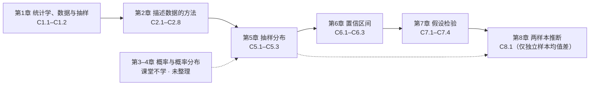
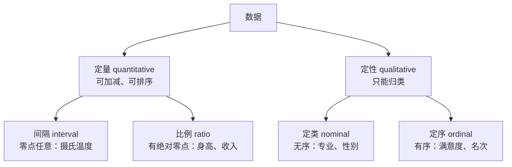

# 统计学总复习：从看数据到做推断

这份提纲把 21 篇讲义重新排成 **5 篇**。排序依据是**知识依赖**，不是上课顺序：凡是"后面某章要用到前面某个工具"的，工具先出现；凡是"两篇在讲同一件事的两面"的，合并成一节对照。教材章号（1、2、5、6、7、8）保持不变，方便回查原笔记与页码；第 3、4 章课堂明确不学，也不在已整理范围内，只在需要时补最小够用的前置结论。

每一章只回答三个问题：

1. **它在解决什么问题**——这一章补上了前面哪块缺口；
2. **公式长什么样**——给到能直接默写、能直接代数进去算的程度；
3. **考场上会死在哪**——符号、阈值、分母、方向这些真正扣分的地方。

配图全部复用 `attachments/` 里的现成图片，不重复造图；标【拓展】的是讲义里由教材与通行讲法延伸、课堂没有展开的部分，优先级排在主干之后。

> [!tip] 三遍用法
> - **第一遍（半天）**：只读第 0 节的地图、总表与"必背十六条"，再读每章的标题结构与公式表。目标是合上书能说出"这一章有哪几步"。
> - **第二遍（两三天）**：逐章读「核心知识点」，遇到公式先遮住自己写，写完再对照。写不出的回原篇，不要在这份提纲里硬背。
> - **第三遍（考前）**：附录 B 的手算模板各做一道，附录 C 的易错清单逐条自查，最后按附录 E 的三轮安排收口。

---

## 0. 先看全局

### 0.1 一句话：这门课在做什么

统计学的全部工作可以压成一句话：**用一小批有代表性的数据，去回答关于一个更大总体的问题，并且说清这个回答有多可靠。**

这句话拆成三个动作，就是课程的三大块：

| 动作 | 问的问题 | 对应章节 | 核心工具 |
|---|---|---|---|
| **描述** | 手里这批数长什么样？ | 第 1–2 章 | 图、中心、离散、位置、箱线图 |
| **概率化** | 再抽一次，这个统计量会怎么变？ | 第 5 章 | 抽样分布、标准误、中心极限定理 |
| **推断** | 只抽了一次，能对总体说什么？ | 第 6–8 章 | 置信区间、假设检验、两样本比较 |

第三块之所以可能，全靠第二块：**没有抽样分布，就没有区间，也没有 p 值。** 这是整门课唯一的"转轴"，第 5 章之前是描述世界，第 5 章之后是用概率对世界下判断。

### 0.2 三条贯穿全课的主线

**主线一：一个分布只要三样东西——中心、宽度、形状。**
总体分布如此，样本分布如此，抽样分布也如此。第 2 章用均值/中位数、方差/标准差、直方图去量这三样；第 5 章把同一套三件套搬到统计量身上；第 6、7 章的一切公式，都是"中心 ± 临界值 × 宽度"。

**主线二：所有推断公式共用一个骨架。**

$$
\text{区间}=\text{点估计}\ \pm\ \text{临界值}\times\text{标准误}
\qquad
\text{检验统计量}=\frac{\text{点估计}-\text{假设值}}{\text{标准误}}
$$

换参数只是换零件：换估计量、换标准误、换分布表。**背公式不如背这张骨架，再记住每个参数用哪套零件**（见 0.5 总表）。

**主线三：把"差多少"折算成"差几个标准误"。**
$z$ 分数、检验统计量、置信区间的半宽，本质上都是同一件事：**用波动当尺子**。所以第 2 章的 $z$、第 5 章的标准化、第 7 章的 $z$ 检验是同一条公式在不同舞台上的三次出场。

### 0.3 课程地图

主链路一句话：**先会看数据（1–2）→ 再会算"再抽一次会怎样"（5）→ 于是能估（6）与判（7）→ 最后把"一个总体"扩成"两个总体"（8）。**

### 0.4 与讲义顺序不同的五处

| 调整 | 原来在哪 | 现在为什么这样放 |
|---|---|---|
| 把"抽样方法"与"抽样误差"合成第 1 章的两节，并提前讲"代表性" | C1.2 的第 2–10 节 | 第 5 章的抽样分布默认"样本是简单随机抽的"，这个前提必须先立住 |
| 把"标准差能说多少"（切比雪夫/经验法则）放在离散程度之后、$z$ 分数之前 | C2.5 | 它是"有了 $\bar x$ 与 $s$ 之后能说什么"的第一次回答，$z$ 是它的精细化 |
| 把"百分位数"与"$z$ 分数"合并成一节"位置"，再接箱线图 | C2.6、C2.7 | 三者回答同一个问题"这个值在队伍里排第几"，只是尺子不同 |
| 把 $z$ 区间与 $t$ 区间合成一节"均值的区间" | C6.1 与 C6.2 | 两者只差"$\sigma$ 知不知道"，分开讲会让同一个骨架背两遍 |
| 把"独立样本 vs 配对样本"提到第 8 章开头 | C8.1 第 9 节 | 它是选公式之前的第一个判断，放在章末太晚 |

### 0.5 推断总表：一张表背完第 5–8 章

这张表是全课最值钱的一页。考试时先认出**参数**，再从表里取零件。

| 参数 | 点估计 | 标准误 | 抽样分布（条件） | 置信区间 | 检验统计量 |
|---|---|---|---|---|---|
| $\mu$（$\sigma$ 已知或 $n\ge30$） | $\bar x$ | $\dfrac{\sigma}{\sqrt n}$ | 正态；或 CLT 近似 | $\bar x\pm z_{\alpha/2}\dfrac{\sigma}{\sqrt n}$ | $z=\dfrac{\bar x-\mu_0}{\sigma/\sqrt n}$ |
| $\mu$（$\sigma$ 未知、小样本） | $\bar x$ | $\dfrac{s}{\sqrt n}$ | $t_{n-1}$（要求总体近似正态） | $\bar x\pm t_{\alpha/2}\dfrac{s}{\sqrt n}$ | $t=\dfrac{\bar x-\mu_0}{s/\sqrt n}$ |
| $\pi$ | $\hat p$ | $\sqrt{\dfrac{\pi(1-\pi)}{n}}$，实用时 $\sqrt{\dfrac{\hat p\hat q}{n}}$ | 正态（$n\pi\ge15$ 且 $nq\ge15$） | $\hat p\pm z_{\alpha/2}\sqrt{\dfrac{\hat p\hat q}{n}}$ | $z=\dfrac{\hat p-\pi_0}{\sqrt{\pi_0(1-\pi_0)/n}}$ |
| $\sigma^2$ | $s^2$ | —（不对称） | $\chi^2_{n-1}$（要求总体正态） | $\dfrac{(n-1)s^2}{\chi^2_{\alpha/2}}\le\sigma^2\le\dfrac{(n-1)s^2}{\chi^2_{1-\alpha/2}}$ | $\chi^2=\dfrac{(n-1)s^2}{\sigma_0^2}$ |
| $\mu_1-\mu_2$ | $\bar x_1-\bar x_2$ | $\sqrt{\dfrac{\sigma_1^2}{n_1}+\dfrac{\sigma_2^2}{n_2}}$ | 正态；或两组都大 | $(\bar x_1-\bar x_2)\pm z_{\alpha/2}\sqrt{\dfrac{s_1^2}{n_1}+\dfrac{s_2^2}{n_2}}$ | $z$ 或 $t$（见第 8 章） |

> [!warning] 这张表有两个"陷阱列"
> 1. **第三列的条件不是装饰**：抽样分布不对，后面查什么表都错。所以每题第一步是先判形状（总体正态？$n$ 够大？），第二步才是套公式。
> 2. **第二列与"估计标准误"不是一回事**：理论标准误里带未知参数（$\sigma$、$\pi$），报告里必须换成能算的版本（$s$、$\hat p$）。戴帽子的记号（$\hat\sigma_{\hat\theta}$）就是"这个能算"。

### 0.6 考前必须能默写的十六件事

1. $z=\dfrac{x-\mu}{\sigma}$，以及"标准化只换刻度、不换形状"。
2. 切比雪夫：$\bar x\pm ks$ 内至少 $1-\dfrac{1}{k^2}$（$k>1$）；经验法则：约 $68/95/99.7$。
3. 百分位数位置 $L=\dfrac{p}{100}(n+1)$；$Q_L,Q_U$ 与 $\mathrm{IQR}=Q_U-Q_L$。
4. 异常值围栏 $Q_L-1.5\,\mathrm{IQR}$ 与 $Q_U+1.5\,\mathrm{IQR}$（外围栏用 $3$）。
5. $s^2=\dfrac{\sum(x_i-\bar x)^2}{n-1}$，以及"为什么是 $n-1$"。
6. $\mu_{\bar x}=\mu$、$\sigma_{\bar x}=\dfrac{\sigma}{\sqrt n}$。
7. 中心极限定理：$n\ge30$ 时 $\bar x\approx N\!\left(\mu,\dfrac{\sigma^2}{n}\right)$。
8. $\hat p$ 的两条性质与判据 $n\pi\ge15$、$n(1-\pi)\ge15$。
9. 均值的 $z$ 区间与 $t$ 区间（含 $t$ 的自由度 $n-1$）。
10. 比例的区间与调整区间 $\tilde p=\dfrac{x+2}{n+4}$。
11. 两个样本量公式 $n=\dfrac{z^2\sigma^2}{ME^2}$、$n=\dfrac{z^2pq}{ME^2}$（$p$ 未知取 $0.5$）。
12. 有限总体校正因子 $\sqrt{\dfrac{N-n}{N}}$（$n/N>.05$ 才用）。
13. 方差的 $\chi^2$ 区间（两个临界值一左一右，大的进分母当下界）。
14. $z$、$t$、$\chi^2$ 三个检验统计量的分子分母各放什么。
15. $p$ 值的定义与三种算法（左尾、右尾、双尾乘 2）；$p<\alpha$ 拒绝。
16. 两样本：$\sqrt{\sigma_1^2/n_1+\sigma_2^2/n_2}$、合并方差 $s_p^2$、自由度 $n_1+n_2-2$。

> [!note] 第 3–4 章缺口的三个补丁（只补第 5 章要用的）
> 1. **正态曲线**：以 $\mu$ 为轴、$\sigma$ 为宽度，钟形对称，总面积 1。记三条带子：$\pm1\sigma$ 约 68%、$\pm2\sigma$ 约 95%、$\pm3\sigma$ 约 99.7%。
> 2. **标准正态表**：表体给的是"从 0 到 $z$"的面积；反查时先算"中间要留多少"，再取一半去查（90% → 0.450，95% → 0.475）。
> 3. **二项的正态近似**：$X\sim B(n,\pi)$ 在 $n\pi$、$n(1-\pi)$ 都够大时近似正态，中心 $n\pi$、标准差 $\sqrt{n\pi(1-\pi)}$；比例 $\hat p=X/n$ 于是中心 $\pi$、标准差 $\sqrt{\pi(1-\pi)/n}$。

---

# 第一篇　描述统计：把手里这份数据说清楚

本篇对应教材第 1–2 章。第 1 章解决"数据从哪来、可不可信"，第 2 章解决"拿到数据之后怎么把它压成几个数、几张图"。

## 第 1 章｜统计学、数据与抽样

### 1.1 统计学是什么：一条从数据到决策的流水线

**定义**：统计学（statistics）是关于数据的科学——**收集、分类、汇总、组织、分析、解释**，目的是从大量数据里找出规律性。它有两个词义：一门学科，以及"一组数据"本身（如"这些 statistics 显示……"）。

**数据 ≠ 信息**。数据是原始记录，信息是能改变判断的东西；统计学的价值不在占有数据，而在**把数据压缩成信息**，并且压缩得可检验。**数据 + 方法 + 概率** 是这门课的三件套：数据是原料，方法是加工，概率负责说明"这个结论有多靠得住"。它和今天的人工智能是同一套东西——用大量数据估计一个规律，再对没见过的数据下判断。

**两支方法**（第 1 章最重要的一刀）：

| | 描述统计 Descriptive | 推断统计 Inferential |
|---|---|---|
| 对象 | 手里这份数据 | 从样本推总体 |
| 动作 | 收集 → 呈现 → 刻画 | 抽样 → 估计/检验 → **给出可靠性** |
| 产出 | 均值、方差、图、表 | 置信区间、$p$ 值、结论 |
| 关键差别 | 到"说清楚"为止 | 必须多走一步：**这个说法有多可靠** |

**开场的彩票案例**（把"期望"讲透）：某期彩票总发行 500 万张、每张 2 元、总销售额 1000 万元；中奖 250 万张、奖金总额 400 万元。于是中奖率 $=50\%$，返还率 $=400/1000=40\%$，每 2 元票的期望回报 $=0.8$ 元。官方彩票连开 6 轮，2000 元剩 $2000\times0.4^6\approx8.2$ 元；私彩返还率 80%、抽水 20%，14 轮后全村 2000 万元剩 $2000\times0.8^{14}\approx88$ 万元——**80% 比官方的 40% 高 40 个百分点，看着更"良心"，但仍有 20% 的抽水；复利 14 轮，一个镇就被抽干**。这就是"期望值"的杀伤力：单次结果随机，长期比例几乎确定。

三个真实场景各钉一个概念：**毒胶囊**（2012）说明样本与检测口径不具代表性时，"相信国药"只是口号；**转基因调查**说明样本不随机，钱花了也得不出结论；**啤酒与尿布**说明**相关不等于因果**——数据能告诉你两件事一起发生，不能告诉你谁导致谁。

![[C1.1-返还率与资金衰减.png]]

### 1.2 六个基本概念：总体、个体、变量、样本、参数、统计量

| 概念 | 英文 | 定义 | 记号 |
|---|---|---|---|
| 总体 | population | 研究对象的全体 | 规模 $N$ |
| 个体 | experimental unit | 总体中的每一个对象 | — |
| 变量 | variable | 个体上被记录的特征 | $x$ |
| 样本 | sample | 从总体中抽出的一部分个体 | 容量 $n$ |
| 参数 | parameter | **描述总体**的数，通常是未知的 | $\mu,\ \sigma,\ \pi$ |
| 统计量 | statistic | **由样本算出**的数，随样本而变 | $\bar x,\ s,\ \hat p$ |

**判据**：看这个数"描述的是谁"。描述总体 → 参数（希腊字母）；由样本算 → 统计量（拉丁字母/戴帽子）。

- 林肯首次当选的得票率 $39.82\%$ 是**参数**（全体选民的真相）；
- 877 人调查中 $45\%$ 说"不聘用有拼写错误者"是**统计量**（样本算出来的）。

**一个统计问题的构成**：目标总体 + 变量 + 参数 + 推断方式。四样缺一，问题就没法答。

![[C1.1-总体样本参数统计量.png]]

### 1.3 过程、黑箱与数据类型

**过程（process）**：把输入变成输出的一整套动作；**黑箱（black box）**：只看输入输出、不问内部机理的建模方式。统计质量控制就是典型的黑箱思路——不拆机器，只监控输出的分布。

**数据类型**（决定合法运算，考点密集）：

- **定量**才能算均值、方差；**定性**只能计数、算比例，最多算中位数/众数（定序）。
- 定类与定序的差别：定序可以比大小，但不能说"第一名是第二名的两倍"。
- 常见错误：把"编号"当数值（学号、邮编），它们是定类。

### 1.4 数据从哪来：四条来路

| 来源 | 英文 | 特点 | 风险 |
|---|---|---|---|
| 观察/调查 | observational / survey | 不干预，只记录 | 混淆变量、回忆偏差 |
| 二手数据 | published source | 便宜、快 | 口径不明、过时 |
| 设计实验 | designed experiment | 能控因果 | 成本高、伦理限制 |
| 自动化记录 | sensor/log | 量大、实时 | 测量误差、缺失 |

调查的三种组织形式：**报表制度**（定期上报）、**普查**（全体，成本极高）、**抽样调查**（抽一部分，靠概率说话）。这门课的主角是第三种。

### 1.5 什么叫"有代表性"：简单随机抽样

**代表性样本**：能反映总体结构与变异特征的样本。判断代表性不能看样本"像不像"，要看**抽样机制是否给了每个样本已知的概率**。前提是总体本身得是"一个东西"：边界清楚、成员可判定；否则"总体均值"无从定义。

**简单随机抽样（simple random sample, SRS）的正式定义**：总体中**每一个容量为 $n$ 的样本**被抽中的概率都相同。注意等概率的对象是"样本"，不是"个人"——这是最容易背错的一句。

**两件必备工具**：

1. **抽样框（sampling frame）**：一份能列出总体全部个体的名册。名册不全 → 选择偏差，后面所有公式都白算。
2. **随机数发生器**：把"等概率"真正执行出来的装置（随机数表、软件）。

**为什么"怎么抽"比"抽多少"更要紧**：抽样框错了，样本再大也只是把同一个偏差放大得更加精确。样本量管**精度**，抽样机制管**正确性**，两者不能互相替代。

### 1.6 五种概率抽样与一种"怎么问"

| 方法 | 一句话动作 | 抽样框要求 | 精度 | 什么时候用 |
|---|---|---|---|---|
| 简单随机 SRS | 全员编号，随机取 $n$ 个 | 全员名册 | 基准 | 总体不大、差异不大 |
| 系统 systematic | 排序后每隔 $k=N/n$ 个取一个（起点随机） | 全员名册（已排序） | 有排序信息时更高 | 现场执行要简单、名册现成 |
| 分层 stratified | 先分层，每层各抽，再合并 | 全员 + 分层指标 | **最高** | 层间差异大、分层指标拿得到 |
| 整群 cluster | 抽几个群，群内**全查** | 只要群的名册 | **最低** | 名册难拿、要省钱 |
| 多阶段 multistage | 一级一级往下抽 | 逐级名册 | 介于其间 | 大规模调查 |

四条要点：

1. **分层与整群方向相反**：分层是"层内同质、层间异质"，把差异留在**不抽**的地方，所以精度最高；整群是"群内异质、群间同质"，把差异全带进误差，所以精度最低。整群要提高精度，只能把群切细——让群内更异质、群间更同质，代价是抽样框要细到能认出群。
2. **系统抽样的两个坑**：$k$ 除不尽时，尾部个体概率为 0（取下整）或样本量不固定（取上整）；名单里若有周期，等距会与周期**共振**，抽出系统性偏差。
3. **多阶段抽样的铁律**：前面阶段**只能用整群抽样**（因为那时只有群名册），最后一阶段才允许简单随机、系统或分层。
4. **简单随机适用于总体不太大的场合**；总体太小也不行——统计学的研究对象本身带"大量性"。

每层抽多少有三种分法：**比例分配**（按层规模等比例，最常用）、**最优分配**（层内方差大、调查成本低的多抽）、**等额分配**（每层抽一样多，只在层规模相近时合理）。分层的代价是必须先拿到分层指标，且层内若不够同质，收益会缩水。

**随机化回答（randomized response）**：敏感问题（作弊、逃税、吸毒）直接问必然被有意识答错。做法是让受访者先掷硬币/转盘，按随机结果决定"答敏感题"还是"答无关题（如'你生日在 1–6 月吗'）"，只报"是/否"。分析者只知道总体中"答敏感题"的比例 $p$，于是

$$
\hat\pi=\frac{\hat P-(1-p)\cdot 0.5}{p}
$$

以 $p=0.5$ 为例，若"是"的比例为 $0.35$，则 $\hat\pi=2\times0.35-0.5=0.20$。**它解决的不是"抽谁"，而是"怎么问"**，可以叠在 SRS 之上。

![[C1.6–1.7-四种抽样方法对照.png]]

![[C1.6–1.7-多阶段抽样五级阶梯.png]]

### 1.7 两类误差：能消掉的和消不掉的

| | 抽样误差 sampling error | 非抽样误差 non-sampling error |
|---|---|---|
| 来源 | 只抽了一部分，样本统计量与参数必然有差 | 抽样框、测量、无回答、录入、分析 |
| 能否消除 | **不能**，只能靠增大 $n$、改进设计来**控制** | 原则上**能**消除，但常更致命 |
| 随 $n$ 变化 | 随 $n$ 增大而减小（按 $1/\sqrt n$） | 与 $n$ 无关，甚至随 $n$ 放大 |
| 诊断 | 算标准误、造区间 | 查抽样框、查问卷、查无回答者与主题是否相关 |

**三类非抽样误差**：

1. **选择偏差 selection bias**：有些单位根本没机会被抽到（抽样框漏人、自愿样本、便利样本）。电视民调、网络投票是典型：样本只覆盖"愿意打电话/上网的人"。
2. **测量误差 measurement error**：记录下来的值与真值不符（仪器、问卷措辞、回忆）。
3. **无回答偏差 nonresponse bias**：抽中了却拿不到数据，且"不回答"与调查内容相关。再分三种：**自愿回答**（平时不填、有意见才填）、**随机无回答**（与主题无关，加大样本可补救）、**系统无回答**（与主题直接相关，加大样本无效，必须做结构补救）。

测量误差也有三种形态：**理解误差**（题意模糊）、**记忆误差**（记不准，整数处堆高）、**有意识误差**（知道但不说，方向固定，最危险）。

**电视民调为什么必然有偏**：它一次犯了三个错——**没有抽样框**（"总体"根本没定义）、**入样概率未知且有些人为 0**（不看电视、不上网的人永远进不来）、**回答概率与观点高度相关**（被政策伤到的人更有动机打电话）。

第三个错可以算出来：假设真实支持率 $50\%$，但支持者只有 $10\%$ 会去投票、反对者有 $30\%$ 会去投票：

$$
P(\text{观测到支持})=\frac{0.5\times0.10}{0.5\times0.10+0.5\times0.30}=\frac{0.05}{0.20}=25\%
$$

**真实 $50\%$、观测 $25\%$**，差了一倍，方向永远一致。把样本量从 1 万加到 100 万，25% 只会更稳定地停在 25%——**样本量再大也救不了偏差**：它只能让弹着点更集中，不能把靶心挪过来。

![[C1.6–1.7-抽样误差与有偏误差-打靶图.png]]

### 1.8 统计思维：把"变异"当成前提

统计思维的三句话：

1. **世界是变异的**：同样条件下重复，结果也不同；统计学研究的是变异的**分布**，不是单个值。
2. **用概率说话**：任何结论都带"在多大程度上"；没有可靠性的断言只是猜测。
3. **先问数据怎么来的**：谁被抽到、谁没被抽到、谁回答了、谁没回答——这四个问题决定结论能不能用。

**管理问题 ↔ 统计问题的循环**：管理问题（"要不要换供应商"）→ 翻译成统计问题（"两批零件的平均强度是否有差异"）→ 统计分析（检验）→ 统计答案（$p=0.03$，拒绝）→ 管理答案（"换"）→ 解决方案；执行后出现新问题，再回到第一步。

### 1.9 考场提醒

- **参数/统计量**给一个百分数让你判断，先问"这个数描述的是全体还是样本"。
- **SRS 的定义**必须写"每个容量为 $n$ 的样本等概率"，写成"每个人机会相同"要扣分。
- **分层 vs 整群**：一个"层间异质、层内同质"，一个"群间同质、群内异质"；问精度最高答分层，最低答整群。
- **多阶段**：前期只能整群；这是简答题的高频点。
- **两类误差**：抽样误差消不掉、随 $n$ 减小；非抽样误差能消、与 $n$ 无关。加大样本量不能修偏差。
- **随机化回答**考的是"为什么能让人说真话"，公式只需记 $p=0.5$ 的特例。

---

## 第 2 章｜描述数据的方法

这一章是"把 $n$ 条观测压成几句话"的全部工具箱。压法有两条路：**先画图看形状，再算数定中心与离散**。图形回答"长什么样"，数字回答"中心在哪、散得多开、某个值排第几"。

### 2.1 定性数据：先归类计数，再画图

**第一步永远是汇总表**，不是画图：

| 类别 | 频数 $f_i$ | 相对频数 $f_i/n$ | 百分比 |
|---|---|---|---|
| A | 62 | 0.31 | 31% |
| B | 88 | 0.44 | 44% |
| C | 50 | 0.25 | 25% |
| 合计 | $n=200$ | 1.00 | 100% |

自检三条：频数合计 $=n$；相对频数合计 $=1$；饼图角度合计 $=360^\circ$。

**三张图各管一件事**：

| 图 | 编码 | 擅长 | 扔掉的信息 |
|---|---|---|---|
| 条形图 bar chart | 柱高 = 频数/百分比 | 比大小 | 先后顺序（除非自己排） |
| 饼图 pie chart | 扇形角度 $=360^\circ\times$ 百分比 | 看构成 | **基数**（只适合一个总体） |
| 帕累托图 Pareto chart | 条形降序 + 累计折线 | 抓主要矛盾 | 类别间的可比性（排序是一种主张） |

**条形图三条规矩**：柱等宽、**纵轴从 0 起**、柱间**留缝**（留缝是在说"这些类别不连续"）。

**饼图的两个失手点**：类别太多时角度难以比较；只报百分比不报 $n$ 时，读者不知道基数——"60% 的人支持"在 $n=5$ 和 $n=5000$ 里是两件事。

**帕累托图为什么必须降序**：降序把"比较"这一步替读者做完了，最高的那根先撞进眼睛；再加一条累计百分比折线，就能读出"前几类占了 80%"——这就是二八法则的操作版。

![[C2.1-同一组数据的三种图.png]]

![[C2.1-帕累托图与累计百分比.png]]

![[C2.1-饼图丢失基数-比较多个总体要用条形图.png]]

### 2.2 定量数据：点图、茎叶图、直方图

三张图是**同一根数轴的三种堆放方式**，数据越多、压得越狠、形状越清楚，细节越查不回。

| 图 | 一个观测变成什么 | 适合 $n$ | 保留原值吗 |
|---|---|---|---|
| 点图 dot plot | 一个点 | 小（$n\lesssim30$） | 是 |
| 茎叶图 stem-and-leaf | 一个"叶"（末位数字） | 小到中（$n\lesssim100$） | 是（末位） |
| 直方图 histogram | 落进某一组，贡献 1 个计数 | 大 | 否（只剩组频数） |

**直方图的三步**：

1. **定组数** $k$：$k=1+3.322\log_{10}n$，且**不少于 5 组**；$k$ 取整。
2. **定组距**：$w=\dfrac{\max-\min}{k}$，向上取整成"好读的数"（1、2、5、10 的倍数）。
3. **填频数表**：区间取**左闭右开** $[a,b)$，所以恰好落在组上限的观测归**下一组**。例：分组 $[180,200)$、$[200,220)$ 时，200 台属于第二组，不属于第一组。

**纵轴的三种读法**（必考辨析）：

| 纵轴 | 高度含义 | 总面积 |
|---|---|---|
| 频数 frequency | 该组有多少个 | $n$ |
| 相对频数 relative frequency | 该组占多大比例 | $1$ |
| 密度 density $=f_i/(nw)$ | 单位宽度上的比例 | $1$（此时"面积 = 比例"） |

**直方图的柱子必须贴紧**（横轴连续，柱与柱之间没有缝）；**条形图必须留缝**——这是两张图的分界线。**"面积等于 1"只在纵轴是密度时成立**；纵轴是频数时，面积等于 $n$。频率多边形把每根柱顶的中点连起来，组距越小、数据越多，这条折线越贴近一条光滑曲线——那条曲线就是**概率密度曲线**。

![[C2.2-点图与茎叶图-同一批数据两种画法.png]]

![[C2.2-直方图与频率多边形-纵轴的三种读法.png]]

![[C2.2-组距越小直方图逼近概率密度曲线.png]]

### 2.3 分布形状：六种一眼能认出的轮廓

| 形状 | 特征 | 典型例子 |
|---|---|---|
| 对称 symmetric | 左右镜像 | 身高、测量误差 |
| 右偏 right-skewed | 长尾在右，峰偏左 | 收入、房价、等待时间 |
| 左偏 left-skewed | 长尾在左，峰偏右 | 考试分数（天花板效应） |
| 双峰 bimodal | 两个峰 | 男女身高混在一起 |
| 均匀 uniform | 每段一样高 | 随机数、轮盘 |
| U 型 U-shaped | 两头高中间低 | 死亡率（婴儿与老年） |

**偏态与三个中心的关系**（先记结论，2.4 解释）：

- 右偏：$\text{众数}<\text{中位数}<\text{均值}$（均值被右尾拖大）；
- 左偏：$\text{均值}<\text{中位数}<\text{众数}$；
- 对称：三者近似相等。

![[C2.2-六种分布形状-对称右偏左偏双峰均匀U型.png]]

### 2.4 集中趋势：均值、中位数、众数

**均值（mean）**：

$$
\bar x=\frac{1}{n}\sum_{i=1}^{n}x_i,\qquad \mu=\frac{1}{N}\sum_{i=1}^{N}x_i
$$

它是**平衡点**：把每个观测想成砝码，均值就是支点位置；等价说法是**离差之和为零**：

$$
\sum_{i=1}^{n}(x_i-\bar x)=0
$$

**均值的软肋**：对极端值敏感。一个 1.9 米的人走进房间，房间的平均身高会被拉高，中位数几乎不动。这也解释了 2.3 留下的顺序：右偏时长尾把均值拖大，中位数只数位置几乎不动，众数守在峰上——于是 $\text{众数}<\text{中位数}<\text{均值}$。

**中位数（median）**：排序后位置在 $\dfrac{n+1}{2}$ 的那个值；$n$ 为偶数时取中间两个的平均。它只数"第几个"，不关心数值多大，所以**抗极端值**。

**众数（mode）**：出现次数最多的值；可以没有、可以有多个（双峰）。它是**唯一能用于定性数据**的中心。

**该用哪一个**：

| 数据/形状 | 首选 | 理由 |
|---|---|---|
| 对称定量 | 均值 | 用上了全部信息，且与方差配套 |
| 偏态定量 | 中位数 | 不被长尾拖走 |
| 定性（定类/定序） | 众数 | 均值无意义 |
| 有开口组/极端值 | 中位数 | 稳健 |

**"average" 不是 "mean"**：工资单上"平均工资"可能报的是中位数；看到 average 先问是哪一个。**"expected" 则要问是不是还没发生**——期望值是随机变量的长期平均，不是已实现的数据。

> [!note] 【拓展】三个中心是三种损失下的最优
> 均值最小化平方损失 $\sum(x_i-c)^2$，中位数最小化绝对损失 $\sum|x_i-c|$，众数最小化 0-1 损失（数错几个）。所以"该用哪个"等价于"你更怕哪种错"。

![[C2.3-砝码与支点-均值是平衡点.png]]

![[C2.3-极端值只拖走均值.png]]

![[C2.3-偏态与三者位置.png]]

### 2.5 离散程度：极差、方差与标准差

**极差（range）**：$R=\max-\min$。只用两个观测，一个极端值就能骗过它；它量的是"跨了多长"，不是"摊得多开"。

**平均离差为什么不能用**：$\dfrac{1}{n}\sum(x_i-\bar x)\equiv0$，正负抵消，永远为零。修法是平方。

**方差（variance）**：

$$
s^2=\frac{\sum_{i=1}^{n}(x_i-\bar x)^2}{n-1}
\qquad
\sigma^2=\frac{\sum_{i=1}^{N}(x_i-\mu)^2}{N}
$$

分子叫**平方和**（sum of squares, $SS$）。**为什么样本除以 $n-1$**：

1. **无偏性**：若除以 $n$，样本方差的期望是 $\dfrac{n-1}{n}\sigma^2$，系统性偏小；除以 $n-1$ 才使 $E(s^2)=\sigma^2$。$n=2$ 时除以 $n$ 正好少一半。
2. **自由度**：$n$ 个离差被 $\sum(x_i-\bar x)=0$ 锁住一个，只有 $n-1$ 个能自由变。分母是"独立信息的份数"。

**标准差（standard deviation）**：$s=\sqrt{s^2}$，把单位从"平方"换回原单位。**算的过程用 $s^2$，报告的时候用 $s$**。

| 测度 | 公式 | 单位 | 抗极端值 |
|---|---|---|---|
| 极差 | $\max-\min$ | 原单位 | 否 |
| 方差 | $SS/(n-1)$ | 原单位² | 否 |
| 标准差 | $\sqrt{s^2}$ | 原单位 | 否 |
| 四分位距 | $Q_U-Q_L$ | 原单位 | **是** |

![[C2.4-极差看不见中间.png]]

![[C2.4-离差抵消与平方.png]]

![[C2.4-除以n与n减1的无偏性.png]]

### 2.6 标准差能说多少：切比雪夫定理与经验法则

有了 $\bar x$ 与 $s$，最自然的问法是："大多数数据落在 $\bar x\pm ks$ 里？" **答案取决于你对形状知道多少。**

**不知道形状：切比雪夫定理（Chebyshev's Theorem）**

对**任何形状**的数据，当 $k>1$ 时，落在 $\bar x\pm ks$ 内的比例**至少**为

$$
1-\frac{1}{k^2}
$$

| $k$ | 下界 | 读法 |
|---|---|---|
| $1$ | $0$ | 没有有用信息 |
| $2$ | $75\%$ | 至少四分之三 |
| $3$ | $88.9\%$ | 至少九分之八 |
| $\sqrt{10}\approx3.162$ | $90\%$ | 客户要 90% 时反解 |

反解公式：要保证至少 $p$ 的比例，取 $k=\dfrac{1}{\sqrt{1-p}}$。

**知道近似正态：经验法则（Empirical Rule）**

| 区间 | 比例 | 单侧尾部 |
|---|---|---|
| $\bar x\pm s$ | 约 $68\%$（精确 $68.27\%$） | $16\%$ |
| $\bar x\pm 2s$ | 约 $95\%$（精确 $95.45\%$） | $2.5\%$ |
| $\bar x\pm 3s$ | 约 $99.7\%$（精确 $99.73\%$） | $0.15\%$ |

**两套数字不矛盾**：$75\%$ 是"任何形状都成立"的地板，$95\%$ 是"加了正态条件"之后的实际值。条件越强，结论越精确；切比雪夫永远可以说，经验法则必须先确认"中间高、两边低、对称"。

![[C2.5-切比雪夫下界与正态实际比例.png]]

![[C2.5-同均值同标准差三种形状的覆盖比例.png]]

![[C2.5-经验法则三条带子.png]]

### 2.7 位置：百分位数与 $z$ 分数

**百分位数（percentile）**：把排序后的数据切成 100 段，第 $p$ 百分位数是"至少有 $p\%$ 的数据不超过它"的那个值。**为什么是 99 个切点**：切成 100 段需要 99 刀；第 0 与第 100 百分位就是最小值与最大值。

**定位公式**：

$$
L=\frac{p}{100}(n+1)
$$

$L$ 是**位置**，不是数值。若 $L$ 是整数，取第 $L$ 个观测；若不是整数，取相邻两个观测按小数部分**线性插值**。例：$n=9$、$p=25$ 时 $L=2.5$，取第 2、3 个观测的平均。

**$z$ 分数（z-score）**：

$$
z=\frac{x-\mu}{\sigma}\quad\text{（样本用 } \frac{x-\bar x}{s}\text{）}
$$

含义：**这个值离均值几个标准差**。它无量纲，所以能跨总体比较——统计学 82 分（$\mu=72,\ \sigma=8$）的 $z=1.25$，高数 78 分（$\mu=65,\ \sigma=12$）的 $z\approx1.083$；$1.25>1.083$，所以**统计学考得更好**。

**两个不变**：标准化只平移原点、缩放刻度，**不改变位置（谁在前谁在后）、不改变形状（偏态还是偏态）**。所以 $z$ 不制造新信息，只是换了一把尺子。

> [!note] 【拓展】高考标准分就是 $T=500+100z$
> 把 $z$ 线性变换到均值 500、标准差 100 的刻度：$T=500+100z$。绕这一圈的理由是原始分跨科不可比，$z$ 化后才能加权合成；后来取消，则是因为转换规则复杂、公众难理解，且各科等值本身有争议。

**一个 $z$ 算不算极端**：没有形状信息时不能答。钟形对称时用 68/95/99.7；粗略判据是 $|z|>3$ 算极端，强偏态数据可放宽到 $|z|>2$。

> [!warning] 最容易错的一步：这块面积到底在哪
> 同一个比例，可能是"两侧尾巴合计"，也可能是"单侧尾巴"；同一个 $z$，表给的是"0 到 $z$"。**先问清这块面积的位置，再决定加、减还是乘 2。**

![[C2.6-百分位数的定位-先找位置再取值.png]]

![[C2.6-z分数的读法-68-95-99.7与尾部比例.png]]

![[C2.6-同一把尺子-两门课的z分数对比.png]]

### 2.8 异常值、四分位数与箱线图

**异常值的三种成因**（先分成因，再谈处置）：

1. **记录/录入错误** → 改正或删除；
2. **抽错了总体**（混进了不属于该总体的个体）→ 删除并说明；
3. **真实但罕见的事件**（金融危机、疫情）→ **保留**，因为它可能正是要研究的信号；删掉会把规律带偏。

**四分位数**：$Q_L$ 是下半段的中位数，$Q_U$ 是上半段的中位数（两种算法结果可能差一点，考试按"半段中位数"做）。**四分位距**：

$$
\mathrm{IQR}=Q_U-Q_L
$$

它只由排序位置决定，极端值动不了它——**这正是它能当尺子的理由**。

**异常值判据（围栏）**：

| 围栏 | 公式 | 出界含义 |
|---|---|---|
| 内围栏 | $Q_L-1.5\,\mathrm{IQR}$，$Q_U+1.5\,\mathrm{IQR}$ | 怀疑异常，记 `*` |
| 外围栏 | $Q_L-3\,\mathrm{IQR}$，$Q_U+3\,\mathrm{IQR}$ | 高度怀疑，记 `0` |

**五数概括**：最小值、$Q_L$、中位数、$Q_U$、最大值。箱线图就是这五个数的图：箱体从 $Q_L$ 到 $Q_U$，中间一道线是中位数，两条须伸到围栏内的最远观测。

**读箱线图（考点，正反两种问法都要会）**：

- 四段各装 $25\%$ 的数据：$[\min,Q_L]$、$[Q_L,m]$、$[m,Q_U]$、$[Q_U,\max]$。
- **段越窄，说明该段数据越密，密度曲线在该处越高**（宽度 × 高度 = 面积 = 25%）。
- **须长不等于数据多**：须只伸到围栏内最远的观测，须短说明该段跨度小、数据密，不说明数据少。
- 右偏：右须最长、中位线偏左、箱体偏窄；
- 左偏：左须最长、中位线偏右；
- 对称：两须近似等长、中位线居中。

| 形状 | 四段大致比例 |
|---|---|
| 均匀 | $25/25/25/25$ |
| 正态 | $39/11/11/39$ |
| 右偏 | $17/10/13/60$ |

![[C2.7-四分位数切四段与四分位距.png]]

![[C2.7-箱线图的结构与围栏.png]]

![[C2.7-箱线图读形状速判卡.png]]

![[C2.7-偏态对应的箱线图.png]]

### 2.9 两个变量：散点图、时间序列图与误导性图表

**散点图（scattergram）**：一个观测落一个点 $(x,y)$。读三层：

1. **方向**：正相关（$x$ 增 $y$ 增）、负相关、无关；
2. **形状**：线性、弯曲、成团；
3. **强度**：点贴得紧不紧。

"关系"是**统计关系**，不是函数关系：同一个 $x$ 可以有多个 $y$。

**时间序列图（time series plot）**：横轴换成时间、相邻点连线。看三样：**趋势**（长期方向）、**季节**（周期波动）、**跳变**（政策/事件）。横轴必须等距，否则折线的斜率会骗人。

**七种"用真数据说假话"**：

| # | 手法 | 怎么骗 | 正确做法 |
|---|---|---|---|
| ① | 用面积冒充数值 | 边长按数值放大，面积按平方放大 | 面积 ∝ 数值时，边长 ∝ $\sqrt{\text{数值}}$ |
| ② | 没有相对基准 | 只报绝对数，不报分母 | 先问"在跟谁比、基数多大" |
| ③ | 压缩纵轴 | 把纵轴压短，微小差异显得巨大 | 纵轴比例要诚实 |
| ④ | 纵轴不设零点 | 柱状图从非零起，柱长比例失真 | 柱状图必须从 0 起 |
| ⑤ | 纵轴开断点 | 跳过一段区间，斜率被放大 | 断点画锯齿并写明跳过了什么 |
| ⑥ | 换一个措辞 | "增长 100%"其实是从 1 到 2 | 还原成绝对量与基数 |
| ⑦ | 只报集中趋势 | 只报均值，不报离散与样本量 | 报 $n$ + 中心 + 离散 + 异常 |

![[C2.8–2.10-散点图的三种形态.png]]

![[C2.8–2.10-时间序列图的趋势与季节.png]]

![[C2.8–2.10-面积与纵轴的四种手法.png]]

### 2.10 考场提醒

- **直方图边界**：组上限归下一组；"面积 = 1"只对密度纵轴成立。
- **偏态顺序**：右偏 mode < median < mean，左偏反过来；画图题要能反推。
- **除以 $n-1$**：答"无偏"与"自由度"两条，只答"这样更准"不得分。
- **切比雪夫**：$k=1$ 那一档没有信息，别说"至少 0%"就完事；$k$ 可以不是整数。
- **百分位**：先算位置 $L$，再取值；$L$ 非整数要插值。
- **箱线图**：右偏 = 右须长 + 中位线偏左 + 窄箱；四段各 25%，窄段对应高密度。
- **误导图**：柱状图零起点、折线图截断要标注、面积要开平方。

---

# 第二篇　从样本到总体：抽样分布

本篇对应教材第 5 章。它是全书唯一的"转轴"：前面是描述手里这份数据，后面是用一份数据去推一个未知的总体。转轴的核心只有一句话——**统计量也是随机变量，所以它有分布。**

## 第 5 章｜抽样分布

### 5.1 统计量是随机变量

**抽样分布（sampling distribution）**：统计量的概率分布。做法是：把"抽样 + 算统计量"这套动作**重复无数次**，看这些统计量落在哪里、散得多开。

**三种分布只差一个字母，横轴差得很远**：

| 分布 | 横轴 | 来源 | 性质 |
|---|---|---|---|
| 总体分布 population distribution | 个体取值 $x$ | 总体本身 | 未知，通常假定 |
| 样本分布 sample distribution | 样本中的 $x$ | 一次抽样的经验分布 | 随样本变 |
| 抽样分布 sampling distribution | 统计量（如 $\bar x$） | 所有可能样本的理论分布 | 推断的依据 |

**容量必须钉死**：$n$ 一变，$\bar x$ 就是另一个随机变量，分布也换一套。

**手工造一个**：总体 $\{1,2,3,4\}$（均匀分布），$\mu=2.5$、$\sigma^2=1.25$。取 $n=2$、**可重复且计顺序**，共有 $4^2=16$ 个样本；16 个均值只取 7 个不同值（$1.0$ 到 $4.0$，每隔 $0.5$），频数是 $1,2,3,4,3,2,1$。于是 $\bar x$ 的抽样分布：中心仍是 $2.5$，方差 $\sigma^2/n=1.25/2=0.625$，标准差 $\sqrt{0.625}=0.7906$——**中心没动，散布变窄**。

> [!warning] 16、6、12 三个数都对，别混
> $4^2=16$（可重复、计顺序）；$C_4^2=6$（不可重复、不计顺序）；$P_4^2=12$（不可重复、计顺序）。**抽样规则是抽样分布定义的一部分**：规则一变，分布就变。

**点估计（point estimate）**：用统计量的一个取值去估参数。四个常用估计量：$\bar x$ 估 $\mu$、$s^2$ 估 $\sigma^2$、$\hat p$ 估 $\pi$、$s$ 估 $\sigma$。

**两把尺子**：

- **无偏性（unbiasedness）**：$E(\hat\theta)=\theta$。平均而言正中靶心。
- **最小方差（minimum variance）**：在所有无偏估计量里，它的散布最小。

$\bar x$ 两条都占，所以是估 $\mu$ 的默认答案。反例：用分母 $n$ 的"样本方差"是有偏的，$E=\dfrac{n-1}{n}\sigma^2$，$n=2$ 时正好少一半。

![[C5.1–5.2-16个样本均值的抽样分布.png]]

![[C5.1–5.2-三种分布的横坐标不同.png]]

![[C5.1–5.2-无偏与最小方差.png]]

### 5.2 样本均值的抽样分布与中心极限定理

**两条永远成立的性质**（与总体形状无关）：

$$
\mu_{\bar x}=\mu,\qquad \sigma_{\bar x}=\frac{\sigma}{\sqrt n}
$$

$\sigma_{\bar x}$ 叫**均值的标准误**（standard error of the mean）。它是"一次估计离真值多远"的典型尺度，与 $\sigma$（一个个体离均值多远）是两件事。

**三个"标准差"必须分清**：

| 符号 | 描述谁 | 随 $n$ 变吗 |
|---|---|---|
| $\sigma$ | 一个个体离 $\mu$ 多远 | 不变 |
| $\sigma/\sqrt n$ | 一次抽样的 $\bar x$ 离 $\mu$ 多远 | 随 $n$ 变大而变小 |
| $s$ | 这一个样本内部散多开 | 每个样本不同 |

**形状**：

- **定理 5.1**：若总体正态，则对**任意** $n$，$\bar x$ 精确服从 $N\!\left(\mu,\dfrac{\sigma^2}{n}\right)$。
- **中心极限定理（CLT）**：若总体不正态，只要 $n$ **足够大**（经验门槛 $n\ge30$），$\bar x$ 近似正态，中心与宽度照旧。

**标准化**：

$$
z=\frac{\bar x-\mu}{\sigma/\sqrt n}
$$

查表时注意分母是**标准误**，不是 $\sigma$；问的是 $\bar x$ 还是单个 $x$，决定除不除 $\sqrt n$。

**$1/\sqrt n$ 的含义**：精度翻一倍，样本量要翻**四倍**；精度翻十倍，样本量要翻一百倍。样本量是最贵的资源。

![[C5.3-标准误按根号n收窄.png]]

![[C5.3-样本均值的分布随样本量变大变正态.png]]

![[C5.3-标准化只换刻度不换面积.png]]

### 5.3 样本比例的抽样分布

**关键一句话**：$\hat p$ 就是 0/1 数据的**样本均值**。令 $X$ 为样本中"成功"的个数，则 $\hat p=X/n$，而 $X\sim B(n,\pi)$。**可重复抽样**下，容量 $n$ 的样本共有 $N^n$ 种（2500 人抽 36 人就是 $2500^{36}$，天文数字），所以抽样分布只能是理论上的，靠性质推、不靠枚举。**不放回**时样本数是 $N!/(N-n)!$，不是 $N^n$——两种规则的分布不同。

于是三条性质是把 5.2 的规律套在 0/1 上：

$$
E(\hat p)=\pi,\qquad \sigma_{\hat p}=\sqrt{\frac{\pi(1-\pi)}{n}}
$$

**正态近似的判据**：

$$
n\pi\ge15\quad\text{且}\quad n(1-\pi)\ge15
$$

两边都要够：只盯 $n\pi$ 会漏掉"$\pi$ 接近 1、左尾太短"的不对称。教材用 15，不用 5 或 10。

**像与不像**：像的是"$n$ 翻四倍、误差减半"；不像的是 $\pi$ 同时出现在**中心**和**标准误**里，未知时要拿 $\hat p$ 顶替，且判据由 $\pi$ 决定而不是单看 $n$。

**算例**：$\pi=0.6$、$n=36$ 时，$\sigma_{\hat p}=\sqrt{0.6\times0.4/36}=0.0816$——**一个标准误就有 8 个百分点**。样本量小的时候，比例的估计非常粗。

![[C5.4-大样本才近似正态-三种样本量的比例抽样分布.png]]

![[C5.4-比例窗口的概率-样本越大装得越多.png]]

### 5.4 考场提醒

- **先判抽样分布**：问的是 $x$ 还是 $\bar x$？总体正态还是大样本？$\sigma$ 知不知道？三步定完再查表。
- **标准误不是标准差**：$\sigma/\sqrt n$ 与 $s$ 差 $\sqrt n$ 倍。
- **CLT 的 $n\ge30$** 是经验门槛，不是定理条件；总体越偏，需要越大。
- **比例判据用 $15$**，且两条都要满足。
- **无偏 ≠ 每个样本都对**：它只说"重复无数次后平均对"。

# 第三篇　估计：给未知参数一个区间

本篇对应教材第 6 章。第 5 章教会我们"统计量会怎么抖"，这一章反过来用：**只抽一次，却要对总体说一句带概率的话。**

## 第 6 章｜置信区间

### 6.1 点估计与好估计量的三条标准

**点估计（point estimate）**：用一个数去猜参数。**估计量（estimator）**是规则（如 $\bar x$），**估计值（estimate）**是算出来的那个数（如 $1.99$）。同一个规则，每抽一次样本就给出不同的估计值。

**好估计量的三条标准**：

| 标准 | 含义 | 检验方法 |
|---|---|---|
| 无偏 unbiased | $E(\hat\theta)=\theta$ | 看期望是否等于参数 |
| 有效 efficient | 在无偏估计量中方差最小 | 比较两个无偏估计量的方差 |
| 一致 consistent | $n\to\infty$ 时 $\hat\theta\to\theta$ | 看样本量增大时是否收敛 |

**先认参数**（题干关键词）：平均/均值/average → $\mu$；比例/百分比/率/占比 → $\pi$；方差/波动/稳定性/一致性 → $\sigma^2$。认错参数，公式照样能算，但那个数没有意义。

**无偏 + 最小方差** 两条合称"最佳无偏估计量"（MVUE）；一致性是另一条（大样本性质），不属于 MVUE。本课程的三个 MVUE：$\bar x\to\mu$、$s\to\sigma$、$\hat p\to\pi$。

**理论标准误 vs 估计标准误**：$\sigma_{\bar x}=\sigma/\sqrt n$ 里带着未知的 $\sigma$，报告时必须换成 $s/\sqrt n$；比例同理，$\sqrt{\pi(1-\pi)/n}$ 换成 $\sqrt{\hat p\hat q/n}$。戴帽子的记号表示"这个能算"。

**点估计的死穴**：它只给一个数，**给不出概率**——数轴上一个点没有面积。所以必须把点撑成区间。

### 6.2 区间估计的原理：95% 到底在说谁

**区间估计的四个要素**：

1. **点估计**（区间的中心）；
2. **标准误**（尺子的刻度）；
3. **临界值**（要几个标准误，由置信水平决定）；
4. **置信水平** $1-\alpha$。

**置信系数（confidence coefficient）**：随机抽出的一个区间包含总体参数的概率，也就是这套"造区间"的方法被重复使用很多次时，命中参数的比例。用百分比表示叫**置信水平**，记 $1-\alpha$；$\alpha$ 是"没盖住"的概率，叫**显著性水平**。

**区间为什么成立（一步换位）**："区间盖住 $\mu$" 与 "$\bar x$ 落在 $\mu\pm z_{\alpha/2}\sigma/\sqrt n$ 内"是**同一个事件**，只是把谁当中心换了。前者含未知的 $\mu$，不能直接算；后者是 $\bar x$ 的抽样分布，查表就能算——这就是抽样分布的全部价值。

由此得到区间估计的三条性质：以点估计为中心；宽度由置信水平与标准误决定；"这一次准不准"无法知道，只能承诺方法的长期命中率。

**95% 的正确读法（最容易考、最容易说错）**：

> [!important] 一句话
> **95% 是这套"造区间"的手艺的长期命中率，不是这一个区间的运气。**

- 错法①："$\mu$ 有 95% 的概率落在这个区间里。"——$\mu$ 是固定数，区间一旦算出也固定，"包含"是已定事实，概率只能是 1 或 0。
- 错法②："这个区间有 95% 的概率包含 $\mu$。"——同上，把随机性挂在了结果上。
- 错法③："全部瓶子里有 95% 的容量落在这个区间内。"——偷换对象：区间讲的是**均值**，不是单个观测。
- 对法：**"如果重复抽 100 次、造 100 个区间，约 95 个会盖住 $\mu$。"**

**为什么要 $\alpha/2$**：区间是"加减"结构，两边各丢一半，所以每侧尾巴是 $\alpha/2$；$z_{\alpha/2}$ 的定义就是"右尾面积为 $\alpha/2$ 的那个 $z$"。

**查表那一坑**：标准正态表给的是"从 0 到 $z$"的面积，所以

| 置信水平 | $\alpha/2$ | 查表用的面积 | $z_{\alpha/2}$ |
|---|---|---|---|
| 90% | .05 | **.450** | 1.645 |
| 95% | .025 | **.475** | 1.960 |
| 98% | .01 | .490 | 2.326 |
| 99% | .005 | **.495** | 2.576 |

拿 0.90 直接去查，会得到 $z\approx1.28$，名义 90% 实际只有约 80%——这是最常见的失分点。

**精确度与置信度的拉锯**：置信水平越高，$z$ 越大，区间越宽；想又窄又稳，只能加大 $n$ 或降低置信水平。**区间宽度由方法决定，不由运气决定**：同一置信水平下，每个区间的宽度完全一样，随机性只在中心。

![[C6.1–6.2-重复抽样的区间覆盖.png]]

![[C6.1–6.2-查表用哪块面积.png]]

![[C6.1–6.2-同一批数据三种置信水平.png]]

### 6.3 均值的区间：$z$ 与 $t$

**大样本（或 $\sigma$ 已知）**：

$$
\bar x\pm z_{\alpha/2}\frac{\sigma}{\sqrt n}
$$

条件：总体正态，或 $n\ge30$（CLT 兜底）。$\sigma$ 未知但 $n\ge30$ 时，用 $s$ 顶替。

**小样本、$\sigma$ 未知**：

$$
\bar x\pm t_{\alpha/2}\frac{s}{\sqrt n},\qquad \mathrm{df}=n-1
$$

条件：**总体近似正态** + 随机样本。$n<30$ 且 $\sigma$ 未知时不能再用 $z$。

**为什么必须换 $t$**：$t=\dfrac{\bar x-\mu}{s/\sqrt n}$，分母里的 $s$ 自己也在抖，比值比正态更分散、尾巴更肥。$n=6$ 时，名义 95% 若仍用 1.96，实际覆盖率只有约 89%。

**$t$ 分布的三同三不同**：与标准正态一样对称、一样钟形、一样中心为 0；不同在于**尾巴更厚、峰值更低、多一个参数（自由度）**。$df\to\infty$ 时趋近标准正态。

**自由度**：$n$ 个离差被 $\sum(x_i-\bar x)=0$ 锁住一个，只有 $n-1$ 份独立信息。**$s$ 有 $n-1$ 份，$t$ 就有 $n-1$ 个自由度。**

**两张表的查法相反**：$z$ 表查"面积"（中间一半），$t$ 表查"尾巴"（单尾 $\alpha/2$）。95% 区间、$df=24$ 时查 $t_{.025,24}=2.064$。

| 情形 | 用什么 | 临界值 | 条件 |
|---|---|---|---|
| $\sigma$ 已知 | $z$ | $z_{\alpha/2}$ | 正态或 $n\ge30$ |
| $\sigma$ 未知、$n\ge30$ | $z$（用 $s$） | $z_{\alpha/2}$ | CLT |
| $\sigma$ 未知、$n<30$ | $t$ | $t_{\alpha/2,df=n-1}$ | 总体近似正态 |

**例（2 升瓶装饮料）**：$\sigma=0.05$ L、$n=100$、$\bar x=1.99$ L，90% 区间：

$$
1.99\pm1.645\times\frac{0.05}{10}=1.99\pm0.008225=[1.9818,\ 1.9982]\ \text{L}
$$

**例（小样本）**：$n=25$、$s=8$、95%，$t_{.025,24}=2.064$：

$$
\bar x\pm2.064\times\frac{8}{5}=\bar x\pm3.302
$$

![[C6.3–6.4-t分布与标准正态-厚尾与临界值.png]]

![[C6.3–6.4-临界值与覆盖率的代价.png]]

### 6.4 比例的区间与调整区间

比例就是 0/1 数据的均值，公式照搬：

$$
\hat p\pm z_{\alpha/2}\sqrt{\frac{\hat p(1-\hat p)}{n}}
$$

**条件**：$n\hat p\ge15$ 且 $n(1-\hat p)\ge15$。**注意区间用 $\hat p$，检验用 $\pi_0$**——这是比例题最大的坑。

**什么时候会坏**：$\hat p$ 贴近 0 或 1 时，区间会越界（下限小于 0 或上限大于 1），覆盖率崩到 18% 这种量级。

**调整区间（adjusted interval）**：先虚拟补 2 个成功、2 个失败：

$$
\tilde p=\frac{x+2}{n+4},\qquad
\tilde p\pm z_{\alpha/2}\sqrt{\frac{\tilde p(1-\tilde p)}{n+4}}
$$

性质：无论 $x=0$ 还是 $x=n$，$\tilde p$ 都严格落在 $(0,1)$ 内，区间不会越界。判据：$n\hat p<15$ 或 $n\hat q<15$ 时改用它；小样本比例一律用它更稳。

**例（400 名毕业生，32 人读研）**：$\hat p=0.08$，$n\hat p=32\ge15$，$n\hat q=368\ge15$：

$$
0.08\pm1.96\sqrt{\frac{0.08\times0.92}{400}}=0.08\pm0.0266=[0.053,\ 0.107]
$$

**例（200 份报纸，35 份有缺陷）**：$\hat p=0.175$，$n\hat q=165$，可直接用；若改为"200 份里 3 份"，$n\hat p=3<15$，改用调整区间：$\tilde p=5/204=0.0245$。

![[C6.3–6.4-比例区间覆盖率-未调整与调整.png]]

### 6.5 样本量、有限总体校正与方差的区间

**估均值要抽多少**（把"误差不超过 $ME$"设成半宽，解方程）：

$$
n=\frac{z_{\alpha/2}^{2}\sigma^{2}}{ME^{2}}
$$

**公式里的 $\sigma$ 从哪来**：预调查（pilot study）、历史数据、同类研究；三者都没有时，先抽一个小样本估 $s$，再按公式补足。$\sigma$ 估大一倍，$n$ 要付四倍。

**估比例要抽多少**：

$$
n=\frac{z_{\alpha/2}^{2}pq}{ME^{2}},\qquad p q=p(1-p)
$$

$\pi$ 未知时取 $p=0.5$（$pq=0.25$ 最大），这是**最保守**的选择：任何真实 $p$ 都够用，代价可能多抽两三倍。**永远向上取整。**

**$n$ 为什么在平方里**：误差按 $1/\sqrt n$ 收缩，所以精度翻倍要付四倍样本；$\sigma$ 估大一倍也是四倍。"提把握"没那么贵：95%→99% 只把 $n$ 乘 $(2.576/1.960)^2\approx1.73$ 倍。

> [!warning] "抽样误差"有两个含义
> 教材有时把 $z_{\alpha/2}\sigma/\sqrt n$ 叫**抽样误差**（margin of error），它是区间的**半宽**；**标准误**是 $\sigma/\sqrt n$。两者只差一个 $z$，别混。

**有限总体校正（fpc）**：当 $n/N>.05$ 时，

$$
\sigma_{\bar x}=\frac{\sigma}{\sqrt n}\sqrt{\frac{N-n}{N}}
$$

$n=N$ 时因子为 0，误差为 0——全体都问了，就没有抽样误差。有限总体下所需样本量：

$$
n=\frac{n_0N}{n_0+N}
$$

$n_0$ 是无穷总体的答案。

有限总体的近似 95% 区间：$\bar x\pm2\dfrac{s}{\sqrt n}\sqrt{\dfrac{N-n}{N}}$；比例把 $\bar x$ 换成 $\hat p$、$\dfrac{s}{\sqrt n}$ 换成 $\sqrt{\dfrac{\hat p\hat q}{n}}$。

**方差的区间**（不对称，用 $\chi^2$）：

$$
\frac{(n-1)s^{2}}{\chi^{2}_{\alpha/2}}\le\sigma^{2}\le\frac{(n-1)s^{2}}{\chi^{2}_{1-\alpha/2}},\qquad \mathrm{df}=n-1
$$

**最容易翻车的一步**：$\chi^2$ 表只给上尾面积；左临界要查 $1-\alpha/2$，**大的临界值进分母当下界**。写完自检"下限 < 上限"。

**例（292 名跑者，$s=8.3$ 分钟）**：95% 区间，$df=291$，查 $\chi^2_{.025}$ 与 $\chi^2_{.975}$，代入上式即得。

![[C6.5–6.7-精度与样本量的平方关系.png]]

![[C6.5–6.7-比例方差抛物线-0.5最保守.png]]

![[C6.5–6.7-卡方分布不对称-两个临界值.png]]

### 6.6 考场提醒

- **先判三件事**：总体正态吗？$n\ge30$ 吗？$\sigma$ 知道吗？——决定 $z$ 还是 $t$。
- **查表方向**：$z$ 表查面积（0.45/0.475），$t$ 表查尾巴（.025）；$t$ 的自由度是 $n-1$。
- **95% 的读法**：说"方法长期命中率"，不说"这个区间有 95% 概率"。
- **比例区间用 $\hat p$，比例检验用 $\pi_0$**，两者不能混。
- **调整区间**：$x+2$、$n+4$，不是 $x+1$、$n+2$。
- **样本量**：向上取整；$\pi$ 未知取 0.5；有限总体记得 $n/N>.05$ 才校正。
- **方差区间**：左临界查 $1-\alpha/2$，大临界值进分母。

# 第四篇　检验：对"某个说法"做判决

本篇对应教材第 7 章。第 6 章回答"它大概是多少"，这一章回答"它是不是我以为的那个值"。**区间估计是"给范围"，假设检验是"做决定"**，两者共用同一个抽样分布。

## 第 7 章｜假设检验

### 7.1 假设的建立与七个要素

**统计假设（statistical hypothesis）**：一句关于**总体参数数值**的陈述。三个要件：说哪个参数、等于几、方向是什么。

**逻辑起点**：概率极小的随机事件，在**一次**抽样中被认为不会发生（常用门槛 5%）。于是，若在 $H_0$ 成立的假设下，观测结果出现的概率小到不像偶然，就反过来怀疑 $H_0$——假设检验本质上是**概率版的反证法**：不是推出矛盾，而是把"不可能"换成了"小概率"。

**原假设 $H_0$**：默认成立、除非数据给出有说服力的反证。通常代表**现状**（"没变""合格""无效"）。$H_0$ **必须带等号**（$=,\le,\ge$）。

**备择假设 $H_a$**：要拿证据去争的那一方，**永远带严格不等号**，只有三种形态：

| $H_a$ | 检验类型 | 拒绝域 |
|---|---|---|
| $\mu\ne\mu_0$ | 双尾 | 两侧各 $\alpha/2$ |
| $\mu<\mu_0$ | 单尾（左尾） | 左侧 $\alpha$ |
| $\mu>\mu_0$ | 单尾（右尾） | 右侧 $\alpha$ |

**把大白话翻成假设的四步**：① 认出参数（$\mu$/$p$/$\sigma^2$）；② 找出"声称值"；③ 把"要证明的"放进 $H_a$；④ $H_0$ 取补集并写成等号。

**最容易错的一处**：题干说"不超过 10"，$H_0$ 要写成 $H_0:\mu=10$（边界），$H_a:\mu>10$；不能把 $\le$ 整个抄进 $H_0$，否则抽样分布不唯一、$\alpha$ 也失去意义。

**为什么 $H_0$ 必须写等号**（三层理由）：

1. **只有钉在一个数上，抽样分布才唯一**——否则算不出概率；
2. **只有钉在边界上，$\alpha$ 才是整片 $H_0$ 上的最坏保证**——不会虚报；
3. **边界是最难推翻的点**——打赢它，整片都倒。

**检验统计量**：

$$
z=\frac{\bar x-\mu_0}{\sigma/\sqrt n}=\frac{\text{偏离}}{\text{标准误}}
$$

分子是**信号**（差多少），分母是**噪声**（正常会抖多少），相除是**信噪比**。它的作用是把不同单位、不同离散程度的问题折算到同一把尺子上。

**七个要素**：$H_0$、$H_a$、检验统计量、显著性水平 $\alpha$、拒绝域、计算值、结论。

### 7.2 拒绝域、两类错误与结论措辞

**第一类错误（Type I）**：$H_0$ 真却拒绝，概率

$$
\alpha=P(\text{拒绝 }H_0\mid H_0\text{ 真})
$$

$\alpha$ 叫**显著性水平**，必须**看数据之前**定死。它不是"$H_0$ 为真的概率"，也不是"我这次判错的概率"。

**第二类错误（Type II）**：$H_0$ 假却没拒绝，概率 $\beta=P(\text{不拒绝}\mid H_0\text{ 假})$。**功效（power）**$=1-\beta$。

**两类错误此消彼长**：同一条临界值线，左移右移只能让一种错误变小、另一种变大。**固定 $n$ 下无法同时变小**；唯一的办法是加大样本量。

**拒绝域与临界值**：

| $\alpha$ | 单尾临界值 | 双尾临界值 |
|---|---|---|
| .10 | 1.282 | 1.645 |
| .05 | 1.645 | 1.960 |
| .01 | 2.326 | 2.576 |

**双尾的临界值更远**：因为 $\alpha$ 是总预算，两边各分一半，每侧只到 $\alpha/2$，所以更难拒绝。

**结论只能有两种落点，却要按 $H_a$ 的方向说成四种句子**：

| 落点 | $H_a:\mu>\mu_0$ | $H_a:\mu<\mu_0$ | $H_a:\mu\ne\mu_0$ |
|---|---|---|---|
| 拒绝 | 有证据表明 $\mu>\mu_0$ | 有证据表明 $\mu<\mu_0$ | 有证据表明 $\mu\ne\mu_0$ |
| 不拒绝 | 证据不足表明 $\mu>\mu_0$ | 证据不足表明 $\mu<\mu_0$ | 证据不足表明 $\mu\ne\mu_0$ |

**四条措辞纪律**：① 说"拒绝/不拒绝"，不说"接受"；② 不说"证明"；③ 双尾拒绝只说"不等于"，不说"大于"或"小于"；④ 结论要带 $\alpha$ 与检验方向。

**为什么不能说"接受 $H_0$"**：不拒绝只说明"没有足够证据"，$\beta$ 可能很大；数据只能**排除**，不能**确认**。

![[C7.1–7.2-拒绝域由备择假设的箭头决定.png]]

![[C7.1–7.2-原假设写等号-最坏边界.png]]

![[C7.1–7.2-两类错误此消彼长.png]]

### 7.3 $p$ 值：把"不像巧合"换成一个概率

**定义**：在 $H_0$ 为真的前提下，抽到"至少和这次一样不利于 $H_0$"的结果的概率。

$$
p=P(\text{观测到这么极端或更极端}\mid H_0\text{ 真})
$$

**算它三步**：① 算检验统计量 $z$ 或 $t$；② 看 $H_a$ 的方向定尾巴；③ 取那一侧面积，双尾乘 2。

| $H_a$ | $p$ 值 |
|---|---|
| $\mu>\mu_0$ | $P(z\ge z_{\text{obs}})$ |
| $\mu<\mu_0$ | $P(z\le z_{\text{obs}})$ |
| $\mu\ne\mu_0$ | $2P(z\ge\lvert z_{\text{obs}}\rvert)$ |

**判定**：$p<\alpha$ 拒绝，$p\ge\alpha$ 不拒绝。$\alpha$ 事先定，$p$ 事后算，顺序不能反。

**同一批数据，双尾 $p$ 是单尾的两倍**，所以"单尾显著、双尾不显著"完全可能——方向必须事先定，不能看了数据再选。

**打印输出只给双尾 $p$ 时的四条换算**：

1. 双尾检验：直接用；
2. 右尾检验且 $z>0$：$p_{\text{单}}=p_{\text{双}}/2$；
3. 左尾检验且 $z<0$：$p_{\text{单}}=p_{\text{双}}/2$；
4. 方向与 $z$ 的符号相反：$p_{\text{单}}=1-p_{\text{双}}/2$。

**顶刊表格里的三颗星**：$p<.01$ 记 `***`、$p<.05$ 记 `**`、$p<.10$ 记 `*`。星号只是 $p$ 值的分档，回答"稳不稳"，不回答"效应大不大"。

**三个常见误读**：

- ❌ "$p$ 是 $H_0$ 为真的概率"——它是条件在 $H_0$ 上的概率；
- ❌ "$p$ 小 = 效应大"——样本量一大，微小差异也能显著；
- ❌ "把 $p$ 和 $\alpha$ 混着说"——$\alpha$ 是门槛，$p$ 是证据。

**与置信区间的等价**：$\mu_0$ 落在 $1-\alpha$ 区间内 ⟺ 双尾检验不拒绝。**区间是"所有不被拒绝的 $\mu_0$ 的集合"**。

![[C7.3-p值的来历-如果原假设为真重复抽一万次.png]]

![[C7.3-同一批数据的双尾与单尾p值.png]]

![[C7.3-偏差不变样本量放大p值一路下降.png]]

### 7.4 均值与比例的检验

**均值的 $z$ 检验**（$\sigma$ 已知，或 $n\ge30$）：

$$
z=\frac{\bar x-\mu_0}{\sigma/\sqrt n}
$$

**均值的 $t$ 检验**（$\sigma$ 未知、$n<30$、总体近似正态）：

$$
t=\frac{\bar x-\mu_0}{s/\sqrt n},\qquad \mathrm{df}=n-1
$$

**用 $z$ 还是 $t$，判据是"分母里的 $\sigma$ 是否真的知道"**，不是样本量本身。$n=10$ 时若拿 1.96 当边界，真实犯错率约 8.2%，不是 5%。

| 条件 | 检验 | 自由度 |
|---|---|---|
| $\sigma$ 已知，或 $n\ge30$ | $z$ | — |
| $\sigma$ 未知、$n<30$、总体近似正态 | $t$ | $n-1$ |

**比例的 $z$ 检验**（$H_0:\pi=\pi_0$）：

$$
z=\frac{\hat p-\pi_0}{\sqrt{\dfrac{\pi_0(1-\pi_0)}{n}}}
$$

**最大的坑：分母用 $\pi_0$，不是 $\hat p$。** 因为整场检验都假定 $H_0$ 成立；区间估计才用 $\hat p$。

条件：$n\pi_0\ge15$ 且 $n(1-\pi_0)\ge15$。

**例（麦片盒，$H_0:\mu=368$）**：$\bar x=372.5$、$\sigma=15$、$n=25$，$SE=3$，

$$
z=\frac{372.5-368}{3}=1.50,\qquad p=2P(z\ge1.50)=0.1336>0.05
$$

不拒绝 $H_0$。**同一个 372.5，若把 $H_a$ 改成"大于"**，$p=0.0668$，仍不拒绝；若 $\alpha=.10$，单尾就拒绝了——**方向与门槛都能翻转结论**。

**单尾的合法用法**：方向必须在看数据之前、由业务问题定死；看了数据再挑单尾，等于把 $\alpha$ 偷偷放大一倍，结论不可信。

![[C7.4–7.6-双尾与单尾的拒绝域.png]]

![[C7.4–7.6-误用z临界值的真实错误率.png]]

![[C7.4–7.6-同一观测值两种标准误的落点.png]]

### 7.5 方差的检验、第二类错误与功效

**方差的 $\chi^2$ 检验**（$H_0:\sigma^2=\sigma_0^2$）：

$$
\chi^2=\frac{(n-1)s^2}{\sigma_0^2},\qquad \mathrm{df}=n-1
$$

**为什么不能直接比 $s^2$ 与 $\sigma_0^2$**：$s^2$ 自己也在抖，且抖幅随 $n$ 变；除以 $\sigma_0^2$ 并乘 $n-1$ 后，抖动幅度被固定下来，才能用同一张表。

**拒绝域**（$\chi^2$ 不对称）：

| 检验 | 拒绝域 |
|---|---|
| $H_a:\sigma^2>\sigma_0^2$ | $\chi^2>\chi^2_{\alpha}$ |
| $H_a:\sigma^2<\sigma_0^2$ | $\chi^2<\chi^2_{1-\alpha}$ |
| $H_a:\sigma^2\ne\sigma_0^2$ | $\chi^2<\chi^2_{1-\alpha/2}$ 或 $\chi^2>\chi^2_{\alpha/2}$ |

**查表规则**：表只给**上尾面积**；左临界查 $1-\alpha$（或 $1-\alpha/2$），这是全篇最容易出错的一步。自检：左临界 $<df<$ 右临界。

**两个前提**：随机样本 + **总体近似正态**。第二个是硬条件，大样本救不了——$\chi^2$ 的分布完全建立在正态上。

**$\beta$ 怎么算（四步）**：

1. 在 $H_0$ 下画出拒绝域，求出临界值（用 $\mu_0$ 定中心）；
2. 指定一个**具体的备择值** $\mu_a$；
3. 在 $H_a$ 下（中心换成 $\mu_a$）算"落进不拒绝区"的概率；
4. 这个概率就是 $\beta$；功效 $=1-\beta$。

**关键**：$\beta$ 必须指定 $\mu_a$ 才算得出来；不指定，$\beta$ 无从谈起。

**功效的三个旋钮**：

| 旋钮 | 变化 | 功效 |
|---|---|---|
| 效应量 $\delta=\lvert\mu_a-\mu_0\rvert$ | 变大 | 变大 |
| 显著性水平 $\alpha$ | 放松（变大） | 变大 |
| 样本量 $n$ | 变大 | 变大 |

**实务里反着用**（先问"要抓多大的差异"，再算样本量）：

$$
n=\left[\frac{(z_\alpha+z_\beta)\sigma}{\delta}\right]^{2}
$$

**例**：$\sigma=15$、$\delta=8$、$\alpha=.05$（单尾 $z=1.645$）、$\beta=.20$（$z=0.8416$）：

$$
n=\left[\frac{(1.645+0.8416)\times15}{8}\right]^2=21.7\ \rightarrow\ 22
$$

**例（$368$ vs $360$）**：算得 $\beta\approx0.153$，功效 $\approx0.847$——这个检验有约 85% 的把握抓出 8 克的真实差异。

![[C7.7–7.8-卡方分布家族与拒绝域.png]]

![[C7.7–7.8-beta与功效的两个面积.png]]

![[C7.7–7.8-功效与样本量效应量显著性水平.png]]

### 7.6 考场提醒

- **$H_0$ 写等号**，$H_a$ 写严格不等号；"$\le$"不能整个抄进 $H_0$。
- **拒绝域方向由 $H_a$ 的箭头决定**，不是由数据偏哪边决定。
- **双尾 $p$ 乘 2**；单尾与双尾的结论可以不同。
- **$t$ 检验**要写自由度 $n-1$ 与"总体近似正态"这个条件。
- **比例检验分母用 $\pi_0$**；区间才用 $\hat p$。
- **$\chi^2$ 左临界查 $1-\alpha$**；两个临界值一大一小，大的进分母。
- **不说"接受 $H_0$"**；不拒绝只说明证据不足。
- **$\beta$ 必须先指定 $\mu_a$**；功效三旋钮里，考试最常问"加大 $n$ 会怎样"。

# 第五篇　两样本推断：把"一个"扩成"两个"

本篇对应教材第 8 章（只完成 8.1，即独立样本的均值差）。它没有新理论，只是把第 5–7 章的骨架搬到一个新统计量上——$\bar x_1-\bar x_2$。

## 第 8 章｜两个总体均值之差

### 8.1 第一步不是算，是判：独立样本还是配对样本

**判据只有一条**：第一个样本里的某个观测，和第二个样本里的某个观测之间，**有没有一条只属于它们的纽带**？

- **有** → 配对样本（paired samples）：同一个人前后测、同一只股票两个年份、同一对双胞胎、同一批零件用两种仪器测。
- **没有** → 独立样本（independent samples）：两组人、两批产品、两个城市，互不重叠。

"独立"不只是描述，它有**技术含义**：两个样本的观测互不影响，协方差项才为零，方差才能相加。

| | 独立样本 | 配对样本 |
|---|---|---|
| 参数 | $\mu_1-\mu_2$ | $\mu_d$（差值均值） |
| 标准误 | $\sqrt{\sigma_1^2/n_1+\sigma_2^2/n_2}$ | $\sigma_d/\sqrt{n_d}$ |
| 自由度 | $n_1+n_2-2$ | $n_d-1$ |
| 关键 | 两份抖动**相加** | 共同部分被**抵消** |

**配对为什么灵敏**：$\mathrm{Var}(X-Y)=\mathrm{Var}(X)+\mathrm{Var}(Y)-2\mathrm{Cov}(X,Y)$。配对时协方差是大的正数，差值方差被减掉一大块；若 $\rho=0.8$，差值标准差只有独立情形的 0.632 倍，达到同样精度只需约 40% 的样本。代价是自由度通常只有独立情形的一半，且可能有顺序效应。

### 8.2 差值也是一个随机变量

**中心**：

$$
E(\bar x_1-\bar x_2)=E(\bar x_1)-E(\bar x_2)=\mu_1-\mu_2
$$

**散布（全篇的地基）**：

$$
\sigma_{\bar x_1-\bar x_2}=\sqrt{\frac{\sigma_1^2}{n_1}+\frac{\sigma_2^2}{n_2}}
$$

**均值相减，方差相加**。减的是位置，加的是不确定性；加号的合法性来自独立性（$\mathrm{Cov}=0$）。

两个特例：

- 等方差、等样本量：$\sigma_{\bar x_1-\bar x_2}=\sqrt{2}\cdot\dfrac{\sigma}{\sqrt n}$，比单个均值大 $41\%$；
- 完全正相关（配对）：协方差项把共同抖动抵消，差值方差可以很小。

**形状**：两个总体都正态 → 精确正态；否则两组都大（各 $\ge30$）时由 CLT 近似正态。

![[C8.1–8.2-差值抽样分布-方差相加不是相减.png]]

### 8.3 大样本：区间与检验

**置信区间**（$\sigma$ 未知时用 $s$）：

$$
(\bar x_1-\bar x_2)\pm z_{\alpha/2}\sqrt{\frac{s_1^2}{n_1}+\frac{s_2^2}{n_2}}
$$

**检验**（$H_0:\mu_1-\mu_2=D_0$，通常 $D_0=0$）：

$$
z=\frac{(\bar x_1-\bar x_2)-D_0}{\sqrt{\dfrac{s_1^2}{n_1}+\dfrac{s_2^2}{n_2}}}
$$

条件：$n_1,n_2\ge30$，不必假设方差相等。

### 8.4 小样本：换 $t$，并把方差合并

样本一小，两件事同时坏掉：$s$ 自己在抖（要换 $t$）；两个 $s$ 该听谁的（要合并）。

**合并方差（pooled variance）**：

$$
s_p^2=\frac{(n_1-1)s_1^2+(n_2-1)s_2^2}{n_1+n_2-2}
=\frac{SS_1+SS_2}{\mathrm{df}_1+\mathrm{df}_2}
$$

它是按**自由度**加权的平均，不是按样本量加权——可加的是平方和，不是方差。前提：$\sigma_1^2=\sigma_2^2$。

**小样本区间**：

$$
(\bar x_1-\bar x_2)\pm t_{\alpha/2}\sqrt{s_p^2\left(\frac{1}{n_1}+\frac{1}{n_2}\right)},\qquad \mathrm{df}=n_1+n_2-2
$$

**小样本检验**：

$$
t=\frac{(\bar x_1-\bar x_2)-D_0}{\sqrt{s_p^2\left(\dfrac{1}{n_1}+\dfrac{1}{n_2}\right)}}
$$

**例（股息率，样本量较大）**：$n_1=121$、$n_2=125$，$\bar x_1-\bar x_2=0.74$，未合并的 $SE=0.157$，95% 区间 $[0.43,1.05]$，拒绝 $H_0$。

**同一道题把样本量降到 $n_1=11$、$n_2=15$**（$s_1=1.30$、$s_2=1.16$）：

- 未合并的 $SE=\sqrt{1.30^2/11+1.16^2/15}=0.493$，直接套 $z$ 得 $[-0.23,1.71]$，已经跨 0；
- 改用合并方差：$s_p^2=\dfrac{10\times1.69+14\times1.3456}{24}=1.4891$，$SE=\sqrt{s_p^2(1/11+1/15)}=0.485$，$df=24$，$t_{.025}=2.064$，区间 $[-0.26,1.74]$，不拒绝。

**同样 0.74 的差，样本量一降结论就翻**——因为标准误大了三倍。结论的强度由证据的精度决定。

![[C8.1–8.2-合并方差是按自由度加权的平均.png]]

![[C8.1–8.2-样本量一降结论就翻.png]]

### 8.5 假定不满足时的三条退路

| 情形 | 做法 | 自由度 |
|---|---|---|
| 方差不相等，但 $n_1=n_2=n$ | $(\bar x_1-\bar x_2)\pm t\sqrt{\dfrac{s_1^2+s_2^2}{n}}$ | $2(n-1)$ |
| 方差不相等，样本量也不等 | 标准误各用各的 + Welch 近似 | 由公式算，**向下取整** |
| 连"近似正态"都怀疑 | Wilcoxon 秩和检验 | 非参数 |

**Welch 自由度**：

$$
\nu=\frac{\left(\dfrac{s_1^2}{n_1}+\dfrac{s_2^2}{n_2}\right)^2}{\dfrac{(s_1^2/n_1)^2}{n_1-1}+\dfrac{(s_2^2/n_2)^2}{n_2-1}}
$$

**向下取整**，因为 $t$ 临界值随 $df$ 单调递减：取小一点，临界值大一点，区间宽一点，结论保守。

**一句话选路**：两组都 $\ge30$ → $z$；否则能接受方差相等 → 合并方差 $t$；不能接受 → 等样本量近似式 / Welch；连正态都怀疑 → Wilcoxon。

> [!note] 【拓展】软件默认
> R 的 `t.test()` 与 Python 的 `scipy.stats.ttest_ind` 默认都用 Welch。考试仍以合并方差为主：题目说 "assuming equal variances" 就用合并，没提方差才考虑 Welch。

### 8.6 考场提醒

- **先判独立/配对**，再选公式；配对样本当独立算，会把最值钱的信息扔掉。
- **均值相减、方差相加**；写成相减是最常见的致命错。
- **小样本三个条件**：独立、正态、方差相等；缺一个就往下走退路。
- **合并方差的分母**是 $n_1+n_2-2$，不是 $n_1+n_2$。
- **Welch 自由度向下取整**，不是四舍五入。
- **结论要连区间一起报**："不拒绝"只说明排除不了 0，不说明相等。

---

# 附录

## 附录 A　横向对比：把容易混的并排放

### A.1 三个"标准差"

| 符号 | 名称 | 描述对象 | 是否随 $n$ 变 |
|---|---|---|---|
| $\sigma$ | 总体标准差 | 个体离 $\mu$ 多远 | 否 |
| $\sigma/\sqrt n$ | 标准误 | $\bar x$ 离 $\mu$ 多远 | 是，变小 |
| $s$ | 样本标准差 | 样本内部散多开 | 每个样本不同 |

### A.2 三个"分布"

| 分布 | 横轴 | 用途 |
|---|---|---|
| 总体分布 | 个体 $x$ | 描述世界 |
| 样本分布 | 样本 $x$ | 看这一批数据 |
| 抽样分布 | 统计量 | 推断 |

### A.3 $z$ 与 $t$

| | $z$ | $t$ |
|---|---|---|
| 何时用 | $\sigma$ 已知，或 $n\ge30$ | $\sigma$ 未知且 $n<30$ |
| 分布 | 标准正态 | $t_{n-1}$，厚尾 |
| 条件 | 正态或 CLT | 总体近似正态 |
| 查表 | 面积（0.45/0.475） | 尾巴（.025） |

### A.4 区间与检验

| | 置信区间 | 假设检验 |
|---|---|---|
| 问法 | 参数大概是多少 | 参数是不是 $\mu_0$ |
| 输出 | 一段范围 | 拒绝 / 不拒绝 |
| 关系 | $\mu_0$ 在区间内 ⟺ 双尾不拒绝 | 同一枚硬币两面 |

### A.5 比例：区间用 $\hat p$，检验用 $\pi_0$

| | 区间 | 检验 |
|---|---|---|
| 中心 | $\hat p$ | $\pi_0$（$H_0$ 的值） |
| 标准误 | $\sqrt{\hat p\hat q/n}$ | $\sqrt{\pi_0(1-\pi_0)/n}$ |

### A.6 独立样本与配对样本

| | 独立 | 配对 |
|---|---|---|
| 纽带 | 无 | 有（同一对象/配对） |
| 方差 | 相加 | 共同部分抵消 |
| 自由度 | $n_1+n_2-2$ | $n_d-1$ |
| 灵敏度 | 基准 | 通常更高 |

### A.7 切比雪夫与经验法则

| | 切比雪夫 | 经验法则 |
|---|---|---|
| 前提 | 任意形状 | 近似正态 |
| 措辞 | 至少 | 大约 |
| $k=2$ | $\ge75\%$ | $\approx95\%$ |

### A.8 三种中心

| | 均值 | 中位数 | 众数 |
|---|---|---|---|
| 用全部信息 | 是 | 否（只用位置） | 否（只用频数） |
| 抗极端值 | 否 | **是** | 是 |
| 适用数据类型 | 定量 | 定量（定序） | 全部 |

### A.9 五种抽样

| 方法 | 精度 | 抽样框 | 典型场景 |
|---|---|---|---|
| 简单随机 | 基准 | 全员 | 小总体 |
| 系统 | 有排序时更高 | 全员（有序） | 现场执行 |
| 分层 | **最高** | 全员 + 分层指标 | 层间差异大 |
| 整群 | **最低** | 群名册 | 名册难拿 |
| 多阶段 | 居中 | 逐级 | 大规模 |

### A.10 两类错误

| | 第一类 $\alpha$ | 第二类 $\beta$ |
|---|---|---|
| 含义 | 弃真 | 存伪 |
| 概率 | $P(\text{拒绝}\mid H_0\text{真})$ | $P(\text{不拒绝}\mid H_0\text{假})$ |
| 控制 | 事先定 | 由 $n$、效应量、$\alpha$ 决定 |

### A.11 三张定性图

| | 条形图 | 饼图 | 帕累托图 |
|---|---|---|---|
| 编码 | 长度 | 角度 | 降序长度 + 累计 |
| 适合 | 比大小 | 一个总体的构成 | 抓主要矛盾 |
| 陷阱 | 纵轴非零 | 丢基数 | 排序即主张 |

### A.12 三种检验统计量

| 参数 | 统计量 | 分布 | 前提 |
|---|---|---|---|
| $\mu$ | $z$ 或 $t$ | 正态 / $t_{n-1}$ | 正态或大样本 |
| $\pi$ | $z$ | 正态 | $n\pi_0,nq_0\ge15$ |
| $\sigma^2$ | $\chi^2$ | $\chi^2_{n-1}$ | **总体正态** |

## 附录 B　手算模板：考试会怎么考、按什么顺序算

### B.1 描述统计五件套（给一列数）

1. 排序；
2. 均值 $\bar x=\sum x/n$；
3. 中位数位置 $(n+1)/2$；
4. 平方和 $SS=\sum x^2-\dfrac{(\sum x)^2}{n}$，$s^2=SS/(n-1)$，$s=\sqrt{s^2}$；
5. $Q_L,Q_U$、$\mathrm{IQR}$、围栏、五数概括。

**自检**：$s\ge0$；$Q_L\le m\le Q_U$；五数概括单调。

### B.2 直方图分组

1. $k=1+3.322\log_{10}n$，取整且 $\ge5$；
2. $w=(\max-\min)/k$ 向上取整到好读的数；
3. 从略小于 $\min$ 的数起，写 $[a,b)$；
4. 数频数，检查合计 $=n$。

### B.3 百分位数与 $z$

- 百分位：$L=\dfrac{p}{100}(n+1)$ → 整数取值，非整数插值。
- $z=\dfrac{x-\bar x}{s}$；反查 $x=\bar x+zs$。
- 判断极端：$|z|>3$（偏态用 2）。

### B.4 均值的置信区间

1. 判：$\sigma$ 知不知？$n\ge30$？总体正态？
2. 算 $SE$：$\sigma/\sqrt n$ 或 $s/\sqrt n$；
3. 选临界值：$z_{\alpha/2}$ 或 $t_{\alpha/2,n-1}$；
4. $\bar x\pm$ 临界值 $\times SE$；
5. 写单位与置信水平。

### B.5 比例的区间

1. $\hat p=x/n$；
2. 查判据 $n\hat p\ge15$、$n\hat q\ge15$；
3. 过 → $\hat p\pm z\sqrt{\hat p\hat q/n}$；不过 → $\tilde p=(x+2)/(n+4)$，用 $n+4$。

### B.6 样本量

- 均值：$n=\dfrac{z^2\sigma^2}{ME^2}$；
- 比例：$n=\dfrac{z^2pq}{ME^2}$，$p$ 未知取 $0.5$；
- 向上取整；有限总体再套 $n=\dfrac{n_0N}{n_0+N}$。

### B.7 方差的区间

1. $df=n-1$；
2. 查 $\chi^2_{\alpha/2}$（大）与 $\chi^2_{1-\alpha/2}$（小）；
3. 下界 $=(n-1)s^2/\chi^2_{\alpha/2}$，上界 $=(n-1)s^2/\chi^2_{1-\alpha/2}$；
4. 自检下限 < 上限。

### B.8 均值的 $z$ 检验

1. 写 $H_0:\mu=\mu_0$，$H_a$ 三种之一；
2. $SE=\sigma/\sqrt n$；
3. $z=(\bar x-\mu_0)/SE$；
4. 临界值法：比 $z_{\alpha}$ 或 $z_{\alpha/2}$；$p$ 值法：算尾巴；
5. 结论按四种句式写。

### B.9 均值的 $t$ 检验

同上，把 $\sigma$ 换成 $s$、$z$ 换成 $t$、自由度 $n-1$，并注明"总体近似正态"。

### B.10 比例的检验

1. $H_0:\pi=\pi_0$；
2. 分母用 $\pi_0$：$z=\dfrac{\hat p-\pi_0}{\sqrt{\pi_0(1-\pi_0)/n}}$；
3. 查 $n\pi_0\ge15$、$nq_0\ge15$；
4. 判拒绝。

### B.11 方差的检验与功效

- $\chi^2=\dfrac{(n-1)s^2}{\sigma_0^2}$，$df=n-1$；左临界查 $1-\alpha$。
- 功效：定 $\mu_a$ → 在 $H_0$ 下定临界值 → 在 $H_a$ 下算 $\beta$ → $1-\beta$。
- 样本量：$n=\left[\dfrac{(z_\alpha+z_\beta)\sigma}{\delta}\right]^2$。

### B.12 两样本

1. 判独立/配对；
2. 独立：$SE=\sqrt{s_1^2/n_1+s_2^2/n_2}$（大样本）或 $\sqrt{s_p^2(1/n_1+1/n_2)}$（小样本）；
3. 区间：差 $\pm$ 临界值 $\times SE$；
4. 检验：$z$ 或 $t=(\text{差}-D_0)/SE$；$df=n_1+n_2-2$。

---

## 附录 C　跨章易错三十条

1. **参数用希腊字母，统计量用拉丁字母**；看到百分数先问"描述总体还是样本"。
2. **SRS 等概率的是"容量为 $n$ 的样本"**，不是"每个人"。
3. **分层精度最高、整群最低**；两者方向相反，别记反。
4. **多阶段抽样前期只能用整群**。
5. **抽样误差消不掉、随 $n$ 减小；非抽样误差能消、与 $n$ 无关。**
6. **直方图组上限归下一组**（左闭右开）。
7. **"面积 = 1"只对密度纵轴成立**；频数纵轴面积 $=n$。
8. **右偏：众数 < 中位数 < 均值**；左偏反过来。
9. **除以 $n-1$ 的两条理由**：无偏 + 自由度；只答"更准"不给分。
10. **切比雪夫 $k=1$ 没有信息**；$k$ 可以不是整数。
11. **经验法则必须先确认近似正态**，否则只能用切比雪夫。
12. **百分位先算位置再取值**，非整数要插值。
13. **箱线图四段各 25%**；窄段对应高密度。
14. **右偏箱线图：右须最长 + 中位线偏左 + 窄箱。**
15. **柱状图纵轴必须从 0 起**；折线图截断要标注。
16. **三种分布横轴不同**：总体/样本是 $x$，抽样分布是统计量。
17. **标准误要除 $\sqrt n$**；$s$ 与 $s/\sqrt n$ 差 $\sqrt n$ 倍。
18. **CLT 的 $n\ge30$ 是经验门槛**，总体越偏需要越大。
19. **比例判据两条都要 $\ge15$**，不能只看 $n\pi$。
20. **比例区间用 $\hat p$，比例检验用 $\pi_0$。**
21. **调整区间是 $x+2$、$n+4$。**
22. **$t$ 表查尾巴**，$df=n-1$；$z$ 表查面积。
23. **95% 是方法命中率**，不是这个区间的概率。
24. **90% 查 0.450，95% 查 0.475，99% 查 0.495。**
25. **双尾 $p$ 值要乘 2**；单尾与双尾结论可以不同。
26. **$H_0$ 带等号，$H_a$ 带严格不等号**；$\le$ 不能整个抄进 $H_0$。
27. **结论不说"接受 $H_0$"、不说"证明"。**
28. **$\chi^2$ 左临界查 $1-\alpha$**；大临界值进分母当下界。
29. **$\beta$ 必须先指定 $\mu_a$**；不指定就算不出。
30. **两样本：均值相减、方差相加**；合并方差分母 $n_1+n_2-2$；Welch 自由度向下取整。

---

## 附录 D　公式墙（考前最后一眼）

**描述统计**

| 名称 | 公式 |
|---|---|
| 均值 | $\bar x=\dfrac{\sum x_i}{n}$ |
| 中位数位置 | $(n+1)/2$ |
| 样本方差 | $s^2=\dfrac{\sum(x_i-\bar x)^2}{n-1}$ |
| 极差 | $\max-\min$ |
| 百分位位置 | $L=\dfrac{p}{100}(n+1)$ |
| $z$ 分数 | $z=\dfrac{x-\mu}{\sigma}$ |
| 四分位距 | $\mathrm{IQR}=Q_U-Q_L$ |
| 异常值围栏 | $Q_L-1.5\,\mathrm{IQR}$，$Q_U+1.5\,\mathrm{IQR}$ |
| 切比雪夫 | $\ge1-\dfrac{1}{k^2}$，$k>1$ |
| 经验法则 | $68/95/99.7$ |
| 组数 | $k=1+3.322\log_{10}n$ |

**抽样分布**

| 名称 | 公式 |
|---|---|
| 均值的中心 | $\mu_{\bar x}=\mu$ |
| 均值的标准误 | $\sigma_{\bar x}=\dfrac{\sigma}{\sqrt n}$ |
| 比例的中心 | $\mu_{\hat p}=\pi$ |
| 比例的标准误 | $\sigma_{\hat p}=\sqrt{\dfrac{\pi(1-\pi)}{n}}$ |
| CLT | $n\ge30:\ \bar x\approx N\!\left(\mu,\dfrac{\sigma^2}{n}\right)$ |
| 标准化 | $z=\dfrac{\bar x-\mu}{\sigma/\sqrt n}$ |

**估计**

| 名称 | 公式 |
|---|---|
| 均值区间（$z$） | $\bar x\pm z_{\alpha/2}\dfrac{\sigma}{\sqrt n}$ |
| 均值区间（$t$） | $\bar x\pm t_{\alpha/2}\dfrac{s}{\sqrt n}$，$df=n-1$ |
| 比例区间 | $\hat p\pm z_{\alpha/2}\sqrt{\dfrac{\hat p\hat q}{n}}$ |
| 调整区间 | $\tilde p\pm z_{\alpha/2}\sqrt{\dfrac{\tilde p\tilde q}{n+4}}$，$\tilde p=\dfrac{x+2}{n+4}$ |
| 样本量（均值） | $n=\dfrac{z^2\sigma^2}{ME^2}$ |
| 样本量（比例） | $n=\dfrac{z^2pq}{ME^2}$ |
| 有限总体因子 | $\sqrt{\dfrac{N-n}{N}}$，$n/N>.05$ |
| 方差区间 | $\dfrac{(n-1)s^2}{\chi^2_{\alpha/2}}\le\sigma^2\le\dfrac{(n-1)s^2}{\chi^2_{1-\alpha/2}}$ |

**检验**

| 名称 | 公式 |
|---|---|
| 均值 $z$ | $z=\dfrac{\bar x-\mu_0}{\sigma/\sqrt n}$ |
| 均值 $t$ | $t=\dfrac{\bar x-\mu_0}{s/\sqrt n}$，$df=n-1$ |
| 比例 $z$ | $z=\dfrac{\hat p-\pi_0}{\sqrt{\pi_0(1-\pi_0)/n}}$ |
| 方差 $\chi^2$ | $\chi^2=\dfrac{(n-1)s^2}{\sigma_0^2}$，$df=n-1$ |
| 两类错误 | $\alpha=P(\text{拒绝}\mid H_0\text{真})$，$\beta=P(\text{不拒绝}\mid H_0\text{假})$ |
| 功效 | $1-\beta$ |
| 功效样本量 | $n=\left[\dfrac{(z_\alpha+z_\beta)\sigma}{\delta}\right]^2$ |

**两样本**

| 名称 | 公式 |
|---|---|
| 差值标准误 | $\sqrt{\dfrac{\sigma_1^2}{n_1}+\dfrac{\sigma_2^2}{n_2}}$ |
| 合并方差 | $s_p^2=\dfrac{(n_1-1)s_1^2+(n_2-1)s_2^2}{n_1+n_2-2}$ |
| 小样本区间 | $(\bar x_1-\bar x_2)\pm t_{\alpha/2}\sqrt{s_p^2\left(\dfrac1{n_1}+\dfrac1{n_2}\right)}$ |
| 小样本检验 | $t=\dfrac{(\bar x_1-\bar x_2)-D_0}{\sqrt{s_p^2\left(\frac1{n_1}+\frac1{n_2}\right)}}$，$df=n_1+n_2-2$ |

**常用临界值（背下来省一次查表）**

| 临界值 | 用途 |
|---|---|
| $z_{.05}=1.645$ | 90% 双侧；95% 单侧 |
| $z_{.025}=1.960$ | 95% 双侧；97.5% 单侧 |
| $z_{.005}=2.576$ | 99% 双侧 |
| $z_{.10}=1.282$ | 80% 双侧；90% 单侧 |
| $t_{.025,10}=2.228$ | 小样本 95%，$df=10$ |
| $t_{.025,24}=2.064$ | 小样本 95%，$df=24$ |
| $\chi^2_{.05,10}=18.307$ | 方差上尾 5%，$df=10$ |
| $\chi^2_{.95,10}=3.940$ | 方差下尾 5%，$df=10$ |

> [!warning] 查表先问"这张表给的是哪块面积"
> $z$ 表给"0 到 $z$"，$t$ 表给"单尾"，$\chi^2$ 表给"上尾"。三张表的入口完全不同，查错方向的代价是整道题作废。

---

## 附录 E　三轮复习安排与考前 30 分钟

### E.1 三轮安排

| 轮次 | 时间 | 做什么 | 验收标准 |
|---|---|---|---|
| 第一轮 | 1–2 天 | 读第 0 节 + 每章标题与小节首段 | 合上书能画出课程地图，说出每章解决什么问题 |
| 第二轮 | 3–4 天 | 逐章读核心知识点，遮公式自写 | 附录 D 公式墙能默出八成 |
| 第三轮 | 1–2 天 | 附录 B 每题做一遍，附录 C 逐条自查 | 手算不出错，易错清单能说出"为什么" |

### E.2 考前 30 分钟只看这些

1. **0.5 推断总表**——认参数、取零件。
2. **附录 C 的 30 条**——尤其第 9、19、20、22、26、28、30 条。
3. **附录 D 公式墙**——只看，不背新的。
4. **四个数**：1.645、1.96、2.576、$t_{.025,24}=2.064$。

> [!tip] 最后一句
> 统计学的题，八成不是算错，而是**第一步认错了**：认错参数、认错样本结构（独立/配对）、认错分布条件（正态/大样本/$\sigma$ 知不知道）。**先把这三问答清楚，再动笔。**

---

## 相关笔记 Related Notes

- 第 1 章：[[C1.1 统计学是什么：从数据到决策]]、[[C1.2 收集数据：抽样方法与代表性]]
- 第 2 章：[[C2.1 定性数据的呈现]]、[[C2.2 定量数据的图形：点图、茎叶图与直方图]]、[[C2.3 集中趋势：均值、中位数、众数]]、[[C2.4 离散程度：极差、方差与标准差]]、[[C2.5 标准差怎么用：切比雪夫定理与经验法则]]、[[C2.6 百分位数与 z 分数]]、[[C2.7 异常值、四分位数与箱线图]]、[[C2.8 散点图、时间序列图与误导性图表]]
- 第 5 章：[[C5.1 抽样分布：统计量也是随机变量]]、[[C5.2 样本均值的抽样分布与中心极限定理]]、[[C5.3 样本比例的抽样分布]]
- 第 6 章：[[C6.1 参数估计与置信区间]]、[[C6.2 小样本 t 区间与比例的置信区间]]、[[C6.3 样本量、有限总体校正与方差的置信区间]]
- 第 7 章：[[C7.1 假设检验的要素与假设的建立]]、[[C7.2 p 值与显著性水平]]、[[C7.3 均值与比例的假设检验]]、[[C7.4 方差的检验、第二类错误与功效]]
- 第 8 章：[[C8.1 两个总体均值之差]]
- 返回：[[统计学课程 MOC]]
